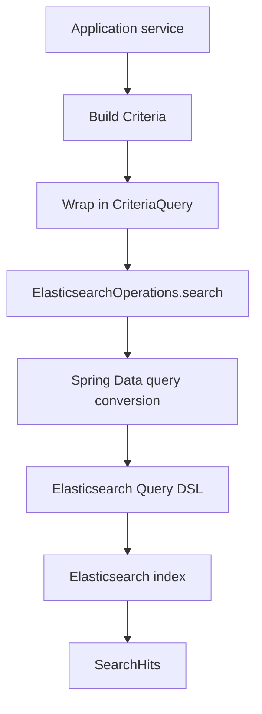

# Criteria và CriteriaQuery cho điều kiện tìm kiếm bằng Java

Spring Data Elasticsearch cung cấp `Criteria` và `CriteriaQuery` để xây dựng điều kiện tìm kiếm bằng Java. Thay vì viết toàn bộ Query DSL dưới dạng JSON, ứng dụng có thể mô tả điều kiện bằng các đối tượng Java như so khớp chính xác, khoảng giá, trạng thái, từ khóa và tổ hợp AND/OR.

`Criteria` biểu diễn điều kiện trên field và cách kết hợp điều kiện. `CriteriaQuery` đóng gói cây điều kiện đó thành một đối tượng query mà `ElasticsearchOperations` có thể thực thi. Cách tiếp cận này phù hợp với những truy vấn có cấu trúc tương đối rõ và có thể được biểu diễn bằng các operator mà Criteria hỗ trợ.

Criteria không phải một bản sao đầy đủ của Elasticsearch Query DSL. Với truy vấn phức tạp như nested query, aggregation, script, function score hoặc các cấu trúc DSL chuyên biệt, nên cân nhắc `NativeQuery` hoặc API Elasticsearch Java Client. Chọn đúng abstraction giúp code dễ đọc mà vẫn giữ được khả năng kiểm soát truy vấn.

## 1. Criteria và CriteriaQuery trong kiến trúc Spring Data

Giả sử ứng dụng quản lý danh mục sản phẩm. Người dùng có thể lọc sản phẩm theo trạng thái, category, giá tối đa, từ khóa tên và sắp xếp kết quả theo giá.

Luồng thực thi:



Các thành phần có vai trò khác nhau:

| Thành phần | Trách nhiệm |
|---|---|
| `Criteria` | Biểu diễn field, operator, giá trị và quan hệ AND/OR |
| `CriteriaQuery` | Đóng gói Criteria thành query có thể thực thi; có thể kết hợp phân trang/sort |
| `ElasticsearchOperations` | Gửi query tới Elasticsearch và ánh xạ kết quả về entity |
| `SearchHits<T>` | Chứa các hit cùng metadata như tổng số hit, score và nội dung entity |

## 2. Khai báo entity và mapping trước khi xây dựng Criteria

Criteria tham chiếu tới tên field trong Elasticsearch mapping. Vì vậy, trước tiên cần biết entity và mapping đang sử dụng.

```java
import org.springframework.data.annotation.Id;
import org.springframework.data.elasticsearch.annotations.Document;
import org.springframework.data.elasticsearch.annotations.Field;
import org.springframework.data.elasticsearch.annotations.FieldType;

@Document(indexName = "products")
public class Product {

    @Id
    private String id;

    @Field(type = FieldType.Keyword)
    private String sku;

    @Field(type = FieldType.Text)
    private String name;

    @Field(type = FieldType.Keyword)
    private String category;

    @Field(type = FieldType.Keyword)
    private String status;

    @Field(type = FieldType.Double)
    private Double price;

    @Field(type = FieldType.Boolean)
    private Boolean available;

    protected Product() {
    }

    // Constructors and accessors omitted for brevity.
}
```

Mapping tương ứng có thể là:

```json
PUT /products
{
  "mappings": {
    "properties": {
      "sku": { "type": "keyword" },
      "name": { "type": "text" },
      "category": { "type": "keyword" },
      "status": { "type": "keyword" },
      "price": { "type": "double" },
      "available": { "type": "boolean" }
    }
  }
}
```

Tên field trong Criteria phải khớp với field mapping. Nếu entity có thuộc tính Java `productStatus` nhưng được ánh xạ thành `status`, Criteria cần tham chiếu tới tên field Elasticsearch mà Spring Data sử dụng theo metadata, không nên tùy tiện lấy tên Java rồi giả định tên hai bên luôn giống nhau.

## 3. Tạo Criteria cơ bản

`Criteria` thuộc package `org.springframework.data.elasticsearch.core.query`. Có thể tạo Criteria cho một field bằng constructor nhận tên field:

```java
import org.springframework.data.elasticsearch.core.query.Criteria;

Criteria criteria = new Criteria("status").is("ACTIVE");
```

Điều kiện trên yêu cầu field `status` có giá trị `ACTIVE`. Có thể tạo Criteria cho các kiểu dữ liệu khác:

```java
Criteria byCategory = new Criteria("category").is("keyboard");

Criteria byPrice = new Criteria("price").lessThanEqual(500000);

Criteria available = new Criteria("available").is(true);
```

Các biểu thức trên mô tả điều kiện; chúng chưa gửi request tới Elasticsearch. Muốn thực thi, cần tạo `CriteriaQuery` và gọi `ElasticsearchOperations`.

## 4. Các operator thường dùng

Criteria hỗ trợ nhiều kiểu điều kiện phổ biến. Cách dùng cần phù hợp với mapping của field.

### 4.1 So khớp chính xác với `is`

`is(value)` biểu diễn điều kiện field bằng giá trị đã cho:

```java
Criteria criteria = new Criteria("status").is("ACTIVE");
```

Với field `keyword`, `is` thường phù hợp cho so khớp chính xác như trạng thái, category, SKU hoặc mã định danh. Với field `text`, semantics phụ thuộc cách Criteria chuyển điều kiện và mapping/analyzer; không nên coi `is` là tìm kiếm toàn văn. Để tìm nội dung text, thường dùng operator tìm kiếm như `matches`.

### 4.2 Phủ định với `isNot` hoặc `not`

Có thể biểu diễn điều kiện không bằng một giá trị:

```java
Criteria criteria = new Criteria("status").isNot("DELETED");
```

Hoặc sử dụng phủ định theo cú pháp Criteria được phiên bản hỗ trợ:

```java
Criteria criteria = new Criteria("status").not().is("DELETED");
```

Hãy chọn một cách viết nhất quán theo API phiên bản dự án. Phủ định thường có semantics khác với field không tồn tại hoặc có giá trị null. Nếu cần kiểm tra sự tồn tại của field, dùng `exists()`/`doesNotExist()` theo API Criteria.

### 4.3 So sánh lớn hơn và nhỏ hơn

Với field số hoặc ngày, có thể sử dụng:

```java
Criteria minPrice = new Criteria("price").greaterThan(100000);

Criteria maxPrice = new Criteria("price").lessThan(500000);

Criteria minOrEqual = new Criteria("price").greaterThanEqual(100000);

Criteria maxOrEqual = new Criteria("price").lessThanEqual(500000);
```

Các operator tương ứng với điều kiện range. Field cần có kiểu phù hợp, ví dụ `double`, `long` hoặc `date`. Nếu `price` được mapping là `keyword`, so sánh có thể không có semantics số như mong muốn.

### 4.4 Khoảng giá với `between`

Để tìm giá trong một khoảng:

```java
Criteria priceRange = new Criteria("price").between(100000, 500000);
```

`between` diễn đạt điều kiện khoảng theo semantics của Criteria. Nếu nghiệp vụ cần phân biệt rõ biên bao gồm hay không bao gồm, hãy kiểm tra operator được chọn và query sinh ra; có thể dùng `greaterThan`, `greaterThanEqual`, `lessThan` hoặc `lessThanEqual` để diễn đạt rõ từng biên.

Ví dụ khoảng mở ở hai đầu:

```java
Criteria priceRange = new Criteria("price")
    .greaterThan(100000)
    .lessThan(500000);
```

### 4.5 Tập giá trị với `in` và `notIn`

Khi field có thể nhận một trong nhiều giá trị:

```java
Criteria categories = new Criteria("category")
    .in("keyboard", "mouse", "monitor");
```

Hoặc truyền collection:

```java
List<String> statuses = List.of("ACTIVE", "FEATURED");
Criteria statusCriteria = new Criteria("status").in(statuses);
```

Để loại trừ một tập giá trị, dùng operator `notIn` nếu phù hợp với phiên bản:

```java
Criteria excluded = new Criteria("status").notIn("DELETED", "ARCHIVED");
```

Với collection đầu vào rỗng, hãy xác định rõ ý nghĩa nghiệp vụ trước khi tạo Criteria. Một tập rỗng có thể có nghĩa “không lọc”, “không có kết quả” hoặc “đầu vào không hợp lệ”; đừng để semantics phụ thuộc vào cách framework xử lý một danh sách rỗng.

### 4.6 Tìm kiếm toàn văn với `matches`

Với field `text`, dùng operator tìm kiếm phù hợp:

```java
Criteria nameCriteria = new Criteria("name").matches("mechanical keyboard");
```

`matches` biểu diễn tìm kiếm theo nội dung và thường được chuyển thành match query. Analyzer của field và analyzer truy vấn ảnh hưởng tới token được so khớp.

Đừng nhầm `matches` với so sánh bằng chính xác toàn bộ chuỗi. Tìm kiếm text thường dựa trên token, relevance và analyzer. Nếu cần exact match cho tên chuẩn hóa, có thể cần multi-field `keyword` hoặc một field keyword riêng.

### 4.7 `contains`, `startsWith` và `endsWith`

Criteria có các operator chuỗi như `contains`, `startsWith` và `endsWith` trong API được hỗ trợ. Chúng thường được dùng để biểu diễn điều kiện chuỗi/pattern, nhưng semantics và query được sinh ra phụ thuộc loại field và phiên bản.

```java
Criteria contains = new Criteria("sku").contains("1001");

Criteria prefix = new Criteria("sku").startsWith("SKU-");

Criteria suffix = new Criteria("sku").endsWith("1001");
```

Với field `keyword`, prefix/suffix hoặc contains có thể dẫn tới truy vấn pattern/wildcard. Wildcard ở đầu chuỗi có thể tốn tài nguyên trên index lớn. Nếu nhu cầu tìm kiếm là prefix thường xuyên, hãy cân nhắc mapping/analyzer phù hợp như edge n-gram hoặc một field search riêng.

Không dùng các operator chuỗi như thể chúng là thao tác substring trên một `String` Java trong bộ nhớ. Chúng được thực thi bởi Elasticsearch theo semantics của query được tạo.

### 4.8 Kiểm tra field tồn tại

Có thể diễn đạt điều kiện field tồn tại hoặc không tồn tại:

```java
Criteria hasDescription = new Criteria("description").exists();

Criteria missingDescription = new Criteria("description").doesNotExist();
```

Field không tồn tại trong `_source`, field có giá trị null và field không được index có thể có những khác biệt tùy mapping và cách ghi document. Nếu logic nghiệp vụ phụ thuộc chính xác vào trạng thái null/missing, cần xác định cách dữ liệu được serialize và query trực tiếp để xác nhận.

## 5. Kết hợp nhiều điều kiện bằng AND

Mặc định, các điều kiện nối bằng `and` yêu cầu document thỏa tất cả điều kiện.

Ví dụ tìm sản phẩm đang hoạt động, còn hàng và có giá không quá 500.000:

```java
Criteria criteria = new Criteria("status").is("ACTIVE")
    .and("available").is(true)
    .and("price").lessThanEqual(500000);
```

Có thể xây dựng điều kiện từ nhiều Criteria riêng:

```java
Criteria status = new Criteria("status").is("ACTIVE");
Criteria availability = new Criteria("available").is(true);
Criteria price = new Criteria("price").lessThanEqual(500000);

Criteria criteria = status.and(availability).and(price);
```

Cách tách biến giúp code dễ đọc hơn khi mỗi điều kiện được xây dựng từ logic riêng. Khi viết query động, chỉ thêm điều kiện khi input thực sự có giá trị và đã được validate.

## 6. Kết hợp điều kiện bằng OR

`or` biểu diễn điều kiện thay thế: document thỏa một nhánh có thể được chọn.

Ví dụ tìm sản phẩm có trạng thái ACTIVE hoặc FEATURED:

```java
Criteria criteria = new Criteria("status").is("ACTIVE")
    .or("status").is("FEATURED");
```

Hoặc xây dựng các nhánh Criteria riêng:

```java
Criteria active = new Criteria("status").is("ACTIVE");
Criteria featured = new Criteria("status").is("FEATURED");

Criteria criteria = active.or(featured);
```

Khi có cả AND và OR, cần chủ động nhóm điều kiện để biểu đạt đúng ý nghĩa nghiệp vụ. Ví dụ yêu cầu:

`category = keyboard AND (status = ACTIVE OR status = FEATURED)`

có thể diễn đạt bằng một Criteria cho nhóm trạng thái rồi kết hợp với category:

```java
Criteria statusGroup = new Criteria("status").is("ACTIVE")
    .or(new Criteria("status").is("FEATURED"));

Criteria criteria = new Criteria("category").is("keyboard")
    .and(statusGroup);
```

Với query có nhiều tầng điều kiện, hãy chia thành các biến có tên thể hiện nhóm logic. Đừng viết một chuỗi dài mà người đọc khó xác định điều kiện nào thuộc cùng một nhóm.

### 6.1 Kiểm tra logic boolean

Giả sử điều kiện cần là:

```text
(category = keyboard)
AND
(status = ACTIVE OR status = FEATURED)
AND
(price <= 500000)
```

Trước khi thực thi, hãy diễn đạt điều kiện thành biểu thức logic hoặc bảng quyết định. Một sai lầm phổ biến là nối mọi Criteria bằng `or`, khiến kết quả rộng hơn mong đợi; hoặc nối mọi điều kiện bằng `and`, khiến kết quả rỗng vì các giá trị loại trừ nhau.

Criteria cung cấp cách ghép điều kiện trong Java, nhưng người viết vẫn chịu trách nhiệm về logic boolean cuối cùng. Khi truy vấn quan trọng, hãy xác nhận query được sinh ra hoặc chạy test integration với dữ liệu có cả trường hợp đúng và sai.

## 7. Tạo CriteriaQuery và thực thi bằng ElasticsearchOperations

Sau khi có Criteria, tạo `CriteriaQuery`:

```java
import org.springframework.data.elasticsearch.core.query.Criteria;
import org.springframework.data.elasticsearch.core.query.CriteriaQuery;

Criteria criteria = new Criteria("status").is("ACTIVE")
    .and("available").is(true)
    .and("price").lessThanEqual(500000);

CriteriaQuery query = new CriteriaQuery(criteria);
```

Thực thi qua `ElasticsearchOperations`:

```java
import org.springframework.data.elasticsearch.core.ElasticsearchOperations;
import org.springframework.data.elasticsearch.core.SearchHits;

public class ProductSearchService {

    private final ElasticsearchOperations operations;

    public ProductSearchService(ElasticsearchOperations operations) {
        this.operations = operations;
    }

    public SearchHits<Product> findAvailableProducts() {
        Criteria criteria = new Criteria("status").is("ACTIVE")
            .and("available").is(true)
            .and("price").lessThanEqual(500000);

        CriteriaQuery query = new CriteriaQuery(criteria);
        return operations.search(query, Product.class);
    }
}
```

`operations.search(query, Product.class)` gửi query tới index được xác định bởi metadata entity `Product` và chuyển mỗi hit thành `Product`. `SearchHits<Product>` chứa nhiều thông tin hơn một danh sách entity, chẳng hạn tổng số hit và score.

Nếu chỉ cần danh sách entity, có thể chuyển từ `SearchHits`:

```java
List<Product> products = operations.search(query, Product.class)
    .getSearchHits()
    .stream()
    .map(SearchHit::getContent)
    .toList();
```

## 8. Phân trang và sắp xếp

CriteriaQuery có thể kết hợp với `Pageable` để giới hạn số kết quả và chọn thứ tự.

```java
import org.springframework.data.domain.PageRequest;
import org.springframework.data.domain.Sort;

Criteria criteria = new Criteria("status").is("ACTIVE");
CriteriaQuery query = new CriteriaQuery(criteria);

query.setPageable(PageRequest.of(
    0,
    20,
    Sort.by(Sort.Order.asc("price"))
));

SearchHits<Product> hits = operations.search(query, Product.class);
```

`PageRequest.of(0, 20, ...)` yêu cầu trang đầu tiên với tối đa 20 kết quả, sắp xếp theo giá tăng dần. Chỉ số trang bắt đầu từ 0.

Field được dùng để sort phải hỗ trợ sort theo mapping. Với `text`, thường cần sort trên multi-field `keyword` thay vì field text đã phân tích. Với số và ngày, dùng field có kiểu số/ngày tương ứng.

### 8.1 Phân trang theo input

Một service có thể nhận page và size từ request, nhưng cần giới hạn size tối đa:

```java
int page = Math.max(requestedPage, 0);
int size = Math.min(Math.max(requestedSize, 1), 100);

Pageable pageable = PageRequest.of(
    page,
    size,
    Sort.by(Sort.Direction.DESC, "price")
);

CriteriaQuery query = new CriteriaQuery(criteria);
query.setPageable(pageable);
```

Không nhận trực tiếp một size tùy ý từ client mà không giới hạn. Kết quả quá lớn có thể làm tăng network, heap và thời gian xử lý.

### 8.2 Offset pagination có giới hạn

Pageable thường sử dụng offset (`from`) và `size`. Khi truy vấn sâu, Elasticsearch phải xử lý các kết quả trước đó để tạo trang sau, có thể tốn tài nguyên. Với tập kết quả rất lớn hoặc cuộn dài, hãy cân nhắc `search_after` và point in time theo khả năng phiên bản. CriteriaQuery không nhất thiết là abstraction phù hợp cho mọi kiểu pagination nâng cao.

## 9. Xây dựng Criteria động từ bộ lọc tùy chọn

Trong API tìm kiếm, người dùng có thể chỉ nhập một vài bộ lọc. Không nên thêm điều kiện với giá trị null hoặc chuỗi rỗng nếu điều đó không có ý nghĩa nghiệp vụ.

Ví dụ request:

```java
public record ProductSearchRequest(
    String category,
    String status,
    Double minPrice,
    Double maxPrice,
    Boolean available,
    String keyword
) {
}
```

Một cách dễ kiểm soát là xây dựng danh sách điều kiện rồi kết hợp chúng:

```java
List<Criteria> filters = new ArrayList<>();

if (request.category() != null && !request.category().isBlank()) {
    filters.add(new Criteria("category").is(request.category()));
}

if (request.status() != null && !request.status().isBlank()) {
    filters.add(new Criteria("status").is(request.status()));
}

if (request.minPrice() != null) {
    filters.add(new Criteria("price").greaterThanEqual(request.minPrice()));
}

if (request.maxPrice() != null) {
    filters.add(new Criteria("price").lessThanEqual(request.maxPrice()));
}

if (request.available() != null) {
    filters.add(new Criteria("available").is(request.available()));
}

if (request.keyword() != null && !request.keyword().isBlank()) {
    filters.add(new Criteria("name").matches(request.keyword().trim()));
}

if (filters.isEmpty()) {
    throw new IllegalArgumentException("At least one search filter is required");
}

Criteria criteria = filters.get(0);

for (int i = 1; i < filters.size(); i++) {
    criteria = criteria.and(filters.get(i));
}
```

Ví dụ trên chọn chính sách yêu cầu ít nhất một filter. Nếu nghiệp vụ cho phép tìm kiếm không có filter, hãy xử lý trường hợp đó riêng bằng query match-all hoặc API phù hợp với phiên bản; không tạo một điều kiện giả trên field không liên quan chỉ để khởi tạo Criteria.

## 10. Criteria và mapping: chọn operator đúng field type

Criteria được chuyển thành query Elasticsearch; mapping quyết định semantics của field. Một operator hợp lệ về cú pháp Java vẫn có thể không phù hợp với kiểu field.

| Field mapping | Nhu cầu | Hướng dùng |
|---|---|---|
| `keyword` | So khớp chính xác trạng thái/mã | `is`, `in`, `notIn` |
| `text` | Tìm kiếm nội dung | `matches` hoặc query text phù hợp |
| `double`, `long`, `integer` | So sánh số/khoảng | `greaterThan`, `lessThan`, `between` |
| `date` | Lọc khoảng thời gian | Range operator với kiểu ngày phù hợp |
| `boolean` | Lọc cờ trạng thái | `is(true/false)` |

### 10.1 `text` không giống `keyword`

Field `text` thường được analyzer tách thành token. Query theo nội dung nên dùng operator tìm kiếm toàn văn. Field `keyword` giữ giá trị như một term chính xác và phù hợp với filter/sort/aggregation.

Ví dụ nếu `name` có mapping `text` và `status` có mapping `keyword`:

```java
Criteria criteria = new Criteria("name").matches("mechanical keyboard")
    .and("status").is("ACTIVE");
```

Không dùng `is("mechanical keyboard")` trên `text` với kỳ vọng nó tự tìm mọi document chứa các từ. Nếu cần tìm kiếm chính xác chuỗi tên, hãy thiết kế multi-field `keyword` và query đúng sub-field.

### 10.2 Date và timezone

Với field `date`, truyền giá trị có kiểu và định dạng tương thích với mapping. Cần thống nhất timezone và phân biệt `LocalDate`, `LocalDateTime`, `Instant` hoặc `OffsetDateTime`. Một khoảng thời gian theo ngày lịch có thể cần được chuyển thành thời điểm bắt đầu và kết thúc theo timezone nghiệp vụ trước khi tạo Criteria.

Ví dụ ý tưởng:

```java
Criteria dateRange = new Criteria("createdAt")
    .greaterThanEqual(startInstant)
    .lessThan(endInstant);
```

Đảm bảo kiểu Java được Spring Data converter hỗ trợ và mapping date trên index có format phù hợp.

## 11. Kết quả tìm kiếm: SearchHits

`ElasticsearchOperations.search(...)` thường trả về `SearchHits<T>`, không phải trực tiếp `List<T>`. Mỗi `SearchHit<T>` chứa entity cùng metadata của kết quả tìm kiếm.

```java
SearchHits<Product> searchHits = operations.search(query, Product.class);

long total = searchHits.getTotalHits();

for (SearchHit<Product> hit : searchHits) {
    Product product = hit.getContent();
    float score = hit.getScore();

    System.out.println(product.getName() + " score=" + score);
}
```

Các metadata hữu ích gồm:

- `getContent()`: entity được ánh xạ từ `_source`.
- `getScore()`: relevance score nếu query có scoring.
- `getId()`: document ID.
- `getIndex()`: index chứa hit.
- `getTotalHits()`: tổng số hit theo response và total-hit tracking.

Nếu chỉ cần entity, có thể map `SearchHit::getContent`. Nếu cần score, ID hoặc index nguồn, giữ lại `SearchHits`/`SearchHit` thay vì chuyển ngay thành entity list.

## 12. Tổ chức Criteria trong service

Để code dễ kiểm thử, nên tách việc tạo Criteria khỏi việc thực thi query. Ví dụ:

```java
import org.springframework.data.domain.PageRequest;
import org.springframework.data.domain.Sort;
import org.springframework.data.elasticsearch.core.ElasticsearchOperations;
import org.springframework.data.elasticsearch.core.SearchHits;
import org.springframework.data.elasticsearch.core.query.Criteria;
import org.springframework.data.elasticsearch.core.query.CriteriaQuery;

public class ProductSearchService {

    private final ElasticsearchOperations operations;

    public ProductSearchService(ElasticsearchOperations operations) {
        this.operations = operations;
    }

    public SearchHits<Product> search(String category, Double maxPrice) {
        Criteria criteria = new Criteria("status").is("ACTIVE");

        if (category != null && !category.isBlank()) {
            criteria = criteria.and("category").is(category);
        }

        if (maxPrice != null) {
            criteria = criteria.and("price").lessThanEqual(maxPrice);
        }

        CriteriaQuery query = new CriteriaQuery(criteria);
        query.setPageable(PageRequest.of(
            0,
            20,
            Sort.by(Sort.Direction.ASC, "price")
        ));

        return operations.search(query, Product.class);
    }
}
```

Ở đây điều kiện `status = ACTIVE` luôn được áp dụng. Category và maxPrice chỉ được thêm khi người dùng cung cấp. Page size được giới hạn ở 20 và sort theo `price`.

Nếu bộ lọc có nhiều nhóm AND/OR hoặc logic có thể thay đổi theo role người dùng, hãy tạo các hàm nhỏ như `buildStatusCriteria`, `buildPriceCriteria` và `buildTextCriteria`. Tên hàm nên phản ánh ý nghĩa nghiệp vụ thay vì chỉ tên operator.

## 13. Khi nào CriteriaQuery không đủ?

CriteriaQuery phù hợp với truy vấn có thể biểu diễn bằng tập operator của Criteria. Tuy nhiên, Elasticsearch Query DSL có nhiều tính năng mà Criteria không bao phủ hoặc không diễn đạt thuận tiện.

Nên cân nhắc `NativeQuery`/Java Client khi cần:

- Nested query phức tạp, nested sort hoặc `inner_hits`.
- Aggregation nhiều tầng, pipeline aggregation hoặc composite aggregation.
- Script query, script score hoặc function score.
- Highlight, collapse, rescore hoặc các tùy chọn search chuyên biệt.
- Query DSL cần kiểm soát chính xác `bool`, `minimum_should_match`, `dis_max` hoặc cấu trúc lồng nhau phức tạp.
- Các tính năng Elasticsearch mới chưa được Criteria API của phiên bản Spring Data hỗ trợ.

Criteria không làm mất khả năng mở rộng của Spring Data; nó là một abstraction tiện dụng cho một phạm vi truy vấn nhất định. Có thể dùng Criteria cho phần filter đơn giản và `NativeQuery` cho một endpoint tìm kiếm nâng cao khác.

Ví dụ với API Java Client hiện đại, một native query có thể được xây dựng theo builder tương ứng với phiên bản Spring Data:

```java
import org.springframework.data.elasticsearch.client.elc.NativeQuery;
import org.springframework.data.elasticsearch.core.query.Query;

Query query = NativeQuery.builder()
    .withQuery(q -> q.bool(b -> b
        .filter(f -> f.term(t -> t
            .field("status")
            .value("ACTIVE")
        ))
        .filter(f -> f.range(r -> r
            .number(n -> n
                .field("price")
                .lte(500000)
            )
        ))
    ))
    .build();
```

Đây là phong cách API dùng Elasticsearch Java Client hiện đại; package và builder cụ thể phụ thuộc phiên bản Spring Data Elasticsearch/client. Hãy dùng dependency version được Spring Boot quản lý và tham khảo Javadoc tương ứng.

## 14. Kiểm thử CriteriaQuery

Criteria builder có thể được kiểm thử bằng integration test với Elasticsearch thật hoặc môi trường test tương thích. Điều cần xác nhận không chỉ là code Java tạo được query, mà còn là query có semantics đúng trên mapping và dữ liệu thực tế.

Một tập dữ liệu test nên có các trường hợp:

- Sản phẩm ACTIVE, đúng category và dưới maxPrice.
- Sản phẩm ACTIVE nhưng vượt maxPrice.
- Sản phẩm INACTIVE nhưng đúng category/price.
- Sản phẩm khác category.
- Field optional không tồn tại hoặc null theo semantics của ứng dụng.
- Tên có nhiều token để xác nhận `matches` và analyzer.

Kiểm tra:

1. Kết quả thỏa toàn bộ điều kiện AND.
2. Nhánh OR trả về đúng tập kết quả.
3. Khoảng số xử lý đúng biên inclusive/exclusive.
4. Sort đúng với mapping.
5. Pageable trả về đúng trang và kích thước.
6. Field text và keyword được query đúng operator.
7. Khi không có filter, hành vi được định nghĩa rõ.

Nếu kết quả không đúng, chạy query DSL tương đương trực tiếp trên Elasticsearch và kiểm tra mapping bằng `GET /index/_mapping`. Điều này giúp phân biệt lỗi ở logic Criteria, mapping field hay dữ liệu đầu vào.

## 15. Những lỗi thường gặp

### 15.1 Dùng sai tên field

Criteria tham chiếu tới field Elasticsearch. Nếu mapping dùng `product_status` nhưng code query `productStatus`, query có thể không trả kết quả như mong muốn. Kiểm tra mapping và tên field sau conversion.

### 15.2 Dùng exact match cho field text

Field `text` được phân tích bởi analyzer. So khớp chính xác thường phù hợp với `keyword`. Dùng `matches` cho tìm kiếm nội dung text và `is` cho giá trị exact theo mapping.

### 15.3 Nhầm AND và OR

Một điều kiện OR đặt sai nhóm có thể mở rộng kết quả ngoài ý muốn. Chia nhóm Criteria thành biến riêng và viết rõ biểu thức logic trước khi thực thi.

### 15.4 Thêm filter null hoặc rỗng

Nếu request không cung cấp category, không nên tạo `category.is(null)` trừ khi nghiệp vụ thực sự muốn tìm field null. Chỉ thêm Criteria khi input hợp lệ và có ý nghĩa.

### 15.5 Không giới hạn page size

Page size lớn có thể tạo response nặng. Giới hạn size ở tầng API và cân nhắc cursor/search_after khi truy vấn sâu.

### 15.6 Dùng Criteria cho query quá phức tạp

Nếu phải lách Criteria để biểu diễn nested query, aggregation hoặc DSL nâng cao, chuyển sang `NativeQuery`/Java Client sẽ rõ ràng hơn.

### 15.7 Giả định Criteria tự sửa mapping

Criteria chỉ mô tả query. Nó không tạo field, đổi field type hoặc chuyển đổi dữ liệu trong index. Mapping cần được quản lý riêng.

## 16. Nguyên tắc sử dụng

- Dùng `Criteria` để mô tả điều kiện field bằng Java.
- Dùng `CriteriaQuery` để đóng gói điều kiện trước khi gọi `ElasticsearchOperations`.
- Chọn operator theo mapping: exact match cho keyword, full-text match cho text, range cho số/ngày.
- Tách nhóm AND/OR thành các biến có tên rõ nghĩa.
- Chỉ thêm điều kiện động khi input hợp lệ và có ý nghĩa.
- Dùng `Pageable` và sort có giới hạn; field sort phải hỗ trợ sort trong mapping.
- Đọc `SearchHits<T>` khi cần score, ID và metadata; chuyển thành entity list khi chỉ cần nội dung.
- Xác nhận query trên dữ liệu test đại diện và mapping thật.
- Dùng `NativeQuery`/Java Client khi cần DSL nâng cao mà Criteria không diễn đạt tốt.

## 17. Tổng kết

`Criteria` là API Java để mô tả điều kiện trên field và kết hợp các điều kiện bằng AND/OR. `CriteriaQuery` đóng gói Criteria thành query mà `ElasticsearchOperations` có thể thực thi. Với các operator như `is`, `in`, `between`, `greaterThan`, `lessThan`, `matches` và kiểm tra tồn tại, ứng dụng có thể xây dựng nhiều bộ lọc CRUD/search phổ biến mà không cần viết JSON DSL trực tiếp.

Khi xây dựng truy vấn, mapping vẫn là nền tảng quyết định semantics. `keyword` phù hợp cho exact match, `text` cho tìm kiếm toàn văn, số/ngày cho range và sort. Nhóm điều kiện AND/OR cần được thể hiện rõ để tránh sai logic; bộ lọc tùy chọn cần được thêm có chủ đích; phân trang cần giới hạn. Với nested query, aggregation và DSL phức tạp, hãy dùng abstraction query mạnh hơn như `NativeQuery` thay vì cố ép mọi yêu cầu vào Criteria.

## Tài liệu tham khảo

- [Spring Data Elasticsearch Reference — Search Operations](https://docs.spring.io/spring-data/elasticsearch/reference/elasticsearch/template.html)
- [Spring Data Elasticsearch Reference — Query Methods](https://docs.spring.io/spring-data/elasticsearch/reference/elasticsearch/repositories/elasticsearch-repositories.html)
- [Spring Data Elasticsearch API — Criteria](https://docs.spring.io/spring-data/elasticsearch/docs/current/api/org/springframework/data/elasticsearch/core/query/Criteria.html)
- [Spring Data Elasticsearch API — CriteriaQuery](https://docs.spring.io/spring-data/elasticsearch/docs/current/api/org/springframework/data/elasticsearch/core/query/CriteriaQuery.html)
