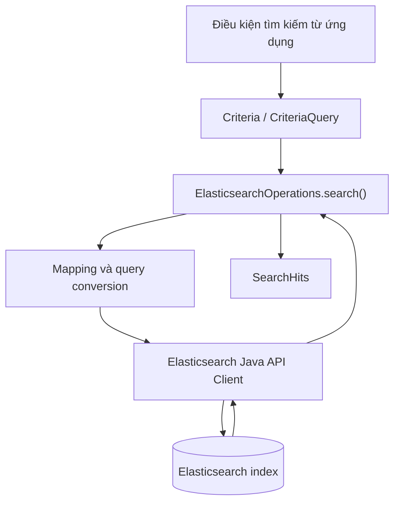
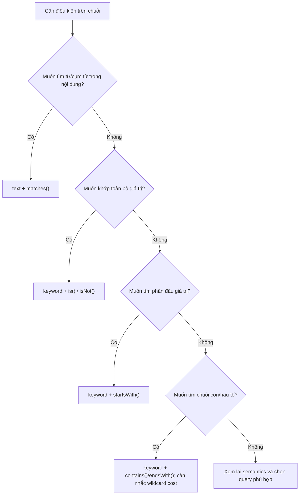

# Điều kiện chuỗi và sự phụ thuộc vào mapping

`CriteriaQuery` trong Spring Data Elasticsearch cho phép ghép các điều kiện tìm kiếm bằng Java API thay vì tự viết toàn bộ Query DSL. Khi điều kiện làm việc với chuỗi, kết quả phụ thuộc trực tiếp vào **mapping** của field: `text` được phân tích thành token, `keyword` giữ giá trị như một term, analyzer có thể đổi chữ hoa/thường hoặc tách từ, còn normalizer chuẩn hóa một giá trị keyword.

Vì vậy, cùng một biểu thức Criteria có thể cho kết quả khác nhau khi field được mapping là `text` hay `keyword`. Muốn dùng Criteria đúng, cần hiểu mỗi predicate biểu đạt điều gì, nó phù hợp với kiểu field nào và Elasticsearch đã index dữ liệu ra sao.

## 1. CriteriaQuery nằm ở đâu trong Spring Data Elasticsearch?

Spring Data Elasticsearch cung cấp `ElasticsearchOperations` để thực thi các truy vấn. `CriteriaQuery` là một loại `Query`, được xây dựng từ các đối tượng `Criteria`.

Luồng cơ bản:



`Criteria` mô tả điều kiện theo field và toán tử. `CriteriaQuery` đóng gói điều kiện đó thành query mà Operations có thể thực thi. Operations chuyển query theo mapping context, gọi Elasticsearch và ánh xạ kết quả thành entity Java.

Ví dụ tối thiểu:

```java
import org.springframework.data.elasticsearch.core.query.Criteria;
import org.springframework.data.elasticsearch.core.query.CriteriaQuery;
import org.springframework.data.elasticsearch.core.query.Query;

Criteria criteria = Criteria.where("category").is("audio");
Query query = new CriteriaQuery(criteria);

SearchHits<ProductDocument> hits = operations.search(
    query,
    ProductDocument.class
);
```

Ví dụ dùng `is` để lọc một giá trị category. Để hiểu vì sao truy vấn này hoạt động như mong đợi, trước tiên cần xem field `category` được mapping thế nào.

## 2. Mapping quyết định ý nghĩa của điều kiện chuỗi

Giả sử document sản phẩm có các field:

```json
{
  "name": "Wireless Headphones",
  "category": "Audio Equipment",
  "sku": "WH-1001"
}
```

Ba field đều là chuỗi trong JSON, nhưng cách sử dụng khác nhau:

| Field | Cách dùng | Mapping phù hợp |
|---|---|---|
| `name` | Tìm theo từ hoặc cụm từ trong tên | `text` |
| `category` | Lọc chính xác theo danh mục | `keyword` |
| `sku` | Tìm chính xác mã sản phẩm | `keyword` |

### 2.1. `text` được phân tích thành token

Field `text` dùng analyzer khi index nội dung và khi thực hiện truy vấn full-text phù hợp. Analyzer có thể lowercase, tách từ, xử lý dấu câu hoặc áp dụng các token filter khác.

Ví dụ analyzer tiêu chuẩn có thể biến:

```text
Input:  "Wireless Headphones"
Tokens: ["wireless", "headphones"]
```

Elasticsearch lập chỉ mục các token, không lưu một term duy nhất có nội dung nguyên văn `Wireless Headphones` cho field `text`. Vì vậy, `match` với từ `wireless` có thể tìm thấy document; truy vấn exact term với cả cụm nguyên văn thường không khớp vì term đó không tồn tại trong inverted index.

### 2.2. `keyword` giữ giá trị thành một term

Field `keyword` được index như một giá trị nguyên vẹn. Với chuỗi `Audio Equipment`, term được lưu là toàn bộ giá trị đó (sau normalizer nếu được cấu hình), không chia thành hai token `audio` và `equipment`.

Đây là lựa chọn phù hợp cho exact filter, sort, aggregation, SKU, trạng thái và danh mục. Nếu cần tìm toàn văn trong một field `keyword`, cần hiểu rằng query không tự có hành vi tách từ như trên field `text`.

### 2.3. Khai báo mapping trong Spring Data

```java
import org.springframework.data.annotation.Id;
import org.springframework.data.elasticsearch.annotations.Document;
import org.springframework.data.elasticsearch.annotations.Field;
import org.springframework.data.elasticsearch.annotations.FieldType;
import org.springframework.data.elasticsearch.annotations.InnerField;
import org.springframework.data.elasticsearch.annotations.MultiField;

@Document(indexName = "products")
public class ProductDocument {

    @Id
    private String id;

    @MultiField(
        mainField = @Field(type = FieldType.Text, analyzer = "standard"),
        otherFields = {
            @InnerField(suffix = "raw", type = FieldType.Keyword)
        }
    )
    private String name;

    @Field(type = FieldType.Keyword)
    private String category;

    @Field(type = FieldType.Keyword)
    private String sku;

    protected ProductDocument() {
    }
}
```

Trong ví dụ:

- `name` là field `text` để full-text search.
- `name.raw` là multi-field kiểu `keyword` để exact matching hoặc sort.
- `category` và `sku` là `keyword` vì được dùng như giá trị phân loại/định danh.

Multi-field không yêu cầu thêm thuộc tính Java. Cùng một giá trị `name` được index theo nhiều cách để phục vụ nhiều kiểu truy vấn.

## 3. Các predicate chuỗi thường dùng trong Criteria

Criteria API cung cấp các điều kiện chuỗi như `is`, `isNot`, `matches`, `contains`, `startsWith`, `endsWith` và `expression`. Tên method mô tả ý định, nhưng mapping vẫn quyết định Elasticsearch so khớp với term hay token nào.

| Predicate | Ý nghĩa ở mức ứng dụng | Mapping thường phù hợp |
|---|---|---|
| `is(value)` | Giá trị khớp chính xác | `keyword` hoặc field có term semantics phù hợp |
| `isNot(value)` | Loại trừ giá trị khớp chính xác | `keyword` |
| `matches(text)` | Full-text match theo analyzer | `text` |
| `contains(text)` | Tìm chuỗi con theo semantics wildcard/contains của Criteria | Thường là `keyword` khi cần substring của toàn giá trị; cân nhắc chi phí |
| `startsWith(prefix)` | Tìm giá trị bắt đầu bằng prefix | Thường là `keyword` hoặc field được thiết kế cho prefix |
| `endsWith(suffix)` | Tìm giá trị kết thúc bằng suffix | `keyword`, thường cần wildcard-style matching |
| `expression(query)` | Diễn đạt query string theo cú pháp query parser | Field và cú pháp phải được xác định rõ |

Các predicate có thể được chuyển thành những loại query Elasticsearch khác nhau. Chi tiết chuyển đổi, escaping và các overload được hỗ trợ có thể thay đổi theo phiên bản Spring Data Elasticsearch. Khi cần semantics chính xác, hãy đối chiếu API/Javadoc của dependency dự án và kiểm tra request thực tế trong integration test.

## 4. `is`: so khớp chính xác và tác động của `text`

`is(value)` phù hợp khi muốn tìm một giá trị chính xác. Ví dụ lọc sản phẩm theo SKU:

```java
Criteria criteria = Criteria.where("sku").is("WH-1001");
Query query = new CriteriaQuery(criteria);

SearchHits<ProductDocument> hits = operations.search(
    query,
    ProductDocument.class
);
```

Vì `sku` được mapping là `keyword`, toàn bộ chuỗi `WH-1001` được xem như một term và phù hợp với exact matching.

Nếu dùng `is` trên field `text`, cần hiểu analyzer đã tạo ra những term nào. Ví dụ field `name` chứa `Wireless Headphones` có thể được index thành `wireless` và `headphones`. Một điều kiện exact term với chuỗi `Wireless Headphones` không tương đương so sánh chuỗi `_source` theo từng ký tự và thường không khớp một term nguyên cụm. Truy vấn `is("wireless")` có thể khớp token `wireless`, nhưng đó cũng không phải là phép so sánh toàn bộ tên sản phẩm.

Khi muốn exact match toàn bộ tên, dùng multi-field `name.raw`:

```java
Criteria criteria = Criteria.where("name.raw")
    .is("Wireless Headphones");
```

Khi muốn tìm các document có category khác một giá trị, có thể dùng `isNot`:

```java
Criteria criteria = Criteria.where("category")
    .isNot("accessories");
```

Điều kiện phủ định cần được dùng cẩn thận: document thiếu field có thể có hành vi khác với document có giá trị khác. Nếu nghiệp vụ cần bao gồm hoặc loại trừ document không có field, hãy mô tả điều kiện tồn tại rõ ràng thay vì chỉ dựa vào `isNot`.

## 5. `matches`: full-text search phụ thuộc analyzer

`matches(value)` dùng khi muốn tìm văn bản theo semantics full-text. Ví dụ tìm sản phẩm có tên liên quan đến `wireless headphones`:

```java
Criteria criteria = Criteria.where("name")
    .matches("wireless headphones");

Query query = new CriteriaQuery(criteria);
SearchHits<ProductDocument> hits = operations.search(
    query,
    ProductDocument.class
);
```

Với field `name` kiểu `text`, Elasticsearch phân tích chuỗi truy vấn bằng search analyzer phù hợp rồi so khớp các token trong inverted index. Kết quả có thể bao gồm document chứa một hoặc nhiều token theo semantics của match query và cấu hình operator.

Ví dụ, analyzer lowercase có thể giúp `WIRELESS` và `wireless` được chuẩn hóa về cùng token. Tuy nhiên, kết quả còn phụ thuộc tokenizer, stop words, stemming, synonyms và search analyzer của field.

Không nên dùng `matches` để thay thế exact matching cho SKU hoặc trạng thái. Với mã định danh, dùng `is` trên field `keyword` sẽ diễn đạt đúng ý định hơn.

## 6. `startsWith`: tìm theo tiền tố

`startsWith(prefix)` hữu ích khi người dùng nhập phần đầu của mã hoặc tên cần tìm. Ví dụ tìm các SKU bắt đầu bằng `WH-`:

```java
Criteria criteria = Criteria.where("sku")
    .startsWith("WH-");

Query query = new CriteriaQuery(criteria);
SearchHits<ProductDocument> hits = operations.search(
    query,
    ProductDocument.class
);
```

Với `sku` là `keyword`, prefix được áp dụng trên term nguyên vẹn. Các mã như `WH-1001` và `WH-2002` có thể khớp, còn `XWH-1001` không khớp.

Nếu dùng trên field `text`, prefix được áp dụng trên các term đã phân tích, không phải trên toàn chuỗi gốc trong `_source`. Ví dụ tên sản phẩm có thể được token hóa thành `wireless` và `headphones`; prefix `head` có thể tác động lên token `headphones`, tùy query được sinh ra, chứ không có nghĩa chuỗi tên bắt đầu bằng `head`.

Với autocomplete hoặc prefix search có lưu lượng lớn, cần thiết kế mapping và index settings phù hợp. Prefix query có thể tốn chi phí khi field có cardinality cao hoặc index lớn; cân nhắc `index_prefixes`, edge n-gram hoặc cấu trúc search chuyên dụng nếu profiling cho thấy cần thiết.

## 7. `contains` và `endsWith`: tìm chuỗi con/hậu tố

`contains(value)` diễn đạt nhu cầu tìm giá trị có chứa một đoạn chuỗi. `endsWith(value)` diễn đạt nhu cầu tìm giá trị kết thúc bằng hậu tố.

Ví dụ tìm SKU có chứa `100`:

```java
Criteria criteria = Criteria.where("sku")
    .contains("100");

Query query = new CriteriaQuery(criteria);
SearchHits<ProductDocument> hits = operations.search(
    query,
    ProductDocument.class
);
```

Ví dụ tìm mã kết thúc bằng `001`:

```java
Criteria criteria = Criteria.where("sku")
    .endsWith("001");
```

Với field `keyword`, các điều kiện dạng contains/suffix thường được thực thi theo semantics wildcard trên toàn term. Đây là phép tìm chuỗi con của giá trị được index, không phải full-text search theo từ.

Với field `text`, wildcard hoạt động trên các term đã được analyzer tạo ra. Nó không tìm một chuỗi con tùy ý trong `_source` ban đầu. Nếu cần substring trên toàn bộ giá trị, hãy cân nhắc một multi-field `keyword` hoặc một mapping được thiết kế riêng.

### 7.1. Chi phí của wildcard

Điều kiện chứa wildcard ở đầu term, ví dụ `*100*` hoặc `*001`, có thể phải kiểm tra rất nhiều term và trở nên tốn kém trên index lớn. Không nên dùng `contains`/`endsWith` như cách tìm kiếm mặc định cho mọi field.

Hãy cân nhắc:

- Dùng `match` trên field `text` nếu mục tiêu là tìm theo từ.
- Dùng `prefix` nếu chỉ cần tìm phần đầu giá trị.
- Dùng `keyword` với wildcard khi tập dữ liệu và tần suất truy vấn cho phép.
- Dùng n-gram hoặc field type/cấu trúc chuyên dụng khi cần substring search ở quy mô lớn.
- Đặt giới hạn độ dài và tần suất cho truy vấn do người dùng nhập.

## 8. `expression`: cú pháp query string

`expression(value)` cho phép biểu đạt điều kiện theo cú pháp query string của Elasticsearch. Nó hữu ích khi ứng dụng thực sự cần các toán tử và cú pháp query parser, ví dụ kết hợp từ khóa theo cú pháp mà query string hỗ trợ.

Ví dụ khái quát:

```java
Criteria criteria = Criteria.where("name")
    .expression("wireless AND headphones");
```

Query string có cú pháp riêng cho dấu ngoặc, toán tử, wildcard, escape và field. Không nên đưa nguyên văn input người dùng vào expression mà không xác định cách xử lý ký tự đặc biệt. Người dùng có thể nhập ký tự mang ý nghĩa cú pháp và vô tình tạo truy vấn khác với mong đợi.

Nếu chỉ cần full-text search đơn giản, `matches` thường dễ hiểu hơn. Nếu cần query DSL phong phú và kiểm soát kiểu tốt, có thể cân nhắc `NativeQuery`. Dùng `expression` khi query parser là một phần rõ ràng của chức năng sản phẩm.

## 9. Ghép nhiều điều kiện bằng AND và OR

Criteria có thể ghép điều kiện để tạo query nhiều field. Ví dụ tìm sản phẩm có tên khớp `wireless`, category chính xác là `audio` và SKU bắt đầu bằng `WH-`:

```java
Criteria criteria = Criteria.where("name")
    .matches("wireless")
    .and("category").is("audio")
    .and("sku").startsWith("WH-");

Query query = new CriteriaQuery(criteria);
SearchHits<ProductDocument> hits = operations.search(
    query,
    ProductDocument.class
);
```

Các điều kiện được ghép theo AND trong chuỗi Criteria này: document phải thỏa cả ba điều kiện.

Khi cần OR, có thể tạo các nhánh Criteria riêng và kết hợp bằng API `or(...)` được hỗ trợ trong phiên bản Spring Data Elasticsearch đang dùng. Ví dụ minh họa:

```java
Criteria wireless = Criteria.where("name").matches("wireless");
Criteria bluetooth = Criteria.where("name").matches("bluetooth");

Criteria criteria = new Criteria().or(wireless).or(bluetooth);
Query query = new CriteriaQuery(criteria);
```

Với biểu thức AND/OR lồng nhau phức tạp, cần kiểm tra cấu trúc query được sinh ra để bảo đảm nhóm điều kiện đúng như logic nghiệp vụ. Nếu cấu trúc Boolean trở nên khó đọc, `NativeQuery` có thể thể hiện rõ các nhóm `must`, `should`, `filter` và `must_not` hơn.

## 10. Mapping có tên field khác tên property Java

Spring Data cho phép tên field Elasticsearch khác tên thuộc tính Java thông qua `@Field(name = ...)`:

```java
@Field(name = "product_name", type = FieldType.Text)
private String name;
```

Khi dùng query thông qua mapping context của entity, Spring Data có thể chuyển đổi property path theo metadata đã khai báo. Với CriteriaQuery, hãy dùng property path đúng theo entity và xác nhận cách ánh xạ tên field của phiên bản đang dùng. Với Query DSL dạng JSON/NativeQuery, thông thường phải tham chiếu tên field thực tế trong index, ở ví dụ này là `product_name`.

Điều này đặc biệt quan trọng khi có nested object hoặc multi-field:

```java
@MultiField(
    mainField = @Field(type = FieldType.Text),
    otherFields = {
        @InnerField(suffix = "raw", type = FieldType.Keyword)
    }
)
private String name;
```

Field con trong index là `name.raw`. Query cần nhắm đúng field con khi thực hiện exact matching hoặc sort. Không giả định `name` và `name.raw` có cùng semantics.

## 11. Normalizer và phân biệt chữ hoa/thường

Field `keyword` mặc định giữ nguyên cách viết hoa/thường. Vì vậy, exact matching trên `WH-1001` có thể khác với `wh-1001` nếu không có normalizer phù hợp.

Có thể khai báo normalizer lowercase trong index settings:

```json
PUT products
{
  "settings": {
    "analysis": {
      "normalizer": {
        "lowercase_normalizer": {
          "type": "custom",
          "filter": ["lowercase", "asciifolding"]
        }
      }
    }
  },
  "mappings": {
    "properties": {
      "category": {
        "type": "keyword",
        "normalizer": "lowercase_normalizer"
      }
    }
  }
}
```

Và tham chiếu normalizer trong entity:

```java
@Field(
    type = FieldType.Keyword,
    normalizer = "lowercase_normalizer"
)
private String category;
```

Khi index và query, giá trị keyword được chuẩn hóa theo cấu hình. Ví dụ `Audio`, `AUDIO` và `audio` có thể được chuẩn hóa về cùng dạng lowercase.

Normalizer phải được khai báo trong settings trước khi tạo index. Không thể tùy tiện đổi normalizer của field đang tồn tại bằng cách sửa annotation. Với thay đổi mapping/settings không tương thích, có thể cần tạo index mới, reindex và chuyển alias.

`asciifolding` xử lý một số ký tự có dấu về dạng ASCII tương đương. Đây không phải bộ phân đoạn từ theo ngôn ngữ. Với tiếng Việt, cần thử analyzer/normalizer trên dữ liệu thực tế để xác nhận yêu cầu tìm có dấu/không dấu và cách xử lý từ ghép.

## 12. Analyzer của `text` và sự khác biệt giữa index/search

Với field `text`, có thể cấu hình analyzer dùng khi index và `search_analyzer` dùng khi phân tích input truy vấn. Hai analyzer có thể giống hoặc khác nhau tùy use case.

Ví dụ khai báo field:

```java
@Field(
    type = FieldType.Text,
    analyzer = "standard",
    searchAnalyzer = "standard"
)
private String description;
```

Analyzer ảnh hưởng trực tiếp đến `matches` và các query full-text. Nếu index analyzer lowercase nhưng search analyzer không chuẩn hóa tương ứng, kết quả có thể khác kỳ vọng. Nếu dùng synonym, stemming hoặc stop words, cần kiểm tra cả quá trình index lẫn search.

Elasticsearch cung cấp Analyze API để quan sát token:

```http
POST products/_analyze
{
  "field": "name",
  "text": "Wireless Headphones"
}
```

Kết quả cho biết các token, vị trí và offset mà analyzer tạo ra. Đây là cách xác định vì sao một `matches` query khớp hoặc không khớp với document.

## 13. Xây dựng CriteriaQuery trong Service

Trong ứng dụng thực tế, các điều kiện thường đến từ bộ lọc trên màn hình. Có thể chỉ thêm Criteria khi người dùng cung cấp giá trị:

```java
import org.springframework.data.domain.PageRequest;
import org.springframework.data.elasticsearch.core.ElasticsearchOperations;
import org.springframework.data.elasticsearch.core.SearchHits;
import org.springframework.data.elasticsearch.core.query.Criteria;
import org.springframework.data.elasticsearch.core.query.CriteriaQuery;
import org.springframework.data.elasticsearch.core.query.Query;
import org.springframework.stereotype.Service;

@Service
public class ProductSearchService {

    private final ElasticsearchOperations operations;

    public ProductSearchService(ElasticsearchOperations operations) {
        this.operations = operations;
    }

    public SearchHits<ProductDocument> search(
            String text,
            String category,
            String skuPrefix) {

        Criteria criteria = new Criteria();

        if (text != null && !text.isBlank()) {
            criteria.and("name").matches(text.trim());
        }

        if (category != null && !category.isBlank()) {
            criteria.and("category").is(category.trim());
        }

        if (skuPrefix != null && !skuPrefix.isBlank()) {
            criteria.and("sku").startsWith(skuPrefix.trim());
        }

        Query query = new CriteriaQuery(criteria);
        query.setPageable(PageRequest.of(0, 20));

        return operations.search(query, ProductDocument.class);
    }
}
```

Ví dụ minh họa việc lắp điều kiện động. Trong code production, cần kiểm tra API khởi tạo Criteria rỗng và cách nối điều kiện theo phiên bản Spring Data đang dùng. Nếu không có điều kiện nào, cần quyết định rõ có cho phép query toàn bộ index hay trả về validation error; tránh vô tình chạy truy vấn quá rộng.

Các điều kiện ở đây có semantics khác nhau:

- `name.matches(text)` dùng full-text search trên field `text`.
- `category.is(category)` dùng exact match trên field `keyword`.
- `sku.startsWith(prefix)` dùng prefix matching trên field `keyword`.

Đây là ví dụ cho thấy cùng một CriteriaQuery có thể kết hợp nhiều kiểu predicate, nhưng mỗi field cần mapping tương ứng.

## 14. Khi nào nên chuyển sang NativeQuery?

CriteriaQuery phù hợp khi điều kiện tương đối trực tiếp: exact match, full-text match, prefix, range và các nhóm AND/OR đơn giản. Nếu query cần những khả năng như nested query phức tạp, function score, script, aggregation hoặc nhiều nhánh Boolean lồng nhau, `NativeQuery` thường biểu đạt rõ hơn.

Ví dụ dùng `NativeQuery` cho một truy vấn có `must` và `filter`:

```java
import co.elastic.clients.elasticsearch._types.FieldValue;
import org.springframework.data.elasticsearch.client.elc.NativeQuery;
import org.springframework.data.elasticsearch.core.query.Query;

Query query = NativeQuery.builder()
    .withQuery(q -> q
        .bool(b -> b
            .must(m -> m
                .match(match -> match
                    .field("name")
                    .query("wireless headphones")
                )
            )
            .filter(f -> f
                .term(term -> term
                    .field("category")
                    .value(FieldValue.of("audio"))
                )
            )
        )
    )
    .build();
```

`NativeQuery` vẫn có thể được thực thi qua `ElasticsearchOperations.search(...)`, nên kết quả tiếp tục dùng mapping/conversion của Spring Data. Việc chuyển sang NativeQuery không làm thay đổi yêu cầu mapping: `name` vẫn cần `text`, còn `category` vẫn cần `keyword`.

## 15. Kiểm tra query thực tế và mapping của index

Khi một CriteriaQuery trả kết quả không đúng, hãy kiểm tra cấu trúc index trước khi thay đổi code.

Đọc mapping:

```http
GET products/_mapping
```

Kiểm tra analyzer:

```http
POST products/_analyze
{
  "field": "name",
  "text": "Wireless Headphones"
}
```

Kiểm tra document:

```http
GET products/_doc/PRODUCT_ID
```

Trong môi trường phát triển hoặc integration test, có thể bật logging phù hợp để xem request do Spring Data gửi đi, hoặc dùng Elasticsearch profile/query tools để xác định query DSL thực tế. Tránh bật log chứa dữ liệu nhạy cảm trong production.

Hãy kiểm tra lần lượt:

1. Criteria đang nhắm tới property/field nào?
2. Mapping thực tế của field là `text`, `keyword` hay kiểu khác?
3. Analyzer/normalizer đã biến đổi dữ liệu thành term nào?
4. Predicate đang tạo exact, full-text, prefix hay wildcard semantics?
5. Giá trị trong `_source` có đúng như ứng dụng kỳ vọng không?

## 16. Các lỗi thường gặp

| Hiện tượng | Nguyên nhân có thể | Cách xử lý |
|---|---|---|
| `is("Wireless Headphones")` không khớp field `text` | Analyzer đã tách chuỗi thành token riêng | Dùng multi-field `keyword` cho exact match hoặc `matches` cho full-text. |
| `matches` trên SKU cho kết quả bất ngờ | SKU là định danh, nhưng query dùng full-text semantics | Dùng `is` trên field `keyword`. |
| `contains` không tìm thấy chuỗi con trong `_source` | Predicate làm việc trên term đã index, không quét chuỗi JSON gốc | Dùng multi-field phù hợp hoặc thiết kế n-gram cho substring search. |
| `startsWith` trên `text` không có nghĩa bắt đầu tên | Prefix được áp dụng lên token đã phân tích | Dùng `keyword` nếu cần prefix của toàn giá trị. |
| Chữ hoa/thường làm exact match khác nhau | Keyword chưa có normalizer phù hợp | Khai báo normalizer và tạo mapping tương ứng. |
| Kết quả thay đổi sau khi sửa annotation | Index cũ vẫn giữ mapping trước đó | Kiểm tra mapping; tạo index mới/reindex nếu thay đổi không tương thích. |
| Wildcard query chậm | `contains`/`endsWith` có thể cần duyệt nhiều term | Giới hạn use case, dùng prefix/full-text hoặc thiết kế index chuyên biệt. |
| Query field sai khi dùng `@Field(name=...)` | Nhầm property Java với tên field trong Query DSL | Kiểm tra mapping context và dùng đúng tên theo loại query. |
| OR/AND cho kết quả khác logic dự kiến | Nhóm Criteria lồng nhau không như mong muốn | Kiểm tra query sinh ra hoặc dùng NativeQuery với bool rõ ràng. |

## 17. Nguyên tắc chọn predicate theo mapping



Một quy trình thực tế:

1. Xác định field là nội dung văn bản, mã định danh hay giá trị phân loại.
2. Chọn `text`, `keyword` hoặc multi-field dựa trên nhu cầu truy vấn.
3. Chọn predicate phù hợp: `matches` cho full-text; `is` cho exact; `startsWith` cho prefix; `contains`/`endsWith` khi thực sự cần wildcard-style matching.
4. Xác định analyzer hoặc normalizer và kiểm tra bằng `_analyze` khi cần.
5. Xác minh mapping thực tế của index, không chỉ annotation Java.
6. Kiểm thử bằng các trường hợp chữ hoa/thường, dấu, khoảng trắng, dấu câu và chuỗi biên.
7. Đo hiệu năng cho wildcard/prefix query trên dữ liệu gần với production.

## 18. Kết luận

`CriteriaQuery` giúp mô tả điều kiện tìm kiếm bằng Java API và thực thi qua `ElasticsearchOperations`. Với điều kiện chuỗi, mapping quyết định cách Elasticsearch nhìn thấy giá trị: `text` được analyzer biến thành token, `keyword` giữ term nguyên vẹn và normalizer có thể chuẩn hóa term đó.

Dùng `matches` khi cần full-text search trên `text`; dùng `is`/`isNot` khi cần exact matching trên `keyword`; dùng `startsWith` cho prefix; chỉ dùng `contains` hoặc `endsWith` khi wildcard-style matching thực sự cần thiết và chi phí đã được cân nhắc. Nếu cùng một field cần nhiều cách truy vấn, multi-field thường là lựa chọn phù hợp.

Khi query không trả kết quả như mong đợi, hãy kiểm tra mapping, analyzer/normalizer và query được sinh ra trước khi sửa điều kiện. Hiểu mối liên hệ giữa Criteria và mapping giúp truy vấn chính xác, dễ bảo trì và tránh những truy vấn wildcard tốn kém trên index lớn.
