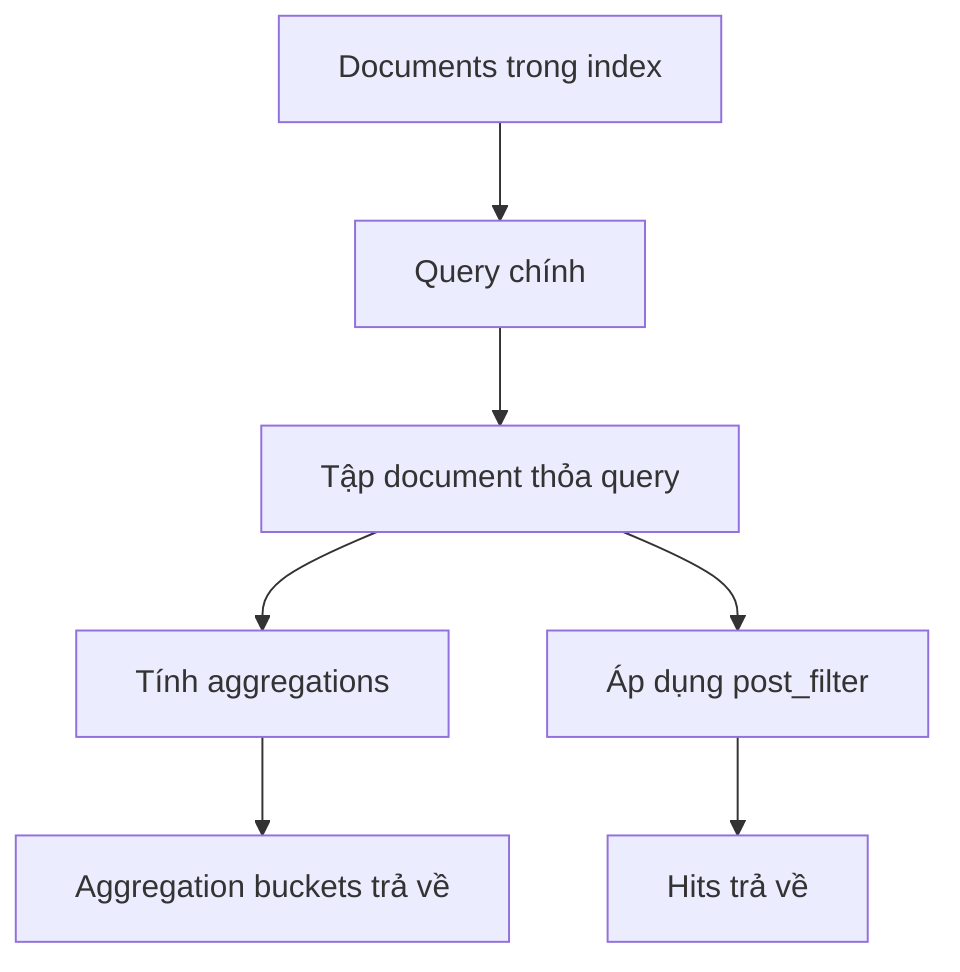
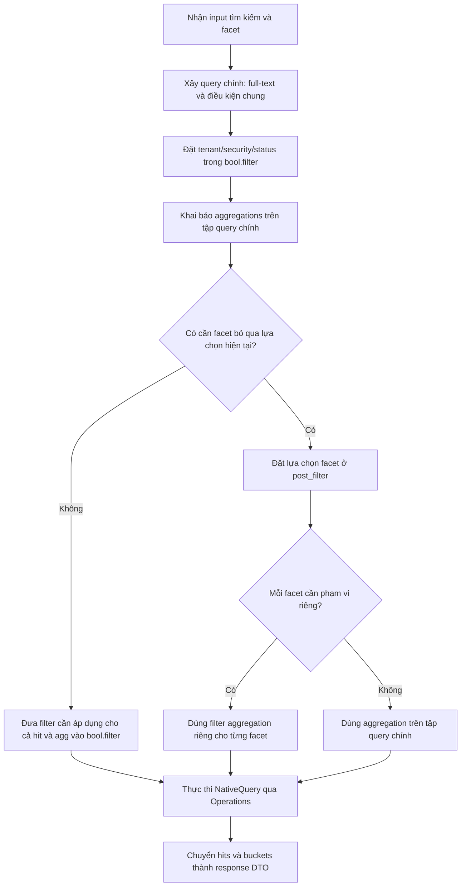

# Kết hợp truy vấn, filter và post_filter

Trong Elasticsearch, một request tìm kiếm có thể vừa chọn document cần trả về, vừa tính aggregation để tạo thống kê hoặc bộ lọc cho giao diện. Khi dùng **`NativeQuery`** trong Spring Data Elasticsearch, cần phân biệt ba nơi đặt điều kiện: query chính, `bool.filter` nằm bên trong query và `post_filter` ở cấp search request.

Sự khác biệt quan trọng nhất là phạm vi áp dụng:

- `query` xác định tập document được tìm kiếm, có thể tính relevance score và làm đầu vào cho aggregation.
- `bool.filter` là điều kiện lọc nằm trong query chính. Nó giới hạn cả hit lẫn dữ liệu dùng để tính aggregation, nhưng không đóng góp relevance score.
- `post_filter` lọc danh sách hit sau khi aggregation đã được tính. Nó tác động đến hit trả về, nhưng không thu hẹp tập document của aggregation.

`post_filter` đặc biệt hữu ích cho giao diện tìm kiếm dạng faceted navigation: người dùng chọn một danh mục để thu hẹp danh sách sản phẩm, trong khi bộ đếm của facet vẫn hiển thị số lượng theo các danh mục khác trong tập kết quả rộng hơn.

## 1. Bối cảnh: một search request có nhiều phần

Giả sử ứng dụng có index `products` với các field:

| Field | Mapping | Vai trò |
|---|---|---|
| `name` | `text` | Tìm kiếm toàn văn theo tên sản phẩm. |
| `category` | `keyword` | Lọc và aggregation theo danh mục. |
| `brand` | `keyword` | Lọc và aggregation theo thương hiệu. |
| `tenantId` | `keyword` | Giới hạn dữ liệu theo tenant. |
| `price` | `double` hoặc kiểu số phù hợp | Lọc khoảng giá và thống kê giá. |

Một màn hình tìm kiếm có thể cần:

1. Tìm sản phẩm có tên liên quan đến `wireless`.
2. Chỉ lấy sản phẩm thuộc tenant hiện tại.
3. Trả về tối đa 20 hit.
4. Tính số lượng sản phẩm theo category và brand để hiển thị facet.
5. Nếu người dùng chọn category `audio`, chỉ trả hit thuộc category đó, nhưng vẫn giữ số lượng facet theo tập kết quả rộng hơn để người dùng có thể tiếp tục thay đổi lựa chọn.

Một search request có thể chứa cả `query`, `aggs` và `post_filter`:

```json
GET products/_search
{
  "query": {
    "bool": {
      "must": [
        { "match": { "name": "wireless" } }
      ],
      "filter": [
        { "term": { "tenantId": "tenant-7" } }
      ]
    }
  },
  "aggs": {
    "categories": {
      "terms": { "field": "category" }
    },
    "brands": {
      "terms": { "field": "brand" }
    }
  },
  "post_filter": {
    "term": { "category": "audio" }
  },
  "size": 20
}
```

Request này có nghĩa:

- Query chính tìm document có tên khớp `wireless`.
- `bool.filter` giới hạn dữ liệu trong tenant `tenant-7`.
- Aggregations tính trên các document thỏa query chính, bao gồm điều kiện tenant.
- `post_filter` chỉ giới hạn hit cuối cùng ở category `audio`.
- Các aggregation `categories` và `brands` vẫn tính trên tập kết quả trước `post_filter`.

Đó là khác biệt cốt lõi giữa `bool.filter` và `post_filter`.

## 2. Query chính: chọn tập document và tính relevance

Query chính nằm trong phần `query` của Search API. Nó xác định document nào tham gia kết quả tìm kiếm và là cơ sở để Elasticsearch tính relevance score nếu query có thành phần scoring.

Ví dụ full-text query:

```json
{
  "query": {
    "match": {
      "name": "wireless headphones"
    }
  }
}
```

Với field `name` kiểu `text`, Elasticsearch phân tích từ khóa bằng search analyzer rồi tìm document có token phù hợp. Điểm liên quan được dùng để xếp hạng hit.

Query chính cũng có thể chứa `bool` để kết hợp nhiều điều kiện:

| Clause | Tác dụng | Ảnh hưởng score |
|---|---|---|
| `must` | Document phải thỏa điều kiện | Có thể đóng góp vào score. |
| `filter` | Document phải thỏa điều kiện | Không đóng góp score; phù hợp điều kiện lọc. |
| `should` | Điều kiện nên thỏa để tăng mức liên quan hoặc có thể trở thành bắt buộc theo cấu trúc query | Có thể đóng góp score. |
| `must_not` | Loại document thỏa điều kiện | Không đóng góp score. |

`bool.filter` phù hợp với tenant, trạng thái, category, khoảng giá hoặc các điều kiện bắt buộc nhưng không cần tính điểm liên quan. Query full-text thường đặt trong `must` hoặc `should` tùy semantics.

## 3. `bool.filter`: lọc trước khi tính aggregation

`bool.filter` là một clause nằm bên trong query chính:

```json
GET products/_search
{
  "query": {
    "bool": {
      "must": [
        { "match": { "name": "wireless" } }
      ],
      "filter": [
        { "term": { "tenantId": "tenant-7" } },
        { "term": { "category": "audio" } },
        { "range": { "price": { "gte": 50, "lte": 300 } } }
      ]
    }
  },
  "aggs": {
    "brands": {
      "terms": { "field": "brand" }
    }
  },
  "size": 20
}
```

Trong request này, chỉ document thỏa cả query `match` và ba filter mới được đưa vào kết quả. Aggregation `brands` cũng chỉ đếm thương hiệu trong tập document đã qua các filter đó.

Hãy đặt điều kiện trong `bool.filter` khi nó cần giới hạn cả hit lẫn aggregation. Ví dụ:

- Tenant hoặc phạm vi dữ liệu của người dùng hiện tại.
- Quyền truy cập dữ liệu cần được áp dụng cho toàn bộ request.
- Trạng thái bản ghi phải là `PUBLISHED`.
- Khoảng thời gian hoặc khoảng giá áp dụng cho toàn bộ kết quả và facet.

Đặc biệt, điều kiện tenant và quyền truy cập phải được áp dụng ở query chính nếu aggregation cũng không được phép tiết lộ số liệu ngoài phạm vi người dùng. Không nên đặt điều kiện bảo mật quan trọng chỉ trong `post_filter`, vì aggregation vẫn có thể phản ánh document bị loại khỏi hit.

## 4. `post_filter`: lọc hit sau khi aggregation đã tính

`post_filter` là một phần riêng ở cấp search request, nằm cạnh `query` và `aggs`, không nằm trong `bool`.

```json
GET products/_search
{
  "query": {
    "match": {
      "name": "wireless"
    }
  },
  "aggs": {
    "categories": {
      "terms": { "field": "category" }
    }
  },
  "post_filter": {
    "term": {
      "category": "audio"
    }
  }
}
```

Ở đây:

- Query chính tìm tất cả document có tên khớp `wireless`.
- Aggregation `categories` đếm category trên toàn bộ tập document đó.
- `post_filter` chỉ giữ lại hit có `category = audio`.

Ví dụ giả sử tập document sau query chính có 100 sản phẩm:

| Category | Số document trước `post_filter` |
|---|---:|
| `audio` | 40 |
| `computer` | 35 |
| `accessories` | 25 |
| **Tổng** | **100** |

Sau khi áp dụng `post_filter` category `audio`:

- Hit trả về chỉ có sản phẩm thuộc `audio` (tối đa theo `size`).
- Aggregation `categories` vẫn cho thấy `audio: 40`, `computer: 35`, `accessories: 25`.

Giao diện có thể tiếp tục hiển thị các lựa chọn category và số lượng tương ứng dù danh sách hit đã được lọc theo một category.

Nếu đặt cùng điều kiện category trong `bool.filter`, aggregation chỉ thấy document category `audio`; các bucket `computer` và `accessories` không còn xuất hiện trong aggregation của request đó.

## 5. Phân biệt bằng sơ đồ luồng xử lý



`bool.filter` là một phần của Query chính, nên nó tác động trước khi tập document được dùng cho aggregation. `post_filter` chạy sau bước aggregation đối với nhánh hit.

| Vị trí điều kiện | Ảnh hưởng hit | Ảnh hưởng aggregation | Có tính relevance score? |
|---|---|---|---|
| `query.bool.must` | Có | Có | Có thể có |
| `query.bool.filter` | Có | Có | Không |
| `query.bool.must_not` | Có, loại document | Có | Không |
| Top-level `post_filter` | Có | Không | Không |

Nếu request không có aggregation, dùng `post_filter` thường không đem lại lợi ích đáng kể so với `bool.filter`. Hãy ưu tiên đặt điều kiện lọc thông thường trong query chính, trừ khi thực sự cần aggregation bỏ qua điều kiện đó.

## 6. Dùng `NativeQuery` với Spring Data Elasticsearch

`NativeQuery` cho phép xây dựng Query DSL bằng các builder có kiểu của Elasticsearch Java API Client, đồng thời thực thi qua `ElasticsearchOperations` và nhận kết quả theo kiểu Spring Data.

Ví dụ service tìm sản phẩm theo tên, giới hạn tenant, tính aggregation theo category và chỉ lọc hit theo category người dùng đã chọn:

```java
package com.example.catalog.product.search;

import co.elastic.clients.elasticsearch._types.FieldValue;
import org.springframework.data.domain.PageRequest;
import org.springframework.data.elasticsearch.client.elc.NativeQuery;
import org.springframework.data.elasticsearch.core.ElasticsearchOperations;
import org.springframework.data.elasticsearch.core.SearchHits;
import org.springframework.data.elasticsearch.core.query.Query;
import org.springframework.stereotype.Service;

import com.example.catalog.product.document.ProductDocument;

@Service
public class ProductSearchService {

    private final ElasticsearchOperations operations;

    public ProductSearchService(ElasticsearchOperations operations) {
        this.operations = operations;
    }

    public SearchHits<ProductDocument> search(
            String text,
            String tenantId,
            String selectedCategory) {

        Query query = NativeQuery.builder()
            .withQuery(q -> q
                .bool(b -> b
                    .must(m -> m
                        .match(match -> match
                            .field("name")
                            .query(text)
                        )
                    )
                    .filter(f -> f
                        .term(term -> term
                            .field("tenantId")
                            .value(FieldValue.of(tenantId))
                        )
                    )
                )
            )
            .withAggregation("categories", aggregation -> aggregation
                .terms(terms -> terms.field("category"))
            )
            .withFilter(filter -> filter
                .term(term -> term
                    .field("category")
                    .value(FieldValue.of(selectedCategory))
                )
            )
            .withPageable(PageRequest.of(0, 20))
            .build();

        return operations.search(query, ProductDocument.class);
    }
}
```

Trong `NativeQuery`, `.withQuery(...)` thiết lập query chính. Điều kiện tenant nằm trong `bool.filter`, do đó giới hạn cả hit và aggregation. `.withFilter(...)` của `NativeQuery` biểu diễn top-level `post_filter`, vì vậy category được chọn chỉ giới hạn hit sau khi aggregation đã tính.

Tên method `withFilter` dễ khiến người đọc nhầm với `bool.filter`. Cần phân biệt vị trí của nó:

- `.withQuery(q -> q.bool(b -> b.filter(...)))`: filter nằm trong query chính.
- `.withFilter(f -> ...)`: post filter ở cấp search request của `NativeQuery`.

Nếu phiên bản Spring Data Elasticsearch đang dùng có API builder khác, hãy đối chiếu Javadoc và xác nhận request được chuyển thành cấu trúc tương đương. Ý nghĩa cần giữ là top-level `post_filter` chỉ tác động lên hit, còn `bool.filter` tác động cả hit và aggregation.

## 7. Cùng một điều kiện category: `bool.filter` và `post_filter` cho kết quả khác nhau

Giả sử query chính chỉ tìm tên `wireless` và có aggregation category.

### 7.1. Category nằm trong `bool.filter`

```java
Query query = NativeQuery.builder()
    .withQuery(q -> q
        .bool(b -> b
            .must(m -> m.match(match -> match
                .field("name")
                .query("wireless")
            ))
            .filter(f -> f.term(term -> term
                .field("category")
                .value(FieldValue.of("audio"))
            ))
        )
    )
    .withAggregation("categories", aggregation -> aggregation
        .terms(terms -> terms.field("category"))
    )
    .build();
```

Kết quả:

- Hit chỉ gồm category `audio`.
- Aggregation category cũng chỉ đếm document category `audio`.
- Các category khác không xuất hiện trong bucket vì đã bị query chính loại ra.

### 7.2. Category nằm trong `post_filter`

```java
Query query = NativeQuery.builder()
    .withQuery(q -> q
        .match(match -> match
            .field("name")
            .query("wireless")
        )
    )
    .withAggregation("categories", aggregation -> aggregation
        .terms(terms -> terms.field("category"))
    )
    .withFilter(f -> f.term(term -> term
        .field("category")
        .value(FieldValue.of("audio"))
    ))
    .build();
```

Kết quả:

- Hit chỉ gồm category `audio`.
- Aggregation vẫn đếm tất cả category trong tập document khớp `name = wireless`.
- Giao diện vẫn có thể hiển thị bucket category khác để người dùng chuyển lựa chọn.

Hai request có thể trả cùng một tập hit nhưng aggregation khác nhau. Đây là lý do phải chọn đúng vị trí đặt filter.

## 8. Dùng filter cho điều kiện chung, post_filter cho lựa chọn facet

Một search page thường có các điều kiện chung và các lựa chọn facet:

- Điều kiện chung: tenant, quyền truy cập, trạng thái được xuất bản, từ khóa tìm kiếm.
- Lựa chọn facet: category, brand, màu sắc hoặc kích thước mà người dùng vừa chọn.

Đặt điều kiện chung trong query chính. Những điều kiện phải giới hạn dữ liệu aggregation, đặc biệt tenant và quyền truy cập, phải ở trong `bool.filter`.

Đặt lựa chọn facet ở `post_filter` nếu muốn hit tuân theo lựa chọn đó nhưng aggregation vẫn tính trên tập kết quả trước lựa chọn facet.

Ví dụ request JSON:

```json
GET products/_search
{
  "query": {
    "bool": {
      "must": [
        { "match": { "name": "wireless" } }
      ],
      "filter": [
        { "term": { "tenantId": "tenant-7" } },
        { "term": { "status": "PUBLISHED" } }
      ]
    }
  },
  "aggs": {
    "categories": {
      "terms": { "field": "category" }
    },
    "brands": {
      "terms": { "field": "brand" }
    }
  },
  "post_filter": {
    "bool": {
      "filter": [
        { "term": { "category": "audio" } },
        { "term": { "brand": "acme" } }
      ]
    }
  },
  "size": 20
}
```

Trong request này, hit chỉ có sản phẩm category `audio` và brand `acme`. Các aggregation category/brand vẫn được tính trên tập document thỏa từ khóa, tenant và trạng thái, không bị hai lựa chọn facet làm hẹp.

Đây là hành vi phù hợp với một số giao diện facet, nhưng không phải giao diện nào cũng muốn giữ toàn bộ bucket rộng như vậy. Nếu cần mỗi facet phản ánh các lựa chọn của facet khác nhưng bỏ qua lựa chọn của chính nó, hãy dùng filter aggregation riêng cho từng facet.

## 9. Self-excluding facets và filter aggregation

Trong một giao diện thương mại điện tử, người dùng có thể chọn:

- Category = `audio`.
- Brand = `acme`.
- Color = `black`.

Khi hiển thị facet category, có thể muốn áp dụng filter brand và color nhưng bỏ qua filter category hiện tại, để người dùng thấy các category khác có bao nhiêu kết quả trong bối cảnh lựa chọn còn lại. Tương tự, facet brand áp dụng category và color nhưng bỏ qua lựa chọn brand.

Một `post_filter` toàn cục không tự tạo ra cách tính self-excluding riêng cho từng aggregation. Nó khiến tất cả aggregation bỏ qua toàn bộ `post_filter`. Để tính chính xác từng facet, có thể dùng `filter` aggregation hoặc `filters` aggregation:

```json
GET products/_search
{
  "query": {
    "bool": {
      "must": [
        { "match": { "name": "wireless" } }
      ],
      "filter": [
        { "term": { "tenantId": "tenant-7" } },
        { "term": { "status": "PUBLISHED" } }
      ]
    }
  },
  "post_filter": {
    "bool": {
      "filter": [
        { "term": { "category": "audio" } },
        { "term": { "brand": "acme" } },
        { "term": { "color": "black" } }
      ]
    }
  },
  "aggs": {
    "categories_after_brand_and_color": {
      "filter": {
        "bool": {
          "filter": [
            { "term": { "brand": "acme" } },
            { "term": { "color": "black" } }
          ]
        }
      },
      "aggs": {
        "values": {
          "terms": { "field": "category" }
        }
      }
    },
    "brands_after_category_and_color": {
      "filter": {
        "bool": {
          "filter": [
            { "term": { "category": "audio" } },
            { "term": { "color": "black" } }
          ]
        }
      },
      "aggs": {
        "values": {
          "terms": { "field": "brand" }
        }
      }
    }
  },
  "size": 20
}
```

Mỗi aggregation có phạm vi lọc riêng:

- `categories_after_brand_and_color` áp dụng brand và color, nhưng không áp dụng category đang chọn.
- `brands_after_category_and_color` áp dụng category và color, nhưng không áp dụng brand đang chọn.
- `post_filter` vẫn áp dụng tất cả lựa chọn để giới hạn hit cuối cùng.

Đây là kỹ thuật phổ biến khi xây facet counts chính xác theo từng chiều lọc. Cần cân nhắc chi phí vì mỗi filter aggregation có thể tăng công việc Elasticsearch phải thực hiện.

## 10. `NativeQuery` và lấy kết quả aggregation

Khi query được thực thi bằng `ElasticsearchOperations.search`, Spring Data trả về `SearchHits<T>`. Ngoài danh sách hit, `SearchHits` còn có metadata và aggregation container nếu request đã khai báo aggregation.

```java
SearchHits<ProductDocument> hits = operations.search(
    query,
    ProductDocument.class
);

for (SearchHit<ProductDocument> hit : hits) {
    ProductDocument product = hit.getContent();
    float score = hit.getScore();
    System.out.println(product.getName() + " score=" + score);
}

var aggregations = hits.getAggregations();
```

`getAggregations()` trả về aggregation container theo API của phiên bản Spring Data Elasticsearch. Với NativeQuery dựa trên Elasticsearch Java API Client, kiểu container có thể bọc các aggregation response do client cung cấp. Cách lấy bucket cụ thể phụ thuộc phiên bản và kiểu aggregation được khai báo; hãy dùng đúng response model của dependency hiện tại thay vì ép kiểu tùy tiện.

Khi xây API cho frontend, thường nên chuyển bucket thành DTO đơn giản:

```java
public record FacetBucket(String value, long count) {
}

public record ProductSearchResponse(
    List<ProductSummary> products,
    List<FacetBucket> categories,
    List<FacetBucket> brands,
    long totalHits
) {
}
```

DTO giúp frontend không phải phụ thuộc vào response model nội bộ của Elasticsearch Java API Client. Service hoặc adapter chuyển `SearchHits` và aggregation buckets thành mô hình API của ứng dụng.

## 11. Phân trang, sort và aggregation size

`NativeQuery` có thể kết hợp query/filter/post_filter với pageable và sort. Ví dụ:

```java
Query query = NativeQuery.builder()
    .withQuery(q -> q
        .bool(b -> b
            .must(m -> m.match(match -> match
                .field("name")
                .query("wireless")
            ))
            .filter(f -> f.term(term -> term
                .field("tenantId")
                .value(FieldValue.of("tenant-7"))
            ))
        )
    )
    .withFilter(f -> f.term(term -> term
        .field("category")
        .value(FieldValue.of("audio"))
    ))
    .withPageable(PageRequest.of(0, 20))
    .build();
```

`PageRequest` giới hạn hit được trả về. Nó không có nghĩa aggregation chỉ đếm 20 document trong trang; aggregation được tính trên tập document phù hợp với query chính (và không bị thu hẹp bởi `post_filter`).

Với terms aggregation, tham số `size` của aggregation quyết định số bucket được trả về, độc lập với `size` của hit. Ví dụ:

```json
"aggs": {
  "categories": {
    "terms": {
      "field": "category",
      "size": 20
    }
  }
}
```

Đừng nhầm:

- Hit size: số document trả về trong `hits.hits`.
- Aggregation bucket size: số bucket được trả về cho một terms aggregation.
- Total hits: tổng số document phù hợp với query và post_filter trong phần hit response, theo semantics và tracking option của request.

Nếu cần tổng số hit chính xác vượt ngưỡng mặc định của Elasticsearch, hãy cấu hình tracking total hits theo yêu cầu và cân nhắc chi phí. `post_filter` tác động lên tập hit; aggregation vẫn phản ánh query chính.

## 12. Khi nào nên dùng `post_filter`?

| Tình huống | Nơi đặt điều kiện | Lý do |
|---|---|---|
| Giới hạn tenant hoặc quyền truy cập | `query.bool.filter` | Hit và aggregation đều phải nằm trong phạm vi được phép. |
| Chỉ lấy sản phẩm đã publish | `query.bool.filter` | Aggregation không nên đếm sản phẩm không được hiển thị. |
| Tìm theo tên và tính facet trên tập kết quả tìm kiếm | `query` + `aggs` | Aggregation phản ánh tập document khớp từ khóa. |
| Người dùng chọn category nhưng muốn facet category vẫn hiển thị các lựa chọn khác | `post_filter` | Chỉ hit bị lọc theo category đã chọn. |
| Người dùng chọn brand và category, cần mỗi facet bỏ qua lựa chọn của chính nó | `post_filter` cho hit + filter aggregations riêng | Mỗi facet cần phạm vi lọc độc lập. |
| Không có aggregation | Thường dùng `query.bool.filter` | `post_filter` thường không đem lại lợi ích đáng kể. |

Một nguyên tắc quan trọng: mọi điều kiện bảo mật, tenant isolation hoặc giới hạn dữ liệu mà aggregation không được phép vượt qua phải nằm trong query chính. `post_filter` không phải cơ chế kiểm soát truy cập.

## 13. Gọi `post_filter` bằng Elasticsearch Java API Client trực tiếp

Để hiểu cấu trúc request ở cấp client, có thể gọi Search API trực tiếp:

```java
import java.io.IOException;

import co.elastic.clients.elasticsearch.ElasticsearchClient;
import co.elastic.clients.elasticsearch.core.SearchResponse;
import co.elastic.clients.elasticsearch._types.FieldValue;

public SearchResponse<ProductDocument> search(
        ElasticsearchClient client,
        String text,
        String tenantId,
        String category) throws IOException {

    return client.search(request -> request
            .index("products")
            .query(query -> query
                .bool(bool -> bool
                    .must(must -> must
                        .match(match -> match
                            .field("name")
                            .query(text)
                        )
                    )
                    .filter(filter -> filter
                        .term(term -> term
                            .field("tenantId")
                            .value(FieldValue.of(tenantId))
                        )
                    )
                )
            )
            .aggregations("categories", aggregation -> aggregation
                .terms(terms -> terms.field("category"))
            )
            .postFilter(postFilter -> postFilter
                .term(term -> term
                    .field("category")
                    .value(FieldValue.of(category))
                )
            )
            .size(20),
        ProductDocument.class
    );
}
```

Ở Java API Client, `postFilter(...)` thể hiện rõ đây là trường top-level `post_filter` của Search API. Với Spring Data, `NativeQuery.withFilter(...)` cung cấp cách biểu đạt tương ứng, còn `bool.filter(...)` nằm bên trong query builder.

Khi gọi client trực tiếp, ứng dụng tự làm việc với response model của client và không tự động dùng `MappingElasticsearchConverter` của Spring Data. Nếu muốn entity được chuyển đổi theo annotation Spring Data, hãy thực thi query qua `ElasticsearchOperations`.

## 14. Kiểm tra request và kết quả thực tế

Khi aggregation không có bucket như mong đợi hoặc hit bị lọc sai, hãy xác nhận vị trí điều kiện trong request.

Kiểm tra bằng Elasticsearch Search API trực tiếp:

```http
GET products/_search
{
  "query": {
    "bool": {
      "must": [
        { "match": { "name": "wireless" } }
      ],
      "filter": [
        { "term": { "tenantId": "tenant-7" } }
      ]
    }
  },
  "aggs": {
    "categories": {
      "terms": { "field": "category" }
    }
  },
  "post_filter": {
    "term": { "category": "audio" }
  }
}
```

So sánh với phiên bản đưa category vào `bool.filter`. Nếu bucket thay đổi, đó là hành vi mong đợi vì phạm vi aggregation đã thay đổi.

Các bước chẩn đoán:

1. Kiểm tra query chính có chứa những điều kiện nào.
2. Kiểm tra filter tenant/security có nằm trong query chính không.
3. Xác nhận `post_filter` là field top-level, không bị lồng vào `bool`.
4. Kiểm tra mapping của field được dùng trong term/aggregation, thường phải là `keyword` hoặc kiểu phù hợp.
5. So sánh số hit và bucket counts trước/sau khi di chuyển một điều kiện giữa `bool.filter` và `post_filter`.
6. Kiểm tra aggregation `size`, field name và dữ liệu có giá trị null/missing.

Trong môi trường phát triển, có thể bật logging request phù hợp hoặc dùng Elasticsearch profile API để quan sát query. Không bật log chứa dữ liệu nhạy cảm trong production.

## 15. Các lỗi thường gặp

| Hiện tượng | Nguyên nhân có thể | Cách xử lý |
|---|---|---|
| Chọn category rồi bucket category chỉ còn một giá trị | Category được đặt trong `bool.filter` | Chuyển lựa chọn facet sang top-level `post_filter` nếu muốn aggregation bỏ qua lựa chọn đó. |
| `post_filter` không làm thay đổi bucket | Đây là hành vi đúng: aggregation không bị `post_filter` giới hạn | Xác định liệu điều kiện có nên nằm trong query chính hay post filter. |
| Aggregation hiển thị số liệu của tenant khác | Tenant condition chỉ nằm trong `post_filter` hoặc bị thiếu | Đặt tenant/security filter trong `query.bool.filter`. |
| Không có hit dù aggregation có bucket | `post_filter` loại hết hit nhưng aggregation vẫn có document | Kiểm tra giá trị facet, mapping và điều kiện post filter. |
| Facet brand không phản ánh category đã chọn | Global post filter bỏ qua toàn bộ lựa chọn facet trong aggregation | Dùng filter aggregation riêng để áp dụng các facet khác, trừ facet đang tính. |
| `withFilter` bị nhầm với `bool.filter` | Tên API gần giống nhau nhưng vị trí khác nhau | `NativeQuery.withFilter` là top-level post filter; builder `bool.filter` thuộc query chính. |
| Aggregation thiếu bucket | Terms aggregation có `size` nhỏ, field sai hoặc mapping không phù hợp | Kiểm tra `size`, field `keyword` và dữ liệu thực tế. |
| Query không compile sau nâng cấp | Builder/API thay đổi theo phiên bản client hoặc Spring Data | Kiểm tra Javadoc và ví dụ đúng dependency đang dùng. |

## 16. Quy trình thiết kế search request



Các bước nên thực hiện:

1. Xác định tập document nền mà người dùng được phép tìm kiếm.
2. Đưa full-text query vào `must`/`should` và điều kiện chung vào `bool.filter`.
3. Xác định aggregation cần thống kê trên tập document nào.
4. Nếu lựa chọn facet chỉ lọc hit, đặt nó trong `post_filter`.
5. Nếu mỗi facet cần bỏ qua lựa chọn của chính nó nhưng vẫn áp dụng lựa chọn facet khác, tạo filter aggregation riêng.
6. Thực thi bằng `NativeQuery` và `ElasticsearchOperations`.
7. Kiểm thử cả hit lẫn aggregation counts, không chỉ kiểm tra danh sách document.

## 17. Kết luận

`NativeQuery` cho phép kết hợp query chính, aggregation và post filter trong một search request. `bool.filter` là điều kiện của query chính, vì vậy nó giới hạn cả hit và aggregation. Top-level `post_filter` chỉ lọc hit sau khi aggregation đã được tính.

Hãy dùng query và `bool.filter` cho từ khóa tìm kiếm, tenant, quyền truy cập, trạng thái và các điều kiện cần áp dụng cho cả kết quả lẫn thống kê. Dùng `post_filter` khi người dùng chọn facet và muốn hit thay đổi nhưng aggregation vẫn phản ánh tập kết quả rộng hơn. Với self-excluding facets, tạo filter aggregation riêng cho từng chiều lọc.

Trong Spring Data Elasticsearch, `.withQuery(...)` xây query chính, `bool.filter(...)` thêm filter vào query đó, còn `.withFilter(...)` của `NativeQuery` biểu đạt top-level `post_filter`. Kiểm tra đúng vị trí của từng điều kiện và xác minh cả hit lẫn bucket counts sẽ giúp search UI hiển thị kết quả và facet nhất quán.
