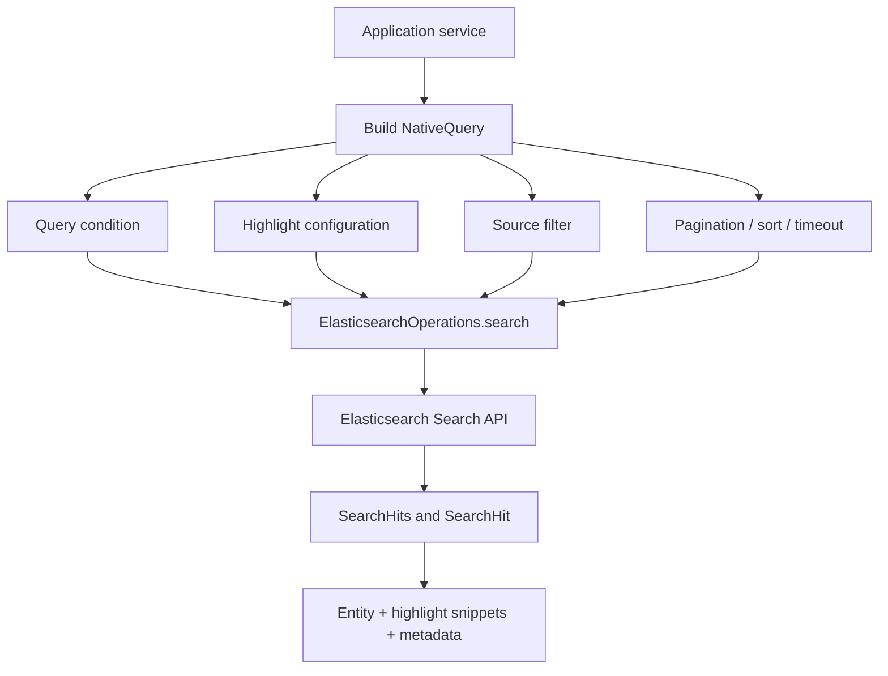

# Thiết lập highlight, source filter và các tùy chọn tìm kiếm

Trong Spring Data Elasticsearch, `NativeQuery` cho phép xây dựng truy vấn bằng Elasticsearch Java Client và truyền thêm nhiều tùy chọn của Search API. Ngoài điều kiện query, một search request thường cần quyết định ba vấn đề khác nhau: hiển thị đoạn văn bản khớp từ khóa như thế nào, trả về những field nào từ `_source`, và cách Elasticsearch phân trang, sắp xếp, tính tổng số kết quả hoặc giới hạn thời gian xử lý.

**Highlight** tạo các đoạn văn bản có đánh dấu phần khớp truy vấn. **Source filtering** giới hạn những field được trả về trong `_source`. **Search options** điều khiển cách lấy và trình bày kết quả, ví dụ `from`, `size`, `sort`, `track_total_hits`, `timeout`, `search_after` và các tùy chọn khác.

Các tùy chọn này không thay thế query chính. Query xác định document nào phù hợp; highlight giúp trình bày phần khớp; source filter giảm dữ liệu trả về; còn pagination/sort/timeout điều khiển cách tìm kiếm được thực hiện và kết quả được chuyển tới ứng dụng.

## 1. Bối cảnh: NativeQuery và Search API

`NativeQuery` là abstraction của Spring Data Elasticsearch cho truy vấn sử dụng Elasticsearch Java API Client. Nó phù hợp khi cần Query DSL linh hoạt hoặc các tính năng tìm kiếm mà `CriteriaQuery` không biểu diễn thuận tiện.

Luồng cơ bản:



Một request tìm kiếm có thể bao gồm:

| Phần request | Vai trò |
|---|---|
| `query` | Chọn document phù hợp |
| `highlight` | Tạo snippet và đánh dấu phần text khớp |
| `_source` | Chọn field nào được trả về từ source |
| `from`, `size` | Phân trang theo offset |
| `sort` | Sắp xếp kết quả |
| `track_total_hits` | Điều khiển việc đếm tổng số hit |
| `timeout` | Giới hạn thời gian tìm kiếm theo cấu hình request |
| `search_after` / point in time | Phân trang sâu theo cursor/snapshot |

Các phần này có thể được kết hợp trong cùng một request. Khi viết Java, Spring Data chuyển đối tượng query thành request Search API tương ứng.

## 2. Highlight là gì?

Highlight là tính năng đánh dấu những phần văn bản liên quan tới query trong một document. Ví dụ người dùng tìm `wireless keyboard`; kết quả trả về có thể chứa một snippet như:

```html
Wireless <em>keyboard</em> with <em>wireless</em> connectivity
```

Ứng dụng có thể hiển thị snippet này bên cạnh tên sản phẩm để người dùng hiểu vì sao document xuất hiện trong kết quả.

Highlight không thay đổi `_source` được lưu trong index. Nó là metadata được Elasticsearch tạo cho từng hit trong response. Vì vậy, một hit có thể chứa entity `Product` và đồng thời chứa map các đoạn highlight riêng.

### 2.1 Highlight field nào?

Chỉ định những field cần highlight trong phần `highlight.fields`. Thường dùng field `text` như `name`, `description`, `content` hoặc `body`.

```json
GET /products/_search
{
  "query": {
    "match": {
      "description": "wireless keyboard"
    }
  },
  "highlight": {
    "fields": {
      "description": {}
    }
  }
}
```

Elasticsearch dùng query và nội dung field để tạo một hoặc nhiều fragment. Nếu field không có nội dung phù hợp, có thể không có highlight cho field đó. Highlight chỉ xuất hiện trong response nếu field được cấu hình và Elasticsearch có thể tạo fragment phù hợp.

### 2.2 Pre-tags và post-tags

`pre_tags` và `post_tags` xác định chuỗi mở/đóng bao quanh phần được highlight:

```json
GET /products/_search
{
  "query": {
    "match": {
      "description": "wireless keyboard"
    }
  },
  "highlight": {
    "pre_tags": ["<mark>"],
    "post_tags": ["</mark>"],
    "fields": {
      "description": {}
    }
  }
}
```

Response có thể chứa:

```json
"highlight": {
  "description": [
    "<mark>Wireless</mark> keyboard with low-latency connection"
  ]
}
```

Các tag chỉ là marker trong chuỗi response. Ứng dụng quyết định cách render chúng ở giao diện. Không nên đưa trực tiếp HTML highlight chưa được kiểm soát vào trang web nếu nội dung gốc có thể do người dùng cung cấp. Hãy escape nội dung không tin cậy hoặc dùng cơ chế render an toàn để tránh XSS; chỉ cho phép marker đã định nghĩa theo cách có kiểm soát.

### 2.3 Fragment size và số fragment

Một field dài có thể tạo nhiều đoạn highlight. Các tùy chọn thường dùng:

- `fragment_size`: kích thước mục tiêu của mỗi fragment theo số ký tự.
- `number_of_fragments`: số fragment tối đa được trả về cho field.
- `no_match_size`: số ký tự có thể lấy từ đầu field khi không có fragment khớp, nếu cấu hình.
- `order`: thứ tự fragment, ví dụ theo score khi được hỗ trợ.

Ví dụ:

```json
GET /articles/_search
{
  "query": {
    "match": {
      "content": "distributed search"
    }
  },
  "highlight": {
    "pre_tags": ["<strong>"],
    "post_tags": ["</strong>"],
    "fields": {
      "content": {
        "fragment_size": 180,
        "number_of_fragments": 3,
        "no_match_size": 80
      }
    }
  }
}
```

Giá trị fragment size không phải giới hạn chính xác số ký tự của mọi snippet; highlighter có thể điều chỉnh biên fragment theo câu, từ hoặc cấu hình boundary scanner. Hãy xem nó là mục tiêu để tạo snippet dễ đọc.

### 2.4 Field ngắn và `number_of_fragments: 0`

Với field ngắn như `name` hoặc `title`, đôi khi muốn nhận toàn bộ giá trị field thay vì các fragment nhỏ. Có thể đặt `number_of_fragments` bằng `0`:

```json
"highlight": {
  "fields": {
    "name": {
      "number_of_fragments": 0
    }
  }
}
```

Khi đó highlighter trả về toàn bộ field được highlight thay vì chia thành nhiều fragment. Với field dài, trả về toàn bộ nội dung có thể làm response rất lớn; hãy giới hạn cho các field ngắn hoặc trường hợp có chủ đích.

### 2.5 Highlight nhiều field với cấu hình riêng

Mỗi field có thể có tùy chọn riêng:

```json
"highlight": {
  "pre_tags": ["<mark>"],
  "post_tags": ["</mark>"],
  "fields": {
    "name": {
      "number_of_fragments": 0
    },
    "description": {
      "fragment_size": 160,
      "number_of_fragments": 2
    },
    "content": {
      "fragment_size": 220,
      "number_of_fragments": 3
    }
  }
}
```

Cấu hình ở cấp field có thể ghi đè một số tùy chọn chung. Điều này giúp field tiêu đề trả về toàn bộ nội dung còn field mô tả chỉ trả một vài đoạn ngắn.

## 3. Các highlighter và lựa chọn phù hợp

Elasticsearch cung cấp nhiều loại highlighter. Loại phù hợp phụ thuộc field type, analyzer, yêu cầu tốc độ và cách dữ liệu được lưu.

### 3.1 Unified highlighter

Unified highlighter là lựa chọn mặc định phổ biến cho nhiều trường hợp. Nó hỗ trợ các field text và có thể tạo fragment dựa trên nội dung, query và thông tin term vector/inverted index theo cấu hình.

Ví dụ chỉ định:

```json
"highlight": {
  "fields": {
    "description": {
      "type": "unified"
    }
  }
}
```

Nếu không có yêu cầu đặc biệt, thường nên bắt đầu với default/unified rồi đo kết quả thực tế.

### 3.2 Plain highlighter

Plain highlighter sử dụng cơ chế phân tích văn bản cho từng field và có thể phù hợp với một số field nhỏ hoặc tình huống đơn giản. Với nội dung lớn hoặc số lượng kết quả cao, cần đánh giá chi phí vì highlighter có thể phải xử lý lại nội dung.

```json
"highlight": {
  "fields": {
    "description": {
      "type": "plain"
    }
  }
}
```

### 3.3 Fast Vector Highlighter (FVH)

FVH có thể phù hợp khi cần highlight nâng cao và field được cấu hình term vectors phù hợp, thường là `with_positions_offsets`. Đổi lại, term vectors làm tăng dung lượng index và chi phí lưu trữ.

Ví dụ mapping:

```json
PUT /articles
{
  "mappings": {
    "properties": {
      "content": {
        "type": "text",
        "term_vector": "with_positions_offsets"
      }
    }
  }
}
```

Query highlight:

```json
"highlight": {
  "fields": {
    "content": {
      "type": "fvh"
    }
  }
}
```

Chỉ bật term vectors khi lợi ích của FVH đáp ứng nhu cầu thực tế. Không thêm term vectors cho mọi field text nếu không cần, vì chúng làm index lớn hơn.

### 3.4 `require_field_match`

`require_field_match` kiểm soát việc query có cần khớp trực tiếp với field đang highlight hay không. Mặc định thường là `true`.

```json
"highlight": {
  "require_field_match": false,
  "fields": {
    "name": {},
    "description": {}
  }
}
```

Đặt `false` có thể hữu ích khi query phức tạp hoặc field được highlight có quan hệ với field query. Tuy nhiên, nó có thể làm highlight xuất hiện ở field không khớp theo cách người dùng mong đợi. Chỉ dùng khi hiểu rõ query và semantics highlighter.

### 3.5 `highlight_query`

Thông thường highlighter sử dụng query tìm kiếm để xác định phần cần đánh dấu. `highlight_query` cho phép chỉ định query riêng cho mục đích highlight.

Điều này hữu ích khi query chính có các filter hoặc điều kiện relevance mà không muốn tất cả điều kiện đó quyết định fragment. Ví dụ query chính kết hợp full-text match và filter category, trong khi highlight chỉ cần đánh dấu từ khóa text:

```json
GET /products/_search
{
  "query": {
    "bool": {
      "must": [
        { "match": { "description": "wireless keyboard" } }
      ],
      "filter": [
        { "term": { "category": "computer-accessories" } }
      ]
    }
  },
  "highlight": {
    "highlight_query": {
      "match": {
        "description": "wireless keyboard"
      }
    },
    "fields": {
      "description": {}
    }
  }
}
```

`highlight_query` không thay đổi document nào được chọn bởi query chính. Nó chỉ ảnh hưởng cách highlighter xác định phần text cần đánh dấu.

## 4. Source filtering là gì?

Mặc định, search response thường trả về `_source` của mỗi hit. Nếu document chứa nhiều field nhưng màn hình chỉ cần một vài field, ứng dụng có thể dùng source filtering để yêu cầu Elasticsearch chỉ trả về những phần cần thiết.

Ví dụ document có nhiều field:

```json
{
  "sku": "SKU-1001",
  "name": "Bàn phím cơ",
  "description": "Wireless mechanical keyboard",
  "price": 185000,
  "internalNotes": "Supplier discount: confidential",
  "auditTrail": ["created", "reviewed", "published"]
}
```

API chỉ cần `sku`, `name` và `price` có thể yêu cầu:

```json
GET /products/_search
{
  "query": {
    "match_all": {}
  },
  "_source": ["sku", "name", "price"]
}
```

Response `_source` sẽ chỉ chứa những field được chọn. Source filtering giảm lượng dữ liệu truyền qua mạng và lượng dữ liệu cần ánh xạ ở client, nhất là khi document có nhiều field hoặc nội dung lớn.

### 4.1 Includes và excludes

Có thể chỉ định `includes` và `excludes`:

```json
GET /products/_search
{
  "query": {
    "match_all": {}
  },
  "_source": {
    "includes": ["sku", "name", "price", "manufacturer.*"],
    "excludes": ["internalNotes", "auditTrail"]
  }
}
```

- `includes`: field hoặc pattern được phép xuất hiện trong `_source` trả về.
- `excludes`: field hoặc pattern cần loại khỏi `_source` trả về.
- Có thể dùng wildcard pattern và đường dẫn field lồng nhau.

Nếu cả includes và excludes cùng khớp một field, cần hiểu quy tắc lọc của Elasticsearch; nên thiết kế danh sách rõ ràng, tránh pattern chồng lấn khó dự đoán.

### 4.2 Include một phần field lồng nhau

Với document:

```json
{
  "name": "Bàn phím cơ",
  "manufacturer": {
    "name": "Northwind",
    "country": "VN",
    "contact": {
      "email": "support@example.test",
      "phone": "0000000000"
    }
  }
}
```

Có thể chỉ lấy một phần nested object:

```json
"_source": {
  "includes": ["name", "manufacturer.name", "manufacturer.country"]
}
```

Kết quả `_source` chứa cấu trúc con tương ứng với các field được chọn. Việc lọc source không thay đổi mapping hoặc dữ liệu lưu trữ.

### 4.3 Tắt trả về `_source`

Nếu request chỉ cần metadata hoặc aggregation, có thể đặt:

```json
"_source": false
```

Điều này loại `_source` khỏi mỗi hit trong response. Nó có thể giảm payload đáng kể, nhưng ứng dụng sẽ không có nội dung document để ánh xạ thành entity đầy đủ. Chỉ dùng khi kết quả không cần entity source, ví dụ chỉ cần ID/score/aggregation hoặc field được lấy bằng cơ chế khác.

Nếu index được tạo với `_source` bị tắt ở mapping, khả năng sử dụng các API cần `_source` như update/reindex có thể bị hạn chế. Cấu hình `_source` ở request chỉ kiểm soát response; nó khác với việc tắt lưu `_source` ở cấp mapping.

### 4.4 Source filtering không phải field-level security

Source filtering chỉ quyết định field nào được trả về trong một search request. Nó không bảo vệ dữ liệu khỏi người gọi có quyền truy vấn trực tiếp hoặc tự sửa request để yêu cầu field khác.

Không dùng `_source.excludes` như cơ chế bảo mật cho `internalNotes`, dữ liệu cá nhân hoặc secret. Nếu người dùng không được phép truy cập một field, hãy áp dụng authorization và cơ chế field/document-level security phù hợp ở tầng Elasticsearch hoặc API. Source filtering là tối ưu payload và projection response, không phải ranh giới quyền truy cập.

## 5. Phân biệt `_source`, fields và stored fields

Elasticsearch có nhiều cách lấy giá trị field trong response. Chúng không tương đương:

| Cơ chế | Mục đích | Đặc điểm |
|---|---|---|
| `_source` | Trả lại JSON gốc đã lưu | Có thể lọc includes/excludes; phản ánh cấu trúc document |
| `fields` | Trả field theo mapping/field retrieval API | Giá trị được trả theo dạng mảng trong response; có thể xử lý runtime/mapped field tùy phiên bản |
| `stored_fields` | Lấy field được cấu hình `store: true` | Chỉ có dữ liệu nếu field được lưu riêng theo mapping |
| `docvalue_fields` | Lấy giá trị doc values | Phù hợp một số field có doc values, thường số/ngày/keyword |

Ví dụ yêu cầu `_source` một số field:

```json
"_source": ["name", "price"]
```

Ví dụ yêu cầu doc values của một field ngày:

```json
"docvalue_fields": [
  {
    "field": "createdAt",
    "format": "strict_date_time"
  }
]
```

Không bật `store: true` cho mọi field chỉ để tránh trả `_source`. Stored fields làm tăng dung lượng và cần được cân nhắc theo query pattern. Source filtering thường là lựa chọn đơn giản khi ứng dụng chỉ muốn giới hạn JSON source trả về.

## 6. Search options: phân trang và số lượng kết quả

### 6.1 `from` và `size`

`from` là offset bắt đầu lấy kết quả; `size` là số hit tối đa trả về:

```json
GET /products/_search
{
  "from": 20,
  "size": 10,
  "query": {
    "match_all": {}
  }
}
```

Request lấy 10 kết quả bắt đầu từ vị trí 20. Cách này phù hợp với phân trang thông thường ở độ sâu vừa phải.

Offset pagination có giới hạn `index.max_result_window`, mặc định thường là 10.000. Khi `from + size` vượt giới hạn, Elasticsearch từ chối request. Tăng giới hạn có thể làm tăng chi phí bộ nhớ và xử lý; không nên tăng chỉ để hỗ trợ trang rất sâu.

### 6.2 Sort

Sort quyết định thứ tự kết quả:

```json
GET /products/_search
{
  "query": {
    "match": {
      "name": "keyboard"
    }
  },
  "sort": [
    { "price": { "order": "asc" } },
    { "_id": { "order": "asc" } }
  ]
}
```

Sort theo nhiều field giúp thứ tự ổn định hơn khi nhiều document có cùng giá. `_id` có thể được dùng làm tie-breaker trong một số tình huống, nhưng với phân trang sâu nên chọn trường sort ổn định, có mapping và doc values phù hợp, đồng thời hiểu giới hạn của `_id` trong sort trên phiên bản Elasticsearch đang dùng.

Với field `text`, thường cần sort theo multi-field `keyword`, ví dụ `name.raw`. Với nested field, sort cần nested context và filter phù hợp.

### 6.3 `track_total_hits`

Elasticsearch có thể giới hạn việc đếm chính xác tổng số hit để cải thiện hiệu năng. `track_total_hits` điều khiển hành vi này:

```json
"track_total_hits": true
```

Yêu cầu đếm tổng số hit chính xác, có thể tốn thêm tài nguyên với tập dữ liệu lớn.

Có thể đặt một ngưỡng số:

```json
"track_total_hits": 10000
```

Khi đạt ngưỡng, Elasticsearch có thể dừng đếm chính xác và response thể hiện quan hệ tổng số là `gte` (lớn hơn hoặc bằng). Nếu đặt `false`, ứng dụng không yêu cầu tổng số hit chính xác.

Chỉ yêu cầu đếm chính xác khi giao diện thực sự cần tổng số trang hoặc số lượng chính xác. Với infinite scroll, thường chỉ cần biết có trang tiếp theo hay không.

### 6.4 `min_score`

`min_score` loại các hit có relevance score thấp hơn ngưỡng:

```json
"min_score": 0.5
```

Chỉ dùng khi query có scoring phù hợp và ngưỡng được đánh giá trên dữ liệu thực tế. Score không phải xác suất và không nhất thiết có cùng thang đo giữa các query khác nhau. Không đặt một ngưỡng tùy ý rồi giả định mọi truy vấn có thể dùng chung.

## 7. Search options: thời gian và xử lý kết quả

### 7.1 `timeout`

`timeout` giới hạn thời gian mà Elasticsearch dành cho search request theo semantics của search operation:

```json
"timeout": "2s"
```

Nếu hết thời gian, Elasticsearch có thể trả response với `timed_out: true` và kết quả một phần tùy trạng thái shard/request. Timeout tìm kiếm không giống timeout socket của HTTP client. HTTP client timeout có thể ngắt chờ response; search timeout được gửi tới Elasticsearch để điều khiển việc xử lý search ở phía server.

Ứng dụng cần kiểm tra cờ `timed_out` và trạng thái shard nếu nghiệp vụ không chấp nhận kết quả một phần. Không được coi mọi response HTTP thành công là kết quả đầy đủ nếu search response báo timeout.

### 7.2 `allow_partial_search_results`

Search API có thể cho phép trả kết quả một phần nếu một số shard thất bại. Tùy chọn `allow_partial_search_results` điều khiển hành vi này ở cấp request/cluster theo khả năng API:

```http
GET /products/_search?allow_partial_search_results=false
```

Nếu nghiệp vụ cần kết quả đầy đủ, hãy xử lý shard failure một cách tường minh. Nếu ứng dụng chấp nhận kết quả một phần để ưu tiên khả năng phản hồi, cần thể hiện trạng thái đó ở tầng API thay vì trả như thể mọi shard đều thành công.

### 7.3 `terminate_after`

`terminate_after` giới hạn số document được thu thập trên mỗi shard trước khi dừng xử lý thêm:

```json
"terminate_after": 1000
```

Đây là giới hạn thu thập theo shard, không phải một cách phân trang hay đảm bảo trả đúng 1.000 kết quả tổng. Nó có thể làm kết quả và tổng số hit không đầy đủ. Chỉ dùng cho trường hợp chấp nhận semantics dừng sớm.

### 7.4 `track_scores`

Khi sort theo field, Elasticsearch không nhất thiết cần tính score relevance nếu không dùng nó. `track_scores` có thể yêu cầu tính score ngay cả khi sort theo field:

```json
"track_scores": true
```

Chỉ bật nếu ứng dụng cần hiển thị hoặc xử lý score trong kết quả. Nếu không cần, tránh thêm công việc không có ích.

### 7.5 `explain`

`explain` yêu cầu Elasticsearch cung cấp giải thích cách score được tính:

```json
"explain": true
```

Thông tin này hữu ích khi điều tra relevance hoặc kiểm tra query trong môi trường phát triển. Nó có thể làm response lớn và tăng chi phí; không nên bật cho mọi request production.

## 8. Phân trang sâu bằng search_after và point in time

Offset pagination phù hợp với các trang đầu. Khi cần duyệt lượng lớn kết quả, `search_after` tránh việc yêu cầu Elasticsearch bỏ qua một offset rất sâu.

### 8.1 `search_after`

`search_after` dùng giá trị sort của hit cuối cùng ở trang trước làm cursor cho trang tiếp theo. Query cần có sort ổn định:

```json
GET /products/_search
{
  "size": 100,
  "query": {
    "match_all": {}
  },
  "sort": [
    { "createdAt": "asc" },
    { "sku": "asc" }
  ]
}
```

Giả sử hit cuối có `sort` values:

```json
"sort": [
  "2025-03-12T10:30:00.000Z",
  "SKU-1001"
]
```

Request tiếp theo dùng đúng các giá trị đó:

```json
GET /products/_search
{
  "size": 100,
  "query": {
    "match_all": {}
  },
  "sort": [
    { "createdAt": "asc" },
    { "sku": "asc" }
  ],
  "search_after": [
    "2025-03-12T10:30:00.000Z",
    "SKU-1001"
  ]
}
```

Sort phải tạo thứ tự đủ ổn định. Nếu nhiều document có cùng các giá trị sort, cần một tie-breaker duy nhất phù hợp. Nếu dữ liệu thay đổi trong lúc phân trang, kết quả có thể dịch chuyển giữa các trang.

### 8.2 Point in time (PIT)

Point in time tạo một góc nhìn ổn định của index trong một khoảng thời gian. Kết hợp PIT với `search_after` giúp duyệt dữ liệu lớn nhất quán hơn trong khi index vẫn có thể nhận ghi mới.

Luồng khái quát:

1. Mở PIT cho index.
2. Gửi search request với PIT ID và sort ổn định.
3. Dùng sort values của hit cuối làm `search_after` cho trang tiếp theo.
4. Tiếp tục cho đến khi hết kết quả hoặc hết thời hạn PIT.
5. Đóng PIT khi hoàn tất.

PIT tiêu thụ tài nguyên vì Elasticsearch phải giữ các trạng thái cần thiết cho snapshot. Đặt `keep_alive` vừa đủ cho quy trình, đóng PIT khi không còn dùng và không tạo PIT dài hạn không kiểm soát.

CriteriaQuery/Pageable thường phù hợp với phân trang offset thông thường. Với PIT/search_after hoặc các tùy chọn search chuyên sâu, `NativeQuery` và API Java Client có thể phù hợp hơn; API builder cụ thể phụ thuộc phiên bản Spring Data Elasticsearch.

## 9. Kết hợp highlight, source filter và search options trong một request

Ví dụ tìm sản phẩm có nội dung liên quan đến `wireless keyboard`, chỉ lấy field cần cho màn hình, đánh dấu phần khớp, sắp xếp theo score rồi giá và giới hạn kết quả:

```json
GET /products/_search
{
  "from": 0,
  "size": 10,
  "track_total_hits": 10000,
  "timeout": "2s",
  "query": {
    "bool": {
      "must": [
        {
          "multi_match": {
            "query": "wireless keyboard",
            "fields": ["name", "description"]
          }
        }
      ],
      "filter": [
        { "term": { "status": "ACTIVE" } },
        { "range": { "price": { "lte": 500000 } } }
      ]
    }
  },
  "_source": {
    "includes": ["sku", "name", "price", "description"],
    "excludes": ["internalNotes"]
  },
  "highlight": {
    "pre_tags": ["<mark>"],
    "post_tags": ["</mark>"],
    "fields": {
      "name": {
        "number_of_fragments": 0
      },
      "description": {
        "fragment_size": 160,
        "number_of_fragments": 2
      }
    }
  },
  "sort": [
    { "_score": "desc" },
    { "price": "asc" }
  ]
}
```

Request này:

- Tìm nội dung trên `name` và `description` bằng `multi_match`.
- Lọc sản phẩm ACTIVE và giá không quá 500.000.
- Chỉ trả về bốn field cần cho màn hình.
- Tạo highlight cho tên và mô tả với tag `<mark>`.
- Trả tối đa 10 hit từ offset 0.
- Theo dõi tổng số hit tới ngưỡng 10.000.
- Đặt timeout search 2 giây.
- Ưu tiên relevance score, sau đó giá tăng dần.

## 10. Dùng NativeQuery trong Spring Data Elasticsearch

Spring Data Elasticsearch cung cấp các lớp để cấu hình highlight và source filter cùng query. Ví dụ dưới đây minh họa phong cách API của Spring Data Elasticsearch 5.x sử dụng Elasticsearch Java Client.

### 10.1 Khai báo highlight query

Các lớp thường dùng:

- `HighlightParameters`: tham số chung như pre/post tags, fragment size và số fragment.
- `HighlightField`: field cần highlight.
- `Highlight`: cấu hình highlight gồm fields và parameters.
- `HighlightQuery`: gắn cấu hình highlight với kiểu entity.

Ví dụ:

```java
import java.util.List;

import org.springframework.data.elasticsearch.core.query.Highlight;
import org.springframework.data.elasticsearch.core.query.HighlightField;
import org.springframework.data.elasticsearch.core.query.HighlightParameters;
import org.springframework.data.elasticsearch.core.query.HighlightQuery;

HighlightParameters parameters = HighlightParameters.builder()
    .withPreTags("<mark>")
    .withPostTags("</mark>")
    .withFragmentSize(160)
    .withNumberOfFragments(2)
    .build();

Highlight highlight = new Highlight(
    List.of(
        new HighlightField("name"),
        new HighlightField("description")
    ),
    parameters
);

HighlightQuery highlightQuery = new HighlightQuery(
    highlight,
    Product.class
);
```

`HighlightQuery` liên kết metadata highlight với kiểu entity để Spring Data có thể chuyển đổi cấu hình. Một số tùy chọn nâng cao có thể được đặt ở cấp field tùy API phiên bản. Nếu cần điều khiển chính xác toàn bộ JSON highlight, có thể xây dựng native request phù hợp với Java Client.

### 10.2 Thiết lập source filter

Spring Data có `FetchSourceFilter` để mô tả field cần include/exclude trong `_source`:

```java
import org.springframework.data.elasticsearch.core.query.FetchSourceFilter;

FetchSourceFilter sourceFilter = new FetchSourceFilter(
    new String[] {"sku", "name", "price", "description"},
    new String[] {"internalNotes"}
);
```

Hai mảng lần lượt là includes và excludes. Nếu không cần một phía, có thể truyền `null` theo constructor/API tương ứng.

Source filter chỉ ảnh hưởng dữ liệu `_source` được trả về. Nó không loại field khỏi index, không thay mapping và không thay thế authorization.

### 10.3 Xây dựng NativeQuery

Ví dụ kết hợp query, highlight, source filter và pageable:

```java
import org.springframework.data.domain.PageRequest;
import org.springframework.data.domain.Sort;
import org.springframework.data.elasticsearch.client.elc.NativeQuery;
import org.springframework.data.elasticsearch.core.query.Query;

Query query = NativeQuery.builder()
    .withQuery(q -> q.bool(b -> b
        .must(m -> m.multiMatch(mm -> mm
            .query("wireless keyboard")
            .fields("name", "description")
        ))
        .filter(f -> f.term(t -> t
            .field("status")
            .value("ACTIVE")
        ))
        .filter(f -> f.range(r -> r
            .number(n -> n
                .field("price")
                .lte(500000)
            )
        ))
    ))
    .withPageable(PageRequest.of(
        0,
        10,
        Sort.by(Sort.Order.desc("_score"), Sort.Order.asc("price"))
    ))
    .withHighlightQuery(highlightQuery)
    .build();

query.addSourceFilter(sourceFilter);
```

Sau đó thực thi:

```java
import org.springframework.data.elasticsearch.core.SearchHits;

SearchHits<Product> hits = operations.search(query, Product.class);
```

`NativeQuery.builder()` cung cấp builder cho phần query và một số search option. Source filter có thể được thêm qua query API. Tên method, overload và builder cụ thể có thể thay đổi giữa các phiên bản Spring Data Elasticsearch; hãy kiểm tra Javadoc của đúng dependency trong dự án nếu một method không có ở phiên bản đang sử dụng.

### 10.4 Đọc highlight từ SearchHit

Mỗi `SearchHit<T>` chứa entity và metadata của hit. Highlight được truy cập riêng qua `getHighlightFields()`:

```java
import java.util.List;
import java.util.Map;

for (SearchHit<Product> hit : hits) {
    Product product = hit.getContent();

    Map<String, List<String>> highlights = hit.getHighlightFields();
    List<String> nameFragments = highlights.getOrDefault("name", List.of());
    List<String> descriptionFragments = highlights.getOrDefault(
        "description",
        List.of()
    );

    System.out.println(product.getName());
    nameFragments.forEach(System.out::println);
    descriptionFragments.forEach(System.out::println);
}
```

Không giả định mọi field luôn có highlight. Nếu query không khớp field, field không được cấu hình hoặc highlighter không tạo được fragment, map có thể không chứa key tương ứng hoặc list rỗng. Hãy có fallback về field gốc đã được source filter cho phép, nếu giao diện cần hiển thị nội dung.

### 10.5 Entity có thể thiếu field do source filter

Nếu `Product` có nhiều thuộc tính nhưng source filter chỉ lấy `sku`, `name` và `price`, các field khác có thể không được populate khi Spring Data ánh xạ hit thành `Product`. Không nên dùng entity partial này như thể nó là một Product đầy đủ để save lại.

Source-filtered search result nên được xem là projection phục vụ đọc. Nếu cần DTO kết quả tìm kiếm, có thể dùng kiểu projection hoặc map entity/metadata sang response model riêng. Đặc biệt không gọi `save()` với entity đã bị thiếu field do source filtering, vì có thể ghi lại một document không đầy đủ.

## 11. Tùy chọn tìm kiếm trong Java

Không phải mọi option của Search API đều được cấu hình bằng cùng một method builder. Có thể chia chúng thành các nhóm:

| Nhóm | Ví dụ | API thường dùng trong Spring Data |
|---|---|---|
| Query | match, bool, range | `NativeQuery.withQuery(...)` |
| Highlight | fields, tags, fragments | `HighlightQuery` / `withHighlightQuery(...)` |
| Source filter | includes, excludes | `FetchSourceFilter` / query source filter |
| Pagination | page, size | `Pageable` / `withPageable(...)` |
| Sort | field, direction | `Sort` / sort builder |
| Search API chuyên sâu | timeout, track total hits, PIT, search_after | Native Java Client hoặc extension point của phiên bản |

Với `Pageable`, Spring Data thường chuyển page/size thành offset/size. Các option nâng cao không có abstraction ổn định trong mọi phiên bản có thể cần sử dụng native client API hoặc request callback phù hợp.

### 11.1 Sort và relevance

Nếu không chỉ định sort, search thường sử dụng relevance score cho query có scoring. Khi thêm sort theo field, thứ tự có thể ưu tiên field thay vì score. Nếu muốn score là tiêu chí đầu tiên, thêm `_score` vào sort như ví dụ trên.

Khi dùng `Sort` qua `Pageable`, bảo đảm field sort có mapping phù hợp. Sort trên field text thường cần keyword sub-field; sort theo nested field cần nested sort context mà abstraction đơn giản có thể không diễn đạt đủ.

### 11.2 Tổng số hit

`SearchHits.getTotalHits()` trả tổng số hit theo thông tin response. Nếu request không yêu cầu track total hits chính xác, giá trị có thể là lower bound thay vì tổng chính xác. Khi API cần số lượng chính xác, cấu hình `track_total_hits` phù hợp và cân nhắc chi phí.

### 11.3 Timeout và kết quả một phần

Timeout của Search API và timeout của HTTP client là hai giới hạn khác nhau. Search timeout có thể trả response có `timed_out`; HTTP timeout có thể khiến ứng dụng không nhận được response. Cần phân biệt hai trường hợp trong logging và xử lý lỗi.

Nếu shard failure hoặc timeout khiến response một phần, hãy xem metadata search response. Không chỉ kiểm tra HTTP status hoặc số lượng hit.

## 12. Những lưu ý về hiệu năng

Highlight, source filtering và search options có thể làm request hiệu quả hơn hoặc tốn tài nguyên hơn tùy cách cấu hình.

### 12.1 Chỉ highlight field cần hiển thị

Highlight nhiều field, nhiều fragment trên hàng trăm hit có thể tốn CPU và làm response lớn. Chỉ bật cho field mà UI thực sự hiển thị, giới hạn `number_of_fragments` và `fragment_size`.

### 12.2 Source filtering giảm payload, không giảm mọi chi phí index

Source filtering giảm lượng `_source` trả về và công việc deserialize ở client. Nó không làm field biến mất khỏi index và không tự giảm chi phí query trên inverted index/doc values. Nếu query cần field để filter/sort, Elasticsearch vẫn phải thực hiện công việc tương ứng.

### 12.3 Không đếm total hits chính xác nếu không cần

Đếm chính xác mọi hit có thể tốn tài nguyên trên index lớn. Với infinite scroll hoặc giao diện chỉ cần nút “xem thêm”, hãy cân nhắc không yêu cầu total chính xác.

### 12.4 Tránh deep offset pagination

`from`/`size` sâu làm tăng lượng kết quả Elasticsearch phải xử lý. Dùng `search_after` với sort ổn định và PIT khi cần duyệt tập kết quả lớn.

### 12.5 Đừng dùng timeout để che query kém hiệu quả

Đặt timeout dài hơn có thể làm request chờ lâu hơn nhưng không giải quyết query đắt. Hãy kiểm tra mapping, query plan/profile, số shard, dữ liệu và aggregation trước khi tăng timeout.

## 13. Những lỗi thường gặp

### 13.1 Không thấy highlight trong SearchHit

Kiểm tra:

- Request có khai báo `highlight.fields` đúng field không.
- Field có được mapping như kiểu text phù hợp không.
- Query có thực sự match field đó không.
- Field có bị source filtering loại khỏi `_source` không (highlight vẫn là metadata riêng, nhưng entity content có thể thiếu).
- Highlighter type có phù hợp với mapping/term vectors không.
- Code có đọc `SearchHit.getHighlightFields()` thay vì tìm key highlight trong entity không.

### 13.2 Tag highlight bị hiển thị như văn bản

Nếu frontend escape toàn bộ chuỗi, `<mark>` có thể xuất hiện nguyên văn. Nếu frontend render HTML không an toàn, nội dung gốc có thể gây XSS. Hãy tách marker highlight khỏi nội dung không tin cậy hoặc dùng renderer an toàn cho đúng tag được cho phép.

### 13.3 Entity thiếu thuộc tính sau source filtering

Đây là kết quả mong đợi nếu field bị loại khỏi `_source`. Source filter tạo một projection partial. Không dùng entity đó cho thao tác ghi lại toàn bộ document.

### 13.4 Source filter bị hiểu nhầm là bảo mật

Người gọi có thể gửi request khác để lấy field bị exclude. Dùng authorization và field-level security cho dữ liệu nhạy cảm.

### 13.5 Không có tổng số hit chính xác

Kiểm tra `track_total_hits`, response total relation và metadata trong `SearchHits`. Không mặc định mọi truy vấn đều đếm chính xác toàn bộ kết quả.

### 13.6 Sort sai hoặc không ổn định

Kiểm tra field type, doc values, multi-field keyword và tie-breaker. Với search_after, giữ nguyên thứ tự sort và dùng sort values của hit cuối đúng nguyên dạng.

### 13.7 Timeout nhưng ứng dụng vẫn coi kết quả là đầy đủ

Kiểm tra `timed_out` và shard failures. Nếu yêu cầu kết quả đầy đủ, hãy xử lý trạng thái một phần như một lỗi nghiệp vụ hoặc thử lại theo chính sách rõ ràng.

## 14. Cách kiểm tra trực tiếp bằng REST API

Khi Java query trả kết quả không như mong đợi, chạy request tương đương trực tiếp trên Elasticsearch giúp phân biệt vấn đề ở cấu hình query, mapping hay cách Spring Data ánh xạ response.

Kiểm tra mapping:

```http
GET /products/_mapping
```

Chạy search với highlight và source filter:

```http
GET /products/_search
{
  "size": 5,
  "query": {
    "match": {
      "description": "wireless keyboard"
    }
  },
  "_source": ["sku", "name", "description"],
  "highlight": {
    "fields": {
      "description": {
        "fragment_size": 150,
        "number_of_fragments": 2
      }
    }
  }
}
```

Kiểm tra response:

- `hits.hits[*]._source`: các field được source filter trả về.
- `hits.hits[*].highlight`: các fragment highlight.
- `hits.total`: tổng số hit và relation.
- `timed_out`: request có vượt thời gian search không.
- `_shards.failed`: có shard nào thất bại không.
- `sort`: giá trị sort của từng hit, hữu ích cho search_after.

Nếu REST request đúng nhưng Java result khác, kiểm tra `NativeQuery`, source filter, highlight mapping và cách đọc `SearchHit`. Nếu REST request cũng sai, kiểm tra mapping và Query DSL trước.

## 15. Nguyên tắc sử dụng

- Dùng highlight để tạo snippet cho field text mà giao diện thực sự hiển thị.
- Chọn pre/post tags an toàn và xử lý HTML không tin cậy để tránh XSS.
- Giới hạn fragment size và số fragment để kiểm soát response.
- Bắt đầu với unified highlighter; chỉ dùng plain/FVH khi có yêu cầu và đã đánh giá mapping/chi phí.
- Dùng `highlight_query` khi query highlight cần khác query chọn document.
- Dùng source filtering để giảm payload và tạo projection đọc phù hợp.
- Không coi source filtering là cơ chế bảo mật.
- Phân biệt `_source`, `fields`, `stored_fields` và `docvalue_fields`.
- Dùng `from`/`size` cho phân trang vừa phải; dùng `search_after`/PIT cho phân trang sâu.
- Chỉ yêu cầu total hits chính xác khi giao diện cần.
- Kiểm tra timeout, shard failure và partial result trước khi trả kết quả như đầy đủ.
- Dùng `SearchHit.getHighlightFields()` để lấy fragment; không giả định highlight nằm trong entity.
- Không save lại entity đã được đọc qua source filter như một document đầy đủ.
- Dùng `NativeQuery`/Java Client cho các search option nâng cao mà CriteriaQuery không biểu diễn tốt.

## 16. Tổng kết

Highlight, source filtering và search options giải quyết ba khía cạnh khác nhau của một search request. Highlight giúp người dùng nhìn thấy phần nội dung khớp truy vấn; source filtering giới hạn JSON `_source` trả về; search options điều khiển số lượng, thứ tự, thời gian và cách duyệt kết quả. Chúng có thể được kết hợp trong cùng Query DSL request và cấu hình từ Spring Data Elasticsearch thông qua `NativeQuery` cùng các lớp hỗ trợ.

Trong Java, `HighlightQuery` mô tả field và tham số highlight, `FetchSourceFilter` mô tả includes/excludes, còn `Pageable` và `Sort` hỗ trợ phân trang/sắp xếp phổ biến. Các option chuyên sâu như timeout, track total hits, search_after và PIT có thể cần API native tương ứng với phiên bản. Khi nhận kết quả, `SearchHits` cung cấp metadata tổng thể, `SearchHit` cung cấp entity và map highlight riêng.

Hãy giới hạn highlight và payload theo nhu cầu giao diện, dùng authorization riêng cho dữ liệu nhạy cảm, kiểm tra trạng thái timeout/shard và chọn chiến lược phân trang phù hợp. Những quyết định này giúp search response nhẹ hơn, dễ hiển thị và có semantics rõ ràng trong ứng dụng Spring Data Elasticsearch.

## Tài liệu tham khảo

- [Elasticsearch — Highlighting search results](https://www.elastic.co/guide/en/elasticsearch/reference/current/highlighting.html)
- [Elasticsearch — Retrieve selected fields](https://www.elastic.co/guide/en/elasticsearch/reference/current/search-fields.html)
- [Elasticsearch — Search API](https://www.elastic.co/guide/en/elasticsearch/reference/current/search-search.html)
- [Elasticsearch — Paginate search results](https://www.elastic.co/guide/en/elasticsearch/reference/current/paginate-search-results.html)
- [Spring Data Elasticsearch Reference — Search Operations](https://docs.spring.io/spring-data/elasticsearch/reference/elasticsearch/template.html)
