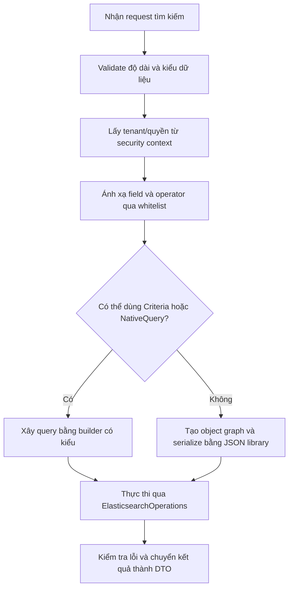

# Kiểm soát escaping và tránh ghép JSON từ đầu vào tùy ý

Khi xây dựng truy vấn Elasticsearch trong Java, việc đưa dữ liệu do người dùng nhập vào Query DSL cần được xử lý đúng cách. Một chuỗi có dấu ngoặc kép, dấu gạch chéo ngược, ký tự xuống dòng hoặc nội dung giống JSON có thể làm hỏng request nếu được ghép trực tiếp vào chuỗi JSON. Nguy hiểm hơn, nếu đầu vào được dùng để tạo cấu trúc query, người dùng có thể làm thay đổi điều kiện mà ứng dụng định gửi.

Trong Spring Data Elasticsearch, nên ưu tiên **`NativeQuery`** hoặc **`CriteriaQuery`** để truyền giá trị qua API có kiểu. Nếu bắt buộc phải dùng `StringQuery`, hãy xây dựng cấu trúc dữ liệu rồi serialize thành JSON bằng thư viện JSON, thay vì tự nối chuỗi. Đồng thời cần phân biệt ba lớp xử lý khác nhau:

- **Java string escaping**: quy tắc biểu diễn chuỗi bên trong source code Java.
- **JSON escaping**: quy tắc mã hóa giá trị chuỗi thành JSON hợp lệ.
- **Elasticsearch query-language escaping**: quy tắc của các ngôn ngữ con như `query_string`, nơi một số ký tự có ý nghĩa toán tử.

Xử lý đúng một lớp không tự động xử lý hai lớp còn lại. Ví dụ, JSON được serialize hợp lệ vẫn có thể chứa cú pháp `query_string` mà người dùng vô tình hoặc cố ý dùng để thay đổi ý nghĩa tìm kiếm.

## 1. Vì sao ghép JSON trực tiếp dễ gây lỗi?

Giả sử ứng dụng cần tìm sản phẩm theo category. Một cách làm dễ viết nhưng không an toàn là ghép giá trị đầu vào vào JSON:

```java
String category = request.category();

String json = """
    {
      "query": {
        "term": {
          "category": "%s"
        }
      }
    }
    """.formatted(category);
```

Với đầu vào thông thường như `audio`, chuỗi tạo ra trông có vẻ hợp lệ. Nhưng JSON string phải xử lý các ký tự như `"`, `\\` và ký tự điều khiển. Nếu đầu vào chứa dấu ngoặc kép hoặc xuống dòng, request có thể trở thành JSON không hợp lệ. Nếu chuỗi được ghép vào vị trí cấu trúc thay vì vị trí giá trị, người dùng có thể làm thay đổi cây Query DSL.

Ví dụ này còn dễ tạo lỗi khi sau này query được mở rộng thêm `bool`, `filter`, `range`, `sort` hoặc aggregation. Người viết phải tự nhớ dấu phẩy, dấu ngoặc, dấu nháy và quy tắc escape ở mọi nhánh.

**Không dùng** `String.format`, `formatted`, phép cộng chuỗi hoặc template text để chèn input không tin cậy vào JSON DSL. Cần xây cấu trúc bằng API có kiểu hoặc serialize dữ liệu có cấu trúc.

## 2. Phân biệt ba lớp escaping

### 2.1. Java string escaping

Trong source code Java, dấu nháy kép được dùng để bao chuỗi. Nếu muốn có dấu nháy kép bên trong literal, cần escape theo cú pháp Java:

```java
String value = "He said: \"hello\"";
String path = "C:\\catalog\\products";
```

Text block `"""` giúp viết chuỗi nhiều dòng dễ đọc hơn, nhưng **không tự động làm an toàn dữ liệu động**. Nếu dùng `.formatted(userInput)` trong text block, nội dung đầu vào vẫn được chèn nguyên vào vị trí placeholder.

### 2.2. JSON escaping

JSON có quy tắc riêng cho string value. Ví dụ, một giá trị chứa dấu nháy kép phải được biểu diễn bằng `\"`, dấu gạch chéo ngược bằng `\\`, và ký tự xuống dòng bằng escape tương ứng. Một JSON serializer sẽ thực hiện việc này đúng cách.

Ví dụ về giá trị Java:

```java
String category = "audio \"premium\"";
```

Khi serialize thành JSON, serializer mã hóa dấu nháy kép bên trong giá trị để JSON vẫn hợp lệ. Không cần tự viết hàm thay thế `"` hoặc `\\` vì cách xử lý thủ công thường bỏ sót ký tự điều khiển, Unicode hoặc trường hợp escape kép.

### 2.3. Escaping của query language

Một số query của Elasticsearch chứa ngôn ngữ con có cú pháp riêng. Ví dụ `query_string` hỗ trợ toán tử, dấu ngoặc, wildcard, field selector và các ký tự đặc biệt. Một JSON string hợp lệ không có nghĩa nội dung của nó được hiểu như văn bản thuần.

Ví dụ, nếu ứng dụng serialize chuỗi `wireless OR headphones` thành JSON hợp lệ rồi đặt nó vào `query_string.query`, Elasticsearch vẫn diễn giải `OR` theo cú pháp query string. JSON serializer không escape toán tử của query language.

Khi người dùng chỉ nhập từ khóa thông thường, hãy ưu tiên `match` trên field `text`. Chỉ dùng `query_string` khi sản phẩm chủ động cung cấp chức năng tìm kiếm theo cú pháp nâng cao và đã định nghĩa rõ cách xử lý cú pháp đó.

| Lớp | Ví dụ cần xử lý | Cách làm phù hợp |
|---|---|---|
| Java source | `"`, `\\`, literal nhiều dòng | Dùng cú pháp Java đúng; text block chỉ hỗ trợ trình bày. |
| JSON | Quote, backslash, control characters, Unicode | Dùng JSON serializer như Jackson. |
| Query language | `AND`, `OR`, wildcard, ngoặc và cú pháp parser | Dùng query phù hợp hoặc escaping theo đúng parser. |

## 3. Cách ưu tiên: dùng `NativeQuery` với builder có kiểu

`NativeQuery` cho phép xây Query DSL bằng builder của Elasticsearch Java API Client. Giá trị đầu vào được truyền vào thuộc tính của request builder, không được chèn vào một đoạn JSON tùy ý.

Ví dụ tìm sản phẩm theo tên và category:

```java
import co.elastic.clients.elasticsearch._types.FieldValue;
import org.springframework.data.elasticsearch.client.elc.NativeQuery;
import org.springframework.data.elasticsearch.core.ElasticsearchOperations;
import org.springframework.data.elasticsearch.core.SearchHits;
import org.springframework.data.elasticsearch.core.query.Query;
import org.springframework.stereotype.Service;

@Service
public class ProductSearchService {

    private final ElasticsearchOperations operations;

    public ProductSearchService(ElasticsearchOperations operations) {
        this.operations = operations;
    }

    public SearchHits<ProductDocument> search(
            String searchText,
            String category) {

        Query query = NativeQuery.builder()
            .withQuery(q -> q
                .bool(b -> b
                    .must(m -> m
                        .match(match -> match
                            .field("name")
                            .query(searchText)
                        )
                    )
                    .filter(f -> f
                        .term(term -> term
                            .field("category")
                            .value(FieldValue.of(category))
                        )
                    )
                )
            )
            .build();

        return operations.search(query, ProductDocument.class);
    }
}
```

Trong ví dụ này:

- `searchText` là giá trị của full-text query trên field `name`.
- `category` là giá trị của exact filter trên field `category`.
- Các field và cấu trúc `bool` được xác định trong code.
- Người dùng chỉ cung cấp giá trị, không được cung cấp một đoạn JSON có thể thêm clause mới.

Builder chịu trách nhiệm serialize request theo giao thức client. Nếu `searchText` chứa dấu nháy kép, dấu gạch chéo ngược hoặc dấu ngoặc nhọn, nó vẫn là dữ liệu đầu vào của `match`, không trở thành một phần cấu trúc Query DSL.

Lưu ý rằng builder không thay thế validation nghiệp vụ. Ứng dụng vẫn cần giới hạn độ dài input, kiểm tra giá trị rỗng và áp dụng tenant/security filter từ ngữ cảnh xác thực.

## 4. Dùng `CriteriaQuery` cho điều kiện đơn giản

Với điều kiện tìm kiếm đơn giản, `CriteriaQuery` cũng giúp tránh tự tạo JSON:

```java
import org.springframework.data.elasticsearch.core.query.Criteria;
import org.springframework.data.elasticsearch.core.query.CriteriaQuery;
import org.springframework.data.elasticsearch.core.query.Query;

public SearchHits<ProductDocument> findByCategory(String category) {
    Criteria criteria = Criteria.where("category").is(category);
    Query query = new CriteriaQuery(criteria);

    return operations.search(query, ProductDocument.class);
}
```

`category` được truyền như giá trị của điều kiện `is`. Nó không được diễn giải thành một phần của cấu trúc JSON. Tên field `category` được khai báo cố định trong code.

Nếu có nhiều điều kiện tùy chọn, chỉ thêm predicate sau khi kiểm tra input:

```java
Criteria criteria = Criteria.where("tenantId").is(authenticatedTenantId);

if (category != null && !category.isBlank()) {
    criteria.and("category").is(category.trim());
}

if (minPrice != null) {
    criteria.and("price").greaterThanEqual(minPrice);
}

Query query = new CriteriaQuery(criteria);
```

Các property path như `tenantId`, `category` và `price` được xác định trong code. Không nên nhận nguyên tên field từ request rồi truyền thẳng vào Criteria; phần field path cần được kiểm soát riêng.

## 5. Khi phải dùng `StringQuery`, serialize cấu trúc thay vì nối chuỗi

Có những trường hợp query DSL đã được lưu dưới dạng JSON hoặc cần tạo một query động mà nhóm dự án quyết định dùng `StringQuery`. Khi đó, có thể tạo object graph bằng `Map`/`List`, sau đó dùng Jackson `ObjectMapper` serialize toàn bộ cấu trúc.

Ví dụ:

```java
import java.util.List;
import java.util.Map;

import com.fasterxml.jackson.core.JsonProcessingException;
import com.fasterxml.jackson.databind.ObjectMapper;
import org.springframework.data.elasticsearch.core.query.Query;
import org.springframework.data.elasticsearch.core.query.StringQuery;

public Query buildQuery(
        ObjectMapper objectMapper,
        String category,
        long minPrice,
        long maxPrice) throws JsonProcessingException {

    Map<String, Object> range = Map.of(
        "priceInCents",
        Map.of("gte", minPrice, "lte", maxPrice)
    );

    Map<String, Object> categoryTerm = Map.of(
        "category",
        category
    );

    Map<String, Object> queryBody = Map.of(
        "bool",
        Map.of(
            "filter",
            List.of(
                Map.of("term", categoryTerm),
                Map.of("range", range)
            )
        )
    );

    String json = objectMapper.writeValueAsString(queryBody);
    return new StringQuery(json);
}
```

Ở đây:

1. `category` được đặt ở vị trí value trong object `term`.
2. `minPrice` và `maxPrice` là giá trị số, không cần tự thêm dấu nháy.
3. `ObjectMapper` chịu trách nhiệm tạo JSON hợp lệ, bao gồm escaping chuỗi.
4. `StringQuery` nhận JSON đã được serialize.

Nếu `category` chứa dấu nháy kép hoặc ký tự xuống dòng, Jackson sẽ mã hóa nó thành JSON string hợp lệ. Giá trị đó vẫn là một term value; nó không thể đóng thêm một query clause vào object graph đã xây.

Trong Spring Boot, thường có thể inject `ObjectMapper` do Boot cấu hình. Không cần tạo một mapper mới ở mỗi request. Nếu cấu trúc query có thể biểu diễn bằng `NativeQuery`, nên ưu tiên builder có kiểu để tránh phải tự duy trì JSON string.

### 5.1. Kiểm tra null và khoảng giá trước khi tạo object

`Map.of(...)` không cho phép key hoặc value là `null`. Đây cũng là lý do nên validate input trước khi tạo query:

```java
if (category == null || category.isBlank()) {
    throw new IllegalArgumentException("category is required");
}

if (minPrice < 0 || maxPrice < minPrice) {
    throw new IllegalArgumentException("Invalid price range");
}
```

Nếu một filter là tùy chọn, hãy thêm hoặc bỏ cả object filter trong `List` theo điều kiện. Không serialize giá trị `null` rồi hy vọng Elasticsearch tự hiểu đó là điều kiện không áp dụng.

## 6. Vì sao JSON serializer an toàn hơn escape thủ công?

Một cách làm khác thường thấy là tự thay thế một vài ký tự:

```java
String escaped = value
    .replace("\\", "\\\\")
    .replace("\"", "\\\"");
```

Đoạn code này chỉ xử lý một phần các trường hợp. JSON còn có các ký tự điều khiển cần mã hóa; thứ tự thay thế cũng quan trọng. Nếu sau này giá trị đi qua thêm một lớp encoding, rất dễ xảy ra escape thiếu hoặc escape hai lần.

Không nên tự viết JSON escaping cho dữ liệu ứng dụng. Hãy để Jackson hoặc JSON-P serialize string value và toàn bộ object graph. Serializer hiểu đúng quy tắc JSON và xử lý các trường hợp ký tự đặc biệt theo chuẩn.

Điều đó cũng có nghĩa không nên serialize một chuỗi JSON đã được escape rồi lại đặt nó vào một JSON string khác nếu mục tiêu là tạo Query DSL. Hãy xây object graph đúng cấu trúc và serialize đúng một lần ở ranh giới cần tạo JSON.

## 7. JSON escaping không thay thế escaping của `query_string`

`query_string` là một query parser có cú pháp riêng. Nó cho phép người dùng viết biểu thức như:

```text
wireless AND headphones
```

hoặc biểu thức có dấu ngoặc, wildcard, field selector và các toán tử khác. Nếu input của người dùng được truyền trực tiếp vào `query_string.query`, họ đang cung cấp một phần ngôn ngữ truy vấn, không chỉ là văn bản tìm kiếm.

Ví dụ:

```java
// Chỉ dùng khi sản phẩm chủ động hỗ trợ cú pháp query_string.
Query query = NativeQuery.builder()
    .withQuery(q -> q
        .queryString(qs -> qs
            .query(advancedQueryText)
        )
    )
    .build();
```

`NativeQuery` bảo vệ cấu trúc JSON của request, nhưng nó không biến nội dung `advancedQueryText` thành văn bản thuần. Parser vẫn diễn giải các toán tử query string có trong giá trị.

Nếu chức năng chỉ là ô tìm kiếm tự do, nên dùng `match`:

```java
Query query = NativeQuery.builder()
    .withQuery(q -> q
        .match(match -> match
            .field("name")
            .query(userText)
        )
    )
    .build();
```

Nếu sản phẩm cần advanced query syntax, cần:

- Quy định rõ cú pháp người dùng được phép nhập.
- Escape ký tự đặc biệt theo đúng cú pháp query parser đang dùng.
- Giới hạn field có thể tìm kiếm; không cho người dùng tự chọn field tùy ý.
- Giới hạn wildcard và độ phức tạp query để tránh truy vấn tốn tài nguyên.
- Xử lý lỗi parse như lỗi input, không biến nó thành kết quả rỗng một cách im lặng.
- Viết test cho các toán tử, dấu ngoặc, quote, backslash và chuỗi không hợp lệ.

Không có một hàm JSON escape chung nào có thể thay thế việc xử lý cú pháp `query_string`.

## 8. Không nhận field name hoặc operator tùy ý từ request

Giá trị và cấu trúc query là hai loại dữ liệu khác nhau. `NativeQuery` giúp truyền value an toàn, nhưng nếu ứng dụng cho phép người dùng quyết định field name, operator hoặc loại query, họ vẫn có thể yêu cầu hệ thống chạy những truy vấn ngoài ý định.

Ví dụ không nên làm:

```java
String field = request.field();
String operator = request.operator();

// Không biến field/operator do client gửi thành cấu trúc Query DSL tùy ý.
```

Hãy ánh xạ lựa chọn bên ngoài sang tập field và operator được cho phép:

```java
public enum ProductFacet {
    CATEGORY,
    BRAND,
    STATUS
}

private String elasticsearchField(ProductFacet facet) {
    return switch (facet) {
        case CATEGORY -> "category";
        case BRAND -> "brand";
        case STATUS -> "status";
    };
}
```

Sau khi parse request thành enum hợp lệ, dùng tên field do ứng dụng kiểm soát:

```java
ProductFacet facet = ProductFacet.valueOf(request.facet().toUpperCase(Locale.ROOT));
String field = elasticsearchField(facet);

Query query = NativeQuery.builder()
    .withQuery(q -> q
        .term(t -> t
            .field(field)
            .value(FieldValue.of(request.value()))
        )
    )
    .build();
```

Ví dụ cần import `java.util.Locale` và xử lý `IllegalArgumentException` khi tên facet không hợp lệ. Nếu không muốn expose enum name trực tiếp, hãy dùng parser ánh xạ chuỗi API sang enum. Điều quan trọng là chỉ có field trong whitelist mới được dùng để tạo query.

Áp dụng nguyên tắc tương tự cho:

- Sort field và sort direction.
- Tên index/alias đích.
- Loại query được phép sử dụng.
- Tên aggregation và field aggregation.
- Script, regexp, wildcard hoặc các option có chi phí cao.

JSON escaping không thể biến một field name tùy ý thành field hợp lệ hoặc an toàn. Field name phải được kiểm soát bằng thiết kế API và whitelist.

## 9. Giữ điều kiện tenant và quyền truy cập ở phía server

Nếu ứng dụng multi-tenant, không nên tin `tenantId` do client gửi để quyết định phạm vi dữ liệu. Hãy lấy tenant từ principal hoặc security context đã xác thực, rồi thêm filter vào query chính:

```java
String tenantId = currentUser.tenantId();

Query query = NativeQuery.builder()
    .withQuery(q -> q
        .bool(b -> b
            .must(m -> m.match(match -> match
                .field("name")
                .query(userText)
            ))
            .filter(f -> f.term(term -> term
                .field("tenantId")
                .value(FieldValue.of(tenantId))
            ))
        )
    )
    .build();
```

Tenant filter phải được tạo từ thông tin đã xác thực và nằm trong query chính để giới hạn cả hits lẫn aggregations. Không đặt điều kiện bảo mật quan trọng chỉ trong `post_filter`, vì aggregation không bị `post_filter` giới hạn.

Escaping chỉ bảo vệ cách biểu diễn dữ liệu trong request. Nó không thay thế authorization, tenant isolation hoặc kiểm tra quyền truy cập.

## 10. Giới hạn input và độ phức tạp truy vấn

Ngay cả khi dùng builder có kiểu, input quá dài hoặc query quá rộng vẫn có thể làm tăng chi phí tìm kiếm. Nên xác định giới hạn phù hợp với sản phẩm:

| Input | Kiểm soát gợi ý |
|---|---|
| Search text | Giới hạn độ dài, trim khoảng trắng và quy định hành vi khi rỗng. |
| Category/brand/status | Chỉ chấp nhận giá trị hợp lệ theo domain hoặc danh mục cho phép. |
| Numeric range | Kiểm tra cận âm, `min <= max` và giới hạn độ rộng khoảng nếu cần. |
| Date range | Parse thành kiểu date/time rõ ràng, thống nhất timezone và giới hạn khoảng thời gian. |
| Page size | Đặt mức tối đa phía server; không tin trực tiếp `size` từ request. |
| Sort | Whitelist field và chỉ cho phép hướng `ASC`/`DESC`. |
| Wildcard/regexp | Chỉ mở khi cần, giới hạn pattern và theo dõi chi phí thực tế. |
| Advanced query syntax | Xác định grammar, escape theo parser và giới hạn độ phức tạp. |

Không nên biến mọi input không hợp lệ thành chuỗi rỗng rồi tiếp tục query. Trả lỗi validation rõ ràng giúp người dùng biết điều kiện nào cần sửa và giúp hệ thống tránh chạy truy vấn ngoài ý định.

## 11. Tránh ghép JSON cho script và các query đặc biệt

Các query dùng script, regexp hoặc query parser có thể có cú pháp riêng và chi phí cao. Không nối input người dùng trực tiếp vào script source hoặc biểu thức regexp.

Với script, ưu tiên script cố định và truyền giá trị qua `params` thay vì tạo source mới bằng string concatenation. Ví dụ về ý tưởng:

```json
{
  "script": {
    "source": "doc['price'].value * params.factor > params.limit",
    "params": {
      "factor": 1.2,
      "limit": 100
    }
  }
}
```

`source` là logic do ứng dụng kiểm soát; `factor` và `limit` là tham số dữ liệu. Không cho phép client gửi script source tùy ý nếu chức năng không được thiết kế rõ ràng để chạy script do người dùng cung cấp.

Tương tự, regexp pattern cần được giới hạn và kiểm thử. JSON serializer chỉ bảo đảm pattern được mã hóa hợp lệ trong JSON, không bảo đảm pattern có chi phí thực thi thấp hoặc có semantics mong muốn.

## 12. Kiểm thử escaping và hành vi truy vấn

Một bài test serialization nên bao gồm các ký tự dễ gây lỗi:

```java
import static org.assertj.core.api.Assertions.assertThat;

import com.fasterxml.jackson.databind.JsonNode;
import com.fasterxml.jackson.databind.ObjectMapper;
import org.junit.jupiter.api.Test;

class QueryJsonSerializationTest {

    private final ObjectMapper objectMapper = new ObjectMapper();

    @Test
    void serializesSpecialCharactersAsAJsonStringValue() throws Exception {
        String input = "audio \"premium\" \\ path\nline 2 {x}: [y]";

        String json = objectMapper.writeValueAsString(
            java.util.Map.of("category", input)
        );

        JsonNode parsed = objectMapper.readTree(json);

        assertThat(parsed.get("category").asText()).isEqualTo(input);
    }
}
```

Test này kiểm tra serializer giữ nguyên giá trị sau khi JSON được parse lại. Nó xác nhận lớp JSON escaping, không kiểm tra Elasticsearch query parser hoặc mapping.

Với integration test, nên xác nhận một input chứa ký tự đặc biệt được xem là giá trị literal trong field, không tạo thêm query clause. Nếu sản phẩm hỗ trợ `query_string`, cần test riêng cú pháp parser và các trường hợp escape của query language.

Một số trường hợp nên đưa vào test:

- Dấu nháy kép: `"`.
- Backslash: `\\`.
- Xuống dòng và tab.
- Unicode và ký tự có dấu.
- Dấu ngoặc nhọn, ngoặc vuông, dấu hai chấm và dấu phẩy.
- Chuỗi rỗng, chỉ có khoảng trắng và chuỗi rất dài.
- Query string chứa toán tử `AND`, `OR`, wildcard hoặc dấu ngoặc nếu chức năng hỗ trợ cú pháp nâng cao.
- Tên field hoặc operator không nằm trong whitelist.

Không chỉ kiểm tra request có parse được. Cần xác nhận kết quả thực tế đúng với semantics nghiệp vụ và không mở rộng phạm vi dữ liệu ngoài ý định.

## 13. Bảng chọn cách xây query

| Nhu cầu | Cách nên dùng | Lý do |
|---|---|---|
| Tìm văn bản thông thường | `NativeQuery` với `match` hoặc `Criteria.matches` | Input được truyền như dữ liệu; không cần query parser syntax. |
| Exact filter theo category/SKU | `NativeQuery` với `term` hoặc `Criteria.is` | Field và operator được kiểm soát, value truyền riêng. |
| Ghép điều kiện động đơn giản | `CriteriaQuery` | Dễ thêm/bỏ predicate theo input đã validate. |
| Query DSL phức tạp | `NativeQuery` | Builder có kiểu và thể hiện rõ cấu trúc request. |
| Query JSON có sẵn cần giữ nguyên | `StringQuery` với JSON được serialize từ object graph | Jackson xử lý escaping thay cho nối chuỗi. |
| Người dùng nhập cú pháp nâng cao | Query parser được giới hạn và xử lý syntax riêng | JSON escaping không thay thế query-language escaping. |
| Người dùng chọn field/sort | Enum hoặc whitelist phía server | Không cho input quyết định cấu trúc query tùy ý. |

## 14. Quy trình an toàn khi xây dựng query động



Trình tự nên áp dụng:

1. Nhận dữ liệu đầu vào và validate kiểu, độ dài, khoảng giá trị.
2. Lấy tenant và quyền truy cập từ phía server.
3. Chuyển lựa chọn field/operator thành enum hoặc giá trị trong whitelist.
4. Dùng `NativeQuery` hoặc `CriteriaQuery` nếu có thể.
5. Nếu phải dùng `StringQuery`, tạo cấu trúc `Map`/`List` rồi serialize bằng JSON library.
6. Nếu dùng `query_string`, xử lý cú pháp theo đúng query parser, không nhầm với JSON escaping.
7. Thực thi qua `ElasticsearchOperations` và kiểm tra lỗi parse/validation.
8. Kiểm thử các ký tự đặc biệt, quyền truy cập và kết quả trên dữ liệu đại diện.

## 15. Kết luận

Không nên ghép JSON Query DSL trực tiếp từ input không tin cậy. Việc chèn chuỗi bằng `+`, `String.format` hoặc text block không tự escape JSON và có thể làm request hỏng hoặc thay đổi cấu trúc query.

Trong Spring Data Elasticsearch, ưu tiên `NativeQuery` và `CriteriaQuery` để truyền giá trị qua builder có kiểu. Nếu cần `StringQuery`, hãy tạo object graph rồi serialize bằng Jackson hoặc thư viện JSON tương đương. Kiểm soát riêng tên field, operator, index, sort và các thành phần cấu trúc bằng whitelist.

Cuối cùng, hãy phân biệt Java escaping, JSON escaping và query-language escaping. `match` phù hợp với văn bản tìm kiếm thông thường; `query_string` chỉ nên dùng khi sản phẩm thực sự hỗ trợ cú pháp nâng cao. Kết hợp serialization đúng, validation, authorization và test ký tự đặc biệt sẽ giúp query động an toàn, ổn định và dễ bảo trì.
