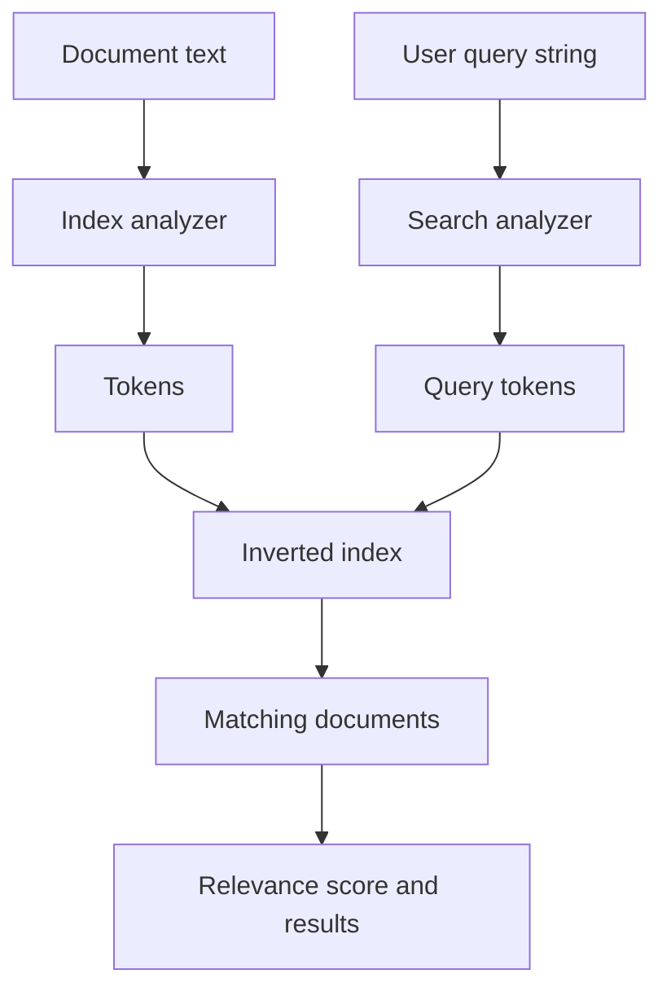

# Match query và phân tích chuỗi truy vấn

Trong tìm kiếm toàn văn của Elasticsearch, `match` query là truy vấn cơ bản để tìm nội dung trong các field được phân tích như `text`. Khi nhận một chuỗi truy vấn, Elasticsearch áp dụng analyzer phù hợp để biến chuỗi thành các token, sau đó tìm những document có token tương ứng trong inverted index.

Điểm quan trọng là `match` không đơn giản so sánh hai chuỗi nguyên văn. Chuỗi người dùng nhập có thể được chuẩn hóa, chuyển chữ thường, tách token, loại bỏ stop word hoặc biến đổi theo stemming/synonym tùy analyzer. Kết quả phụ thuộc cả analyzer lúc index document lẫn analyzer lúc phân tích chuỗi truy vấn.

Spring Data Elasticsearch có thể tạo `match` query bằng `NativeQuery` hoặc khai báo bằng repository `@Query`. Khi cần tìm kiếm toàn văn, cần hiểu rõ cách phân tích chuỗi, operator AND/OR, `minimum_should_match`, fuzziness và mapping của field để tránh kết quả quá rộng hoặc quá hẹp.

## 1. Tìm kiếm toàn văn và inverted index

Elasticsearch sử dụng Lucene để lập chỉ mục và tìm kiếm. Với field `text`, dữ liệu thường được phân tích thành token thay vì lưu như một giá trị duy nhất để so khớp nguyên văn.

Ví dụ document:

```json
{
  "title": "Spring Data Elasticsearch in Practice",
  "description": "Build search applications with Java and Spring"
}
```

Với standard analyzer, tiêu đề có thể được phân tích thành các token gần như:

```text
spring
data
elasticsearch
in
practice
```

Inverted index lưu mối liên hệ từ token tới những document chứa token đó. Khi người dùng tìm `spring data`, Elasticsearch phân tích chuỗi truy vấn thành token rồi tra cứu inverted index để xác định document phù hợp.



Hai bước phân tích thường được gọi là:

- **Index-time analysis:** analyzer xử lý nội dung field khi document được index.
- **Search-time analysis:** analyzer xử lý chuỗi truy vấn khi chạy search.

Để match hoạt động như mong muốn, hai phía cần có semantics tương thích. Nếu index-time analyzer tạo token khác với search-time analyzer, người dùng có thể không tìm thấy nội dung dù chuỗi nhìn bằng mắt có vẻ giống nhau.

## 2. Khai báo field text và analyzer

Giả sử ứng dụng quản lý bài viết:

```java
import org.springframework.data.annotation.Id;
import org.springframework.data.elasticsearch.annotations.Document;
import org.springframework.data.elasticsearch.annotations.Field;
import org.springframework.data.elasticsearch.annotations.FieldType;

@Document(indexName = "articles")
public class Article {

    @Id
    private String id;

    @Field(type = FieldType.Text)
    private String title;

    @Field(type = FieldType.Text)
    private String content;

    @Field(type = FieldType.Keyword)
    private String status;

    protected Article() {
    }

    // Constructors and accessors omitted for brevity.
}
```

`title` và `content` là field `text`, phù hợp cho full-text search. `status` là `keyword`, phù hợp cho lọc chính xác như `PUBLISHED` hoặc `DRAFT`.

Mapping có thể được khai báo tường minh:

```json
PUT /articles
{
  "mappings": {
    "properties": {
      "title": {
        "type": "text",
        "analyzer": "standard",
        "search_analyzer": "standard"
      },
      "content": {
        "type": "text",
        "analyzer": "standard",
        "search_analyzer": "standard"
      },
      "status": {
        "type": "keyword"
      }
    }
  }
}
```

Nếu không khai báo analyzer riêng, field text thường sử dụng analyzer mặc định của Elasticsearch. Khai báo tường minh giúp mapping dễ đọc và làm rõ hợp đồng phân tích giữa index và search.

### 2.1 Analyzer gồm những thành phần nào?

Một analyzer thường bao gồm:

1. **Character filters:** biến đổi văn bản trước khi tách token, ví dụ loại bỏ hoặc thay thế một số ký tự.
2. **Tokenizer:** chia văn bản thành token.
3. **Token filters:** biến đổi token, ví dụ lowercase, stop words, stemming hoặc synonyms.

Ví dụ standard analyzer thường tách từ theo ranh giới từ và chuẩn hóa chữ thường. Một analyzer khác có thể bổ sung stop filter hoặc stemmer để đưa các biến thể từ về dạng chuẩn.

### 2.2 `analyzer` và `search_analyzer`

- `analyzer` chỉ định analyzer được dùng khi index giá trị field.
- `search_analyzer` chỉ định analyzer được dùng khi phân tích chuỗi truy vấn cho field.

Hai analyzer có thể giống nhau hoặc khác nhau. Ví dụ, index có thể dùng edge n-gram để hỗ trợ autocomplete, trong khi search dùng analyzer thông thường để tránh phân tách truy vấn thành quá nhiều token. Với match query thông thường, Elasticsearch dùng search analyzer được cấu hình cho field; có thể ghi đè analyzer ở query nếu có lý do rõ ràng.

Thay đổi analyzer index-time không tự phân tích lại các token đã được index. Nếu muốn thay đổi cách token hóa dữ liệu cũ, cần tạo index mới và reindex dữ liệu. Một số thay đổi search-time có thể ảnh hưởng truy vấn mới mà không cần reindex, nhưng phải kiểm tra tương thích với token hiện có.

## 3. Match query cơ bản

Một `match` query nhận tên field và chuỗi cần tìm:

```json
GET /articles/_search
{
  "query": {
    "match": {
      "title": "spring data"
    }
  }
}
```

Elasticsearch phân tích chuỗi `spring data` bằng search analyzer của field `title`, sau đó tìm document chứa các token phù hợp. Query này thường được dùng cho field `text`.

Có thể khai báo rõ `query` trong object:

```json
GET /articles/_search
{
  "query": {
    "match": {
      "title": {
        "query": "spring data"
      }
    }
  }
}
```

Dạng object cho phép bổ sung operator, analyzer, fuzziness, `minimum_should_match` và các tùy chọn khác.

### 3.1 Match query không phải exact string equality

Giả sử document có tiêu đề `Spring Data Elasticsearch in Practice`. Query `match` với `spring data` có thể tìm thấy document dù chuỗi truy vấn không giống toàn bộ tiêu đề.

Nếu nhu cầu là so khớp chính xác một mã hoặc giá trị phân loại, hãy dùng field `keyword` và `term` query. Nếu nhu cầu là tìm nội dung văn bản, `match` trên field `text` thường phù hợp hơn.

### 3.2 Match query và relevance

`match` là query có scoring. Các document khớp có thể nhận `_score` khác nhau dựa trên mức độ liên quan và cấu trúc query. Khi không chỉ định sort riêng, kết quả thường được xếp theo score giảm dần.

Score không phải xác suất. Không nên diễn giải `_score = 2.0` là “độ chính xác 2 lần” hoặc so sánh score giữa các truy vấn khác nhau như cùng một thang đo tuyệt đối.

## 4. Operator OR và AND

Khi chuỗi truy vấn được phân tích thành nhiều token, `match` cần xác định document phải chứa token nào.

### 4.1 Mặc định OR

Theo mặc định, `match` dùng operator `OR`. Với query `spring data`, document có thể khớp nếu chứa `spring` hoặc `data` sau phân tích.

```json
GET /articles/_search
{
  "query": {
    "match": {
      "title": {
        "query": "spring data",
        "operator": "or"
      }
    }
  }
}
```

OR thường tăng recall: nhiều document có cơ hội được trả về hơn. Tuy nhiên, kết quả có thể rộng nếu chuỗi truy vấn có nhiều từ phổ biến.

### 4.2 AND

Nếu muốn document chứa tất cả token được phân tích, dùng `operator: "and"`:

```json
GET /articles/_search
{
  "query": {
    "match": {
      "title": {
        "query": "spring data",
        "operator": "and"
      }
    }
  }
}
```

AND thường giảm số kết quả và tăng độ chặt của điều kiện. Tuy nhiên, nó không yêu cầu token nằm cạnh nhau hoặc theo đúng thứ tự. Nếu cần cụm từ xuất hiện liên tiếp, cân nhắc `match_phrase`.

### 4.3 So sánh OR, AND và phrase

| Kiểu truy vấn | Điều kiện khớp | Dùng khi |
|---|---|---|
| `match` mặc định OR | Một hoặc nhiều token phù hợp | Tìm rộng, ưu tiên recall |
| `match` với AND | Tất cả token phù hợp, không nhất thiết liền nhau | Tìm chặt hơn theo các từ |
| `match_phrase` | Token khớp theo thứ tự/vị trí cụm từ | Cần cụm từ hoặc thứ tự từ |

Ví dụ query `spring data`:

- Document `Spring applications with data search` có thể khớp AND vì chứa cả hai token nhưng cách xa nhau.
- Document `Spring Data Elasticsearch` có thể khớp phrase vì các token nằm liền nhau theo thứ tự.

## 5. `minimum_should_match`

`minimum_should_match` cho phép quy định số lượng hoặc tỷ lệ token/điều kiện should tối thiểu phải khớp. Đây là lựa chọn linh hoạt hơn việc chỉ chọn OR hoặc AND.

Ví dụ query có bốn token:

```json
GET /articles/_search
{
  "query": {
    "match": {
      "content": {
        "query": "spring data elasticsearch java",
        "minimum_should_match": "75%"
      }
    }
  }
}
```

Với bốn clause/token được tạo ra, tỷ lệ 75% yêu cầu tối thiểu ba clause khớp. Giá trị thực tế phụ thuộc số clause sau khi analyzer xử lý, không nhất thiết bằng số từ người dùng gõ ban đầu.

Có thể dùng số nguyên:

```json
"minimum_should_match": 2
```

Hoặc biểu thức phức tạp theo số clause, ví dụ:

```json
"minimum_should_match": "2<-25% 9<-3"
```

Biểu thức nâng cao hữu ích khi số token truy vấn thay đổi nhiều, nhưng cần hiểu cú pháp và kiểm thử với độ dài query thực tế. Với API tìm kiếm đơn giản, một tỷ lệ hoặc số nguyên dễ dự đoán hơn.

## 6. Phân tích chuỗi truy vấn diễn ra như thế nào?

Giả sử người dùng nhập:

```text
The QUICK brown foxes
```

Với một analyzer có lowercase và stop filter, chuỗi có thể được chuyển thành token:

```text
quick
brown
foxes
```

Nếu có stemmer phù hợp, `foxes` có thể được đưa về dạng gốc theo ngôn ngữ và stemmer được cấu hình. Đây chỉ là ví dụ minh họa; token thực tế phải được xác nhận bằng `_analyze` trên index và analyzer đang dùng.

Match query không tự biết ý nghĩa ngôn ngữ của chuỗi. Nó gọi analyzer đã cấu hình. Nếu analyzer không có stemming, synonyms hoặc bộ tách từ phù hợp, query chỉ tìm theo token mà analyzer tạo ra.

### 6.1 Kiểm tra token bằng `_analyze`

Elasticsearch cung cấp Analyze API để xem một chuỗi được chuyển thành token ra sao:

```http
POST /articles/_analyze
{
  "field": "title",
  "text": "Spring Data Elasticsearch in Practice"
}
```

Hoặc chỉ định analyzer:

```http
POST /articles/_analyze
{
  "analyzer": "standard",
  "text": "The QUICK brown foxes"
}
```

Kết quả trả về danh sách token cùng thông tin như vị trí và offset. Đây là công cụ quan trọng khi query không trả kết quả như dự kiến.

### 6.2 Index analyzer và search analyzer phải tương thích

Ví dụ mapping:

```json
PUT /articles
{
  "settings": {
    "analysis": {
      "analyzer": {
        "content_index": {
          "type": "custom",
          "tokenizer": "standard",
          "filter": ["lowercase", "english_stop", "porter_stem"]
        },
        "content_search": {
          "type": "custom",
          "tokenizer": "standard",
          "filter": ["lowercase", "english_stop", "porter_stem"]
        }
      },
      "filter": {
        "english_stop": {
          "type": "stop",
          "stopwords": "_english_"
        }
      }
    }
  },
  "mappings": {
    "properties": {
      "content": {
        "type": "text",
        "analyzer": "content_index",
        "search_analyzer": "content_search"
      }
    }
  }
}
```

Hai analyzer trong ví dụ dùng cùng pipeline. Trong một thiết kế khác, index analyzer có thể dùng n-gram để hỗ trợ autocomplete còn search analyzer dùng tokenizer thông thường. Điều quan trọng là token từ query phải có khả năng khớp với cách token được lưu trong inverted index.

Lưu ý analyzer, tokenizer và token filter cần tồn tại trong Elasticsearch version/plugin tương ứng. Khi khai báo custom analyzer, hãy tạo index mới nếu cần thay đổi cấu trúc phân tích index-time của dữ liệu đã tồn tại.

### 6.3 Ngôn ngữ và phân tách từ

Analyzer mặc định không nhất thiết phù hợp với mọi ngôn ngữ. Với ngôn ngữ có quy tắc tách từ phức tạp hoặc từ ghép, standard analyzer có thể tạo token chưa phù hợp với kỳ vọng tìm kiếm.

Đối với nội dung tiếng Việt, cần kiểm tra thực tế cách tokenizer tách từ và cân nhắc plugin hoặc custom analysis phù hợp với phiên bản Elasticsearch đang triển khai. Không nên giả định khoảng trắng luôn tương đương ranh giới từ có nghĩa trong mọi ngôn ngữ. Hãy dùng `_analyze` với các câu truy vấn đại diện và kiểm thử cả index-time lẫn search-time.

## 7. Tùy chọn analyzer trong match query

Có thể chỉ định analyzer riêng trong query:

```json
GET /articles/_search
{
  "query": {
    "match": {
      "content": {
        "query": "Spring Data",
        "analyzer": "standard"
      }
    }
  }
}
```

Nếu không chỉ định, Elasticsearch dùng search analyzer của field (hoặc analyzer mặc định theo mapping). Chỉ ghi đè analyzer khi có lý do rõ ràng, bởi analyzer không tương thích với index-time analysis có thể làm mất kết quả.

## 8. Fuzziness: chịu lỗi gõ sai

Người dùng có thể nhập sai chính tả. `fuzziness` cho phép match query tìm các term gần giống với term truy vấn dựa trên khoảng cách chỉnh sửa Levenshtein (với các giới hạn của Elasticsearch).

Ví dụ:

```json
GET /articles/_search
{
  "query": {
    "match": {
      "title": {
        "query": "elastisearch",
        "fuzziness": "AUTO"
      }
    }
  }
}
```

Query có thể tìm term `elasticsearch` dù người dùng bỏ sót một ký tự. `AUTO` chọn ngưỡng fuzziness theo độ dài term; có thể chỉ định rõ khoảng cách edit là `0`, `1` hoặc `2` tùy giới hạn Elasticsearch.

### 8.1 `prefix_length`

`prefix_length` quy định số ký tự đầu tiên phải khớp chính xác trước khi áp dụng fuzzy expansion:

```json
"prefix_length": 2
```

Tăng prefix length có thể giảm số biến thể cần xét và giảm những kết quả sai khác quá xa, nhưng cũng làm giảm khả năng sửa lỗi ở phần đầu từ.

### 8.2 `max_expansions`

`max_expansions` giới hạn số term biến thể được mở rộng:

```json
"max_expansions": 50
```

Giá trị lớn có thể tăng recall nhưng làm query tốn tài nguyên hơn. Hãy đặt giới hạn hợp lý và đo trên dữ liệu thật.

### 8.3 `fuzzy_transpositions`

Tùy chọn này điều khiển việc xem hai ký tự bị đảo vị trí liền kề là một phép chỉnh sửa trong fuzzy matching:

```json
"fuzzy_transpositions": true
```

Ví dụ người dùng gõ `teh` thay vì `the`. Cho phép transposition có thể giúp tìm được từ đúng trong trường hợp đảo ký tự.

### 8.4 Khi nào không nên bật fuzziness?

Fuzziness hữu ích cho từ khóa tự do nhưng không phải lựa chọn phù hợp cho mọi field. Không nên mặc định bật cho:

- Mã định danh, SKU, email hoặc mã hợp đồng cần chính xác.
- Trường có giá trị ngắn, vì một chỉnh sửa có thể làm thay đổi quá nhiều ý nghĩa.
- Query có nhiều token và yêu cầu độ chính xác cao.
- Các truy vấn mà fuzzy expansion tạo ra quá nhiều ứng viên.

Với mã định danh, thường nên dùng `keyword` và exact match. Với tên hoặc tiêu đề, có thể cân nhắc fuzziness có giới hạn sau khi đo chất lượng kết quả.

## 9. `zero_terms_query` và stop words

Một analyzer có thể loại bỏ một số từ phổ biến (stop words). Nếu toàn bộ chuỗi truy vấn chỉ chứa stop words, sau phân tích có thể không còn token nào để tìm.

`zero_terms_query` điều khiển hành vi khi analyzer tạo ra zero token:

```json
GET /articles/_search
{
  "query": {
    "match": {
      "content": {
        "query": "the and of",
        "zero_terms_query": "none"
      }
    }
  }
}
```

Các lựa chọn thường gặp:

- `none`: không trả về document nào (hành vi mặc định phổ biến).
- `all`: coi query như match-all và có thể trả về mọi document trong phạm vi index.

`all` cần được dùng thận trọng. Nếu một query chỉ chứa stop words mà trở thành match-all, endpoint tìm kiếm có thể trả về quá nhiều dữ liệu. Chỉ bật khi semantics sản phẩm thực sự mong muốn điều đó và có giới hạn phân trang/phạm vi rõ ràng.

## 10. `lenient` và dữ liệu không cùng kiểu

`lenient` cho phép match query bỏ qua một số lỗi chuyển đổi kiểu trong những trường hợp được hỗ trợ:

```json
"lenient": true
```

Tùy chọn này có thể hữu ích khi query trên field có kiểu không đồng nhất hoặc khi người dùng nhập giá trị không parse được theo mapping. Tuy nhiên, nó có thể che giấu lỗi dữ liệu hoặc lỗi thiết kế mapping. Không dùng `lenient` như cách sửa một mapping sai; hãy chuẩn hóa kiểu dữ liệu và xác định field được tìm kiếm.

## 11. Kết hợp match với filter trong bool query

Một tìm kiếm sản phẩm thường kết hợp full-text với điều kiện lọc chính xác:

```json
GET /articles/_search
{
  "query": {
    "bool": {
      "must": [
        {
          "match": {
            "content": {
              "query": "spring data elasticsearch",
              "operator": "and"
            }
          }
        }
      ],
      "filter": [
        { "term": { "status": "PUBLISHED" } }
      ]
    }
  }
}
```

Trong ví dụ:

- `must` chứa match query và có thể đóng góp vào relevance score.
- `filter` yêu cầu status chính xác là `PUBLISHED` nhưng không tính score.

Tách full-text relevance và filter cấu trúc giúp query rõ ý định. Các điều kiện như trạng thái, category, tenant hoặc khoảng ngày thường phù hợp với filter nếu không cần ảnh hưởng score.

## 12. Match nhiều field bằng multi_match

Nếu chuỗi truy vấn cần tìm trên nhiều field, có thể dùng `multi_match`:

```json
GET /articles/_search
{
  "query": {
    "multi_match": {
      "query": "spring data",
      "fields": ["title^3", "content"],
      "type": "best_fields"
    }
  }
}
```

`title^3` tăng trọng số field title so với content. `best_fields` thường phù hợp khi một field khớp tốt là tín hiệu quan trọng. Các kiểu multi_match khác như `most_fields`, `cross_fields`, `phrase` hoặc `bool_prefix` có semantics riêng; chọn theo cách dữ liệu được phân tích và cách người dùng tìm kiếm.

`multi_match` cũng phân tích chuỗi query theo analyzer của field hoặc cấu hình tương ứng. Nếu các field có analyzer khác nhau, cần kiểm tra tokenization và kết quả scoring.

## 13. Match query và match_phrase

`match_phrase` dùng khi vị trí và thứ tự token quan trọng:

```json
GET /articles/_search
{
  "query": {
    "match_phrase": {
      "title": {
        "query": "spring data",
        "slop": 1
      }
    }
  }
}
```

`slop` cho phép một mức dịch chuyển/vị trí linh hoạt giữa các token. Giá trị 0 yêu cầu cụm từ khớp vị trí theo thứ tự; tăng slop cho phép khoảng cách hoặc một số thay đổi vị trí theo semantics phrase query.

So sánh:

- `match`: tìm token theo operator/boolean semantics.
- `match_phrase`: tìm chuỗi token theo vị trí và thứ tự.
- `term`: so khớp term chính xác, không phân tích chuỗi truy vấn như match.

Không dùng `match_phrase` cho mọi query vì nó có thể quá chặt và giảm recall. Ngược lại, dùng `match` với OR có thể quá rộng khi người dùng mong đợi một cụm từ cụ thể.

## 14. Sử dụng Match query trong Spring Data Elasticsearch

Với Spring Data Elasticsearch 5.x sử dụng Elasticsearch Java Client, có thể xây dựng match query bằng `NativeQuery`:

```java
import org.springframework.data.elasticsearch.client.elc.NativeQuery;
import org.springframework.data.elasticsearch.core.query.Query;

Query query = NativeQuery.builder()
    .withQuery(q -> q.match(m -> m
        .field("title")
        .query("spring data")
    ))
    .build();
```

Thực thi bằng `ElasticsearchOperations`:

```java
import org.springframework.data.elasticsearch.core.ElasticsearchOperations;
import org.springframework.data.elasticsearch.core.SearchHits;

public class ArticleSearchService {

    private final ElasticsearchOperations operations;

    public ArticleSearchService(ElasticsearchOperations operations) {
        this.operations = operations;
    }

    public SearchHits<Article> searchTitle(String text) {
        Query query = NativeQuery.builder()
            .withQuery(q -> q.match(m -> m
                .field("title")
                .query(text)
            ))
            .build();

        return operations.search(query, Article.class);
    }
}
```

`SearchHits<Article>` cung cấp kết quả tìm kiếm cùng metadata như tổng số hit và score. Nếu chỉ cần entity, có thể map từng `SearchHit<Article>` sang `getContent()`.

### 14.1 Thiết lập operator AND trong Java

```java
import co.elastic.clients.elasticsearch._types.query_dsl.Operator;

Query query = NativeQuery.builder()
    .withQuery(q -> q.match(m -> m
        .field("title")
        .query("spring data")
        .operator(Operator.And)
    ))
    .build();
```

Ở đây mọi token được tạo từ chuỗi truy vấn cần khớp theo semantics AND. Đây vẫn không phải phrase query; thứ tự token không bắt buộc liền nhau.

### 14.2 Thiết lập minimum_should_match và fuzziness

```java
Query query = NativeQuery.builder()
    .withQuery(q -> q.match(m -> m
        .field("content")
        .query("spring data elasticsearch java")
        .minimumShouldMatch("75%")
        .fuzziness("AUTO")
        .prefixLength(1)
        .maxExpansions(50)
    ))
    .build();
```

Ví dụ kết hợp tỷ lệ token tối thiểu và fuzzy matching. Không phải lúc nào cũng nên dùng đồng thời; fuzziness làm tăng số term ứng viên và `minimum_should_match` thay đổi mức độ chặt của query. Hãy đánh giá relevance và latency trên dữ liệu thực tế.

### 14.3 Chỉ định analyzer trong Java

```java
Query query = NativeQuery.builder()
    .withQuery(q -> q.match(m -> m
        .field("content")
        .query("Spring Data")
        .analyzer("standard")
    ))
    .build();
```

Đặt analyzer trong query chỉ nên thực hiện khi muốn override search analyzer đã cấu hình cho field. Nếu không có lý do đặc biệt, để mapping quản lý search analyzer giúp query nhất quán hơn.

### 14.4 Multi-match trong Java

```java
Query query = NativeQuery.builder()
    .withQuery(q -> q.multiMatch(m -> m
        .query("spring data")
        .fields("title^3", "content")
    ))
    .build();
```

Ví dụ tìm trên cả title và content, tăng trọng số title. Các builder cụ thể phụ thuộc phiên bản Elasticsearch Java Client do Spring Data sử dụng; hãy kiểm tra Javadoc đúng phiên bản nếu tên method hoặc kiểu enum khác.

## 15. Sử dụng `@Query` trong repository

Với query ổn định và không cần dựng động, có thể khai báo Query DSL JSON trong `@Query`:

```java
import java.util.List;

import org.springframework.data.elasticsearch.annotations.Query;
import org.springframework.data.elasticsearch.repository.ElasticsearchRepository;

public interface ArticleRepository
        extends ElasticsearchRepository<Article, String> {

    @Query("{\"match\": {\"title\": {\"query\": \"?0\", \"operator\": \"and\"}}}")
    List<Article> findByTitleAllTerms(String text);
}
```

Placeholder `?0` tham chiếu tham số đầu tiên theo cơ chế query annotation của Spring Data Elasticsearch. Cần kiểm tra cách binding của phiên bản đang dùng và tránh tự nối chuỗi đầu vào vào JSON query. Với nhiều option động như analyzer, fuzziness hoặc minimum_should_match, `NativeQuery` thường dễ đọc và dễ kiểm soát hơn.

## 16. Khi nào dùng match, term, match_phrase hoặc query_string?

Các query có tên gần nhau nhưng semantics khác nhau:

| Query | Phân tích chuỗi truy vấn? | Mục đích |
|---|---|---|
| `match` | Có | Full-text search theo token và operator |
| `match_phrase` | Có | Full-text search theo thứ tự/vị trí token |
| `term` | Không phân tích chuỗi truy vấn theo analyzer | Exact term match, thường trên keyword |
| `terms` | Không phân tích từng giá trị như match | Match một trong nhiều term chính xác |
| `query_string` | Có parser cú pháp query | Query nâng cao có toán tử và field syntax |
| `simple_query_string` | Có parser cú pháp giới hạn, thân thiện hơn với input không hợp lệ | Search box hỗ trợ toán tử người dùng |

Với input tìm kiếm thông thường từ người dùng, `match` hoặc `multi_match` thường là lựa chọn an toàn, dễ kiểm soát. `query_string` có cú pháp mạnh nhưng người dùng có thể vô tình hoặc cố ý nhập ký tự điều khiển query; cần hiểu parser và xử lý lỗi. `simple_query_string` bỏ qua một số cú pháp sai và thường phù hợp hơn cho search box có hỗ trợ toán tử.

## 17. Debug khi match query không trả kết quả mong đợi

Khi query trả rỗng hoặc quá nhiều document, đừng chỉ thay operator ngẫu nhiên. Hãy kiểm tra theo các bước:

1. Xác nhận field có mapping `text` hay `keyword`.
2. Kiểm tra `analyzer` và `search_analyzer` của field bằng `GET /index/_mapping`.
3. Dùng `_analyze` để xem token khi index và khi search.
4. Chạy `match` với operator mặc định OR rồi thử AND để hiểu phạm vi kết quả.
5. Kiểm tra stop words và `zero_terms_query`.
6. Nếu có fuzziness, kiểm tra prefix length, max expansions và độ dài token.
7. Kiểm tra query có kết hợp filter khiến document bị loại hay không.
8. Dùng `_explain` hoặc profile API khi cần hiểu score và chi phí query.

Ví dụ kiểm tra mapping:

```http
GET /articles/_mapping
```

Kiểm tra token:

```http
POST /articles/_analyze
{
  "field": "content",
  "text": "Spring Data Elasticsearch"
}
```

Kiểm tra document cụ thể:

```http
GET /articles/_doc/article-1001
```

Kiểm tra lý do document khớp hoặc không khớp:

```http
GET /articles/_explain/article-1001
{
  "query": {
    "match": {
      "content": {
        "query": "spring data",
        "operator": "and"
      }
    }
  }
}
```

`_explain` hữu ích cho một document cụ thể. Profile API giúp phân tích chi phí thực thi query nhưng có overhead, nên chỉ bật khi điều tra.

## 18. Những sai lầm thường gặp

### 18.1 Dùng `term` cho nội dung text

`term` không phân tích chuỗi truy vấn như match. Nếu field là `text`, một cụm người dùng nhập có thể không tồn tại như một term duy nhất. Dùng `match` cho full-text search.

### 18.2 Nghĩ match mặc định yêu cầu tất cả từ

Operator mặc định thường là OR. Nếu muốn mọi token phải khớp, đặt `operator: "and"` hoặc dùng `minimum_should_match` phù hợp.

### 18.3 Nhầm AND với phrase

AND yêu cầu các token cùng khớp nhưng không nhất thiết liền nhau hoặc đúng thứ tự. Dùng `match_phrase` nếu vị trí và thứ tự quan trọng.

### 18.4 Không kiểm tra analyzer

Hai chuỗi nhìn giống nhau có thể tạo token khác nhau do lowercase, stemming, stop words, synonyms hoặc tokenizer. Dùng `_analyze` thay vì suy đoán từ chuỗi gốc.

### 18.5 Bật fuzziness cho mọi field

Fuzziness trên mã định danh hoặc field ngắn có thể trả kết quả không mong muốn và tăng chi phí. Chỉ dùng trên field văn bản tự do khi sản phẩm cần sửa lỗi gõ.

### 18.6 Dùng `minimum_should_match` mà không xét token sau phân tích

Số token có thể ít hơn số từ người dùng nhập do stop words hoặc analyzer. Tỷ lệ cần được đánh giá dựa trên token thực tế.

### 18.7 Thay analyzer index-time nhưng không reindex

Thay mapping analyzer không tự tạo lại token đã index. Nếu thay cách phân tích dữ liệu lịch sử, cần tạo index mới và reindex.

### 18.8 Dùng query_string cho search box mà không kiểm soát cú pháp

Query parser có toán tử và cú pháp riêng. Nếu người dùng nhập ký tự đặc biệt, query có thể lỗi hoặc có semantics khác dự kiến. Dùng `match`/`multi_match` cho input tự do hoặc chọn `simple_query_string` với cấu hình được kiểm soát.

## 19. Nguyên tắc thiết kế tìm kiếm toàn văn

- Dùng `text` cho nội dung cần phân tích và tìm kiếm toàn văn.
- Dùng `keyword` cho mã, trạng thái và giá trị cần so khớp chính xác.
- Thiết kế analyzer theo ngôn ngữ và dữ liệu thực tế; kiểm tra bằng `_analyze`.
- Bảo đảm index analyzer và search analyzer tương thích.
- Bắt đầu với `match` mặc định OR; chuyển sang AND hoặc `minimum_should_match` khi cần tăng độ chặt.
- Dùng `match_phrase` khi thứ tự/vị trí token quan trọng.
- Chỉ bật fuzziness khi cần chịu lỗi gõ và giới hạn expansion.
- Xử lý stop words và zero-token query có chủ đích.
- Tách full-text clause khỏi filter cấu trúc bằng `bool.must` và `bool.filter`.
- Dùng `multi_match` khi tìm trên nhiều field và điều chỉnh boost theo tầm quan trọng.
- Dùng `NativeQuery` cho query động/nâng cao; dùng `@Query` cho query ổn định, đơn giản.
- Reindex khi thay đổi analyzer index-time hoặc cấu trúc token đã lưu.

## 20. Tổng kết

`match` query là nền tảng của tìm kiếm toàn văn trong Elasticsearch. Nó phân tích chuỗi truy vấn bằng search analyzer rồi tìm các token tương ứng trong inverted index. Vì vậy, kết quả phụ thuộc vào field mapping, analyzer lúc index, analyzer lúc search và các tùy chọn như OR/AND, `minimum_should_match`, fuzziness, `prefix_length`, `max_expansions` và `zero_terms_query`.

Trong Spring Data Elasticsearch, `NativeQuery` giúp xây dựng match query bằng Java Client và thực thi qua `ElasticsearchOperations`; `@Query` phù hợp với truy vấn JSON ổn định. Hãy phân biệt match với exact `term` và phrase query, kiểm tra token bằng `_analyze`, kết hợp filter cấu trúc trong bool query và chỉ bật fuzzy matching khi nghiệp vụ cần. Thiết kế analyzer đúng với ngôn ngữ và dữ liệu là điều kiện quan trọng để tìm kiếm trả kết quả có ý nghĩa.

## Tài liệu tham khảo

- [Elasticsearch — Match query](https://www.elastic.co/guide/en/elasticsearch/reference/current/query-dsl-match-query.html)
- [Elasticsearch — Text analysis](https://www.elastic.co/guide/en/elasticsearch/reference/current/analysis.html)
- [Elasticsearch — Analyze API](https://www.elastic.co/guide/en/elasticsearch/reference/current/indices-analyze.html)
- [Elasticsearch — Fuzzy query behavior](https://www.elastic.co/guide/en/elasticsearch/reference/current/query-dsl-fuzzy-query.html)
- [Spring Data Elasticsearch Reference — Search Operations](https://docs.spring.io/spring-data/elasticsearch/reference/elasticsearch/template.html)
