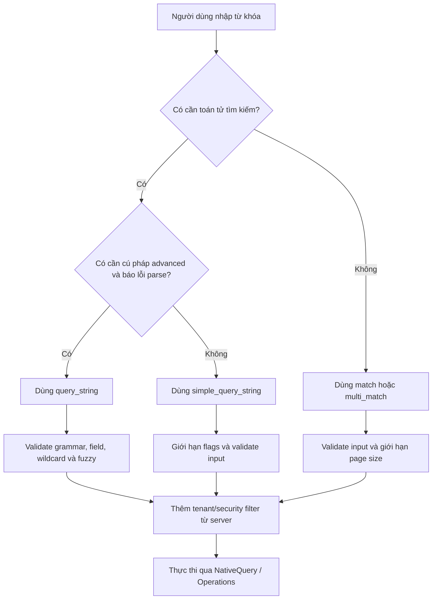

# Query string, simple query string và giới hạn cú pháp đầu vào

Trong chức năng tìm kiếm toàn văn, người dùng đôi khi muốn nhập một biểu thức có toán tử thay vì chỉ nhập vài từ khóa. Elasticsearch cung cấp hai query dành cho trường hợp này: **`query_string`** và **`simple_query_string`**. Spring Data Elasticsearch có thể gọi cả hai thông qua `NativeQuery` và `ElasticsearchOperations`.

Hai query này đều có parser riêng. `query_string` hỗ trợ cú pháp phong phú và báo lỗi khi biểu thức sai cú pháp. `simple_query_string` hỗ trợ một tập cú pháp đơn giản hơn và bỏ qua một số phần cú pháp không hợp lệ thay vì làm hỏng toàn bộ request. Cả hai đều cần giới hạn đầu vào, field được tìm kiếm và các toán tử tốn tài nguyên.

Nếu sản phẩm chỉ cần một ô tìm kiếm từ khóa thông thường, **`match` thường là lựa chọn phù hợp hơn**. Chỉ mở cú pháp query string khi đó là tính năng người dùng thực sự cần, có quy tắc rõ ràng và được kiểm soát ở phía server.

## 1. Ba cách tìm kiếm văn bản thường gặp

Giả sử index `products` có các field:

| Field | Mapping | Mục đích |
|---|---|---|
| `name` | `text` | Tìm theo tên sản phẩm. |
| `description` | `text` | Tìm trong mô tả. |
| `sku` | `keyword` | Tìm mã sản phẩm chính xác. |
| `category` | `keyword` | Lọc chính xác theo danh mục. |
| `tenantId` | `keyword` | Giới hạn dữ liệu theo tenant. |

Ba query có mục tiêu khác nhau:

| Query | Đặc điểm | Phù hợp khi |
|---|---|---|
| `match` | Phân tích input như văn bản tìm kiếm; không diễn giải toán tử query string | Ô tìm kiếm thông thường, tìm từ/cụm từ trong nội dung. |
| `query_string` | Parser cú pháp phong phú; biểu thức sai có thể làm request thất bại | Tính năng advanced search cho người dùng hiểu cú pháp. |
| `simple_query_string` | Tập cú pháp đơn giản hơn; bỏ qua một số phần cú pháp lỗi | Ô tìm kiếm cho phép một số toán tử nhưng cần chịu lỗi tốt hơn. |

Ví dụ cùng một input:

```text
wireless AND headphones
```

- Với `match`, đây là văn bản được phân tích; từ `AND` có thể được xem như một token hoặc bị analyzer xử lý như stop word tùy cấu hình.
- Với `query_string`, `AND` là toán tử Boolean viết hoa.
- Với `simple_query_string`, toán tử được hỗ trợ theo cú pháp đơn giản và flags được bật.

Không nên đổi `match` thành `query_string` chỉ để người dùng nhập được dấu ngoặc hoặc wildcard nếu chưa xác định rõ cách sản phẩm sẽ hỗ trợ cú pháp đó.

## 2. Mapping và analyzer là nền tảng của full-text query

`query_string` và `simple_query_string` thường tìm trên field `text`. Analyzer xử lý nội dung lúc index và search, ví dụ lowercase, tách từ hoặc áp dụng token filter. Vì vậy, cú pháp query không bỏ qua mapping.

Ví dụ entity:

```java
import org.springframework.data.annotation.Id;
import org.springframework.data.elasticsearch.annotations.Document;
import org.springframework.data.elasticsearch.annotations.Field;
import org.springframework.data.elasticsearch.annotations.FieldType;

@Document(indexName = "products")
public class ProductDocument {

    @Id
    private String id;

    @Field(type = FieldType.Text, analyzer = "standard")
    private String name;

    @Field(type = FieldType.Text, analyzer = "standard")
    private String description;

    @Field(type = FieldType.Keyword)
    private String sku;

    @Field(type = FieldType.Keyword)
    private String category;

    @Field(type = FieldType.Keyword)
    private String tenantId;

    protected ProductDocument() {
    }

    public String getId() {
        return id;
    }

    public String getName() {
        return name;
    }
}
```

`name` và `description` được khai báo `text` để full-text search. `sku`, `category` và `tenantId` là `keyword` vì chúng được dùng như giá trị chính xác.

Nếu muốn vừa tìm toàn văn vừa exact match trên một chuỗi, có thể khai báo multi-field, ví dụ `name` kiểu `text` và `name.raw` kiểu `keyword`. Tuy nhiên, query string không thay thế `term` query cho mã định danh hoặc exact filter. Hãy dùng query đúng với semantics của field.

Mapping thực tế của index mới là điều Elasticsearch sử dụng. Nếu index đã tồn tại với mapping cũ, sửa annotation Java không tự đổi kiểu field. Khi truy vấn có kết quả bất ngờ, kiểm tra `GET products/_mapping` và analyzer trước khi thay đổi cú pháp query.

## 3. Cú pháp cơ bản của `query_string`

`query_string` cho phép người dùng diễn đạt biểu thức tìm kiếm bằng một ngôn ngữ nhỏ. Một số cú pháp phổ biến:

| Cú pháp | Ý nghĩa | Ví dụ |
|---|---|---|
| `AND`, `OR`, `NOT` | Toán tử Boolean | `wireless AND headphones` |
| `+` | Term bắt buộc | `+wireless headphones` |
| `-` | Loại term | `wireless -used` |
| `"..."` | Cụm từ | `"wireless headphones"` |
| `(...)` | Nhóm điều kiện | `(wireless OR bluetooth) AND headphones` |
| `*`, `?` | Wildcard | `head*`, `bluetooth?` |
| `~` | Fuzzy hoặc proximity tùy vị trí | `headphons~1` |
| `^` | Boost một biểu thức | `name:wireless^2` |
| `field:value` | Chỉ định field | `name:wireless` |
| `[a TO b]` / `{a TO b}` | Khoảng có/không bao gồm biên | `price:[50 TO 300]` |

Ví dụ:

```text
(wireless OR bluetooth) headphones -refurbished
```

Biểu thức này yêu cầu một trong hai từ `wireless` hoặc `bluetooth`, đồng thời có `headphones`, và loại kết quả chứa `refurbished` theo semantics query string.

### 3.1. Field và boost

Có thể chỉ định field trong biểu thức:

```text
name:wireless OR description:bluetooth
```

Có thể tăng trọng số một field:

```text
name:wireless^3 description:wireless
```

Nếu không chỉ định field trong biểu thức, `fields` của query hoặc `default_field` quyết định các field mặc định được tìm kiếm. Trong ứng dụng, nên cấu hình danh sách field rõ ràng và không để người dùng tự do mở rộng phạm vi tìm kiếm ngoài ý định.

Lưu ý: danh sách `fields` đặt các field mặc định, nhưng cú pháp `field:value` của parser có thể cho phép người dùng chỉ định field khác. Nếu sản phẩm không cho phép field selector, cần giới hạn cú pháp đó bằng parser/flags phù hợp hoặc kiểm tra biểu thức trước khi gửi. Không xem `fields` mặc định là ranh giới phân quyền.

### 3.2. Toán tử mặc định

Nếu biểu thức không ghi rõ toán tử, `query_string` mặc định dùng `OR` giữa các term. Có thể đổi `default_operator` thành `AND` để yêu cầu mọi term phải khớp.

Ví dụ:

```json
GET products/_search
{
  "query": {
    "query_string": {
      "query": "wireless headphones",
      "fields": ["name", "description"],
      "default_operator": "AND"
    }
  }
}
```

Với `AND`, document cần thỏa cả hai term sau khi phân tích. Các toán tử Boolean viết tường minh trong biểu thức vẫn là một phần cú pháp mà parser diễn giải.

## 4. `query_string` nghiêm ngặt với cú pháp không hợp lệ

`query_string` hỗ trợ nhiều tính năng, nhưng parser có thể từ chối biểu thức sai cú pháp. Ví dụ người dùng nhập một dấu ngoặc mở nhưng không đóng hoặc quote không hoàn chỉnh. Elasticsearch có thể trả lỗi parse thay vì trả về danh sách hit.

Điều này phù hợp với advanced search khi giao diện:

- Hướng dẫn cú pháp rõ ràng.
- Hiển thị lỗi parse có thể hiểu được.
- Có thể đánh dấu vị trí hoặc phần biểu thức cần sửa nếu ứng dụng tự phân tích trước.
- Không tự âm thầm thay đổi biểu thức sai thành query khác.

Không nên bắt mọi lỗi query rồi trả danh sách rỗng. Cách đó khiến người dùng không phân biệt được “không có kết quả” với “biểu thức tìm kiếm không hợp lệ”. Hãy chuyển lỗi parser thành lỗi validation/search syntax phù hợp ở API.

## 5. Ký tự đặc biệt và escaping của `query_string`

Query string có các ký tự mang ý nghĩa cú pháp. Những ký tự đặc biệt thường gặp gồm:

```text
+ - = && || > < ! ( ) { } [ ] ^ " ~ * ? : \ /
```

Nếu muốn một ký tự đặc biệt được hiểu theo nghĩa literal, phải escape theo quy tắc của query parser. Ví dụ, để tìm dấu cộng như một phần của chuỗi `C++`, biểu thức query string cần escape dấu cộng:

```text
C\+\+
```

Trong Java string literal, backslash cũng cần được escape theo cú pháp Java:

```java
String queryText = "C\\+\\+";
```

Giá trị runtime của chuỗi Java chứa `C\+\+`. Java API Client sau đó serialize giá trị thành JSON và xử lý JSON escaping. Parser `query_string` mới là lớp diễn giải backslash để coi dấu cộng là literal.

Hai lớp này không được nhầm lẫn:

1. Java source cần `\\` để biểu diễn một backslash trong runtime string.
2. JSON serializer tự mã hóa backslash khi tạo request body.
3. Query parser sử dụng backslash trong runtime query string để escape ký tự cú pháp.

Các ký tự `<` và `>` trong query string có quy tắc đặc biệt và không thể được escape theo cách thông thường; nếu cần tìm chúng như văn bản literal, hãy cân nhắc query khác như `match` hoặc chuẩn hóa dữ liệu phù hợp.

Không tự viết một hàm escape đơn giản bằng cách chỉ thay dấu nháy kép. Cú pháp parser có nhiều ký tự đặc biệt và còn có trường hợp backslash kép. Nếu người dùng chỉ muốn tìm văn bản thông thường, dùng `match` để tránh bắt họ phải nhập cú pháp query string.

## 6. `simple_query_string`: cú pháp đơn giản và chịu lỗi tốt hơn

`simple_query_string` được thiết kế cho trường hợp cần một cú pháp tìm kiếm gọn hơn. Nó hỗ trợ một tập toán tử nhất định và bỏ qua một số phần cú pháp không hợp lệ thay vì từ chối toàn bộ request.

Một số toán tử thường được dùng:

| Ký hiệu | Ý nghĩa |
|---|---|
| `+` | AND: term bắt buộc |
| `|` | OR: một trong các nhánh |
| `-` | NOT: loại term |
| `"..."` | Tìm cụm từ |
| `*` | Prefix wildcard ở cuối term |
| `(...)` | Nhóm biểu thức |
| `~N` | Fuzzy hoặc proximity tùy vị trí |

Ví dụ:

```json
GET products/_search
{
  "query": {
    "simple_query_string": {
      "query": "+wireless +(headphones|earbuds) -refurbished",
      "fields": ["name", "description"],
      "default_operator": "AND"
    }
  }
}
```

`simple_query_string` bỏ qua một số phần cú pháp sai thay vì ném lỗi parser như `query_string`. Đây là hành vi có ích cho ô tìm kiếm hướng người dùng cuối, nhưng không có nghĩa input đã được validate hoặc mọi biểu thức đều có ý nghĩa như người dùng dự định. Nếu một phần bị bỏ qua, kết quả có thể rộng hoặc hẹp hơn mong muốn.

### 6.1. Giới hạn toán tử bằng flags

`simple_query_string` cho phép giới hạn toán tử được hỗ trợ thông qua `flags`. Ví dụ, nếu giao diện chỉ cho phép AND, OR và prefix, hãy chỉ bật các flags cần thiết theo phiên bản Elasticsearch đang dùng.

Ví dụ DSL minh họa:

```json
GET products/_search
{
  "query": {
    "simple_query_string": {
      "query": "wireless + headphones | earbuds",
      "fields": ["name", "description"],
      "flags": "AND|OR|PREFIX",
      "default_operator": "AND"
    }
  }
}
```

Tập flags cụ thể cần được chọn theo cú pháp sản phẩm muốn hỗ trợ. Không bật tất cả toán tử theo mặc định chỉ vì parser cho phép. Giới hạn cú pháp giúp giao diện dễ hướng dẫn hơn và giảm bề mặt truy vấn phức tạp.

## 7. So sánh `query_string` và `simple_query_string`

| Tiêu chí | `query_string` | `simple_query_string` |
|---|---|---|
| Mục tiêu | Advanced search với cú pháp phong phú | Search box với cú pháp giới hạn hơn |
| Cú pháp | Nhiều toán tử, field selector, range, wildcard, fuzzy, boost | Một tập toán tử đơn giản, có thể giới hạn bằng flags |
| Cú pháp sai | Có thể trả lỗi parse làm request thất bại | Bỏ qua một số phần cú pháp không hợp lệ |
| Kiểm soát toán tử | Cần kiểm soát cú pháp đầu vào và option query | Có thể dùng `flags` để giới hạn toán tử |
| Trải nghiệm người dùng | Phù hợp người dùng biết cú pháp | Dễ phù hợp hơn với giao diện tìm kiếm phổ thông |
| Rủi ro hiệu năng | Wildcard, fuzzy, field expansion và query phức tạp | Vẫn có rủi ro từ prefix, fuzzy và query quá rộng |
| Thay thế `match`? | Không nên dùng cho tìm kiếm văn bản đơn giản | Không cần dùng nếu `match` đã đáp ứng |

`simple_query_string` không phải một cơ chế bảo mật. Nó chỉ có parser chịu lỗi và tập cú pháp khác. Vẫn phải giới hạn field, độ dài input, page size, tenant filter và chi phí truy vấn.

## 8. Dùng `NativeQuery` với `query_string`

Spring Data Elasticsearch cho phép xây Query DSL bằng builder của Elasticsearch Java API Client thông qua `NativeQuery`. Giá trị người dùng được truyền vào thuộc tính `query`, còn field mặc định và operator được ứng dụng cấu hình.

Ví dụ service:

```java
import co.elastic.clients.elasticsearch._types.FieldValue;
import co.elastic.clients.elasticsearch._types.query_dsl.Operator;
import org.springframework.data.domain.PageRequest;
import org.springframework.data.elasticsearch.client.elc.NativeQuery;
import org.springframework.data.elasticsearch.core.ElasticsearchOperations;
import org.springframework.data.elasticsearch.core.SearchHits;
import org.springframework.data.elasticsearch.core.query.Query;
import org.springframework.stereotype.Service;

@Service
public class AdvancedProductSearchService {

    private final ElasticsearchOperations operations;

    public AdvancedProductSearchService(ElasticsearchOperations operations) {
        this.operations = operations;
    }

    public SearchHits<ProductDocument> search(
            String expression,
            String authenticatedTenantId) {

        Query query = NativeQuery.builder()
            .withQuery(q -> q
                .bool(b -> b
                    .must(m -> m
                        .queryString(qs -> qs
                            .query(expression)
                            .fields("name", "description")
                            .defaultOperator(Operator.And)
                            .allowLeadingWildcard(false)
                        )
                    )
                    .filter(f -> f
                        .term(term -> term
                            .field("tenantId")
                            .value(FieldValue.of(authenticatedTenantId))
                        )
                    )
                )
            )
            .withPageable(PageRequest.of(0, 20))
            .build();

        return operations.search(query, ProductDocument.class);
    }
}
```

Các điểm cần chú ý:

- `expression` là cú pháp advanced search mà sản phẩm cho phép; nó không phải văn bản literal như tham số `match`.
- `fields` đặt các field mặc định để tìm kiếm.
- `defaultOperator(Operator.And)` đổi toán tử mặc định giữa các term.
- `allowLeadingWildcard(false)` chặn wildcard ở đầu term theo option của query.
- Tenant filter lấy từ ngữ cảnh đã xác thực, không lấy từ biểu thức người dùng.
- `PageRequest` giới hạn số hit trả về.

Nếu giao diện không hỗ trợ cú pháp nâng cao, hãy dùng `match` thay cho `queryString`. Đoạn code này minh họa một advanced-search endpoint; trước khi đưa vào ứng dụng, cần validate độ dài, field selector và các toán tử được phép.

## 9. Dùng `NativeQuery` với `simple_query_string`

Khi muốn cho người dùng một số toán tử cơ bản nhưng chịu lỗi cú pháp tốt hơn, có thể dùng `simpleQueryString`:

```java
import co.elastic.clients.elasticsearch._types.FieldValue;
import co.elastic.clients.elasticsearch._types.query_dsl.Operator;
import org.springframework.data.domain.PageRequest;
import org.springframework.data.elasticsearch.client.elc.NativeQuery;
import org.springframework.data.elasticsearch.core.SearchHits;
import org.springframework.data.elasticsearch.core.query.Query;

public SearchHits<ProductDocument> searchSimply(
        String userExpression,
        String authenticatedTenantId) {

    Query query = NativeQuery.builder()
        .withQuery(q -> q
            .bool(b -> b
                .must(m -> m
                    .simpleQueryString(sqs -> sqs
                        .query(userExpression)
                        .fields("name", "description")
                        .defaultOperator(Operator.And)
                    )
                )
                .filter(f -> f
                    .term(term -> term
                        .field("tenantId")
                        .value(FieldValue.of(authenticatedTenantId))
                    )
                )
            )
        )
        .withPageable(PageRequest.of(0, 20))
        .build();

    return operations.search(query, ProductDocument.class);
}
```

Đoạn code vẫn đặt tenant filter trong query chính. `simple_query_string` chỉ thay parser của phần tìm kiếm văn bản; nó không thay thế authorization hoặc điều kiện giới hạn dữ liệu.

Nếu cần cấu hình `flags`, dùng API `flags` được sinh bởi phiên bản Elasticsearch Java API Client của dự án. Kiểu enum và chữ ký builder có thể thay đổi theo phiên bản; hãy đối chiếu Javadoc hiện tại. Có thể kiểm soát flags ở JSON DSL hoặc cấu hình tương ứng trong builder, nhưng cần giữ đúng danh sách toán tử đã công bố cho người dùng.

## 10. `match` vẫn là lựa chọn mặc định cho ô tìm kiếm thông thường

Nếu người dùng chỉ nhập:

```text
wireless headphones
```

và không cần `AND`, `OR`, wildcard hay field selector, dùng `match` sẽ rõ ràng hơn:

```java
Query query = NativeQuery.builder()
    .withQuery(q -> q
        .bool(b -> b
            .must(m -> m
                .match(match -> match
                    .field("name")
                    .query(userText)
                )
            )
            .filter(f -> f
                .term(term -> term
                    .field("tenantId")
                    .value(FieldValue.of(authenticatedTenantId))
                )
            )
        )
    )
    .build();
```

Input `userText` được xử lý như nội dung tìm kiếm sau khi analyzer áp dụng. Các ký tự như dấu ngoặc, dấu cộng hoặc dấu nháy không trở thành toán tử của query string vì đây không phải query parser đó.

Chọn query theo trải nghiệm sản phẩm:

- Search box đơn giản: `match` hoặc `multi_match`.
- Search box có một số toán tử phổ biến: `simple_query_string` với flags giới hạn.
- Advanced search có tài liệu cú pháp và thông báo lỗi parser: `query_string`.
- Mã, trạng thái hoặc category chính xác: `term` trên field `keyword`.

## 11. Giới hạn field và tránh để người dùng điều khiển cấu trúc query

Query string có thể cho phép cú pháp `field:value`. Điều này hữu ích trong advanced search nhưng có thể khiến người dùng tìm trên field mà giao diện không định cung cấp.

Một số nguyên tắc:

1. Cấu hình danh sách field mặc định rõ ràng, ví dụ `name` và `description`.
2. Nếu không hỗ trợ field selector, không bật hoặc không chấp nhận cú pháp field selector trong grammar sản phẩm.
3. Nếu có hỗ trợ field selector, ánh xạ field qua whitelist; không tin tên field tùy ý.
4. Không để người dùng chọn `tenantId`, field nội bộ, field nhạy cảm hoặc field kỹ thuật chỉ để lọc dữ liệu.
5. Luôn thêm điều kiện tenant/authorization từ phía server vào query chính.
6. Giới hạn index/alias mà service account được phép truy cập ở cấp Elasticsearch.

`fields` trong query chỉ xác định các field mặc định. Nếu parser cho phép qualifier trong biểu thức, qualifier có thể thay đổi field được tìm kiếm. Vì vậy, `fields` không thay thế việc giới hạn cú pháp hoặc kiểm soát quyền truy cập.

## 12. Giới hạn wildcard, fuzzy và các truy vấn tốn tài nguyên

Một biểu thức hợp lệ vẫn có thể quá tốn kém. Những tính năng cần kiểm soát:

### 12.1. Leading wildcard

Các mẫu như `*phone` hoặc `?ireless` có thể phải xét rất nhiều term vì không có prefix cố định. `allow_leading_wildcard` nên được tắt nếu sản phẩm không thực sự cần wildcard ở đầu term.

Prefix wildcard ở cuối term như `head*` thường dễ tối ưu hơn nhưng vẫn có chi phí phụ thuộc số lượng term và cấu trúc index. Không nên cho phép mọi người dùng gửi wildcard dài hoặc lặp liên tục.

### 12.2. Fuzzy query

Fuzzy search hữu ích để chịu lỗi chính tả, ví dụ `headphons~1`. Nhưng fuzzy expansion có thể tạo nhiều term thay thế. Hãy giới hạn fuzziness, số expansion và độ dài term theo use case. Không mở fuzzy không giới hạn trên mọi field.

### 12.3. Query quá rộng

Biểu thức chỉ có wildcard hoặc chỉ có toán tử phủ định có thể tạo tập kết quả rất rộng. Cần xác định liệu sản phẩm có cho phép query không chứa term bắt buộc hay không. Có thể yêu cầu ít nhất một term chữ/số và từ chối biểu thức chỉ có ký tự wildcard hoặc dấu phủ định.

### 12.4. Quá nhiều field

Tìm kiếm trên nhiều field làm tăng số query clause. Hãy giữ danh sách field cần thiết, dùng boost có chủ đích và theo dõi giới hạn clause của Elasticsearch. Không tự tăng giới hạn cluster chỉ để chấp nhận biểu thức đầu vào không được kiểm soát.

## 13. Validation đầu vào ở tầng ứng dụng

Parser không thay thế validation. Một endpoint advanced search nên xác định các giới hạn rõ ràng:

| Thành phần | Kiểm soát đề xuất |
|---|---|
| Độ dài biểu thức | Đặt giới hạn theo UI, ví dụ tối đa 256 ký tự; chọn ngưỡng dựa trên sản phẩm. |
| Biểu thức rỗng | Từ chối hoặc xử lý như browse/search mặc định có giới hạn rõ ràng. |
| Field selector | Chỉ cho phép field trong whitelist hoặc không cho dùng cú pháp này. |
| Wildcard | Cấm leading wildcard; giới hạn số lượng wildcard nếu sản phẩm cần. |
| Fuzzy | Giới hạn mức edit distance và expansion. |
| Page size | Đặt trần ở server, không nhận size tùy ý. |
| Sort | Dùng whitelist field và hướng sort hợp lệ. |
| Tenant | Lấy từ principal/security context đã xác thực. |
| Query parse error | Trả lỗi input dễ hiểu, không giả thành “không có kết quả”. |

Ví dụ validate đơn giản:

```java
private String validateExpression(String expression) {
    if (expression == null || expression.isBlank()) {
        throw new IllegalArgumentException("Search expression is required");
    }

    String normalized = expression.trim();
    if (normalized.length() > 256) {
        throw new IllegalArgumentException("Search expression is too long");
    }

    return normalized;
}
```

Con số 256 chỉ là ví dụ chính sách cho một endpoint. Hãy chọn giới hạn phù hợp với UI, ngôn ngữ và chi phí query. Có thể cần giới hạn thêm số term, số wildcard, độ sâu ngoặc hoặc số field selector nếu sản phẩm hỗ trợ advanced syntax.

Không nên cố xử lý mọi biểu thức sai bằng cách xóa ký tự cho đến khi parser chấp nhận. Việc tự sửa có thể thay đổi ý nghĩa truy vấn. Tốt hơn là báo lỗi hoặc dùng `simple_query_string` nếu trải nghiệm sản phẩm chấp nhận semantics bỏ qua phần cú pháp lỗi.

## 14. Xử lý lỗi và phản hồi cho API

Với `query_string`, lỗi parse từ Elasticsearch nên được chuyển thành phản hồi validation/search syntax phù hợp, ví dụ HTTP 400 với thông điệp ngắn và không lộ chi tiết nội bộ của cluster.

Với `simple_query_string`, parser có thể bỏ qua phần lỗi nên không có exception tương ứng. Ứng dụng vẫn cần xác định kết quả rỗng có ý nghĩa gì và có nên hiển thị gợi ý cú pháp hay không.

Phân biệt các tình huống:

- **Không có kết quả**: query hợp lệ nhưng không có document phù hợp.
- **Cú pháp không hợp lệ**: `query_string` không parse được biểu thức.
- **Input không hợp lệ theo sản phẩm**: biểu thức quá dài, field không được phép hoặc vượt giới hạn wildcard.
- **Lỗi hạ tầng**: timeout, mất kết nối hoặc Elasticsearch trả lỗi server.
- **Không đủ quyền**: user/service account không có quyền truy cập index.

Không trả danh sách rỗng cho mọi lỗi vì frontend sẽ không thể phân biệt người dùng tìm không thấy dữ liệu với hệ thống đang gặp sự cố.

## 15. Kết hợp full-text query với filter bảo mật

Advanced search chỉ quyết định cách tìm nội dung. Điều kiện tenant, quyền truy cập và trạng thái bản ghi vẫn phải do server kiểm soát.

Ví dụ:

```java
Query query = NativeQuery.builder()
    .withQuery(q -> q
        .bool(b -> b
            .must(m -> m
                .simpleQueryString(sqs -> sqs
                    .query(userExpression)
                    .fields("name", "description")
                )
            )
            .filter(f -> f
                .term(term -> term
                    .field("tenantId")
                    .value(FieldValue.of(authenticatedTenantId))
                )
            )
            .filter(f -> f
                .term(term -> term
                    .field("status")
                    .value(FieldValue.of("PUBLISHED"))
                )
            )
        )
    )
    .build();
```

Điều kiện tenant và status nằm trong `bool.filter`, nên giới hạn cả hit và aggregation nếu request có aggregation. Không cho người dùng loại bỏ hoặc ghi đè các điều kiện này bằng cách nhập `OR`, dấu ngoặc hay field selector trong query string.

Nếu query có aggregation, các điều kiện bảo mật phải nằm trong query chính. Không đặt tenant filter ở `post_filter`, vì `post_filter` không giới hạn aggregation.

## 16. Kiểm thử cú pháp và giới hạn đầu vào

Nên có test ở nhiều lớp:

### 16.1. Unit test validation

Kiểm tra:

- `null`, chuỗi rỗng và chuỗi chỉ có khoảng trắng.
- Độ dài đúng giới hạn và vượt giới hạn.
- Field selector ngoài whitelist.
- Wildcard ở đầu term nếu đã cấm.
- Biểu thức chỉ có toán tử hoặc wildcard.
- Page size vượt trần.

### 16.2. Integration test parser

Với `query_string`, kiểm tra cả biểu thức hợp lệ và không hợp lệ:

```text
wireless AND headphones
"wireless headphones"
(wireless OR bluetooth) AND headphones
name:wireless
"unclosed phrase
wireless AND (headphones
```

Với `simple_query_string`, kiểm tra cú pháp đúng và input lỗi được xử lý theo hành vi parser bỏ qua phần không hợp lệ. Không giả định hai query trả cùng kết quả cho mọi biểu thức.

### 16.3. Test chi phí và quyền truy cập

- Kiểm tra query có leading wildcard bị chặn theo policy.
- Xác nhận tenant filter luôn có mặt trong query chính.
- Xác nhận người dùng không thể truy cập field nội bộ qua field selector.
- Đo latency với dữ liệu đại diện cho wildcard/fuzzy và số field thực tế.
- Xác nhận page size và sort được giới hạn phía server.

Unit test chỉ xác nhận validation và cách xây request. Integration test với Elasticsearch tương thích mới xác nhận parser, analyzer, mapping và kết quả thực tế.

## 17. Quy trình chọn query



Các bước áp dụng:

1. Xác định ô tìm kiếm có cần cú pháp nâng cao hay chỉ cần từ khóa tự do.
2. Dùng `match`/`multi_match` nếu không cần parser syntax.
3. Dùng `simple_query_string` nếu chỉ mở một tập toán tử nhỏ và muốn chịu lỗi cú pháp tốt hơn.
4. Dùng `query_string` nếu có advanced-search grammar được công bố và có xử lý lỗi rõ ràng.
5. Cấu hình field, operator mặc định và wildcard behavior ở phía server.
6. Validate độ dài, field selector, wildcard, fuzzy, page size và sort.
7. Thêm tenant/security filter từ context đã xác thực.
8. Test cú pháp hợp lệ, cú pháp lỗi, mapping và chi phí trên dữ liệu đại diện.

## 18. Kết luận

`query_string` và `simple_query_string` cho phép người dùng nhập biểu thức tìm kiếm có toán tử. `query_string` phong phú và nghiêm ngặt với cú pháp lỗi; `simple_query_string` hỗ trợ cú pháp giới hạn hơn và bỏ qua một số phần không hợp lệ. Cả hai vẫn chịu ảnh hưởng của mapping/analyzer và có thể tạo truy vấn tốn tài nguyên nếu cho phép wildcard, fuzzy hoặc tìm trên quá nhiều field.

Với ô tìm kiếm thông thường, ưu tiên `match` hoặc `multi_match`. Khi cần cú pháp người dùng, chọn `simple_query_string` với flags giới hạn hoặc `query_string` cho advanced search có tài liệu và thông báo lỗi rõ ràng. Luôn cấu hình field ở phía server, kiểm soát field selector, giới hạn input và query cost, đồng thời thêm tenant/security filter từ ngữ cảnh đã xác thực.

Trong Spring Data Elasticsearch, có thể xây cả hai query bằng `NativeQuery` và thực thi qua `ElasticsearchOperations`. Cách này giữ cấu trúc request trong code có kiểu, nhưng không loại bỏ nhu cầu kiểm soát cú pháp mà parser sẽ diễn giải từ nội dung người dùng nhập.
