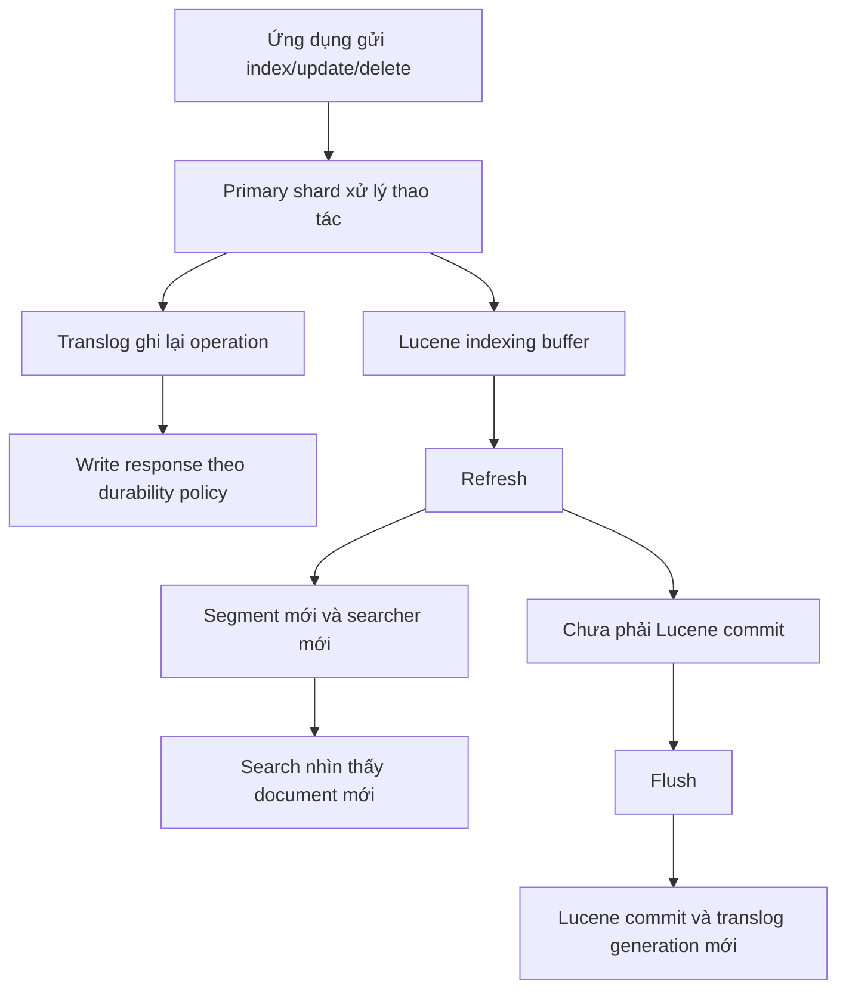

# Near real-time, refresh, flush và commit trong Elasticsearch

Elasticsearch được thiết kế để tìm kiếm dữ liệu gần thời gian thực (*near real-time* hay NRT). Khi một document vừa được index, update hoặc delete thành công, ứng dụng có thể nhận được phản hồi ghi ngay lập tức, nhưng một truy vấn tìm kiếm chưa chắc đã nhìn thấy thay đổi đó. Thay đổi chỉ xuất hiện trong kết quả search sau khi shard được **refresh**.

Refresh quyết định thời điểm dữ liệu mới trở nên có thể tìm kiếm. **Flush** lại phục vụ một mục tiêu khác: yêu cầu Elasticsearch thực hiện một Lucene commit và bắt đầu thế hệ translog mới. Commit ở đây là commit nội bộ của Lucene, không phải transaction commit giống cơ sở dữ liệu quan hệ. Translog, refresh và flush phối hợp để cân bằng ba yêu cầu: tốc độ ghi, khả năng tìm kiếm dữ liệu mới và khả năng phục hồi sau sự cố.

Để vận hành đúng Elasticsearch và Spring Data Elasticsearch, cần tách biệt ba câu hỏi:

1. Thao tác ghi đã được Elasticsearch xác nhận chưa?
2. Document đã xuất hiện trong kết quả tìm kiếm chưa?
3. Dữ liệu đã được commit vào Lucene hay vẫn cần translog để phục hồi?

Ba thời điểm này có liên quan nhưng không đồng nhất.

## 1. Near real-time là gì?

Trong một cơ sở dữ liệu truyền thống, người dùng thường kỳ vọng một bản ghi vừa ghi xong có thể được truy vấn ngay theo cơ chế transaction và isolation của hệ quản trị đó. Elasticsearch tối ưu cho tìm kiếm toàn văn trên các Lucene index phân mảnh. Để không phải mở lại searcher cho mỗi lần ghi, Elasticsearch gom các thay đổi và định kỳ làm mới góc nhìn mà các truy vấn search sử dụng.

Vì vậy, một thao tác ghi có thể đã thành công nhưng search vẫn đang đọc một searcher được mở trước thời điểm ghi. Khi refresh xảy ra, searcher mới nhìn thấy các segment chứa thay đổi mới và những truy vấn search tiếp theo có thể trả về dữ liệu đó.

*Near real-time* có nghĩa là dữ liệu thường có thể tìm kiếm sau một khoảng trễ ngắn, thường được tính bằng giây hoặc nhỏ hơn tùy cấu hình và tải hệ thống. Nó không có nghĩa mọi thao tác ghi lập tức hiển thị trong mọi truy vấn, cũng không phải cam kết độ trễ cố định cho từng request.

### 1.1 Luồng dữ liệu tổng quát



Sơ đồ thể hiện hai đường đi phục vụ hai mục tiêu. Refresh cập nhật góc nhìn dành cho search. Translog hỗ trợ phục hồi các operation chưa nằm trong Lucene commit gần nhất. Flush đưa Lucene tới một commit point mới và xoay vòng translog.

### 1.2 Vì sao Elasticsearch không refresh sau từng document?

Refresh liên quan đến việc tạo hoặc công bố segment mới và mở searcher để đọc các segment đó. Nếu refresh sau mọi thao tác ghi, hệ thống có thể tạo rất nhiều segment nhỏ, tốn tài nguyên CPU, bộ nhớ, file handle và công việc merge. Chi phí này làm giảm thông lượng index và ảnh hưởng hiệu năng search.

Elasticsearch vì vậy gom nhiều thay đổi giữa các lần refresh. Cách làm này cho phép hệ thống ghi hiệu quả hơn trong khi vẫn cung cấp khả năng tìm kiếm với độ trễ thấp. Đổi lại, ứng dụng phải hiểu rằng write acknowledgement và search visibility là hai trạng thái khác nhau.

## 2. Các thành phần phía dưới: indexing buffer, segment và translog

Để hiểu refresh và flush, cần biết dữ liệu được tổ chức ở tầng shard như thế nào.

### 2.1 Lucene segment

Elasticsearch sử dụng Apache Lucene để lập chỉ mục và tìm kiếm trên từng shard. Lucene tổ chức dữ liệu đã index thành các **segment**. Segment về cơ bản là bất biến sau khi được tạo: dữ liệu mới thường được ghi vào segment mới, còn việc hợp nhất các segment nhỏ thành segment lớn hơn được thực hiện bởi quá trình merge.

Một shard có thể chứa nhiều segment. Khi document bị update, Lucene không đơn giản sửa trực tiếp các byte của document cũ; thao tác thường được biểu diễn bằng document mới và đánh dấu phiên bản cũ không còn hợp lệ đối với kết quả hiện hành. Delete cũng được ghi nhận theo cơ chế đánh dấu xóa. Những dữ liệu cũ chỉ được thu hồi vật lý khi segment được merge.

Điều này giải thích vì sao số lượng segment và hoạt động merge có ảnh hưởng tới dung lượng lưu trữ cũng như hiệu năng tìm kiếm.

### 2.2 Indexing buffer

Khi shard nhận thao tác ghi, dữ liệu được xử lý qua cơ chế indexing của Lucene. Một phần dữ liệu mới được tích lũy trong bộ đệm để xây dựng cấu trúc phục vụ tìm kiếm. Refresh làm cho các thay đổi đã được xử lý có thể được đọc qua một searcher mới.

Không nên xem indexing buffer như nơi lưu trữ bền vững duy nhất. Nó là một phần của đường đi ghi; khả năng phục hồi operation chưa được Lucene commit dựa vào translog.

### 2.3 Translog

Mỗi shard có transaction log riêng, gọi là **translog**. Translog ghi lại các operation như index, update và delete. Nếu node dừng bất thường trước khi các operation mới được đưa vào Lucene commit, Elasticsearch có thể dùng translog để phát lại các operation cần thiết khi shard phục hồi.

Translog vì vậy đóng vai trò quan trọng trong độ bền dữ liệu. Nó cũng giải thích tại sao Elasticsearch không cần thực hiện một Lucene commit sau mỗi request để bảo vệ mọi thao tác ghi đã được xác nhận.

Translog không phải là một kho lưu trữ truy vấn thay thế cho Lucene. Search chủ yếu làm việc với các segment đã được công bố qua refresh. Translog hỗ trợ phục hồi và tham gia vào cơ chế real-time get; nó không biến mọi operation vừa ghi thành kết quả search ngay lập tức.

### 2.4 Searcher và snapshot dữ liệu

Một searcher làm việc trên một góc nhìn ổn định của các segment mà nó đã mở. Khi có segment mới, searcher hiện tại không tự động thay đổi nội dung mà nó nhìn thấy. Refresh tạo điều kiện để searcher mới được mở và sử dụng các segment mới.

Vì search request đọc qua searcher, nó chỉ nhìn thấy dữ liệu đã được công bố cho searcher tại thời điểm request chạy. Đây là cơ chế cốt lõi của tính near real-time.

## 3. Refresh: đưa thay đổi mới vào kết quả search

**Refresh** làm cho các thay đổi index gần đây trở nên có thể tìm kiếm. Ở tầng Lucene, refresh công bố các segment mới và cập nhật searcher để search có thể đọc những segment đó. Refresh không đồng nghĩa với một Lucene commit bền vững.

### 3.1 Điều gì xảy ra khi refresh?

Giả sử ứng dụng index một document có ID `book-1001` vào index `books`:

1. Elasticsearch nhận và xử lý operation trên shard tương ứng.
2. Operation được ghi vào translog theo durability policy.
3. Lucene xử lý nội dung document trong đường đi indexing.
4. Searcher hiện tại vẫn có thể chưa nhìn thấy document mới.
5. Khi refresh xảy ra, searcher mới được mở trên các segment đã được công bố.
6. Những search request tiếp theo có thể tìm thấy `book-1001`.

Một search request đã bắt đầu trước refresh có thể vẫn dùng searcher cũ. Vì thế, thời điểm refresh và thời điểm request chạy có ý nghĩa đối với kết quả.

### 3.2 Refresh định kỳ và `index.refresh_interval`

Elasticsearch tự động refresh index theo chu kỳ. Trong cấu hình phổ biến, `index.refresh_interval` mặc định là `1s`. Giá trị này có thể được thay đổi theo nhu cầu tải ghi và độ trễ tìm kiếm mong muốn.

Kiểm tra settings:

```http
GET /books/_settings?include_defaults=true
```

Đổi chu kỳ refresh thành 5 giây:

```http
PUT /books/_settings
{
  "index": {
    "refresh_interval": "5s"
  }
}
```

Tăng refresh interval có thể giảm chi phí refresh và cải thiện thông lượng ghi, đặc biệt với workload index liên tục. Đổi lại, người dùng phải chấp nhận dữ liệu mới chậm xuất hiện hơn trong search.

Có thể tắt refresh định kỳ bằng giá trị `-1`:

```http
PUT /books/_settings
{
  "index": {
    "refresh_interval": "-1"
  }
}
```

Khi đặt `-1`, ứng dụng hoặc quy trình vận hành phải chủ động refresh khi cần dữ liệu có thể tìm kiếm. Không nên để cấu hình này kéo dài ngoài ý muốn trên index phục vụ truy vấn trực tiếp, vì dữ liệu mới có thể không xuất hiện trong search cho đến khi có refresh.

Chu kỳ một giây là một cấu hình mặc định phổ biến, không phải SLA. Tải hệ thống, trạng thái shard, hoạt động search và phiên bản Elasticsearch có thể ảnh hưởng thời điểm một thay đổi cụ thể được nhìn thấy.

### 3.3 Refresh thủ công

Có thể yêu cầu refresh một index qua REST API:

```http
POST /books/_refresh
```

Hoặc refresh nhiều index:

```http
POST /books,authors/_refresh
```

Refresh thủ công hữu ích trong một số tình huống cần xác nhận dữ liệu đã có thể tìm kiếm, chẳng hạn sau một đợt bulk import. Tuy nhiên, gọi refresh sau từng document hoặc sau mọi request thông thường có thể làm tăng chi phí và tạo nhiều segment nhỏ.

### 3.4 Tham số `refresh` khi ghi

Các API ghi của Elasticsearch hỗ trợ tham số `refresh` với ba lựa chọn thường dùng: `false`, `true` và `wait_for`.

**`refresh=false`** là mặc định thông thường. Request không yêu cầu refresh riêng; dữ liệu sẽ xuất hiện trong search khi refresh định kỳ tiếp theo công bố thay đổi.

**`refresh=true`** yêu cầu refresh ngay trên shard liên quan trước khi request hoàn tất. Điều này giúp dữ liệu có thể tìm kiếm ngay sau response, nhưng có thể gây chi phí đáng kể nếu sử dụng thường xuyên.

**`refresh=wait_for`** làm request chờ cho tới khi một refresh tiếp theo khiến thay đổi trở nên có thể tìm kiếm. Cách này không chủ động ép refresh ngay trong trường hợp bình thường; nó tận dụng lần refresh sắp diễn ra. Vì vậy, nó thường phù hợp hơn `refresh=true` khi ứng dụng cần read-after-write qua search nhưng vẫn muốn giữ nhịp refresh chung.

Ví dụ:

```http
PUT /books/_doc/book-1001?refresh=wait_for
{
  "title": "Spring Data Elasticsearch",
  "author": "Nguyen An"
}
```

Sau khi request trả về thành công, thay đổi đã được refresh và các search request tiếp theo có thể nhìn thấy document. Nếu refresh định kỳ bị tắt bằng `-1`, request `wait_for` có thể phải chờ cho tới khi có refresh được thực hiện bằng cách khác. Do đó, cần cấu hình chu kỳ refresh phù hợp với cách ứng dụng sử dụng `wait_for`.

Ví dụ ép refresh ngay:

```http
PUT /books/_doc/book-1002?refresh=true
{
  "title": "Elasticsearch căn bản",
  "author": "Tran Binh"
}
```

Không nên dùng `refresh=true` như một cách mặc định để làm mọi lần ghi có vẻ đồng bộ. Nếu nhiều request đồng thời liên tục ép refresh, hệ thống sẽ mất lợi ích của việc gom thao tác ghi.

### 3.5 Refresh không phải là durability

Refresh trả lời câu hỏi: *search có nhìn thấy thay đổi chưa?* Nó không trả lời câu hỏi: *thay đổi đã được Lucene commit và không cần translog để phục hồi chưa?*

Refresh có thể tạo segment mới và mở searcher mà không thực hiện một Lucene commit bền vững. Nếu node gặp sự cố, translog vẫn cần thiết để phục hồi các operation chưa nằm trong commit point gần nhất.

Do đó, không được suy luận rằng document đã search được thì mọi bước durability đã hoàn tất, hoặc phải flush mới search được. Search visibility và durability là hai khía cạnh độc lập.

## 4. Real-time GET khác với near real-time search

Elasticsearch có một điểm dễ gây nhầm lẫn: đọc document theo ID và tìm kiếm document không nhất thiết có cùng độ trễ hiển thị.

API lấy document theo ID (`GET /index/_doc/id`) là **real-time** theo mặc định. Nó có thể trả về phiên bản mới nhất của document ngay cả khi thay đổi đó chưa được refresh để search nhìn thấy. Trong khi đó, `_search` sử dụng searcher và chỉ nhìn thấy thay đổi sau refresh.

Ví dụ ghi document không yêu cầu refresh:

```http
PUT /books/_doc/book-2001?refresh=false
{
  "title": "Distributed Search",
  "author": "Le Minh"
}
```

Đọc theo ID ngay sau đó:

```http
GET /books/_doc/book-2001
```

Thông thường, GET theo ID có thể trả về document mới. Nhưng tìm kiếm:

```http
GET /books/_search
{
  "query": {
    "term": {
      "author": "Le Minh"
    }
  }
}
```

có thể chưa trả về document cho đến lần refresh tiếp theo.

Sự khác biệt này cũng áp dụng cho update và delete. GET theo ID có thể phản ánh phiên bản mới hoặc trạng thái đã xóa trước khi searcher được refresh; search có thể vẫn nhìn thấy trạng thái cũ trong khoảng thời gian chờ refresh.

| Thao tác đọc | Cơ chế hiển thị | Có cần chờ refresh không? |
|---|---|---|
| GET document theo `_id` | Real-time get | Thông thường không |
| `_search` | Đọc qua searcher đã refresh | Có |
| Search qua repository method | Cuối cùng vẫn là search | Có |

Đây là lý do một đoạn code có thể gọi `save()` rồi `findById()` và thấy dữ liệu ngay, nhưng gọi một phương thức repository dẫn xuất như `findByAuthor()` lại chưa thấy document vừa ghi.

## 5. Translog và chính sách durability

Refresh kiểm soát khả năng tìm kiếm. Để bảo vệ operation khi node dừng bất thường, Elasticsearch sử dụng translog và chính sách đồng bộ translog xuống thiết bị lưu trữ.

### 5.1 Vì sao cần translog?

Giả sử một operation đã được ghi nhận nhưng chưa nằm trong Lucene commit point. Nếu node mất điện hoặc process dừng bất thường, các thay đổi chỉ còn trong trạng thái bộ nhớ có thể bị mất. Khi shard khởi động lại, Elasticsearch cần một nguồn để biết những operation nào phải được áp dụng lại.

Translog lưu lại các operation đó. Trong quá trình recovery, Elasticsearch dùng Lucene commit gần nhất làm nền và phát lại những operation hợp lệ còn lại trong translog. Khi flush tạo commit point mới, các translog generation cũ không còn cần thiết cho recovery có thể được loại bỏ sau khi các điều kiện an toàn được đáp ứng.

### 5.2 `index.translog.durability`

Elasticsearch cung cấp setting `index.translog.durability` để chọn thời điểm đồng bộ translog.

**`request`** là chế độ mặc định phổ biến. Elasticsearch đồng bộ translog theo từng yêu cầu ghi như index, delete, update hoặc bulk trước khi xác nhận request theo cơ chế durability. Cách này ưu tiên bảo vệ các thao tác đã được xác nhận trước sự cố, đổi lại có chi phí I/O đồng bộ.

**`async`** cho phép đồng bộ translog theo chu kỳ thay vì sau mỗi request. Chu kỳ được điều khiển bởi `index.translog.sync_interval`, thường mặc định là `5s`. Chế độ này có thể tăng thông lượng ghi trong một số workload, nhưng khi xảy ra sự cố, các operation đã được xác nhận kể từ lần sync gần nhất có thể bị mất.

Kiểm tra cấu hình:

```http
GET /books/_settings?include_defaults=true
```

Ví dụ cấu hình async:

```http
PUT /books/_settings
{
  "index": {
    "translog": {
      "durability": "async",
      "sync_interval": "5s"
    }
  }
}
```

Chỉ cân nhắc `async` khi nghiệp vụ chấp nhận rõ ràng cửa sổ mất dữ liệu có thể xảy ra và đã đánh giá tác động của nó. Không dùng async chỉ vì muốn tăng tốc mà không hiểu mức độ rủi ro.

### 5.3 Write acknowledgement không có nghĩa là search visibility

Một write response thành công thể hiện Elasticsearch đã xử lý request theo điều kiện ghi và durability đang cấu hình. Với chế độ `request`, translog được đồng bộ theo chính sách tương ứng. Nhưng response thành công không tự động có nghĩa searcher đã refresh.

Vì vậy, một document có thể đồng thời ở trạng thái:

- Ghi đã được xác nhận.
- Có đủ thông tin trong translog để phục hồi theo durability policy.
- Chưa xuất hiện trong kết quả `_search`.
- Chưa được đưa vào Lucene commit point gần nhất.

Đây là trạng thái bình thường trong mô hình near real-time.

## 6. Flush: tạo Lucene commit và xoay vòng translog

**Flush** là thao tác nội bộ ở cấp shard, yêu cầu Lucene thực hiện commit và Elasticsearch bắt đầu một translog generation mới. Khi commit hoàn tất, Lucene có một commit point mới đại diện cho trạng thái index đã commit. Translog generation cũ có thể được dọn dẹp khi không còn cần thiết cho recovery.

Flush không phải là thao tác cần gọi để mọi document xuất hiện trong search. Việc đó thuộc về refresh. Một refresh có thể làm document search được trước khi flush tiếp theo diễn ra.

### 6.1 Flush thực hiện những gì?

Ở mức khái quát, flush gồm các việc:

1. Đưa các thay đổi indexing cần thiết vào trạng thái Lucene có thể commit.
2. Tạo Lucene commit point mới.
3. Bắt đầu translog generation mới.
4. Cho phép loại bỏ các translog generation cũ khi chúng không còn cần thiết cho quá trình phục hồi.

Sau flush, Elasticsearch có thể phục hồi shard từ Lucene commit mới hơn và ít phải phát lại operation từ translog hơn.

### 6.2 Gọi flush thủ công

Có thể yêu cầu flush một index:

```http
POST /books/_flush
```

Hoặc flush nhiều index:

```http
POST /books,authors/_flush
```

Đây là API quản trị cấp thấp. Elasticsearch tự quyết định thời điểm flush dựa trên các điều kiện nội bộ như kích thước translog và hoạt động shard. Trong phần lớn ứng dụng, không cần gọi flush sau mỗi lần save, bulk hay refresh.

Gọi flush quá thường xuyên có thể làm tăng chi phí I/O và ảnh hưởng thông lượng. Chỉ nên gọi thủ công khi có lý do vận hành cụ thể và hiểu rõ tác động.

### 6.3 Flush không giống refresh

Hai thao tác thường bị nhầm vì đều có thể xảy ra sau khi dữ liệu được index, nhưng mục tiêu khác nhau:

- Refresh mở góc nhìn mới cho searcher, làm dữ liệu có thể tìm kiếm.
- Flush tạo Lucene commit point mới và xoay vòng translog, hỗ trợ quản lý durability và recovery.

Nếu chỉ cần search nhìn thấy document mới, hãy xem xét refresh hoặc `refresh=wait_for`. Không cần gọi flush để đạt mục tiêu đó.

## 7. Commit trong Elasticsearch: hiểu đúng phạm vi

Từ *commit* có thể khiến người phát triển liên tưởng đến câu lệnh `COMMIT` trong transaction SQL. Hai khái niệm không tương đương.

Trong ngữ cảnh flush, commit thường nói tới **Lucene commit**: một commit point xác định tập segment và metadata tạo nên trạng thái index đã commit. Elasticsearch quản lý thời điểm commit thông qua flush và các cơ chế nội bộ.

Elasticsearch không cung cấp một transaction SQL tổng quát cho phép ứng dụng gom nhiều thao tác ghi trên nhiều document hoặc nhiều index rồi commit/rollback nguyên tử như một transaction quan hệ. Mỗi operation ghi có semantics riêng; refresh và flush không tạo ra transaction nghiệp vụ.

### 7.1 Lucene commit và translog recovery

Có thể hình dung shard có:

- Một Lucene commit point gần nhất.
- Các operation đã được commit trong Lucene.
- Translog chứa những operation phát sinh sau commit point và cần cho recovery.

Khi flush thành công, commit point được cập nhật và translog generation mới bắt đầu. Khi shard recovery, Elasticsearch sử dụng commit point phù hợp và replay những operation cần thiết còn trong translog.

Điều này không có nghĩa translog chỉ tồn tại trong RAM hoặc mọi thao tác phải đợi flush mới bền vững. Với durability `request`, translog được sync theo từng request ghi; Lucene commit có thể diễn ra muộn hơn.

### 7.2 Commit không phải force merge

Một shard có thể có nhiều segment sau nhiều lần refresh và flush. **Force merge** là thao tác yêu cầu Lucene hợp nhất segment, thường nhằm giảm số segment sau khi dữ liệu ít thay đổi hoặc đã hoàn tất một đợt import.

Force merge không phải cách thay thế cho flush và cũng không phải bước bắt buộc sau mỗi lần ghi. Nó có thể tiêu thụ nhiều tài nguyên và tạo thêm I/O, vì vậy cần được sử dụng có chủ đích, nhất là với index đang tiếp tục nhận ghi.

## 8. So sánh refresh, flush, commit và force merge

| Khái niệm | Mục tiêu chính | Tác động tới search visibility | Vai trò với durability |
|---|---|---|---|
| Refresh | Công bố segment mới cho searcher | Làm thay đổi có thể tìm kiếm | Không thay thế Lucene commit |
| Translog sync | Đồng bộ operation log theo durability policy | Không trực tiếp làm search thấy dữ liệu | Bảo vệ operation để recovery |
| Flush | Tạo Lucene commit và translog generation mới | Không phải cơ chế chính để làm mới searcher | Cập nhật commit point, hỗ trợ dọn translog cũ |
| Lucene commit | Xác lập trạng thái segment đã commit | Không đồng nghĩa với refresh API | Tạo nền tảng phục hồi từ Lucene index |
| Force merge | Hợp nhất nhiều segment | Search tiếp tục hoạt động với segment được quản lý lại | Không phải cơ chế acknowledgement/durability cho từng write |

Điểm cần nhớ là refresh và flush giải quyết hai vấn đề khác nhau. Translog sync và Lucene commit lại là hai lớp khác nhau trong câu chuyện durability. Không nên gom tất cả thành một khái niệm “ghi xuống đĩa”.

## 9. Chuỗi tình huống: từ save tới search

Xét một request của ứng dụng:

```text
repository.save(book)
        |
        v
Elasticsearch xử lý write operation
        |
        +--> translog được sync theo durability policy
        |
        +--> Lucene xử lý indexing
        |
        v
Write response trả về
        |
        v
Search ngay lúc này có thể chưa thấy document
        |
        v
Refresh định kỳ hoặc refresh được yêu cầu
        |
        v
Searcher mới được mở
        |
        v
Search tiếp theo có thể thấy document
        |
        v
Flush ở một thời điểm phù hợp tạo Lucene commit mới
```

Nếu ứng dụng chỉ gọi `findById`, real-time GET có thể lấy document mới trước refresh. Nếu ứng dụng gọi `findByAuthor`, đây là truy vấn search và cần chờ refresh.

Nếu ứng dụng cần search ngay sau write, có ba hướng chính:

1. Dùng `refresh=wait_for` để write request chờ lần refresh tiếp theo.
2. Dùng refresh policy tương ứng trong Spring Data Elasticsearch.
3. Chủ động gọi refresh sau một nhóm thao tác, chẳng hạn sau bulk import.

Chọn theo nhu cầu nghiệp vụ và tải hệ thống. Không nên ép refresh cho tất cả thao tác chỉ để tránh một khoảng trễ vốn đã được thiết kế trong Elasticsearch.

## 10. Refresh policy trong Spring Data Elasticsearch

Spring Data Elasticsearch cung cấp abstraction để cấu hình refresh policy cho thao tác ghi. Tùy phiên bản, có thể cấu hình policy trên metadata entity bằng `@Document` hoặc qua API thao tác tương ứng.

Các policy phổ biến có ý nghĩa:

- `NONE`: không yêu cầu refresh riêng cho thao tác ghi; dựa vào refresh định kỳ.
- `IMMEDIATE`: yêu cầu refresh ngay sau thao tác ghi.
- `WAIT_UNTIL`: chờ cho tới khi lần refresh tiếp theo công bố thay đổi.

Ví dụ khai báo policy cho entity:

```java
import org.springframework.data.annotation.Id;
import org.springframework.data.elasticsearch.annotations.Document;
import org.springframework.data.elasticsearch.core.RefreshPolicy;

@Document(
    indexName = "books",
    refreshPolicy = RefreshPolicy.WAIT_UNTIL
)
public class Book {

    @Id
    private String id;

    private String title;
}
```

Ví dụ trên minh họa cấu hình ở cấp entity theo API của các phiên bản Spring Data Elasticsearch hỗ trợ thuộc tính `refreshPolicy`. Tên package, phạm vi áp dụng và API cấu hình có thể khác giữa các phiên bản; cần đối chiếu đúng phiên bản dependency mà dự án đang dùng.

### 10.1 Chọn policy nào?

Với luồng ghi thông thường, `NONE` thường là lựa chọn phù hợp vì tận dụng refresh định kỳ và tránh chi phí refresh không cần thiết.

Nếu một thao tác ghi phải được tìm thấy ngay trong search trước khi response trả về, `WAIT_UNTIL` thường là lựa chọn cân bằng hơn. Request có thể chờ một khoảng thời gian tương ứng với chu kỳ refresh.

`IMMEDIATE` hữu ích trong trường hợp đặc biệt cần công bố thay đổi ngay, nhưng dùng thường xuyên có thể làm giảm thông lượng index. Chỉ chọn khi yêu cầu độ trễ tìm kiếm thực sự cần thiết.

### 10.2 Repository save và repository search

Ví dụ service:

```java
import java.util.List;

import org.springframework.stereotype.Service;

@Service
public class BookService {

    private final BookRepository repository;

    public BookService(BookRepository repository) {
        this.repository = repository;
    }

    public Book save(Book book) {
        return repository.save(book);
    }

    public List<Book> findByAuthor(String author) {
        return repository.findByAuthor(author);
    }
}
```

Nếu entity sử dụng policy `NONE`, `save()` có thể trả về thành công trong khi `findByAuthor()` gọi ngay sau đó chưa thấy document do search chưa được refresh. Đây là hành vi phù hợp với NRT, không nhất thiết là lỗi repository.

Nếu `findById()` được gọi ngay sau `save()`, real-time GET thường có thể trả về phiên bản mới. Vì vậy, khi kiểm tra read-after-write, cần xác định ứng dụng đang đọc theo ID hay đang chạy search query.

### 10.3 Integration test

Một integration test có thể thất bại ngẫu nhiên nếu test ghi document rồi search ngay trong khi đang dùng refresh policy mặc định. Có thể xử lý bằng cách:

- Cấu hình `WAIT_UNTIL` cho thao tác ghi trong phạm vi test phù hợp.
- Chủ động refresh index sau khi chuẩn bị dữ liệu test.
- Dùng cơ chế chờ có giới hạn để đợi dữ liệu xuất hiện, nếu mục tiêu test là xác nhận hành vi bất đồng bộ.

Ví dụ thao tác refresh bằng REST API sau khi seed dữ liệu:

```http
POST /books/_refresh
```

Không nên dùng `Thread.sleep(1000)` như một đảm bảo đồng bộ. Chu kỳ refresh có thể thay đổi, môi trường CI có tải khác và sleep không chứng minh index đã thực sự được refresh. Dùng refresh policy hoặc thao tác refresh tường minh sẽ diễn đạt ý định rõ ràng hơn.

## 11. Tối ưu bulk indexing

Khi nạp lượng lớn dữ liệu ban đầu, mục tiêu thường là đạt thông lượng ghi cao. Việc refresh quá thường xuyên trong giai đoạn này tạo nhiều segment nhỏ và làm tăng chi phí merge.

Một quy trình thường dùng là:

1. Tăng `refresh_interval` hoặc tạm tắt refresh định kỳ.
2. Gửi dữ liệu theo các bulk request có kích thước phù hợp.
3. Theo dõi lỗi từng item trong bulk response, không chỉ kiểm tra HTTP status tổng thể.
4. Sau khi hoàn tất, khôi phục refresh interval mong muốn.
5. Thực hiện một refresh để dữ liệu vừa nạp có thể tìm kiếm.
6. Theo dõi segment, merge, translog và dung lượng index sau import.

Ví dụ tắt refresh định kỳ trong lúc import:

```http
PUT /books/_settings
{
  "index": {
    "refresh_interval": "-1"
  }
}
```

Sau khi bulk hoàn tất, khôi phục chu kỳ:

```http
PUT /books/_settings
{
  "index": {
    "refresh_interval": "1s"
  }
}
```

Sau đó yêu cầu refresh:

```http
POST /books/_refresh
```

Trong thực tế, hãy khôi phục đúng giá trị refresh interval trước đó của index, không mặc định rằng mọi index đều dùng `1s`.

### 11.1 Có cần flush sau bulk không?

Thông thường không cần gọi flush thủ công chỉ vì vừa hoàn tất bulk import. Refresh là bước cần thiết nếu muốn search nhìn thấy dữ liệu ngay. Flush do Elasticsearch quản lý để tạo commit point và xoay vòng translog khi phù hợp.

Nếu có yêu cầu vận hành đặc biệt về commit hoặc recovery, hãy đánh giá riêng. Không thêm flush vào mọi pipeline import theo thói quen, vì flush có chi phí và không thay thế refresh.

### 11.2 Chọn kích thước bulk và refresh interval

Không có một kích thước bulk phù hợp cho mọi cluster. Bulk quá nhỏ tạo nhiều request và overhead; bulk quá lớn có thể gây áp lực bộ nhớ, thời gian xử lý dài và tăng rủi ro retry tốn kém. Cần thử nghiệm với kích thước document, số shard, tài nguyên node và tốc độ ingest thực tế.

Refresh interval dài hơn giúp gom nhiều thay đổi giữa các lần refresh. Tuy nhiên, nếu index phục vụ người dùng cần dữ liệu mới nhanh, phải cân bằng giữa thông lượng ghi và độ trễ hiển thị.

## 12. Quan sát refresh, flush và translog

Khi vận hành, cần kiểm tra số liệu thực tế thay vì suy đoán chỉ từ response của ứng dụng.

### 12.1 Index stats

Lấy thống kê refresh, flush và translog:

```http
GET /books/_stats/refresh,flush,translog
```

Các nhóm chỉ số có thể giúp theo dõi:

- `refresh`: số lần refresh, tổng thời gian refresh và số lần refresh đang chờ nếu có.
- `flush`: số lần flush và tổng thời gian flush.
- `translog`: số operation, kích thước translog và thông tin sync theo phiên bản.

Tên field chi tiết trong response có thể khác giữa các phiên bản Elasticsearch. Khi điều tra, cần xem cả thống kê ở cấp index và cấp shard nếu nghi ngờ một shard bị lệch tải.

### 12.2 Kiểm tra segment

Có thể xem danh sách segment:

```http
GET /books/_segments
```

Hoặc dùng CAT API:

```http
GET /_cat/segments/books?v
```

Quá nhiều segment nhỏ có thể là dấu hiệu refresh thường xuyên hoặc merge chưa theo kịp workload. Tuy nhiên, số lượng segment cao không tự động chứng minh có lỗi; cần kết hợp với dung lượng, latency, indexing rate, search latency và merge stats.

### 12.3 Kiểm tra translog và shard

```http
GET /_cat/shards/books?v
GET /books/_stats/translog
```

Khi điều tra durability hoặc recovery, kiểm tra trạng thái shard, translog size và các cảnh báo liên quan đến disk. Không xóa file translog hoặc can thiệp trực tiếp vào thư mục dữ liệu Elasticsearch để cố giải phóng dung lượng; hãy dùng API và quy trình quản trị được hỗ trợ.

## 13. Các nhầm lẫn thường gặp

### 13.1 “Save trả về thành công thì search phải thấy ngay”

Không đúng. Write acknowledgement và search visibility tách biệt. Search cần refresh. Nếu nghiệp vụ cần search ngay, dùng `WAIT_UNTIL`, `refresh=wait_for` hoặc refresh tường minh sau một nhóm thao tác.

### 13.2 “Refresh là commit xuống đĩa”

Không đúng. Refresh làm thay đổi có thể tìm kiếm bằng cách cập nhật searcher. Nó không tương đương với Lucene commit và không thay thế translog durability.

### 13.3 “Phải flush mới query được document mới”

Không đúng. Refresh mới là cơ chế công bố dữ liệu cho search. Flush phục vụ Lucene commit và quản lý translog generation.

### 13.4 “Flush sau mỗi request giúp dữ liệu an toàn hơn”

Không nên suy luận như vậy. Với durability `request`, Elasticsearch đã sync translog theo chính sách trước khi xác nhận request ghi. Flush thường xuyên có thể gây chi phí mà không đem lại lợi ích tương ứng cho ứng dụng.

### 13.5 “Commit của Elasticsearch giống transaction commit trong SQL”

Không đúng. Lucene commit xác lập commit point của index. Nó không tạo transaction nguyên tử cho một chuỗi nghiệp vụ gồm nhiều document hoặc nhiều index.

### 13.6 “GET theo ID chưa thấy thì search cũng chưa thấy”

Không nhất thiết. GET theo ID là real-time theo mặc định, còn search là near real-time. Hai API có đường đọc và thời điểm hiển thị khác nhau.

### 13.7 “Đặt refresh interval bằng 1 giây đảm bảo mọi document có mặt trong đúng một giây”

Không phải cam kết thời gian cứng. Đây là chu kỳ refresh cấu hình; tải cluster, trạng thái shard và lịch thực thi có thể làm thời điểm hiển thị thay đổi.

### 13.8 “Force merge cũng là flush”

Không đúng. Flush tạo commit point và xoay vòng translog. Force merge hợp nhất segment. Hai thao tác có mục tiêu và chi phí khác nhau.

## 14. Nguyên tắc lựa chọn cho ứng dụng

Khi thiết kế một luồng ghi và tìm kiếm, hãy bắt đầu từ yêu cầu nghiệp vụ:

**Nếu dữ liệu có thể trễ một khoảng ngắn:** giữ refresh interval mặc định phù hợp và dùng `refresh=false`/`NONE`. Đây là lựa chọn tốt cho phần lớn luồng ingest thông thường.

**Nếu một request ghi phải được tìm thấy ngay sau khi trả về:** dùng `refresh=wait_for` hoặc `RefreshPolicy.WAIT_UNTIL` nếu phiên bản Spring Data hỗ trợ. Chỉ dùng `IMMEDIATE` khi cần ép refresh ngay và đã chấp nhận chi phí.

**Nếu đang import dữ liệu lớn:** cân nhắc tăng hoặc tắt refresh tạm thời, bulk dữ liệu, sau đó khôi phục settings và refresh một lần. Theo dõi tài nguyên và lỗi từng item.

**Nếu cần đánh giá độ bền dữ liệu:** xem `index.translog.durability`, `index.translog.sync_interval`, trạng thái shard và cơ chế backup/recovery. Không dùng refresh như bằng chứng durability.

**Nếu cần hiểu vì sao dữ liệu chưa xuất hiện:** phân biệt GET theo ID với search, kiểm tra refresh interval, refresh policy của write request và trạng thái shard.

**Nếu cần thay đổi segment hoặc giảm số lượng segment:** theo dõi merge và chỉ xem xét force merge trong trường hợp phù hợp. Không dùng flush thay cho force merge.

## 15. Kết luận mô hình hoạt động

Near real-time là đặc tính xuất phát từ cách Elasticsearch công bố thay đổi cho searcher theo từng lần refresh. Một thao tác ghi có thể được xác nhận trước khi search nhìn thấy document. Translog giữ lại operation để hỗ trợ recovery; chính sách durability quyết định thời điểm translog được đồng bộ. Flush tạo Lucene commit point mới và bắt đầu translog generation mới. Commit là khái niệm nội bộ của Lucene, không phải transaction commit của ứng dụng.

Khi làm việc với Spring Data Elasticsearch, điều này thể hiện rõ qua sự khác biệt giữa `save()` và các phương thức tìm kiếm: thao tác lưu có thể thành công trong khi repository search vẫn chưa nhìn thấy dữ liệu cho tới refresh. Hãy chọn refresh policy dựa trên yêu cầu read-after-write, để Elasticsearch tự quản lý flush trong phần lớn trường hợp, và quan sát translog/segment/refresh stats khi cần chẩn đoán hoặc tối ưu.
