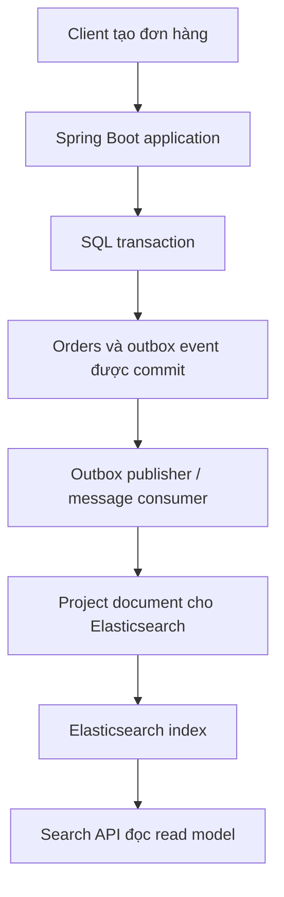

# Giới hạn giao dịch, phép join và ràng buộc dữ liệu so với SQL

Elasticsearch và cơ sở dữ liệu quan hệ giải quyết những bài toán khác nhau. Cơ sở dữ liệu SQL thường được dùng làm nơi quản lý dữ liệu nghiệp vụ với giao dịch, khóa và ràng buộc quan hệ. Elasticsearch là hệ thống tìm kiếm phân tán, lưu dữ liệu dưới dạng document JSON và tối ưu cho việc lập chỉ mục, lọc, tổng hợp và tìm kiếm trên lượng dữ liệu lớn.

Vì vậy, khi dùng Spring Data Elasticsearch, không nên mặc định rằng các thao tác repository có đầy đủ ngữ nghĩa như JPA hoặc JDBC. Elasticsearch có những bảo đảm hữu ích ở cấp document và cơ chế đồng bộ shard, nhưng không cung cấp mô hình giao dịch nhiều document, phép join quan hệ tổng quát hay bộ ràng buộc toàn vẹn giống SQL.

| Khả năng | Cơ sở dữ liệu SQL điển hình | Elasticsearch |
|---|---|---|
| Giao dịch | Có transaction với ranh giới nhiều câu lệnh và các thuộc tính ACID theo engine/cấu hình. | Một thao tác trên một document có tính nguyên tử; không có transaction ACID bao trùm nhiều document hoặc index. |
| Quan hệ | JOIN trên bảng theo khóa và điều kiện truy vấn. | Không có phép join quan hệ tổng quát giữa các index; thường denormalize, hoặc dùng `nested` / `join` field trong phạm vi một index. |
| Ràng buộc | Có thể khai báo `PRIMARY KEY`, `FOREIGN KEY`, `UNIQUE`, `NOT NULL`, `CHECK`. | Mapping kiểm soát kiểu và cách lập chỉ mục; phần lớn ràng buộc nghiệp vụ và quan hệ phải được kiểm tra ở ứng dụng hoặc hệ thống nguồn. |
| Khả năng nhìn thấy dữ liệu | Thường gắn với commit và isolation level của transaction. | Search là near-real-time; document mới có thể chưa xuất hiện trong kết quả tìm kiếm cho đến lần refresh tiếp theo. |
| Mô hình dữ liệu | Thường chuẩn hóa thành bảng và quan hệ. | Document-oriented; thường lưu sẵn dữ liệu cần đọc để tránh join lúc truy vấn. |

## 1. Giới hạn giao dịch trong Elasticsearch

### 1.1. Phạm vi nguyên tử ở cấp document

Elasticsearch xử lý thao tác ghi trên một document như một đơn vị. Một lần index hoặc update document thay thế/điều chỉnh nội dung document đó theo một thao tác nguyên tử ở cấp document. Nếu một document chứa các object lồng nhau hoặc mảng, cập nhật document vẫn là cập nhật trên cùng document.

Ví dụ, một đơn hàng được lưu thành một document:

```json
{
  "orderId": "ORD-1001",
  "status": "PAID",
  "customer": {
    "id": "CUS-10",
    "name": "An"
  },
  "items": [
    { "sku": "BOOK-01", "quantity": 2 },
    { "sku": "PEN-02", "quantity": 3 }
  ]
}
```

Nếu ứng dụng cập nhật document này để đổi `status` hoặc điều chỉnh `items`, Elasticsearch xử lý thay đổi như một thao tác trên document `ORD-1001`. Cách tổ chức này thuận tiện khi các trường thường được đọc cùng nhau.

Tuy nhiên, nếu đơn hàng, tồn kho và thanh toán được lưu thành ba document riêng, Elasticsearch không có transaction để bảo đảm ba thao tác cập nhật cùng thành công hoặc cùng rollback. Có thể xảy ra trường hợp đơn hàng đã đổi trạng thái nhưng thao tác cập nhật tồn kho thất bại.

### 1.2. Bulk không phải transaction

Bulk API gom nhiều thao tác ghi vào một request để giảm chi phí mạng và tăng thông lượng. Việc gửi nhiều thao tác trong cùng request không làm chúng trở thành một transaction.

Ví dụ:

```http
POST /_bulk
{"index":{"_index":"orders","_id":"ORD-1001"}}
{"status":"PAID"}
{"index":{"_index":"inventory","_id":"BOOK-01"}}
{"available":18}
{"delete":{"_index":"temporary-orders","_id":"ORD-OLD"}}
```

Mỗi item có kết quả riêng. Một số item có thể thành công trong khi item khác thất bại; response Bulk có trường `errors` và kết quả chi tiết theo item để ứng dụng xử lý. Elasticsearch không tự rollback các item đã thành công khi một item khác lỗi.

Tương tự, `_update_by_query` và `_delete_by_query` là các tác vụ áp dụng trên nhiều document. Chúng có thể gặp version conflict, lỗi ở một số batch hoặc bị hủy sau khi đã xử lý một phần. Ứng dụng cần đọc response và thiết kế retry/reconciliation phù hợp, không được giả định rằng toàn bộ tác vụ có rollback như transaction SQL.

### 1.3. Kiểm soát cập nhật đồng thời

Khi nhiều request cùng sửa một document, một request có thể ghi đè thay đổi mới hơn nếu ứng dụng không kiểm soát cạnh tranh. Elasticsearch cung cấp optimistic concurrency control dựa trên `_seq_no` và `_primary_term`.

Một luồng điển hình:

1. Đọc document và lấy `_seq_no`, `_primary_term` trong response.
2. Tính nội dung cần cập nhật.
3. Gửi thao tác ghi kèm hai giá trị đã đọc.
4. Nếu document đã thay đổi kể từ lần đọc, Elasticsearch trả lỗi version conflict để ứng dụng đọc lại và quyết định xử lý.

Ví dụ request cập nhật có điều kiện:

```http
PUT /products/_doc/BOOK-01?if_seq_no=12&if_primary_term=3
Content-Type: application/json

{
  "name": "Java Fundamentals",
  "available": 18
}
```

Các giá trị `12` và `3` chỉ là ví dụ; ứng dụng phải lấy chúng từ lần đọc document tương ứng. Điều kiện này giúp tránh ghi đè âm thầm, nhưng không tạo transaction cho nhiều document.

Trong Spring Data Elasticsearch, cần chọn cách cập nhật phù hợp với nghiệp vụ và phiên bản thư viện đang dùng. Với dữ liệu quan trọng, hãy thiết kế rõ hành vi khi gặp optimistic locking conflict: retry có giới hạn, đọc lại rồi tính lại, hoặc trả lỗi để người gọi xử lý.

### 1.4. Refresh và thời điểm tìm kiếm nhìn thấy dữ liệu

Elasticsearch là hệ thống near-real-time. Một thao tác ghi đã được xác nhận không nhất thiết làm document xuất hiện ngay trong kết quả search. Search chỉ nhìn thấy dữ liệu sau khi shard được refresh và tạo searchable segment phù hợp.

Ba cách thường gặp khi gửi thao tác ghi:

- Không chỉ định `refresh`: dùng hành vi mặc định, thường hiệu quả hơn cho thông lượng ghi; document sẽ được tìm thấy sau lần refresh tiếp theo.
- `refresh=wait_for`: chờ một lần refresh tiếp theo làm thay đổi có thể tìm kiếm được trước khi response hoàn tất.
- `refresh=true`: yêu cầu refresh ngay cho các shard liên quan; có thể làm giảm hiệu năng nếu dùng thường xuyên.

Ví dụ:

```http
PUT /products/_doc/BOOK-01?refresh=wait_for
Content-Type: application/json

{
  "name": "Java Fundamentals",
  "available": 18
}
```

Refresh không phải là lệnh `COMMIT` của SQL và cũng không tạo transaction isolation. Nó điều khiển thời điểm dữ liệu trở nên có thể tìm kiếm qua search API. Truy vấn lấy trực tiếp theo document id có ngữ nghĩa realtime khác với search.

Không nên ép `refresh=true` sau mọi lần ghi chỉ để làm search thấy dữ liệu ngay. Nếu luồng nghiệp vụ cần đọc lại bằng search ngay sau khi ghi, cân nhắc `refresh=wait_for` ở ranh giới phù hợp hoặc thay đổi luồng đọc để lấy trực tiếp theo id.

## 2. Elasticsearch không có JOIN quan hệ tổng quát như SQL

Trong SQL, có thể lưu khách hàng, đơn hàng và sản phẩm ở các bảng riêng rồi JOIN khi truy vấn:

```sql
SELECT o.id, c.name, o.total_amount
FROM orders o
JOIN customers c ON c.id = o.customer_id
WHERE o.status = 'PAID';
```

Với Elasticsearch, không thể mặc định viết một truy vấn search để JOIN tùy ý các index như JOIN bảng quan hệ. Thiết kế thường gặp là lưu sẵn các trường cần tìm kiếm hoặc hiển thị ngay trong document của index đích.

Có ba hướng thiết kế phổ biến: denormalization, `nested` và quan hệ parent-child bằng `join` field. Mỗi hướng có phạm vi sử dụng và chi phí riêng.

### 2.1. Denormalization: lưu sẵn dữ liệu cần đọc

Denormalization là đưa một phần dữ liệu từ entity liên quan vào document để truy vấn không cần JOIN. Ví dụ document đơn hàng có thể lưu `customerId`, `customerName` và `customerTier` cùng các thông tin đơn hàng.

```json
{
  "orderId": "ORD-1001",
  "customerId": "CUS-10",
  "customerName": "An",
  "customerTier": "GOLD",
  "status": "PAID",
  "totalAmount": 1250000
}
```

Ưu điểm:

- Truy vấn và hiển thị dữ liệu thường chỉ cần đọc một index.
- Có thể lọc, sắp xếp và tổng hợp trên các trường đã được lập chỉ mục.
- Tránh chi phí join tại thời điểm search.

Đổi lại, dữ liệu có thể bị lặp. Nếu tên khách hàng thay đổi, các document đơn hàng đã sao chép tên đó không tự cập nhật. Ứng dụng phải xác định chính sách đồng bộ: cập nhật các document liên quan, chấp nhận dữ liệu snapshot tại thời điểm tạo đơn, hoặc chỉ lưu id và lấy thông tin mới nhất từ hệ thống nguồn khi cần.

Denormalization phù hợp khi tối ưu đọc là ưu tiên và có thể xác định rõ cách cập nhật dữ liệu lặp. Đây thường là lựa chọn đơn giản, hiệu quả cho các màn hình tìm kiếm và danh sách.

### 2.2. Nested object cho mảng object có quan hệ nội bộ

Mặc định, Elasticsearch có thể làm phẳng object trong mảng thành các trường đa trị. Khi cần giữ mối liên hệ giữa các trường trong cùng một phần tử mảng, kiểu `nested` cho phép truy vấn từng object con như một đơn vị độc lập.

Ví dụ một đơn hàng có nhiều dòng hàng:

```json
{
  "orderId": "ORD-1001",
  "items": [
    { "sku": "BOOK-01", "color": "RED", "quantity": 2 },
    { "sku": "PEN-02", "color": "BLUE", "quantity": 3 }
  ]
}
```

Nếu `items` là object thông thường, điều kiện `sku = BOOK-01` và `color = BLUE` có thể khớp từ hai phần tử khác nhau sau khi các trường bị làm phẳng. Dùng `nested` để bảo đảm các điều kiện cùng áp dụng trên một phần tử.

Mapping:

```json
PUT /orders
{
  "mappings": {
    "properties": {
      "orderId": { "type": "keyword" },
      "items": {
        "type": "nested",
        "properties": {
          "sku": { "type": "keyword" },
          "color": { "type": "keyword" },
          "quantity": { "type": "integer" }
        }
      }
    }
  }
}
```

Truy vấn nested:

```json
GET /orders/_search
{
  "query": {
    "nested": {
      "path": "items",
      "query": {
        "bool": {
          "filter": [
            { "term": { "items.sku": "BOOK-01" } },
            { "term": { "items.color": "BLUE" } }
          ]
        }
      }
    }
  }
}
```

Truy vấn trên chỉ khớp khi có một phần tử `items` vừa có `sku` là `BOOK-01`, vừa có `color` là `BLUE`. Trong dữ liệu ví dụ, document không khớp vì hai điều kiện nằm ở hai phần tử khác nhau.

Nested phù hợp với object con có vòng đời gắn với document cha, thường được đọc và cập nhật cùng document cha. Mỗi nested object được lưu như một Lucene document nội bộ, nên số lượng nested object lớn làm tăng chi phí lưu trữ, lập chỉ mục và truy vấn. Nested không phải công cụ JOIN hai index.

### 2.3. Parent-child bằng join field

Elasticsearch có kiểu field `join` để mô hình hóa quan hệ cha-con trong cùng một index. Ví dụ một công ty có nhiều nhân viên được lưu thành các document riêng, nhưng document nhân viên tham chiếu document công ty cha.

Tạo index và khai báo quan hệ:

```json
PUT /company-directory
{
  "mappings": {
    "properties": {
      "relation": {
        "type": "join",
        "relations": {
          "company": "employee"
        }
      },
      "name": { "type": "text" }
    }
  }
}
```

Ghi document cha và document con:

```http
PUT /company-directory/_doc/company-1
Content-Type: application/json

{
  "name": "Acme",
  "relation": "company"
}
```

```http
PUT /company-directory/_doc/employee-1?routing=company-1
Content-Type: application/json

{
  "name": "An",
  "relation": {
    "name": "employee",
    "parent": "company-1"
  }
}
```

Parent và child phải nằm trên cùng shard. Vì vậy, thao tác ghi child cần routing theo id của parent như ví dụ. Khi tìm kiếm có thể dùng `has_child` hoặc `has_parent` để lọc theo quan hệ.

Parent-child hữu ích khi document con cần được tìm kiếm hoặc cập nhật độc lập và số lượng con lớn đến mức không phù hợp nhúng vào một document `nested`. Tuy nhiên, truy vấn quan hệ tốn tài nguyên hơn truy vấn document thông thường; việc cập nhật, routing và phân bổ shard phức tạp hơn. Một index chỉ có thể có một join field, dù field đó có thể khai báo nhiều quan hệ theo cấu hình được hỗ trợ.

Join field không biến Elasticsearch thành cơ sở dữ liệu quan hệ: nó không cung cấp JOIN tùy ý giữa các index, không thay thế foreign key và không tự cung cấp cascade update/delete như SQL.

### 2.4. Chọn cách biểu diễn quan hệ

| Nhu cầu | Hướng thiết kế thường phù hợp |
|---|---|
| Danh sách tìm kiếm cần hiển thị vài trường của entity liên quan | Denormalize các trường cần đọc vào document. |
| Mảng object con luôn được đọc và cập nhật cùng document cha | Object thường hoặc `nested`, tùy có cần giữ quan hệ giữa các trường trong từng phần tử hay không. |
| Document con có vòng đời và truy vấn độc lập, nhưng cần truy vấn quan hệ cha-con | Parent-child `join` field trong cùng index, sau khi đánh giá chi phí. |
| Cần JOIN linh hoạt, nhiều bảng, transaction và ràng buộc quan hệ chặt | Dùng cơ sở dữ liệu SQL làm hệ thống nguồn; đồng bộ dữ liệu phù hợp sang Elasticsearch để tìm kiếm. |

## 3. Ràng buộc dữ liệu: mapping không phải schema SQL

### 3.1. Mapping kiểm soát kiểu và cách lập chỉ mục

Mapping mô tả cách Elasticsearch hiểu từng field: `keyword`, `text`, `integer`, `date`, `boolean`, `object`, `nested` và các kiểu khác. Mapping ảnh hưởng đến cách lưu trữ, phân tích văn bản, lọc, sắp xếp và tổng hợp.

Ví dụ:

```json
PUT /customers
{
  "mappings": {
    "dynamic": "strict",
    "properties": {
      "customerId": { "type": "keyword" },
      "name": { "type": "text" },
      "email": { "type": "keyword" },
      "birthDate": { "type": "date" },
      "active": { "type": "boolean" }
    }
  }
}
```

Ở đây, `customerId` và `email` là `keyword` phù hợp với lọc chính xác; `name` là `text` phù hợp với full-text search; `birthDate` và `active` có kiểu dữ liệu rõ ràng. `dynamic: strict` khiến document có field không được khai báo bị từ chối thay vì tự động thêm mapping.

Tuy nhiên, `dynamic: strict` không có nghĩa tất cả field đều bắt buộc phải xuất hiện. Một document thiếu `email` vẫn có thể được chấp nhận nếu không có validation khác yêu cầu field đó.

### 3.2. Những ràng buộc SQL không tự có trong mapping

Mapping không cung cấp đầy đủ các ràng buộc nghiệp vụ quen thuộc trong SQL:

- **NOT NULL / required:** mapping không tự bắt buộc một field phải có mặt trong mọi document.
- **FOREIGN KEY:** Elasticsearch không tự kiểm tra document tham chiếu có tồn tại trong index khác hay không.
- **UNIQUE trên field tùy ý:** khai báo field kiểu `keyword` không làm giá trị của field đó trở thành duy nhất.
- **CHECK constraint:** mapping không thay thế các quy tắc như `quantity > 0`, `startDate <= endDate` hoặc trạng thái chỉ được nằm trong một tập giá trị nghiệp vụ.
- **ON DELETE CASCADE:** xóa document cha không tự động xóa các document tham chiếu hoặc các document con liên quan ở nơi khác.

Elasticsearch có `_id` duy nhất trong phạm vi một index. Ghi document với cùng `_id` bằng thao tác index thông thường có thể thay thế nội dung hiện tại; thao tác `create` yêu cầu id chưa tồn tại và trả conflict nếu id đã được dùng. Điều đó không tạo ra ràng buộc unique cho các field khác như email hoặc số điện thoại.

Ví dụ, hai document khác `_id` vẫn có thể chứa cùng `email`:

```json
{ "_id": "customer-1", "email": "an@example.com" }
{ "_id": "customer-2", "email": "an@example.com" }
```

Nếu nghiệp vụ yêu cầu email duy nhất, cần kiểm soát ở hệ thống có khả năng bảo đảm quy tắc đó, thường là cơ sở dữ liệu nguồn. Một thao tác kiểm tra trước rồi ghi vào Elasticsearch không đủ để bảo đảm uniqueness khi có nhiều request đồng thời.

### 3.3. Validation nên đặt ở đâu?

Nên chia trách nhiệm kiểm tra dữ liệu thành các lớp:

1. **API/application validation:** kiểm tra field bắt buộc, định dạng, miền giá trị và quy tắc nghiệp vụ trước khi ghi. Với ứng dụng Spring, có thể dùng Bean Validation như `@NotBlank`, `@NotNull`, `@Positive` cùng validation tùy chỉnh.
2. **Domain/source database:** giữ các quy tắc toàn vẹn cần được bảo đảm khi nhiều tiến trình cùng ghi, chẳng hạn unique, foreign key và transaction nghiệp vụ. Nếu SQL là hệ thống nguồn, các ràng buộc quan trọng nên được thực thi ở đó.
3. **Elasticsearch mapping:** khai báo đúng kiểu field, analyzer, normalizer và cấu trúc object; dùng `dynamic: strict` nếu muốn từ chối field ngoài hợp đồng.
4. **Ingestion pipeline:** kiểm tra hoặc chuẩn hóa dữ liệu nhập vào Elasticsearch từ nhiều nguồn khi cần, đồng thời ghi nhận document lỗi để có thể xử lý lại.

Validation trong Spring Data chỉ bảo vệ những luồng đi qua lớp ứng dụng đó. Nếu một hệ thống khác ghi trực tiếp vào Elasticsearch, các kiểm tra ở controller/service của ứng dụng không tự được áp dụng. Vì thế, không nên xem validation của một API là ràng buộc toàn cục cho index.

## 4. Tổ chức dữ liệu giữa SQL và Elasticsearch

Một kiến trúc phổ biến là giữ dữ liệu nghiệp vụ trong SQL và dùng Elasticsearch như một read model phục vụ tìm kiếm. SQL đảm nhiệm transaction, khóa và ràng buộc; Elasticsearch nhận bản chiếu dữ liệu đã được chuẩn hóa cho các màn hình search.

Ví dụ luồng tạo đơn hàng:



Trong mô hình này:

- Transaction SQL ghi dữ liệu đơn hàng và outbox event trong cùng transaction.
- Publisher đọc event đã commit và chuyển đến consumer.
- Consumer tạo hoặc cập nhật document tìm kiếm trong Elasticsearch.
- Search API đọc từ Elasticsearch; các thao tác nghiệp vụ cần bảo đảm transaction vẫn dùng hệ thống nguồn phù hợp.

Outbox giúp tránh tình huống commit SQL thành công nhưng việc gửi message thất bại trước khi hệ thống ghi nhận cần đồng bộ. Việc cập nhật Elasticsearch vẫn có thể trễ hoặc thất bại tạm thời, nên consumer cần retry và cơ chế quan sát lỗi.

### 4.1. Idempotency và thứ tự cập nhật

Consumer có thể nhận lại cùng một event do retry. Vì vậy, nên dùng document id ổn định, chẳng hạn `orderId`, và thiết kế thao tác ghi có thể chạy lặp an toàn. Nếu nhiều event của cùng entity có thể đến sai thứ tự, cần có version nghiệp vụ hoặc cơ chế kiểm tra phiên bản để tránh event cũ ghi đè trạng thái mới.

Ví dụ, document đơn hàng có thể chứa `sourceVersion` lấy từ hệ thống nguồn. Consumer chỉ chấp nhận phiên bản mới hơn phiên bản đã lập chỉ mục, theo cơ chế concurrency phù hợp. Không nên dựa vào thời điểm consumer nhận message làm thứ tự nghiệp vụ duy nhất.

### 4.2. Khi nào cần ghi đồng bộ vào cả SQL và Elasticsearch?

Ghi trực tiếp lần lượt vào hai hệ thống không tạo distributed transaction. Nếu SQL thành công nhưng Elasticsearch thất bại, hoặc ngược lại, trạng thái có thể lệch. Chỉ dùng cách này khi đã chấp nhận rõ tính nhất quán, có retry/reconciliation và có cách khôi phục; với hệ thống nghiệp vụ quan trọng, outbox thường dễ kiểm soát hơn.

Không nên đặt kỳ vọng rằng một annotation `@Transactional` trên service Spring sẽ tự biến thao tác SQL và Elasticsearch thành một transaction ACID chung. Transaction manager chỉ điều phối những tài nguyên thực sự tham gia vào transaction tương ứng; Elasticsearch không cung cấp transaction nhiều document để Spring Data có thể rollback tùy ý các thao tác đã ghi.

## 5. Áp dụng trong Spring Data Elasticsearch

Spring Data Elasticsearch giúp ánh xạ Java object thành document và cung cấp repository/operations API. Các abstraction này không thay đổi giới hạn giao dịch, join và constraint của Elasticsearch.

Ví dụ entity:

```java
@Document(indexName = "customers")
public class CustomerDocument {

    @Id
    private String id;

    @Field(type = FieldType.Keyword)
    private String customerId;

    @Field(type = FieldType.Text)
    private String name;

    @Field(type = FieldType.Keyword)
    private String email;

    // constructors, getters, setters
}
```

Repository:

```java
public interface CustomerSearchRepository
        extends ElasticsearchRepository<CustomerDocument, String> {
}
```

Lệnh `save` ghi một document theo id của entity. Nếu ứng dụng cần bảo đảm email duy nhất, kiểm tra quan hệ với một customer khác hoặc cập nhật đồng thời nhiều document, repository không tự cung cấp transaction/constraint tương ứng. Những quy tắc đó cần được thiết kế ở service và hệ thống nguồn.

Với dữ liệu có quan hệ, có thể chọn:

- Một document tổng hợp chứa các trường customer cần hiển thị trong kết quả tìm kiếm đơn hàng.
- Một nested collection khi các phần tử thuộc cùng aggregate và cần truy vấn chính xác theo từng phần tử.
- Parent-child khi thật sự cần các document cha-con độc lập trong cùng index và chấp nhận chi phí join.

Mapping của entity cũng cần nhất quán với mapping thực tế trên index. Annotation giúp mô tả field cho Spring Data, nhưng việc thay đổi mapping đã tồn tại có thể cần tạo index mới và reindex dữ liệu. Không nên coi việc sửa annotation là tự động chuyển đổi dữ liệu cũ.

## 6. Cách quyết định giữa SQL và Elasticsearch

| Yêu cầu hệ thống | Nên ưu tiên |
|---|---|
| Chuyển tiền, cập nhật số dư, đặt chỗ hoặc nghiệp vụ cần nhiều thay đổi cùng commit/rollback | SQL transaction hoặc một hệ thống giao dịch phù hợp. |
| Bảo đảm email/số định danh duy nhất và kiểm tra foreign key | Constraint ở database nguồn. |
| Tìm kiếm toàn văn, relevance scoring, autocomplete, faceted search và aggregation trên tập dữ liệu lớn | Elasticsearch. |
| Trang danh sách cần kết hợp một số thông tin khách hàng và đơn hàng với tốc độ đọc cao | Read model denormalized trong Elasticsearch. |
| Quan hệ con nằm trong một document và cần lọc đúng từng object trong mảng | Nested mapping/query. |
| Quan hệ cha-con độc lập trong một index, có nhu cầu truy vấn theo quan hệ rõ ràng | Đánh giá parent-child join field và chi phí của nó. |

Khi Elasticsearch chỉ là search projection của dữ liệu SQL, hãy coi dữ liệu trong index là bản sao có thể tái tạo từ hệ thống nguồn. Cần có định danh ổn định, quy trình đồng bộ, retry, theo dõi độ trễ, xử lý document lỗi và khả năng reindex toàn bộ khi mapping hoặc cách biểu diễn dữ liệu thay đổi.

## 7. Những điểm cần nhớ

- Elasticsearch cung cấp thao tác nguyên tử ở cấp document, nhưng không có transaction ACID bao trùm nhiều document hoặc index.
- Bulk API là cách gửi nhiều thao tác trong một request; mỗi item có kết quả riêng và không có rollback chung.
- Optimistic concurrency control với `_seq_no` và `_primary_term` giúp phát hiện cập nhật cạnh tranh trên document.
- Search là near-real-time; refresh quyết định thời điểm document trở nên có thể tìm kiếm, không tương đương SQL commit.
- Elasticsearch không hỗ trợ JOIN quan hệ tổng quát giữa các index như SQL. Denormalization thường phù hợp cho truy vấn đọc; `nested` và parent-child giải quyết các nhu cầu hẹp hơn.
- Mapping định nghĩa kiểu và cách lập chỉ mục, không thay thế `NOT NULL`, `UNIQUE`, `FOREIGN KEY`, `CHECK` hoặc cascade constraint.
- `@Transactional` trong Spring không tự tạo transaction chung giữa SQL và Elasticsearch.
- Với nghiệp vụ cần tính toàn vẹn mạnh, nên giữ SQL hoặc hệ thống giao dịch phù hợp làm source of truth và đồng bộ read model sang Elasticsearch bằng quy trình có retry, idempotency và khả năng đối soát.

Hiểu rõ các giới hạn này giúp thiết kế đúng ranh giới giữa dữ liệu nghiệp vụ và dữ liệu tìm kiếm. Spring Data Elasticsearch là công cụ thuận tiện để thao tác document, nhưng tính đúng đắn của transaction, quan hệ và ràng buộc vẫn phải được quyết định ở cấp kiến trúc và nghiệp vụ.
