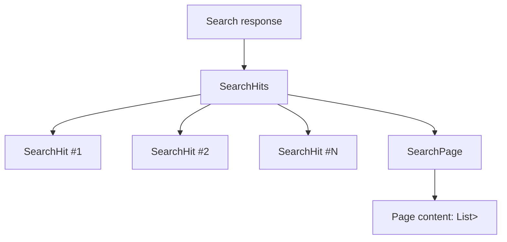
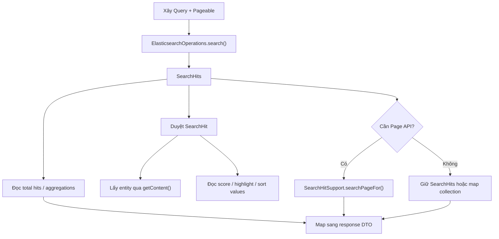

# SearchHit<T>, SearchHits<T> và SearchPage<T>

Khi tìm kiếm bằng Spring Data Elasticsearch, kết quả không chỉ là danh sách entity. Mỗi document được trả về có thể đi kèm điểm liên quan, ID, index nguồn, giá trị sort, highlight và các metadata khác. Toàn bộ response còn có tổng số hit, max score, aggregation và thông tin phân trang.

Spring Data cung cấp ba kiểu giúp biểu diễn các lớp kết quả này:

- **`SearchHit<T>`** đại diện cho một kết quả tìm kiếm, gồm entity `T` và metadata riêng của hit đó.
- **`SearchHits<T>`** đại diện cho toàn bộ kết quả tìm kiếm, gồm danh sách `SearchHit<T>` và metadata cấp response.
- **`SearchPage<T>`** biểu diễn kết quả tìm kiếm theo mô hình `Page` của Spring Data, trong đó nội dung trang là các `SearchHit<T>` và vẫn giữ thông tin `SearchHits<T>`.

Hiểu sự khác nhau giữa ba kiểu giúp ứng dụng không làm mất score hoặc highlight khi chuyển kết quả thành entity, đồng thời xây API phân trang và search UI chính xác hơn.

## 1. Vì sao kết quả tìm kiếm cần nhiều hơn một `List<T>`?

Giả sử người dùng tìm sản phẩm theo từ khóa `wireless`. Elasticsearch có thể trả về nhiều document, mỗi document có `_source` và metadata riêng:

```json
{
  "_index": "products",
  "_id": "p-1001",
  "_score": 4.82,
  "_source": {
    "name": "Wireless Headphones",
    "category": "audio",
    "price": 129.90
  },
  "sort": [4.82, "p-1001"]
}
```

Ngoài dữ liệu sản phẩm, ứng dụng có thể cần:

- `_id` để tạo đường dẫn chi tiết hoặc thực hiện thao tác tiếp theo.
- `_score` để xếp hạng hoặc hiển thị thông tin relevance.
- Highlight fragments để làm nổi bật phần văn bản khớp từ khóa.
- Sort values để tiếp tục phân trang bằng `search_after`.
- Tổng số hit để hiển thị “Có 125 kết quả”.
- Aggregations để hiển thị facet category, brand hoặc khoảng giá.

Nếu chỉ lấy `List<ProductDocument>`, ứng dụng chỉ còn entity và có thể mất phần lớn metadata tìm kiếm. Các kiểu `SearchHit`, `SearchHits` và `SearchPage` giúp giữ những thông tin đó trong mô hình kết quả của Spring Data.

## 2. `SearchHit<T>`: một hit và metadata của nó

`SearchHit<T>` biểu diễn một document đơn lẻ trong kết quả tìm kiếm. Nó chứa entity đã được chuyển đổi thành kiểu `T` cùng metadata Elasticsearch trả về cho hit đó.

Các thông tin thường dùng gồm:

| Thông tin | Ý nghĩa |
|---|---|
| `getContent()` | Entity Java được ánh xạ từ `_source`. |
| `getId()` | Document ID (`_id`). |
| `getIndex()` | Tên index chứa document. |
| `getScore()` | Relevance score của hit. |
| `getSortValues()` | Các giá trị sort Elasticsearch trả về cho hit. |
| `getHighlightFields()` | Các đoạn văn bản highlight nếu request đã yêu cầu highlight. |
| `getInnerHits()` | Inner hits nếu query sử dụng nested/parent-child và request có khai báo. |
| `getMatchedQueries()` | Tên các named query khớp với hit nếu request có cấu hình. |

Các metadata tùy chọn chỉ có ý nghĩa khi request được cấu hình để trả về chúng. Ví dụ, nếu query không yêu cầu highlight thì không thể mong `getHighlightFields()` chứa fragment.

### 2.1. Đọc entity bên trong hit

Ví dụ tìm sản phẩm bằng `ElasticsearchOperations`:

```java
import org.springframework.data.elasticsearch.core.SearchHit;
import org.springframework.data.elasticsearch.core.SearchHits;
import org.springframework.data.elasticsearch.core.query.Query;

SearchHits<ProductDocument> hits = operations.search(
    query,
    ProductDocument.class
);

for (SearchHit<ProductDocument> hit : hits) {
    ProductDocument product = hit.getContent();

    System.out.println("ID: " + hit.getId());
    System.out.println("Name: " + product.getName());
    System.out.println("Score: " + hit.getScore());
}
```

`getContent()` trả về entity `ProductDocument`; `SearchHit` là wrapper chứa cả entity và metadata. Vì vậy, khi muốn lấy thuộc tính domain, truy cập qua `hit.getContent()`.

### 2.2. Score không phải lúc nào cũng là thước đo nghiệp vụ

`getScore()` là điểm relevance do Elasticsearch tính theo query và cấu hình scoring. Điểm này hữu ích để xếp hạng kết quả tìm kiếm, nhưng không phải xác suất, phần trăm độ chính xác hay điểm chất lượng tuyệt đối.

Khi query chỉ có filter hoặc sort theo field, score có thể không mang ý nghĩa xếp hạng mà giao diện cần. Không nên hiển thị `4.82` thành “độ chính xác 96%” nếu chưa có mô hình nghiệp vụ chuyển đổi được định nghĩa và kiểm chứng.

### 2.3. Highlight fields

Nếu search request bật highlighting, một hit có thể chứa fragment đã được đánh dấu phần khớp. Ví dụ dữ liệu highlight có thể tương tự:

```json
{
  "name": [
    "<em>Wireless</em> Headphones"
  ],
  "description": [
    "Enjoy music with <em>wireless</em> connectivity"
  ]
}
```

Đọc highlight từ `SearchHit`:

```java
for (SearchHit<ProductDocument> hit : hits) {
    List<String> nameFragments = hit.getHighlightFields().get("name");

    if (nameFragments != null && !nameFragments.isEmpty()) {
        System.out.println(nameFragments.get(0));
    }
}
```

Highlight là nội dung được Elasticsearch tạo từ dữ liệu index. Khi đưa fragment vào HTML, phải xử lý output theo chính sách render an toàn của ứng dụng. Không mặc định mọi chuỗi highlight đều là HTML tin cậy; tên tag highlight có thể được cấu hình và nội dung gốc có thể chứa ký tự cần escape.

### 2.4. Sort values

`getSortValues()` chứa giá trị sort của hit theo thứ tự các field sort trong request. Đây là metadata quan trọng khi dùng `search_after` để tiếp tục lấy trang kế tiếp.

Không nên tự tính lại sort values từ entity vì Elasticsearch có thể áp dụng missing value, multi-value mode, tie-breaker hoặc cách chuẩn hóa khác. Hãy giữ lại sort values do response trả về nếu cần tiếp tục phân trang theo cursor.

## 3. `SearchHits<T>`: toàn bộ response tìm kiếm

`SearchHits<T>` đại diện cho kết quả search ở cấp request. Nó chứa các `SearchHit<T>` và metadata chung của response.

Các method thường dùng:

| Method | Ý nghĩa |
|---|---|
| `getSearchHits()` | Danh sách `SearchHit<T>` được trả về. |
| `getTotalHits()` | Tổng số hit theo thông tin Elasticsearch trả về. |
| `getMaxScore()` | Score lớn nhất trong tập hit được trả về. |
| `getAggregations()` | Aggregation container nếu request có khai báo aggregation. |
| `getSuggest()` | Suggest response nếu request có cấu hình suggestion. |

`SearchHits<T>` có thể được duyệt trực tiếp trong một vòng lặp, nhưng dùng `getSearchHits()` khi cần thao tác với danh sách cụ thể.

Ví dụ:

```java
SearchHits<ProductDocument> hits = operations.search(
    query,
    ProductDocument.class
);

long total = hits.getTotalHits();
float maxScore = hits.getMaxScore();

List<SearchHit<ProductDocument>> searchHits = hits.getSearchHits();

System.out.println("Total hits: " + total);
System.out.println("Max score: " + maxScore);

for (SearchHit<ProductDocument> hit : searchHits) {
    System.out.println(hit.getId() + " -> " + hit.getContent().getName());
}
```

### 3.1. `getTotalHits()` khác số hit trong trang hiện tại

Giả sử request yêu cầu `size = 20` và Elasticsearch tìm thấy 125 document:

- `hits.getSearchHits().size()` là số hit thực tế trong response hiện tại, tối đa 20.
- `hits.getTotalHits()` là tổng số hit phù hợp theo total-hits semantics của request.

Không dùng `getSearchHits().size()` để hiển thị tổng số kết quả. Nó chỉ là số document trong trang hiện tại.

Elasticsearch có cơ chế giới hạn chi phí đếm tổng số hit. Tùy cấu hình `track_total_hits` và phiên bản, tổng số trả về có thể là số chính xác hoặc chỉ là cận dưới. Nếu sản phẩm cần con số chính xác để báo cáo hoặc phân trang, hãy cấu hình tracking phù hợp và cân nhắc chi phí trên index lớn. Đừng giả định mọi total hits đều chính xác chỉ vì API trả về kiểu `long`.

### 3.2. Aggregations nằm ở cấp `SearchHits`

Aggregation là thống kê trên tập document của search request, không phải metadata riêng của từng hit. Ví dụ request có terms aggregation theo category; kết quả aggregation được truy cập từ `SearchHits.getAggregations()`.

```java
SearchHits<ProductDocument> hits = operations.search(
    queryWithAggregations,
    ProductDocument.class
);

var aggregations = hits.getAggregations();
```

Kiểu container và cách đọc bucket phụ thuộc phiên bản Spring Data Elasticsearch và loại client được sử dụng. Hãy dùng response model tương ứng với dependency của dự án. Không ép kiểu tùy tiện hoặc giả định aggregation luôn tồn tại; nếu request không khai báo aggregation thì container có thể không có giá trị.

## 4. `SearchPage<T>`: kết quả tìm kiếm theo mô hình Page

`SearchPage<T>` kết hợp search metadata với abstraction phân trang `Page` của Spring Data. Nội dung trang là các `SearchHit<T>`, nhờ đó vẫn giữ metadata từng hit trong khi cung cấp các thuộc tính phân trang quen thuộc.

Các thông tin có thể dùng từ page:

- `getContent()`: danh sách `SearchHit<T>` của trang hiện tại.
- `getNumber()`: số trang hiện tại, bắt đầu từ 0.
- `getSize()`: kích thước trang.
- `getTotalElements()`: tổng số phần tử theo metadata tìm kiếm.
- `getTotalPages()`: tổng số trang được suy ra từ tổng số phần tử và page size.
- `hasNext()` / `hasPrevious()`: kiểm tra trang tiếp theo/trước đó.
- `getSearchHits()`: truy cập `SearchHits<T>` gốc để lấy metadata search response, theo API của Spring Data Elasticsearch.

`SearchPage<T>` không phải `Page<T>` chứa entity trực tiếp. Nó là page chứa `SearchHit<T>`. Muốn lấy entity, gọi `getContent()` của từng hit.

### 4.1. Chuyển `SearchHits` thành `SearchPage`

Khi dùng `ElasticsearchOperations`, ta có thể xây query với `Pageable`, nhận `SearchHits<T>`, rồi dùng `SearchHitSupport.searchPageFor(...)` để tạo `SearchPage<T>`:

```java
import org.springframework.data.domain.PageRequest;
import org.springframework.data.domain.Pageable;
import org.springframework.data.elasticsearch.core.SearchHit;
import org.springframework.data.elasticsearch.core.SearchHitSupport;
import org.springframework.data.elasticsearch.core.SearchHits;
import org.springframework.data.elasticsearch.core.SearchPage;
import org.springframework.data.elasticsearch.client.elc.NativeQuery;
import org.springframework.data.elasticsearch.core.query.Query;

Pageable pageable = PageRequest.of(0, 20);

Query query = NativeQuery.builder()
    .withQuery(q -> q
        .match(match -> match
            .field("name")
            .query("wireless")
        )
    )
    .withPageable(pageable)
    .build();

SearchHits<ProductDocument> hits = operations.search(
    query,
    ProductDocument.class
);

SearchPage<ProductDocument> page = SearchHitSupport.searchPageFor(
    hits,
    pageable
);
```

Sau đó có thể dùng API Page:

```java
System.out.println("Page number: " + page.getNumber());
System.out.println("Page size: " + page.getSize());
System.out.println("Total elements: " + page.getTotalElements());
System.out.println("Total pages: " + page.getTotalPages());

for (SearchHit<ProductDocument> hit : page.getContent()) {
    ProductDocument product = hit.getContent();
    System.out.println(hit.getScore() + " - " + product.getName());
}
```

`SearchHitSupport.searchPageFor` chuyển kết quả search thành abstraction phân trang, đồng thời giữ các hit. Chữ ký và package cần đối chiếu với phiên bản Spring Data Elasticsearch đang dùng nếu dự án sử dụng một thế hệ API cũ.

## 5. So sánh ba kiểu kết quả

| Tiêu chí | `SearchHit<T>` | `SearchHits<T>` | `SearchPage<T>` |
|---|---|---|---|
| Phạm vi | Một document trong kết quả | Toàn bộ search response | Một trang kết quả tìm kiếm |
| Entity | `getContent()` | Nằm trong từng hit | Nằm trong từng hit ở page content |
| Score | Score của hit | Max score ở cấp response và score trong từng hit | Score nằm trong từng hit |
| ID/index | Metadata của một document | Truy cập qua từng hit | Truy cập qua từng hit |
| Total hits | Không phải thông tin chính của một hit | Có `getTotalHits()` | Có thông tin tổng phần tử của Page và search hits gốc |
| Aggregations | Không thuộc phạm vi một hit | Có thể truy cập qua response | Có thể lấy qua `getSearchHits()` |
| Pagination | Không | Không tự triển khai Page API | Có `Pageable` semantics |
| Mục đích | Xem entity cùng metadata riêng | Xử lý toàn bộ response và metadata search | Trả kết quả theo trang cho tầng service/API |

Có thể hình dung mối quan hệ:



`SearchPage` không thay thế `SearchHit` hoặc `SearchHits`; nó bổ sung lớp phân trang cho kết quả tìm kiếm.

## 6. Dùng Repository với kiểu kết quả tìm kiếm

Spring Data Elasticsearch Repository hỗ trợ các kiểu kết quả tìm kiếm trong những phương thức truy vấn phù hợp, bên cạnh các kiểu trả về entity thông thường. Ví dụ một derived query có thể trả `SearchHits<ProductDocument>` để giữ metadata:

```java
import org.springframework.data.elasticsearch.repository.ElasticsearchRepository;
import org.springframework.data.elasticsearch.core.SearchHits;

public interface ProductRepository
        extends ElasticsearchRepository<ProductDocument, String> {

    SearchHits<ProductDocument> findByCategory(String category);
}
```

Khi cần các thông tin như score, highlight hoặc sort values, kiểu trả về search hits phù hợp hơn `List<ProductDocument>`.

Với query động, aggregation, filter phức tạp hoặc yêu cầu chọn index/alias tại runtime, `ElasticsearchOperations` thường linh hoạt hơn. Không cần ép mọi truy vấn vào method name của Repository.

Các kiểu trả về Repository được hỗ trợ có thể thay đổi theo phiên bản và loại query. Hãy kiểm tra tài liệu/Javadoc của Spring Data Elasticsearch đang dùng trước khi chọn `SearchPage<T>` trực tiếp làm return type của một method query.

## 7. Xây dựng response DTO cho REST API

Không nên mặc định trả nguyên object `SearchHits`, `SearchPage` hoặc Elasticsearch client response ra ngoài API. Những kiểu này thuộc tầng persistence/search và có thể chứa metadata hoặc cấu trúc phụ thuộc phiên bản.

Nên chuyển kết quả thành DTO phù hợp với hợp đồng API:

```java
public record ProductSearchItem(
    String id,
    String name,
    String category,
    float score,
    List<String> nameHighlights
) {
}

public record ProductSearchResponse(
    List<ProductSearchItem> items,
    long totalElements,
    int page,
    int size,
    int totalPages
) {
}
```

Service chuyển từ `SearchPage`:

```java
import java.util.List;

public ProductSearchResponse toResponse(SearchPage<ProductDocument> page) {
    List<ProductSearchItem> items = page.getContent().stream()
        .map(hit -> new ProductSearchItem(
            hit.getId(),
            hit.getContent().getName(),
            hit.getContent().getCategory(),
            hit.getScore(),
            hit.getHighlightFields().getOrDefault("name", List.of())
        ))
        .toList();

    return new ProductSearchResponse(
        items,
        page.getTotalElements(),
        page.getNumber(),
        page.getSize(),
        page.getTotalPages()
    );
}
```

Ví dụ dùng Java hiện đại với record và `Stream.toList()`. Nếu dự án dùng Java cũ hơn, thay record bằng class/DTO thông thường và dùng `Collectors.toList()`.

DTO giúp ứng dụng quyết định rõ metadata nào được public. Ví dụ, có thể trả score và highlight cho search UI nhưng không trả tên index nội bộ hoặc sort values nếu API không cần chúng.

## 8. Phân trang với `Pageable`

Khi xây query bằng `NativeQuery`, dùng `Pageable` để chỉ định page number, page size và sort:

```java
Pageable pageable = PageRequest.of(
    0,
    20,
    Sort.by(Sort.Direction.DESC, "price")
);

Query query = NativeQuery.builder()
    .withQuery(q -> q
        .match(match -> match
            .field("name")
            .query("wireless")
        )
    )
    .withPageable(pageable)
    .build();

SearchHits<ProductDocument> hits = operations.search(
    query,
    ProductDocument.class
);
```

Có thể chuyển thành `SearchPage` như phần trước nếu service cần Page API.

### 8.1. Page number và offset

`PageRequest.of(page, size)` dùng page number bắt đầu từ 0. Ví dụ `PageRequest.of(2, 20)` yêu cầu trang thứ ba, tương ứng offset 40 với page size 20.

Elasticsearch dùng `from` và `size` cho phân trang kiểu offset. Cách này thuận tiện cho những trang đầu, nhưng có giới hạn về độ sâu và chi phí khi truy cập các trang rất xa. Không nên cho phép client gửi page number vô hạn.

### 8.2. Sort ổn định

Khi phân trang, nên có thứ tự sort ổn định. Nếu nhiều document có cùng giá trị sort, kết quả có thể dịch chuyển giữa các trang khi dữ liệu thay đổi hoặc khi không có tie-breaker phù hợp.

Có thể thêm một field duy nhất làm tie-breaker, ví dụ `id` hoặc một field keyword có doc values, nếu mapping và query hỗ trợ:

```java
Sort sort = Sort.by(
    Sort.Order.desc("price"),
    Sort.Order.asc("id")
);
```

Chọn field sort dựa trên mapping thực tế. Không sort trực tiếp trên field `text` nếu không có multi-field `keyword` phù hợp.

## 9. Phân trang sâu: `search_after` và Point in Time

Với export hoặc batch đọc rất nhiều document, tăng page number và dùng `from`/`size` có thể tốn tài nguyên. Elasticsearch hỗ trợ `search_after`, trong đó request kế tiếp dùng sort values của hit cuối cùng trong request trước.

Luồng khái quát:

1. Chạy request đầu với sort ổn định.
2. Lấy `getSortValues()` từ hit cuối cùng.
3. Đặt các giá trị đó vào `search_after` của request tiếp theo.
4. Tiếp tục cho đến khi không còn hit.

Ví dụ response hit có sort values:

```json
{
  "_id": "p-1001",
  "sort": [129.9, "p-1001"]
}
```

Giá trị `[129.9, "p-1001"]` là cursor của hit đó theo thứ tự sort đã khai báo. Không tự tạo cursor bằng cách lấy giá từ entity nếu Elasticsearch trả thêm tie-breaker hoặc áp dụng missing-value semantics.

Với dữ liệu có thể thay đổi trong lúc đọc nhiều trang, Point in Time (PIT) giúp giữ một góc nhìn nhất quán của index trong thời gian phân trang. Cách dùng PIT và API `search_after` cụ thể phụ thuộc phiên bản Elasticsearch/Spring Data. Khi làm batch export, cần quản lý PIT lifetime, đóng PIT khi xong và xử lý trường hợp cursor hết hạn.

`SearchPage<T>` phù hợp với phân trang thông thường. Với cursor pagination, cần một response model riêng chứa sort values/cursor; không nên ép `search_after` vào `PageRequest` nếu semantics không tương ứng.

## 10. SearchHits và aggregation

Một query có thể vừa trả hit vừa tính aggregation. Ví dụ đếm số sản phẩm theo category:

```java
Query query = NativeQuery.builder()
    .withQuery(q -> q
        .match(match -> match
            .field("name")
            .query("wireless")
        )
    )
    .withAggregation("categories", aggregation -> aggregation
        .terms(terms -> terms.field("category"))
    )
    .withPageable(PageRequest.of(0, 20))
    .build();

SearchHits<ProductDocument> hits = operations.search(
    query,
    ProductDocument.class
);

var aggregations = hits.getAggregations();
```

Hit và aggregation có phạm vi khác nhau về mặt mô hình:

- `SearchHit<T>` chứa một document cùng metadata.
- `SearchHits<T>` chứa danh sách hit và metadata response, bao gồm aggregation container.
- `SearchPage<T>` giúp phân trang hit nhưng aggregation vẫn là metadata của search response gốc.

Không giả định aggregation được tính trên số hit của trang hiện tại. Aggregation thường được tính trên tập document phù hợp với query chính, không phải chỉ 20 document đang được hiển thị. Nếu request có `post_filter`, cần nhớ aggregation không bị post filter giới hạn.

## 11. Highlighting và đọc fragment trong SearchHit

Để có highlight, search request cần khai báo field muốn highlight. Khi Elasticsearch trả highlight fragments, Spring Data đặt chúng vào metadata của `SearchHit`.

Ví dụ cấu trúc DSL:

```json
GET products/_search
{
  "query": {
    "match": {
      "name": "wireless"
    }
  },
  "highlight": {
    "fields": {
      "name": {}
    },
    "pre_tags": ["<mark>"],
    "post_tags": ["</mark>"]
  }
}
```

Sau khi thực thi qua Operations:

```java
for (SearchHit<ProductDocument> hit : hits) {
    List<String> fragments = hit.getHighlightFields()
        .getOrDefault("name", List.of());

    ProductDocument product = hit.getContent();
    // Chuyển product và fragments thành response DTO.
}
```

Highlight không thay đổi `_source` của entity. `getContent().getName()` vẫn là tên gốc; fragment highlight là metadata riêng của hit. Nếu giao diện cần hiển thị tên có đánh dấu, dùng fragment highlight theo cách render đã được kiểm soát.

## 12. Khi nào nên dùng `List<T>`, `SearchHits<T>` hay `SearchPage<T>`?

| Nhu cầu | Kiểu trả về phù hợp | Lý do |
|---|---|---|
| Chỉ cần entity, không cần metadata search | `List<T>` hoặc kiểu collection phù hợp | Đơn giản, ít phụ thuộc vào search response. |
| Cần score, ID, highlight hoặc sort values từng hit | `SearchHits<T>` | Giữ metadata của từng hit và toàn response. |
| Cần một hit và metadata của nó | `SearchHit<T>` | Phù hợp với thao tác trên một kết quả riêng lẻ. |
| Cần Page API với total elements, page number và page size | `SearchPage<T>` | Kết hợp metadata tìm kiếm với Spring Data Page. |
| Cần cursor pagination sâu | Response cursor riêng dựa trên sort values/PIT | `Page` offset semantics không đại diện đầy đủ cho `search_after`. |

Không nên luôn dùng `SearchHits` cho mọi use case. Nếu service chỉ cần danh sách entity để xử lý nội bộ và không dùng metadata, collection đơn giản có thể dễ đọc hơn. Ngược lại, đừng chuyển `SearchHits` thành `List<T>` quá sớm nếu giao diện cần score, highlight hoặc cursor.

## 13. Các lỗi thường gặp

| Hiện tượng | Nguyên nhân có thể | Cách xử lý |
|---|---|---|
| Không lấy được tên sản phẩm từ `SearchHit` | Đọc trực tiếp thuộc tính domain trên wrapper | Dùng `hit.getContent().getName()`. |
| Tổng kết quả bằng số hit trong trang | Dùng `getSearchHits().size()` thay cho total hits | Dùng `SearchHits.getTotalHits()` hoặc Page total elements. |
| Không có highlight | Query chưa khai báo highlight hoặc field không được hỗ trợ | Thêm highlight request và kiểm tra mapping/field. |
| Score bằng 0 hoặc không hữu ích | Query chủ yếu dùng filter hoặc không có scoring clause | Không diễn giải score như điểm nghiệp vụ; xem query và sort. |
| `SearchPage` content không phải entity | Page chứa `SearchHit<T>` | Duyệt page content rồi gọi `getContent()` trên từng hit. |
| Aggregation chỉ có một phần dữ liệu | Điều kiện được đặt trong query chính hoặc aggregation size quá nhỏ | Xác định tập dữ liệu aggregation cần phản ánh và kiểm tra `size`. |
| Tổng hit không chính xác tuyệt đối | Total-hits tracking bị giới hạn | Cấu hình tracking phù hợp nếu nghiệp vụ cần exact count. |
| Trang sâu chậm | Offset pagination với `from` lớn | Dùng cursor với `search_after` và cân nhắc PIT. |
| Kết quả trùng/mất giữa các trang | Sort không ổn định hoặc dữ liệu thay đổi trong lúc phân trang | Thêm tie-breaker và cân nhắc PIT. |
| API phụ thuộc mạnh vào model Elasticsearch | Trả nguyên SearchHits/SearchPage ra REST | Chuyển thành DTO theo hợp đồng API. |

## 14. Quy trình xử lý kết quả tìm kiếm



Các bước thực tế:

1. Xác định UI/API cần entity, score, highlight, aggregation hay pagination metadata.
2. Xây query và `Pageable` phù hợp.
3. Thực thi bằng `ElasticsearchOperations.search(...)` để nhận `SearchHits<T>`.
4. Đọc total hits và aggregation ở cấp response.
5. Duyệt từng `SearchHit<T>` để lấy entity và metadata riêng.
6. Chuyển thành `SearchPage<T>` nếu cần Page API.
7. Map kết quả sang DTO, chỉ giữ metadata cần public.
8. Với phân trang sâu, cân nhắc cursor/search_after thay cho page number lớn.

## 15. Kết luận

`SearchHit<T>` đại diện cho một document tìm được cùng metadata như ID, index, score, highlight và sort values. `SearchHits<T>` đại diện cho toàn bộ response, gồm danh sách hit, tổng số kết quả, max score và aggregation/suggest metadata khi có. `SearchPage<T>` bổ sung mô hình phân trang Spring Data, trong đó mỗi phần tử của page vẫn là một `SearchHit<T>`.

Khi cần xử lý entity, lấy `hit.getContent()`. Khi cần tổng số kết quả, dùng `SearchHits.getTotalHits()` hoặc Page total elements thay vì đếm số hit trong trang. Khi cần highlight, aggregation hoặc cursor, giữ metadata ở đúng cấp của response và hit.

Đối với API ứng dụng, nên chuyển các kiểu kết quả này thành DTO rõ ràng để kiểm soát hợp đồng trả về và tránh phụ thuộc trực tiếp vào response model của Elasticsearch. Với trang đầu và các trang thông thường, `SearchPage` thuận tiện; với dữ liệu rất lớn, dùng sort ổn định cùng `search_after` và PIT khi phù hợp.
