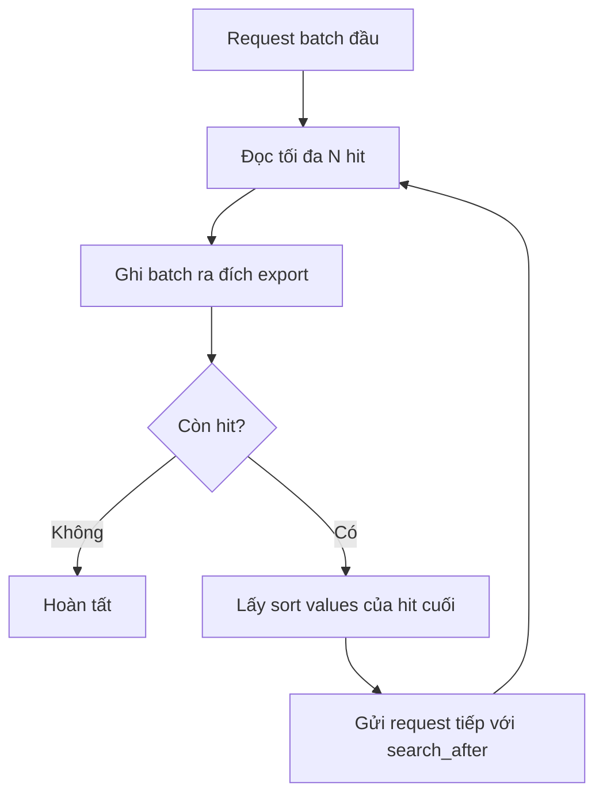
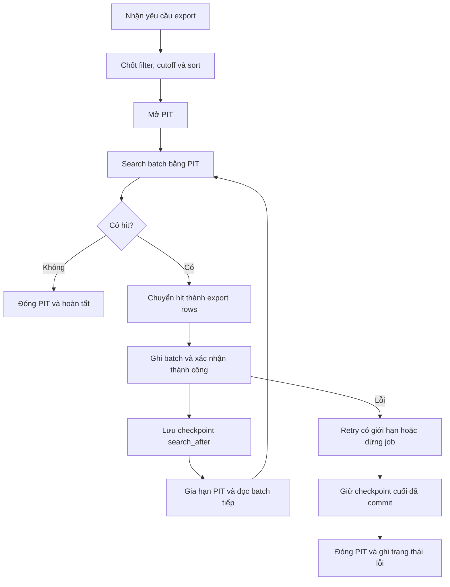

# Phân biệt phân trang giao diện và quét dữ liệu để xuất

Trong Spring Data Elasticsearch, phân trang có thể phục vụ hai mục tiêu rất khác nhau. Giao diện tìm kiếm thường cần hiển thị một trang nhỏ, cho phép người dùng chuyển trang, quay lại trang trước hoặc nhảy tới một trang cụ thể. Ngược lại, một tác vụ export cần đọc tuần tự hàng trăm nghìn hoặc hàng triệu document để ghi ra CSV, JSON, file báo cáo hay hệ thống khác.

Hai mục tiêu này không nên dùng cùng một chiến lược mặc định:

- **Phân trang giao diện** ưu tiên page number, page size, sort và tổng số kết quả để người dùng điều hướng.
- **Quét dữ liệu để export** ưu tiên đọc tuần tự ổn định, kiểm soát bộ nhớ, throughput, khả năng tiếp tục sau lỗi và không bỏ sót document.

Spring Data Elasticsearch hỗ trợ `Pageable`, `SearchHits` và `SearchPage` cho phân trang thông thường. Với việc quét sâu, Elasticsearch khuyến nghị dùng **Point in Time (PIT) kết hợp `search_after`** thay vì tăng `from` liên tục. Cách chọn đúng phụ thuộc vào trải nghiệm người dùng, kích thước dữ liệu và yêu cầu nhất quán của bản export.

## 1. Hai bài toán có mục tiêu khác nhau

Giả sử ứng dụng có index `orders` chứa hàng triệu đơn hàng.

Màn hình quản trị có thể cần hiển thị 25 đơn hàng mỗi trang, cho phép nhân viên chọn trang 1, 2, 3 hoặc lọc theo trạng thái. Người dùng không cần tải toàn bộ dữ liệu cùng lúc.

Trong khi đó, tác vụ cuối ngày cần export toàn bộ đơn hàng đã hoàn tất trong một khoảng thời gian ra file. Tác vụ này phải đọc hết tập dữ liệu, không giữ hàng triệu entity trong RAM và cần xử lý được khi ghi file hoặc kết nối Elasticsearch gặp lỗi.

| Tiêu chí | Phân trang giao diện | Quét dữ liệu để export |
|---|---|---|
| Mục tiêu | Hiển thị một phần kết quả để người dùng điều hướng | Đọc toàn bộ tập dữ liệu cần xuất |
| Cách đi qua dữ liệu | Có thể nhảy tới trang bất kỳ hoặc quay lại | Tuần tự từ batch đầu đến batch cuối |
| Kích thước mỗi lần đọc | Thường nhỏ, ví dụ 10–50 hit | Batch lớn hơn, chọn theo payload và tài nguyên |
| Tổng số kết quả | Thường hữu ích cho số trang và bộ đếm | Thường không cần đếm trước toàn bộ |
| Cách phân trang | `Pageable`, `from`/`size`, `SearchPage` | `search_after` với PIT |
| Bộ nhớ ứng dụng | Giữ một trang | Xử lý từng batch, không tích lũy toàn bộ |
| Nhất quán khi dữ liệu thay đổi | Có thể chấp nhận thay đổi giữa các lần chuyển trang tùy sản phẩm | Thường cần một góc nhìn ổn định trong suốt lần export |
| Khả năng tiếp tục | Người dùng tải lại trang | Lưu cursor/checkpoint và xử lý resume |
| Tiêu chí kết thúc | Hết trang hoặc người dùng dừng | Không còn hit sau cursor cuối |

Điểm quan trọng là export không phải một giao diện có rất nhiều trang. Nó là một quy trình xử lý batch trên tập dữ liệu lớn.

## 2. Phân trang giao diện bằng `Pageable`

Spring Data sử dụng `Pageable` để mô tả số trang, kích thước trang và thứ tự sắp xếp. Với `NativeQuery`, có thể đặt `Pageable` rồi thực thi qua `ElasticsearchOperations`:

```java
import org.springframework.data.domain.PageRequest;
import org.springframework.data.domain.Pageable;
import org.springframework.data.domain.Sort;
import co.elastic.clients.elasticsearch._types.FieldValue;
import org.springframework.data.elasticsearch.client.elc.NativeQuery;
import org.springframework.data.elasticsearch.core.SearchHits;
import org.springframework.data.elasticsearch.core.query.Query;

Pageable pageable = PageRequest.of(
    0,
    25,
    Sort.by(Sort.Direction.DESC, "createdAt")
);

Query query = NativeQuery.builder()
    .withQuery(q -> q
        .bool(b -> b
            .filter(f -> f.term(t -> t
                .field("status")
                    .value(FieldValue.of("COMPLETED"))
            ))
        )
    )
    .withPageable(pageable)
    .build();

SearchHits<OrderDocument> hits = operations.search(
    query,
    OrderDocument.class
);
```

`PageRequest.of(0, 25)` yêu cầu trang đầu tiên với tối đa 25 kết quả. Page number bắt đầu từ 0. Trang tiếp theo có thể dùng `PageRequest.of(1, 25)`.

Nếu cần API `Page` quen thuộc, chuyển `SearchHits` thành `SearchPage`:

```java
import org.springframework.data.elasticsearch.core.SearchHitSupport;
import org.springframework.data.elasticsearch.core.SearchPage;

SearchPage<OrderDocument> page = SearchHitSupport.searchPageFor(
    hits,
    pageable
);

long totalElements = page.getTotalElements();
int totalPages = page.getTotalPages();
boolean hasNext = page.hasNext();
```

`SearchPage` chứa `SearchHit<OrderDocument>` trong `getContent()`. Khi cần entity, gọi `hit.getContent()`. Metadata của hit như score và highlight vẫn có thể được giữ lại.

### 2.1. Khi nào dùng `Page`, `Slice` hoặc `SearchPage`?

- Dùng `Page<T>` khi tầng ứng dụng cần tổng số phần tử và tổng số trang.
- Dùng `Slice<T>` khi chỉ cần biết có trang tiếp theo hay không và không cần tổng số phần tử chính xác.
- Dùng `SearchPage<T>` khi cần phân trang cùng metadata tìm kiếm như score, highlight và sort values.
- Dùng `SearchHits<T>` khi cần toàn bộ metadata của search response nhưng không cần Page API.

Việc tính total hits có thể tốn thêm chi phí trên index lớn. Nếu giao diện chỉ có nút “Xem thêm” hoặc “Tải thêm”, không nhất thiết phải đếm chính xác tất cả document trước khi hiển thị trang đầu.

## 3. Giới hạn của `from` và `size`

Phân trang giao diện truyền thống thường được thực hiện bằng `from` và `size` trong Elasticsearch. Ví dụ:

```json
GET orders/_search
{
  "from": 50,
  "size": 25,
  "sort": [
    { "createdAt": "desc" }
  ],
  "query": {
    "term": {
      "status": "COMPLETED"
    }
  }
}
```

Request này bỏ qua 50 kết quả đầu và trả tối đa 25 kết quả tiếp theo.

Mặc định, Elasticsearch thường giới hạn tổng `from + size` bằng `index.max_result_window`, thường là 10.000. Vì vậy, việc yêu cầu trang rất sâu có thể gặp lỗi giới hạn result window. Giới hạn này tồn tại vì mỗi shard cần giữ và xử lý các kết quả liên quan đến vị trí offset, gây tốn bộ nhớ và CPU khi offset lớn.

Không nên giải quyết ngay bằng cách tăng `index.max_result_window` lên hàng trăm nghìn hoặc hàng triệu. Việc tăng giới hạn có thể làm truy vấn sâu đắt hơn và gây áp lực lên cluster. Với export hoặc batch scan, hãy dùng `search_after`.

### 3.1. Khi `from`/`size` phù hợp

- Người dùng cần nhảy tới một trang cụ thể.
- Số lượng trang không quá sâu.
- Page size nhỏ và được giới hạn ở server.
- UI cần hiển thị tổng số trang.
- Tần suất chuyển trang và độ trễ chấp nhận được.

### 3.2. Khi `from`/`size` không phù hợp

- Export hàng trăm nghìn hoặc hàng triệu document.
- Tác vụ batch đọc toàn bộ kết quả.
- Người dùng có thể yêu cầu page number rất lớn.
- Ứng dụng đang tăng `from` theo từng vòng lặp để đọc hết index.

## 4. Những vấn đề khi export bằng cách tăng page number

Một cách làm có vẻ đơn giản là lặp `PageRequest.of(pageNumber, batchSize)` cho đến khi trang rỗng:

```java
import org.springframework.data.domain.Page;
import org.springframework.data.domain.Pageable;
import org.springframework.data.elasticsearch.repository.ElasticsearchRepository;

public interface OrderRepository
        extends ElasticsearchRepository<OrderDocument, String> {

    Page<OrderDocument> findByStatus(String status, Pageable pageable);
}

int pageNumber = 0;
int batchSize = 500;

while (true) {
    Pageable pageable = PageRequest.of(pageNumber, batchSize);
    Page<OrderDocument> page = repository.findByStatus(
        "COMPLETED",
        pageable
    );

    if (page.isEmpty()) {
        break;
    }

    export(page.getContent());
    pageNumber++;
}
```

Cách này có một số vấn đề:

1. `from` tăng theo page number và cuối cùng chạm `max_result_window`.
2. Các trang sâu ngày càng tốn tài nguyên vì Elasticsearch phải xử lý nhiều kết quả trước offset.
3. Nếu document được thêm hoặc xóa trong lúc export, vị trí offset có thể dịch chuyển, gây trùng hoặc bỏ sót dữ liệu.
4. Nếu mỗi vòng lặp gọi `count` để xây `Page`, việc đếm tổng có thể lặp lại không cần thiết.
5. Toàn bộ quy trình bị gắn với mô hình điều hướng trang của UI thay vì mô hình scan tuần tự.

`PageRequest` phù hợp với UI và tập kết quả vừa phải. Nó không phải công cụ tối ưu để đọc toàn bộ index.

## 5. Quét tuần tự bằng `search_after`

`search_after` dùng giá trị sort của hit cuối cùng trong batch hiện tại làm cursor cho request tiếp theo. Thay vì nói “bỏ qua 100.000 kết quả”, request nói “trả các kết quả đứng sau hit có sort values này”.

Luồng cơ bản:



Ví dụ request đầu:

```json
GET orders/_search
{
  "size": 500,
  "sort": [
    { "createdAt": "asc" },
    { "orderSortId": "asc" }
  ],
  "query": {
    "term": {
      "status": "COMPLETED"
    }
  }
}
```

Giả sử hit cuối cùng có:

```json
{
  "_id": "order-9000",
  "sort": ["2026-11-13T10:30:00Z", "order-9000"]
}
```

Request tiếp theo truyền nguyên mảng sort values đó:

```json
GET orders/_search
{
  "size": 500,
  "sort": [
    { "createdAt": "asc" },
    { "orderSortId": "asc" }
  ],
  "search_after": [
    "2026-11-13T10:30:00Z",
    "order-9000"
  ],
  "query": {
    "term": {
      "status": "COMPLETED"
    }
  }
}
```

Các request tiếp theo phải giữ cùng query và cùng thứ tự sort. Không tự tính cursor từ entity nếu response đã cung cấp sort values; hãy dùng chính giá trị Elasticsearch trả về.

## 6. Sort phải ổn định và có tie-breaker

Nếu sort chỉ theo `createdAt`, nhiều đơn hàng có thể cùng thời điểm. Khi hai document có cùng toàn bộ sort values, ranh giới giữa các batch có thể không xác định đủ để phân trang chính xác.

Nên thêm một field duy nhất làm tie-breaker, ví dụ `orderSortId` kiểu `keyword` có doc values:

```json
"sort": [
  { "createdAt": "asc" },
  { "orderSortId": "asc" }
]
```

Field tie-breaker cần:

- Có giá trị cho mọi document trong tập export.
- Có mapping hỗ trợ sort, thường là `keyword` hoặc kiểu số/ngày phù hợp.
- Có tính duy nhất trong phạm vi tập kết quả cần quét.
- Không thay đổi trong lúc export nếu cần cursor ổn định.

Không nên sort trên field `text` thông thường vì field này không có doc values mặc định. Nếu cần sort theo nội dung tên, tạo multi-field `keyword` hoặc một field sort chuyên biệt.

Khi dùng PIT, Elasticsearch có thể dùng `_shard_doc` làm tie-breaker nội bộ nếu request không khai báo tie-breaker riêng. Tuy nhiên, nếu export cần thứ tự nghiệp vụ xác định hoặc cần checkpoint dễ diễn giải, một field duy nhất do ứng dụng quản lý thường rõ ràng hơn. Với scan không cần thứ tự nghiệp vụ, có thể cân nhắc `_shard_doc` theo hướng dẫn của phiên bản Elasticsearch đang chạy.

## 7. Kết hợp `search_after` với Point in Time (PIT)

`search_after` tự nó không tạo ra một snapshot nhất quán. Nếu index thay đổi giữa hai request, document có thể được thêm, xóa hoặc đổi giá trị sort. Điều này có thể làm cursor không còn đại diện cho cùng một tập dữ liệu ban đầu.

**Point in Time (PIT)** tạo một góc nhìn ổn định của index trong một khoảng thời gian. Kết hợp PIT và `search_after` là chiến lược phù hợp để quét sâu dữ liệu trong khi hạn chế ảnh hưởng của thay đổi đồng thời.

Quy trình:

1. Mở PIT trên index hoặc alias cần export.
2. Gửi search request sử dụng PIT, query cố định và sort ổn định.
3. Ghi batch kết quả ra đích.
4. Lấy sort values của hit cuối làm `search_after`.
5. Gửi request tiếp theo với cùng PIT và gia hạn `keep_alive`.
6. Lặp đến khi không còn hit.
7. Đóng PIT trong mọi trường hợp kết thúc, kể cả khi export lỗi hoặc bị hủy.

### 7.1. Mở PIT

REST API:

```http
POST /orders/_pit?keep_alive=2m
```

Response trả về PIT ID. Khi search bằng PIT, request được gửi tới `/_search` và chứa PIT ID:

```json
{
  "pit": {
    "id": "PIT_ID_FROM_OPEN_RESPONSE",
    "keep_alive": "2m"
  },
  "size": 500,
  "sort": [
    { "createdAt": "asc" },
    { "orderSortId": "asc" }
  ],
  "query": {
    "term": {
      "status": "COMPLETED"
    }
  }
}
```

Khi dùng PIT, không truyền index path vào từng search request theo cách thông thường; PIT đã xác định index view được mở.

### 7.2. Gia hạn PIT

`keep_alive` không phải thời hạn tổng của toàn bộ export. Nó là khoảng thời gian Elasticsearch giữ PIT sau lần truy cập gần nhất. Mỗi request tiếp theo nên gửi `keep_alive` đủ dài để xử lý batch kế tiếp.

Nếu xử lý một batch mất quá lâu, PIT có thể hết hạn trước request kế tiếp. Hãy chọn batch size và keep-alive dựa trên thời gian xử lý thực tế, đồng thời theo dõi thời gian từng batch.

Elasticsearch có thể trả về PIT ID mới trong search response. Nếu response có ID mới, dùng ID mới nhất cho request tiếp theo và khi đóng PIT. Không tiếp tục dùng một PIT ID cũ nếu server đã trả ID thay thế.

### 7.3. Đóng PIT

Sau khi export hoàn tất hoặc thất bại, đóng PIT để giải phóng tài nguyên:

```http
DELETE /_pit
{
  "id": "LATEST_PIT_ID"
}
```

PIT giữ tài nguyên và các trạng thái liên quan đến search context. Không mở PIT rồi bỏ quên. Dùng `try/finally` hoặc cơ chế quản lý tài nguyên tương đương để đảm bảo cleanup.

## 8. Ví dụ Java với Elasticsearch Java API Client

Trong Spring Boot/Spring Data Elasticsearch, có thể inject `ElasticsearchClient` đã được cấu hình và dùng API PIT/search khi cần kiểm soát cursor chi tiết. Ví dụ sau dùng một DTO export có cấu trúc JSON khớp với `_source`:

```java
public record OrderExportRow(
    String orderId,
    String status,
    Instant createdAt,
    BigDecimal total
) {
}
```

Ví dụ service đọc theo batch:

```java
import java.io.IOException;
import java.math.BigDecimal;
import java.time.Instant;
import java.util.List;
import java.util.function.Consumer;

import co.elastic.clients.elasticsearch.ElasticsearchClient;
import co.elastic.clients.elasticsearch._types.FieldValue;
import co.elastic.clients.elasticsearch._types.SortOrder;
import co.elastic.clients.elasticsearch.core.SearchResponse;
import co.elastic.clients.elasticsearch.core.search.Hit;
import co.elastic.clients.elasticsearch.core.OpenPointInTimeResponse;

public class OrderExportScanner {

    private final ElasticsearchClient client;

    public OrderExportScanner(ElasticsearchClient client) {
        this.client = client;
    }

    public void export(Consumer<List<OrderExportRow>> batchConsumer)
            throws IOException {

        OpenPointInTimeResponse opened = client.openPointInTime(request ->
            request.index("orders").keepAlive("2m")
        );

        String pitId = opened.id();
        List<FieldValue> searchAfter = null;

        try {
            while (true) {
                final String currentPitId = pitId;
                final List<FieldValue> cursor = searchAfter;

                SearchResponse<OrderExportRow> response = client.search(request -> {
                    request
                        .pit(pit -> pit.id(currentPitId).keepAlive("2m"))
                        .size(500)
                        .sort(sort -> sort.field(field -> field
                            .field("createdAt")
                            .order(SortOrder.Asc)
                        ))
                        .sort(sort -> sort.field(field -> field
                            .field("orderSortId")
                            .order(SortOrder.Asc)
                        ))
                        .query(query -> query
                            .term(term -> term
                                .field("status")
                                .value(FieldValue.of("COMPLETED"))
                            )
                        );

                    if (cursor != null) {
                        request.searchAfter(cursor);
                    }

                    return request;
                }, OrderExportRow.class);

                if (response.pitId() != null) {
                    pitId = response.pitId();
                }

                List<Hit<OrderExportRow>> hits = response.hits().hits();
                if (hits.isEmpty()) {
                    break;
                }

                List<OrderExportRow> rows = hits.stream()
                    .map(Hit::source)
                    .filter(java.util.Objects::nonNull)
                    .toList();

                batchConsumer.accept(rows);

                searchAfter = hits.get(hits.size() - 1).sort();
            }
        } finally {
            final String latestPitId = pitId;
            client.closePointInTime(request -> request.id(latestPitId));
        }
    }
}
```

Đây là ví dụ minh họa API Java Client; tên method/kiểu response cần đối chiếu phiên bản Elasticsearch Java API Client do Spring Boot quản lý. Cần bổ sung import `java.util.function.Consumer` và `java.time.Instant`, `java.math.BigDecimal` cho DTO/consumer. Tùy JSON mapper của client, DTO export phải có constructor/record support và tên field khớp `_source`.

Một số điểm trong ví dụ cần giữ khi triển khai:

- PIT được mở một lần cho toàn bộ lần scan.
- Mỗi search request dùng PIT hiện tại và cùng query/sort.
- `searchAfter` lấy trực tiếp từ `sort()` của hit cuối cùng.
- Mỗi batch được chuyển cho consumer ngay, không tích lũy toàn bộ dữ liệu.
- PIT ID mới nhất được giữ nếu response trả ID thay thế.
- `finally` đóng PIT.

Ví dụ chưa triển khai retry, checkpoint bền vững, ghi file tạm/rename nguyên tử hoặc xử lý lỗi từng record. Các phần đó cần bổ sung theo yêu cầu vận hành của export job.

### 8.1. Lưu ý khi dùng Java API Client bên cạnh Spring Data

`ElasticsearchClient` dùng JSON-P mapper của client để chuyển `_source` thành kiểu Java. Nó không tự động áp dụng toàn bộ `MappingElasticsearchConverter`, annotation `@Field`, custom conversions hoặc property mapping của Spring Data.

Vì vậy, với export trực tiếp bằng client:

- Dùng DTO export có tên field và kiểu dữ liệu khớp `_source`.
- Hoặc nhận dữ liệu dạng `JsonData`/`Map` rồi chuyển đổi theo adapter riêng.
- Nếu bắt buộc dùng custom conversion của Spring Data, thiết kế lớp adapter dùng converter đã cấu hình hoặc dùng API `NativeQuery`/Operations tương ứng với phiên bản hỗ trợ PIT và search-after.

Không giả định POJO dùng cho Repository sẽ luôn được Java API Client deserialize giống hệt Spring Data.

## 9. Batch size và kiểm soát bộ nhớ

Không có một batch size đúng cho mọi hệ thống. Một batch 500 document nhỏ có thể nhẹ, nhưng 500 document có mô tả dài, nested object và binary-like payload có thể tạo response rất lớn.

Chọn batch size bằng cách đo:

- Kích thước response theo byte.
- Thời gian Elasticsearch xử lý request.
- Thời gian chuyển đổi từng document.
- Thời gian ghi batch ra đích.
- Heap usage và garbage collection của ứng dụng.
- Throughput tổng và timeout của cluster/network.

Một điểm bắt đầu thường là vài trăm đến khoảng một nghìn document mỗi batch, sau đó điều chỉnh theo dữ liệu thực tế. Đây chỉ là giá trị khởi đầu, không phải quy tắc cố định.

### 9.1. Không giữ toàn bộ export trong RAM

Tránh cách làm:

```java
List<OrderExportRow> allRows = new ArrayList<>();

while (hasMore) {
    allRows.addAll(readNextBatch());
}

writeCsv(allRows);
```

Với hàng triệu document, danh sách này có thể chiếm nhiều heap và làm ứng dụng OOM.

Thay vào đó, ghi hoặc xử lý ngay từng batch:

```java
while (hasMore) {
    List<OrderExportRow> batch = readNextBatch();
    csvWriter.writeRows(batch);
    csvWriter.flushIfNeeded();
}
```

Nếu destination chậm hơn Elasticsearch, cần backpressure: chỉ lấy batch tiếp theo sau khi batch hiện tại đã được ghi xong hoặc đã được xác nhận lưu thành công. Không tạo hàng đợi không giới hạn giữa reader và writer.

## 10. Export nên có checkpoint và khả năng resume

Với export dài, tiến trình có thể dừng do restart, timeout, lỗi file system hoặc sự cố cluster. Nếu phải chạy lại từ đầu, chi phí có thể lớn.

Checkpoint nên lưu ít nhất:

- Export job ID và trạng thái job.
- Index/alias hoặc phạm vi dữ liệu được quét.
- Query/filter cố định và phiên bản schema liên quan.
- Sort definition.
- `search_after` values của batch cuối đã ghi thành công.
- Số document đã ghi và thời điểm checkpoint.
- Thông tin snapshot/PIT nếu hệ thống có thể tiếp tục trong cùng PIT lifetime.

Không nên đánh dấu cursor đã xử lý trước khi batch được ghi bền vững vào đích. Nếu ghi file, có thể ghi batch rồi flush/fsync theo yêu cầu, sau đó mới lưu checkpoint. Nếu checkpoint được lưu trước khi batch hoàn tất, resume có thể bỏ sót dữ liệu.

### 10.1. PIT hết hạn thì sao?

PIT có thời gian sống hữu hạn. Nếu PIT hết hạn, không thể giả định mở PIT mới rồi tiếp tục với cursor cũ sẽ vẫn đọc đúng cùng snapshot. Dữ liệu có thể đã thay đổi giữa hai snapshot.

Các lựa chọn phụ thuộc yêu cầu:

- Nếu export phải phản ánh một snapshot nhất quán tuyệt đối, cần giữ PIT đủ lâu, kiểm soát thời gian xử lý hoặc tạo nguồn dữ liệu snapshot riêng.
- Nếu export có thể chấp nhận dữ liệu thay đổi trong lúc chạy, có thể mở PIT mới và tiếp tục theo cursor, nhưng phải xác định cách xử lý trùng/thiếu.
- Nếu dữ liệu là append-only và có watermark rõ ràng, có thể giới hạn export theo một cutoff cố định và resume theo khóa sort, nhưng vẫn cần quy tắc xử lý cập nhật/xóa.
- Nếu đích hỗ trợ idempotency, dùng khóa nghiệp vụ ổn định để ghi lại batch mà không tạo bản ghi trùng.

Không tuyên bố export “exactly once” chỉ vì đã lưu `search_after`. Exactly-once cần phối hợp cursor, snapshot, checkpoint và semantics ghi của đích.

## 11. Retry và xử lý lỗi theo từng batch

Một export job nên phân biệt lỗi tạm thời và lỗi dữ liệu:

| Lỗi | Hướng xử lý |
|---|---|
| Timeout hoặc lỗi kết nối tạm thời | Retry có giới hạn với backoff; xác định PIT còn hiệu lực hay không. |
| PIT expired | Mở snapshot mới theo chính sách resume đã định nghĩa; không giả định cursor giữ nguyên snapshot. |
| Mapping/deserialize error | Ghi nhận document lỗi, xử lý theo chính sách skip/quarantine hoặc dừng job. |
| Destination write failure | Không tiến checkpoint qua batch chưa ghi thành công; retry ghi theo cơ chế idempotent nếu có thể. |
| Disk full hoặc permission error | Dừng job, giữ trạng thái lỗi và giải phóng PIT. |
| Cancellation | Dừng lấy batch mới, hoàn tất hoặc rollback batch hiện tại theo chính sách rồi đóng PIT. |

Retry không được tạo ra vòng lặp vô hạn. Cần giới hạn số lần, có backoff và log job ID, batch number, cursor/checkpoint (tránh log dữ liệu nhạy cảm). Khi retry một batch, dùng cùng cursor và đảm bảo việc ghi đích có thể chịu được thao tác lặp.

## 12. Scroll API và vì sao thường ưu tiên PIT + search_after

Elasticsearch từng dùng Scroll API rộng rãi cho deep pagination và export. Scroll giữ search context ở cluster và trả scroll ID cho request tiếp theo.

Scroll vẫn có thể xuất hiện trong hệ thống cũ hoặc một số workload batch phù hợp, nhưng nó có các đặc tính vận hành cần quản lý:

- Search context được giữ trên cluster trong suốt quá trình scan.
- Phải gia hạn scroll keep-alive khi đọc tiếp.
- Phải clear scroll khi hoàn tất để giải phóng tài nguyên.
- Scroll không phù hợp với trải nghiệm UI cần nhảy tới một trang bất kỳ.

Với các phiên bản Elasticsearch hiện đại, PIT kết hợp `search_after` là lựa chọn được khuyến nghị cho nhiều trường hợp deep pagination vì cung cấp snapshot ổn định cùng cursor sort rõ ràng. Nếu dùng Scroll do yêu cầu tương thích hoặc workload cụ thể, cần tuân thủ hướng dẫn của phiên bản cluster và luôn clear scroll.

## 13. UI pagination và export cần sort/consistency khác nhau

Giao diện có thể sắp xếp theo giá, tên hoặc ngày tạo để người dùng dễ duyệt. Với dữ liệu thay đổi thường xuyên, người dùng có thể chấp nhận trang 2 có một vài khác biệt so với thời điểm tải trang 1, tùy yêu cầu sản phẩm.

Export thường cần một định nghĩa rõ ràng hơn:

- Export lấy dữ liệu tại thời điểm bắt đầu hay dữ liệu mới nhất trong suốt quá trình?
- Có bao gồm document được tạo sau khi job bắt đầu không?
- Nếu một đơn hàng đổi trạng thái giữa lúc quét, export lấy trạng thái cũ hay mới?
- Nếu document bị xóa trong lúc export, có cần xuất bản snapshot cũ không?
- Thứ tự bản ghi có cần xác định để đối soát không?

PIT giữ góc nhìn ổn định cho search context, nhưng không thay thế quy tắc nghiệp vụ về thời điểm dữ liệu được chốt. Với báo cáo tài chính hoặc đối soát, có thể cần một cutoff nghiệp vụ hoặc nguồn snapshot đã đóng băng trước khi export.

## 14. Chọn chiến lược theo yêu cầu

| Tình huống | Chiến lược phù hợp |
|---|---|
| Danh sách đơn hàng, 25 dòng mỗi trang, có số trang | `Pageable`/`SearchPage` với `from`/`size` |
| Nút “Tải thêm” chỉ cần trang kế tiếp | Có thể dùng `Slice` hoặc cursor pagination tùy độ sâu và tính nhất quán |
| UI cần nhảy tới trang 20 trong tập dữ liệu nhỏ/vừa | `from`/`size`, nếu còn trong result window |
| Export 500.000 document | PIT + `search_after`, xử lý theo batch |
| Đọc toàn bộ index để đồng bộ hệ thống khác | PIT + `search_after`, checkpoint và idempotent destination |
| Export có snapshot nghiệp vụ cố định | Tạo/chọn nguồn dữ liệu đã chốt, sau đó scan tuần tự |
| Cluster cũ chưa hỗ trợ PIT phù hợp | Đánh giá Scroll API và giới hạn tài nguyên theo phiên bản |

Không chọn chiến lược chỉ dựa trên số lượng document. Hãy xét cả cách người dùng điều hướng, tần suất dữ liệu thay đổi, yêu cầu nhất quán, độ sâu phân trang và khả năng resume.

## 15. Những lỗi thường gặp

| Hiện tượng | Nguyên nhân có thể | Cách xử lý |
|---|---|---|
| Export dừng ở khoảng 10.000 document | Đang dùng `from`/`size` và chạm `max_result_window` | Chuyển sang PIT + `search_after`. |
| Batch bị trùng hoặc thiếu record | Sort không ổn định hoặc index thay đổi giữa các request | Dùng PIT và sort có tie-breaker ổn định. |
| Search-after không trả kết quả tiếp | Cursor không lấy từ hit cuối hoặc sort/query giữa các request thay đổi | Dùng nguyên sort values và giữ cùng query/sort. |
| Export làm ứng dụng OOM | Tích lũy tất cả entity trong một collection | Ghi và giải phóng từng batch. |
| PIT bị expired | `keep_alive` quá ngắn hoặc xử lý batch quá lâu | Gia hạn mỗi request và tối ưu batch; định nghĩa resume khi PIT hết hạn. |
| Cluster giữ nhiều search context | Không đóng PIT/scroll sau khi job kết thúc | Đóng PIT trong `finally`, clear scroll nếu dùng Scroll. |
| Các trang UI thay đổi khi chuyển trang | Dữ liệu được thêm/xóa giữa các request offset | Chấp nhận theo UX hoặc dùng cursor/PIT nếu cần snapshot ổn định. |
| Sort không hoạt động trên field tên | Field `text` không có doc values | Dùng multi-field `keyword` hoặc field sort riêng. |
| Resume bỏ sót batch cuối | Checkpoint được lưu trước khi đích ghi thành công | Chỉ commit checkpoint sau khi batch được ghi bền vững. |
| Resume tạo bản ghi trùng | Destination không idempotent | Dùng khóa ổn định và upsert/dedup theo hợp đồng đích. |

## 16. Quy trình thiết kế một export job



Một quy trình triển khai nên gồm:

1. Chốt query/filter và cutoff nghiệp vụ trước khi mở PIT.
2. Chọn sort field có doc values và tie-breaker ổn định.
3. Mở PIT với keep-alive phù hợp.
4. Đọc batch bằng `search_after`, giữ nguyên query và sort.
5. Chuyển đổi và ghi từng batch ra destination; không giữ toàn bộ dữ liệu trong RAM.
6. Chỉ lưu checkpoint sau khi batch đã được ghi thành công.
7. Gia hạn PIT trên mỗi request và giữ PIT ID mới nhất.
8. Retry lỗi tạm thời có giới hạn; xác định rõ hành vi khi PIT hết hạn.
9. Đóng PIT trong mọi đường kết thúc.
10. Đối soát số document, trạng thái job và file/đích export sau khi hoàn tất.

## 17. Kết luận

Phân trang giao diện và quét dữ liệu để export là hai bài toán khác nhau. `Pageable`, `Page` và `SearchPage` phù hợp với UI cần page number, page size, sort và tổng số kết quả trong phạm vi phân trang vừa phải. Cơ chế `from`/`size` có giới hạn độ sâu, thường mặc định 10.000 kết quả, và không phù hợp để quét hàng triệu document.

Với export, hãy dùng PIT kết hợp `search_after`, sort ổn định, batch processing và checkpoint. Mỗi request tiếp theo dùng sort values của hit cuối, query và sort phải nhất quán, batch được ghi thành công trước khi tiến checkpoint, và PIT phải được đóng khi job kết thúc. Không tích lũy toàn bộ document trong RAM và không tuyên bố exactly-once nếu snapshot, checkpoint và destination chưa có semantics tương ứng.

Chọn `from`/`size` cho trải nghiệm điều hướng trang; chọn PIT + `search_after` cho việc đọc tuần tự sâu. Khi giữ đúng ranh giới này, ứng dụng vừa có giao diện tìm kiếm dễ dùng, vừa có quy trình export ổn định và kiểm soát được tài nguyên.
