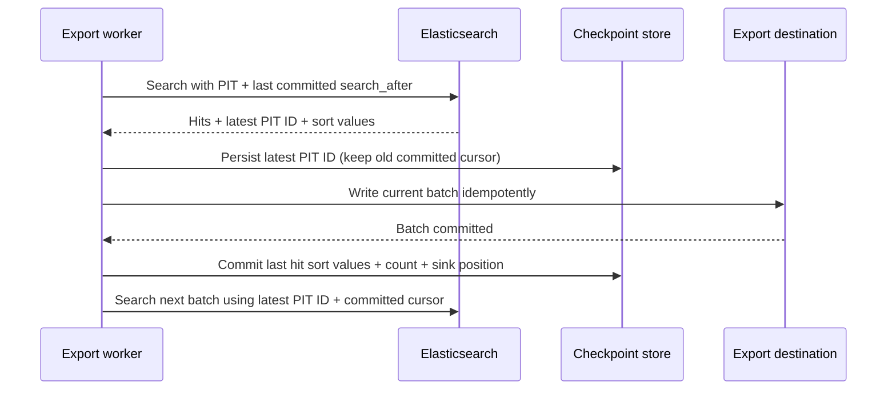
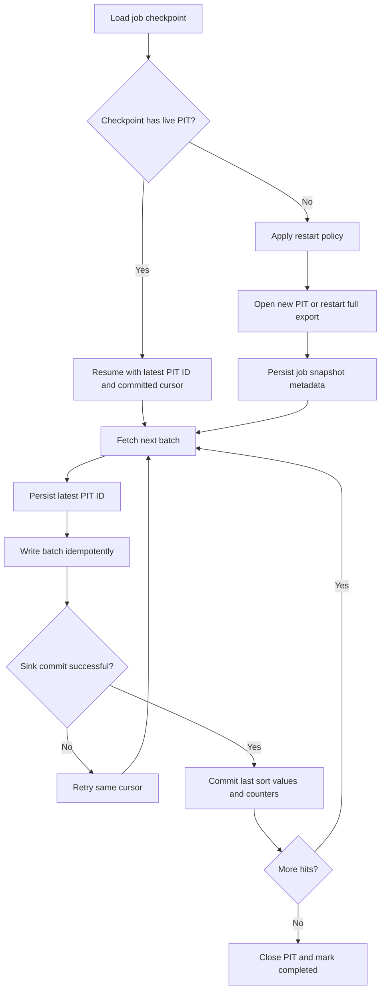

# Khôi phục khi xuất dữ liệu gián đoạn và giới hạn của điểm tiếp tục

Khi xuất hàng trăm nghìn hoặc hàng triệu document từ Elasticsearch, ứng dụng thường không thể lấy tất cả dữ liệu trong một request. Thay vào đó, ứng dụng đọc theo từng batch, ghi batch vào file hoặc hệ thống đích, rồi tiếp tục cho đến khi hết kết quả. Nếu tiến trình bị dừng giữa chừng, câu hỏi quan trọng là có thể tiếp tục từ đúng vị trí cũ hay phải chạy lại.

Elasticsearch cung cấp một số cơ chế để duyệt kết quả lớn như Scroll API và `search_after` kết hợp Point in Time (PIT). Chúng hỗ trợ phân trang/duyệt dữ liệu, nhưng cursor không phải một checkpoint xuất dữ liệu bền vững. Scroll ID và PIT ID tham chiếu tới search context tồn tại trong một khoảng thời gian; chúng có thể hết hạn hoặc mất khi cluster thay đổi. `search_after` chỉ là các giá trị sort của hit cuối đã xử lý, không tự lưu trạng thái công việc hay bảo đảm có thể tiếp tục cùng một snapshot sau khi PIT mất.

Muốn khôi phục đáng tin cậy, ứng dụng phải tự quản lý checkpoint, lưu trạng thái cursor đúng thời điểm, ghi dữ liệu đích theo cách idempotent và xác định rõ điều gì xảy ra khi search context hết hạn. Nếu snapshot không còn tồn tại, không thể bảo đảm tiếp tục chính xác cùng một tập document chỉ bằng cách mở PIT mới và dùng lại cursor cũ.

## 1. Vì sao xuất dữ liệu cần cơ chế tiếp tục?

Giả sử một job xuất index `orders` sang file JSONL. Index có 2 triệu document; mỗi request chỉ lấy 2.000 document. Quy trình có thể gồm:

1. Mở một góc nhìn nhất quán của index.
2. Lấy batch đầu tiên.
3. Ghi batch vào file hoặc data warehouse.
4. Lưu checkpoint của batch đã ghi thành công.
5. Lấy batch tiếp theo.
6. Lặp lại cho đến khi hết dữ liệu.

Job có thể gián đoạn vì nhiều nguyên nhân:

- Process bị restart hoặc máy chủ mất điện.
- Container bị thay thế trong lúc deploy.
- Network timeout khiến ứng dụng không nhận được response.
- Elasticsearch node hoặc cluster restart.
- Scroll/PIT context hết thời hạn `keep_alive`.
- File đích đầy, database đích tạm thời không sẵn sàng hoặc transaction ghi batch thất bại.
- Job bị dừng có chủ đích để bảo trì hoặc thay đổi cấu hình.

Nếu job luôn bắt đầu lại từ đầu, chi phí đọc và ghi có thể rất lớn. Nếu tiếp tục sai vị trí, dữ liệu có thể bị trùng hoặc thiếu. Vì vậy, xuất dữ liệu cần phân biệt ba trạng thái:

| Trạng thái | Ý nghĩa |
|---|---|
| Đã đọc | Elasticsearch đã trả batch cho ứng dụng |
| Đã ghi bền vững | Batch đã được commit vào đích xuất |
| Đã checkpoint | Job đã lưu vị trí cuối cùng mà nó xác nhận đã ghi thành công |

Không được coi “đã nhận response” là “đã xuất xong”. Nếu ứng dụng cập nhật cursor trước khi dữ liệu đích được ghi bền vững, một lần crash có thể làm mất batch.

## 2. Ba khái niệm cần phân biệt

### 2.1 Scroll ID

Scroll API tạo một search context để duyệt lần lượt các batch của một kết quả tìm kiếm. Response trả về `_scroll_id`; ứng dụng dùng ID đó để yêu cầu batch tiếp theo. Search context giữ góc nhìn dữ liệu tại thời điểm search ban đầu trong khoảng thời gian được gia hạn bằng `keep_alive`.

Scroll ID là tham chiếu tới context phía Elasticsearch. Nó không chứa toàn bộ dữ liệu, không phải số trang bền vững và không phải một offset có thể tự tính lại.

### 2.2 Point in Time ID (PIT ID)

PIT mở một góc nhìn ổn định của index trong một khoảng thời gian. Search request có thể dùng PIT ID để truy vấn snapshot đó qua nhiều lần gọi. Mỗi response có thể trả PIT ID mới; ứng dụng cần sử dụng ID mới nhất được trả về.

PIT ID cũng là tham chiếu tới search context phía Elasticsearch. Nó có thời hạn và có thể mất. Lưu PIT ID xuống database giúp ứng dụng biết ID cần dùng khi khởi động lại, nhưng không biến PIT thành một snapshot được lưu trữ vĩnh viễn.

### 2.3 `search_after` cursor

`search_after` là mảng giá trị sort của hit cuối cùng ở batch trước. Request kế tiếp gửi cùng query và sort, kèm mảng đó để lấy các hit đứng sau vị trí đã xử lý.

Ví dụ hit cuối có:

```json
"sort": [
  "2025-03-12T10:30:00.000Z",
  "ORDER-900100"
]
```

Request tiếp theo dùng chính xác hai giá trị này:

```json
"search_after": [
  "2025-03-12T10:30:00.000Z",
  "ORDER-900100"
]
```

`search_after` không lưu trạng thái ở Elasticsearch và không tạo snapshot. Để duyệt nhất quán khi index vẫn có thể thay đổi, nên dùng nó cùng PIT. Cursor chỉ có ý nghĩa với cùng query, cùng sort và cùng góc nhìn dữ liệu.

## 3. Scroll API: duyệt batch bằng search context

Scroll phù hợp với một số job xuất dữ liệu lớn theo batch, đặc biệt khi cần duyệt toàn bộ kết quả theo thứ tự nội bộ hiệu quả thay vì phân trang giao diện.

### 3.1 Mở scroll

Request đầu tiên chỉ định `scroll` keep-alive và kích thước batch:

```http
POST /orders/_search?scroll=2m
{
  "size": 2000,
  "sort": ["_doc"],
  "query": {
    "term": {
      "status": "COMPLETED"
    }
  }
}
```

Response chứa batch đầu tiên và `_scroll_id`:

```json
{
  "_scroll_id": "DXF1ZXJ5...",
  "hits": {
    "hits": [
      { "_id": "order-1", "_source": { "status": "COMPLETED" } },
      { "_id": "order-2", "_source": { "status": "COMPLETED" } }
    ]
  }
}
```

`_doc` là lựa chọn sort hiệu quả khi chỉ cần duyệt document, không cần thứ tự nghiệp vụ cụ thể. Nếu file xuất cần thứ tự xác định theo ngày hoặc mã đơn hàng, phải chọn sort phù hợp và chấp nhận chi phí tương ứng.

### 3.2 Lấy batch tiếp theo

Gửi scroll ID gần nhất:

```http
POST /_search/scroll
{
  "scroll": "2m",
  "scroll_id": "DXF1ZXJ5..."
}
```

Response trả batch tiếp theo và có thể trả `_scroll_id` mới. Luôn thay ID đang lưu bằng ID mới nhất được response trả về. Không giả định scroll ID đầu tiên sẽ dùng được trong suốt job.

### 3.3 `keep_alive` có nghĩa gì?

`keep_alive` là khoảng thời gian Elasticsearch giữ search context kể từ lần request scroll gần nhất. Mỗi lần tiếp tục scroll, ứng dụng có thể yêu cầu gia hạn thời gian context cho lần tiếp theo.

Nó không phải thời lượng tối đa của toàn bộ job. Một job có thể chạy lâu hơn nhiều lần `keep_alive` nếu liên tục gửi request đúng hạn. Ngược lại, nếu job bị dừng lâu hơn thời gian context được giữ, context có thể bị đóng và scroll ID không còn dùng được.

Chọn `keep_alive` đủ dài cho khoảng thời gian có thể xử lý/ghi một batch và chịu được độ trễ tạm thời. Không đặt quá dài một cách tùy tiện vì mỗi scroll context giữ tài nguyên ở cluster.

### 3.4 Kết thúc và giải phóng scroll context

Khi hết dữ liệu hoặc job bị hủy, hãy xóa scroll context:

```http
DELETE /_search/scroll
{
  "scroll_id": ["DXF1ZXJ5..."]
}
```

Nếu có nhiều scroll ID cần dọn, gửi danh sách theo API. Trong code, đặt thao tác clear trong `finally` hoặc cơ chế cleanup tương đương để giải phóng context khi thành công hoặc khi có exception.

## 4. Giới hạn khôi phục của Scroll ID

Scroll ID không phải checkpoint bền vững. Có một số giới hạn cần hiểu rõ:

1. **Context có thời hạn:** nếu `keep_alive` hết trước khi job tiếp tục, Elasticsearch có thể đóng context.
2. **Context nằm ở cluster:** process ứng dụng lưu được chuỗi scroll ID nhưng không lưu được search context bên trong Elasticsearch.
3. **ID có thể thay đổi:** phải dùng ID mới nhất từ response. Nếu response bị mất trước khi ứng dụng nhận ID mới, ứng dụng có thể không biết ID cần dùng tiếp.
4. **Cluster restart hoặc context bị đóng:** scroll ID cũ không thể tự dựng lại snapshot.
5. **Không có random access:** scroll là luồng batch tuần tự, không phải API nhảy tới trang bất kỳ bằng số offset.
6. **Tốn tài nguyên:** context giữ trạng thái tìm kiếm và segment cần thiết; mở quá nhiều scroll hoặc giữ quá lâu gây áp lực lên cluster.

Nếu scroll context mất, không thể chỉ lấy ID document cuối cùng rồi yêu cầu Scroll API tiếp tục từ đó. Scroll API không nhận `_id` như một cursor khôi phục tùy ý. Muốn bắt đầu lại, phải mở search mới hoặc chuyển sang một chiến lược cursor khác; snapshot mới có thể không còn cùng tập dữ liệu ban đầu.

### 4.1 Scroll ID không tương đương checkpoint của file xuất

Giả sử ứng dụng đã nhận batch số 12 và scroll ID mới, nhưng chưa ghi batch vào file. Nếu process crash, chỉ lưu scroll ID không cho biết batch 12 đã được commit hay chưa. Nếu tiếp tục và bỏ qua batch này, dữ liệu bị thiếu; nếu ghi lại, có thể bị trùng nếu batch đã được ghi nhưng checkpoint chưa cập nhật.

Checkpoint cần mô tả trạng thái của **đích xuất**, không chỉ trạng thái cursor Elasticsearch. Với Scroll API, việc gắn một checkpoint bền vững với vị trí batch có giới hạn vì cursor phụ thuộc search context phía server.

## 5. PIT kết hợp `search_after`

Với các phiên bản Elasticsearch hiện đại, cách thường dùng để phân trang sâu và duyệt snapshot là PIT kết hợp `search_after`.

- PIT giữ góc nhìn ổn định của index.
- `search_after` xác định vị trí tiếp theo trong thứ tự sort.
- Ứng dụng tự lưu cursor và trạng thái job để tiếp tục khi process restart, miễn là PIT còn tồn tại.

### 5.1 Mở PIT

```http
POST /orders/_pit?keep_alive=5m
```

Response trả PIT ID. Ứng dụng lưu ID này cùng metadata job.

### 5.2 Search batch đầu tiên

```http
POST /_search
{
  "size": 2000,
  "pit": {
    "id": "PIT_ID_FROM_OPEN",
    "keep_alive": "5m"
  },
  "query": {
    "term": {
      "status": "COMPLETED"
    }
  },
  "sort": [
    { "createdAt": "asc" },
    { "exportKey": "asc" }
  ]
}
```

`exportKey` ở đây là field keyword duy nhất, ổn định và có thể sort. `createdAt` xác định thứ tự nghiệp vụ; `exportKey` phân định các document có cùng timestamp.

Nếu dùng PIT, Elasticsearch có thể bổ sung `_shard_doc` làm tie-breaker nội bộ khi cần. Giá trị sort trả về trong mỗi hit phải được giữ nguyên để gửi lại trong `search_after`. Một field nghiệp vụ duy nhất cũng hữu ích khi cần diễn giải hoặc kiểm tra checkpoint. Không dùng `_id` trực tiếp làm field sort tùy tiện; `_id` có giới hạn về sort/doc values, vì vậy nếu cần sort theo định danh hãy lưu bản sao vào một field keyword có doc values.

### 5.3 Search batch tiếp theo

Giả sử hit cuối batch đầu trả về:

```json
{
  "_id": "order-900100",
  "sort": [
    "2025-03-12T10:30:00.000Z",
    "ORDER-900100",
    4294967298
  ]
}
```

Request tiếp theo dùng `search_after` đúng nguyên dạng mảng `sort`:

```http
POST /_search
{
  "size": 2000,
  "pit": {
    "id": "LATEST_PIT_ID",
    "keep_alive": "5m"
  },
  "query": {
    "term": {
      "status": "COMPLETED"
    }
  },
  "sort": [
    { "createdAt": "asc" },
    { "exportKey": "asc" }
  ],
  "search_after": [
    "2025-03-12T10:30:00.000Z",
    "ORDER-900100",
    4294967298
  ]
}
```

Mảng cursor phải giữ đúng thứ tự, kiểu dữ liệu và giá trị mà Elasticsearch trả về. Không tự parse timestamp sang timezone khác, làm tròn số hoặc chỉ lưu một phần sort values.

### 5.4 Dùng PIT ID mới nhất

Search response có thể trả PIT ID mới. Hãy thay PIT ID đã lưu bằng ID mới nhất sau mỗi response. Tương tự scroll ID, không giả định ID ban đầu luôn là ID phải dùng cho mọi request sau.

Mỗi request có thể gia hạn `keep_alive`. Nếu ứng dụng không gửi request trong khoảng thời gian PIT được giữ, context có thể hết hạn. PIT không được giữ vô thời hạn chỉ vì ID của nó còn nằm trong database ứng dụng.

### 5.5 Đóng PIT

Khi export hoàn tất hoặc bị hủy, đóng PIT:

```http
DELETE /_pit
{
  "id": "LATEST_PIT_ID"
}
```

Nếu có ID mới hơn sau request cuối, dùng ID mới nhất để đóng. Nếu cleanup thất bại do context đã hết hạn, ghi nhận trạng thái và để Elasticsearch giải phóng context theo lifecycle của nó; không lặp vô hạn thao tác đóng.

## 6. Điểm tiếp tục không phải là snapshot

`search_after` chỉ là vị trí sort. Bản thân nó không giữ dữ liệu tại thời điểm export bắt đầu. Tính nhất quán đến từ PIT.

Nếu dùng `search_after` mà không có PIT trong khi index vẫn nhận insert/update/delete:

- Document mới có sort value nhỏ hơn cursor có thể nằm phía trước cursor và bị bỏ qua.
- Document được cập nhật làm sort value thay đổi có thể chuyển từ phía sau lên phía trước hoặc ngược lại.
- Document bị xóa trước khi được đọc sẽ không còn xuất hiện.
- Một document có thể được nhìn thấy ở vị trí khác nếu thứ tự thay đổi giữa các request.

Vì vậy, cursor cũ không đảm bảo không trùng/không thiếu khi dữ liệu thay đổi.

### 6.1 PIT tạo snapshot theo góc nhìn search

PIT giữ một góc nhìn ổn định của index tại thời điểm mở. Những thay đổi được index sau thời điểm đó không xuất hiện trong snapshot; document đã tồn tại trong snapshot vẫn được nhìn theo phiên bản thuộc góc nhìn đó.

Điều này hữu ích cho export cần nhất quán: một đơn hàng được cập nhật sau khi PIT mở không làm thay đổi nội dung mà job đang duyệt trong PIT đó.

Tuy nhiên, snapshot chỉ tồn tại khi PIT context còn sống. Nó không phải bản sao dữ liệu được lưu độc lập trên disk dành cho job và không phải transaction export kéo dài qua mọi lần restart.

### 6.2 PIT mất thì không thể tái tạo cùng snapshot bằng cursor cũ

Nếu PIT hết hạn hoặc bị mất, mở PIT mới sẽ tạo góc nhìn mới. Dùng `search_after` cũ trên PIT mới có thể tiếp tục theo thứ tự sort tại snapshot mới, nhưng tập document và vị trí của chúng có thể đã thay đổi.

Ví dụ:

1. PIT A được mở lúc 10:00.
2. Job đã xuất tới `createdAt = 10:30`, `exportKey = ORDER-900100`.
3. PIT A hết hạn lúc job đang dừng.
4. Từ 10:00 tới 10:20, có document mới được thêm, document cũ bị xóa và một số sort field bị sửa.
5. Job mở PIT B lúc 10:25 và dùng cursor cũ.

PIT B không phải snapshot A. Document mới có thể nằm trước cursor và bị bỏ qua; document thay đổi có thể di chuyển qua ranh giới cursor. Không có cách nào chỉ từ cursor cũ khôi phục đầy đủ snapshot A sau khi context A đã mất.

Đây là giới hạn căn bản của điểm tiếp tục: cursor cho biết vị trí, còn snapshot context xác định tập dữ liệu và phiên bản dữ liệu mà vị trí đó thuộc về.

## 7. Thiết kế checkpoint bền vững

Ứng dụng cần lưu trạng thái export ở một nơi bền vững như database, checkpoint store hoặc manifest file được ghi nguyên tử. Một checkpoint hữu ích thường có:

| Trường | Ý nghĩa |
|---|---|
| `jobId` | Định danh duy nhất của lần export |
| `index`/alias | Nguồn dữ liệu đã export |
| `queryHash` | Dấu vân tay của query/filter |
| `sortDefinition` | Thứ tự sort và phiên bản quy tắc sort |
| `pitId` | PIT ID mới nhất được nhận, nếu dùng PIT |
| `searchAfter` | Sort values của hit cuối đã commit |
| `lastDocumentId` | ID cuối cùng để quan sát/đối chiếu, không thay thế sort cursor |
| `batchNumber` | Số batch đã commit |
| `exportedCount` | Số record đã ghi thành công |
| `sinkPosition` | Vị trí/offset/file segment đã commit ở đích |
| `startedAt` | Thời điểm bắt đầu job/snapshot |
| `status` | RUNNING, PAUSED, COMPLETED hoặc FAILED |

Không nhất thiết mọi job đều cần tất cả field. Nhưng cần lưu đủ thông tin để biết cursor thuộc query, sort và index nào. Không dùng lại cursor nếu query hoặc sort đã thay đổi.

### 7.1 Không checkpoint trước khi dữ liệu đích commit

Thứ tự sai:

1. Nhận batch.
2. Lưu `search_after` là hit cuối batch.
3. Ghi file thất bại.
4. Khởi động lại từ cursor mới.

Batch chưa ghi bị bỏ qua vì checkpoint đã tiến lên.

Thứ tự an toàn hơn:

1. Nhận batch và PIT ID mới.
2. Lưu PIT ID mới nhất cùng cursor đã commit trước đó.
3. Ghi batch vào đích và commit bền vững.
4. Cập nhật cursor thành sort values của hit cuối batch vừa commit.
5. Tăng batch number và exported count.

Nếu crash sau bước 2 nhưng trước bước 3, job đọc lại cùng batch từ cursor cũ. Nếu crash sau bước 3 nhưng trước bước 4, batch có thể được ghi lại khi resume. Vì vậy, đích xuất cần idempotent hoặc có cơ chế nhận biết batch đã commit.

### 7.2 Lưu PIT ID mới và cursor đã commit riêng biệt

PIT ID mới nhất và cursor cuối cùng đã ghi thành công là hai thông tin có thời điểm cập nhật khác nhau:

- PIT ID nên được lưu ngay khi response mới được nhận để job giữ tham chiếu context mới nhất.
- `search_after` chỉ được tiến lên sau khi batch tương ứng đã được ghi bền vững.

Nếu gộp hai trường vào một checkpoint chỉ cập nhật sau khi ghi batch, crash trong lúc ghi có thể làm mất PIT ID mới nhất. Nếu cập nhật cursor quá sớm, batch chưa commit có thể bị bỏ qua. Có thể lưu PIT ID riêng trước, rồi commit cursor sau khi sink xác nhận.

### 7.3 Ví dụ trình tự xử lý



Nếu sink và checkpoint store hỗ trợ cùng một transaction, có thể commit dữ liệu batch và cursor trong cùng transaction. Nếu chúng là hai hệ thống khác nhau, cần thiết kế idempotency, page manifest hoặc outbox-like protocol để xử lý khoảng thời gian giữa hai lần commit.

## 8. Xử lý crash và retry

Không phải mọi lỗi đều có cùng cách phục hồi. Cần phân biệt lỗi trước khi request được gửi, lỗi khi Elasticsearch xử lý, response bị mất và lỗi khi ghi đích.

| Tình huống | Điều có thể biết | Hướng xử lý |
|---|---|---|
| Process crash sau khi checkpoint đã commit | Cursor và sink position đã lưu | Resume từ checkpoint nếu PIT còn sống |
| Sink ghi thất bại trước commit | Batch chưa được xác nhận | Retry batch từ cursor cũ |
| Sink commit xong nhưng checkpoint chưa tiến | Dữ liệu có thể đã tồn tại ở đích | Reprocess batch bằng sink idempotent/dedup |
| PIT/scroll context hết hạn | Snapshot context không còn | Không thể tiếp tục snapshot cũ; chạy lại hoặc dùng chiến lược watermark |
| Search response timeout, không rõ request đã hoàn tất | Có thể không nhận được PIT ID mới | Thử lại với ID/cursor đã lưu nếu context còn; xử lý như trạng thái không chắc chắn |
| Elasticsearch trả lỗi shard/context | Batch không đáng tin cậy hoặc context mất | Kiểm tra response; retry có giới hạn hoặc khởi tạo lại job theo policy |
| Cluster restart làm mất context | ID cũ không còn tham chiếu hợp lệ | Reopen snapshot mới và áp dụng chính sách restart |

### 8.1 Retry cùng `search_after`

Với PIT còn sống, nếu sink chưa commit batch, gửi lại cùng query, sort, PIT ID mới nhất đã lưu và `search_after` cuối cùng đã commit. Kết quả sẽ bắt đầu lại sau cursor đã commit.

Điều này có thể trả lại batch vừa xử lý dở. Đó là chủ ý: cursor chỉ đại diện cho batch đã commit, không đại diện cho batch đã nhận.

### 8.2 Request timeout và response bị mất

Một trường hợp khó là Elasticsearch đã xử lý request nhưng response bị mất trên network. Ứng dụng không biết response chứa PIT ID mới nào. Nếu PIT ID cũ vẫn còn dùng được, có thể thử lại request với cursor đã commit; nhưng không nên dựa vào việc mọi ID cũ luôn còn hợp lệ, vì API yêu cầu sử dụng PIT ID mới nhất nhận được.

Để giảm rủi ro:

- Lưu PIT ID mới ngay khi response nhận được.
- Giữ cursor ở vị trí batch đã commit.
- Dùng retry có giới hạn và ghi log request/job ID.
- Nếu không thể xác nhận context còn tồn tại, chuyển job sang trạng thái cần khởi tạo snapshot mới theo policy.
- Dùng sink idempotent để chấp nhận batch có thể được gửi lại.

Không thể tạo một bảo đảm exactly-once xuyên suốt Elasticsearch và một hệ thống đích độc lập chỉ bằng `search_after`. Exactly-once cần transaction chung hoặc giao thức idempotency/dedup phù hợp.

## 9. Khi PIT hoặc Scroll context đã mất: chọn chính sách khôi phục

Khi context hết hạn, ứng dụng phải quyết định cách tiếp tục. Không có một lựa chọn đúng cho mọi loại export.

### 9.1 Chạy lại toàn bộ export

Phù hợp khi:

- Dataset có kích thước vừa phải.
- Sink có thể ghi đè theo khóa duy nhất hoặc deduplicate.
- Cần một snapshot mới nhất và không yêu cầu giữ đúng snapshot trước.
- Chi phí chạy lại chấp nhận được.

Job mở PIT mới, xóa/rebuild partition đích hoặc ghi lại bằng khóa idempotent. Cách này đơn giản về semantics nhưng có thể tốn thời gian và tài nguyên.

### 9.2 Tiếp tục từ watermark nghiệp vụ

Nếu dữ liệu có một field bất biến, tăng đơn điệu như `createdAt` hoặc sequence do hệ thống nguồn cấp, có thể dùng watermark để chia các khoảng:

```text
createdAt <= 2025-03-12T10:30:00Z
```

Job ghi nhận watermark cuối đã commit, mở PIT mới và query các document sau watermark. Cách này phù hợp với dataset append-only hoặc khi có quy tắc xử lý update/delete rõ ràng.

Tuy nhiên, watermark thời gian không tự giải quyết mọi thay đổi:

- Document cũ được cập nhật sau watermark có thể không được đọc lại.
- Document bị xóa không xuất hiện để job phát hiện.
- Hai document có cùng timestamp cần tie-breaker duy nhất.
- Clock skew hoặc dữ liệu đến trễ có thể làm record xuất hiện với timestamp nhỏ hơn watermark.

Một chiến lược robust hơn có thể dùng `(updatedAt, uniqueKey)` làm composite cursor, có overlap window để đọc lại vùng gần watermark và deduplicate theo ID/version. Nếu cần phản ánh delete, nguồn phải cung cấp tombstone/change log hoặc cơ chế CDC.

### 9.3 Export theo khoảng khóa hoặc partition cố định

Nếu có khóa phân vùng ổn định, chia công việc thành các khoảng không giao nhau:

```text
range A: exportKey từ A000000 đến A999999
range B: exportKey từ B000000 đến B999999
range C: exportKey từ C000000 đến C999999
```

Mỗi partition có checkpoint riêng. Khi một partition lỗi, chỉ cần chạy lại partition đó. Cách này hữu ích với dữ liệu lớn và có key phân bố tốt, nhưng cần bảo đảm các khoảng bao phủ hết dữ liệu và không chồng lấn. Nếu key có thể thay đổi, partition có thể bỏ sót hoặc trùng document.

### 9.4 Dùng nguồn thay đổi bền vững

Nếu yêu cầu export phải tiếp tục chính xác qua thời gian dài, có thể cần một nguồn thay đổi bền vững như change data capture, event log hoặc snapshot được lưu ở hệ thống khác. PIT/scroll context được thiết kế cho search, không phải kho lưu trạng thái job lâu dài.

Một event log có offset bền vững giúp job tiếp tục từ offset đã commit và xử lý insert/update/delete theo thứ tự. Elasticsearch có thể là nguồn phục vụ tìm kiếm trong khi log/CDC là nguồn chính cho quá trình đồng bộ lâu dài.

## 10. Sort cursor phải ổn định

`search_after` phụ thuộc thứ tự sort. Nếu sort không xác định, ranh giới giữa các batch có thể không rõ khi nhiều document có cùng giá trị sort.

### 10.1 Thêm tie-breaker duy nhất

Ví dụ chỉ sort theo `createdAt`:

```json
"sort": [
  { "createdAt": "asc" }
]
```

Nhiều order có thể có cùng timestamp. Nên thêm field duy nhất:

```json
"sort": [
  { "createdAt": "asc" },
  { "exportKey": "asc" }
]
```

`exportKey` phải:

- Có giá trị cho mọi document thuộc tập export.
- Duy nhất trong phạm vi index hoặc export.
- Không thay đổi trong thời gian snapshot.
- Có mapping hỗ trợ sort, thường là `keyword` với doc values.

Nếu dùng PIT, Elasticsearch có thể tự thêm `_shard_doc` làm tie-breaker nội bộ. Sort value trả về cần được lưu nguyên vẹn. `_shard_doc` chỉ có ý nghĩa trong PIT context đó; không dùng nó như một khóa bền vững để tiếp tục sau khi mở PIT mới.

### 10.2 Giữ nguyên query và sort giữa các batch

Khi tiếp tục, giữ nguyên:

- Index hoặc alias nguồn.
- Query/filter và tham số của chúng.
- Sort fields, direction và missing-value behavior.
- Mapping/phiên bản logic của export.
- PIT context nếu đang dùng snapshot.

Nếu thay đổi filter hoặc sort giữa chừng, cursor cũ không còn chỉ tới cùng một vị trí logic. Hãy tạo job mới hoặc bắt đầu một partition mới với checkpoint riêng.

### 10.3 Giá trị sort phải được lưu đúng kiểu

Nếu Elasticsearch trả sort value là số nguyên, giữ nó là số nguyên; nếu là chuỗi date, giữ đúng chuỗi/format; nếu là giá trị null, không tự thay bằng chuỗi rỗng. Khi lưu checkpoint JSON, dùng serializer giữ đúng kiểu JSON và thứ tự phần tử.

Không chỉ lưu `lastDocumentId` rồi tự dựng lại mảng `search_after` nếu sort có nhiều field. ID cuối không đủ để tái tạo mọi sort value.

## 11. Spring Data Elasticsearch: Scroll API

Spring Data Elasticsearch cung cấp API scroll thông qua `ElasticsearchOperations`. Tên method và kiểu kết quả có thể thay đổi giữa các phiên bản, nhưng API ở các dòng phổ biến có dạng `searchScrollStart`, `searchScrollContinue` và `searchScrollClear`.

Ví dụ minh họa:

```java
import java.util.List;

import org.springframework.data.elasticsearch.core.ElasticsearchOperations;
import org.springframework.data.elasticsearch.core.SearchScrollHits;
import org.springframework.data.elasticsearch.core.mapping.IndexCoordinates;
import org.springframework.data.elasticsearch.core.query.Query;
import org.springframework.data.elasticsearch.core.query.StringQuery;

public class OrderExportService {

    private final ElasticsearchOperations operations;

    public OrderExportService(ElasticsearchOperations operations) {
        this.operations = operations;
    }

    public void export() {
        long keepAliveMillis = 120_000L;
        IndexCoordinates index = IndexCoordinates.of("orders");
        Query query = new StringQuery("{\"term\":{\"status\":\"COMPLETED\"}}")
            .setPageable(org.springframework.data.domain.PageRequest.of(0, 1000));

        SearchScrollHits<Order> page = operations.searchScrollStart(
            keepAliveMillis,
            query,
            Order.class,
            index
        );

        String scrollId = page.getScrollId();

        try {
            while (page.hasSearchHits()) {
                writeBatch(page.getSearchHits());

                page = operations.searchScrollContinue(
                    scrollId,
                    keepAliveMillis,
                    Order.class,
                    index
                );

                scrollId = page.getScrollId();
            }
        } finally {
            if (scrollId != null) {
                operations.searchScrollClear(List.of(scrollId));
            }
        }
    }

    private void writeBatch(List<?> hits) {
        // Persist this batch to the export destination.
    }
}
```

Đây là ví dụ minh họa luồng API; cần đối chiếu chữ ký method, kiểu trả về và cách kiểm tra batch rỗng với đúng phiên bản Spring Data Elasticsearch trong dự án. Trong code production, phải cập nhật `scrollId` mới nhất trước khi dùng cho lần tiếp theo và lưu checkpoint/ghi batch theo quy tắc bền vững đã mô tả.

### 11.1 Dùng `searchForStream`

Spring Data Elasticsearch cũng có API dạng stream/iterator như `searchForStream(...)` trong các phiên bản hỗ trợ. Cách này tiện cho việc duyệt `SearchHit<T>` theo luồng và thường sử dụng scroll ở phía dưới.

Ví dụ khái quát:

```java
try (SearchHitsIterator<Order> stream = operations.searchForStream(
        query,
        Order.class,
        IndexCoordinates.of("orders"))) {

    while (stream.hasNext()) {
        SearchHit<Order> hit = stream.next();
        writeOne(hit.getContent());
    }
}
```

Đóng iterator là cần thiết để giải phóng tài nguyên scroll/context. Stream tiện cho vòng lặp đọc tuần tự, nhưng không tự cung cấp checkpoint bền vững để khôi phục sau khi process bị kill. Nếu cần resume, ứng dụng vẫn phải quản lý trạng thái export riêng và có thể cần dùng API scroll cấp thấp hơn để kiểm soát ID.

## 12. Spring Data và PIT/search_after

PIT và `search_after` là tính năng Search API của Elasticsearch. Spring Data Elasticsearch có thể cung cấp abstraction cho một số phần thông qua `NativeQuery`/client integration tùy phiên bản; mức hỗ trợ và tên builder thay đổi theo release.

Khi dùng PIT/search_after, ứng dụng cần có quyền kiểm soát các thành phần sau:

- Mở PIT và nhận ID.
- Tạo search request có PIT và keep-alive.
- Đọc `sort` values của hit cuối.
- Gửi `search_after` cho batch tiếp theo.
- Nhận và lưu PIT ID mới nhất từ response.
- Đóng PIT khi hoàn tất.

Nếu abstraction của phiên bản Spring Data không expose đầy đủ các trường này, có thể dùng Elasticsearch Java API Client trực tiếp cho phần export, trong khi vẫn dùng Spring Data mapping/converter để ánh xạ document. Tránh tự giả định một method `withPointInTime` hoặc `withSearchAfter` có trong mọi phiên bản; kiểm tra API thực tế của dependency đang dùng.

Ví dụ REST là hợp đồng rõ nhất về luồng:

```http
POST /orders/_pit?keep_alive=5m
```

```http
POST /_search
{
  "size": 1000,
  "pit": {
    "id": "LATEST_PIT_ID",
    "keep_alive": "5m"
  },
  "query": {
    "term": {
      "status": "COMPLETED"
    }
  },
  "sort": [
    { "createdAt": "asc" },
    { "exportKey": "asc" }
  ],
  "search_after": [
    "2025-03-12T10:30:00.000Z",
    "ORDER-900100"
  ]
}
```

Trong thực tế, nếu PIT response tự thêm sort tie-breaker, mảng `search_after` phải chứa đầy đủ cả giá trị đó như response trả về.

## 13. Thiết kế file export có thể khôi phục

Nếu đích là file, không nên chỉ append tùy ý rồi ghi checkpoint riêng mà không có quy tắc đồng bộ. Một số cách triển khai:

### 13.1 File theo batch và manifest

Mỗi batch ghi thành một file riêng:

```text
export-job-42/
  batch-000001.jsonl
  batch-000002.jsonl
  batch-000003.jsonl
  checkpoint.json
```

Quy trình:

1. Ghi batch vào file tạm `batch-000004.tmp`.
2. Flush và đóng file.
3. Rename nguyên tử thành `batch-000004.jsonl` trong cùng filesystem.
4. Cập nhật manifest/checkpoint ghi nhận batch 4 đã commit.

Nếu crash sau rename nhưng trước checkpoint, khi restart có thể phát hiện file batch đã tồn tại và xác minh checksum/count trước khi đánh dấu commit. Đặt tên batch xác định và ghi metadata giúp tránh ghi trùng tùy tiện.

### 13.2 Append một file duy nhất

Nếu ghi một file JSONL duy nhất, checkpoint cần lưu byte offset hoặc record boundary cuối đã commit. Khi restart, có thể cắt phần tail chưa commit nếu định dạng và filesystem cho phép. Cách này phức tạp hơn vì phải bảo đảm không lưu cursor vượt quá byte đã flush bền vững.

Không lưu checkpoint sau khi chỉ ghi vào buffer trong bộ nhớ. Hãy flush và, khi yêu cầu durability cao, đồng bộ dữ liệu xuống storage trước khi tiến cursor.

### 13.3 Ghi database hoặc object storage

Với database, dùng khóa duy nhất theo document ID và upsert idempotent. Với object storage, có thể ghi mỗi batch thành object riêng, dùng manifest chỉ trỏ tới các object đã hoàn tất. Dù dùng sink nào, checkpoint cần được commit sau khi sink xác nhận batch đã bền vững.

## 14. Exactly-once, at-least-once và deduplication

Trong hệ thống phân tán, ứng dụng có thể gặp khoảng thời gian không chắc chắn giữa hai thao tác: Elasticsearch đã trả dữ liệu nhưng sink hoặc checkpoint chưa xác nhận. Nếu không có transaction chung, khó bảo đảm mỗi record được ghi đúng một lần tuyệt đối.

### 14.1 At-least-once

Job chỉ tiến cursor sau khi batch đã commit. Khi crash trong khoảng giữa sink commit và checkpoint, batch được đọc lại và có thể ghi lần nữa. Đây là semantics at-least-once.

Để kết quả cuối không bị trùng, sink cần idempotent:

- Upsert theo `_id` hoặc business key duy nhất.
- Ghi object theo tên xác định từ job ID và batch number.
- Dùng unique constraint ở database đích.
- Dùng manifest/dedup key để nhận biết batch đã hoàn tất.

### 14.2 At-most-once

Nếu cập nhật cursor trước khi sink commit, job có thể không ghi lại batch khi crash. Điều này gần với at-most-once nhưng có nguy cơ mất dữ liệu. Không phù hợp với export cần bảo toàn toàn bộ record.

### 14.3 Exactly-once

Exactly-once end-to-end cần phối hợp transaction giữa sink và checkpoint hoặc một giao thức idempotency đủ mạnh để kết quả quan sát tương đương exactly-once. Scroll ID/PIT ID/`search_after` tự thân không cung cấp bảo đảm này.

Với file export, cách thực tế thường là at-least-once + batch file/record có khóa xác định + manifest commit. Với database, upsert theo ID và checkpoint transaction có thể đơn giản hơn.

## 15. Giới hạn của cursor và snapshot

Các điểm tiếp tục có những giới hạn khác nhau:

| Cơ chế | Cursor | Snapshot | Có thể resume sau process restart? | Giới hạn chính |
|---|---|---|---|---|
| `from`/`size` | Offset | Không tự giữ snapshot | Có thể gửi lại offset | Deep paging tốn kém; dữ liệu thay đổi có thể gây trùng/thiếu |
| Scroll | Scroll ID phía server | Có trong scroll context | Chỉ khi context còn sống và ID mới nhất được lưu | Context có hạn, tốn tài nguyên, mất context thì không tiếp tục snapshot cũ |
| `search_after` không PIT | Sort values | Không | Có thể gửi lại cursor | Dữ liệu thay đổi làm thứ tự dịch chuyển, có thể bỏ sót/trùng |
| PIT + `search_after` | Sort values + PIT ID | Có trong PIT context | Có nếu PIT còn sống và checkpoint đầy đủ | PIT hết hạn/mất thì không thể khôi phục snapshot cũ |
| Watermark nghiệp vụ | Giá trị nghiệp vụ/sequence | Không tự có snapshot | Có thể mở job mới từ watermark | Cần dữ liệu bất biến/append-only hoặc CDC để xử lý update/delete |

Không có cursor nào tự giải quyết mọi vấn đề của export. Cần chọn theo yêu cầu nhất quán, thời gian chạy, khả năng restart và mức độ thay đổi của nguồn.

## 16. Các lỗi thường gặp

### 16.1 Lưu scroll ID nhưng không lưu trạng thái sink

Khi restart, job không biết batch cuối đã được ghi chưa. Lưu cả cursor lẫn trạng thái batch/sink position; thiết kế ghi idempotent để có thể replay.

### 16.2 Dùng scroll ID cũ sau khi đã nhận ID mới

Scroll ID có thể thay đổi theo response. Luôn cập nhật và dùng ID mới nhất.

### 16.3 Cố tiếp tục sau khi scroll context đã hết hạn

Scroll ID không thể tái tạo context đã đóng. Mở search mới nghĩa là bắt đầu snapshot mới; cần chọn restart policy thay vì retry vô hạn ID cũ.

### 16.4 Lưu PIT ID nhưng quên gia hạn keep_alive

PIT ID không giữ context sống mãi. Các request tiếp theo cần đặt `keep_alive` đủ dài; thời gian job dừng có thể vượt thời hạn.

### 16.5 Không dùng PIT khi index đang thay đổi

`search_after` không PIT không tạo snapshot. Insert/update/delete có thể làm document dịch chuyển qua cursor, dẫn tới trùng hoặc thiếu.

### 16.6 Chỉ lưu ID cuối mà không lưu sort values

Nếu sort gồm timestamp và unique key, ID cuối không đủ để dựng lại mảng cursor. Lưu nguyên `sort` array của hit cuối.

### 16.7 Thay đổi query giữa job

Cursor được tạo trong ngữ cảnh query/sort cụ thể. Thay filter, sort hoặc index có thể làm cursor không còn đúng. Gắn query hash và sort version vào checkpoint.

### 16.8 Checkpoint trước khi flush dữ liệu đích

Nếu file hoặc database chưa commit mà cursor đã tiến, batch có thể bị bỏ qua. Chỉ tiến cursor sau khi sink xác nhận bền vững.

### 16.9 Không xử lý batch trùng khi retry

Crash sau sink commit nhưng trước checkpoint có thể khiến batch được ghi lại. Dùng ID duy nhất, upsert, file batch xác định hoặc dedup.

### 16.10 Giữ quá nhiều context

Scroll/PIT context tiêu thụ tài nguyên. Đóng context khi hoàn tất, giới hạn số job đồng thời và chọn keep_alive vừa đủ.

## 17. Quy trình triển khai một export job có khả năng phục hồi

Một quy trình thực tế có thể tổ chức như sau:



Các bước quan trọng:

1. **Tạo job:** lưu job ID, index, query hash, sort definition, batch size và sink target.
2. **Mở snapshot:** tạo PIT và lưu ID cùng thời điểm bắt đầu.
3. **Đọc batch:** dùng PIT mới nhất và cursor đã commit.
4. **Lưu PIT ID:** cập nhật ID mới ngay sau khi nhận response, giữ nguyên cursor đã commit.
5. **Ghi đích:** ghi batch theo cách idempotent và xác nhận durability.
6. **Commit cursor:** lưu `sort` values của hit cuối batch, batch number, count và sink position.
7. **Lặp:** đọc batch tiếp theo.
8. **Hoàn tất:** đóng PIT, ghi trạng thái COMPLETED và checksum/count cuối.
9. **Khôi phục:** nếu PIT còn sống, resume; nếu không, áp dụng chính sách restart đã định nghĩa.

## 18. Kiểm tra tính đầy đủ sau export

Một job kết thúc không đồng nghĩa file đích chắc chắn đầy đủ. Nên lưu và đối chiếu một số chỉ số:

- Tổng số hit theo snapshot nếu có thể lấy chính xác.
- Tổng số document đã ghi thành công.
- Số batch đã commit.
- ID đầu và cuối hoặc sort cursor cuối.
- Số document lỗi/được cách ly.
- Checksum theo batch/file nếu cần phát hiện hỏng dữ liệu.
- Query hash và thời điểm snapshot.

Nếu query yêu cầu `track_total_hits` chính xác, có thể đối chiếu tổng hit với số record xuất, nhưng cần nhớ total hits và số record thực tế có thể khác nếu job chủ động loại record, deduplicate hoặc ghi lỗi sang nơi khác. Hãy định nghĩa rõ công thức đối chiếu.

Với file JSONL, có thể kiểm tra số dòng và checksum. Với database đích, kiểm tra số khóa duy nhất và số record được upsert. Không chỉ dựa vào log “job completed”.

## 19. Nguyên tắc lựa chọn cơ chế

- Dùng Scroll khi cần duyệt batch tuần tự, không cần cursor nghiệp vụ và thời gian xử lý từng batch ngắn hơn keep_alive.
- Dùng PIT + `search_after` khi cần duyệt sâu theo thứ tự ổn định trên một snapshot.
- Dùng `from`/`size` cho pagination giao diện ở độ sâu vừa phải, không phải export hàng triệu record.
- Dùng watermark/sequence hoặc CDC nếu cần resume qua thời gian dài hơn tuổi thọ search context.
- Lưu PIT/scroll ID mới nhất nhưng hiểu rằng chúng là context handle tạm thời, không phải checkpoint bền vững.
- Lưu đầy đủ sort values, query hash, sort definition và trạng thái sink.
- Chỉ tiến cursor sau khi batch đã commit bền vững.
- Thiết kế sink idempotent vì batch có thể được replay.
- Không dùng cursor cũ với query/sort mới.
- Nếu PIT/scroll context mất, không tuyên bố đã tiếp tục cùng snapshot; phải restart hoặc dùng chính sách watermark/dedup có giới hạn được hiểu rõ.
- Đóng PIT/scroll context khi hoàn tất và giới hạn số context đồng thời.

## 20. Tổng kết

Scroll ID và PIT ID là các tham chiếu tới search context tạm thời ở Elasticsearch. Chúng giúp duyệt một tập kết quả qua nhiều request nhưng có thời hạn, có thể thay đổi và có thể mất khi context bị đóng hoặc cluster thay đổi. `search_after` chỉ lưu vị trí sort của hit cuối; nó không tạo snapshot và không tự quản lý trạng thái export.

PIT kết hợp `search_after` là lựa chọn phù hợp để duyệt sâu một snapshot ổn định. Để khôi phục sau khi process restart, hãy lưu PIT ID mới nhất, toàn bộ sort values của hit cuối đã commit, query/sort definition và trạng thái đích xuất. Ghi batch bền vững trước khi tiến cursor; dùng sink idempotent để xử lý trường hợp batch đã ghi nhưng checkpoint chưa cập nhật.

Nếu PIT hoặc scroll context hết hạn, không thể tái tạo chính xác snapshot cũ chỉ bằng cursor. Mở PIT mới tạo góc nhìn dữ liệu mới, có thể dẫn tới trùng hoặc thiếu nếu nguồn đã thay đổi. Khi cần khả năng tiếp tục lâu dài, hãy dùng watermark/sequence, partition cố định hoặc change log/CDC và xác định rõ cách xử lý update/delete. Độ tin cậy của export đến từ sự phối hợp giữa cursor, snapshot, checkpoint và đích ghi, không chỉ từ API phân trang.

## Tài liệu tham khảo

- [Elasticsearch — Scroll search results](https://www.elastic.co/guide/en/elasticsearch/reference/current/scroll-api.html)
- [Elasticsearch — Point in time API](https://www.elastic.co/guide/en/elasticsearch/reference/current/point-in-time-api.html)
- [Elasticsearch — Paginate search results](https://www.elastic.co/guide/en/elasticsearch/reference/current/paginate-search-results.html)
- [Spring Data Elasticsearch — Search operations](https://docs.spring.io/spring-data/elasticsearch/reference/elasticsearch/template.html)
