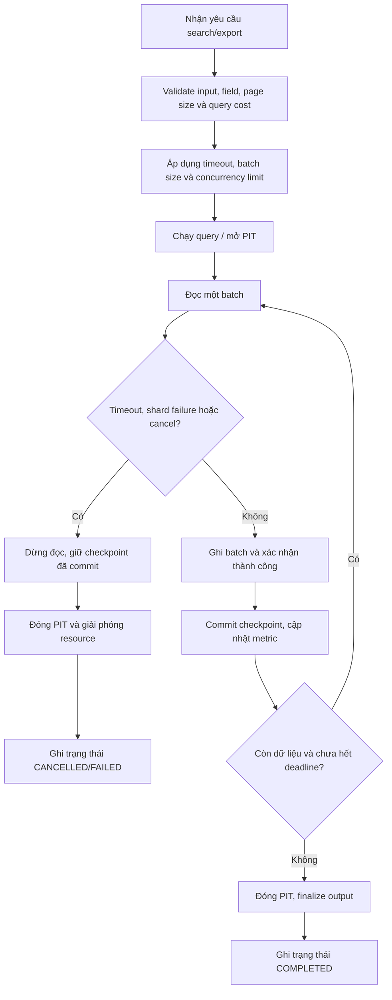

# Giới hạn truy vấn lớn, hủy thao tác và kiểm soát tài nguyên

Một truy vấn Elasticsearch có thể trả về ít document nhưng vẫn tiêu tốn nhiều CPU, heap, I/O hoặc tài nguyên trên nhiều shard. Điều này đặc biệt dễ xảy ra khi ứng dụng export dữ liệu lớn, chạy aggregation có cardinality cao, tìm kiếm wildcard/fuzzy, hoặc cho phép nhiều tác vụ đồng thời.

Trong Spring Data Elasticsearch, việc gọi `ElasticsearchOperations.search(...)` hay Elasticsearch Java API Client không loại bỏ giới hạn tài nguyên của cluster. Ứng dụng cần thiết kế giới hạn ở cả hai phía: giới hạn phạm vi và độ phức tạp của request; giới hạn số batch, số tác vụ đồng thời, thời gian chạy và lượng dữ liệu giữ trong bộ nhớ. Khi người dùng hủy export hoặc ứng dụng shutdown, hệ thống cũng cần dừng việc đọc tiếp, giải phóng PIT/search context và cập nhật trạng thái job rõ ràng.

Bài học này tập trung vào bốn mục tiêu: giới hạn truy vấn lớn, đặt timeout phù hợp, hủy tác vụ đúng cách và kiểm soát tài nguyên xuyên suốt một quy trình search/export.

## 1. Truy vấn nhỏ về số hit vẫn có thể rất tốn tài nguyên

Giả sử một màn hình chỉ yêu cầu 20 kết quả:

```json
GET products/_search
{
  "size": 20,
  "query": {
    "wildcard": {
      "name.raw": "*phone*"
    }
  },
  "aggs": {
    "all_skus": {
      "terms": {
        "field": "sku",
        "size": 50000
      }
    }
  }
}
```

Response chỉ chứa tối đa 20 hit, nhưng Elasticsearch vẫn có thể phải:

- Xét một lượng lớn term do wildcard bắt đầu bằng `*`.
- Đọc nhiều segment và shard để tìm document phù hợp.
- Tính aggregation trên toàn bộ tập document khớp query, không chỉ 20 hit trả về.
- Tạo nhiều bucket và giữ dữ liệu trung gian để reduce kết quả giữa các shard.
- Truyền response aggregation lớn qua mạng và deserialize trong ứng dụng.

Vì vậy, `size: 20` không có nghĩa request chỉ xử lý 20 document. Cần đánh giá query, aggregation, shard fan-out, total hits và response payload cùng lúc.

## 2. Những giới hạn quan trọng của Elasticsearch

Elasticsearch có nhiều giới hạn bảo vệ cluster. Một số là giới hạn theo index, một số theo cluster hoặc request, và một số phụ thuộc phiên bản.

| Giới hạn/cơ chế | Kiểm soát điều gì | Điều cần lưu ý |
|---|---|---|
| `index.max_result_window` | Độ sâu phân trang bằng `from` + `size` | Mặc định thường là 10.000. Không dùng tăng giới hạn này để quét toàn bộ index. |
| `search.max_buckets` | Số bucket aggregation trong một response | Aggregation nhiều chiều hoặc cardinality cao có thể vượt giới hạn. |
| `track_total_hits` | Chi phí đếm tổng số hit chính xác | Tắt hoặc giới hạn đếm nếu export không cần total count. |
| Search `timeout` | Thời gian chờ cho search trên shard | Có thể dẫn đến kết quả một phần; phải kiểm tra `timed_out` và shard failures. |
| `terminate_after` | Số document tối đa được thu thập trên mỗi shard | Dùng để dừng sớm trong một số use case; không phù hợp export đầy đủ. |
| `search.allow_expensive_queries` | Một số loại query có chi phí cao | Không phải bộ giới hạn tổng quát; cần hiểu ảnh hưởng tới wildcard, regexp, fuzzy và các query liên quan. |
| Circuit breakers | Bảo vệ heap trước một số cấp phát lớn | Khi breaker mở, request có thể bị từ chối; không nên xem đây là cơ chế điều tiết tải của ứng dụng. |
| Thread pool và queue | Số tác vụ search có thể chạy/chờ | Queue đầy có thể dẫn tới rejection; tăng queue không tự tạo thêm năng lực xử lý. |

Giá trị mặc định và khả năng cấu hình có thể thay đổi theo phiên bản Elasticsearch. Hãy kiểm tra cấu hình thực tế của cluster trước khi dựa vào một con số cụ thể.

## 3. Giới hạn phân trang và kích thước response

Với UI, `Pageable` và `from`/`size` phù hợp cho các trang đầu. Với truy vấn sâu hoặc export, hãy dùng `search_after` cùng PIT như bài học về quét dữ liệu.

Ví dụ một request có giới hạn page size:

```java
int requestedSize = request.pageSize();
int pageSize = Math.min(Math.max(requestedSize, 1), 100);

Pageable pageable = PageRequest.of(
    request.page(),
    pageSize,
    Sort.by(Sort.Direction.DESC, "createdAt")
);
```

Không truyền page size không giới hạn từ client vào Elasticsearch. Hãy đặt trần ở server và kiểm tra page number để tránh offset vượt `max_result_window`.

Với export, chọn batch size theo payload thực tế. Một batch 500 document có thể nhẹ nếu mỗi document nhỏ, nhưng rất lớn nếu `_source` chứa nested arrays, mô tả dài hoặc nhiều field không cần thiết. Dùng source filtering để chỉ lấy field export cần:

```json
GET orders/_search
{
  "size": 500,
  "_source": ["orderId", "createdAt", "status", "total"],
  "query": {
    "term": {
      "status": "COMPLETED"
    }
  }
}
```

Giảm `_source` giúp giảm network payload, deserialize time và heap ở ứng dụng. Không lấy toàn bộ document nếu file export chỉ cần một vài field.

## 4. Giới hạn chi phí của query

Ngoài số hit, cần kiểm soát cấu trúc query.

### 4.1. Wildcard, regexp và fuzzy

Các mẫu wildcard bắt đầu bằng `*` hoặc regexp rộng có thể buộc Elasticsearch xét nhiều term. Fuzzy query cũng có thể mở rộng thành nhiều term gần giống.

Hướng xử lý:

- Ưu tiên `match`/`multi_match` cho tìm kiếm văn bản thông thường.
- Dùng `prefix` hoặc mapping autocomplete phù hợp nếu chỉ cần tìm theo tiền tố.
- Chỉ bật leading wildcard, regexp và fuzzy khi sản phẩm thực sự cần.
- Giới hạn độ dài và số lượng biểu thức do người dùng gửi.
- Theo dõi latency và rejection trên dữ liệu có kích thước gần production.

### 4.2. Số field và Boolean clauses

Tìm trên quá nhiều field hoặc tạo Boolean query với rất nhiều nhánh làm tăng số clause và công việc lập kế hoạch query. Không cho client tự gửi một danh sách field tùy ý. Dùng whitelist field, giới hạn số filter và xây query từ cấu trúc API được kiểm soát.

### 4.3. Aggregation cardinality cao

Terms aggregation trên field có rất nhiều giá trị duy nhất có thể tạo nhiều bucket. `size` của hit không giới hạn số bucket. Chỉ yêu cầu những facet giao diện thực sự cần, đặt kích thước bucket hợp lý và xem xét composite aggregation khi cần duyệt bucket theo từng trang.

Không dùng terms aggregation với `size` rất lớn như một cách export toàn bộ giá trị duy nhất. Composite aggregation được thiết kế cho việc phân trang bucket và có cursor `after_key`; cần giữ cùng query và cấu hình aggregation khi tiếp tục.

### 4.4. Lấy total hits

Nếu tác vụ chỉ cần quét document cho export, thường không cần đếm chính xác toàn bộ kết quả trước. Có thể tắt `track_total_hits` trong request để tránh chi phí đếm chính xác:

```json
GET orders/_search
{
  "track_total_hits": false,
  "size": 500,
  "query": {
    "term": {
      "status": "COMPLETED"
    }
  }
}
```

Nếu UI cần hiển thị bộ đếm, có thể dùng giới hạn đếm hoặc bật exact tracking theo yêu cầu sản phẩm. Không mặc định mọi request đều cần total count chính xác.

## 5. Timeout không đồng nghĩa với hủy hoàn toàn

Có nhiều lớp timeout trong một request:

1. Timeout ở client/HTTP transport: ứng dụng ngừng chờ response sau một khoảng thời gian.
2. Search timeout trong Elasticsearch: search có thể dừng thu thập kết quả sau giới hạn và trả response có `timed_out: true` hoặc shard failure.
3. Deadline của ứng dụng: toàn bộ job phải hoàn thành trong thời gian nghiệp vụ cho phép.
4. Timeout của PIT/scroll context: tài nguyên server được giữ trong khoảng `keep_alive` nếu không được gia hạn.

Các lớp này không thay thế nhau. Client hết thời gian chờ không chứng minh Elasticsearch đã dừng xử lý request. Search timeout cũng không phải cam kết rằng mọi shard đã dừng ngay tại một thời điểm tuyệt đối.

### 5.1. Đặt search timeout

Search API hỗ trợ tham số `timeout`:

```json
GET orders/_search
{
  "timeout": "5s",
  "size": 100,
  "query": {
    "term": {
      "status": "COMPLETED"
    }
  }
}
```

Khi timeout, Elasticsearch có thể trả về kết quả một phần. Ứng dụng phải kiểm tra `timed_out` và thông tin shard trong response.

Với UI, kết quả một phần đôi khi có thể chấp nhận nếu sản phẩm thể hiện rõ trạng thái. Với export cần đầy đủ dữ liệu, không được ghi file thành công nếu response hoặc một batch báo timeout/failed shards mà chưa có chính sách xử lý rõ ràng.

### 5.2. Từ chối kết quả một phần khi cần tính đầy đủ

Search API có tùy chọn `allow_partial_search_results`. Với workload cần tất cả shard thành công, có thể đặt false:

```json
GET orders/_search?allow_partial_search_results=false
{
  "timeout": "10s",
  "size": 500,
  "query": {
    "term": {
      "status": "COMPLETED"
    }
  }
}
```

Tùy chọn này giúp request thất bại khi không thể trả kết quả đầy đủ theo semantics của Search API. Ứng dụng vẫn cần xử lý exception, timeout, PIT expiry và lỗi destination. Không nên chỉ kiểm tra HTTP status mà bỏ qua trạng thái `timed_out` hoặc shard failures.

### 5.3. Deadline tổng của job

Một export gồm nhiều batch. Mỗi batch có thể hoàn thành trong 2 giây nhưng toàn bộ job có thể chạy hàng giờ. Vì vậy, ngoài timeout mỗi request, hãy đặt deadline tổng hoặc chính sách thời gian chạy tối đa cho job.

Ví dụ, một job export có thể có:

- Deadline tổng: 30 phút.
- Timeout mỗi search request: 10 giây.
- PIT keep-alive: 2 phút, được gia hạn trong từng request.
- Tối đa 3 lần retry cho lỗi tạm thời.
- Tối đa 2 export đồng thời trên mỗi tenant.

Các con số chỉ minh họa; cần chọn theo SLA, tải cluster và kích thước dữ liệu.

## 6. Kiểm tra response trước khi chấp nhận batch

Đối với export, một batch chỉ được coi là thành công khi:

- Request hoàn tất theo chính sách timeout.
- Không có shard failure ngoài chính sách được cho phép.
- Response không bị đánh dấu `timed_out` nếu yêu cầu đầy đủ.
- Tất cả document cần xuất đã được chuyển đổi hợp lệ hoặc được xử lý theo chính sách lỗi record.
- Destination đã xác nhận ghi batch thành công.

Ví dụ kiểm tra response khi dùng Elasticsearch Java API Client:

```java
SearchResponse<OrderExportRow> response = client.search(request, OrderExportRow.class);

if (Boolean.TRUE.equals(response.timedOut())) {
    throw new ExportBatchIncompleteException("Elasticsearch search timed out");
}

if (response.shards() != null && response.shards().failed() > 0) {
    throw new ExportBatchIncompleteException("One or more shards failed");
}
```

Tên accessor và kiểu dữ liệu response cần đối chiếu phiên bản Elasticsearch Java API Client. Ý nghĩa cần giữ là không coi một response có timeout hoặc shard failures là batch đầy đủ.

## 7. Hủy thao tác từ phía người dùng

Một export job nên có trạng thái rõ ràng, ví dụ:

```text
QUEUED -> RUNNING -> COMPLETED
                  -> CANCELLING -> CANCELLED
                  -> FAILED
```

Khi người dùng bấm Cancel:

1. API đánh dấu job `CANCELLING`.
2. Worker kiểm tra cancellation token trước khi gửi batch mới.
3. Nếu request đang chạy, ứng dụng yêu cầu dừng theo cơ chế client/task phù hợp.
4. Không lấy thêm batch mới.
5. Hoàn tất hoặc rollback batch đang ghi theo chính sách destination.
6. Đóng PIT hoặc clear scroll.
7. Lưu trạng thái `CANCELLED` và checkpoint cuối cùng đã commit.

Không nên chỉ đổi trạng thái DB thành `CANCELLED` trong khi worker vẫn tiếp tục đọc Elasticsearch và ghi file. Trạng thái job phải phản ánh việc tài nguyên đã được dừng và cleanup hoàn tất.

## 8. Hủy ở client và hủy task trên Elasticsearch khác nhau

Nếu ứng dụng dùng API đồng bộ, việc interrupt thread hoặc đóng kết nối client có thể làm ứng dụng ngừng chờ, nhưng không phải lúc nào cũng chứng minh search task phía cluster đã dừng ngay.

Với API bất đồng bộ, có thể hủy future/subscription ở phía client. Tuy nhiên, việc truyền cancellation xuống server phụ thuộc client, transport và loại request. Cần kiểm tra hành vi của phiên bản đang dùng.

Elasticsearch có Task Management API cho những tác vụ được expose dưới dạng task có thể hủy. Có thể kiểm tra task đang chạy:

```http
GET _tasks?actions=indices:data/read/search*
```

Response task có thể chứa ID, action, description, running time và cờ `cancellable`. Chỉ những task hỗ trợ cancellation mới có thể được yêu cầu hủy qua API task:

```http
POST _tasks/{task_id}/_cancel
```

Không giả định mọi synchronous search request đều cung cấp task ID để ứng dụng hủy trực tiếp. Cần kiểm tra task thực tế và khả năng `cancellable` của nó trên phiên bản cluster. Với nhiều request search ngắn, cách hiệu quả hơn thường là ngừng gửi batch mới, đặt timeout phù hợp và đóng PIT khi kết thúc.

Task cancellation là thao tác quản trị có phạm vi rộng. Không để người dùng cuối truyền `task_id` tùy ý để hủy task của hệ thống khác; API ứng dụng phải liên kết task với job ID và quyền sở hữu đã xác thực.

## 9. Cancellation token trong service

Một worker export có thể nhận một abstraction cancellation token do job manager quản lý. Ví dụ khái niệm:

```java
public interface CancellationToken {
    boolean isCancellationRequested();

    default void throwIfCancellationRequested() {
        if (isCancellationRequested()) {
            throw new ExportCancelledException();
        }
    }
}
```

Worker kiểm tra token trước mỗi request và trước khi ghi batch:

```java
while (true) {
    cancellationToken.throwIfCancellationRequested();

    SearchResponse<OrderExportRow> response = fetchNextBatch(cursor);
    validateCompleteResponse(response);

    cancellationToken.throwIfCancellationRequested();
    destination.write(response.hits().hits());

    checkpointStore.commit(cursorOfLastHit(response));

    if (response.hits().hits().isEmpty()) {
        break;
    }
}
```

Đây là pseudocode để thể hiện điểm kiểm tra cancellation; cần điều chỉnh kiểu response và thứ tự xử lý theo implementation thực tế. Nếu cancellation xảy ra sau khi destination đã ghi batch nhưng trước khi checkpoint commit, retry có thể ghi lại batch. Destination nên hỗ trợ idempotency hoặc ghi theo file tạm để xử lý tình huống này.

## 10. Đóng PIT và giải phóng tài nguyên trong mọi đường kết thúc

PIT giữ search context trên cluster. Nếu export bị hủy, lỗi mapping, timeout hoặc destination ghi thất bại, vẫn phải đóng PIT.

Ví dụ cấu trúc `try/finally`:

```java
String pitId = openPointInTime();

try {
    scanBatches(pitId, cancellationToken);
} catch (ExportCancelledException ex) {
    markCancelled();
    throw ex;
} catch (Exception ex) {
    markFailed(ex);
    throw ex;
} finally {
    closePointInTimeIfOpen(pitId);
}
```

Nếu response trả PIT ID mới, phải cập nhật biến `pitId` và đóng ID mới nhất. Không đóng một ID cũ khi server đã cấp ID thay thế.

Nếu dùng Scroll API, phải gọi clear scroll khi hoàn tất. Nếu dùng stream, file writer, temporary file hoặc resource khác, đóng chúng trong `try-with-resources` hoặc `finally` tương ứng.

## 11. Kiểm soát số tác vụ đồng thời

Một export job có thể hợp lý khi chạy riêng lẻ nhưng gây quá tải nếu 50 người dùng cùng lúc bắt đầu export toàn bộ dữ liệu.

Ứng dụng nên có admission control:

- Giới hạn số export đang chạy toàn hệ thống.
- Giới hạn số export trên mỗi tenant hoặc user.
- Giới hạn số search request in-flight của mỗi job.
- Xếp hàng hoặc từ chối job mới khi đã đạt giới hạn.
- Ưu tiên request tương tác của UI hơn batch export nếu kiến trúc cần phân biệt workload.

Ví dụ dùng semaphore để giới hạn số worker export trong một process:

```java
import java.util.concurrent.Semaphore;

public class ExportAdmissionControl {

    private final Semaphore slots = new Semaphore(2);

    public void runExport(Runnable exportTask) {
        if (!slots.tryAcquire()) {
            throw new ExportCapacityExceededException();
        }

        try {
            exportTask.run();
        } finally {
            slots.release();
        }
    }
}
```

Semaphore trong ví dụ chỉ giới hạn trong một JVM. Nếu ứng dụng chạy nhiều replica, cần giới hạn phân tán bằng queue/job scheduler hoặc cơ chế lưu trữ trạng thái dùng chung. Cũng cần giữ permit đến khi worker thật sự dừng; không release ngay khi API trả lời yêu cầu cancel.

## 12. Backpressure và kiểm soát bộ nhớ

Không đọc batch mới nhanh hơn khả năng ghi của destination. Nếu Elasticsearch trả 500 document trong 100 ms nhưng file writer cần 3 giây, việc tiếp tục đọc sẽ làm hàng đợi tăng dần và có thể chiếm hết heap.

Một pipeline an toàn thường xử lý tuần tự:

```text
Elasticsearch batch
        |
        v
Convert / validate
        |
        v
Write destination
        |
        v
Flush / confirm
        |
        v
Commit checkpoint
        |
        v
Read next batch
```

Chỉ lấy batch tiếp theo sau khi batch hiện tại đã được xử lý và xác nhận. Nếu dùng producer/consumer song song, hãy đặt bounded queue và giới hạn số worker. Queue không giới hạn chỉ chuyển vấn đề bộ nhớ từ danh sách document sang queue.

Giảm bộ nhớ bằng cách:

- Dùng `_source` filtering để chỉ lấy field cần export.
- Chọn batch size dựa trên byte và heap usage, không chỉ số document.
- Ghi streaming thay vì tạo một `List` chứa toàn bộ kết quả.
- Tránh giữ cả response, entity list và DTO list cùng lúc nếu không cần.
- Giải phóng tham chiếu batch sau khi ghi xong.
- Không tạo một thread riêng cho mỗi export request.

## 13. Retry, backoff và tránh retry storm

Khi cluster quá tải, request có thể bị từ chối hoặc timeout. Nếu mọi worker retry ngay lập tức, tải có thể tăng thêm và làm tình trạng tệ hơn.

Một retry policy nên:

- Chỉ retry lỗi tạm thời như một số rejection, timeout hoặc lỗi kết nối.
- Không retry lỗi validation, query parse, mapping hoặc authorization như thể chúng sẽ tự hết.
- Dùng exponential backoff và jitter.
- Giới hạn số lần retry và tổng thời gian retry.
- Giảm concurrency hoặc batch size khi thấy rejection tăng.
- Không tiến checkpoint cho batch chưa được ghi thành công.
- Bảo đảm destination idempotent nếu có thể xảy ra ghi lặp.

Ví dụ backoff khái niệm:

```java
Duration delayForAttempt(int attempt) {
    long baseMillis = 250L;
    long maxMillis = 10_000L;
    long exponential = Math.min(maxMillis, baseMillis * (1L << attempt));
    long jitter = ThreadLocalRandom.current().nextLong(0, Math.max(1, exponential / 3));
    return Duration.ofMillis(exponential + jitter);
}
```

Đoạn code minh họa cách tăng thời gian chờ; implementation thực tế cần giới hạn `attempt` để tránh overflow, tôn trọng retry budget và cancellation token trong lúc chờ. Không retry vô hạn một batch đang giữ PIT nếu PIT có thể hết hạn.

## 14. Hủy khi ứng dụng shutdown

Khi Spring Boot nhận tín hiệu shutdown, export worker cần dừng có kiểm soát:

1. Ngừng nhận job mới.
2. Đánh dấu job đang chạy cần cancellation hoặc cho phép hoàn tất trong grace period theo chính sách.
3. Ngừng gửi batch mới sau khi nhận cancellation.
4. Hoàn tất/rollback batch đang ghi theo khả năng của destination.
5. Commit checkpoint cuối cùng đã ghi thành công.
6. Đóng PIT, writer, stream và resource khác.
7. Chờ worker kết thúc trong thời gian shutdown cho phép.

Không nên để JVM bị kill ngay khi worker vẫn đang ghi file hoặc giữ PIT. Nếu grace period hết hạn, job cần có trạng thái interrupted để lần chạy sau có thể resume theo chính sách.

Với export tạo file, một pattern hữu ích là ghi vào file tạm, flush và đóng file, sau đó rename sang tên chính thức khi export hoàn tất. File đích sẽ không bị hiểu nhầm là hoàn chỉnh nếu job bị hủy giữa chừng. Cách rename nguyên tử phụ thuộc filesystem và vị trí file.

## 15. Giám sát tài nguyên và chất lượng export

Không thể kiểm soát tài nguyên hiệu quả nếu không đo. Nên ghi metric theo job và theo batch:

| Metric | Dùng để nhận biết |
|---|---|
| Job duration | Export có vượt SLA hoặc kéo dài bất thường không. |
| Batch latency | Search hoặc destination đang chậm ở bước nào. |
| Batch document count và response bytes | Batch size có phù hợp payload không. |
| Heap usage / GC pause | Ứng dụng có giữ quá nhiều dữ liệu không. |
| Active export jobs | Có vượt concurrency limit không. |
| Queue depth | Job đang chờ có tăng không. |
| Search rejections / timeout / shard failures | Cluster có bị quá tải hoặc lỗi shard không. |
| PIT age / open PIT count | Có job giữ search context quá lâu không. |
| Retry count | Hệ thống có đang gặp lỗi tạm thời lặp lại không. |
| Exported rows / checkpoint position | Job tiến triển đều và có thể resume không. |

Log nên có `jobId`, `batchNumber`, thời gian xử lý, số document và trạng thái. Tránh log toàn bộ query có dữ liệu nhạy cảm, document content, PIT ID hoặc thông tin xác thực. Dùng trace/correlation ID để liên kết request của ứng dụng với log phía Elasticsearch khi cần.

## 16. Ví dụ cấu hình một export job có giới hạn

Một cấu hình job có thể tập trung các giới hạn ở một nơi:

```java
public record ExportLimits(
    int batchSize,
    int maxConcurrentJobs,
    Duration requestTimeout,
    Duration pitKeepAlive,
    Duration maxJobDuration,
    int maxRetries
) {
}
```

Ví dụ giá trị cấu hình theo môi trường:

```yaml
app:
  elasticsearch-export:
    batch-size: 500
    max-concurrent-jobs: 2
    request-timeout: 10s
    pit-keep-alive: 2m
    max-job-duration: 30m
    max-retries: 3
```

Các giá trị trên chỉ là điểm bắt đầu minh họa. Cần hiệu chỉnh theo kích thước document, throughput cluster, SLA, số replica ứng dụng và giới hạn tài nguyên thực tế. Đừng đưa các giới hạn này thành hằng số rải rác trong nhiều service.

Một job manager có thể dùng cấu hình này để:

- Từ chối hoặc xếp hàng khi đạt `maxConcurrentJobs`.
- Cấp batch size cố định và không cho client tăng tùy ý.
- Đặt timeout mỗi search request.
- Gia hạn PIT theo `pitKeepAlive`.
- Dừng job khi đạt `maxJobDuration`.
- Retry lỗi tạm thời tối đa `maxRetries` lần.
- Ghi metric và trạng thái job ở mỗi batch.

## 17. Những lỗi thường gặp

| Hiện tượng | Nguyên nhân có thể | Cách xử lý |
|---|---|---|
| Search trả ít hit nhưng vẫn chậm | Query hoặc aggregation xử lý tập document lớn | Xem query profile, giảm field/aggregation và tối ưu mapping. |
| Export dừng ở 10.000 kết quả | Đang dùng `from`/`size` vượt result window | Dùng PIT + `search_after`. |
| File export thiếu dữ liệu nhưng job báo thành công | Bỏ qua `timed_out` hoặc shard failures | Xác thực response và đánh dấu batch incomplete khi cần. |
| Cancel trên UI nhưng worker vẫn chạy | Chỉ đổi trạng thái job, chưa truyền cancellation tới worker | Dùng cancellation token và dừng vòng lặp trước batch tiếp theo. |
| Thread bị interrupt nhưng cluster vẫn xử lý | Hủy ở client không bảo đảm task server đã dừng | Dùng timeout, đóng context và Task API khi task có thể hủy. |
| PIT bị giữ lâu | Thiếu cleanup khi exception/cancel | Đóng PIT trong `finally`, dùng PIT ID mới nhất. |
| Heap tăng liên tục | Đọc nhanh hơn ghi hoặc tích lũy toàn bộ kết quả | Bounded batch, backpressure và streaming. |
| Cluster liên tục reject search | Quá nhiều export hoặc batch quá lớn | Giảm concurrency/batch size, queue job và backoff. |
| Retry tạo nhiều tải hơn | Retry ngay, không giới hạn | Exponential backoff, jitter và retry budget. |
| Nhiều replica cùng vượt concurrency limit | Dùng semaphore chỉ trong một JVM | Dùng queue hoặc giới hạn phân tán. |
| Export file dở dang vẫn xuất hiện như file hoàn chỉnh | Ghi trực tiếp vào tên file cuối | Ghi file tạm, finalize/rename sau khi hoàn tất. |

## 18. Quy trình thiết kế và vận hành an toàn



Checklist vận hành:

- Giới hạn page size và batch size ở server.
- Dùng `search_after` + PIT cho scan sâu.
- Chỉ lấy field cần thiết qua source filtering.
- Giới hạn aggregation bucket và tránh wildcard/fuzzy không cần thiết.
- Tắt exact total hits nếu export không cần.
- Đặt timeout request và deadline tổng job.
- Kiểm tra `timed_out` và shard failures trước khi chấp nhận batch.
- Dùng cancellation token và state machine cho job.
- Đóng PIT/scroll trong mọi đường kết thúc.
- Giới hạn concurrency và dùng backpressure.
- Retry lỗi tạm thời có backoff, jitter và retry budget.
- Commit checkpoint sau khi destination xác nhận ghi thành công.
- Theo dõi latency, heap, rejection, PIT và số batch.
- Finalize file/output chỉ sau khi toàn bộ export hoàn tất.

## 19. Kết luận

Truy vấn lớn cần được kiểm soát ở nhiều lớp: độ sâu phân trang, kích thước batch, số bucket aggregation, độ phức tạp query, total hits, thời gian request và số tác vụ chạy đồng thời. `size` nhỏ không bảo đảm request rẻ, và timeout không đồng nghĩa server task đã được hủy hoàn toàn.

Với export, hãy đọc theo batch bằng PIT + `search_after`, giới hạn concurrency, áp dụng backpressure, chỉ lấy field cần thiết và lưu checkpoint sau khi destination ghi thành công. Khi người dùng hủy hoặc ứng dụng shutdown, dừng đọc batch mới, xử lý batch đang chạy theo chính sách, đóng PIT và cập nhật trạng thái job.

Hãy phân biệt timeout của client, search timeout của Elasticsearch, deadline của job và thời hạn PIT. Kiểm tra `timed_out` cùng shard failures trước khi coi batch là hoàn chỉnh. Kết hợp giới hạn đầu vào, retry có kiểm soát, quan sát metric và cleanup chắc chắn sẽ giúp ứng dụng Spring Data Elasticsearch xử lý truy vấn lớn mà vẫn bảo vệ được tài nguyên của cả ứng dụng lẫn cluster.
