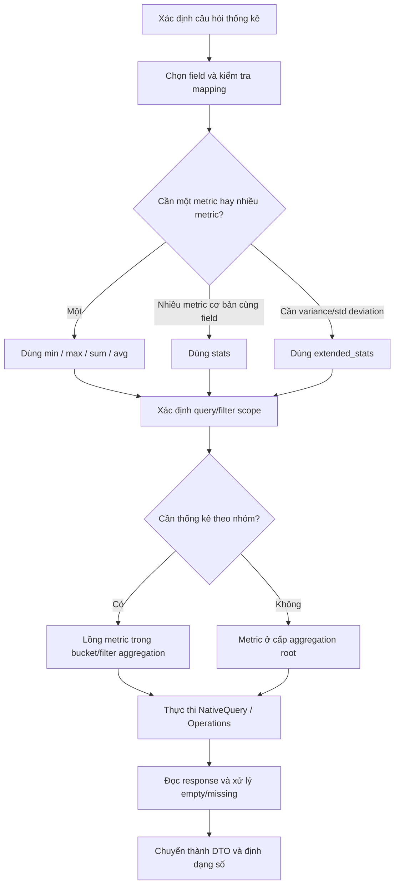

# Metric aggregation với min, max, sum, avg và stats

Trong Elasticsearch, aggregation cho phép tính toán thống kê trên tập document khớp một truy vấn. **Metric aggregation** tập trung vào việc tính giá trị số như nhỏ nhất, lớn nhất, tổng, trung bình hoặc nhiều thống kê cùng lúc. Spring Data Elasticsearch có thể xây dựng các aggregation này bằng `NativeQuery`, sau đó thực thi qua `ElasticsearchOperations`.

Năm metric thường gặp là:

- `min`: giá trị nhỏ nhất.
- `max`: giá trị lớn nhất.
- `sum`: tổng các giá trị.
- `avg`: giá trị trung bình.
- `stats`: gộp `count`, `min`, `max`, `avg` và `sum` trong một aggregation.

Các phép tính được thực hiện trên field đã được index và trên tập document mà aggregation nhận được. Vì vậy, mapping, query filter, missing values, kiểu số và phạm vi bucket đều ảnh hưởng đến kết quả.

## 1. Metric aggregation dùng để làm gì?

Giả sử index `products` lưu sản phẩm với các field:

| Field | Mapping | Ví dụ |
|---|---|---|
| `name` | `text` | `Wireless Headphones` |
| `category` | `keyword` | `audio` |
| `priceInCents` | `long` | `12990` |
| `stock` | `integer` | `45` |
| `rating` | `double` | `4.6` |

Một trang quản trị có thể cần biết:

- Giá thấp nhất và cao nhất của các sản phẩm đang bán.
- Tổng số lượng tồn kho.
- Giá trung bình của sản phẩm trong một danh mục.
- Thống kê giá gồm số lượng giá trị, min, max, average và sum.

Không cần tải tất cả document về ứng dụng rồi tự tính bằng Java. Elasticsearch có thể tính trực tiếp trên dữ liệu đã index và chỉ trả về các con số thống kê.

Ví dụ một request chỉ tính metric:

```json
GET products/_search
{
  "size": 0,
  "query": {
    "term": {
      "status": "ACTIVE"
    }
  },
  "aggs": {
    "minimum_price": {
      "min": {
        "field": "priceInCents"
      }
    },
    "maximum_price": {
      "max": {
        "field": "priceInCents"
      }
    },
    "total_stock": {
      "sum": {
        "field": "stock"
      }
    },
    "average_rating": {
      "avg": {
        "field": "rating"
      }
    },
    "price_stats": {
      "stats": {
        "field": "priceInCents"
      }
    }
  }
}
```

`size: 0` yêu cầu không trả danh sách hit, chỉ trả aggregation. Điều kiện `status = ACTIVE` giới hạn tập document được dùng cho tất cả metric trong request.

## 2. Mapping phải phù hợp với phép tính

Metric aggregation hoạt động trên field có kiểu dữ liệu phù hợp. Với giá, số lượng và rating, nên dùng mapping số như `integer`, `long`, `float`, `double` hoặc `scaled_float` tùy yêu cầu.

Ví dụ entity:

```java
package com.example.catalog.product.document;

import org.springframework.data.annotation.Id;
import org.springframework.data.elasticsearch.annotations.Document;
import org.springframework.data.elasticsearch.annotations.Field;
import org.springframework.data.elasticsearch.annotations.FieldType;

@Document(indexName = "products")
public class ProductDocument {

    @Id
    private String id;

    @Field(type = FieldType.Text)
    private String name;

    @Field(type = FieldType.Keyword)
    private String category;

    @Field(type = FieldType.Keyword)
    private String status;

    @Field(type = FieldType.Long)
    private Long priceInCents;

    @Field(type = FieldType.Integer)
    private Integer stock;

    @Field(type = FieldType.Double)
    private Double rating;

    protected ProductDocument() {
    }

    public String getId() {
        return id;
    }

    public Long getPriceInCents() {
        return priceInCents;
    }
}
```

Các field `priceInCents`, `stock` và `rating` có kiểu số nên có thể dùng trong metric aggregation phù hợp. Field `category` và `status` là `keyword` để lọc chính xác hoặc chia bucket; field `name` là `text` để full-text search.

Không dùng field `text` để tính min, max, sum hoặc average như một giá trị số. Nếu dữ liệu số đang được lưu dưới dạng chuỗi, hãy sửa schema/mapping và xử lý dữ liệu trước khi chạy metric aggregation.

### 2.1. Tiền tệ và độ chính xác

Với tiền tệ, dùng số thực nhị phân như `double` có thể tạo sai số làm tròn. Một cách phổ biến là lưu đơn vị nhỏ nhất bằng số nguyên, ví dụ VND đồng hoặc cents theo đơn vị nghiệp vụ:

```java
@Field(type = FieldType.Long)
private Long priceInCents;
```

Khi hiển thị, ứng dụng chuyển đổi về đơn vị tiền tệ. Nếu cần lưu số thập phân theo một precision cố định, có thể cân nhắc `scaled_float` với scaling factor được thiết kế rõ ràng. Chọn mapping trước khi index dữ liệu và dùng cùng quy ước ở mọi service.

### 2.2. Kiểm tra mapping thực tế

Annotation Java mô tả mapping mong muốn khi tạo index. Nếu index đã tồn tại, mapping thực tế trên cluster mới là thứ Elasticsearch sử dụng:

```http
GET products/_mapping
```

Nếu field có kiểu không phù hợp, sửa annotation không tự chuyển đổi dữ liệu đã index. Một thay đổi mapping không tương thích thường cần tạo index mới, reindex dữ liệu và chuyển alias.

## 3. `min`: giá trị nhỏ nhất

`min` trả về giá trị nhỏ nhất của field trên tập document được aggregation xử lý.

Ví dụ lấy giá thấp nhất:

```json
GET products/_search
{
  "size": 0,
  "aggs": {
    "minimum_price": {
      "min": {
        "field": "priceInCents"
      }
    }
  }
}
```

Response có cấu trúc tương tự:

```json
{
  "aggregations": {
    "minimum_price": {
      "value": 4990
    }
  }
}
```

Trong Spring Data Elasticsearch, có thể xây aggregation bằng `NativeQuery`:

```java
import co.elastic.clients.elasticsearch._types.aggregations.Aggregation;
import org.springframework.data.elasticsearch.client.elc.NativeQuery;
import org.springframework.data.elasticsearch.core.query.Query;

Aggregation minPrice = Aggregation.of(aggregation -> aggregation
    .min(min -> min.field("priceInCents"))
);

Query query = NativeQuery.builder()
    .withAggregation("minimum_price", minPrice)
    .build();
```

Sau đó thực thi query qua `ElasticsearchOperations` như phần tích hợp ở dưới. Tên `minimum_price` là tên aggregation trong response, còn `priceInCents` là field được tính.

Nếu field không có giá trị trong tập document, `min` không có giá trị số để trả về; response có thể biểu diễn `value` là `null`. Ứng dụng cần xử lý trường hợp không có dữ liệu thay vì mặc định giá nhỏ nhất bằng 0.

## 4. `max`: giá trị lớn nhất

`max` trả về giá trị lớn nhất của field:

```json
GET products/_search
{
  "size": 0,
  "aggs": {
    "maximum_price": {
      "max": {
        "field": "priceInCents"
      }
    }
  }
}
```

Response minh họa:

```json
{
  "aggregations": {
    "maximum_price": {
      "value": 259900
    }
  }
}
```

NativeQuery:

```java
Aggregation maxPrice = Aggregation.of(aggregation -> aggregation
    .max(max -> max.field("priceInCents"))
);

Query query = NativeQuery.builder()
    .withAggregation("maximum_price", maxPrice)
    .build();
```

`min` và `max` thường dùng để tạo khoảng giá, hiển thị giá thấp nhất/cao nhất hoặc kiểm tra phạm vi dữ liệu. Nếu field có nhiều giá trị trong một document, metric sẽ xét các giá trị được index theo semantics của field, không nhất thiết chỉ có một giá trị cho mỗi document.

## 5. `sum`: tổng các giá trị

`sum` cộng các giá trị của field trong tập document được xét:

```json
GET products/_search
{
  "size": 0,
  "aggs": {
    "total_stock": {
      "sum": {
        "field": "stock"
      }
    }
  }
}
```

Nếu các sản phẩm có stock lần lượt là 5, 10 và 20, tổng là 35.

NativeQuery:

```java
Aggregation totalStock = Aggregation.of(aggregation -> aggregation
    .sum(sum -> sum.field("stock"))
);

Query query = NativeQuery.builder()
    .withAggregation("total_stock", totalStock)
    .build();
```

`sum` cộng các giá trị field, không phải đếm số document. Nếu một document chứa một field multi-valued như `quantities: [2, 3]`, cả hai giá trị có thể tham gia phép cộng. Nếu document không có field đó, nó không đóng góp giá trị vào tổng.

Với field số nguyên lớn, cần lưu ý kiểu số trong response metric thường là số thực `double`. Giá trị rất lớn có thể mất độ chính xác nguyên khi vượt phạm vi biểu diễn chính xác của double. Với yêu cầu tài chính hoặc số lượng cực lớn, hãy đánh giá precision và thiết kế cách lưu/đối soát phù hợp.

## 6. `avg`: giá trị trung bình

`avg` tính trung bình các giá trị của field:

\[
\text{avg} = \frac{\text{sum of values}}{\text{count of values}}
\]

Ví dụ:

```json
GET products/_search
{
  "size": 0,
  "aggs": {
    "average_rating": {
      "avg": {
        "field": "rating"
      }
    }
  }
}
```

Nếu các rating là 4.0, 4.5 và 5.0, average là 4.5.

NativeQuery:

```java
Aggregation averageRating = Aggregation.of(aggregation -> aggregation
    .avg(avg -> avg.field("rating"))
);

Query query = NativeQuery.builder()
    .withAggregation("average_rating", averageRating)
    .build();
```

`avg` tính trung bình trên các giá trị hiện diện, không coi document thiếu field là giá trị 0. Ví dụ ba document có rating 4.0, 5.0 và thiếu rating thì average là 4.5, không phải 3.0.

Với dữ liệu multi-valued, mỗi giá trị field có thể tham gia phép tính riêng. Do đó, `avg` trên một field chứa nhiều số trong một document có thể khác với trung bình theo document. Nếu nghiệp vụ cần trung bình mỗi sản phẩm, hãy bảo đảm mỗi document có một giá trị rating tổng hợp phù hợp hoặc thiết kế aggregation theo đúng mô hình dữ liệu.

## 7. `stats`: nhiều metric trong một aggregation

`stats` là multi-value metric aggregation. Nó trả về năm thông tin chính trong một lần tính:

- `count`: số lượng giá trị được tính.
- `min`: giá trị nhỏ nhất.
- `max`: giá trị lớn nhất.
- `avg`: giá trị trung bình.
- `sum`: tổng các giá trị.

Ví dụ:

```json
GET products/_search
{
  "size": 0,
  "aggs": {
    "price_stats": {
      "stats": {
        "field": "priceInCents"
      }
    }
  }
}
```

Response minh họa:

```json
{
  "aggregations": {
    "price_stats": {
      "count": 3,
      "min": 4990,
      "max": 259900,
      "avg": 104963.33333333333,
      "sum": 314890
    }
  }
}
```

NativeQuery:

```java
Aggregation priceStats = Aggregation.of(aggregation -> aggregation
    .stats(stats -> stats.field("priceInCents"))
);

Query query = NativeQuery.builder()
    .withAggregation("price_stats", priceStats)
    .build();
```

Nếu cần các metric cơ bản cùng một field, `stats` thường gọn hơn việc khai báo năm aggregation riêng. Nếu chỉ cần một giá trị, dùng aggregation đơn tương ứng sẽ thể hiện ý định rõ hơn.

### 7.1. `count` trong stats không phải số document

`count` đếm số giá trị field tham gia aggregation. Nếu một document không có `priceInCents`, document đó không đóng góp vào count. Nếu một document có nhiều giá trị số, count có thể tăng nhiều hơn một cho document đó.

Ví dụ:

| Document | `priceInCents` |
|---|---|
| A | `10000` |
| B | `20000` |
| C | Không có field |
| D | `[30000, 35000]` |

Trong trường hợp field multi-valued, stats có thể tính bốn giá trị số, dù chỉ có ba document chứa field. Vì vậy, đừng dùng `stats.count` như số sản phẩm nếu schema cho phép nhiều giá trị trong một document.

## 8. `extended_stats`: khi cần thêm độ lệch chuẩn

Ngoài `stats`, Elasticsearch có `extended_stats`, mở rộng kết quả với các số liệu như sum of squares, variance, standard deviation và bounds. Nó hữu ích khi cần phân tích mức độ phân tán của dữ liệu.

Ví dụ DSL:

```json
GET products/_search
{
  "size": 0,
  "aggs": {
    "price_extended_stats": {
      "extended_stats": {
        "field": "priceInCents",
        "sigma": 2
      }
    }
  }
}
```

`stats` đủ cho min/max/sum/avg/count. Chỉ dùng `extended_stats` nếu sản phẩm thực sự cần variance, standard deviation hoặc statistical bounds. Nhiều metric hơn đồng nghĩa response và công việc tính toán lớn hơn, dù phần tăng chi phí thường phụ thuộc chủ yếu vào tập document được xử lý.

## 9. Kết hợp nhiều metric trong một request

Một request có thể chứa nhiều aggregation với tên riêng:

```json
GET products/_search
{
  "size": 0,
  "query": {
    "term": {
      "status": "ACTIVE"
    }
  },
  "aggs": {
    "minimum_price": {
      "min": { "field": "priceInCents" }
    },
    "maximum_price": {
      "max": { "field": "priceInCents" }
    },
    "total_stock": {
      "sum": { "field": "stock" }
    },
    "average_rating": {
      "avg": { "field": "rating" }
    },
    "price_stats": {
      "stats": { "field": "priceInCents" }
    }
  }
}
```

Tên aggregation (`minimum_price`, `price_stats`...) là khóa để ứng dụng đọc đúng kết quả. Nên đặt tên rõ nghĩa, ổn định và tránh trùng tên khi tạo query động.

## 10. Thực thi metric aggregation bằng `NativeQuery` và `ElasticsearchOperations`

Spring Data Elasticsearch dùng `NativeQuery` để xây Query DSL bằng các builder có kiểu từ Elasticsearch Java API Client. Sau đó `ElasticsearchOperations` thực thi request và trả `SearchHits<T>` cùng aggregation metadata.

Ví dụ service xây query có filter và nhiều metric:

```java
import co.elastic.clients.elasticsearch._types.FieldValue;
import co.elastic.clients.elasticsearch._types.aggregations.Aggregation;
import org.springframework.data.elasticsearch.client.elc.NativeQuery;
import org.springframework.data.elasticsearch.core.ElasticsearchOperations;
import org.springframework.data.elasticsearch.core.SearchHits;
import org.springframework.data.elasticsearch.core.query.Query;
import org.springframework.stereotype.Service;

@Service
public class ProductMetricsService {

    private final ElasticsearchOperations operations;

    public ProductMetricsService(ElasticsearchOperations operations) {
        this.operations = operations;
    }

    public SearchHits<ProductDocument> calculateActiveProductMetrics() {
        Aggregation minPrice = Aggregation.of(a -> a
            .min(m -> m.field("priceInCents"))
        );

        Aggregation maxPrice = Aggregation.of(a -> a
            .max(m -> m.field("priceInCents"))
        );

        Aggregation totalStock = Aggregation.of(a -> a
            .sum(s -> s.field("stock"))
        );

        Aggregation averageRating = Aggregation.of(a -> a
            .avg(avg -> avg.field("rating"))
        );

        Aggregation priceStats = Aggregation.of(a -> a
            .stats(stats -> stats.field("priceInCents"))
        );

        Query query = NativeQuery.builder()
            .withQuery(q -> q
                .bool(b -> b
                    .filter(f -> f
                        .term(t -> t
                            .field("status")
                            .value(FieldValue.of("ACTIVE"))
                        )
                    )
                )
            )
            .withAggregation("minimum_price", minPrice)
            .withAggregation("maximum_price", maxPrice)
            .withAggregation("total_stock", totalStock)
            .withAggregation("average_rating", averageRating)
            .withAggregation("price_stats", priceStats)
            .build();

        return operations.search(query, ProductDocument.class);
    }
}
```

Đoạn code trả `SearchHits<ProductDocument>` vì đó là kiểu kết quả search của Operations. Nếu chỉ cần metric và không cần document hit, hãy cấu hình request để không trả hit (ví dụ `size: 0` trong Query DSL hoặc API phù hợp của phiên bản Spring Data) nhằm tránh truyền dữ liệu không cần thiết.

`SearchHits.getAggregations()` cung cấp aggregation container của response. Kiểu wrapper và cách truy cập aggregate cụ thể phụ thuộc phiên bản Spring Data Elasticsearch/client. Với implementation dựa trên Elasticsearch Java API Client, container thường bọc các aggregate response theo tên aggregation. Hãy dùng API `ElasticsearchAggregations` tương ứng với dependency của dự án, không ép kiểu sang lớp aggregation của client cũ.

## 11. Đọc kết quả stats bằng Elasticsearch Java API Client

Khi cần truy cập các giá trị stats cụ thể bằng kiểu dữ liệu có sẵn của client, có thể gọi Search API trực tiếp qua `ElasticsearchClient`. Cách này cho thấy rõ kiểu response của Elasticsearch Java API Client:

```java
import co.elastic.clients.elasticsearch.ElasticsearchClient;
import co.elastic.clients.elasticsearch._types.FieldValue;
import co.elastic.clients.elasticsearch._types.aggregations.Aggregate;
import co.elastic.clients.elasticsearch._types.aggregations.StatsAggregate;
import co.elastic.clients.elasticsearch.core.SearchResponse;

SearchResponse<ProductDocument> response = client.search(s -> s
        .index("products")
        .size(0)
        .query(q -> q
            .term(t -> t
                .field("status")
                .value(FieldValue.of("ACTIVE"))
            )
        )
        .aggregations("price_stats", a -> a
            .stats(stats -> stats.field("priceInCents"))
        ),
    ProductDocument.class
);

Aggregate aggregate = response.aggregations().get("price_stats");
StatsAggregate stats = aggregate.stats();

long count = stats.count();
double min = stats.min();
double max = stats.max();
double average = stats.avg();
double sum = stats.sum();
```

Đoạn code dùng trực tiếp client nên đọc `response.aggregations()` và aggregate union do Java API Client trả về. Nếu ứng dụng dùng `ElasticsearchOperations`, hãy đọc aggregation qua wrapper Spring Data của phiên bản đang dùng hoặc tạo một adapter chung để chuyển kết quả sang DTO.

### 11.1. Chuyển stats thành DTO

Không nên trả trực tiếp response model của Elasticsearch ra REST API. Tạo DTO theo nhu cầu domain:

```java
public record NumericStats(
    long count,
    Double min,
    Double max,
    Double average,
    Double sum
) {
}
```

Sau khi đọc aggregate, map sang DTO:

```java
NumericStats result = new NumericStats(
    stats.count(),
    stats.min(),
    stats.max(),
    stats.avg(),
    stats.sum()
);
```

Với trường hợp không có giá trị, hãy xử lý semantics của aggregate trước khi tạo DTO. Không nên giả định `min`, `max` hoặc `avg` luôn có giá trị hữu hạn. Tùy response model, giá trị không tồn tại có thể được biểu diễn bằng `null`, `NaN` hoặc trạng thái riêng; kiểm tra kiểu response của phiên bản đang dùng và chuẩn hóa về `null`/Optional trong adapter.

## 12. Aggregation được tính trên tập document nào?

Metric aggregation không tự tìm kiếm toàn bộ index bất kể query. Nó được tính trên tập document mà aggregation nhận được.

Ví dụ:

```json
GET products/_search
{
  "size": 0,
  "query": {
    "bool": {
      "filter": [
        { "term": { "status": "ACTIVE" } },
        { "term": { "category": "audio" } }
      ]
    }
  },
  "aggs": {
    "average_price": {
      "avg": {
        "field": "priceInCents"
      }
    }
  }
}
```

`average_price` chỉ tính trên sản phẩm active thuộc category `audio`. Điều kiện trong query chính, bao gồm `bool.filter`, giới hạn tập dữ liệu dùng cho aggregation.

Nếu request dùng top-level `post_filter`, aggregation không bị post filter giới hạn. Đây là khác biệt quan trọng khi xây giao diện faceted search. Với báo cáo metric thông thường, hãy đặt điều kiện nghiệp vụ trong query chính để metric phản ánh đúng tập dữ liệu.

## 13. Metric aggregation bên trong bucket aggregation

Metric có thể được lồng bên trong bucket aggregation để tính thống kê theo từng nhóm. Ví dụ tính giá trung bình và giá nhỏ/lớn nhất theo category:

```json
GET products/_search
{
  "size": 0,
  "aggs": {
    "categories": {
      "terms": {
        "field": "category"
      },
      "aggs": {
        "price_stats": {
          "stats": {
            "field": "priceInCents"
          }
        },
        "total_stock": {
          "sum": {
            "field": "stock"
          }
        }
      }
    }
  }
}
```

Response có cấu trúc khái quát:

```json
{
  "aggregations": {
    "categories": {
      "buckets": [
        {
          "key": "audio",
          "doc_count": 42,
          "price_stats": {
            "count": 40,
            "min": 4990,
            "max": 259900,
            "avg": 104963.33,
            "sum": 4198533
          },
          "total_stock": {
            "value": 320
          }
        }
      ]
    }
  }
}
```

`doc_count` của bucket đếm số document trong category, trong khi `price_stats.count` đếm số giá trị price được tính. Hai con số có thể khác nhau nếu có document thiếu price hoặc field multi-valued.

Trong Spring Data, có thể xây nested aggregation bằng builder:

```java
Aggregation categoryMetrics = Aggregation.of(a -> a
    .terms(terms -> terms.field("category"))
    .aggregations("price_stats", sub -> sub
        .stats(stats -> stats.field("priceInCents"))
    )
    .aggregations("total_stock", sub -> sub
        .sum(sum -> sum.field("stock"))
    )
);

Query query = NativeQuery.builder()
    .withAggregation("categories", categoryMetrics)
    .build();
```

Chữ ký builder lồng aggregation phụ thuộc phiên bản Elasticsearch Java API Client. Ví dụ minh họa cấu trúc: một bucket aggregation theo `category` chứa hai metric sub-aggregation. Khi triển khai, đối chiếu builder API của dependency thực tế.

## 14. Metric trong filter aggregation

Nếu cần nhiều thống kê theo các điều kiện khác nhau trong cùng request, dùng filter aggregation để xác định tập document con cho từng metric.

Ví dụ so sánh giá trung bình giữa sản phẩm đang bán và sản phẩm hết hàng:

```json
GET products/_search
{
  "size": 0,
  "aggs": {
    "active_products": {
      "filter": {
        "term": { "status": "ACTIVE" }
      },
      "aggs": {
        "average_price": {
          "avg": { "field": "priceInCents" }
        }
      }
    },
    "out_of_stock_products": {
      "filter": {
        "term": { "stock": 0 }
      },
      "aggs": {
        "maximum_price": {
          "max": { "field": "priceInCents" }
        }
      }
    }
  }
}
```

Metric con chỉ tính trên document thuộc filter aggregation cha. Đây là cách giữ nhiều phép tính trong một request mà không phải gửi nhiều search request riêng.

## 15. `missing`: xử lý document không có field

Mặc định, document không có giá trị cho field được aggregation bỏ qua. Với một số báo cáo, cần xem document thiếu field như một giá trị mặc định. Elasticsearch hỗ trợ tùy chọn `missing` cho nhiều metric aggregation.

Ví dụ coi sản phẩm không có rating như rating 0:

```json
GET products/_search
{
  "size": 0,
  "aggs": {
    "average_rating_with_missing_zero": {
      "avg": {
        "field": "rating",
        "missing": 0
      }
    }
  }
}
```

Điều này thay đổi ý nghĩa phép tính: document không có rating giờ đóng góp một giá trị 0. Chỉ dùng khi đó đúng là quy tắc nghiệp vụ. Nếu “chưa có rating” khác với “rating bằng 0”, không nên đặt `missing: 0`.

Với `stats`, count cũng sẽ phản ánh các giá trị missing được thay thế theo cấu hình. Vì vậy, hãy ghi rõ trong tài liệu báo cáo liệu missing được bỏ qua hay được thay bằng giá trị mặc định.

## 16. Metric với field multi-valued và nested data

Một field có thể chứa nhiều giá trị trong một document. Ví dụ:

```json
{
  "sku": "BUNDLE-1",
  "componentPrices": [1000, 2000, 3000]
}
```

Metric aggregation trên `componentPrices` xử lý các giá trị số được index. `sum` có thể cộng cả ba giá trị; `avg` tính trung bình trên các giá trị đó; `stats.count` đếm số giá trị, không phải số bundle.

Nếu dữ liệu nằm trong nested object, cần dùng nested aggregation để đi vào nested documents trước khi tính metric. Không giả định metric aggregation ở root tự động tính theo từng object con trong một nested array như cách ứng dụng duyệt object Java.

Ví dụ khái quát với nested field `items`:

```json
GET orders/_search
{
  "size": 0,
  "aggs": {
    "order_items": {
      "nested": {
        "path": "items"
      },
      "aggs": {
        "average_item_price": {
          "avg": {
            "field": "items.price"
          }
        }
      }
    }
  }
}
```

Ở đây metric tính trên nested documents thuộc `items`. Nếu muốn quay lại đếm hoặc thống kê trên parent documents, có thể cần `reverse_nested` tùy cấu trúc báo cáo.

## 17. Empty result và cách xử lý ở ứng dụng

Một aggregation có thể nhận tập document rỗng hoặc không có document nào chứa field. Ứng dụng cần xác định cách biểu diễn trường hợp đó.

| Metric | Khi không có giá trị field |
|---|---|
| `min` | Không có min hữu hạn; response có thể có `value: null`. |
| `max` | Không có max hữu hạn; response có thể có `value: null`. |
| `avg` | Không có average hữu hạn; response có thể có `value: null`. |
| `sum` | Tổng thường là `0` khi không có giá trị đóng góp. |
| `stats` | `count` bằng 0; min/max/avg không có giá trị hữu hạn; sum là 0. |

Khi chuyển response thành DTO, không nên tự biến `null` thành 0 cho min/max/avg vì điều đó có thể làm giao diện hiển thị sai rằng có một sản phẩm giá 0. Hãy biểu diễn “không có dữ liệu” riêng, ví dụ bằng nullable field hoặc trạng thái `hasValues`.

## 18. Precision và cách diễn giải số liệu

Metric aggregation thường trả giá trị số dạng double. Với dữ liệu đo lường, rating hoặc giá trị thống kê thông thường, điều này thường phù hợp. Với tiền tệ, số lượng rất lớn hoặc phép đối soát chính xác, cần hiểu giới hạn precision của double.

Một số nguyên tắc:

- Lưu tiền bằng đơn vị nhỏ nhất dạng integer/long khi phù hợp.
- Không dùng `double` để kỳ vọng mọi phép tính thập phân đều chính xác tuyệt đối.
- Làm tròn ở tầng trình bày theo quy tắc tiền tệ, không làm tròn sớm trước khi tính metric.
- Phân biệt số document (`doc_count`) với số giá trị (`stats.count`).
- Ghi rõ missing values bị bỏ qua hay được thay thế.
- Với dữ liệu có nhiều giá trị trong một document, xác định metric theo giá trị hay theo document.
- Kiểm tra overflow/precision khi tổng có thể rất lớn.

## 19. Performance: metric aggregation vẫn xử lý toàn bộ tập phù hợp

Đặt `size: 0` giúp bỏ phần hit khỏi response, nhưng Elasticsearch vẫn phải xử lý tập document khớp query để tính aggregation. Vì vậy, metric request vẫn có thể tốn tài nguyên nếu index lớn hoặc filter không chọn lọc.

Các cách kiểm soát:

- Đưa điều kiện cần thiết vào query/filter để giới hạn tập document.
- Dùng field có mapping đúng và doc values phù hợp.
- Chỉ yêu cầu metric thực sự cần.
- Dùng bucket aggregation có giới hạn hợp lý nếu tính theo nhóm.
- Tránh tạo quá nhiều bucket/cardinality cao khi không cần.
- Dùng `size: 0` khi không cần hit để giảm response payload.
- Đo latency và dùng query profiling khi cần tìm bottleneck.
- Cân nhắc pre-aggregation hoặc transform cho báo cáo lặp lại trên dữ liệu lớn.

Không nên chạy nhiều request riêng cho min, max, sum, avg nếu có thể gom chúng vào một request. Một request có nhiều metric cùng field thường giúp giảm round trip và chia sẻ quá trình xử lý tập document, dù chi phí tổng vẫn phụ thuộc aggregation và dữ liệu.

## 20. Phân biệt metric aggregation và value count

`stats.count` đếm số giá trị field được đưa vào stats. Nếu chỉ cần đếm số giá trị hiện diện, có thể dùng `value_count`:

```json
GET products/_search
{
  "size": 0,
  "aggs": {
    "number_of_ratings": {
      "value_count": {
        "field": "rating"
      }
    }
  }
}
```

`value_count` không phải số document duy nhất. Với field multi-valued, nó đếm từng giá trị. Nếu cần số document trong một bucket, dùng `doc_count` của bucket. Nếu cần số giá trị duy nhất gần đúng, đó là use case khác, thường dùng cardinality aggregation.

## 21. Những lỗi thường gặp

| Hiện tượng | Nguyên nhân có thể | Cách xử lý |
|---|---|---|
| Metric aggregation báo lỗi kiểu field | Field là `text` hoặc `keyword` thay vì numeric | Kiểm tra mapping và dùng field số phù hợp. |
| `avg` thấp hơn kỳ vọng | Document thiếu field bị bỏ qua hoặc field multi-valued làm thay đổi mẫu số | Xác định rõ missing semantics và dữ liệu từng document. |
| `sum` không bằng tổng số document | Sum cộng giá trị field, không đếm document | Dùng `value_count` hoặc `doc_count` cho nhu cầu đếm phù hợp. |
| `stats.count` lớn hơn số document | Field có nhiều giá trị trong một document | Phân biệt value count và document count. |
| `min`/`max` không có giá trị | Tập document rỗng hoặc field không có giá trị | Xử lý nullable/empty stats ở DTO. |
| Kết quả tiền tệ có sai số | Dùng float/double hoặc chuyển đổi đơn vị không nhất quán | Dùng đơn vị nhỏ nhất dạng integer hoặc scaled decimal có chủ đích. |
| Metric tính cả category không mong muốn | Query chính chưa giới hạn tập document hoặc filter đặt ở `post_filter` | Đặt điều kiện nghiệp vụ trong query chính. |
| Bucket metric khác với tổng toàn cục | Metric được lồng trong bucket nên chỉ tính trên document của bucket đó | Kiểm tra phạm vi aggregation cha/con. |
| Nested metric không đúng | Thiếu nested aggregation hoặc dùng sai nested path | Dùng nested aggregation theo mapping. |
| Request chậm dù `size: 0` | Aggregation vẫn xử lý toàn bộ tập document phù hợp | Thu hẹp query, giảm bucket và đo profile. |

## 22. Quy trình xây dựng metric aggregation



Các bước áp dụng:

1. Xác định cần min, max, sum, average hay cả bộ stats.
2. Chọn field số và kiểm tra mapping thực tế.
3. Xác định query/filter nào giới hạn tập document cần thống kê.
4. Quyết định metric toàn cục hay metric theo bucket/category/filter.
5. Dùng `NativeQuery` để khai báo aggregation và `ElasticsearchOperations` để thực thi.
6. Đọc aggregation container đúng theo phiên bản Spring Data/client.
7. Xử lý tập rỗng, missing values, multi-valued field và precision.
8. Chuyển kết quả thành DTO theo hợp đồng ứng dụng.
9. Đo hiệu năng trên dữ liệu đại diện nếu aggregation chạy thường xuyên hoặc trên index lớn.

## 23. Kết luận

Metric aggregation giúp Elasticsearch tính thống kê trực tiếp trên field đã index. `min` trả giá trị nhỏ nhất, `max` trả giá trị lớn nhất, `sum` cộng các giá trị, `avg` tính trung bình và `stats` trả về count/min/max/avg/sum trong một aggregation. `extended_stats` bổ sung các thống kê phân tán khi cần.

Trong Spring Data Elasticsearch, có thể tạo các aggregation bằng builder của Elasticsearch Java API Client thông qua `NativeQuery`, sau đó gọi `ElasticsearchOperations.search(...)`. Kết quả aggregation nằm ở metadata cấp response, không phải trong từng entity hit. Nếu chỉ cần metric, đặt hit size bằng 0 để tránh truyền document không cần thiết.

Hãy kiểm tra mapping numeric, phạm vi query/filter, missing values, field multi-valued, nested path và precision. Đặc biệt, `stats.count` đếm giá trị field chứ không nhất thiết đếm document; `avg` bỏ qua document thiếu giá trị theo mặc định; và `size: 0` không loại bỏ chi phí tính aggregation. Khi hiểu rõ các semantics này, metric aggregation có thể cung cấp thống kê nhanh, nhất quán và phù hợp cho dashboard, báo cáo và bộ lọc dữ liệu.
