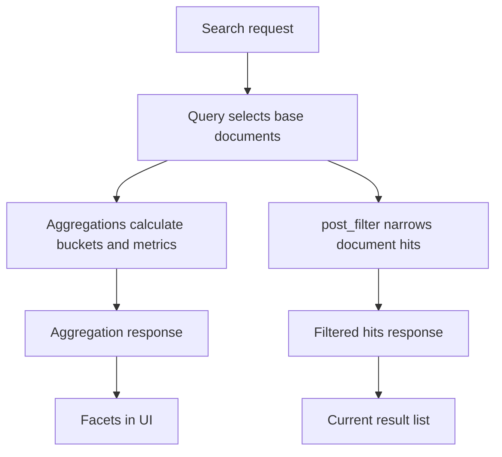
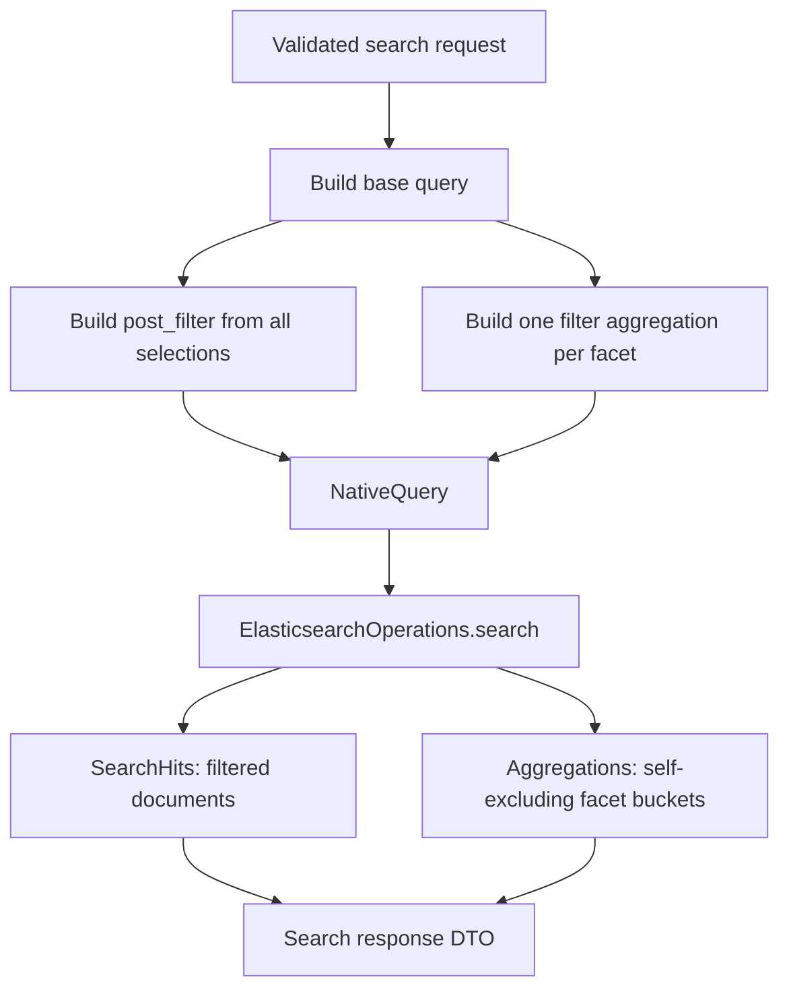

# Kết hợp aggregation với post_filter để xây dựng faceted search

Faceted search là kiểu tìm kiếm trong đó người dùng vừa xem danh sách kết quả, vừa dùng các nhóm bộ lọc để thu hẹp dữ liệu. Ví dụ trang sản phẩm hiển thị các sản phẩm phù hợp với từ khóa, đồng thời hiển thị số lượng theo category, brand, màu sắc hoặc khoảng giá. Khi người dùng chọn một brand, danh sách sản phẩm phải thu hẹp theo brand đó; các facet khác vẫn cần cho biết còn bao nhiêu lựa chọn phù hợp.

Elasticsearch hỗ trợ mô hình này bằng cách kết hợp **query**, **aggregation** và **`post_filter`** trong cùng một search request. Query xác định tập document nền. Aggregation tính bucket/metric trên tập document trong scope của nó. `post_filter` lọc danh sách hits sau khi aggregation đã được tính, nên có thể thu hẹp danh sách đang hiển thị mà không làm mất các lựa chọn facet khác.

Điểm cần nắm là `post_filter` tác động lên hits, không tác động lên aggregation cấp cao nhất. Khi cần facet đếm theo kiểu “tôn trọng các filter đã chọn khác, nhưng bỏ qua filter của chính facet đang tính”, hãy đặt từng facet trong một `filter` aggregation có scope riêng. Đây là kỹ thuật thường gọi là *disjunctive faceting* hoặc *self-excluding facets*.

## 1. Faceted search giải quyết vấn đề gì?

Giả sử index `products` có các document với field `name`, `category`, `brand`, `color`, `price` và `active`. Một trang tìm kiếm cần:

- Hiển thị các sản phẩm khớp từ khóa.
- Cho phép lọc theo category.
- Cho phép lọc theo brand.
- Cho phép lọc theo màu.
- Cho phép lọc theo khoảng giá.
- Hiển thị số lượng phù hợp cạnh mỗi lựa chọn, ví dụ `Keyboard (12)` hoặc `Northwind (8)`.

Một request search có thể trả cả danh sách document lẫn các facet. Giao diện không cần gọi một request riêng cho từng nhóm thống kê nếu các nhóm có thể được tính trong cùng một aggregation request.

### 1.1 Ví dụ dữ liệu

Giả sử có dữ liệu minh họa:

| SKU | Category | Brand | Color | Price | Active |
|---|---|---|---|---:|---|
| KB-01 | keyboard | Northwind | black | 120 | true |
| KB-02 | keyboard | Contoso | white | 180 | true |
| KB-03 | keyboard | Northwind | white | 220 | true |
| MS-01 | mouse | Northwind | black | 40 | true |
| MS-02 | mouse | Fabrikam | blue | 60 | true |
| MN-01 | monitor | Contoso | black | 300 | true |
| MN-02 | monitor | Northwind | white | 450 | false |

Người dùng tìm `wireless`, chọn category `keyboard`, rồi chọn brand `Northwind`. Danh sách hits cần chỉ còn sản phẩm keyboard của Northwind. Tuy nhiên, facet brand vẫn nên cho biết những brand nào còn sản phẩm trong category keyboard; facet category vẫn có thể cho biết số lượng theo category trong phạm vi các filter khác.

Để hiểu chính xác con số trên facet, phải xác định scope của từng aggregation. Nếu tất cả filter người dùng chọn đều nằm trong query chính, mọi aggregation sẽ bị thu hẹp theo tất cả filter đó và các lựa chọn khác trong facet có thể biến mất.

## 2. Phân biệt query, aggregation và post_filter

Ba thành phần có vai trò riêng:

| Thành phần | Tác động lên hits | Tác động lên aggregation cấp top-level | Vai trò |
|---|---|---|---|
| `query` | Có | Có | Xác định tập document nền cho search |
| `aggs` | Không chọn hits trực tiếp | Tính bucket/metric trên scope của aggregation | Tạo facet và thống kê |
| `post_filter` | Có, sau khi aggregation được tính | Không | Thu hẹp hits mà giữ scope aggregation rộng hơn |

Luồng xử lý có thể hình dung như sau:



`post_filter` được áp dụng sau khi Elasticsearch đã tính aggregation. Vì vậy, hits và facet có thể phản ánh hai tập document khác nhau một cách có chủ đích.

### 2.1 Query filter ảnh hưởng cả hits và aggregation

Điều kiện đặt trong `query.bool.filter` giới hạn tập document nền. Cả hits lẫn aggregation top-level đều chỉ nhìn thấy các document vượt qua filter đó.

Ví dụ:

```json
GET /products/_search
{
  "query": {
    "bool": {
      "must": [
        { "match": { "name": "wireless" } }
      ],
      "filter": [
        { "term": { "active": true } },
        { "term": { "category": "keyboard" } }
      ]
    }
  },
  "aggs": {
    "brands": {
      "terms": {
        "field": "brand",
        "size": 20
      }
    }
  }
}
```

Aggregation `brands` chỉ thống kê những sản phẩm vừa match `wireless`, vừa active, vừa thuộc category `keyboard`. Nếu mục tiêu là hiển thị những category khác hoặc brand khác sau khi chọn một category, đặt category trong query chính sẽ khiến facet không còn thấy các document ngoài category đó.

### 2.2 post_filter chỉ thu hẹp hits

Nếu chuyển category filter sang `post_filter`, aggregation cấp top-level sẽ tính trên tập document sau query nhưng trước category filter:

```json
GET /products/_search
{
  "query": {
    "bool": {
      "must": [
        { "match": { "name": "wireless" } }
      ],
      "filter": [
        { "term": { "active": true } }
      ]
    }
  },
  "post_filter": {
    "term": {
      "category": "keyboard"
    }
  },
  "aggs": {
    "categories": {
      "terms": {
        "field": "category",
        "size": 20
      }
    }
  }
}
```

Kết quả:

- `hits.hits` chỉ chứa sản phẩm match `wireless`, active và thuộc category `keyboard`.
- `aggregations.categories` đếm category trên các sản phẩm match `wireless` và active, trước khi áp dụng category đã chọn.

Đây là mẫu cơ bản của faceted search: filter người dùng chọn được dùng để lọc danh sách, trong khi facet tương ứng vẫn có thể hiển thị các lựa chọn thay thế.

## 3. Vì sao chỉ dùng post_filter đôi khi chưa đủ?

Mẫu ở phần trước giữ aggregation rộng hơn tất cả điều kiện `post_filter`. Điều đó có thể đúng với một facet đơn, nhưng với nhiều nhóm facet, thường cần hành vi tinh tế hơn.

Giả sử người dùng đã chọn:

- Category = `keyboard`.
- Brand = `Northwind`.
- Color = `black`.

Danh sách hits phải áp dụng cả ba lựa chọn. Nhưng khi hiển thị facet category, ta thường muốn tính số lượng theo category sau khi áp dụng brand và color, đồng thời bỏ qua lựa chọn category hiện tại. Khi hiển thị facet brand, ta muốn áp dụng category và color, nhưng bỏ qua brand hiện tại. Tương tự với color.

Nếu chỉ dùng một aggregation top-level và đưa toàn bộ ba filter vào `post_filter`, tất cả facet đều được tính trước cả ba filter. Chúng sẽ quá rộng: facet brand không phản ánh việc category/color đã được chọn. Nếu đưa cả ba filter vào query, tất cả facet lại quá hẹp: mỗi facet chỉ thấy giá trị đã chọn của chính nó.

Giải pháp là dùng **filter aggregation riêng cho từng facet**:

- Aggregation category áp dụng filter brand và color, bỏ filter category.
- Aggregation brand áp dụng filter category và color, bỏ filter brand.
- Aggregation color áp dụng filter category và brand, bỏ filter color.
- Hits vẫn dùng `post_filter` với cả ba filter.

## 4. Disjunctive faceting: mỗi facet bỏ qua filter của chính nó

Đây là mô hình thường dùng cho giao diện thương mại điện tử và tìm kiếm nhiều bộ lọc.

### 4.1 Quy tắc logic

Giả sử:

```text
Q = full-text query + tenant/security constraints + active = true
C = category selection
B = brand selection
L = color selection
P = price range selection
```

Danh sách hits cần:

```text
Q AND C AND B AND L AND P
```

Facet category cần:

```text
Q AND B AND L AND P, then bucket by category
```

Facet brand cần:

```text
Q AND C AND L AND P, then bucket by brand
```

Facet color cần:

```text
Q AND C AND B AND P, then bucket by color
```

Facet price cần:

```text
Q AND C AND B AND L, then bucket by price range
```

Như vậy, mỗi facet phản ánh các filter ở những nhóm khác, nhưng không tự loại bỏ các giá trị thay thế của chính nhóm đó.

### 4.2 Nhiều lựa chọn trong cùng một facet

Trong một facet, nhiều giá trị thường được kết hợp bằng OR. Ví dụ người dùng chọn `keyboard` hoặc `mouse`:

```json
{
  "terms": {
    "category": ["keyboard", "mouse"]
  }
}
```

Điều kiện category là một nhóm OR. Các nhóm facet khác nhau thường kết hợp bằng AND:

```text
(category = keyboard OR category = mouse)
AND (brand = Northwind OR brand = Contoso)
AND (color = black)
```

Trong Elasticsearch DSL, đặt một `terms` query cho mỗi nhóm trong `bool.filter` sẽ biểu diễn đúng quy tắc này: các giá trị bên trong `terms` là OR, còn các filter clause trong bool là AND.

## 5. Query DSL đầy đủ cho faceted search

Ví dụ dưới đây có ba nhóm lựa chọn category, brand và color. Người dùng đã chọn category `keyboard`, brand `Northwind` và color `black`.

```http
GET /products/_search
{
  "size": 20,
  "query": {
    "bool": {
      "must": [
        {
          "match": {
            "name": "wireless"
          }
        }
      ],
      "filter": [
        { "term": { "active": true } }
      ]
    }
  },
  "post_filter": {
    "bool": {
      "filter": [
        { "terms": { "category": ["keyboard"] } },
        { "terms": { "brand": ["Northwind"] } },
        { "terms": { "color": ["black"] } }
      ]
    }
  },
  "aggs": {
    "categories_scope": {
      "filter": {
        "bool": {
          "filter": [
            { "terms": { "brand": ["Northwind"] } },
            { "terms": { "color": ["black"] } }
          ]
        }
      },
      "aggs": {
        "values": {
          "terms": {
            "field": "category",
            "size": 20
          }
        }
      }
    },
    "brands_scope": {
      "filter": {
        "bool": {
          "filter": [
            { "terms": { "category": ["keyboard"] } },
            { "terms": { "color": ["black"] } }
          ]
        }
      },
      "aggs": {
        "values": {
          "terms": {
            "field": "brand",
            "size": 20
          }
        }
      }
    },
    "colors_scope": {
      "filter": {
        "bool": {
          "filter": [
            { "terms": { "category": ["keyboard"] } },
            { "terms": { "brand": ["Northwind"] } }
          ]
        }
      },
      "aggs": {
        "values": {
          "terms": {
            "field": "color",
            "size": 20
          }
        }
      }
    }
  }
}
```

Trong request:

- Query chính áp dụng full-text `wireless` và điều kiện `active = true` cho cả hits lẫn aggregation.
- `post_filter` áp dụng đồng thời category, brand và color để lọc hits.
- `categories_scope` bỏ category đã chọn, nhưng vẫn áp dụng brand và color.
- `brands_scope` bỏ brand đã chọn, nhưng vẫn áp dụng category và color.
- `colors_scope` bỏ color đã chọn, nhưng vẫn áp dụng category và brand.

Mỗi aggregation con `values` tạo bucket theo field tương ứng. Giao diện đọc bucket từ đúng scope để hiển thị facet.

### 5.1 Khi có price range

Giả sử người dùng chọn giá từ 100 đến 300. Thêm range vào `post_filter` để giới hạn hits:

```json
{
  "range": {
    "price": {
      "gte": 100,
      "lte": 300
    }
  }
}
```

Khi tính facet category, brand và color, phải giữ price range vì đó là filter thuộc nhóm khác. Khi tính facet price, bỏ price range hiện tại để hiển thị các khoảng giá thay thế trong phạm vi category/brand/color đã chọn.

Ví dụ aggregation price:

```json
"prices_scope": {
  "filter": {
    "bool": {
      "filter": [
        { "terms": { "category": ["keyboard"] } },
        { "terms": { "brand": ["Northwind"] } },
        { "terms": { "color": ["black"] } }
      ]
    }
  },
  "aggs": {
    "price_ranges": {
      "range": {
        "field": "price",
        "ranges": [
          { "to": 100 },
          { "from": 100, "to": 200 },
          { "from": 200, "to": 300 },
          { "from": 300 }
        ]
      }
    }
  }
}
```

Các biên range trong ví dụ dùng `from` inclusive và `to` exclusive. Nếu giao diện hiển thị các khoảng có nhãn như “100–199”, hãy xác định rõ cách biểu diễn biên và đơn vị tiền tệ để không tạo khoảng chồng lấn hoặc khoảng trống.

## 6. Khi nào chỉ cần aggregation top-level?

Không phải mọi faceted search đều cần filter aggregation riêng cho từng facet. Chọn cấu trúc đơn giản nhất đúng với trải nghiệm mong muốn.

### 6.1 Facet không phụ thuộc filter đã chọn

Nếu giao diện muốn luôn hiển thị số lượng category/brand trên toàn bộ tập document match query nền, bất kể người dùng đã chọn facet nào, có thể dùng aggregation top-level cùng `post_filter` đơn giản:

```json
{
  "query": {
    "match": {
      "name": "wireless"
    }
  },
  "post_filter": {
    "term": {
      "category": "keyboard"
    }
  },
  "aggs": {
    "categories": {
      "terms": {
        "field": "category"
      }
    },
    "brands": {
      "terms": {
        "field": "brand"
      }
    }
  }
}
```

Hai facet đều tính trên tập `wireless`, không bị category đã chọn ảnh hưởng. Cách này phù hợp nếu facet luôn là thống kê trên tập query nền.

### 6.2 Facet phụ thuộc các lựa chọn ở nhóm khác

Nếu category facet cần tôn trọng brand/color/price, brand facet cần tôn trọng category/color/price, hãy dùng filter aggregation riêng cho từng facet như phần disjunctive faceting.

Đừng dùng một aggregation top-level chung rồi mong mỗi facet tự bỏ qua filter của chính nó. Elasticsearch không tự suy luận quy tắc UI; scope phải được mô tả rõ trong request.

## 7. Dùng `filter` aggregation để đặt scope cho từng facet

`filter` aggregation tạo một phạm vi document con theo một query. Aggregation lồng bên trong chỉ tính trên các document vượt qua filter đó.

Ví dụ đơn giản:

```json
{
  "aggs": {
    "brands_for_selected_category": {
      "filter": {
        "term": {
          "category": "keyboard"
        }
      },
      "aggs": {
        "brand_values": {
          "terms": {
            "field": "brand"
          }
        }
      }
    }
  }
}
```

`brands_for_selected_category` chỉ nhận sản phẩm keyboard; `brand_values` nhóm các document trong scope đó theo brand.

Trong faceted search nhiều nhóm, filter aggregation được tạo theo nguyên tắc “mọi filter khác trừ filter của facet hiện tại”. Cần áp dụng cả query nền và filter chung ở top-level để mọi facet tuân thủ phạm vi tenant, trạng thái hoặc quyền truy cập.

### 7.1 Filter aggregation không phải post_filter

Hai khái niệm đều dùng filter nhưng tác động khác nhau:

| Cơ chế | Mục đích |
|---|---|
| `post_filter` | Lọc hits sau khi aggregation đã được tính |
| `filter` aggregation | Tạo scope riêng cho một nhánh aggregation |
| `bool.filter` trong query | Giới hạn tập document nền cho hits và aggregation |

Có thể dùng cả ba trong cùng request. Một cách triển khai phổ biến là query cho điều kiện chung, post_filter cho tất cả lựa chọn người dùng để lọc hits, và filter aggregation cho facet counts tự loại trừ filter cùng nhóm.

## 8. Nhiều giá trị trong một facet và cách kết hợp logic

Faceted search thường cho phép chọn nhiều giá trị trong cùng một nhóm. Cần xác định quy tắc AND/OR rõ ràng.

Ví dụ người dùng chọn hai category `keyboard` và `mouse`, đồng thời chọn hai brand `Northwind` và `Contoso`:

```json
{
  "bool": {
    "filter": [
      {
        "terms": {
          "category": ["keyboard", "mouse"]
        }
      },
      {
        "terms": {
          "brand": ["Northwind", "Contoso"]
        }
      }
    ]
  }
}
```

Semantics là:

```text
(category = keyboard OR category = mouse)
AND
(brand = Northwind OR brand = Contoso)
```

Trong cùng một facet, các lựa chọn thường là OR. Giữa các facet khác nhau, nhóm điều kiện thường là AND. Nếu sản phẩm có quy tắc khác, hãy biểu diễn rõ bằng bool query thay vì dùng một `terms` query lớn trộn các field khác nhau.

### 8.1 Bỏ toàn bộ nhóm facet hiện tại khi tính bucket

Nếu category được chọn nhiều giá trị, facet category vẫn cần bỏ cả nhóm category khi tính bucket. Không chỉ bỏ một giá trị đã chọn. Vì vậy, aggregation category không chứa bất kỳ điều kiện category nào, nhưng vẫn chứa các filter của brand, color, price và các nhóm khác.

### 8.2 Giá trị được chọn không xuất hiện trong bucket

Nếu filter hiện tại quá chặt hoặc bucket size không đủ lớn, một giá trị đang chọn có thể không xuất hiện trong danh sách bucket trả về. Giao diện nên giữ trạng thái lựa chọn từ request/state của client và không xóa lựa chọn chỉ vì bucket response không chứa nó.

Với terms aggregation, `size` giới hạn số bucket được trả về. Nếu cần giữ các giá trị đã chọn, có thể tăng `size` hợp lý hoặc bổ sung logic response để giữ selected values. Không giả định aggregation luôn trả mọi giá trị khác nhau.

## 9. Mapping cần phù hợp với facet

Facet dạng terms thường dùng trên field có kiểu `keyword` hoặc kiểu phù hợp với doc values. Field `text` được phân tích thành token và thường không phải lựa chọn mặc định cho facet chính xác.

Ví dụ mapping:

```json
PUT /products
{
  "mappings": {
    "properties": {
      "name": {
        "type": "text"
      },
      "category": {
        "type": "keyword"
      },
      "brand": {
        "type": "keyword"
      },
      "color": {
        "type": "keyword"
      },
      "price": {
        "type": "double"
      },
      "active": {
        "type": "boolean"
      }
    }
  }
}
```

Nếu vừa cần full-text search trên tên vừa cần facet/sort theo giá trị tên chính xác, dùng multi-field:

```json
"name": {
  "type": "text",
  "fields": {
    "raw": {
      "type": "keyword"
    }
  }
}
```

Facet theo `name.raw`, còn match query trên `name`. Không bật fielddata trên `text` chỉ để làm terms aggregation nếu chưa đánh giá chi phí heap và cardinality; keyword sub-field thường là thiết kế rõ ràng hơn.

## 10. Xây dựng faceted search bằng Spring Data Elasticsearch

Với Spring Data Elasticsearch 5.x và Elasticsearch Java API Client, `NativeQuery` hỗ trợ query, filter, aggregation và pageable. Filter riêng của `NativeQuery` được chuyển thành `post_filter` trong Search API; `withQuery(...)` tạo query chính. Hãy kiểm tra API của đúng phiên bản Spring Data trong dự án vì builder và kiểu Java Client có thể thay đổi giữa các release.

### 10.1 Khai báo aggregation đơn giản

Ví dụ tạo terms aggregation theo category:

```java
import co.elastic.clients.elasticsearch._types.aggregations.Aggregation;
import org.springframework.data.elasticsearch.client.elc.NativeQuery;
import org.springframework.data.elasticsearch.core.query.Query;

Aggregation categories = Aggregation.of(a -> a
    .terms(t -> t
        .field("category")
        .size(20)
    )
);

Query query = NativeQuery.builder()
    .withQuery(q -> q.match(m -> m
        .field("name")
        .query("wireless")
    ))
    .withAggregation("categories", categories)
    .build();
```

Aggregation được đặt tên `categories`; tên này được dùng khi đọc kết quả. Có thể khai báo nhiều aggregation bằng cách gọi `withAggregation` nhiều lần.

### 10.2 Đặt filter cho hits bằng post_filter

Ví dụ người dùng chọn category `keyboard`:

```java
import org.springframework.data.elasticsearch.client.elc.NativeQuery;
import org.springframework.data.elasticsearch.core.query.Query;

Query query = NativeQuery.builder()
    .withQuery(q -> q.bool(b -> b
        .must(m -> m.match(mm -> mm
            .field("name")
            .query("wireless")
        ))
        .filter(f -> f.term(t -> t
            .field("active")
            .value(true)
        ))
    ))
    .withFilter(f -> f.term(t -> t
        .field("category")
        .value("keyboard")
    ))
    .withAggregation("categories", categories)
    .build();
```

Trong `NativeQuery`, `withFilter(...)` là filter riêng của search request và được dùng như `post_filter`: hits bị lọc theo category, còn aggregation top-level vẫn được tính trên query chính. Không nhầm nó với `bool.filter` bên trong `withQuery(...)`, vì `bool.filter` giới hạn cả hits lẫn aggregation.

### 10.3 Filter aggregation trong Java Client

Để tạo facet brand dựa trên category đã chọn, khai báo filter aggregation lồng terms aggregation:

```java
Aggregation brandsForCategory = Aggregation.of(a -> a
    .filter(f -> f.term(t -> t
        .field("category")
        .value("keyboard")
    ))
    .aggregations("values", sub -> sub.terms(t -> t
        .field("brand")
        .size(20)
    ))
);

Query query = NativeQuery.builder()
    .withQuery(q -> q.match(m -> m
        .field("name")
        .query("wireless")
    ))
    .withAggregation("brands_scope", brandsForCategory)
    .build();
```

Aggregation `brands_scope` giới hạn document theo category `keyboard`; aggregation con `values` nhóm các document đó theo brand. Với nhiều lựa chọn category, dùng `terms` query trong filter aggregation. Với disjunctive faceting đầy đủ, tạo một filter aggregation riêng cho mỗi facet và áp dụng tất cả selected filters trừ filter cùng nhóm.

### 10.4 Kết hợp nhiều facet trong NativeQuery

Khung triển khai có thể tổ chức các aggregation trước rồi gắn vào query:

```java
Aggregation categoriesForOtherFilters = Aggregation.of(a -> a
    .filter(f -> f.bool(b -> b
        .filter(q -> q.term(t -> t.field("brand").value("Northwind")))
        .filter(q -> q.term(t -> t.field("color").value("black")))
    ))
    .aggregations("values", sub -> sub.terms(t -> t
        .field("category")
        .size(20)
    ))
);

Aggregation brandsForOtherFilters = Aggregation.of(a -> a
    .filter(f -> f.bool(b -> b
        .filter(q -> q.term(t -> t.field("category").value("keyboard")))
        .filter(q -> q.term(t -> t.field("color").value("black")))
    ))
    .aggregations("values", sub -> sub.terms(t -> t
        .field("brand")
        .size(20)
    ))
);

Query query = NativeQuery.builder()
    .withQuery(q -> q.bool(b -> b
        .must(m -> m.match(mm -> mm.field("name").query("wireless")))
        .filter(f -> f.term(t -> t.field("active").value(true)))
    ))
    .withFilter(f -> f.bool(b -> b
        .filter(q -> q.term(t -> t.field("category").value("keyboard")))
        .filter(q -> q.term(t -> t.field("brand").value("Northwind")))
        .filter(q -> q.term(t -> t.field("color").value("black")))
    ))
    .withAggregation("categories_scope", categoriesForOtherFilters)
    .withAggregation("brands_scope", brandsForOtherFilters)
    .withPageable(PageRequest.of(0, 20))
    .build();
```

Đây là ví dụ minh họa builder theo phong cách Elasticsearch Java Client. Với filter aggregation category, code không đưa category vào scope; với filter aggregation brand, code không đưa brand vào scope. Trong ứng dụng thực tế, hãy tạo các filter từ request đã validate thay vì hard-code giá trị. Các method overload cụ thể có thể khác theo phiên bản client; giữ nguyên cấu trúc DSL và đối chiếu Javadoc của dependency đang dùng.

### 10.5 Đọc hits và aggregation riêng biệt

```java
SearchHits<Product> result = operations.search(query, Product.class);

List<Product> products = result.getSearchHits().stream()
    .map(SearchHit::getContent)
    .toList();

long totalHits = result.getTotalHits();
AggregationsContainer<?> aggregationContainer = result.getAggregations();
```

`products` là danh sách document sau `post_filter`. `aggregationContainer` chứa facet buckets theo scope đã cấu hình. Khi đọc aggregation, lấy đúng tên aggregation như `categories_scope` hoặc `brands_scope`, sau đó lấy aggregation con `values`. Cấu trúc wrapper cụ thể phụ thuộc Spring Data/Elasticsearch Java Client version.

Không chuyển bucket thành entity. Bucket chỉ chứa key, count và aggregation con; nó không phải một document sản phẩm.

## 11. Xây dựng filter động từ request

Một API faceted search thường nhận nhiều lựa chọn:

```java
public record ProductFacetRequest(
    String keyword,
    List<String> categories,
    List<String> brands,
    List<String> colors,
    Double minPrice,
    Double maxPrice,
    Integer page,
    Integer size
) {
}
```

Trước khi tạo query, cần validate và chuẩn hóa:

- Loại bỏ giá trị trùng trong từng nhóm.
- Từ chối hoặc bỏ qua chuỗi rỗng theo contract API.
- Giới hạn số lựa chọn trong mỗi facet.
- Kiểm tra minPrice không lớn hơn maxPrice.
- Chỉ cho phép field facet nằm trong allowlist server-side.
- Áp dụng tenant/security constraints trong query nền, không đưa chúng vào `post_filter` do client kiểm soát.

### 11.1 Hàm tạo terms filter

Về mặt logic, một nhóm lựa chọn có thể được tạo thành `terms` query. Nếu danh sách rỗng, không thêm filter cho nhóm đó:

```java
private void addTermsFilter(
        List<Query> filters,
        String field,
        List<String> values) {
    if (values != null && !values.isEmpty()) {
        filters.add(Query.of(q -> q.terms(t -> t
            .field(field)
            .terms(v -> v.value(
                values.stream().map(FieldValue::of).toList()
            ))
        )));
    }
}
```

Đoạn helper minh họa việc chuyển một nhóm nhiều giá trị thành một terms query. Kiểu `Query` ở đây là query type của Elasticsearch Java Client; không nhầm với `org.springframework.data.elasticsearch.core.query.Query` của Spring Data. Khi triển khai, đặt alias/import rõ ràng để tránh xung đột tên lớp.

### 11.2 Tạo post_filter

Tập filter đã validate được ghép bằng bool filter:

```java
Query postFilter = Query.of(q -> q.bool(b -> {
    for (Query filter : selectedFacetFilters) {
        b.filter(filter);
    }
    return b;
}));
```

Sau đó truyền vào `NativeQuery` qua filter API tương ứng của phiên bản. Nếu không có facet nào được chọn, không cần thêm post_filter.

### 11.3 Tạo filter aggregation cho từng facet

Với facet `category`, lấy tất cả selected facet filters ngoại trừ nhóm category. Với facet `brand`, loại nhóm brand. Cách tổ chức dữ liệu đầu vào thành map theo facet key giúp tránh viết logic riêng lẻ cho từng tổ hợp:

```text
selectedFilters = {
  category: categoryTermsFilter,
  brand: brandTermsFilter,
  color: colorTermsFilter,
  price: priceRangeFilter
}

scope(category) = brand + color + price
scope(brand)    = category + color + price
scope(color)    = category + brand + price
scope(price)    = category + brand + color
```

Mỗi scope được chuyển thành filter aggregation, bên trong đặt terms/range aggregation tương ứng. Đây là cách tổng quát để xây dựng disjunctive facets khi số nhóm filter tăng lên.

## 12. Phân biệt filter trong query và filter trong aggregation

Một hệ thống tìm kiếm thường có ba loại điều kiện:

1. **Điều kiện nền:** tenant, quyền truy cập, trạng thái được phép, full-text query. Đặt trong query chính để tất cả hits và facets tuân thủ.
2. **Lựa chọn của người dùng:** category, brand, color, price. Đặt trong `post_filter` để lọc hits.
3. **Scope facet:** các lựa chọn của người dùng trừ lựa chọn thuộc facet đang tính. Đặt trong filter aggregation tương ứng.

Không đưa điều kiện bảo mật vào `post_filter` nếu aggregation không được phép nhìn thấy dữ liệu ngoài quyền của người dùng. `post_filter` không giới hạn aggregation. Tenant/security filter phải nằm trong query nền hoặc cơ chế authorization tương đương được thực thi trên toàn request.

### 12.1 Ví dụ tenant isolation

Giả sử document có `tenantId`. Query nền phải bao gồm tenant hiện tại:

```json
"query": {
  "bool": {
    "must": [
      { "match": { "name": "wireless" } }
    ],
    "filter": [
      { "term": { "tenantId": "tenant-42" } },
      { "term": { "active": true } }
    ]
  }
}
```

Các filter aggregation con kế thừa scope của query nền, vì vậy vẫn chỉ tính dữ liệu tenant-42. Nếu dùng `global` aggregation, nó bỏ qua query scope và cần xử lý bảo mật riêng; không thêm global aggregation tùy tiện vào faceted endpoint multi-tenant.

## 13. Facet counts và cách hiểu số lượng

Bucket `doc_count` là số document thuộc bucket trong scope aggregation. Nó không nhất thiết bằng số hit đang hiển thị vì:

- Hits đã qua `post_filter`, còn aggregation có thể bỏ qua một hoặc nhiều facet filter.
- Bucket được tính trên tập query nền cộng scope riêng.
- Terms aggregation có thể chỉ trả một số bucket hàng đầu.
- Một document có thể có nhiều giá trị trong một field mảng và xuất hiện trong nhiều bucket.
- Terms aggregation phân tán có thể có sai số đếm bucket tùy cấu hình/shard.

Giao diện cần biết mỗi facet count thuộc scope nào. Ví dụ `Northwind (8)` trong facet brand có thể có nghĩa “8 sản phẩm Northwind sau khi áp dụng category, color và price hiện tại, nhưng trước khi áp dụng brand đã chọn”. Đó không phải số hit hiện tại sau toàn bộ filter.

### 13.1 Terms size và selected values

`terms.size` giới hạn số bucket được trả về. Nếu có nhiều brand, các brand có count thấp có thể không xuất hiện. Tăng size hợp lý, sắp xếp theo key nếu cần danh sách ổn định, hoặc sử dụng composite aggregation khi cần duyệt toàn bộ bucket.

Nếu một giá trị đang được chọn không xuất hiện trong bucket vì count bằng 0 hoặc bị giới hạn, backend/UI vẫn nên giữ lựa chọn đã gửi. Có thể trả selected values riêng trong response hoặc ghép chúng vào facet model ở tầng ứng dụng.

### 13.2 Bucket count không phải tổng số hits

`hits.total` mô tả tổng document khớp query và các filter tác động lên hits theo request. `bucket.doc_count` mô tả document trong scope của bucket. Trong disjunctive faceting, hai số có thể khác nhau có chủ đích.

Đừng cộng count của các bucket category để suy ra tổng hits nếu field có nhiều giá trị hoặc terms aggregation bị giới hạn. Xác định semantics của field và aggregation trước khi diễn giải số liệu.

## 14. Facet dạng range và date histogram

Không phải facet nào cũng là terms.

### 14.1 Price range facet

Range aggregation có thể tạo các lựa chọn khoảng giá:

```json
{
  "aggs": {
    "price_ranges": {
      "range": {
        "field": "price",
        "ranges": [
          { "to": 50 },
          { "from": 50, "to": 100 },
          { "from": 100, "to": 250 },
          { "from": 250 }
        ]
      }
    }
  }
}
```

Khi người dùng chọn một khoảng giá, thêm range filter vào `post_filter` cho hits. Khi tính facet price, bỏ range filter hiện tại nhưng giữ các facet khác trong filter aggregation price scope.

### 14.2 Date histogram facet

Với dữ liệu đơn hàng hoặc bài viết, có thể nhóm theo ngày/tháng:

```json
{
  "aggs": {
    "orders_by_month": {
      "date_histogram": {
        "field": "createdAt",
        "calendar_interval": "month",
        "time_zone": "+07:00"
      }
    }
  }
}
```

Nếu người dùng chọn khoảng ngày, áp dụng date range vào `post_filter` cho hits và bỏ nó khỏi date facet scope nếu muốn hiển thị các khoảng ngày thay thế. Xác định timezone nghiệp vụ rõ ràng để bucket không lệch ngày.

## 15. Phân trang hits không phân trang facet

`from`/`size` hoặc `Pageable` điều khiển danh sách document trả về. Chúng không phân trang bucket aggregation. Một request có thể trả 20 hits nhưng facet category có 20 bucket, facet brand có 20 bucket và facet price có nhiều range.

Nếu một facet có hàng nghìn giá trị khác nhau, `terms.size` chỉ trả top buckets. Dùng composite aggregation với `after_key` để duyệt bucket nếu UI hoặc quy trình cần toàn bộ giá trị. Composite bucket pagination khác `search_after` dùng cho document hits.

Không tải tất cả document chỉ để tự tạo facet trong Java. Dùng aggregation để tính thống kê ở Elasticsearch, và chỉ lấy hits cần hiển thị ở trang hiện tại.

## 16. Những lỗi thường gặp

### 16.1 Đặt tất cả selected filters trong query chính

Khi category, brand, color đều nằm trong query filter, aggregation top-level chỉ thấy document vượt qua tất cả lựa chọn. Facet có thể chỉ trả lại giá trị đang chọn. Chuyển lựa chọn người dùng sang `post_filter` và tạo scope riêng cho từng facet nếu cần self-excluding counts.

### 16.2 Nghĩ post_filter ảnh hưởng aggregation

`post_filter` chỉ lọc hits sau khi aggregation được tính. Nếu muốn một aggregation bị lọc, dùng filter aggregation hoặc đưa điều kiện vào query chính khi nó là điều kiện nền.

### 16.3 Dùng một post_filter rộng nhưng mong facet tôn trọng các filter khác

Một aggregation top-level không tự biết facet nào cần bỏ filter nào. Muốn category facet tôn trọng brand/color nhưng bỏ category, phải tạo filter aggregation category với brand/color scope. Lặp lại cho từng facet.

### 16.4 Kết hợp nhiều lựa chọn trong cùng facet bằng AND ngoài ý muốn

Nếu người dùng chọn category keyboard hoặc mouse, hai giá trị phải là OR. Dùng một `terms` query cho nhóm category. Các nhóm facet khác nhau được ghép bằng AND trong bool filter.

### 16.5 Đưa điều kiện tenant/security vào post_filter

Aggregation không bị post_filter giới hạn, nên facet có thể tiết lộ số liệu của document ngoài phạm vi quyền. Đặt điều kiện tenant/security trong query nền hoặc áp dụng cơ chế authorization toàn request.

### 16.6 Nhầm bucket count với hits.total

Facet scope có thể rộng hơn hoặc khác tập hits. Giải thích count theo scope đã định nghĩa và không dùng bucket count thay cho total hits.

### 16.7 Dùng terms aggregation trên field text

Facet chính xác nên dùng keyword field hoặc multi-field keyword. Field text thường không phù hợp cho terms aggregation mặc định.

### 16.8 Không giữ lựa chọn đã chọn khi bucket không trả về

Terms aggregation có giới hạn số bucket. UI cần giữ selected state từ request, kể cả khi giá trị không xuất hiện trong danh sách bucket hiện tại.

### 16.9 Query không đồng nhất giữa hits và facet scopes

Mọi facet scope phải kế thừa cùng query nền, tenant và trạng thái chung. Nếu một aggregation dùng query khác, count có thể không còn so sánh được với hits.

## 17. Kiểm thử faceted search

Nên tạo tập dữ liệu nhỏ có các document khác nhau theo category, brand, color, price và trạng thái để kiểm tra rõ từng scope.

Kiểm tra các trường hợp:

1. Không chọn facet nào: hits và các facet phản ánh query nền.
2. Chọn một category: hits thu hẹp theo category; category facet vẫn hiển thị lựa chọn thay thế theo scope mong muốn.
3. Chọn category và brand: hits áp dụng cả hai; category facet bỏ category nhưng giữ brand; brand facet bỏ brand nhưng giữ category.
4. Chọn nhiều giá trị trong một nhóm: các giá trị trong nhóm là OR.
5. Chọn giá trị ở hai nhóm khác nhau: hai nhóm kết hợp AND.
6. Chọn price range: price facet bỏ range hiện tại, các facet khác giữ range.
7. Không có kết quả hits: aggregation vẫn có thể trả bucket rỗng hoặc metric theo scope tương ứng.
8. Có tenant filter: mọi facet chỉ thống kê dữ liệu tenant được phép.
9. Terms size nhỏ: UI vẫn giữ selected value không nằm trong top buckets.
10. Query text thay đổi: cả hits và mọi facet scope dùng cùng query nền.

Khi debug, chạy REST request trực tiếp và kiểm tra riêng `hits.hits`, `hits.total` cùng từng nhánh `aggregations`. Đặt tên aggregation rõ ràng như `categories_scope`, `brands_scope`, `colors_scope`; tên bucket con như `values` giúp code Java và response mapper dễ đọc.

## 18. Quy trình xây dựng endpoint faceted search

Một quy trình triển khai có thể chia thành các bước:

1. **Xác định query nền:** full-text search, tenant, quyền truy cập và trạng thái chung.
2. **Xác định các nhóm facet:** category, brand, color, price, date...
3. **Chuẩn hóa lựa chọn:** deduplicate, validate field/value và giới hạn số lựa chọn.
4. **Tạo post_filter:** ghép tất cả lựa chọn của người dùng để lọc hits.
5. **Tạo aggregation scope:** với mỗi facet, ghép các lựa chọn thuộc nhóm khác và bỏ nhóm hiện tại.
6. **Tạo bucket/metric:** terms cho keyword, range cho số, date_histogram cho thời gian.
7. **Giới hạn hits và buckets:** page size, terms size và chiến lược bucket pagination.
8. **Thực thi một search request:** lấy hits và aggregation cùng lúc.
9. **Map response:** tách danh sách document, total hits và facet model.
10. **Giữ selected state:** không phụ thuộc hoàn toàn vào danh sách bucket trả về.



## 19. Nguyên tắc triển khai

- Dùng query chính cho full-text và điều kiện nền cần áp dụng cho cả hits lẫn aggregation.
- Dùng `post_filter` cho các lựa chọn facet muốn áp dụng lên danh sách hits mà không thu hẹp aggregation top-level.
- Dùng filter aggregation riêng cho từng facet khi count cần tôn trọng các lựa chọn ở nhóm khác nhưng bỏ lựa chọn của chính nó.
- Dùng `terms` cho nhiều giá trị trong cùng facet: các giá trị là OR; các nhóm facet khác nhau thường là AND.
- Đặt tenant/security constraints trong query nền hoặc cơ chế authorization toàn request, không chỉ trong post_filter.
- Dùng keyword mapping cho facet terms; dùng range/date histogram cho facet số và thời gian.
- Phân biệt `hits.total`, `hits.hits` và `bucket.doc_count`.
- Nhớ rằng `from`/`size` phân trang hits, không phân trang bucket.
- Giữ selected values ở tầng ứng dụng ngay cả khi terms aggregation không trả bucket tương ứng.
- Trong Spring Data, dùng `NativeQuery` để kết hợp query, post-filter, aggregation và pageable; đọc hits và aggregation riêng qua `SearchHits`.
- Kiểm tra semantics của builder theo đúng phiên bản Spring Data Elasticsearch/Java Client.

## 20. Tổng kết

Faceted search kết hợp danh sách document với các bucket thống kê để người dùng vừa xem kết quả vừa thu hẹp theo category, brand, color, price hoặc thời gian. Query chính xác định tập document nền và áp dụng các điều kiện chung. `post_filter` lọc hits sau khi aggregation được tính, nên có thể giữ facet rộng hơn danh sách đang hiển thị.

Khi chỉ cần facet không phụ thuộc lựa chọn hiện tại, aggregation top-level cùng `post_filter` là đủ. Khi cần disjunctive faceting, mỗi facet cần một filter aggregation riêng: áp dụng các selected filters thuộc nhóm khác và bỏ filter của chính facet đó. Nhiều giá trị trong cùng nhóm thường kết hợp OR; các nhóm khác nhau kết hợp AND. Điều kiện tenant và bảo mật phải nằm trong query nền hoặc cơ chế authorization toàn request để aggregation không nhìn thấy dữ liệu ngoài phạm vi.

Trong Spring Data Elasticsearch, `NativeQuery` cho phép ghép query, post-filter và aggregation; `SearchHits` cung cấp danh sách document và aggregation container riêng. Hiểu rõ scope của từng phần giúp facet counts có ý nghĩa, tránh nhầm bucket với hits và xây dựng trải nghiệm lọc nhiều bước nhất quán.

## Tài liệu tham khảo

- [Elasticsearch — Filter search results](https://www.elastic.co/guide/en/elasticsearch/reference/current/filter-search-results.html)
- [Elasticsearch — Post filter](https://www.elastic.co/guide/en/elasticsearch/reference/current/filter-search-results.html#post-filter)
- [Elasticsearch — Filter aggregation](https://www.elastic.co/guide/en/elasticsearch/reference/current/search-aggregations-bucket-filter-aggregation.html)
- [Elasticsearch — Terms aggregation](https://www.elastic.co/guide/en/elasticsearch/reference/current/search-aggregations-bucket-terms-aggregation.html)
- [Elasticsearch — Search API](https://www.elastic.co/guide/en/elasticsearch/reference/current/search-search.html)
- [Spring Data Elasticsearch Reference — Search Operations](https://docs.spring.io/spring-data/elasticsearch/reference/elasticsearch/template.html)
