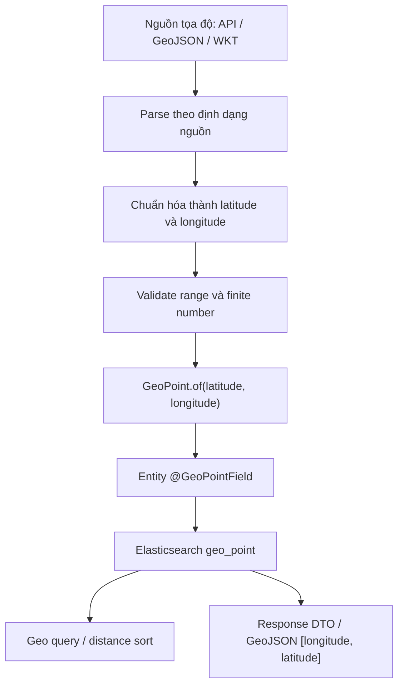

# Ánh xạ GeoPoint, @GeoPoint và cấu trúc tọa độ

Khi lưu vị trí địa lý trong Elasticsearch, một cặp số latitude/longitude không nên được xem như hai field số độc lập nếu ứng dụng cần tìm kiếm theo khoảng cách, vùng địa lý hoặc sắp xếp theo khoảng cách. Elasticsearch cung cấp kiểu dữ liệu **`geo_point`** để biểu diễn một điểm trên bề mặt Trái Đất. Trong Spring Data Elasticsearch, kiểu Java thường dùng là **`GeoPoint`** và annotation để khai báo mapping là **`@GeoPointField`**.

Điều quan trọng nhất khi làm việc với tọa độ là thứ tự giá trị. API `GeoPoint` của Spring Data nhận **latitude trước, longitude sau**; một số định dạng mảng mà Elasticsearch chấp nhận lại dùng **longitude trước, latitude sau**. Đảo hai giá trị có thể tạo ra một vị trí hoàn toàn khác hoặc khiến tọa độ vượt giới hạn hợp lệ.

Bài học này trình bày cách khai báo `geo_point` trong entity, cách Spring Data ánh xạ `GeoPoint`, các cấu trúc tọa độ Elasticsearch hỗ trợ, cách tạo và kiểm tra mapping, cũng như các quy tắc validation để tránh lỗi khi lưu dữ liệu địa lý.

## 1. `geo_point` là gì?

`geo_point` là kiểu field của Elasticsearch dùng để lưu một điểm địa lý được xác định bởi hai thành phần:

- **Latitude (vĩ độ)**: vị trí theo hướng Bắc/Nam, nằm trong khoảng từ -90 đến 90 độ.
- **Longitude (kinh độ)**: vị trí theo hướng Đông/Tây, nằm trong khoảng từ -180 đến 180 độ.

Ví dụ, một địa điểm tại Thành phố Hồ Chí Minh có thể được biểu diễn gần đúng như sau:

```json
{
  "location": {
    "lat": 10.762622,
    "lon": 106.660172
  }
}
```

Elasticsearch hiểu `location` là một điểm địa lý. Từ đó, ứng dụng có thể dùng các truy vấn địa lý như `geo_distance`, `geo_bounding_box`, `geo_polygon`, hoặc sắp xếp theo khoảng cách nếu use case cần.

Nếu chỉ lưu `latitude` và `longitude` thành hai field `double`, Elasticsearch vẫn có thể lọc từng con số, nhưng không tự hiểu chúng là một cặp tọa độ địa lý. Dùng `geo_point` giúp khai báo đúng ý nghĩa dữ liệu và mở ra các thao tác geospatial tích hợp.

## 2. Phân biệt latitude và longitude

Hai thành phần có phạm vi và ý nghĩa khác nhau:

| Thành phần | Tên tiếng Việt | Phạm vi hợp lệ | Ví dụ tại TP. Hồ Chí Minh |
|---|---|---:|---:|
| Latitude | Vĩ độ | `-90` đến `90` | `10.762622` |
| Longitude | Kinh độ | `-180` đến `180` | `106.660172` |

Latitude dương nằm ở Bắc bán cầu, latitude âm ở Nam bán cầu. Longitude dương nằm phía Đông kinh tuyến gốc, longitude âm phía Tây.

Trong code Java, nên đặt tên biến rõ nghĩa:

```java
double latitude = 10.762622;
double longitude = 106.660172;
```

Tránh dùng hai biến tên chung chung như `x` và `y` nếu không có quy ước đi kèm. Trong một số hệ tọa độ hoặc thư viện đồ họa, `x` thường đại diện longitude và `y` đại diện latitude; điều này khác với thứ tự constructor của nhiều API `GeoPoint`.

## 3. `GeoPoint` và `@GeoPointField` trong Spring Data Elasticsearch

Spring Data Elasticsearch cung cấp class `GeoPoint` để biểu diễn tọa độ trong Java và annotation `@GeoPointField` để khai báo một property có mapping Elasticsearch là `geo_point`.

Ví dụ entity:

```java
package com.example.places.document;

import org.springframework.data.annotation.Id;
import org.springframework.data.elasticsearch.annotations.Document;
import org.springframework.data.elasticsearch.annotations.Field;
import org.springframework.data.elasticsearch.annotations.FieldType;
import org.springframework.data.elasticsearch.annotations.GeoPointField;
import org.springframework.data.elasticsearch.core.geo.GeoPoint;

@Document(indexName = "places")
public class PlaceDocument {

    @Id
    private String id;

    @Field(type = FieldType.Keyword)
    private String name;

    @GeoPointField
    private GeoPoint location;

    protected PlaceDocument() {
    }

    public PlaceDocument(String id, String name, GeoPoint location) {
        this.id = id;
        this.name = name;
        this.location = location;
    }

    public String getId() {
        return id;
    }

    public String getName() {
        return name;
    }

    public GeoPoint getLocation() {
        return location;
    }
}
```

Hai import cần chú ý:

```java
import org.springframework.data.elasticsearch.annotations.GeoPointField;
import org.springframework.data.elasticsearch.core.geo.GeoPoint;
```

`@GeoPointField` là annotation Spring Data Elasticsearch thường dùng để đánh dấu property có kiểu `geo_point`. `GeoPoint` là kiểu Java giữ hai giá trị latitude và longitude. Không nhầm annotation này với các annotation có tên tương tự trong thư viện GIS hoặc mapping framework khác.

### 3.1. Tạo một GeoPoint

Có thể tạo điểm bằng factory method:

```java
GeoPoint location = GeoPoint.of(10.762622, 106.660172);

PlaceDocument place = new PlaceDocument(
    "place-001",
    "Central Post Office",
    location
);
```

Thứ tự tham số của `GeoPoint.of(...)` là:

```java
GeoPoint.of(latitude, longitude)
```

Nếu dùng constructor của class `GeoPoint` trong phiên bản đang dùng, quy ước cũng là latitude trước, longitude sau. Ưu tiên factory method nếu API của phiên bản dự án cung cấp nó; kiểm tra Javadoc khi nâng cấp Spring Data Elasticsearch.

### 3.2. Gán từ DTO đầu vào

Một request REST có thể nhận hai trường riêng:

```java
public record PlaceRequest(
    String name,
    double latitude,
    double longitude
) {
}
```

Chuyển DTO thành entity:

```java
GeoPoint point = GeoPoint.of(
    request.latitude(),
    request.longitude()
);

PlaceDocument document = new PlaceDocument(
    generatedId,
    request.name(),
    point
);
```

Đặt tên rõ `latitude` và `longitude` ở DTO giúp tránh việc người gọi API gửi ngược thứ tự mà không nhận ra. Hãy validate trước khi tạo entity.

## 4. Mapping Elasticsearch được tạo ra

Khi Spring Data tạo index từ metadata entity, `@GeoPointField` khai báo field có kiểu `geo_point`.

Mapping tương ứng có dạng:

```json
PUT places
{
  "mappings": {
    "properties": {
      "name": {
        "type": "keyword"
      },
      "location": {
        "type": "geo_point"
      }
    }
  }
}
```

Spring Data có thể tạo mapping từ entity khi index được tạo thông qua cơ chế mapping/index operations đã cấu hình. Ví dụ:

```java
import org.springframework.data.elasticsearch.core.ElasticsearchOperations;
import org.springframework.data.elasticsearch.core.IndexOperations;
import org.springframework.stereotype.Component;

@Component
public class PlaceIndexInitializer {

    private final ElasticsearchOperations operations;

    public PlaceIndexInitializer(ElasticsearchOperations operations) {
        this.operations = operations;
    }

    public void createIndexIfMissing() {
        IndexOperations indexOperations = operations.indexOps(PlaceDocument.class);

        if (!indexOperations.exists()) {
            indexOperations.createWithMapping();
        }
    }
}
```

Đoạn code minh họa việc tạo index và mapping từ entity. Trong production, việc provision index thường nên được quản lý bằng migration hoặc pipeline triển khai có kiểm soát; tránh để nhiều instance ứng dụng đồng thời tự tạo index khi khởi động.

### 4.1. Kiểm tra mapping thực tế

Sau khi tạo index, kiểm tra mapping trực tiếp trên Elasticsearch:

```http
GET places/_mapping
```

Kết quả cần cho thấy:

```json
{
  "properties": {
    "location": {
      "type": "geo_point"
    }
  }
}
```

Đừng chỉ dựa vào annotation Java để kết luận mapping trên cluster đã đúng. Index có thể đã tồn tại trước khi annotation được thêm, được tạo bởi template khác hoặc có mapping do pipeline hạ tầng provision.

### 4.2. Mapping cũ không tự thay đổi

Nếu `location` trước đây được khai báo là `object`, `keyword` hoặc hai field số riêng, thêm `@GeoPointField` vào entity không tự chuyển đổi mapping hiện tại. Elasticsearch không cho thay đổi tùy ý kiểu field đã index.

Quy trình thay đổi an toàn thường là:

1. Tạo index mới với mapping `geo_point`.
2. Chuyển đổi dữ liệu cũ sang cấu trúc tọa độ đúng.
3. Reindex hoặc nạp lại dữ liệu vào index mới.
4. Kiểm tra document và mapping.
5. Chuyển alias đọc/ghi sang index mới theo kế hoạch triển khai.

Nếu dữ liệu cũ lưu latitude và longitude ở hai field riêng, bước chuyển đổi phải ghép chúng đúng thứ tự và xử lý document thiếu một trong hai giá trị.

## 5. Cấu trúc tọa độ Elasticsearch chấp nhận

Elasticsearch `geo_point` hỗ trợ nhiều cách biểu diễn điểm. Dù cùng mô tả một vị trí, thứ tự latitude/longitude không giống nhau ở mọi định dạng.

### 5.1. Object có `lat` và `lon`

Đây là dạng dễ đọc và rõ nghĩa:

```json
{
  "location": {
    "lat": 10.762622,
    "lon": 106.660172
  }
}
```

Tên thuộc tính thể hiện rõ thành phần, nên ít gây nhầm lẫn. Đây cũng là dạng cấu trúc phù hợp để đọc và kiểm tra trong `_source` khi ứng dụng serialize `GeoPoint` theo dạng object.

### 5.2. Array theo thứ tự `[longitude, latitude]`

Elasticsearch chấp nhận mảng tọa độ theo thứ tự longitude trước, latitude sau:

```json
{
  "location": [106.660172, 10.762622]
}
```

Đây là một trong những nguồn lỗi phổ biến nhất. Array dùng thứ tự `[lon, lat]`, không phải `[lat, lon]`.

Nếu một hệ thống GIS hoặc GeoJSON gửi tọa độ theo cặp `[x, y]`, thông thường `x` là longitude và `y` là latitude. Khi chuyển sang `GeoPoint.of(...)`, phải đảo vị trí tham số để đưa về `(latitude, longitude)`.

### 5.3. String theo dạng `"latitude,longitude"`

Elasticsearch cũng hỗ trợ chuỗi có hai giá trị phân cách bằng dấu phẩy theo thứ tự latitude trước, longitude sau:

```json
{
  "location": "10.762622,106.660172"
}
```

Dạng này có thứ tự khác với array. Không sao chép nguyên tắc `[lon, lat]` của array sang chuỗi `"lat,lon"`.

### 5.4. WKT Point

Well-Known Text (WKT) biểu diễn điểm theo thứ tự x/y, tức longitude rồi latitude:

```text
POINT (106.660172 10.762622)
```

Trong WKT, tọa độ đầu tiên là x/longitude, tọa độ thứ hai là y/latitude. Nếu đọc WKT rồi tạo `GeoPoint`, hãy chuyển thành `GeoPoint.of(y, x)`.

### 5.5. Geohash

Elasticsearch cũng hỗ trợ geohash để biểu diễn một vùng/vị trí theo mã ký tự:

```json
{
  "location": "w3gvk"
}
```

Độ chính xác của vị trí phụ thuộc độ dài geohash. Geohash ngắn đại diện vùng lớn hơn; geohash dài xác định vùng nhỏ hơn. Với dữ liệu ứng dụng thông thường, object `lat`/`lon` hoặc Java `GeoPoint` thường dễ đọc và dễ kiểm soát hơn.

### 5.6. Bảng tổng hợp thứ tự tọa độ

| Định dạng | Ví dụ | Thứ tự |
|---|---|---|
| Object | `{"lat": 10.76, "lon": 106.66}` | `lat`, `lon` theo tên thuộc tính |
| Array | `[106.66, 10.76]` | `longitude`, `latitude` |
| String | `"10.76,106.66"` | `latitude`, `longitude` |
| WKT | `POINT (106.66 10.76)` | `x/longitude`, `y/latitude` |
| Spring Data `GeoPoint` | `GeoPoint.of(10.76, 106.66)` | `latitude`, `longitude` |

Khi tích hợp nhiều hệ thống, nên chuẩn hóa về một dạng nội bộ duy nhất. Với Spring Data Elasticsearch, dùng `GeoPoint` trong entity và hai trường `latitude`/`longitude` rõ nghĩa trong DTO thường là cách dễ kiểm soát.

## 6. Những lỗi đảo tọa độ thường gặp

Giả sử điểm ở TP. Hồ Chí Minh:

```java
double latitude = 10.762622;
double longitude = 106.660172;
```

Đúng:

```java
GeoPoint point = GeoPoint.of(latitude, longitude);
```

Sai:

```java
GeoPoint point = GeoPoint.of(longitude, latitude);
```

Trong ví dụ sai, giá trị `106.660172` được hiểu là latitude. Vì latitude chỉ hợp lệ trong khoảng -90 đến 90, giá trị này vượt phạm vi hợp lệ. Một số hệ thống có thể từ chối document; một số luồng chuyển đổi hoặc dữ liệu khác có thể tạo ra lỗi khó nhận biết nếu cả hai con số đều nằm trong phạm vi hợp lệ.

Không phải mọi lần đảo tọa độ đều gây lỗi range. Ví dụ một điểm ở vùng có cả latitude và longitude nằm trong khoảng -90 đến 90 có thể vẫn tạo ra cặp số hợp lệ nhưng chỉ sai vị trí. Vì vậy, chỉ kiểm tra giới hạn số chưa đủ để phát hiện mọi trường hợp đảo thứ tự; cần kiểm thử với dữ liệu chuẩn hoặc vị trí đã biết.

## 7. Validation tọa độ trước khi lưu

Nên kiểm tra tọa độ tại biên API hoặc service trước khi tạo `GeoPoint`:

```java
public final class Coordinates {

    private Coordinates() {
    }

    public static GeoPoint toGeoPoint(double latitude, double longitude) {
        if (!Double.isFinite(latitude) || !Double.isFinite(longitude)) {
            throw new IllegalArgumentException("Coordinates must be finite numbers");
        }

        if (latitude < -90 || latitude > 90) {
            throw new IllegalArgumentException("Latitude must be between -90 and 90");
        }

        if (longitude < -180 || longitude > 180) {
            throw new IllegalArgumentException("Longitude must be between -180 and 180");
        }

        return GeoPoint.of(latitude, longitude);
    }
}
```

`Double.isFinite` loại `NaN` và giá trị vô cực. Những giá trị này không phải tọa độ địa lý hợp lệ.

Với request DTO, có thể dùng Bean Validation để kiểm tra phạm vi:

```java
import jakarta.validation.constraints.DecimalMax;
import jakarta.validation.constraints.DecimalMin;
import jakarta.validation.constraints.NotNull;

public record PlaceRequest(
    String name,

    @NotNull
    @DecimalMin("-90.0")
    @DecimalMax("90.0")
    Double latitude,

    @NotNull
    @DecimalMin("-180.0")
    @DecimalMax("180.0")
    Double longitude
) {
}
```

Nếu dùng `Double` nullable trong DTO, cần kiểm tra null trước khi unbox. Bean Validation chỉ có hiệu lực khi controller/service kích hoạt validation phù hợp, ví dụ `@Valid` trên request body.

Validation phạm vi đảm bảo tọa độ nằm trong miền hợp lệ, nhưng không thể xác nhận vị trí có đúng với địa chỉ người dùng nhập hay không. Với use case quan trọng, có thể cần kiểm tra nguồn geocoding hoặc xác nhận vị trí trên bản đồ.

## 8. Lưu document qua Spring Data Elasticsearch

Sau khi tạo `GeoPoint`, có thể lưu entity bằng Repository:

```java
import org.springframework.data.elasticsearch.repository.ElasticsearchRepository;

public interface PlaceRepository
        extends ElasticsearchRepository<PlaceDocument, String> {
}
```

Gọi:

```java
GeoPoint location = Coordinates.toGeoPoint(10.762622, 106.660172);

PlaceDocument place = new PlaceDocument(
    "place-001",
    "Central Post Office",
    location
);

placeRepository.save(place);
```

Hoặc dùng `ElasticsearchOperations`:

```java
PlaceDocument saved = operations.save(place);
```

Spring Data sử dụng mapping metadata và converter để chuyển `GeoPoint` thành cấu trúc document tương ứng với `geo_point`. Ứng dụng không cần tự ghép JSON cho mỗi entity.

### 8.1. Kiểm tra document đã lưu

Đọc document từ Elasticsearch:

```http
GET places/_doc/place-001
```

Kiểm tra field `location` trong `_source` có đúng latitude và longitude mong đợi. Nếu dùng converter hoặc custom serializer, hãy xác nhận thứ tự và tên field trong JSON thực tế.

Đọc lại qua Repository:

```java
PlaceDocument loaded = placeRepository.findById("place-001")
    .orElseThrow();

GeoPoint point = loaded.getLocation();
```

Đây là một cách kiểm tra round-trip: Java `GeoPoint` được ghi xuống Elasticsearch và được chuyển đổi trở lại thành kiểu Java.

## 9. Tách DTO và entity địa lý

Không nhất thiết phải expose trực tiếp `GeoPoint` ra API. Một DTO có hai thuộc tính đặt tên rõ ràng thường dễ hiểu hơn:

```java
public record CoordinatesResponse(
    double latitude,
    double longitude
) {
}

public record PlaceResponse(
    String id,
    String name,
    CoordinatesResponse location
) {
}
```

Chuyển từ entity sang DTO:

```java
GeoPoint point = place.getLocation();

CoordinatesResponse coordinates = new CoordinatesResponse(
    point.getLat(),
    point.getLon()
);

PlaceResponse response = new PlaceResponse(
    place.getId(),
    place.getName(),
    coordinates
);
```

Nếu phiên bản `GeoPoint` đang dùng cung cấp getter với tên khác, hãy theo Javadoc của class. Trong các API Spring Data phổ biến, `getLat()` và `getLon()` lần lượt trả latitude và longitude.

Đối với GeoJSON hoặc bản đồ phía frontend, cấu trúc tọa độ thường là `[longitude, latitude]`. Khi tạo response GeoJSON, cần chuyển thứ tự rõ ràng:

```java
List<Double> geoJsonCoordinates = List.of(
    point.getLon(),
    point.getLat()
);
```

Không lấy danh sách `[lon, lat]` này rồi truyền thẳng vào `GeoPoint.of(...)`; factory method cần `(lat, lon)`.

## 10. Dùng `geo_point` trong truy vấn địa lý

Mục tiêu của việc khai báo `geo_point` là cho phép Elasticsearch hiểu vị trí như dữ liệu địa lý. Ví dụ tìm các địa điểm trong bán kính 2 km từ một điểm trung tâm:

```json
GET places/_search
{
  "query": {
    "geo_distance": {
      "distance": "2km",
      "location": {
        "lat": 10.762622,
        "lon": 106.660172
      }
    }
  }
}
```

Điều kiện `geo_distance` chỉ hoạt động đúng khi field được mapping là `geo_point` và dữ liệu tọa độ có cấu trúc hợp lệ.

Có thể dùng `geo_bounding_box` để lọc các điểm nằm trong hộp tọa độ:

```json
GET places/_search
{
  "query": {
    "geo_bounding_box": {
      "location": {
        "top_left": {
          "lat": 10.80,
          "lon": 106.60
        },
        "bottom_right": {
          "lat": 10.70,
          "lon": 106.75
        }
      }
    }
  }
}
```

Các ví dụ này giúp kiểm chứng field thực sự là `geo_point`. Bài toán truy vấn địa lý có nhiều lựa chọn khác nhau; trước tiên cần lưu tọa độ đúng và xác nhận mapping.

## 11. Kiểm tra mapping và dữ liệu khi có lỗi

Khi truy vấn địa lý không trả kết quả hoặc lưu document thất bại, hãy kiểm tra theo thứ tự:

1. **Mapping**: `GET places/_mapping` có cho thấy `location.type = geo_point` không?
2. **Document**: `GET places/_doc/{id}` có field location đúng cấu trúc không?
3. **Thứ tự tọa độ**: array có đang dùng `[lon, lat]`, còn `GeoPoint.of` có đang nhận `(lat, lon)` không?
4. **Giới hạn số**: latitude có trong `[-90, 90]`, longitude có trong `[-180, 180]` không?
5. **Giá trị thiếu**: document có cả hai thành phần không, hay chỉ có latitude/longitude?
6. **Index/template**: index thực tế có được tạo từ template khác ghi đè mapping không?
7. **Converter**: custom converter có đang serialize GeoPoint thành chuỗi hoặc cấu trúc sai không?

Nếu cần kiểm tra analyzer thì không liên quan đến `geo_point`; hãy tập trung vào mapping và dữ liệu tọa độ. Field địa lý không cần analyzer như field `text`.

## 12. Những lỗi thường gặp

| Hiện tượng | Nguyên nhân có thể | Cách xử lý |
|---|---|---|
| Elasticsearch báo latitude ngoài phạm vi | Đã truyền longitude vào vị trí latitude | Kiểm tra thứ tự; `GeoPoint.of(lat, lon)`. |
| Điểm xuất hiện sai vị trí trên bản đồ | Đảo latitude/longitude dù cả hai giá trị vẫn nằm trong phạm vi hợp lệ | So sánh với tọa độ chuẩn và kiểm tra nguồn dữ liệu. |
| Geo query báo field không phải geo_point | Mapping thực tế là object/keyword/double | Kiểm tra `_mapping`, tạo index mới và reindex khi cần. |
| Thêm `@GeoPointField` nhưng query vẫn lỗi | Index đã tồn tại với mapping cũ | Annotation không tự sửa mapping hiện tại. |
| Array được lưu sai | Dùng `[lat, lon]` thay cho `[lon, lat]` | Chuyển đúng thứ tự theo định dạng Elasticsearch. |
| WKT tạo vị trí sai | Dùng `POINT (lat lon)` thay vì `POINT (lon lat)` | WKT dùng x/longitude trước, y/latitude sau. |
| Document thiếu vị trí | Request thiếu một thành phần hoặc DTO nullable không được validate | Yêu cầu cả hai giá trị hoặc xử lý null theo domain. |
| Có `NaN`/infinity trong dữ liệu | Không validate số trước khi tạo GeoPoint | Dùng `Double.isFinite` và kiểm tra range. |
| API trả tọa độ ngược với GeoJSON | Dùng thứ tự Spring `GeoPoint` cho mảng GeoJSON | GeoJSON coordinates dùng `[longitude, latitude]`. |
| Lưu/đọc lại cho kết quả khác | Converter hoặc JSON mapping không nhất quán | Kiểm tra `_source`, converter và round-trip integration test. |

## 13. Kiểm thử ánh xạ GeoPoint

Một integration test nên kiểm tra cả mapping lẫn round-trip dữ liệu. Ví dụ minh họa:

```java
import static org.assertj.core.api.Assertions.assertThat;

import org.junit.jupiter.api.BeforeEach;
import org.junit.jupiter.api.Test;
import org.springframework.beans.factory.annotation.Autowired;
import org.springframework.boot.test.context.SpringBootTest;
import org.springframework.data.elasticsearch.core.ElasticsearchOperations;
import org.springframework.data.elasticsearch.core.IndexOperations;
import org.springframework.data.elasticsearch.core.geo.GeoPoint;

@SpringBootTest
class PlaceGeoPointMappingTest {

    @Autowired
    private ElasticsearchOperations operations;

    @Autowired
    private PlaceRepository repository;

    @BeforeEach
    void setUp() {
        IndexOperations indexOperations = operations.indexOps(PlaceDocument.class);
        if (indexOperations.exists()) {
            indexOperations.delete();
        }
        indexOperations.createWithMapping();
    }

    @Test
    void storesAndReadsLatitudeAndLongitude() {
        GeoPoint expected = GeoPoint.of(10.762622, 106.660172);
        PlaceDocument place = new PlaceDocument(
            "place-001",
            "Central Post Office",
            expected
        );

        repository.save(place);

        PlaceDocument loaded = repository.findById("place-001").orElseThrow();

        assertThat(loaded.getLocation().getLat()).isEqualTo(10.762622);
        assertThat(loaded.getLocation().getLon()).isEqualTo(106.660172);
    }
}
```

Đây là ví dụ test với Elasticsearch instance tương thích. Nếu repository hoặc index được cấu hình `createIndex = false`, test phải tạo mapping rõ ràng như trên. Test xóa index chỉ phù hợp với index riêng của môi trường test; không chạy thao tác đó trên dữ liệu production.

Ngoài round-trip, nên có test validation cho:

- Latitude nhỏ hơn -90 hoặc lớn hơn 90.
- Longitude nhỏ hơn -180 hoặc lớn hơn 180.
- Giá trị `NaN`, positive infinity hoặc negative infinity.
- Thiếu latitude hoặc longitude.
- Tọa độ có giá trị hợp lệ nhưng bị đảo thứ tự.

Trường hợp cuối cùng cần một fixture vị trí đã biết vì cả hai giá trị vẫn có thể nằm trong phạm vi hợp lệ.

## 14. Quy trình chuẩn hóa tọa độ từ nhiều nguồn

Một ứng dụng có thể nhận tọa độ từ mobile app, GeoJSON, geocoding service hoặc hệ thống đối tác. Mỗi nguồn có thể dùng một cấu trúc khác nhau.

Quy trình khuyến nghị:

1. Xác định định dạng đầu vào của từng nguồn: object, array, WKT hay chuỗi.
2. Parse theo đúng quy tắc thứ tự của định dạng đó.
3. Chuẩn hóa thành hai biến có tên `latitude` và `longitude`.
4. Validate finite number và phạm vi tọa độ.
5. Tạo `GeoPoint.of(latitude, longitude)`.
6. Lưu entity có property `@GeoPointField`.
7. Kiểm tra mapping và document khi triển khai index mới.
8. Khi trả dữ liệu ra GeoJSON, chuyển về `[longitude, latitude]`.

Sơ đồ chuyển đổi:



Đừng để logic chuyển thứ tự tọa độ nằm rải rác trong controller, service và repository. Hãy gom vào một adapter/converter có tên rõ ràng, ví dụ `GeoJsonCoordinateMapper` hoặc `Coordinates.toGeoPoint`, rồi kiểm thử riêng.

## 15. Kết luận

Elasticsearch `geo_point` biểu diễn một vị trí địa lý bằng latitude và longitude. Trong Spring Data Elasticsearch, dùng `GeoPoint` làm kiểu Java và `@GeoPointField` để khai báo mapping. Mapping trên cluster phải có `"type": "geo_point"` thì các geo query mới hoạt động đúng.

Hãy ghi nhớ quy tắc thứ tự:

- Spring Data `GeoPoint.of(latitude, longitude)` nhận vĩ độ trước, kinh độ sau.
- Elasticsearch array dùng `[longitude, latitude]`.
- Elasticsearch string dùng `"latitude,longitude"`.
- WKT Point dùng `POINT (longitude latitude)`.
- GeoJSON coordinates dùng `[longitude, latitude]`.

Chuẩn hóa dữ liệu đầu vào thành hai biến có tên rõ ràng, validate phạm vi và giá trị hữu hạn, sau đó tạo `GeoPoint`. Kiểm tra mapping thực tế và `_source` sau khi lưu; nếu index cũ có mapping sai, cần tạo index mới và chuyển đổi dữ liệu. Làm đúng các bước này giúp tránh lỗi đảo tọa độ và tạo nền tảng đáng tin cậy cho tìm kiếm theo khoảng cách, vùng địa lý và sắp xếp theo vị trí.
