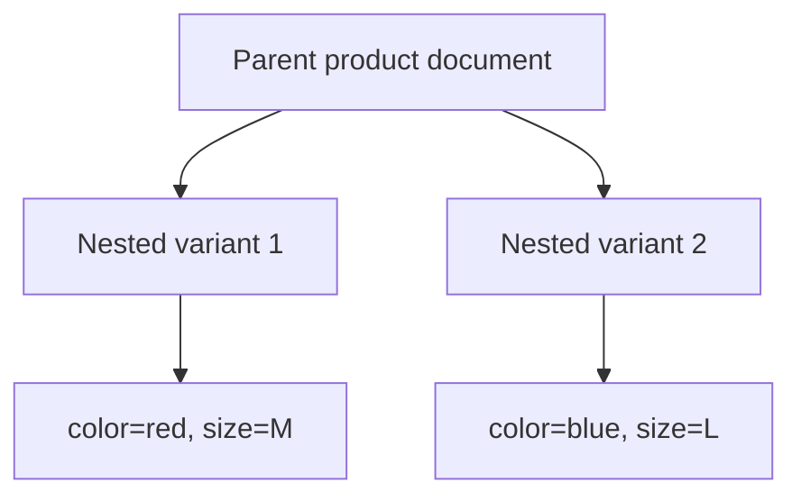

# Object và nested: bảo toàn cặp thuộc tính của phần tử con

Trong Elasticsearch, `object` và `nested` đều dùng để lưu cấu trúc JSON có các thuộc tính con. Khác biệt quan trọng xuất hiện khi một field chứa **mảng các object**. Với mapping `object` thông thường, Elasticsearch lập chỉ mục các giá trị con theo cách làm mất mối liên hệ giữa những thuộc tính thuộc cùng một phần tử mảng. Một truy vấn có thể vô tình ghép giá trị từ hai phần tử khác nhau và trả về document không đúng.

Mapping `nested` giữ mỗi phần tử object trong mảng thành một đơn vị nested riêng khi lập chỉ mục. Một `nested` query có thể yêu cầu nhiều điều kiện cùng khớp trên **cùng một phần tử con**. Đây là lựa chọn cần thiết khi quan hệ giữa các thuộc tính của từng phần tử có ý nghĩa nghiệp vụ, ví dụ màu và kích cỡ của cùng một biến thể sản phẩm, tên và giá của cùng một dòng hàng, hoặc người tham gia và vai trò trong cùng một bản ghi.

`nested` có chi phí lưu trữ và truy vấn cao hơn `object`, vì mỗi nested object được lập chỉ mục như một hidden Lucene document liên kết với document cha. Vì vậy, chỉ dùng nested khi cần bảo toàn quan hệ giữa các thuộc tính của từng phần tử; nếu chỉ cần lưu cấu trúc con và không cần ràng buộc nhiều field trên cùng phần tử, `object` thường đơn giản hơn.

## 1. Ví dụ: sản phẩm có nhiều biến thể

Giả sử một sản phẩm có hai biến thể:

```json
{
  "id": "product-1001",
  "name": "Áo khoác thể thao",
  "variants": [
    {
      "sku": "JACKET-RED-M",
      "color": "red",
      "size": "M",
      "price": 120,
      "available": true
    },
    {
      "sku": "JACKET-BLUE-L",
      "color": "blue",
      "size": "L",
      "price": 140,
      "available": true
    }
  ]
}
```

Mỗi phần tử trong `variants` là một object có nhiều thuộc tính. Mối liên hệ giữa các thuộc tính rất quan trọng:

- `JACKET-RED-M` có màu đỏ và kích cỡ M.
- `JACKET-BLUE-L` có màu xanh và kích cỡ L.

Người dùng tìm sản phẩm có một biến thể vừa màu đỏ vừa kích cỡ L. Sản phẩm trên **không** có biến thể đó. Màu đỏ thuộc phần tử thứ nhất, còn kích cỡ L thuộc phần tử thứ hai.

Nếu mapping dùng `object`, Elasticsearch có thể tìm document này khi query yêu cầu `color = red AND size = L`, vì các giá trị của hai field được lập chỉ mục riêng mà không giữ mối quan hệ phần tử. Đây là lỗi *cross-object matching*.

Nếu mapping dùng `nested` và hai điều kiện được đặt trong cùng một `nested` query, document trên sẽ không khớp vì không có một biến thể nào thỏa cả hai điều kiện.

## 2. Object mapping lưu mảng object như thế nào?

Mapping mặc định cho object thường có dạng:

```json
PUT /products-object
{
  "mappings": {
    "properties": {
      "name": {
        "type": "text"
      },
      "variants": {
        "type": "object",
        "properties": {
          "sku": { "type": "keyword" },
          "color": { "type": "keyword" },
          "size": { "type": "keyword" },
          "price": { "type": "double" },
          "available": { "type": "boolean" }
        }
      }
    }
  }
}
```

Khi index document ví dụ, `_source` vẫn giữ nguyên JSON array. Nhưng trong inverted index, Elasticsearch xử lý các giá trị con như những tập giá trị của field thuộc document cha. Có thể hình dung dữ liệu được trải phẳng thành:

```text
variants.sku       = [JACKET-RED-M, JACKET-BLUE-L]
variants.color     = [red, blue]
variants.size      = [M, L]
variants.price     = [120, 140]
variants.available = [true, true]
```

Thông tin “red đi cùng M” và “blue đi cùng L” không còn được bảo toàn trong cách truy vấn field thông thường. Elasticsearch biết document có `red` và có `L`, nhưng query object không thể yêu cầu hai giá trị đó đến từ cùng một phần tử mảng.

### 2.1 Query object có thể tạo kết quả sai

Ví dụ query:

```http
GET /products-object/_search
{
  "query": {
    "bool": {
      "filter": [
        { "term": { "variants.color": "red" } },
        { "term": { "variants.size": "L" } }
      ]
    }
  }
}
```

Query yêu cầu document có ít nhất một giá trị `red` trong `variants.color` và ít nhất một giá trị `L` trong `variants.size`. Hai điều kiện có thể được thỏa bởi hai phần tử khác nhau. Vì thế sản phẩm ví dụ có thể xuất hiện dù không có biến thể đỏ/L.

Đây không phải lỗi của bool query. Query đang thực hiện đúng semantics của object mapping: mỗi điều kiện kiểm tra tập giá trị của field trong document cha. Mapping `object` không cung cấp ràng buộc cùng phần tử mảng.

### 2.2 Khi object vẫn là lựa chọn phù hợp

Object phù hợp nếu:

- Cấu trúc con chỉ dùng để lưu hoặc hiển thị.
- Chỉ truy vấn từng field con độc lập.
- Không cần ràng buộc hai hay nhiều thuộc tính phải thuộc cùng một phần tử mảng.
- Mảng chỉ chứa scalar hoặc quan hệ giữa các phần tử không quan trọng.
- Muốn giảm số hidden document và chi phí nested query.

Ví dụ `address` là một object đơn chứa `city`, `district`, `street`; nếu chỉ có một địa chỉ và các điều kiện áp dụng trên cùng object đó, mapping object là đủ. Một mảng các nhãn hoặc mã độc lập cũng thường không cần nested.

## 3. Nested mapping bảo toàn quan hệ phần tử

Với mapping `nested`, Elasticsearch lập chỉ mục mỗi phần tử object như một nested document riêng và giữ liên kết với document cha.

Mapping:

```json
PUT /products-nested
{
  "mappings": {
    "properties": {
      "name": {
        "type": "text"
      },
      "variants": {
        "type": "nested",
        "properties": {
          "sku": { "type": "keyword" },
          "color": { "type": "keyword" },
          "size": { "type": "keyword" },
          "price": { "type": "double" },
          "available": { "type": "boolean" }
        }
      }
    }
  }
}
```

JSON `_source` vẫn giống document ban đầu. Điểm khác nằm ở cấu trúc index: mỗi phần tử `variants` được lưu như một nested Lucene document riêng, còn document sản phẩm là document cha. Nhờ vậy, Elasticsearch có thể kiểm tra điều kiện trên từng phần tử và chỉ trả document cha khi một nested document thỏa các điều kiện.



Với document có hai nested object, Elasticsearch cần lập chỉ mục ít nhất ba Lucene documents: một document cha và hai nested documents. Một mảng có nhiều nested object làm tăng số document nội bộ và chi phí index/search tương ứng.

## 4. Nested query: các điều kiện phải khớp cùng phần tử

Để tìm sản phẩm có một biến thể vừa màu đỏ vừa kích cỡ L, dùng `nested` query với `path` là `variants`. Đặt cả hai điều kiện bên trong cùng một bool query:

```http
GET /products-nested/_search
{
  "query": {
    "nested": {
      "path": "variants",
      "query": {
        "bool": {
          "filter": [
            { "term": { "variants.color": "red" } },
            { "term": { "variants.size": "L" } }
          ]
        }
      }
    }
  }
}
```

Elasticsearch đánh giá bool filter trên từng nested document thuộc `variants`. Một nested document phải đồng thời có `color = red` và `size = L`; sau đó document cha chứa nested document phù hợp mới được trả về.

Với hai biến thể trong ví dụ, nested document thứ nhất thỏa màu đỏ nhưng không thỏa size L; nested document thứ hai thỏa size L nhưng không thỏa màu đỏ. Không có nested document nào thỏa cả hai, nên sản phẩm không xuất hiện.

### 4.1 Đặt các điều kiện trong cùng nested query

Đây là điểm quan trọng nhất khi dùng nested. Cấu trúc đúng:

```json
{
  "nested": {
    "path": "variants",
    "query": {
      "bool": {
        "filter": [
          { "term": { "variants.color": "red" } },
          { "term": { "variants.size": "L" } }
        ]
      }
    }
  }
}
```

Hai điều kiện cùng được đánh giá trên một nested child.

Nếu viết thành hai nested query độc lập:

```json
{
  "bool": {
    "filter": [
      {
        "nested": {
          "path": "variants",
          "query": {
            "term": { "variants.color": "red" }
          }
        }
      },
      {
        "nested": {
          "path": "variants",
          "query": {
            "term": { "variants.size": "L" }
          }
        }
      }
    ]
  }
}
```

document cha có thể khớp nếu một nested child có màu đỏ và một nested child khác có size L. Cấu trúc này lại cho phép cross-object matching, dù mapping đã là nested. Muốn bảo toàn cặp thuộc tính, phải đặt các điều kiện cần cùng phần tử trong **một nested query**.

### 4.2 Kết hợp điều kiện cha và điều kiện con

Có thể lọc field của document cha ở ngoài nested query, đồng thời lọc thuộc tính biến thể ở trong:

```http
GET /products-nested/_search
{
  "query": {
    "bool": {
      "filter": [
        { "term": { "active": true } },
        {
          "nested": {
            "path": "variants",
            "query": {
              "bool": {
                "filter": [
                  { "term": { "variants.color": "red" } },
                  { "term": { "variants.size": "L" } },
                  { "term": { "variants.available": true } }
                ]
              }
            }
          }
        }
      ]
    }
  }
}
```

Document cha phải active và phải có ít nhất một nested variant vừa đỏ, vừa size L, vừa còn hàng. Các điều kiện cha/con được tách đúng scope.

### 4.3 Score mode

Nested query có `score_mode` để xác định cách score của nested documents đóng góp vào score document cha:

```json
{
  "nested": {
    "path": "variants",
    "score_mode": "max",
    "query": {
      "match": {
        "variants.description": "wireless"
      }
    }
  }
}
```

Các lựa chọn thường gặp gồm `avg`, `max`, `min`, `sum` và `none`. Với filter thuần túy, scoring thường không quan trọng; có thể dùng filter context. Khi nested query tham gia relevance scoring, chọn score mode theo cách muốn tổng hợp mức liên quan của các child documents.

## 5. Trả thông tin phần tử con bằng inner_hits

Nested query mặc định trả document cha phù hợp. Nếu giao diện cần biết chính xác biến thể nào đã khớp, dùng `inner_hits`:

```http
GET /products-nested/_search
{
  "query": {
    "nested": {
      "path": "variants",
      "query": {
        "bool": {
          "filter": [
            { "term": { "variants.color": "red" } },
            { "term": { "variants.size": "M" } }
          ]
        }
      },
      "inner_hits": {
        "name": "matching_variants",
        "size": 5
      }
    }
  }
}
```

Response có document cha trong `hits.hits[*]._source` và các nested hit khớp trong `hits.hits[*].inner_hits.matching_variants.hits.hits`. Nhờ đó ứng dụng có thể hiển thị đúng SKU/giá của biến thể đã thỏa điều kiện.

### 5.1 Inner hits không thay đổi `_source` của cha

`inner_hits` là metadata kết quả gắn với hit cha. Nó không biến nested object thành document độc lập trong index và không thay đổi JSON `_source` gốc. Có thể cấu hình source filtering, sort hoặc highlight riêng cho inner hits theo khả năng Search API.

### 5.2 Giới hạn số inner hits

Không nên trả tất cả nested child của mọi parent nếu mỗi document có hàng trăm hoặc hàng nghìn phần tử. Đặt `inner_hits.size` hợp lý, chỉ trả field cần thiết và cân nhắc chi phí response. Nếu cần duyệt toàn bộ phần tử con như dữ liệu độc lập, hãy xem xét mô hình hóa chúng thành index/document riêng.

## 6. Object và nested trong Spring Data Elasticsearch

Spring Data Elasticsearch ánh xạ kiểu thuộc tính Java sang mapping Elasticsearch bằng annotation. Một object có thể được khai báo tường minh là `FieldType.Object`; nested dùng `FieldType.Nested`.

### 6.1 Khai báo kiểu Java

Lớp con biểu diễn một biến thể:

```java
import org.springframework.data.elasticsearch.annotations.Field;
import org.springframework.data.elasticsearch.annotations.FieldType;

public class ProductVariant {

    @Field(type = FieldType.Keyword)
    private String sku;

    @Field(type = FieldType.Keyword)
    private String color;

    @Field(type = FieldType.Keyword)
    private String size;

    @Field(type = FieldType.Double)
    private Double price;

    @Field(type = FieldType.Boolean)
    private Boolean available;

    protected ProductVariant() {
    }

    // Constructors and accessors omitted for brevity.
}
```

Entity sản phẩm với nested variants:

```java
import java.util.List;

import org.springframework.data.annotation.Id;
import org.springframework.data.elasticsearch.annotations.Document;
import org.springframework.data.elasticsearch.annotations.Field;
import org.springframework.data.elasticsearch.annotations.FieldType;

@Document(indexName = "products")
public class Product {

    @Id
    private String id;

    @Field(type = FieldType.Text)
    private String name;

    @Field(type = FieldType.Boolean)
    private Boolean active;

    @Field(type = FieldType.Nested)
    private List<ProductVariant> variants;

    protected Product() {
    }

    // Constructors and accessors omitted for brevity.
}
```

Annotation `@Field(type = FieldType.Nested)` cho Spring Data biết `variants` phải được mapping thành nested. Nếu dùng `FieldType.Object` hoặc để mapping object mặc định, quan hệ giữa các phần tử của mảng không được bảo toàn cho nested query.

### 6.2 Khai báo object thông thường

Nếu không cần nested semantics, có thể khai báo:

```java
@Field(type = FieldType.Object)
private ProductVariant details;
```

Với một object con đơn, object mapping thường đủ nếu không cần truy vấn theo quan hệ giữa nhiều phần tử mảng. Với `List<ProductVariant>`, lựa chọn Object/Nested phải dựa trên việc có cần nhiều điều kiện khớp cùng một phần tử hay không.

### 6.3 Kiểm tra mapping thực tế

Sau khi tạo index, xác nhận field có `type: nested`:

```http
GET /products/_mapping
```

Kết quả mong đợi:

```json
{
  "properties": {
    "variants": {
      "type": "nested",
      "properties": {
        "sku": { "type": "keyword" },
        "color": { "type": "keyword" },
        "size": { "type": "keyword" },
        "price": { "type": "double" },
        "available": { "type": "boolean" }
      }
    }
  }
}
```

Không chỉ dựa vào annotation trong Java; hãy kiểm tra mapping được tạo thực tế, nhất là khi index đã tồn tại hoặc được quản lý bằng template/migration riêng.

## 7. Nested query trong Spring Data bằng NativeQuery

Với Spring Data Elasticsearch dùng Elasticsearch Java API Client, `NativeQuery` cho phép xây dựng nested query bằng typed query builder.

Ví dụ tìm sản phẩm có biến thể màu đỏ và size M:

```java
import co.elastic.clients.elasticsearch._types.FieldValue;
import org.springframework.data.elasticsearch.client.elc.NativeQuery;
import org.springframework.data.elasticsearch.core.query.Query;

Query query = NativeQuery.builder()
    .withQuery(q -> q.nested(n -> n
        .path("variants")
        .query(nq -> nq.bool(b -> b
            .filter(f -> f.term(t -> t
                .field("variants.color")
                .value(FieldValue.of("red"))
            ))
            .filter(f -> f.term(t -> t
                .field("variants.size")
                .value(FieldValue.of("M"))
            ))
        ))
    ))
    .build();
```

Hai term query nằm trong cùng một nested query với path `variants`, vì vậy phải khớp trên cùng nested child. Thực thi qua `ElasticsearchOperations`:

```java
SearchHits<Product> hits = operations.search(query, Product.class);
```

`SearchHits<Product>` chứa document cha `Product`. Nested child không được trả như một danh sách Product riêng; nếu cần nội dung biến thể khớp, cấu hình `inner_hits` và đọc metadata tương ứng.

### 7.1 Kết hợp nested và field cha

```java
Query query = NativeQuery.builder()
    .withQuery(q -> q.bool(b -> b
        .filter(f -> f.term(t -> t
            .field("active")
            .value(FieldValue.of(true))
        ))
        .filter(f -> f.nested(n -> n
            .path("variants")
            .query(nq -> nq.bool(nb -> nb
                .filter(v -> v.term(t -> t
                    .field("variants.color")
                    .value(FieldValue.of("red"))
                ))
                .filter(v -> v.term(t -> t
                    .field("variants.size")
                    .value(FieldValue.of("M"))
                ))
            ))
        ))
    ))
    .build();
```

Điều kiện `active` áp dụng trên document cha. Hai điều kiện color/size áp dụng trên cùng nested variant.

### 7.2 Repository method và nested query

Với truy vấn cố định, có thể khai báo Query DSL JSON qua `@Query` nếu phiên bản Spring Data Elasticsearch hỗ trợ cấu trúc đó:

```java
import org.springframework.data.elasticsearch.annotations.Query;
import org.springframework.data.elasticsearch.repository.ElasticsearchRepository;

public interface ProductRepository
        extends ElasticsearchRepository<Product, String> {

    @Query("{\"nested\":{\"path\":\"variants\",\"query\":{\"bool\":{\"filter\":[{\"term\":{\"variants.color\":\"?0\"}},{\"term\":{\"variants.size\":\"?1\"}}]}}}}")
    List<Product> findByVariantColorAndSize(String color, String size);
}
```

Placeholder binding và cách serialize tham số cần được xác nhận theo phiên bản dự án. Với nested query động hoặc nhiều điều kiện, `NativeQuery` thường dễ đọc, mở rộng và kiểm soát hơn một chuỗi JSON dài.

## 8. Nested sorting

Khi sort document cha theo một field trong nested object, Elasticsearch cần biết nested path và cách tổng hợp giá trị của các child. Ví dụ sản phẩm có nhiều variant và cần sort theo giá thấp nhất của các variant còn hàng:

```http
GET /products/_search
{
  "query": {
    "match_all": {}
  },
  "sort": [
    {
      "variants.price": {
        "order": "asc",
        "mode": "min",
        "nested": {
          "path": "variants",
          "filter": {
            "term": {
              "variants.available": true
            }
          }
        }
      }
    }
  ]
}
```

`nested.path` xác định nested field. `mode: min` chọn giá nhỏ nhất trong các child tham gia sort. Nested filter chỉ lấy variant còn hàng. Các mode như `min`, `max`, `avg`, `sum` hoặc `median` (tùy kiểu field và phiên bản) điều khiển cách tổng hợp nhiều giá trị.

Sort trên `variants.price` mà không khai báo nested context có thể thất bại hoặc không mang semantics mong muốn. Đây là một trong những lý do cần cân nhắc kỹ nested khi thiết kế query, sort và aggregation.

## 9. Nested aggregation

Aggregation trên field nested cần đi vào nested scope bằng nested aggregation. Ví dụ đếm số biến thể theo màu:

```http
GET /products/_search
{
  "size": 0,
  "aggs": {
    "variants_scope": {
      "nested": {
        "path": "variants"
      },
      "aggs": {
        "colors": {
          "terms": {
            "field": "variants.color"
          }
        }
      }
    }
  }
}
```

`variants_scope` chuyển aggregation context từ document cha sang nested documents. `colors` đếm nested variant theo màu, vì vậy `doc_count` ở đây là số nested child, không phải số product cha.

### 9.1 Quay lại scope document cha bằng reverse_nested

Nếu cần đếm số sản phẩm cha có variant theo màu, dùng `reverse_nested`:

```http
GET /products/_search
{
  "size": 0,
  "aggs": {
    "variants_scope": {
      "nested": {
        "path": "variants"
      },
      "aggs": {
        "by_color": {
          "terms": {
            "field": "variants.color"
          },
          "aggs": {
            "parent_products": {
              "reverse_nested": {}
            }
          }
        }
      }
    }
  }
}
```

`by_color` đếm nested variants theo màu. `parent_products.doc_count` đếm số document cha liên quan tới từng bucket màu. Hai con số có thể khác nhau vì một product có thể có nhiều variant cùng màu.

## 10. Cập nhật nested object

Nested object không phải document độc lập mà ứng dụng có thể cập nhật bằng một `_id` riêng. Nested child được lưu nội bộ và gắn với document cha. Khi cập nhật một nested element, thao tác thông thường vẫn là cập nhật/index lại document cha chứa mảng nested.

Ví dụ thay đổi giá một variant:

1. Đọc product hoặc lấy dữ liệu chuẩn từ nguồn nghiệp vụ.
2. Tìm variant có SKU tương ứng trong mảng.
3. Thay đổi giá trong object Java.
4. Ghi document cha theo luồng cập nhật đã thiết kế.

Nếu document cha lớn hoặc nhiều request đồng thời cập nhật các variant khác nhau, cần xem xét concurrency và chi phí reindex toàn bộ parent. Nested phù hợp khi các child có quan hệ chặt và thường được đọc/truy vấn cùng parent. Nếu child cần cập nhật độc lập với tần suất cao, mô hình hóa mỗi child thành document riêng có thể phù hợp hơn.

### 10.1 Không dùng nested để thay thế quan hệ độc lập

Nếu biến thể có vòng đời, quyền truy cập, transaction hoặc lượng dữ liệu riêng biệt, index riêng cho biến thể có thể dễ quản lý hơn. Có thể lưu `productId` làm khóa liên kết và query nhiều bước hoặc dùng application-level join. Elasticsearch không cung cấp join tùy ý giữa các index như cơ sở dữ liệu quan hệ.

Nested tối ưu cho việc tìm document cha theo điều kiện trên các object con liên quan; nó không biến Elasticsearch thành relational database.

## 11. Chuyển mapping từ object sang nested

Một field đã được tạo mapping `object` không thể đổi trực tiếp thành `nested` bằng update mapping. Hai kiểu có cách lập chỉ mục khác nhau. Nếu cần chuyển đổi:

1. Tạo index mới với mapping nested.
2. Reindex document từ index cũ sang index mới.
3. Kiểm tra query nested trên dữ liệu mới.
4. Chuyển alias/ứng dụng sang index mới theo kế hoạch migration.
5. Ngừng index cũ sau khi xác nhận các consumer đã chuyển.

Ví dụ tạo index mới:

```http
PUT /products-v2
{
  "mappings": {
    "properties": {
      "name": {
        "type": "text"
      },
      "variants": {
        "type": "nested",
        "properties": {
          "sku": { "type": "keyword" },
          "color": { "type": "keyword" },
          "size": { "type": "keyword" },
          "price": { "type": "double" },
          "available": { "type": "boolean" }
        }
      }
    }
  }
}
```

Reindex:

```http
POST /_reindex
{
  "source": {
    "index": "products-v1"
  },
  "dest": {
    "index": "products-v2"
  }
}
```

Nếu `_source` của index cũ giữ nguyên JSON array, reindex có thể dùng nội dung đó để tạo nested documents trong index mới theo mapping đích. Tuy nhiên, cần kiểm tra kết quả và xử lý các lỗi mapping/dữ liệu trước khi chuyển alias.

### 11.1 Alias switch

Nếu ứng dụng đọc qua alias, có thể chuyển alias trong một thao tác `_aliases`:

```http
POST /_aliases
{
  "actions": [
    { "remove": { "index": "products-v1", "alias": "products" } },
    { "add": { "index": "products-v2", "alias": "products" } }
  ]
}
```

Alias giúp chuyển index vật lý mà không phải đổi tên index trong mọi consumer. Trước khi switch, cần đồng bộ dữ liệu ghi mới phát sinh trong lúc reindex, hoặc có kế hoạch dual-write/cutover phù hợp; reindex đơn giản không tự đồng bộ các thay đổi sau thời điểm đọc từng document.

## 12. Chi phí và giới hạn của nested

Nested giải quyết yêu cầu tương quan phần tử, nhưng có chi phí:

- Mỗi nested object trở thành hidden Lucene document, làm tăng số lượng document nội bộ.
- Indexing và cập nhật document cha có thể tốn thêm công việc.
- Nested query, nested sort và nested aggregation phức tạp hơn query field phẳng.
- `inner_hits` có thể làm response lớn và tăng chi phí.
- Có các giới hạn cấu hình như số nested field và số nested objects trên một document; giá trị cụ thể phụ thuộc phiên bản/setting Elasticsearch.
- Nested không cung cấp khả năng cập nhật từng child độc lập như document riêng.

Không nên biến mọi object thành nested theo mặc định. Hãy chọn nested cho các mảng object mà nghiệp vụ cần điều kiện nhiều field trên cùng một phần tử. Với cấu trúc con đơn giản, object thường đủ và nhẹ hơn.

### 12.1 Nested hay index riêng?

| Tiêu chí | Object | Nested | Child thành document riêng |
|---|---|---|---|
| Giữ quan hệ field trong cùng phần tử mảng khi query | Không | Có | Có, theo document riêng |
| Truy vấn document cha theo điều kiện con | Có thể cross-match | Có nested query | Cần thiết kế query/liên kết ở ứng dụng |
| Cập nhật từng phần tử độc lập | Không | Không trực tiếp | Có |
| Chi phí index | Thấp hơn | Cao hơn do hidden docs | Tùy số lượng document và mapping |
| Phù hợp | Cấu trúc con không cần correlation | Child gắn chặt với parent | Child có vòng đời/khối lượng độc lập |

## 13. Những lỗi thường gặp

### 13.1 Dùng object array nhưng cần điều kiện cùng phần tử

Nếu query cần `color = red AND size = L` trên cùng một variant, object mapping không bảo đảm điều đó. Dùng nested mapping và một nested query chứa cả hai điều kiện.

### 13.2 Có nested mapping nhưng query field như field object

Không thể chỉ query `variants.color` bằng term query ở root và mong semantics nested. Phải bọc điều kiện trong `nested` query với đúng `path`.

### 13.3 Tách điều kiện thành nhiều nested query độc lập

Hai nested query riêng có thể khớp hai child khác nhau. Nếu các điều kiện phải thuộc cùng một child, đặt chúng trong cùng một nested query và cùng bool group.

### 13.4 Nhầm nested hit với parent hit

Nested query trả document cha. Muốn xem nested child nào khớp, bật `inner_hits` và đọc metadata inner hits.

### 13.5 Quên nested context khi sort hoặc aggregation

Sort trên nested field cần nested path/mode/filter. Aggregation trên nested field cần nested aggregation; muốn đếm lại parent document thì dùng `reverse_nested`.

### 13.6 Nghĩ nested child có `_id` độc lập

Nested object là phần của document cha, không phải một document độc lập trong API CRUD thông thường. Nếu child cần update/get/delete độc lập, hãy cân nhắc index riêng.

### 13.7 Đổi object thành nested trực tiếp

Không thể đổi type field hiện có bằng update mapping. Tạo index mới và reindex dữ liệu.

### 13.8 Không kiểm tra mapping đã tạo

Annotation Java không bảo đảm index hiện tại đã có mapping nested nếu index được tạo từ trước hoặc do template quản lý. Kiểm tra `_mapping` thực tế.

## 14. Kiểm tra bằng dữ liệu phản ví dụ

Để xác nhận mapping có bảo toàn quan hệ phần tử, tạo một document có hai child mà mỗi child chỉ thỏa một nửa điều kiện:

```json
PUT /products-nested/_doc/product-1001
{
  "name": "Áo khoác thể thao",
  "variants": [
    { "sku": "RED-M", "color": "red", "size": "M" },
    { "sku": "BLUE-L", "color": "blue", "size": "L" }
  ]
}
```

Chạy nested query tìm đỏ/L:

```http
GET /products-nested/_search
{
  "query": {
    "nested": {
      "path": "variants",
      "query": {
        "bool": {
          "filter": [
            { "term": { "variants.color": "red" } },
            { "term": { "variants.size": "L" } }
          ]
        }
      }
    }
  }
}
```

Kết quả không được chứa `product-1001`. Tiếp theo, tìm đỏ/M; sản phẩm phải được trả về và `inner_hits` (nếu bật) phải chỉ ra `RED-M`.

Đây là dữ liệu phản ví dụ quan trọng vì nó phân biệt rõ object flattening với nested correlation. Nếu chỉ test document có một child hoặc mọi child đều có cùng giá trị, cả hai mapping có thể cho kết quả giống nhau và lỗi cross-match không lộ ra.

## 15. Nguyên tắc lựa chọn và triển khai

- Dùng `object` cho cấu trúc JSON con khi không cần điều kiện nhiều field phải thuộc cùng một phần tử mảng.
- Dùng `nested` cho mảng object khi cần bảo toàn cặp/nhóm thuộc tính của từng phần tử.
- Đặt các điều kiện cần cùng child trong một `nested` query với cùng `path`.
- Không tách điều kiện tương quan thành nhiều nested query độc lập.
- Dùng `inner_hits` khi cần biết child nào làm parent document khớp.
- Dùng nested sort với path/mode/filter phù hợp; dùng nested aggregation để phân tích child và `reverse_nested` để quay lại parent scope.
- Trong Spring Data, khai báo `@Field(type = FieldType.Nested)` và kiểm tra mapping thực tế.
- Dùng `NativeQuery`/Elasticsearch Java Client cho nested query phức tạp; dùng repository `@Query` khi truy vấn cố định và dễ đọc.
- Nhớ nested child không phải document độc lập; cập nhật thường tác động document cha.
- Reindex sang index mới khi chuyển field từ object sang nested.
- Đo chi phí nested object, inner hits, sort và aggregation trước khi dùng trên dữ liệu lớn.
- Nếu child có vòng đời và thao tác độc lập, cân nhắc mô hình hóa child thành document riêng.

## 16. Tổng kết

`object` và `nested` đều biểu diễn cấu trúc JSON có thuộc tính con, nhưng khác nhau trong cách Elasticsearch lập chỉ mục mảng object. Object mapping làm phẳng các giá trị con theo field, nên query có thể ghép `color = red` từ phần tử này với `size = L` từ phần tử khác. Khi quan hệ giữa các thuộc tính trong cùng một phần tử có ý nghĩa, cách đó tạo ra kết quả sai về nghiệp vụ.

Nested mapping lưu mỗi phần tử object thành nested Lucene document riêng. Một nested query với các điều kiện đặt chung trong cùng bool group bảo đảm tất cả điều kiện phải khớp trên cùng nested child. `inner_hits` cho biết child nào khớp; nested sort và nested aggregation cần scope/path riêng. Trong Spring Data Elasticsearch, khai báo bằng `@Field(type = FieldType.Nested)` và xây dựng truy vấn qua `NativeQuery` hoặc Query DSL tương ứng.

Nested có chi phí lưu trữ và truy vấn cao hơn object, không tạo child document có vòng đời CRUD độc lập và không thể đổi mapping object hiện có trực tiếp thành nested. Hãy chọn nested khi cần bảo toàn quan hệ phần tử, kiểm tra mapping thực tế và reindex sang index mới khi thay đổi loại field. Nếu child cần được quản lý độc lập, một index riêng có thể phù hợp hơn.

## Tài liệu tham khảo

- [Elasticsearch — Object field type](https://www.elastic.co/guide/en/elasticsearch/reference/current/object.html)
- [Elasticsearch — Nested field type](https://www.elastic.co/guide/en/elasticsearch/reference/current/nested.html)
- [Elasticsearch — Nested query](https://www.elastic.co/guide/en/elasticsearch/reference/current/query-dsl-nested-query.html)
- [Elasticsearch — Nested aggregation](https://www.elastic.co/guide/en/elasticsearch/reference/current/search-aggregations-bucket-nested-aggregation.html)
- [Elasticsearch — Nested sorting](https://www.elastic.co/guide/en/elasticsearch/reference/current/sort-search-results.html#nested-sorting)
- [Spring Data Elasticsearch Reference](https://docs.spring.io/spring-data/elasticsearch/reference/index.html)
