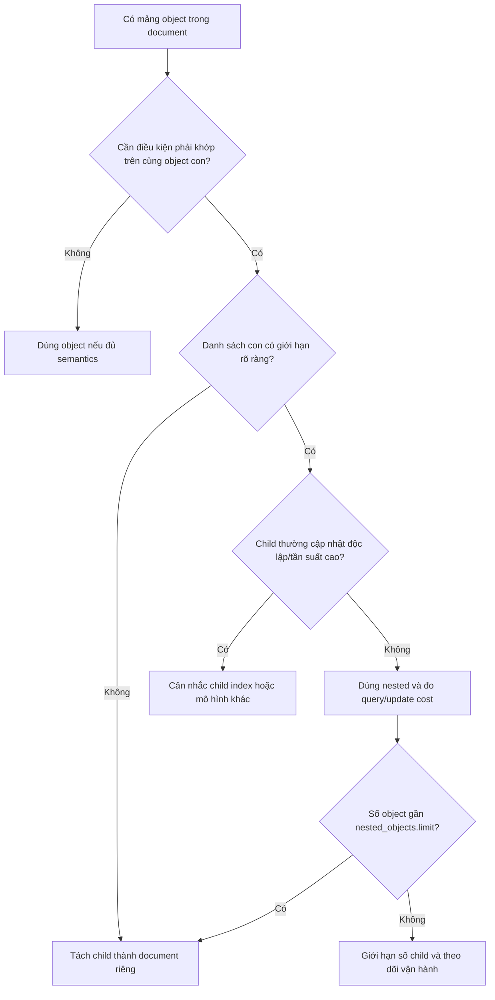

# Giới hạn số đối tượng nested và chi phí cập nhật

Trong Elasticsearch, `nested` mapping giúp giữ mối liên hệ giữa các thuộc tính của từng object nằm trong một mảng. Đây là lựa chọn cần thiết khi một document chứa nhiều object con và truy vấn phải bảo đảm các điều kiện cùng khớp trên **một object con cụ thể**. Tuy nhiên, nested không miễn phí: Elasticsearch lưu mỗi nested object như một Lucene document ẩn, làm tăng kích thước index, chi phí truy vấn và đặc biệt là chi phí cập nhật.

Spring Data Elasticsearch cho phép khai báo nested field bằng `@Field(type = FieldType.Nested)`. Khi thiết kế entity, cần cân nhắc số lượng nested object trong mỗi document, số nested mapping khác nhau trong index, tần suất cập nhật và cách ứng dụng truy vấn dữ liệu con.

Hai giới hạn quan trọng thường bị nhầm lẫn:

- `index.mapping.nested_fields.limit`: giới hạn số **nested field mapping khác nhau** trong một index.
- `index.mapping.nested_objects.limit`: giới hạn tổng số **nested object trong một document**.

Theo cấu hình mặc định phổ biến của Elasticsearch, hai giới hạn này lần lượt là 50 nested field mapping và 10.000 nested object trên mỗi document. Giá trị thực tế cần kiểm tra theo phiên bản và cấu hình index đang chạy.

## 1. Vì sao cần nested mapping?

Giả sử một đơn hàng có nhiều dòng hàng. Mỗi dòng có `productId`, `quantity` và `unitPrice`:

```json
{
  "orderId": "ORD-1001",
  "items": [
    {
      "productId": "P-100",
      "quantity": 2,
      "unitPrice": 150000
    },
    {
      "productId": "P-200",
      "quantity": 10,
      "unitPrice": 50000
    }
  ]
}
```

Ứng dụng cần tìm đơn hàng có một dòng chứa sản phẩm `P-100` với số lượng ít nhất 5. Điều kiện phải khớp trên cùng một phần tử `items`.

Nếu `items` được mapping thành `object` thông thường, Elasticsearch flatten các giá trị của mảng object thành các field đa trị. Thông tin quan hệ giữa các thuộc tính trong từng object con không còn được giữ để truy vấn theo từng object. Một query có thể khớp `productId = P-100` từ dòng thứ nhất và `quantity >= 5` từ dòng thứ hai, dù không có dòng hàng nào thỏa cả hai điều kiện.

`nested` giải quyết vấn đề này bằng cách index từng object con như một document riêng, đồng thời giữ liên kết với document cha. Nested query có thể yêu cầu các điều kiện cùng khớp trên một nested object.

## 2. Khai báo nested trong Spring Data Elasticsearch

Ví dụ entity đơn hàng:

```java
package com.example.orders.document;

import java.util.List;

import org.springframework.data.annotation.Id;
import org.springframework.data.elasticsearch.annotations.Document;
import org.springframework.data.elasticsearch.annotations.Field;
import org.springframework.data.elasticsearch.annotations.FieldType;

@Document(indexName = "orders")
public class OrderDocument {

    @Id
    private String id;

    @Field(type = FieldType.Keyword)
    private String orderId;

    @Field(type = FieldType.Keyword)
    private String status;

    @Field(type = FieldType.Nested)
    private List<OrderItem> items;

    protected OrderDocument() {
    }

    public OrderDocument(
            String id,
            String orderId,
            String status,
            List<OrderItem> items) {
        this.id = id;
        this.orderId = orderId;
        this.status = status;
        this.items = items;
    }

    public String getId() {
        return id;
    }

    public List<OrderItem> getItems() {
        return items;
    }
}
```

Class object con:

```java
package com.example.orders.document;

import org.springframework.data.elasticsearch.annotations.Field;
import org.springframework.data.elasticsearch.annotations.FieldType;

public class OrderItem {

    @Field(type = FieldType.Keyword)
    private String productId;

    @Field(type = FieldType.Integer)
    private Integer quantity;

    @Field(type = FieldType.Long)
    private Long unitPrice;

    protected OrderItem() {
    }

    public OrderItem(String productId, Integer quantity, Long unitPrice) {
        this.productId = productId;
        this.quantity = quantity;
        this.unitPrice = unitPrice;
    }

    public String getProductId() {
        return productId;
    }

    public Integer getQuantity() {
        return quantity;
    }

    public Long getUnitPrice() {
        return unitPrice;
    }
}
```

`@Field(type = FieldType.Nested)` đặt mapping của `items` thành `nested`. Các field bên trong `OrderItem` có mapping riêng như `keyword`, `integer` và `long`.

Mapping Elasticsearch tương ứng có dạng:

```json
PUT orders
{
  "mappings": {
    "properties": {
      "orderId": { "type": "keyword" },
      "status": { "type": "keyword" },
      "items": {
        "type": "nested",
        "properties": {
          "productId": { "type": "keyword" },
          "quantity": { "type": "integer" },
          "unitPrice": { "type": "long" }
        }
      }
    }
  }
}
```

Spring Data có thể tạo mapping từ metadata entity thông qua `IndexOperations`:

```java
IndexOperations indexOperations = operations.indexOps(OrderDocument.class);

if (!indexOperations.exists()) {
    indexOperations.createWithMapping();
}
```

Trong production, index mapping nên được quản lý qua migration hoặc quy trình provisioning có kiểm soát. Không để nhiều instance ứng dụng tự tạo index đồng thời khi khởi động.

## 3. `object` và `nested` khác nhau như thế nào?

`object` là kiểu mapping mặc định cho object JSON. Khi một field là mảng object, Elasticsearch flatten các thuộc tính của những object đó thành các giá trị đa trị. `nested` tạo document con riêng cho từng object và giữ quan hệ giữa các thuộc tính của cùng object.

| Tiêu chí | `object` | `nested` |
|---|---|---|
| Cách index | Field của các object được flatten | Mỗi object con được index thành Lucene document ẩn |
| Giữ quan hệ giữa field trong cùng object | Không giữ semantics truy vấn theo từng object | Có |
| Truy vấn | Term/range query thông thường trên field | Cần nested query để truy vấn object con |
| Aggregation | Aggregation thông thường | Nested aggregation để đi vào nested documents |
| Chi phí index | Thấp hơn trong nhiều trường hợp | Cao hơn do có thêm Lucene documents |
| Chi phí update | Update document gốc vẫn reindex document | Update document gốc và toàn bộ nested block liên quan |
| Khi dùng | Không cần ràng buộc điều kiện trên cùng object con | Cần truy vấn các thuộc tính cùng thuộc một object con |

Không nên khai báo mọi object thành `nested` theo thói quen. Nếu chỉ cần lưu metadata và không cần giữ quan hệ giữa các field trong từng phần tử, `object` thường đơn giản và tiết kiệm hơn.

## 4. Nested object được lưu như thế nào?

Một nested object không phải một bảng con độc lập như trong cơ sở dữ liệu quan hệ. Elasticsearch index mỗi nested object thành một Lucene document riêng và nhóm các document con với document cha trong cùng một block.

Ví dụ một order có 3 phần tử `items`:

```text
Order document
  ├── Item nested document 1
  ├── Item nested document 2
  └── Item nested document 3
```

Về mặt Lucene, block này có một document cha và ba document nested. Một index có nhiều order, mỗi order có nhiều item, sẽ tạo ra lượng Lucene document lớn hơn đáng kể so với số order mà ứng dụng nhìn thấy.

Nếu một document chứa 2.000 nested object, riêng document đó có thể tương ứng với hàng nghìn Lucene document bổ sung. Điều này ảnh hưởng đến:

- Dung lượng index và số lượng document nội bộ.
- Chi phí index và refresh.
- Segment merge và I/O.
- Heap và cấu trúc dữ liệu dùng cho query.
- Chi phí nested query, nested aggregation và nested sort.
- Kích thước `_source` và payload phải serialize/deserialize khi đọc hoặc cập nhật.

Vì vậy, cần giới hạn số nested object trong từng root document và cân nhắc mô hình dữ liệu nếu danh sách con có thể tăng không giới hạn.

## 5. Hai giới hạn nested cần phân biệt

### 5.1. `index.mapping.nested_fields.limit`

Setting này giới hạn số nested field mapping khác nhau trong một index. Giá trị mặc định phổ biến là `50`.

Ví dụ một mapping có các nested path:

```json
{
  "properties": {
    "items": { "type": "nested" },
    "shipments": { "type": "nested" },
    "payments": { "type": "nested" }
  }
}
```

Ở đây có ba nested field mapping khác nhau: `items`, `shipments` và `payments`. Một document có 100 phần tử `items` không làm số nested field mapping tăng thành 100; đó là vấn đề của giới hạn nested object per document.

Mapping động có thể vô tình tạo ra nhiều nested path khác nhau nếu schema được sinh từ nhiều loại object hoặc field tùy biến. Cần thiết kế một số ít nested path ổn định, không tạo nested mapping mới theo từng loại dữ liệu hoặc tenant.

### 5.2. `index.mapping.nested_objects.limit`

Setting này giới hạn tổng số nested object trong một document, tính trên các nested type. Giá trị mặc định phổ biến là `10.000` nested object cho mỗi document.

Ví dụ:

- Một order có 100 `items`: 100 nested object.
- Một order có 4 shipment và 100 item: tổng số nested object của document có thể là 104.
- Một document có nhiều nested path: tổng object trên các path đều góp vào giới hạn của document đó.

Giới hạn này áp dụng theo từng document, không phải tổng số nested object của toàn index. Một index có thể chứa rất nhiều nested object phân bố trên nhiều document mà không vi phạm giới hạn per-document; nhưng tổng số đó vẫn làm tăng kích thước và chi phí vận hành index.

### 5.3. Bảng so sánh nhanh

| Setting | Đếm gì? | Phạm vi | Mặc định phổ biến |
|---|---|---|---:|
| `index.mapping.nested_fields.limit` | Số nested field mapping khác nhau | Một index | 50 |
| `index.mapping.nested_objects.limit` | Tổng số nested object instances | Một document | 10.000 |

Không nhầm hai setting này với `index.mapping.total_fields.limit`, vốn giới hạn tổng số field mapping. Một mapping có ít nested path nhưng mỗi document có hàng chục nghìn nested object có thể chạm `nested_objects.limit`; ngược lại, mapping có quá nhiều nested path có thể chạm `nested_fields.limit` dù mỗi document chỉ chứa một vài object con.

## 6. Cấu hình và kiểm tra nested limits

Có thể khai báo giới hạn trong index settings khi tạo index:

```json
PUT orders-v1
{
  "settings": {
    "index.mapping.nested_fields.limit": 20,
    "index.mapping.nested_objects.limit": 3000
  },
  "mappings": {
    "properties": {
      "items": {
        "type": "nested",
        "properties": {
          "productId": { "type": "keyword" },
          "quantity": { "type": "integer" }
        }
      }
    }
  }
}
```

Các con số `20` và `3000` chỉ minh họa một chính sách giới hạn chặt hơn mặc định. Không nên sao chép chúng mà chưa đo kích thước document và workload thực tế.

Đọc settings của index:

```http
GET orders-v1/_settings?include_defaults=true
```

Kiểm tra mapping:

```http
GET orders-v1/_mapping
```

Settings và khả năng cập nhật động/phải đóng index có thể khác theo phiên bản Elasticsearch. Hãy xác minh tài liệu của phiên bản cluster trước khi thay đổi. Tăng limit không làm query hoặc update nhanh hơn; nó chỉ cho phép index chấp nhận cấu trúc lớn hơn và có thể làm tăng rủi ro sử dụng tài nguyên.

### 6.1. Không tăng limit để che vấn đề mô hình dữ liệu

Nếu một document chứa 50.000 phần tử nested, câu hỏi đầu tiên nên là liệu 50.000 phần tử đó có thực sự thuộc cùng một document hay không. Có thể đây là dữ liệu lịch sử, log, giao dịch hoặc child records nên được lưu thành document độc lập.

Chỉ tăng `nested_objects.limit` khi:

- Có lý do nghiệp vụ rõ ràng cần giữ toàn bộ child objects trong một root document.
- Kích thước tối đa đã được xác định và đo kiểm.
- Query/update latency và index size đã được kiểm thử ở tải gần production.
- Có giới hạn đầu vào để client không thể tạo document lớn tùy ý.
- Cluster có đủ tài nguyên và có kế hoạch theo dõi sau thay đổi.

## 7. Nested query và chi phí truy vấn

Để truy vấn field trong nested path, phải dùng `nested` query. Ví dụ tìm order có một item `productId = P-100` và `quantity >= 5`:

```json
GET orders/_search
{
  "query": {
    "nested": {
      "path": "items",
      "query": {
        "bool": {
          "filter": [
            { "term": { "items.productId": "P-100" } },
            { "range": { "items.quantity": { "gte": 5 } } }
          ]
        }
      },
      "inner_hits": {
        "size": 5
      }
    }
  }
}
```

Hai điều kiện được áp dụng trên cùng một nested object trong `items`. `inner_hits` yêu cầu trả thêm các nested object đã khớp. Nếu không cần hiển thị dòng hàng khớp, có thể bỏ `inner_hits` để giảm response payload.

Nested query có chi phí cao hơn query thông thường vì Elasticsearch phải thực hiện quan hệ giữa nested documents và parent documents. Khi có nhiều nested object trên mỗi root document, query cần xét nhiều Lucene document hơn.

Các yếu tố ảnh hưởng chi phí:

- Số lượng nested object trung bình và tối đa trên mỗi document.
- Số shard và kích thước index.
- Số nested clause trong query.
- Số field được filter/sort bên trong nested path.
- Việc dùng `inner_hits` và số lượng inner hit trả về.
- Nested aggregation và độ lớn của bucket tree.

Hãy giới hạn `inner_hits.size`, page size và số nested path mà query sử dụng. Không trả hàng nghìn nested object trong mỗi hit nếu giao diện chỉ cần một vài dòng phù hợp.

### 7.1. Dùng nested query qua NativeQuery

Trong Spring Data Elasticsearch, có thể xây dựng nested query bằng builder của Elasticsearch Java API Client:

```java
import co.elastic.clients.elasticsearch._types.FieldValue;
import org.springframework.data.elasticsearch.client.elc.NativeQuery;
import org.springframework.data.elasticsearch.core.SearchHits;
import org.springframework.data.elasticsearch.core.query.Query;

Query query = NativeQuery.builder()
    .withQuery(q -> q
        .nested(n -> n
            .path("items")
            .query(nq -> nq
                .term(t -> t
                    .field("items.productId")
                    .value(FieldValue.of("P-100"))
                )
            )
        )
    )
    .build();

SearchHits<OrderDocument> hits = operations.search(
    query,
    OrderDocument.class
);
```

Ví dụ tập trung vào điều kiện exact match. Khi cần kết hợp nhiều điều kiện trên cùng nested object, đặt chúng trong một `bool` bên trong `nested.query`, giống JSON DSL ở phần trước. Các tên builder có thể thay đổi theo phiên bản Java API Client; ý nghĩa quan trọng là `path` phải là nested path đã mapping.

## 8. Nested aggregation cũng có chi phí riêng

Nếu cần thống kê theo field trong nested object, dùng nested aggregation để chuyển phạm vi tính toán vào nested documents.

Ví dụ đếm số dòng hàng theo `productId`:

```json
GET orders/_search
{
  "size": 0,
  "aggs": {
    "order_items": {
      "nested": {
        "path": "items"
      },
      "aggs": {
        "products": {
          "terms": {
            "field": "items.productId",
            "size": 20
          }
        }
      }
    }
  }
}
```

Aggregation `products` đếm nested documents theo `productId`, không phải số order cha. Nếu cần quay lại phạm vi order để đếm parent document, có thể dùng `reverse_nested` aggregation.

Nested aggregation trên tập dữ liệu lớn, nhiều nested object hoặc nhiều bucket có thể tốn tài nguyên. Giới hạn bucket size, chỉ yêu cầu facet cần thiết và đo latency trên dữ liệu đại diện.

## 9. Chi phí cập nhật nested object

Đây là phần quan trọng khi thiết kế mô hình dữ liệu. Elasticsearch là search engine dựa trên Lucene; document đã index không được sửa tại chỗ như một hàng trong cơ sở dữ liệu quan hệ. Khi cập nhật một document, Elasticsearch tạo phiên bản document mới và đánh dấu phiên bản cũ để xóa theo cơ chế Lucene.

Với nested mapping, một root document cùng các nested documents của nó được lưu như một block. Khi cập nhật root document, Elasticsearch phải ghi lại root và nested objects liên quan trong block đó.

Ví dụ một order có 2.000 items. Nếu chỉ thay đổi `quantity` của một item, thao tác cập nhật vẫn có thể phải reindex toàn bộ order cùng các nested documents, không chỉ một nested object duy nhất.

Điều này dẫn tới:

- Tăng lượng dữ liệu phải serialize và gửi tới Elasticsearch.
- Tăng công việc indexing và ghi segment.
- Tăng write amplification khi chỉ một child field thay đổi.
- Tăng merge pressure và I/O khi cập nhật thường xuyên.
- Tăng nguy cơ xung đột ghi nếu nhiều tác vụ cùng cập nhật một root document.

### 9.1. `save` cập nhật cả aggregate

Ví dụ service đọc order, sửa một item rồi lưu lại:

```java
OrderDocument order = orderRepository.findById(orderId)
    .orElseThrow();

List<OrderItem> updatedItems = order.getItems().stream()
    .map(item -> item.getProductId().equals(productId)
        ? new OrderItem(item.getProductId(), newQuantity, item.getUnitPrice())
        : item)
    .toList();

OrderDocument updated = new OrderDocument(
    order.getId(),
    order.getOrderId(),
    order.getStatus(),
    updatedItems
);

orderRepository.save(updated);
```

Đây là cách làm rõ ràng khi order là một aggregate nhỏ và được cập nhật như một đơn vị. Tuy nhiên, với danh sách nested lớn, chi phí ghi lại toàn bộ aggregate có thể đáng kể.

### 9.2. Partial update không biến nested object thành hàng độc lập

Elasticsearch Update API có thể nhận partial document hoặc script để sửa một phần `_source`. API này giúp ứng dụng không phải tự đọc document rồi ghép lại ở client trong một số trường hợp, nhưng về bản chất Elasticsearch vẫn phải tạo phiên bản document mới trong Lucene.

Vì vậy, partial update không có nghĩa chỉ một nested Lucene document được sửa tại chỗ. Nếu root document chứa nhiều nested object, việc cập nhật một phần tử vẫn có thể reindex toàn bộ root/nested block.

Scripted update có thể giảm round trip ứng dụng nhưng không loại bỏ write amplification. Bulk API giảm số request mạng khi cập nhật nhiều document, nhưng không thay đổi chi phí cập nhật từng root document có nested array lớn.

## 10. Tần suất cập nhật ảnh hưởng đến lựa chọn nested

Nested thường phù hợp khi:

- Danh sách object con có giới hạn rõ ràng.
- Object con được đọc cùng parent trong phần lớn use case.
- Cần query nhiều thuộc tính trên cùng một object con.
- Parent và children thường được tạo/cập nhật cùng nhau.
- Tần suất cập nhật thấp hoặc vừa phải so với tần suất đọc.

Nested kém phù hợp khi:

- Danh sách con tăng không giới hạn theo thời gian.
- Mỗi child được cập nhật độc lập và thường xuyên.
- Một root document chứa hàng chục nghìn hoặc hàng trăm nghìn child records.
- Nhiều request đồng thời sửa các child khác nhau trong cùng một root document.
- Use case chủ yếu tìm kiếm từng child độc lập thay vì truy vấn parent cùng child.

Ví dụ, `items` của một order thường có số lượng hữu hạn và được đọc cùng order, nên nested có thể phù hợp. Ngược lại, lịch sử sự kiện, audit log hoặc giao dịch phát sinh liên tục không nên tích lũy vô hạn trong một nested array của một document.

## 11. Chiến lược thay thế khi nested quá lớn hoặc cập nhật thường xuyên

### 11.1. Dùng `object` nếu không cần quan hệ trong cùng phần tử

Nếu ứng dụng chỉ hiển thị các thuộc tính và không cần query nhiều điều kiện phải khớp cùng một object con, mapping `object` có thể đáp ứng với chi phí thấp hơn.

Ví dụ metadata đơn giản:

```json
{
  "attributes": [
    { "name": "color", "value": "black" },
    { "name": "material", "value": "plastic" }
  ]
}
```

Nếu không cần đảm bảo `name` và `value` thuộc cùng object trong query, có thể chọn object mapping. Nếu cần tìm chính xác một cặp thuộc tính trên cùng phần tử, nested mới giữ được semantics đó.

### 11.2. Tách child thành document riêng

Nếu mỗi item cần cập nhật và tìm kiếm độc lập, có thể lưu mỗi item thành document trong index riêng:

```json
{
  "orderId": "ORD-1001",
  "productId": "P-100",
  "quantity": 2,
  "unitPrice": 150000
}
```

Khi đó, một item có thể được cập nhật mà không phải reindex toàn bộ order cùng các item khác. Đổi lại, truy vấn cần join ở tầng ứng dụng hoặc denormalize dữ liệu cần thiết vào child document.

Thiết kế này phù hợp khi:

- Child record có vòng đời riêng.
- Child được cập nhật thường xuyên.
- Số lượng child không có giới hạn nhỏ.
- Search chủ yếu trên child record.

### 11.3. Denormalize dữ liệu cần đọc

Elasticsearch thường hoạt động tốt với mô hình đọc denormalized. Có thể lưu một số thông tin parent cần thiết vào từng child document, ví dụ `orderStatus`, `customerId` hoặc `createdAt`, để search child mà không cần join.

Denormalization làm tăng chi phí đồng bộ khi parent thay đổi. Cần có quy trình cập nhật lại các child document hoặc chấp nhận dữ liệu snapshot theo thời điểm. Không sao chép toàn bộ parent nếu chỉ cần vài field để lọc.

### 11.4. Parent-child relationship

Elasticsearch có `join` field để mô hình parent-child trong cùng index. Mô hình này cho phép parent và child là document riêng nhưng hỗ trợ join query. Tuy nhiên, join query có chi phí đáng kể, cần routing để parent và child nằm cùng shard, và có thể cần global ordinals.

Parent-child không phải lựa chọn mặc định chỉ vì nested array lớn. Chỉ cân nhắc khi child cần vòng đời độc lập, quan hệ parent-child thực sự cần truy vấn trong Elasticsearch và nhóm đã đo được chi phí join. Trong nhiều hệ thống, tách index và join ở tầng ứng dụng hoặc denormalize có thể đơn giản hơn.

### 11.5. Dùng index theo sự kiện hoặc thời gian

Với audit log, event hoặc lịch sử thay đổi, hãy lưu mỗi event thành document độc lập, có timestamp và khóa liên kết tới parent. Có thể dùng data stream hoặc index theo thời gian tùy workload. Không dồn toàn bộ lịch sử không giới hạn vào một document nested.

## 12. Tối ưu quy trình cập nhật nested

Nếu nested là lựa chọn phù hợp và không thể tách dữ liệu, vẫn có thể giảm chi phí bằng cách:

- Giới hạn kích thước nested array ở tầng domain/API.
- Không cập nhật root document khi giá trị thực sự không thay đổi.
- Gom nhiều thay đổi của cùng root document thành một lần ghi.
- Dùng Bulk API khi cập nhật nhiều root document khác nhau.
- Giới hạn số worker cùng cập nhật cùng một loại aggregate.
- Dùng optimistic concurrency control khi có nguy cơ ghi đè cập nhật đồng thời.
- Chỉ lấy field cần thiết khi đọc, nhưng nhớ rằng update source vẫn có thể cần toàn bộ document.
- Theo dõi update latency, indexing throughput, merge time và rejection.

### 12.1. Bulk không làm mất chi phí reindex

Bulk API giảm overhead của nhiều HTTP request bằng cách gửi nhiều thao tác trong một request. Nhưng mỗi update item vẫn phải được xử lý theo semantics của Elasticsearch. Nếu 1.000 order mỗi order có 2.000 nested items đều được cập nhật, bulk không biến 2.000.000 nested objects đó thành một vài field update rẻ.

Chọn batch bulk dựa trên kích thước payload, thời gian xử lý và lỗi từng item. Không chỉ kiểm tra HTTP request thành công; response bulk có thể chứa item thất bại riêng lẻ.

### 12.2. Tránh ghi đè khi có cập nhật đồng thời

Hai worker có thể cùng đọc một order, mỗi worker sửa một item khác nhau rồi `save`. Worker ghi sau có thể ghi đè thay đổi của worker trước nếu cả hai dùng cùng snapshot cũ.

Có thể dùng optimistic concurrency/versioning hoặc một cơ chế serialize cập nhật theo order ID. Cách triển khai phụ thuộc API Spring Data và phiên bản Elasticsearch; điều quan trọng là xác định rõ aggregate nào có quyền cập nhật và cách phát hiện xung đột.

## 13. Kiểm soát kích thước nested ở tầng ứng dụng

Đừng chỉ dựa vào `nested_objects.limit` của Elasticsearch để từ chối document quá lớn. Nên áp dụng giới hạn nghiệp vụ trước khi gửi request:

```java
public final class OrderRules {

    private static final int MAX_ITEMS_PER_ORDER = 500;

    private OrderRules() {
    }

    public static void validateItems(List<OrderItem> items) {
        if (items == null) {
            throw new IllegalArgumentException("Order items are required");
        }

        if (items.size() > MAX_ITEMS_PER_ORDER) {
            throw new IllegalArgumentException(
                "An order cannot contain more than " + MAX_ITEMS_PER_ORDER + " items"
            );
        }
    }
}
```

Giới hạn `500` chỉ là ví dụ. Hãy chọn mức tối đa dựa trên nghiệp vụ, kích thước trung bình của mỗi nested object, query latency và chi phí update. Nếu document có nhiều nested path, cần tính tổng nested object trên tất cả path chứ không chỉ `items.size()`.

Ngoài số lượng, có thể giới hạn:

- Tổng byte hoặc độ dài nội dung child object.
- Số field có thể xuất hiện trong object con.
- Số mức nested lồng nhau.
- Tần suất cập nhật một parent trong một khoảng thời gian.
- Số child được trả về qua `inner_hits`.

## 14. Theo dõi nested mapping và chi phí trong cluster

Để chẩn đoán, cần quan sát cả mapping lẫn workload:

```http
GET orders/_mapping
GET orders/_settings?include_defaults=true
GET orders/_stats/docs,store,indexing,merge
```

Những thông tin nên theo dõi:

| Chỉ số | Ý nghĩa |
|---|---|
| Số nested field mapping | Có đang tiến gần `nested_fields.limit` không? |
| Nested object tối đa trên một document | Có document gần `nested_objects.limit` không? |
| Số Lucene documents so với số root documents | Nested objects đang làm tăng số document nội bộ bao nhiêu? |
| Index size và segment count | Nested data có làm index tăng nhanh không? |
| Indexing/update latency | Cập nhật parent có quá chậm không? |
| Merge time và disk I/O | Write amplification có làm tăng merge pressure không? |
| Nested query latency | Query trên nested path có vượt SLA không? |
| Bulk item failures/rejections | Cập nhật hàng loạt có gây áp lực cluster không? |

Có thể dùng Profile API để hiểu query nested đang tiêu tốn thời gian ở phần nào, nhưng profiling có overhead và không nên bật tùy tiện trên mọi request production.

## 15. Các lỗi thường gặp

| Hiện tượng | Nguyên nhân có thể | Cách xử lý |
|---|---|---|
| Indexing thất bại vì nested limit | Một document chứa quá nhiều nested object | Giới hạn ở ứng dụng hoặc tách child thành document riêng; chỉ tăng limit khi đã đo kiểm. |
| Mapping bị từ chối khi thêm nested path | Vượt `nested_fields.limit` | Giảm số nested mapping khác nhau và chuẩn hóa schema. |
| Query khớp các field thuộc hai object con khác nhau | Mảng được mapping thành `object` thay vì `nested` | Dùng nested mapping nếu cần correlation theo cùng object. |
| Nested query trả rỗng | Thiếu nested query hoặc `path` sai | Kiểm tra mapping và dùng đúng nested path. |
| Cập nhật một item làm chậm toàn bộ order | Root document cùng nested block được reindex | Giảm kích thước aggregate, gom update hoặc tách child document. |
| Bulk update vẫn gây tải lớn | Bulk giảm round trip nhưng không loại bỏ reindex từng root | Giảm batch/concurrency và đo write amplification. |
| `inner_hits` làm response rất lớn | Trả quá nhiều nested hit trên mỗi parent | Giới hạn `inner_hits.size` và chỉ lấy field cần thiết. |
| Nested aggregation tốn tài nguyên | Nhiều nested document hoặc bucket cardinality cao | Thu hẹp query, giới hạn bucket và cân nhắc mô hình dữ liệu. |
| Ghi đồng thời làm mất thay đổi | Nhiều worker ghi lại cùng root từ snapshot cũ | Dùng optimistic concurrency hoặc serialize theo parent ID. |
| Tăng limit nhưng cluster vẫn chậm | Giới hạn chỉ cho phép document lớn hơn, không làm workload rẻ hơn | Tối ưu schema, query, update frequency và tài nguyên. |

## 16. Quy trình quyết định có nên dùng nested



Trước khi chọn nested, hãy trả lời:

1. Có cần query nhiều thuộc tính phải thuộc cùng một object con không?
2. Số object con tối đa của một document là bao nhiêu?
3. Child có được cập nhật độc lập và thường xuyên không?
4. Query chủ yếu đọc parent cùng children hay đọc từng child riêng?
5. Có cần sort, aggregation hoặc inner hits trên nested path không?
6. Kích thước index và chi phí update đã được đo với dữ liệu gần production chưa?
7. Có thể dùng object, child index hoặc denormalized read model thay thế không?

## 17. Kết luận

Nested mapping giữ quan hệ giữa các thuộc tính của cùng object con bằng cách index mỗi nested object thành một Lucene document ẩn. Đây là công cụ cần thiết khi query phải bảo đảm nhiều điều kiện cùng khớp trên một phần tử của mảng. Trong Spring Data Elasticsearch, khai báo bằng `@Field(type = FieldType.Nested)` và dùng nested query/aggregation đúng path.

Hai giới hạn cần nhớ là `index.mapping.nested_fields.limit` cho số nested mapping khác nhau trong một index và `index.mapping.nested_objects.limit` cho tổng nested object trong một document. Mặc định phổ biến lần lượt là 50 và 10.000. Tăng giới hạn không làm query hoặc update nhanh hơn; nó chỉ cho phép cấu trúc lớn hơn.

Chi phí cập nhật là điểm cần cân nhắc đặc biệt: Elasticsearch không sửa một nested object tại chỗ. Khi root document được cập nhật, toàn bộ root/nested block liên quan có thể phải được index lại. Nested phù hợp với danh sách con có giới hạn, được đọc cùng parent và ít cập nhật độc lập. Với lịch sử không giới hạn hoặc child thay đổi thường xuyên, hãy cân nhắc tách child thành document riêng, denormalize dữ liệu đọc hoặc dùng mô hình quan hệ khác sau khi đo chi phí.

Thiết kế tốt bắt đầu từ semantics truy vấn, giới hạn số child và tần suất cập nhật. Kết hợp validation ở ứng dụng, theo dõi nested limits, giới hạn inner hits/bucket và kiểm thử trên dữ liệu thực tế sẽ giúp giữ được lợi ích của nested mà không tạo ra chi phí vận hành vượt khả năng của cluster.
