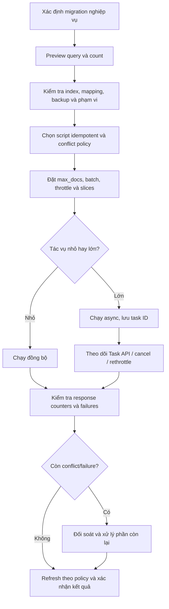

# Update by query và các giới hạn nhất quán

Elasticsearch cung cấp **Update By Query API** để cập nhật nhiều document thỏa cùng một điều kiện trong một request. Thay vì ứng dụng tìm từng document rồi gọi update riêng, Elasticsearch tìm tập document phù hợp và chạy một script trên từng document đó. Trong Spring Data Elasticsearch, có thể tổ chức thao tác này ở tầng service/repository; với các tùy chọn chuyên sâu của Elasticsearch, ứng dụng có thể dùng Elasticsearch Java API Client đã được Spring cấu hình.

Update by query hữu ích khi cần chuẩn hóa field, chuyển trạng thái hàng loạt, bổ sung giá trị mặc định hoặc sửa dữ liệu sau khi thay đổi quy tắc domain. Tuy nhiên, đây không phải một transaction bao trùm toàn bộ tập document. Elasticsearch xử lý theo batch, mỗi document có thể thành công hoặc thất bại riêng, và dữ liệu có thể thay đổi đồng thời trong lúc tác vụ chạy.

Các giới hạn nhất quán cần hiểu trước khi dùng:

- Search của update by query dựa trên một snapshot/scroll context được tạo khi tác vụ bắt đầu.
- Nếu document thay đổi sau khi snapshot được lấy nhưng trước khi update được áp dụng, có thể xảy ra version conflict.
- Mặc định, version conflict có thể làm tác vụ dừng; `conflicts=proceed` cho phép tiếp tục nhưng không làm các document xung đột được cập nhật.
- Tác vụ có thể cập nhật một phần rồi thất bại hoặc bị hủy.
- Chạy lại script không idempotent có thể làm dữ liệu thay đổi thêm lần nữa.

Do đó, hãy coi update by query là một tác vụ bảo trì dữ liệu có kiểm soát, có giới hạn tải, theo dõi tiến độ và kế hoạch phục hồi.

## 1. Update by query là gì?

Giả sử index `orders` có nhiều đơn hàng ở trạng thái `PENDING`. Khi một quy tắc nghiệp vụ thay đổi, ứng dụng cần chuyển tất cả đơn hàng cũ trước một ngày nhất định sang trạng thái `EXPIRED`.

Nếu dùng vòng lặp ở ứng dụng, quy trình thường là:

1. Search các document phù hợp.
2. Đọc từng document về ứng dụng.
3. Thay đổi thuộc tính.
4. Gửi update cho từng document.
5. Quản lý phân trang, retry và lỗi giữa các lần ghi.

Update by query thực hiện việc tìm và cập nhật ở phía Elasticsearch:

```json
POST orders/_update_by_query
{
  "query": {
    "bool": {
      "filter": [
        { "term": { "status": "PENDING" } },
        { "range": { "createdAt": { "lt": "2025-01-01T00:00:00Z" } } }
      ]
    }
  },
  "script": {
    "lang": "painless",
    "source": "ctx._source.status = params.newStatus",
    "params": {
      "newStatus": "EXPIRED"
    }
  }
}
```

Request tìm các đơn hàng `PENDING` trước thời điểm đã chọn, sau đó thay đổi `status` thành `EXPIRED` trên từng document phù hợp.

Elasticsearch xử lý bằng cách search các document theo query, rồi gửi các update theo batch. Ứng dụng không cần tải toàn bộ document về RAM chỉ để sửa một field.

## 2. Update by query không phải transaction nhiều document

Điểm quan trọng nhất: Update By Query API không cung cấp transaction ACID bao trùm tất cả document trong query.

Nếu query khớp 100.000 document, Elasticsearch có thể cập nhật nhiều batch. Trong quá trình đó:

- Một số batch có thể đã được cập nhật thành công.
- Một batch sau có thể gặp version conflict hoặc lỗi mapping/script.
- Tác vụ có thể timeout, bị hủy hoặc gặp lỗi shard.
- Các document đã cập nhật không tự động rollback khi tác vụ thất bại.

Vì vậy, response báo lỗi không đồng nghĩa không có dữ liệu nào thay đổi. Ngược lại, response HTTP thành công cũng không đủ để kết luận toàn bộ document đã được cập nhật như mong đợi; cần đọc các bộ đếm và danh sách lỗi trong response.

Ví dụ response có các trường như:

```json
{
  "took": 12450,
  "timed_out": false,
  "total": 10000,
  "updated": 9980,
  "version_conflicts": 20,
  "noops": 0,
  "batches": 10,
  "failures": []
}
```

Các con số chỉ minh họa. `total` là số document được xử lý theo tác vụ, `updated` là số update thành công, `version_conflicts` là số xung đột version và `noops` là số document mà script không yêu cầu thay đổi. Một tác vụ có thể hoàn tất với một số conflict nếu đã chọn `conflicts=proceed`.

## 3. Script Painless và `ctx._source`

Update by query thường dùng Painless script để thay đổi `_source` của mỗi document.

Ví dụ cập nhật một field:

```json
POST products/_update_by_query
{
  "query": {
    "term": {
      "status": "ACTIVE"
    }
  },
  "script": {
    "lang": "painless",
    "source": "ctx._source.status = params.newStatus",
    "params": {
      "newStatus": "ARCHIVED"
    }
  }
}
```

Trong script:

- `ctx._source` là dữ liệu nguồn của document đang được cập nhật.
- `params` chứa giá trị được truyền từ request.
- `ctx.op` có thể điều khiển thao tác, ví dụ `noop` để bỏ qua document hoặc `delete` để xóa document phù hợp.

Ví dụ tăng một bộ đếm:

```json
POST products/_update_by_query
{
  "query": {
    "term": {
      "category": "audio"
    }
  },
  "script": {
    "lang": "painless",
    "source": "ctx._source.viewCount += params.increment",
    "params": {
      "increment": 1
    }
  }
}
```

Script này không idempotent: nếu chạy lại, `viewCount` tiếp tục tăng thêm 1. Với tác vụ có khả năng retry hoặc resume, ưu tiên phép gán xác định từ input hoặc thiết kế điều kiện để chạy lại không làm thay đổi kết quả lần nữa.

### 3.1. Bỏ qua document bằng `noop`

Có thể kiểm tra dữ liệu trước khi cập nhật:

```json
POST products/_update_by_query
{
  "query": {
    "match_all": {}
  },
  "script": {
    "lang": "painless",
    "source": "if (ctx._source.status == params.target) { ctx.op = 'noop'; } else { ctx._source.status = params.target; }",
    "params": {
      "target": "ACTIVE"
    }
  }
}
```

Nếu giá trị đã đúng, script đặt `ctx.op = 'noop'`, giúp không ghi lại document đó. Response tăng `noops` tương ứng.

### 3.2. Xóa document bằng script

Painless có thể đặt `ctx.op = 'delete'` để xóa document trong tác vụ update by query. Tuy nhiên, nếu mục tiêu chỉ là xóa theo điều kiện, Delete By Query API thường diễn đạt rõ ý định hơn:

```json
POST orders/_delete_by_query
{
  "query": {
    "term": {
      "status": "CANCELLED"
    }
  }
}
```

Không dùng script update để mô phỏng một thao tác delete đơn giản nếu Delete By Query API phù hợp hơn.

## 4. Giới hạn query thật chặt trước khi chạy

Update by query tác động đến nhiều document. Một query quá rộng có thể sửa toàn bộ index ngoài dự kiến.

Trước khi chạy, hãy:

1. Viết query có điều kiện rõ ràng, thường dùng `bool.filter`.
2. Chạy search preview với cùng query để kiểm tra document mẫu.
3. Dùng `_count` để ước lượng số document phù hợp.
4. Kiểm tra index/alias đích và routing nếu có.
5. Xác định rõ field được sửa và giá trị sau cập nhật.
6. Chạy thử trên index staging hoặc tập dữ liệu nhỏ.
7. Chỉ chạy production khi đã có kế hoạch theo dõi và xử lý lỗi.

Ví dụ preview:

```http
GET orders/_search
{
  "size": 10,
  "_source": ["orderId", "status", "createdAt"],
  "query": {
    "bool": {
      "filter": [
        { "term": { "status": "PENDING" } },
        { "range": { "createdAt": { "lt": "2025-01-01T00:00:00Z" } } }
      ]
    }
  }
}
```

Đếm số document dự kiến:

```http
GET orders/_count
{
  "query": {
    "bool": {
      "filter": [
        { "term": { "status": "PENDING" } },
        { "range": { "createdAt": { "lt": "2025-01-01T00:00:00Z" } } }
      ]
    }
  }
}
```

Preview và count không khóa dữ liệu. Document có thể thay đổi giữa lúc preview và lúc update by query bắt đầu. Chúng giúp phát hiện query sai phạm vi, nhưng không phải cơ chế đảm bảo toàn bộ tập document không thay đổi.

## 5. Version conflict và tính nhất quán

Elasticsearch dùng versioning nội bộ để tránh ghi đè một thay đổi mới hơn bằng dữ liệu cũ. Update by query search document trong một snapshot/scroll context, sau đó gửi update dựa trên version mà nó đã đọc.

Giả sử:

1. Update by query đọc order `ORD-1001` với status `PENDING` và version 5.
2. Một request nghiệp vụ khác cập nhật order thành `PAID`, version tăng lên 6.
3. Update by query cố ghi thay đổi dựa trên version 5.
4. Elasticsearch phát hiện version không còn khớp và ghi nhận conflict.

Điều này tránh việc tác vụ bảo trì ghi đè mù một thay đổi đồng thời. Tuy nhiên, conflict có nghĩa document đó không được update bởi lần chạy này.

### 5.1. Mặc định dừng khi có conflict

Mặc định, update by query có thể dừng khi gặp version conflict. Response chứa thông tin về conflict và các update đã thực hiện trước đó vẫn có thể còn hiệu lực.

### 5.2. `conflicts=proceed`

Nếu nghiệp vụ cho phép bỏ qua document bị xung đột và tiếp tục các document khác, có thể dùng:

```http
POST orders/_update_by_query?conflicts=proceed
```

Hoặc trong JSON request:

```json
POST orders/_update_by_query?conflicts=proceed
{
  "query": {
    "term": {
      "status": "PENDING"
    }
  },
  "script": {
    "lang": "painless",
    "source": "ctx._source.status = 'EXPIRED'"
  }
}
```

`proceed` không giải quyết conflict và không retry document bị xung đột. Nó chỉ cho phép tác vụ tiếp tục thay vì dừng tại conflict. Sau khi chạy, cần đọc `version_conflicts` và quyết định có cần chạy lại một query hẹp hơn cho các document còn ở trạng thái cũ hay không.

Không tự động dùng `conflicts=proceed` cho mọi tác vụ. Nếu mỗi document bắt buộc phải được cập nhật, conflict phải được xử lý như một phần của quy trình nghiệp vụ.

## 6. Snapshot và giới hạn nhất quán

Update by query dùng search context để xác định tập document cần xử lý. Các document được tạo sau khi snapshot bắt đầu thường không nằm trong tập đã chọn. Nếu document thay đổi sau khi được đọc nhưng trước khi update, có thể phát sinh conflict.

Snapshot của search không biến toàn bộ update thành transaction. Những điều sau vẫn có thể xảy ra:

- Một số document được cập nhật, số khác bị conflict.
- Tác vụ bị hủy sau khi đã cập nhật nhiều batch.
- Một document mới thỏa query được tạo sau thời điểm snapshot nhưng không được cập nhật trong lần chạy đó.
- Một document được sửa bởi quy trình nghiệp vụ khác trong lúc update by query đang chạy.
- Một lần chạy lại có thể chọn tập document khác do dữ liệu đã thay đổi.

Nếu yêu cầu nghiệp vụ là “mọi document tại một thời điểm phải thay đổi đồng loạt hoặc không document nào thay đổi”, Update By Query API không cung cấp bảo đảm đó. Cần thiết kế một quy trình migration/snapshot riêng hoặc thay đổi mô hình dữ liệu và luồng đọc để hỗ trợ chuyển đổi theo giai đoạn.

## 7. Idempotency: có thể chạy lại an toàn hay không?

Một tác vụ update by query có thể thất bại sau khi đã cập nhật một phần. Vì vậy, khả năng chạy lại là yếu tố quan trọng.

### 7.1. Script gán giá trị xác định

Ví dụ:

```painless
ctx._source.status = params.targetStatus
```

Chạy lại với cùng `targetStatus` sẽ đưa field về cùng một giá trị. Đây là thao tác idempotent ở cấp field, miễn là query và điều kiện nghiệp vụ không thay đổi theo cách làm tác động thêm dữ liệu ngoài dự kiến.

### 7.2. Script tăng/giảm giá trị

Ví dụ:

```painless
ctx._source.retryCount += 1
```

Chạy lại sẽ tăng thêm lần nữa. Nếu tác vụ bị timeout sau khi một số batch thành công và ứng dụng gửi lại toàn bộ query, các document đã xử lý có thể bị tăng lặp.

### 7.3. Thiết kế query để chỉ chọn document chưa chuyển đổi

Thay vì chạy trên toàn bộ document, query có thể giới hạn trạng thái cũ:

```json
POST products/_update_by_query
{
  "query": {
    "term": {
      "schemaVersion": 1
    }
  },
  "script": {
    "lang": "painless",
    "source": "ctx._source.newField = params.value; ctx._source.schemaVersion = 2",
    "params": {
      "value": "default"
    }
  }
}
```

Sau khi document được chuyển sang version 2, lần chạy tiếp theo không còn chọn nó. Đây là một kỹ thuật migration có thể resume, nhưng cần đảm bảo việc gán field và cập nhật version trong cùng một script, đồng thời xử lý conflict và dữ liệu được tạo mới.

## 8. Giới hạn số document bằng `max_docs`

`max_docs` giới hạn số document mà tác vụ cố gắng xử lý. Ví dụ chạy thử trên tối đa 500 document:

```http
POST products/_update_by_query?max_docs=500
```

Đây là giới hạn hữu ích để kiểm soát phạm vi hoặc chia migration thành nhiều lượt. Tuy nhiên, khi có slicing hoặc version conflict, số document thực sự được update có thể thấp hơn giới hạn. Không coi `max_docs` là cam kết chính xác số document thành công.

Nếu cần chia migration theo giai đoạn, có thể dùng query range theo ngày, ID hoặc schema version thay vì chỉ dựa vào `max_docs`. Điều đó giúp xác định rõ partition nghiệp vụ và dễ đối soát hơn.

## 9. Batch size và `scroll_size`

Update by query đọc document theo scroll batch rồi gửi các thao tác bulk. `scroll_size` kiểm soát số hit được lấy trong mỗi batch.

Ví dụ:

```http
POST orders/_update_by_query?scroll_size=500
```

Batch nhỏ:

- Giảm kích thước mỗi response/bulk request.
- Có thể giảm áp lực bộ nhớ ở mỗi bước.
- Tăng số round trip và overhead.

Batch lớn:

- Có thể cải thiện throughput khi cluster còn dư tài nguyên.
- Tạo request/bulk payload lớn hơn.
- Có thể tăng heap pressure, thời gian xử lý mỗi batch và rủi ro timeout.

Chọn batch size bằng cách đo latency, payload, heap, indexing pressure và rejection. Không mặc định tăng `scroll_size` sẽ làm tác vụ nhanh hơn.

## 10. Throttle bằng `requests_per_second`

Update by query có thể tạo tải ghi lớn vì mỗi document được cập nhật đều tạo công việc indexing mới. Tham số `requests_per_second` giới hạn tốc độ xử lý theo request/batch để tác vụ không chiếm hết năng lực cluster.

Ví dụ:

```http
POST orders/_update_by_query?requests_per_second=200
```

Giá trị này điều tiết tốc độ theo batch, không phải một giới hạn đơn giản về số document/giây. Kích thước batch và thời gian xử lý cũng ảnh hưởng tốc độ thực tế.

Có thể bắt đầu với tốc độ thấp, theo dõi cluster, rồi tăng dần nếu latency và indexing pressure vẫn ổn định. Nếu cluster đang phục vụ traffic người dùng, nên chạy migration ngoài giờ cao điểm hoặc dùng queue/job scheduler để giới hạn số tác vụ.

## 11. Slicing để chạy song song

Slicing chia công việc update by query thành các phần độc lập để có thể xử lý song song. Ví dụ:

```http
POST orders/_update_by_query?slices=4
```

Hoặc để Elasticsearch tự chọn số slice:

```http
POST orders/_update_by_query?slices=auto
```

Ưu điểm:

- Có thể tăng throughput bằng cách xử lý nhiều partition song song.
- Hữu ích với index lớn và cluster còn tài nguyên.

Giới hạn:

- Mỗi slice tạo thêm search/bulk workload.
- Các slice có thể có kích thước không đồng đều.
- Tổng thời gian không nhất thiết giảm tuyến tính theo số slice.
- Response/task cha tổng hợp trạng thái từ các slice con.
- Tăng slice quá mức có thể làm cluster quá tải.

Hãy đo throughput và rejection trước khi tăng số slice. `slices=auto` tiện lợi nhưng không thay thế capacity planning.

## 12. Chạy đồng bộ và bất đồng bộ

Mặc định, update by query có thể chờ tác vụ hoàn thành rồi trả response. Với tác vụ lớn, request HTTP có thể kéo dài và vượt timeout của gateway hoặc client.

Có thể dùng `wait_for_completion=false` để khởi chạy tác vụ nền:

```http
POST orders/_update_by_query?wait_for_completion=false&requests_per_second=100
{
  "query": {
    "term": {
      "status": "PENDING"
    }
  },
  "script": {
    "lang": "painless",
    "source": "ctx._source.status = 'EXPIRED'"
  }
}
```

Response ban đầu trả về task ID thay vì chờ toàn bộ công việc hoàn tất. Ứng dụng cần lưu task ID cùng job ID của mình để theo dõi tiến độ.

Kiểm tra task:

```http
GET _tasks/{task_id}
```

Hủy task nếu cần:

```http
POST _tasks/{task_id}/_cancel
```

Thay đổi tốc độ của task đang chạy:

```http
POST _update_by_query/{task_id}/_rethrottle?requests_per_second=50
```

Task cancellation không rollback những batch đã cập nhật. Khi hủy, một phần dữ liệu có thể đã thay đổi; cần kiểm tra task response/trạng thái và đối soát dữ liệu.

## 13. Spring Data Elasticsearch và Elasticsearch Java API Client

Trong ứng dụng Spring Boot, client thường được cấu hình và quản lý bởi Spring. Với thao tác đơn lẻ, `ElasticsearchOperations` cung cấp các API `save`, `update` hoặc bulk phù hợp. Với update by query, khả năng abstraction và chữ ký API phụ thuộc phiên bản Spring Data Elasticsearch đang dùng.

Ở các phiên bản có `ElasticsearchOperations.updateByQuery(...)`, có thể xây dựng `UpdateQuery` chứa query, script và parameters rồi thực thi trên `IndexCoordinates`. Ví dụ minh họa:

```java
Query query = NativeQuery.builder()
    .withQuery(q -> q
        .term(t -> t
            .field("status")
            .value("PENDING")
        )
    )
    .build();

UpdateQuery updateQuery = UpdateQuery.builder(query)
    .withScript("ctx._source.status = params.target")
    .withParams(Map.of("target", "EXPIRED"))
    .build();

operations.updateByQuery(
    updateQuery,
    IndexCoordinates.of("orders")
);
```

Đoạn code minh họa ý tưởng API; tên builder, kiểu response và các tùy chọn như conflicts, slicing, throttling, async execution có thể khác theo release. Hãy đối chiếu Javadoc của đúng dependency trong dự án trước khi sử dụng.

Nếu abstraction của phiên bản hiện tại không expose đầy đủ option cần thiết, có thể inject `ElasticsearchClient` đã được Spring cấu hình và gọi Update By Query API qua adapter chuyên trách. Ví dụ JSON REST ở các phần trước thể hiện chính xác các option cần cấu hình mà adapter phải truyền.

Không tạo `ElasticsearchClient` mới cho từng lần update. Tái sử dụng bean do Spring quản lý, đặt timeout và authentication ở cấu hình client, đồng thời giữ API update by query trong một service có quyền hạn rõ ràng.

## 14. Ví dụ service tổ chức tác vụ migration

Một service migration nên nhận một lệnh nghiệp vụ rõ ràng thay vì để controller nhận raw script và query tùy ý:

```java
public record ExpireOldOrdersCommand(
    Instant createdBefore,
    int maxDocuments
) {
}
```

Service có thể:

1. Validate cutoff và giới hạn số document.
2. Tạo query cố định cho `status = PENDING` và `createdAt < cutoff`.
3. Tạo script cố định gán status `EXPIRED`.
4. Cấu hình `conflicts`, batch size và throttle theo policy.
5. Chạy đồng bộ cho tập nhỏ hoặc async cho tác vụ lớn.
6. Lưu task ID và trạng thái job.
7. Poll task status, ghi progress và failures.
8. Đối soát số document sau khi hoàn tất.

Controller không nên nhận `script.source`, tên field, index name hoặc Painless code do người dùng cuối gửi. Chỉ expose các tham số nghiệp vụ đã được whitelist.

## 15. Những giới hạn nhất quán khi chạy đồng thời

Update by query có thể chạy cùng lúc với các thao tác save/update/delete khác. Các tình huống cần tính đến:

| Tình huống | Hành vi/giới hạn |
|---|---|
| Document thay đổi sau khi update by query đọc snapshot | Có thể version conflict; document không được update trong lần chạy đó. |
| Document mới được tạo sau snapshot | Thường không nằm trong tập document của lần chạy hiện tại. |
| Tác vụ bị hủy giữa các batch | Những batch trước vẫn có thể đã cập nhật; không rollback. |
| Script không idempotent được chạy lại | Có thể cộng dồn thay đổi hoặc tạo dữ liệu sai. |
| Hai update by query cùng sửa một field | Có thể cạnh tranh và tạo version conflicts; thứ tự kết quả không phải transaction order. |
| Alias trỏ tới nhiều index | Tác vụ có thể tác động lên nhiều index theo alias; cần xác nhận phạm vi trước khi chạy. |
| Mapping không tương thích giữa các index | Một số document/batch có thể thất bại khi script ghi field theo kiểu không hợp lệ. |

Nếu cần migration schema, cân nhắc version field để chỉ chọn document chưa chuyển đổi. Nếu cần bảo toàn update nghiệp vụ mới hơn, thiết kế query chỉ chọn trạng thái cũ và script không ghi đè field đã thay đổi theo một quy tắc rõ ràng.

## 16. Refresh và khả năng nhìn thấy dữ liệu sau update

Update by query không nhất thiết làm thay đổi hiển thị search ngay lập tức. Elasticsearch chỉ làm dữ liệu mới có thể tìm kiếm sau refresh.

Có thể yêu cầu refresh khi hoàn tất:

```http
POST orders/_update_by_query?refresh=true
```

`refresh=true` làm các thay đổi có thể tìm kiếm sau khi request hoàn thành, nhưng có thể tăng chi phí refresh. Với tác vụ lớn, hãy cân nhắc chỉ refresh một lần sau khi migration hoàn tất thay vì refresh liên tục ở các bước ghi nhỏ.

Refresh không phải transaction và không làm các update trở nên atomic. Nó chỉ ảnh hưởng thời điểm thay đổi được nhìn thấy qua search.

## 17. Response, progress và đối soát

Khi tác vụ hoàn tất, cần đọc các trường response quan trọng:

| Trường | Ý nghĩa |
|---|---|
| `took` | Thời gian thực thi tính bằng millisecond. |
| `timed_out` | Search phase có timeout hay không. |
| `total` | Số document được xử lý theo tác vụ. |
| `updated` | Số document đã được update. |
| `deleted` | Số document bị xóa bởi script nếu có. |
| `noops` | Số document script bỏ qua. |
| `version_conflicts` | Số document gặp version conflict. |
| `batches` | Số batch đã xử lý. |
| `retries` | Số retry cho search/bulk theo response. |
| `throttled_millis` | Thời gian bị throttle. |
| `failures` | Các lỗi được báo trong response. |

Với tác vụ async, Task API có thể cung cấp trạng thái đang chạy, tiến độ và kết quả khi hoàn tất. Nên lưu các metric này cùng job ID, index, query version và thời điểm bắt đầu/kết thúc.

Đối soát sau khi chạy:

- Đếm số document còn thỏa query cũ.
- Đếm số document đã có giá trị mới.
- Kiểm tra một mẫu document theo ID.
- Kiểm tra failures, timeout và version conflicts.
- Nếu có conflict, quyết định có cần chạy lại một query hẹp hơn hay chuyển sang xử lý từng document.

Không chỉ dựa vào `updated` để kết luận migration hoàn tất nếu response có failures hoặc conflict chưa được chấp nhận.

## 18. Bảo vệ cluster và dữ liệu khi chạy production

Update by query tạo tải đọc và ghi đồng thời. Một tác vụ có thể ảnh hưởng cả traffic tìm kiếm lẫn traffic index thông thường.

Các biện pháp nên áp dụng:

- Chạy trên index/alias được xác định rõ; tránh wildcard index rộng không cần thiết.
- Preview query và count trước khi ghi.
- Dùng `max_docs` hoặc partition theo range/schema version khi migration có thể chia nhỏ.
- Đặt `requests_per_second` và `scroll_size` phù hợp.
- Chỉ bật `slices` khi cluster có tài nguyên và đã đo kiểm.
- Chạy async cho tác vụ dài và lưu task ID.
- Theo dõi indexing pressure, search latency, heap, merge và rejection.
- Có cancellation procedure nhưng hiểu rằng cancel không rollback.
- Giữ script và field name do ứng dụng kiểm soát; không nhận Painless code tùy ý từ client.
- Dùng snapshot/backup hoặc khả năng phục hồi phù hợp trước migration có rủi ro cao.
- Kiểm tra mapping và kiểu dữ liệu trước khi script ghi field mới.

## 19. Các lỗi thường gặp

| Hiện tượng | Nguyên nhân có thể | Cách xử lý |
|---|---|---|
| Tác vụ dừng với version conflict | Document bị thay đổi đồng thời sau snapshot | Xác định conflict có được chấp nhận không; dùng `conflicts=proceed` chỉ khi phù hợp và đối soát phần còn lại. |
| Tác vụ báo lỗi nhưng một số document đã đổi | Update by query không phải transaction; batch trước đã ghi | Đọc response/task status, xác định phần đã hoàn thành và thiết kế resume. |
| Chạy lại làm counter tăng gấp đôi | Script không idempotent | Dùng phép gán xác định hoặc query chọn document chưa xử lý. |
| Document mới không được cập nhật | Được tạo sau snapshot của tác vụ | Chạy lượt bổ sung hoặc có quy trình bắt các document phát sinh sau cutoff. |
| Cluster bị chậm khi migration | Throttle quá cao, batch lớn hoặc nhiều slice | Giảm tốc độ, batch size, concurrency; chạy ngoài giờ cao điểm. |
| Request HTTP timeout nhưng task vẫn chạy | Client timeout không đồng nghĩa server task đã dừng | Dùng async task ID và kiểm tra Task API. |
| Cancel rồi dữ liệu vẫn thay đổi một phần | Các batch trước đã cập nhật trước khi cancel được xử lý | Đối soát và chạy tiếp theo chính sách; không mong rollback tự động. |
| `updated` thấp hơn `total` | Noop, conflict hoặc failures | Phân tích các bộ đếm và failures, không suy luận từ một trường. |
| Script lỗi trên một số document | Field thiếu, kiểu dữ liệu không đồng nhất hoặc script giả định sai | Validate mapping/data, xử lý null và kiểm thử trên sample. |
| Alias cập nhật nhầm nhiều index | Alias trỏ tới nhiều index hoặc write index chưa rõ | Kiểm tra alias target và chỉ định index cụ thể khi cần. |

## 20. Quy trình triển khai update by query



Quy trình thực tế:

1. Xác định chính xác index, query và field cần thay đổi.
2. Preview bằng search và count.
3. Kiểm tra mapping, script và dữ liệu mẫu.
4. Chọn script idempotent nếu có thể.
5. Xác định conflict policy, `max_docs`, batch size, throttle và slices.
6. Chạy staging hoặc một partition nhỏ trước.
7. Chạy đồng bộ cho tác vụ nhỏ; chạy async và theo dõi task cho tác vụ dài.
8. Kiểm tra `updated`, `noops`, `version_conflicts`, `failures` và `timed_out`.
9. Đối soát dữ liệu, xử lý phần còn lại và refresh theo nhu cầu.
10. Ghi log migration, query version, task ID và kết quả để phục vụ audit.

## 21. Kết luận

Update by query là cách hiệu quả để cập nhật nhiều document theo một điều kiện ngay trong Elasticsearch. Request gồm query xác định tập document và script Painless thay đổi `_source`. Có thể giới hạn phạm vi bằng `max_docs`, điều tiết tải bằng `requests_per_second`, điều chỉnh batch bằng `scroll_size`, chạy song song bằng `slices` và theo dõi tác vụ nền qua Task API.

Tuy nhiên, update by query không phải transaction nhiều document. Nó dùng snapshot/scroll để tìm dữ liệu, có thể gặp version conflict khi document thay đổi đồng thời, và có thể để lại cập nhật một phần khi thất bại hoặc bị hủy. `conflicts=proceed` chỉ cho phép bỏ qua conflict và tiếp tục; nó không cập nhật lại document xung đột. Script không idempotent có thể làm dữ liệu sai nếu chạy lại.

Trong Spring Data Elasticsearch, tổ chức thao tác trong service và dùng client do Spring quản lý. Chọn `ElasticsearchOperations.updateByQuery` nếu phiên bản cung cấp đầy đủ API cần thiết; nếu cần option chuyên sâu, dùng Elasticsearch Java API Client trong adapter riêng. Luôn preview query, giới hạn tải, lưu task ID, kiểm tra response counters/failures và đối soát sau khi chạy. Cách tiếp cận này giúp migration dữ liệu có thể quan sát, kiểm soát và phục hồi khi có xung đột hoặc lỗi giữa chừng.
