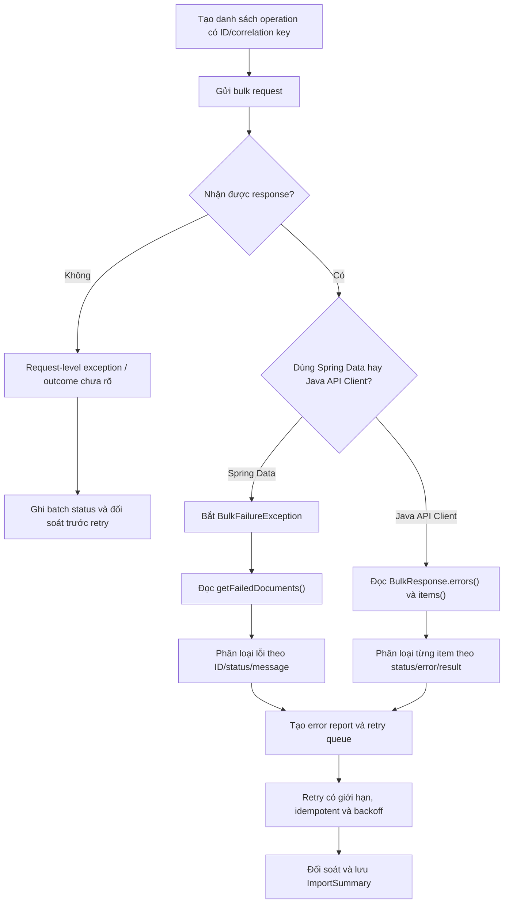

# Đọc BulkFailureException hoặc kết quả chi tiết theo API

Bulk API của Elasticsearch cho phép gửi nhiều thao tác index, create, update hoặc delete trong một request. Cách này giảm số lần gọi mạng và thường tăng throughput khi nhập dữ liệu. Tuy nhiên, **một bulk request không phải transaction**: một số item có thể thành công trong khi item khác thất bại. Vì vậy, HTTP response thành công hoặc việc lời gọi Java không ném exception chưa đủ để kết luận mọi document đã được ghi đúng.

Trong Spring Data Elasticsearch, các thao tác như `ElasticsearchOperations.bulkIndex(...)` và `bulkUpdate(...)` có thể ném **`BulkFailureException`** khi có item lỗi. Exception này cung cấp danh sách document thất bại qua `getFailedDocuments()`. Nếu cần kết quả chi tiết cho từng operation, gồm cả thành công và thất bại theo đúng thứ tự gửi, có thể gọi Elasticsearch Java API Client trực tiếp và đọc `BulkResponse.items()`.

Bài học này giải thích cách đọc hai dạng kết quả, cách phân loại lỗi, cách retry đúng item, và cách xây dựng báo cáo bulk đáng tin cậy.

## 1. Bulk request có thể thành công một phần

Giả sử ứng dụng nhập 4 sản phẩm trong một bulk request:

| ID | Thao tác | Kết quả minh họa |
|---|---|---|
| `P-100` | Index | Thành công, `201 created` |
| `P-101` | Index | Thất bại, `400 mapper_parsing_exception` |
| `P-102` | Index | Thành công, `201 created` |
| `P-103` | Index | Thất bại, `409 version_conflict_engine_exception` |

Elasticsearch vẫn có thể trả HTTP 200 cho toàn bộ Bulk API request, trong khi hai item thất bại. Response bulk có cờ `errors: true` và một kết quả riêng cho mỗi thao tác.

Điều này khác với một request đơn lẻ theo kiểu all-or-nothing. Bulk API không rollback hai item đã thành công chỉ vì item khác thất bại. Ứng dụng phải đọc kết quả theo từng item và quyết định xử lý phần còn lại.

## 2. Phân biệt lỗi request và lỗi từng item

Có hai lớp lỗi cần xử lý riêng:

| Loại lỗi | Ví dụ | Nơi nhận biết |
|---|---|---|
| Request/transport failure | Mất kết nối, timeout, lỗi xác thực, request bulk sai định dạng ở cấp tổng thể | Exception từ client/transport; có thể không có `BulkResponse` đầy đủ |
| Item failure | Một document sai mapping, version conflict, document không tồn tại | Item tương ứng trong `BulkResponse`, hoặc `BulkFailureException` từ Spring Data |

Nếu request không thể tới Elasticsearch hoặc server từ chối toàn bộ request, ứng dụng có thể nhận `IOException`, `ElasticsearchException` hoặc exception được Spring chuyển đổi. Khi đó chưa chắc có danh sách item result để phân tích.

Nếu Elasticsearch đã nhận và xử lý bulk request, response có thể chứa kết quả của từng thao tác. Trong trường hợp này, không nên chỉ bắt exception tổng quát rồi ghi log “bulk failed”; cần lấy ID và nguyên nhân của từng item.

## 3. `BulkFailureException` trong Spring Data Elasticsearch

Spring Data Elasticsearch cung cấp class:

```java
import org.springframework.data.elasticsearch.BulkFailureException;
```

`BulkFailureException` là một exception thuộc hệ thống `DataAccessException` của Spring. Các phương thức bulk như `DocumentOperations.bulkIndex(...)` và `bulkUpdate(...)` khai báo có thể ném exception này khi thao tác bulk có document thất bại.

Method quan trọng:

```java
Map<String, BulkFailureException.FailureDetails> getFailedDocuments()
```

Trong Spring Data Elasticsearch từ phiên bản 5.2, map có:

- Key: document ID.
- Value: `FailureDetails`, một record chứa `status` và `errorMessage`.

Ví dụ:

```java
try {
    operations.bulkIndex(indexQueries, IndexCoordinates.of("products"));
} catch (BulkFailureException ex) {
    Map<String, BulkFailureException.FailureDetails> failedDocuments =
        ex.getFailedDocuments();

    failedDocuments.forEach((id, failure) -> {
        log.warn(
            "Bulk item failed: id={}, status={}, reason={}",
            id,
            failure.status(),
            failure.errorMessage()
        );
    });
}
```

`getFailedDocuments()` là nơi bắt đầu để biết document nào thất bại. Không chỉ log `ex.getMessage()` vì thông báo tổng quát có thể không đủ để tìm record cần sửa.

### 3.1. Thay đổi kiểu trả về giữa các phiên bản

Có một thay đổi API quan trọng khi nâng cấp Spring Data Elasticsearch từ nhánh 5.1 lên 5.2:

| Phiên bản | Kiểu của `getFailedDocuments()` |
|---|---|
| 5.1.x và cũ hơn | `Map<String, String>` |
| 5.2.x trở lên | `Map<String, BulkFailureException.FailureDetails>` |

Ở phiên bản cũ, mỗi key là document ID và value là chuỗi mô tả lỗi:

```java
// Dành cho phiên bản Spring Data Elasticsearch cũ có API Map<String, String>.
try {
    operations.bulkIndex(indexQueries, IndexCoordinates.of("products"));
} catch (BulkFailureException ex) {
    Map<String, String> failures = ex.getFailedDocuments();

    failures.forEach((id, message) ->
        log.warn("Bulk item failed: id={}, reason={}", id, message)
    );
}
```

Từ 5.2, value được thay bằng record `FailureDetails` để có thêm HTTP status:

```java
// Dành cho Spring Data Elasticsearch 5.2+.
BulkFailureException.FailureDetails details =
    ex.getFailedDocuments().get("P-101");

if (details != null) {
    Integer status = details.status();
    String errorMessage = details.errorMessage();
}
```

Hai đoạn code dùng các kiểu generic khác nhau nên không thể biên dịch đồng thời trong cùng một source set. Khi nâng cấp dependency, hãy cập nhật kiểu biến và code xử lý theo phiên bản đang dùng.

### 3.2. `FailureDetails` chứa những gì?

Trong API mới, `FailureDetails` là record có hai component:

```java
public record FailureDetails(Integer status, String errorMessage) {
}
```

- `status()` thường là mã HTTP của item, ví dụ 400, 404, 409 hoặc 429.
- `errorMessage()` là mô tả lỗi được Spring Data giữ lại cho document đó.

Thông tin này đủ cho nhiều luồng import thông thường: xác định ID, phân loại status, ghi log và đưa record lỗi vào danh sách cần xử lý. Nếu cần `operationType`, index, result, sequence number, primary term hoặc cấu trúc `caused_by`/`root_cause`, hãy xem xét kết quả chi tiết từ Elasticsearch Java API Client.

## 4. `bulkIndex` trả về gì khi thành công?

`ElasticsearchOperations.bulkIndex(...)` trả về:

```java
List<IndexedObjectInformation>
```

Mỗi `IndexedObjectInformation` là record chứa metadata của document đã được index, gồm các thông tin như:

- `id()` — document ID.
- `index()` — index đích.
- `seqNo()` — sequence number.
- `primaryTerm()` — primary term.
- `version()` — document version.

Ví dụ:

```java
List<IndexedObjectInformation> indexed = operations.bulkIndex(
    indexQueries,
    IndexCoordinates.of("products")
);

for (IndexedObjectInformation info : indexed) {
    log.info(
        "Indexed document: index={}, id={}, seqNo={}, version={}",
        info.index(),
        info.id(),
        info.seqNo(),
        info.version()
    );
}
```

Khi lời gọi trả về bình thường, danh sách cung cấp metadata của các document đã index. Nếu có item failure, API có thể ném `BulkFailureException`; lúc đó luồng điều khiển đi vào `catch`, và không có một `List<IndexedObjectInformation>` được trả về cho caller. Exception cung cấp failed-document map, không phải một bản sao đầy đủ của `BulkResponse` gồm mọi item thành công lẫn thất bại.

Với `bulkUpdate(...)`, API trả `void` và cũng có thể ném `BulkFailureException`. Nếu cần thống kê chi tiết từng update, dùng API client trực tiếp hoặc thiết kế lớp ghi nhận kết quả phù hợp.

## 5. Ví dụ tạo IndexQuery và bắt BulkFailureException

Ví dụ entity:

```java
@Document(indexName = "products")
public class ProductDocument {

    @Id
    private String id;

    private String name;

    private Long priceInCents;

    // constructors, getters and setters
}
```

Tạo các `IndexQuery` từ danh sách entity:

```java
import java.util.List;

import org.springframework.data.elasticsearch.core.IndexedObjectInformation;
import org.springframework.data.elasticsearch.core.mapping.IndexCoordinates;
import org.springframework.data.elasticsearch.core.query.IndexQuery;
import org.springframework.data.elasticsearch.core.query.IndexQueryBuilder;
import org.springframework.data.elasticsearch.BulkFailureException;

List<IndexQuery> queries = products.stream()
    .map(product -> new IndexQueryBuilder()
        .withId(product.getId())
        .withObject(product)
        .build())
    .toList();

try {
    List<IndexedObjectInformation> indexed = operations.bulkIndex(
        queries,
        IndexCoordinates.of("products")
    );

    log.info("Bulk indexed {} products", indexed.size());
} catch (BulkFailureException ex) {
    ex.getFailedDocuments().forEach((id, failure) ->
        log.error(
            "Could not index product id={}, status={}, message={}",
            id,
            failure.status(),
            failure.errorMessage()
        )
    );
}
```

Ví dụ dùng API `FailureDetails` của Spring Data Elasticsearch 5.2+. Nếu dự án dùng bản cũ, thay generic và phần đọc value bằng `Map<String, String>` như phần trước.

Khi tạo `IndexQuery`, nên gán ID ổn định nếu nghiệp vụ có thể làm được. ID ổn định giúp tìm lại document lỗi, đối chiếu dữ liệu nguồn và chạy lại riêng các record thất bại.

## 6. Đọc lỗi của bulkUpdate

`bulkUpdate` nhận danh sách `UpdateQuery` và trả `void`. Khi một hoặc nhiều item thất bại, Spring Data có thể ném `BulkFailureException`:

```java
try {
    operations.bulkUpdate(
        updateQueries,
        IndexCoordinates.of("products")
    );

    log.info("Bulk update completed");
} catch (BulkFailureException ex) {
    ex.getFailedDocuments().forEach((id, failure) -> {
        log.error(
            "Could not update product id={}, status={}, reason={}",
            id,
            failure.status(),
            failure.errorMessage()
        );
    });
}
```

Không coi việc `bulkUpdate` ném exception là bằng chứng tất cả update đều thất bại. Các item khác có thể đã được áp dụng thành công. Hãy đối chiếu failed IDs với nguồn dữ liệu và trạng thái thực tế trong index.

## 7. Khi nào cần kết quả chi tiết hơn `BulkFailureException`?

`BulkFailureException` thuận tiện khi ứng dụng muốn giữ abstraction của Spring Data và chỉ cần danh sách document thất bại. Tuy nhiên, có những tình huống cần biết kết quả của **từng operation**:

- Muốn đếm chính xác số `created`, `updated`, `deleted` và failed item.
- Cần `operationType`, index, ID và HTTP status cho cả item thành công.
- Cần đọc `ErrorCause.type()`, `reason()`, `causedBy()` hoặc `rootCause()`.
- Cần giữ sequence number, primary term hoặc version trả về.
- Một bulk request có nhiều loại operation hoặc nhiều index.
- Cần đối chiếu mỗi response item với đúng vị trí record nguồn.

Trong trường hợp đó, dùng `ElasticsearchClient.bulk(...)` và đọc `BulkResponse`.

## 8. `BulkResponse`: kết quả chi tiết từ Elasticsearch Java API Client

Elasticsearch Java API Client trả về `BulkResponse`. Các thành phần quan trọng:

| Thành phần | Ý nghĩa |
|---|---|
| `errors()` | `true` nếu có ít nhất một operation thất bại. |
| `items()` | Kết quả riêng của từng operation, theo đúng thứ tự request gửi lên. |
| `took()` | Thời gian Elasticsearch xử lý bulk request, tính bằng millisecond. |
| `ingestTook()` | Thời gian ingest pipeline nếu response có thông tin này. |

Mỗi `BulkResponseItem` có thể cung cấp:

| Method | Ý nghĩa |
|---|---|
| `operationType()` | Loại thao tác: index, create, update hoặc delete. |
| `index()` | Index được thao tác. |
| `id()` | Document ID. |
| `status()` | HTTP status của item. |
| `result()` | Kết quả thành công như `created`, `updated` hoặc `deleted`. |
| `error()` | Chi tiết lỗi; thường chỉ có khi item thất bại. |
| `seqNo()` / `primaryTerm()` / `version()` | Metadata versioning khi có. |

Điểm quan trọng: `errors()` là cờ tổng hợp. Khi nó là `true`, vẫn phải duyệt `items()` để tìm item lỗi. Không dừng ở một boolean nếu cần biết record nào phải xử lý lại.

## 9. Ví dụ dùng ElasticsearchClient để đọc từng BulkResponseItem

Ví dụ tạo bulk request bằng Elasticsearch Java API Client:

```java
import co.elastic.clients.elasticsearch.ElasticsearchClient;
import co.elastic.clients.elasticsearch._types.ErrorCause;
import co.elastic.clients.elasticsearch.core.BulkResponse;
import co.elastic.clients.elasticsearch.core.bulk.BulkResponseItem;

BulkResponse response = client.bulk(bulk -> bulk
    .operations(operation -> operation.index(index -> index
        .index("products")
        .id("P-100")
        .document(product100)
    ))
    .operations(operation -> operation.index(index -> index
        .index("products")
        .id("P-101")
        .document(product101)
    ))
    .operations(operation -> operation.index(index -> index
        .index("products")
        .id("P-102")
        .document(product102)
    ))
);

if (response.errors()) {
    for (BulkResponseItem item : response.items()) {
        if (item.error() != null) {
            ErrorCause error = item.error();

            log.error(
                "Bulk item failed: index={}, id={}, status={}, type={}, reason={}",
                item.index(),
                item.id(),
                item.status(),
                error.type(),
                error.reason()
            );
        }
    }
} else {
    log.info("Bulk completed without item errors; took={}ms", response.took());
}
```

Các lambda `operations(...)` được thêm theo thứ tự các thao tác. `response.items()` giữ cùng thứ tự, nên có thể đối chiếu item response với danh sách command đầu vào theo index của danh sách. Trong code thực tế, nên giữ thêm `sourceRecordId` hoặc correlation key ở tầng ứng dụng nếu ID Elasticsearch không trùng với ID của file import.

Elasticsearch Java API Client serialize document bằng mapper được cấu hình cho client. Khi gọi trực tiếp client, không mặc định mọi annotation/custom conversion của `MappingElasticsearchConverter` trong Spring Data đều được áp dụng. Nếu entity có mapping tùy chỉnh, hãy kiểm tra JSON gửi lên hoặc dùng `ElasticsearchOperations` cho luồng cần converter Spring Data.

## 10. Đọc `ErrorCause` sâu hơn

`BulkResponseItem.error()` trả về `ErrorCause`, có các thông tin như:

- `type()` — loại lỗi Elasticsearch.
- `reason()` — mô tả lỗi dễ đọc.
- `causedBy()` — nguyên nhân cấp dưới nếu có.
- `rootCause()` — danh sách nguyên nhân gốc nếu có.
- `metadata()` — dữ liệu bổ sung tùy loại lỗi.

Ví dụ:

```java
ErrorCause error = item.error();

String errorType = error.type();
String reason = error.reason();

ErrorCause causedBy = error.causedBy();
if (causedBy != null) {
    log.debug(
        "Underlying cause: type={}, reason={}",
        causedBy.type(),
        causedBy.reason()
    );
}

for (ErrorCause root : error.rootCause()) {
    log.debug("Root cause: type={}, reason={}", root.type(), root.reason());
}
```

Không phải lỗi nào cũng có đủ `causedBy`, `rootCause` hoặc metadata. Luôn xử lý null/empty. Không log `stackTrace()` hoặc toàn bộ error metadata một cách mặc định nếu response có thể chứa dữ liệu nhạy cảm.

## 11. Dùng kết quả chi tiết để tạo báo cáo import

Một DTO ứng dụng có thể biểu diễn kết quả cho từng dòng nguồn:

```java
public record BulkItemResult(
    int inputPosition,
    String sourceRecordId,
    String index,
    String documentId,
    int status,
    String result,
    String errorType,
    String errorMessage
) {
    public boolean successful() {
        return errorType == null;
    }
}
```

Chuyển `BulkResponse.items()` thành DTO:

```java
List<BulkItemResult> results = new ArrayList<>();

for (int i = 0; i < response.items().size(); i++) {
    BulkResponseItem item = response.items().get(i);
    ErrorCause error = item.error();

    results.add(new BulkItemResult(
        i,
        sourceRecords.get(i).recordId(),
        item.index(),
        item.id(),
        item.status(),
        item.result(),
        error == null ? null : error.type(),
        error == null ? null : error.reason()
    ));
}
```

Ở ví dụ này, `sourceRecords` phải có cùng thứ tự với các operation được thêm vào bulk request. Không sort hoặc filter một danh sách mà không cập nhật mapping vị trí, nếu không báo cáo có thể gắn lỗi vào nhầm dòng import.

Từ DTO, service có thể tính:

```java
long successCount = results.stream()
    .filter(BulkItemResult::successful)
    .count();

long failureCount = results.size() - successCount;
```

Nếu cần xuất file lỗi cho người dùng, hãy đưa `sourceRecordId`, dòng nguồn, status và thông báo đã chuẩn hóa vào file kết quả. Tránh đưa stack trace hoặc payload nhạy cảm vào response công khai.

## 12. Phân loại lỗi để quyết định cách xử lý

Không phải mọi lỗi bulk đều nên retry. Hãy phân loại theo status và error type:

| Lỗi thường gặp | Status thường thấy | Ý nghĩa | Hướng xử lý |
|---|---:|---|---|
| `mapper_parsing_exception` / `document_parsing_exception` | 400 | Dữ liệu không phù hợp mapping hoặc JSON không hợp lệ | Sửa dữ liệu/schema; không retry nguyên trạng. |
| `illegal_argument_exception` | 400 | Tham số hoặc field không hợp lệ | Sửa request hoặc dữ liệu nguồn. |
| `document_missing_exception` | 404 | Update/delete nhắm tới document không tồn tại | Kiểm tra nghiệp vụ; có thể bỏ qua nếu thao tác idempotent cho phép. |
| `version_conflict_engine_exception` | 409 | Version không còn khớp do cập nhật đồng thời hoặc create trùng ID | Đọc lại và reconcile; không retry mù. |
| `es_rejected_execution_exception` | 429 | Cluster từ chối vì quá tải/queue đầy | Retry có backoff và jitter; giảm batch/concurrency. |
| Lỗi shard/availability tạm thời | 5xx tùy trường hợp | Cluster hoặc shard tạm thời không phục vụ | Kiểm tra trạng thái, retry có giới hạn nếu thao tác an toàn. |
| Authorization failure | 401/403 ở cấp request hoặc item | Thiếu quyền | Sửa cấu hình quyền; không retry liên tục. |

Status chỉ là tín hiệu phân loại ban đầu. Hãy đọc `error.type()` và `error.reason()` vì cùng một status có thể phát sinh từ nhiều nguyên nhân khác nhau.

## 13. Retry chỉ các item thất bại

Giả sử bulk gồm 1.000 document, trong đó 990 thành công và 10 thất bại do lỗi tạm thời. Gửi lại toàn bộ 1.000 item có thể:

- Ghi lặp các document đã thành công.
- Tạo conflict nếu dùng `create`.
- Tăng counter lần nữa nếu update script không idempotent.
- Tạo thêm tải không cần thiết cho cluster.

Quy trình tốt hơn:

1. Đọc response từng item.
2. Phân loại lỗi.
3. Loại lỗi dữ liệu cố định khỏi retry queue.
4. Chỉ đưa item có khả năng phục hồi vào retry queue.
5. Retry với backoff, jitter và giới hạn số lần.
6. Lưu trạng thái cuối cùng cho từng source record.

### 13.1. Backoff có giới hạn

Ví dụ pseudocode:

```java
for (int attempt = 1; attempt <= maxAttempts; attempt++) {
    BulkResponse response = sendBulk(pendingItems);

    List<SourceRecord> retryable = classifyRetryableFailures(
        pendingItems,
        response
    );

    if (retryable.isEmpty()) {
        break;
    }

    pendingItems = retryable;
    sleep(backoffWithJitter(attempt));
}
```

Đây là cấu trúc điều khiển minh họa; `classifyRetryableFailures` cần dựa trên `BulkResponseItem` và phải giữ mapping chính xác giữa response item với source record. Trong production, việc chờ phải hỗ trợ cancellation và tổng retry deadline.

### 13.2. Idempotency và ID ổn định

Trước khi retry, xác định operation có thể chạy lặp an toàn không:

- `index` với ID ổn định và cùng nội dung thường có thể ghi đè về cùng trạng thái mong muốn.
- `create` có thể trả conflict nếu lần trước đã tạo document nhưng client mất response.
- `update` bằng phép gán giá trị cố định thường dễ retry hơn phép tăng/giảm.
- Script `counter += 1` không idempotent; retry có thể tăng hai lần.
- Delete cùng ID có thể được xem là idempotent theo nghiệp vụ, nhưng cần hiểu response `not_found`.

Nếu client timeout sau khi gửi request, không thể luôn biết server đã áp dụng một phần hay chưa. ID ổn định, thao tác idempotent và đối soát theo document là cơ sở để phục hồi an toàn.

## 14. Xử lý kết quả khi dùng nhiều operation type

Một Bulk API request có thể trộn `index`, `create`, `update` và `delete`. Mỗi `BulkResponseItem` mô tả operation tương ứng:

```java
for (BulkResponseItem item : response.items()) {
    switch (item.operationType()) {
        case INDEX, CREATE -> handleIndexResult(item);
        case UPDATE -> handleUpdateResult(item);
        case DELETE -> handleDeleteResult(item);
        default -> handleUnknownOperation(item);
    }
}
```

Tên enum operation có thể được bổ sung theo phiên bản client. Nếu không muốn phụ thuộc exhaustive switch vào enum, có thể ghi nhận `operationType()` và phân loại theo các loại operation mà ứng dụng đang tạo.

Khi trộn nhiều operation, response order càng quan trọng. Hãy lưu command metadata cho mỗi operation, ví dụ loại thao tác, source record ID, business key và index đích.

## 15. Lỗi trong bulk request và lỗi trong từng item

Một lỗi request-level có thể khiến client ném exception trước khi có `BulkResponse`, ví dụ:

- Không kết nối được cluster.
- Request JSON/NDJSON sai cấu trúc.
- Thiếu quyền cho toàn bộ request/index.
- Request bị từ chối ở tầng gateway hoặc transport.

Khi đó, không có `items()` để duyệt. Ứng dụng nên lưu trạng thái batch là `UNKNOWN` hoặc `REQUEST_FAILED` tùy khả năng xác định request đã được gửi đến server hay chưa. Nếu timeout xảy ra sau khi gửi body, kết quả có thể không xác định; không được giả định chắc chắn tất cả item chưa được ghi.

Với item-level error, `BulkResponse` đã có kết quả theo từng thao tác. Hãy đánh dấu thành công/thất bại riêng cho từng record.

Một mô hình trạng thái import hữu ích:

```text
QUEUED
  -> SENDING
       -> SUCCEEDED
       -> PARTIAL_FAILURE
       -> REQUEST_FAILED
       -> UNKNOWN_OUTCOME
```

Nếu một bulk request có cả success và failure, batch là `PARTIAL_FAILURE`; không nên đánh dấu toàn batch là `FAILED` mà bỏ mất thông tin các item đã thành công.

## 16. `BulkFailureException` và `BulkResponse` khác nhau thế nào?

| Tiêu chí | `BulkFailureException` | `BulkResponse` |
|---|---|---|
| API | Spring Data `ElasticsearchOperations` | Elasticsearch Java API Client |
| Cách nhận kết quả | Exception khi có item failure | Response bình thường có cờ `errors` |
| Danh sách lỗi | `getFailedDocuments()` | `items()` với `error()` từng item |
| Thành công | `bulkIndex` trả `IndexedObjectInformation` khi hoàn tất bình thường; `bulkUpdate` trả `void` | Mỗi item có status/result và metadata |
| Thông tin lỗi | ID, status và message từ 5.2+ | ID, index, operation, status, error type/reason/root cause |
| Thứ tự operation | Failed map không phải danh sách theo thứ tự gửi | `items()` theo thứ tự operation trong request |
| Mapping entity | Dùng converter Spring Data | Dùng JSON mapper của Java API Client |
| Phù hợp khi | Muốn abstraction Spring Data và chỉ cần biết failed IDs | Cần kết quả đầy đủ theo từng operation |

Không nhất thiết phải chọn một cách cho toàn bộ ứng dụng. Service thông thường có thể dùng Spring Data `bulkIndex` và xử lý `BulkFailureException`; một import pipeline cần báo cáo từng dòng có thể dùng client trực tiếp hoặc một adapter trả về DTO chi tiết.

## 17. Đưa lỗi bulk về API mà không lộ chi tiết nội bộ

Không nên trả nguyên exception hoặc `ErrorCause` cho frontend. Hãy chuyển sang response có cấu trúc ổn định:

```java
public record ImportItemError(
    String sourceRecordId,
    Integer status,
    String code,
    String message
) {
}

public record ImportSummary(
    int submitted,
    int succeeded,
    int failed,
    List<ImportItemError> errors
) {
}
```

Service có thể ánh xạ error type nội bộ thành code nghiệp vụ:

| Error type Elasticsearch | Code API gợi ý | Message hướng người dùng |
|---|---|---|
| `mapper_parsing_exception` | `INVALID_FIELD_VALUE` | Một hoặc nhiều giá trị không đúng định dạng. |
| `version_conflict_engine_exception` | `CONCURRENT_MODIFICATION` | Dữ liệu đã được thay đổi bởi một thao tác khác. |
| `document_missing_exception` | `DOCUMENT_NOT_FOUND` | Không tìm thấy bản ghi cần cập nhật. |
| `es_rejected_execution_exception` | `TEMPORARY_CAPACITY` | Hệ thống đang bận, vui lòng thử lại sau. |

Code và message cụ thể cần phù hợp với sản phẩm. Không trả tên index nội bộ, stack trace, script, full `_source` hoặc chi tiết hạ tầng cho client không có quyền xem.

## 18. Ghi log và giám sát bulk operation

Mỗi batch nên có correlation ID và các chỉ số:

- Số item gửi đi.
- Số item thành công và thất bại.
- Thời gian `took`.
- Số lần retry.
- Phân bố lỗi theo status/error type.
- Batch size và số byte payload.
- Index đích và operation type.

Ví dụ log tổng hợp:

```java
log.info(
    "Bulk completed: batchId={}, submitted={}, succeeded={}, failed={}, tookMs={}",
    batchId,
    response.items().size(),
    successCount,
    failureCount,
    response.took()
);
```

Chỉ log ID và error code cần thiết. Với dữ liệu cá nhân hoặc nhạy cảm, không ghi toàn bộ document hoặc giá trị field lỗi vào log mặc định. Lưu error report theo quyền truy cập và thời hạn retention phù hợp.

## 19. Kiểm thử lỗi bulk

Một test có ý nghĩa nên xác minh cả success lẫn failure trong cùng một batch, thay vì chỉ test trường hợp tất cả document hợp lệ.

Các trường hợp nên có:

1. Tất cả item thành công.
2. Một item sai mapping và các item khác thành công.
3. Version conflict khi update.
4. Create trùng ID.
5. Update document không tồn tại.
6. Request-level timeout hoặc mất kết nối.
7. Retry chỉ các item được phân loại retryable.
8. Đối chiếu response order với source record order.
9. Spring Data 5.2+ đọc đúng `FailureDetails.status()` và `errorMessage()`.
10. Nếu còn hỗ trợ phiên bản cũ, test riêng `Map<String, String>`.

Với integration test, dùng Elasticsearch tương thích phiên bản client/Spring Data. Kiểm tra response thực tế vì error type và message phụ thuộc mapping, operation và phiên bản server.

## 20. Quy trình xử lý bulk result



Các bước thực tế:

1. Tạo ID ổn định và correlation metadata cho mỗi source record.
2. Chia dữ liệu thành batch có kích thước phù hợp.
3. Gửi qua `ElasticsearchOperations.bulkIndex/bulkUpdate` hoặc Java API Client.
4. Nếu dùng Spring Data, bắt `BulkFailureException` và đọc `getFailedDocuments()`.
5. Nếu cần kết quả từng operation, đọc `BulkResponse.items()` và `errors()`.
6. Phân loại lỗi dữ liệu, conflict, quá tải và lỗi request-level.
7. Chỉ retry item có thể phục hồi; dùng backoff, giới hạn số lần và thao tác idempotent.
8. Ghi error report theo source record ID.
9. Đối soát trạng thái cuối cùng trong Elasticsearch và lưu summary của batch/import job.

## 21. Kết luận

Bulk API xử lý nhiều thao tác trong một request nhưng không cung cấp transaction all-or-nothing. Một bulk request có thể chứa cả item thành công và thất bại. Khi dùng Spring Data Elasticsearch, `ElasticsearchOperations.bulkIndex(...)` trả metadata `IndexedObjectInformation` khi thành công và có thể ném `BulkFailureException` khi item lỗi. Đọc `getFailedDocuments()` để biết ID, status và message của document thất bại.

Từ Spring Data Elasticsearch 5.2, `getFailedDocuments()` trả `Map<String, FailureDetails>` với `status()` và `errorMessage()`; các phiên bản 5.1 trở về trước trả `Map<String, String>`. `bulkUpdate(...)` trả `void` và cũng có thể ném exception.

Nếu cần kết quả đầy đủ cho từng operation, dùng Elasticsearch Java API Client và đọc `BulkResponse.errors()` cùng `BulkResponse.items()`. Mỗi item có ID, index, operation type, status, result và error details; danh sách giữ thứ tự request gửi lên. Hãy phân biệt lỗi request-level với lỗi item-level, không retry mù toàn bộ batch và không giả định những item đã thành công sẽ được rollback. Kết hợp ID ổn định, retry có phân loại, backoff, idempotency và error report theo từng record sẽ giúp quy trình bulk import dễ theo dõi và phục hồi.
