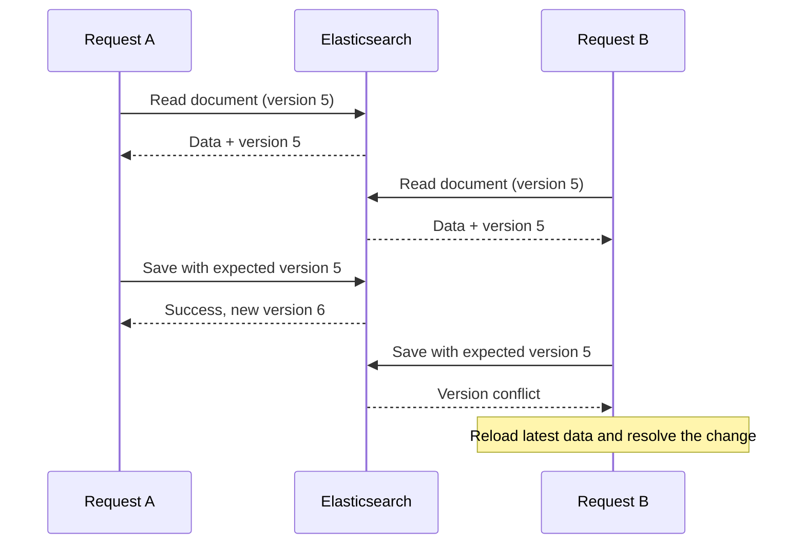
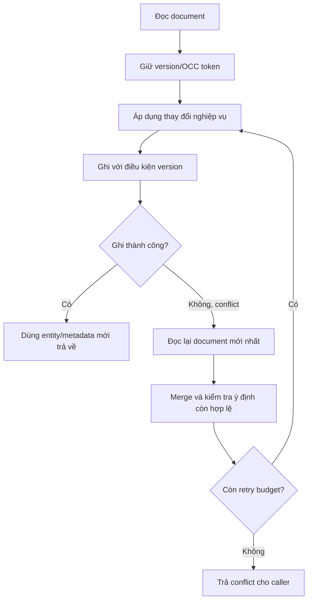

# Versioning, @Version và yêu cầu tương thích API

Khi nhiều request hoặc nhiều worker cùng cập nhật một document Elasticsearch, ứng dụng cần một cách phát hiện dữ liệu đã thay đổi kể từ lúc nó được đọc. Nếu không kiểm soát, một request có thể ghi đè thay đổi mới hơn bằng bản sao cũ. Elasticsearch hỗ trợ versioning và optimistic concurrency control (OCC); Spring Data Elasticsearch tích hợp versioning qua annotation **`@Version`**.

Có ba cơ chế cần phân biệt:

- **Internal versioning**: Elasticsearch quản lý `_version` và tăng version khi document được ghi.
- **Optimistic concurrency control bằng sequence number và primary term**: request chỉ được áp dụng nếu document vẫn ở đúng trạng thái mà client đã đọc.
- **External versioning**: ứng dụng gửi version do hệ thống nguồn quản lý để ngăn dữ liệu cũ ghi đè dữ liệu mới.

`@Version` giúp Spring Data tham gia cơ chế optimistic locking theo API versioning mà Spring Data hỗ trợ. Khi cần kiểm soát trực tiếp bằng `if_seq_no`/`if_primary_term` hoặc external version, có thể dùng API tương ứng của Elasticsearch Java API Client. Không nên coi ba cơ chế này là cùng một loại token hoặc trộn chúng trong cùng một luồng ghi nếu chưa xác định rõ semantics.

## 1. Vấn đề lost update khi nhiều request cùng ghi

Giả sử một sản phẩm có giá `100` và tồn kho `20`. Hai request cùng đọc document:

1. Request A đọc giá `100`, tồn kho `20`.
2. Request B cũng đọc giá `100`, tồn kho `20`.
3. A đổi giá thành `120` và lưu.
4. B đổi tồn kho thành `15`, nhưng lưu cả object cũ có giá `100`.

Nếu B ghi đè toàn bộ `_source` mà không có kiểm soát đồng thời, giá `120` của A có thể bị mất. Đây là lỗi **lost update**.

Optimistic locking cho phép cả hai request đọc mà không khóa document từ đầu. Khi ghi, Elasticsearch kiểm tra document có còn ở version mà request đã đọc hay không. Nếu document đã thay đổi, thao tác ghi cũ bị từ chối để ứng dụng đọc lại và xử lý xung đột.



Đây là optimistic locking: xung đột được phát hiện ở thời điểm ghi, thay vì khóa document trong toàn bộ thời gian xử lý nghiệp vụ.

## 2. `@Version` trong Spring Data Elasticsearch

Spring Data Elasticsearch sử dụng annotation chung của Spring Data:

```java
import org.springframework.data.annotation.Version;
```

Không import một annotation `Version` tùy ý từ thư viện khác. Ví dụ entity:

```java
import org.springframework.data.annotation.Id;
import org.springframework.data.annotation.Version;
import org.springframework.data.elasticsearch.annotations.Document;
import org.springframework.data.elasticsearch.annotations.Field;
import org.springframework.data.elasticsearch.annotations.FieldType;

@Document(indexName = "products")
public class ProductDocument {

    @Id
    private String id;

    @Field(type = FieldType.Keyword)
    private String name;

    @Field(type = FieldType.Long)
    private Long priceInCents;

    @Version
    private Long version;

    protected ProductDocument() {
    }

    public ProductDocument(String id, String name, Long priceInCents) {
        this.id = id;
        this.name = name;
        this.priceInCents = priceInCents;
    }

    public String getId() {
        return id;
    }

    public String getName() {
        return name;
    }

    public Long getPriceInCents() {
        return priceInCents;
    }

    public void setPriceInCents(Long priceInCents) {
        this.priceInCents = priceInCents;
    }

    public Long getVersion() {
        return version;
    }
}
```

`@Version` đánh dấu property mà Spring Data dùng cho versioning. Khi entity được đọc, Spring Data ánh xạ version metadata từ Elasticsearch vào property này. Khi entity được lưu lại, version được sử dụng để kiểm tra cập nhật đồng thời và metadata version mới được trả về theo kết quả ghi.

Nên dùng `Long` nullable để thể hiện rõ entity chưa có version trước lần lưu đầu tiên. Kiểu property và chi tiết khởi tạo/version trả về cần theo tài liệu của đúng release Spring Data Elasticsearch đang dùng; không tự gán version giả định trong constructor.

### 2.1. Version không phải field nghiệp vụ trong `_source`

Versioning là metadata của Elasticsearch. Property `@Version` được Spring Data nhận diện như version property, không nên xem nó là field nghiệp vụ bình thường cần tìm kiếm hoặc aggregation trong `_source`.

Nếu domain cần một trường `revision` hoặc `schemaVersion` có ý nghĩa nghiệp vụ, hãy khai báo field riêng. Đừng dùng cùng một property cho cả version metadata của Elasticsearch và revision do ứng dụng tự quản lý.

## 3. Lưu entity có `@Version`

Có thể dùng Repository:

```java
import org.springframework.data.elasticsearch.repository.ElasticsearchRepository;

public interface ProductRepository
        extends ElasticsearchRepository<ProductDocument, String> {
}
```

Hoặc `ElasticsearchOperations`:

```java
import org.springframework.data.elasticsearch.core.ElasticsearchOperations;
import org.springframework.stereotype.Service;

@Service
public class ProductService {

    private final ElasticsearchOperations operations;

    public ProductService(ElasticsearchOperations operations) {
        this.operations = operations;
    }

    public ProductDocument changePrice(String id, long newPrice) {
        ProductDocument product = operations.get(
            id,
            ProductDocument.class
        );

        if (product == null) {
            throw new IllegalArgumentException("Product not found: " + id);
        }

        product.setPriceInCents(newPrice);

        return operations.save(product);
    }
}
```

Điểm quan trọng là entity được đọc từ Elasticsearch có version hiện tại. Khi lưu entity đó, Spring Data có thể dùng version đã đọc để phát hiện một thay đổi xảy ra trong lúc service xử lý.

Hãy giữ entity/version mới mà thao tác `save` trả về. Không tiếp tục dùng một instance cũ sau khi đã lưu thành công nếu code cần thực hiện một lần cập nhật tiếp theo.

## 4. Xử lý `OptimisticLockingFailureException`

Nếu document đã thay đổi kể từ lúc được đọc, thao tác ghi có thể thất bại với exception thuộc Spring DAO:

```java
import org.springframework.dao.OptimisticLockingFailureException;

try {
    ProductDocument saved = operations.save(product);
    return saved;
} catch (OptimisticLockingFailureException ex) {
    // Document đã được thay đổi bởi một thao tác khác.
    throw new ProductUpdateConflictException(product.getId(), ex);
}
```

Ứng dụng có thể chuyển conflict thành HTTP 409 Conflict nếu đó là API cập nhật do người dùng khởi tạo. Thông báo nên nói dữ liệu đã thay đổi và yêu cầu tải lại, thay vì trả stack trace Elasticsearch.

### 4.1. Không retry mù cùng một entity cũ

Nếu save thất bại vì version conflict, gửi lại chính entity cũ với cùng version thường tiếp tục thất bại. Quy trình xử lý đúng thường là:

1. Đọc lại document mới nhất.
2. Xác định thay đổi nào của request vẫn còn hợp lệ.
3. Áp dụng lại ý định nghiệp vụ lên dữ liệu mới.
4. Lưu lại với version mới.
5. Giới hạn số lần retry và trả conflict nếu vẫn không thành công.

Ví dụ, nếu request chỉ thay đổi giá, hãy đọc lại sản phẩm mới nhất rồi chỉ áp dụng giá mới. Không ghi toàn bộ object cũ đã được đọc trước đó.

### 4.2. Ví dụ retry có giới hạn

```java
public ProductDocument changePriceWithRetry(
        String id,
        long newPrice,
        int maxAttempts) {

    for (int attempt = 1; attempt <= maxAttempts; attempt++) {
        ProductDocument current = operations.get(
            id,
            ProductDocument.class
        );

        if (current == null) {
            throw new IllegalArgumentException("Product not found: " + id);
        }

        current.setPriceInCents(newPrice);

        try {
            return operations.save(current);
        } catch (OptimisticLockingFailureException ex) {
            if (attempt == maxAttempts) {
                throw new ProductUpdateConflictException(id, ex);
            }
        }
    }

    throw new IllegalStateException("Unreachable retry state");
}
```

Đây là ví dụ minh họa cho một thao tác gán giá có thể áp dụng lại sau khi đọc mới. Với nghiệp vụ như trừ tồn kho, cộng điểm hoặc chuyển trạng thái có điều kiện, cần xác định lại quy tắc trên dữ liệu mới; không phải thao tác nào cũng an toàn khi tự động retry.

## 5. Elasticsearch internal versioning

Mỗi document Elasticsearch có metadata `_version`. Với internal versioning, Elasticsearch quản lý giá trị này và tăng version qua các thao tác ghi thành công.

Ví dụ đọc document:

```http
GET products/_doc/P-100
```

Response có thể chứa:

```json
{
  "_index": "products",
  "_id": "P-100",
  "_version": 7,
  "found": true,
  "_source": {
    "name": "Wireless Headphones",
    "priceInCents": 12990
  }
}
```

`_version` là metadata, không phải một thuộc tính thông thường trong `_source`.

### 5.1. Kiểm tra version khi ghi

Elasticsearch hỗ trợ truyền version mong đợi vào thao tác ghi. Với internal versioning, thao tác chỉ thành công nếu version truyền lên khớp với version hiện tại theo semantics của API. Nếu không, Elasticsearch trả version conflict.

Ví dụ REST minh họa:

```http
PUT products/_doc/P-100?version=7&version_type=internal
{
  "name": "Wireless Headphones",
  "priceInCents": 13990
}
```

Request này yêu cầu ghi dựa trên version hiện tại là 7. Nếu document đã có version khác, thao tác bị từ chối.

Spring Data `@Version` giúp ánh xạ version property vào cơ chế versioning mà Spring Data hỗ trợ. Khi dùng API trực tiếp, hãy hiểu rõ `version` và `version_type` được truyền như thế nào; không tự đặt một con số tùy ý.

## 6. Optimistic concurrency control bằng `_seq_no` và `_primary_term`

Elasticsearch cung cấp một cơ chế OCC khác dựa trên hai giá trị metadata:

- **`_seq_no` (sequence number)**: số thứ tự thao tác được shard primary chấp nhận.
- **`_primary_term`**: định danh thế hệ primary shard đang xử lý thao tác.

Khi đọc document, client giữ lại cả hai giá trị. Khi ghi, client gửi `if_seq_no` và `if_primary_term`. Elasticsearch chỉ chấp nhận ghi nếu cả hai vẫn khớp với trạng thái hiện tại của document/shard.

Ví dụ đọc document:

```http
GET products/_doc/P-100
```

Response minh họa:

```json
{
  "_index": "products",
  "_id": "P-100",
  "_seq_no": 42,
  "_primary_term": 3,
  "_source": {
    "name": "Wireless Headphones",
    "priceInCents": 12990
  }
}
```

Ghi với điều kiện OCC:

```http
PUT products/_doc/P-100?if_seq_no=42&if_primary_term=3
{
  "name": "Wireless Headphones",
  "priceInCents": 13990
}
```

Nếu một thao tác khác đã thay đổi document hoặc primary term đã thay đổi, request sẽ thất bại với conflict. Client cần đọc lại dữ liệu và quyết định xử lý.

### 6.1. Vì sao cần cả hai giá trị?

Sequence number xác định thứ tự thao tác trong shard. Primary term thay đổi khi shard chuyển sang primary mới. Kết hợp hai giá trị giúp tránh chấp nhận một thao tác dựa trên trạng thái cũ trong trường hợp primary shard đã thay đổi.

Không chỉ lưu `seq_no` mà bỏ `primary_term`. Hai giá trị phải được giữ và gửi như một cặp.

### 6.2. Dùng Elasticsearch Java API Client

Với Elasticsearch Java API Client, `IndexRequest` hỗ trợ các điều kiện OCC:

```java
import co.elastic.clients.elasticsearch.ElasticsearchClient;
import co.elastic.clients.elasticsearch.core.IndexResponse;

IndexResponse response = client.index(request -> request
    .index("products")
    .id(productId)
    .ifSeqNo(seqNo)
    .ifPrimaryTerm(primaryTerm)
    .document(productDocument)
);
```

Nếu document đã thay đổi kể từ lúc đọc, client nhận lỗi version conflict. Cách gọi tương ứng cũng có thể được áp dụng cho update/delete request mà API client phiên bản đang dùng hỗ trợ.

Nếu cần sequence number và primary term từ search hit thay vì GET, request search phải yêu cầu trả metadata đó (ví dụ `seq_no_primary_term: true` trong Search API). Kiểm tra API builder tương ứng của phiên bản Java Client.

### 6.3. `@Version` có giống `seq_no`/`primary_term` không?

Không nên mặc định hai cách này là cùng một API hoặc cùng một token:

- `@Version` là abstraction của Spring Data, dựa trên version property và cơ chế versioning mà release Spring Data Elasticsearch tích hợp.
- `if_seq_no`/`if_primary_term` là điều kiện OCC rõ ràng của Elasticsearch API.
- `_version` và cặp `_seq_no`/`_primary_term` là các metadata khác nhau do Elasticsearch trả về.

Nếu ứng dụng dùng `ElasticsearchOperations` cho một phần ghi và Java API Client trực tiếp cho phần khác, cần thống nhất cơ chế OCC và metadata được lưu trong domain/command. Đừng lấy `_version` rồi truyền nhầm vào `if_seq_no`, hoặc dùng `seq_no` như một version property.

## 7. External versioning cho dữ liệu đến từ hệ thống nguồn

Một số hệ thống có version riêng, ví dụ database nguồn có revision tăng dần hoặc event stream có sequence number. Elasticsearch hỗ trợ external versioning để bảo đảm một bản ghi cũ không ghi đè bản ghi mới hơn.

Ví dụ REST:

```http
PUT products/_doc/P-100?version=105&version_type=external
{
  "name": "Wireless Headphones",
  "priceInCents": 13990
}
```

Với `version_type=external`, version gửi lên phải lớn hơn version hiện tại của document. Nếu event cũ đến sau event mới, Elasticsearch từ chối update vì version cũ hơn.

### 7.1. `external` và `external_gte`

| Version type | Quy tắc chính | Khi phù hợp |
|---|---|---|
| `internal` | Elasticsearch quản lý version; request có thể kiểm tra version hiện tại | OCC cho thao tác đọc-sửa-ghi thông thường |
| `external` | Version từ client phải lớn hơn version hiện tại | Đồng bộ từ nguồn có revision tăng đơn điệu |
| `external_gte` | Version từ client phải lớn hơn hoặc bằng version hiện tại | Một số luồng replay có payload giống nhau và version bằng nhau |

`external_gte` cần cẩn trọng: hai payload khác nhau cùng version có thể cho phép payload đến sau ghi đè payload trước. Chỉ dùng khi nguồn bảo đảm cùng một version luôn đại diện cùng trạng thái hoặc khi semantics đó được chấp nhận.

External versioning không phải cách thay thế `@Version` cho mọi entity. Nó phù hợp khi hệ thống nguồn là chủ sở hữu version và có thể bảo đảm version tăng theo thứ tự dữ liệu.

## 8. Chọn cơ chế versioning nào?

| Nhu cầu | Cơ chế nên cân nhắc | Lý do |
|---|---|---|
| CRUD qua Spring Data, muốn phát hiện ghi đè đồng thời | `@Version` | Tích hợp với entity/repository/operations của Spring Data |
| Dùng Elasticsearch API trực tiếp và cần OCC theo lần đọc | `if_seq_no` + `if_primary_term` | Token OCC rõ ràng từ Elasticsearch |
| Đồng bộ event từ database nguồn có revision tăng dần | External versioning | Chặn event cũ ghi đè event mới |
| Chỉ cần ghi document không có read-modify-write | Ghi bình thường với ID phù hợp | Không cần thêm cơ chế OCC nếu không có yêu cầu xung đột |
| Bulk import cần xử lý từng item | Bulk response và version policy cho từng operation | Mỗi item có thể thành công/thất bại riêng |

Không cần bật versioning cho mọi document một cách máy móc. Chọn cơ chế dựa trên nguy cơ lost update, nguồn dữ liệu và cách ứng dụng thực hiện ghi.

## 9. Versioning trong bulk operations

Bulk request có thể chứa nhiều index/update/delete operation. Mỗi item có thể có điều kiện version hoặc OCC riêng nếu API hỗ trợ. Một item conflict không làm toàn bộ bulk request rollback.

Ví dụ REST Bulk API với external version:

```text
{ "index": { "_index": "products", "_id": "P-100", "version": 105, "version_type": "external" } }
{ "name": "Wireless Headphones", "priceInCents": 13990 }
```

Nếu item thất bại vì version conflict, đọc response item để biết status/error. Không retry mù toàn bộ bulk batch, đặc biệt nếu các operation khác đã thành công.

Với Spring Data bulk operations, kiểm tra `BulkFailureException` và danh sách failed documents. Nếu cần `seq_no`, `primary_term`, version và operation result cho từng item, Elasticsearch Java API Client `BulkResponse.items()` có thể cung cấp chi tiết hơn tùy operation/version.

## 10. Tương thích API giữa các thế hệ Spring Data Elasticsearch

Spring Data Elasticsearch thay đổi client và query API qua các major release. Khi đọc ví dụ trên mạng hoặc nâng cấp dependency, cần xác định rõ phiên bản dự án.

Một ranh giới quan trọng:

| Thế hệ Spring Data Elasticsearch | Client/API thường gặp | Ghi chú |
|---|---|---|
| 4.x | Elasticsearch High Level REST Client (RHLC); các query API như `NativeSearchQuery` | Ví dụ cũ có thể dùng `NativeSearchQueryBuilder` và `RestHighLevelClient`. |
| 5.x | Elasticsearch Java API Client (ELC); query API như `NativeQuery` | Ví dụ mới dùng `co.elastic.clients.elasticsearch.*` và builder lambda. |

Các abstraction như `ElasticsearchOperations`, Repository và annotation Spring Data giúp giữ code domain ổn định hơn, nhưng không bảo đảm mọi method, builder hoặc response type giống nhau giữa major version.

### 10.1. Import đúng client theo phiên bản

Với Spring Data Elasticsearch 5.x, Java API Client dùng package:

```java
import co.elastic.clients.elasticsearch.ElasticsearchClient;
```

Với thế hệ 4.x, ví dụ cũ có thể dùng:

```java
import org.elasticsearch.client.RestHighLevelClient;
```

Không trộn request builder của RHLC với `ElasticsearchClient` mới. Hai client có model request/response, serialization và API khác nhau.

### 10.2. `NativeSearchQuery` và `NativeQuery`

Trong code cũ, có thể gặp:

```java
NativeSearchQuery query = new NativeSearchQueryBuilder()
    .withQuery(...)
    .build();
```

Trong code Spring Data Elasticsearch 5.x, thường dùng `NativeQuery` với Elasticsearch Java API Client builder:

```java
NativeQuery query = NativeQuery.builder()
    .withQuery(q -> q
        .match(m -> m
            .field("name")
            .query("wireless")
        )
    )
    .build();
```

Đây không phải hai class có thể thay thế trực tiếp bằng cách đổi import. Khi nâng cấp, cần chuyển query DSL, sort, aggregation, highlight, pageable và cách đọc response theo API mới.

### 10.3. Giữ dependency theo Spring Boot BOM

Nếu dự án dùng Spring Boot, ưu tiên dependency management/BOM mà Spring Boot release cung cấp. Tránh tự nâng riêng `spring-data-elasticsearch`, `spring-data-commons`, `elasticsearch-java` hoặc client transport lên các phiên bản không tương thích.

Khi chọn phiên bản, kiểm tra:

- Spring Boot version.
- Spring Data release train được Boot quản lý.
- Spring Data Elasticsearch module version.
- Elasticsearch Java API Client version.
- Elasticsearch server version và ma trận tương thích.
- JDK version.

Không suy luận server/client compatibility chỉ từ việc project compile thành công. Một client có thể compile nhưng request/response hoặc feature không được server phiên bản đó hỗ trợ.

## 11. Tương thích của `@Version` và exception

`@Version` thuộc Spring Data Commons:

```java
import org.springframework.data.annotation.Version;
```

Đây là annotation chung được Spring Data Elasticsearch sử dụng. Tuy vậy, cách triển khai versioning, kiểu property được hỗ trợ, API đọc metadata và exception mapping có thể khác theo release.

Các điểm cần xác nhận khi nâng cấp:

1. Annotation có còn được đọc từ đúng package `org.springframework.data.annotation.Version` không?
2. Property type được hỗ trợ trong release đang dùng là gì? Ưu tiên kiểu nullable được tài liệu xác nhận, thường dùng `Long`.
3. Spring Data đang sử dụng internal version hay một cơ chế OCC khác cho thao tác cụ thể?
4. Repository và `ElasticsearchOperations.save(...)` chuyển conflict thành exception nào?
5. Bulk operations báo conflict qua exception tổng hợp hay response item?
6. Nếu gọi Java API Client trực tiếp, response có cung cấp `_version`, `_seq_no`, `_primary_term` theo request đã cấu hình không?

Không copy một đoạn code versioning từ Spring Data 4.x vào 5.x mà chưa kiểm tra import, builder và exception type. Đặc biệt, không dùng API `RestHighLevelClient` trong một project đã chuyển sang Java API Client chỉ vì một ví dụ cũ có vẻ tương tự.

## 12. API compatibility khi dùng Java API Client trực tiếp

Elasticsearch Java API Client là client có kiểu cho REST API của Elasticsearch. Các request builder thường thay đổi theo version của thư viện. Ví dụ OCC dùng `ifSeqNo` và `ifPrimaryTerm`:

```java
IndexResponse response = client.index(request -> request
    .index("products")
    .id(productId)
    .ifSeqNo(seqNo)
    .ifPrimaryTerm(primaryTerm)
    .document(document)
);
```

Khi nâng version client, cần kiểm tra:

- Package và tên request/response class.
- Kiểu của `seqNo`, `primaryTerm` và version.
- Builder method có còn tồn tại và cùng overload không.
- Error response được bọc trong exception như thế nào.
- JSON mapper/transport có tương thích với cấu hình Spring không.
- Server hỗ trợ endpoint và option request đang sử dụng không.

Nếu Spring Data Elasticsearch cung cấp abstraction phù hợp, ưu tiên dùng abstraction đó cho CRUD thông thường. Dùng Java API Client trực tiếp khi cần option Elasticsearch chưa được expose qua Spring Data, nhưng cô lập trong adapter/service để giới hạn phụ thuộc API.

## 13. Không trộn version metadata với business revision

Một entity có thể cần cả version của Elasticsearch và revision nghiệp vụ từ hệ thống nguồn:

```java
@Document(indexName = "products")
public class ProductDocument {

    @Id
    private String id;

    @Version
    private Long elasticsearchVersion;

    @Field(type = FieldType.Long)
    private Long sourceRevision;
}
```

Hai field có mục đích khác nhau:

- `elasticsearchVersion` dùng cho optimistic locking do Spring Data/Elasticsearch quản lý.
- `sourceRevision` là revision nghiệp vụ do hệ thống nguồn quản lý và có thể được dùng để quyết định event nào mới hơn.

Nếu dùng external versioning, version nguồn có thể được truyền trong metadata của request thay vì chỉ lưu như field `_source`. Dù chọn cách nào, cần xác định một nguồn sự thật duy nhất cho từng cơ chế.

Không dùng `sourceRevision` thay cho `@Version` trừ khi đã thiết kế external versioning và hiểu rõ các quy tắc version type. Ngược lại, `_version` không thể thay thế revision nghiệp vụ để đối soát event của database nguồn.

## 14. Các lỗi thường gặp

| Hiện tượng | Nguyên nhân có thể | Cách xử lý |
|---|---|---|
| Hai request ghi đè thay đổi của nhau | Không có optimistic locking hoặc update toàn bộ object cũ | Dùng `@Version`/OCC và áp dụng thay đổi lên dữ liệu mới nhất. |
| `OptimisticLockingFailureException` khi save | Document đã thay đổi sau lần đọc | Đọc lại, merge ý định nghiệp vụ và retry có giới hạn. |
| Retry vẫn conflict | Gửi lại entity cũ với version cũ | Reload entity và lấy version mới trước khi retry. |
| Version field bị coi là dữ liệu domain | Dùng sai annotation hoặc import | Dùng `org.springframework.data.annotation.Version`. |
| Dùng `seq_no` như version | Nhầm metadata OCC | Giữ cặp `_seq_no` và `_primary_term`; không tráo với `_version`. |
| Event cũ ghi đè event mới | Không dùng external versioning hoặc version nguồn không đơn điệu | Dùng external version phù hợp và xác minh thứ tự revision. |
| `external_gte` ghi đè payload cùng version | Nhiều payload khác nhau dùng cùng revision | Chỉ dùng khi cùng version đảm bảo cùng trạng thái. |
| Ví dụ không compile sau nâng cấp | Trộn API RHLC/NativeSearchQuery với Java API Client/NativeQuery | Đối chiếu major version và chuyển đổi request/response. |
| Bulk save không ném OptimisticLockingFailureException như mong đợi | Bulk API báo lỗi theo item/exception tổng hợp | Đọc `BulkFailureException` hoặc `BulkResponse.items()`. |
| Version conflict bị xử lý thành lỗi server chung | Exception translation/API mapping chưa đúng | Chuyển thành conflict nghiệp vụ/HTTP 409 phù hợp. |

## 15. Kiểm thử optimistic locking

Một integration test nên chứng minh hai bản đọc cùng version không thể ghi đè nhau một cách âm thầm.

Luồng test:

1. Lưu một document ban đầu.
2. Đọc document thành hai instance độc lập, A và B.
3. Thay đổi và lưu A thành công.
4. Thay đổi B dựa trên dữ liệu cũ rồi thử lưu.
5. Xác nhận B gặp optimistic locking conflict.
6. Đọc lại document và xác nhận thay đổi của A vẫn còn.

Ví dụ khung test:

```java
@Test
void staleEntityCannotOverwriteNewerVersion() {
    ProductDocument initial = operations.save(
        new ProductDocument("P-100", "Headphones", 10000L)
    );

    ProductDocument firstRead = operations.get("P-100", ProductDocument.class);
    ProductDocument secondRead = operations.get("P-100", ProductDocument.class);

    firstRead.setPriceInCents(12000L);
    operations.save(firstRead);

    secondRead.setPriceInCents(9000L);

    assertThatThrownBy(() -> operations.save(secondRead))
        .isInstanceOf(OptimisticLockingFailureException.class);

    ProductDocument latest = operations.get("P-100", ProductDocument.class);
    assertThat(latest.getPriceInCents()).isEqualTo(12000L);
}
```

Đây là test minh họa; cần dùng index riêng cho test, chờ refresh khi cần và xác nhận versioning API của release Spring Data đang dùng. Với Elasticsearch API Client trực tiếp, tạo test tương tự bằng cách giữ `_seq_no`/`_primary_term`, ghi lần đầu, rồi gửi request thứ hai với cặp token cũ và xác nhận conflict.

## 16. Quy trình xử lý cập nhật có kiểm soát



Các bước thực tế:

1. Xác định ai là chủ sở hữu dữ liệu và ai cấp version.
2. Chọn `@Version`, `if_seq_no`/`if_primary_term` hoặc external versioning.
3. Đọc document cùng metadata version tương ứng.
4. Áp dụng thay đổi nghiệp vụ lên bản dữ liệu vừa đọc.
5. Ghi với điều kiện version/token đã đọc.
6. Nếu thành công, dùng metadata mới trả về.
7. Nếu conflict, đọc lại và merge ý định; không gửi lại object cũ.
8. Giới hạn retry và trả conflict nếu không thể giải quyết an toàn.
9. Kiểm thử hai writer đồng thời và luồng retry trên Elasticsearch tương thích.
10. Khi nâng cấp Spring Data/client/server, kiểm tra lại import, builder, exception và semantics versioning.

## 17. Kết luận

Versioning giúp phát hiện cập nhật đồng thời và ngăn một bản ghi cũ ghi đè thay đổi mới hơn. Spring Data Elasticsearch cung cấp `@Version` từ `org.springframework.data.annotation.Version` để tích hợp version property vào thao tác lưu entity. Khi phát hiện xung đột, ứng dụng thường nhận `OptimisticLockingFailureException`; cách xử lý đúng là đọc lại, áp dụng lại ý định nghiệp vụ và retry có giới hạn.

Elasticsearch có nhiều cơ chế metadata khác nhau: `_version` cho internal/external versioning và cặp `_seq_no`/`_primary_term` cho optimistic concurrency control. External versioning phù hợp khi hệ thống nguồn sở hữu revision tăng đơn điệu. Không nhầm các token này hoặc dùng lẫn chúng nếu chưa xác định rõ semantics.

API Spring Data Elasticsearch cũng thay đổi theo major version. Nhánh 4.x thường dùng Rest High Level REST Client và `NativeSearchQuery`; nhánh 5.x dùng Elasticsearch Java API Client và `NativeQuery`. Ưu tiên dependency được Spring Boot BOM quản lý, kiểm tra ma trận tương thích server/client, và cô lập các API client trực tiếp trong adapter. Khi nâng cấp, xác minh lại `@Version`, kiểu property, exception translation và request/response builder. Làm đúng các bước này giúp optimistic locking hoạt động nhất quán và tránh lỗi do trộn API giữa các thế hệ thư viện.
