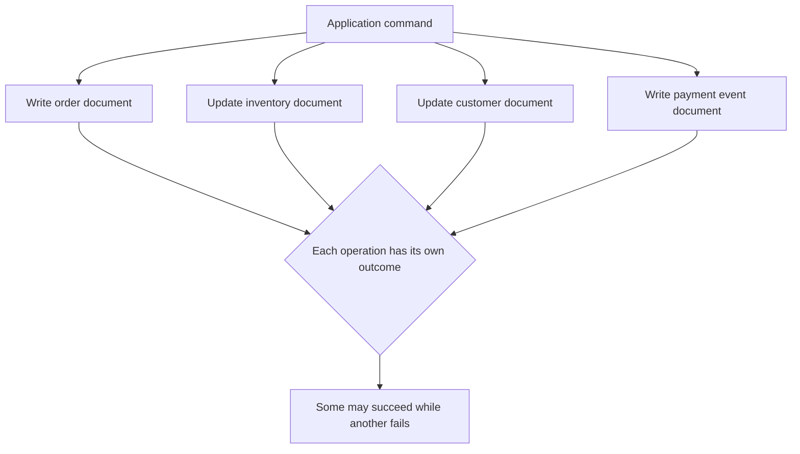
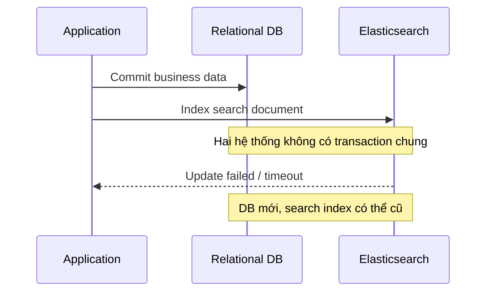
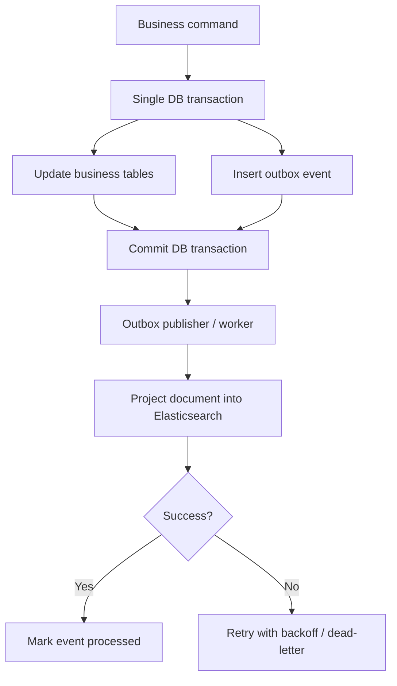
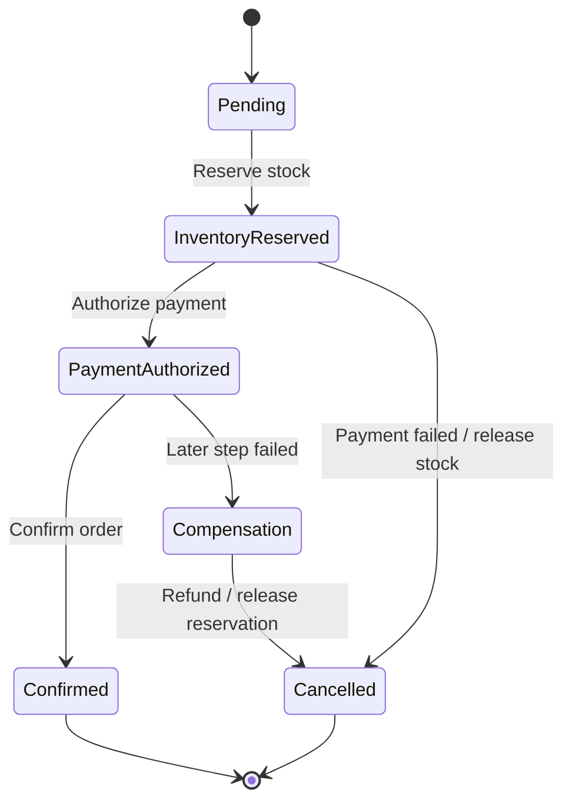

# Không có giao dịch ACID đa tài liệu tương đương JPA

Khi làm việc với cơ sở dữ liệu quan hệ qua JPA, ứng dụng thường gom nhiều thao tác ghi vào một transaction: tạo đơn hàng, trừ tồn kho, ghi lịch sử thanh toán rồi commit. Nếu một bước thất bại, transaction có thể rollback để đưa toàn bộ thay đổi trong phạm vi transaction về trạng thái ban đầu.

Elasticsearch không cung cấp transaction ACID đa tài liệu tương đương cách JPA/JDBC làm việc với một relational database. Một thao tác ghi trên **một document** có tính nguyên tử ở cấp document, nhưng một chuỗi thao tác trên nhiều document, nhiều shard hoặc nhiều index không được bao bọc trong một transaction chung có thể commit/rollback toàn bộ. Bulk API cũng không biến nhiều item thành một transaction nguyên tử: từng item thành công hoặc thất bại độc lập.

Vì vậy, khi dùng Spring Data Elasticsearch, không nên giả định `@Transactional` của JPA sẽ bao trùm cả thao tác ghi Elasticsearch. Nếu nghiệp vụ cần nhất quán giữa nhiều document hoặc giữa database quan hệ và Elasticsearch, ứng dụng phải thiết kế ranh giới dữ liệu và quy trình đồng bộ rõ ràng, thường bằng cách gom invariant vào một document, dùng transactional outbox, saga/compensation, idempotent retry và reconciliation.

## 1. Transaction ACID trong JPA có phạm vi như thế nào?

ACID là bốn thuộc tính thường dùng để mô tả transaction:

- **Atomicity:** tất cả thao tác trong transaction cùng thành công hoặc cùng bị rollback.
- **Consistency:** transaction đưa dữ liệu từ một trạng thái hợp lệ sang trạng thái hợp lệ khác theo các ràng buộc được hệ thống bảo đảm.
- **Isolation:** các transaction đồng thời không nhìn thấy trạng thái trung gian theo mức cô lập đã chọn.
- **Durability:** sau khi commit thành công, thay đổi được lưu bền vững theo bảo đảm của hệ quản trị dữ liệu.

Ví dụ một service JPA:

```java
@Service
public class OrderService {

    private final OrderRepository orders;
    private final InventoryRepository inventory;
    private final PaymentRepository payments;

    @Transactional
    public void placeOrder(PlaceOrderCommand command) {
        Order order = orders.save(Order.pending(command));
        inventory.decrease(command.productId(), command.quantity());
        payments.save(Payment.requested(order.getId(), command.amount()));
        order.markSubmitted();
    }
}
```

Nếu cả ba repository tham gia cùng một transaction manager JPA và cùng một transaction database, commit/rollback có thể bao phủ các thay đổi đó. Đây là ranh giới transaction do relational database và transaction manager quản lý.

Điều kiện quan trọng là các thao tác thực sự tham gia cùng transaction resource/transaction manager. Chỉ đặt annotation `@Transactional` trên method không tự tạo ra một transaction phân tán giữa mọi hệ thống mà method gọi tới.

## 2. Elasticsearch bảo đảm nguyên tử ở cấp một document

Elasticsearch lưu document theo `_id` trong một index và shard. Một thao tác index, delete hoặc update cho một document được xử lý như một thao tác nguyên tử ở cấp document: reader không nhìn thấy một nửa JSON document đang được ghi.

Ví dụ cập nhật một document đơn hàng:

```http
POST /orders/_update/order-1001
{
  "doc": {
    "status": "CONFIRMED",
    "confirmedAt": "2026-11-13T10:30:00Z"
  }
}
```

Thay đổi của document `order-1001` được áp dụng như một đơn vị. Search không nhận một document có `status` mới nhưng `confirmedAt` mới chỉ được ghi một nửa. Update API thực hiện đọc document hiện tại, áp dụng partial doc hoặc script, rồi index lại phiên bản document đã cập nhật.

Điều đó không có nghĩa Elasticsearch cung cấp transaction ACID cho một nhóm document. Nếu ứng dụng cần cập nhật `order-1001`, `inventory-product-7` và `customer-42`, ba thao tác đó là ba lần ghi riêng biệt. Có thể một thao tác thành công trong khi thao tác khác thất bại.

### 2.1 Một document có thể chứa nhiều thuộc tính liên quan

Nếu các field phải thay đổi cùng nhau để giữ invariant, có thể mô hình hóa chúng trong cùng một document:

```json
{
  "orderId": "order-1001",
  "status": "CONFIRMED",
  "paymentStatus": "AUTHORIZED",
  "inventoryReservation": {
    "status": "RESERVED",
    "reservationId": "reservation-9001"
  },
  "updatedAt": "2026-11-13T10:30:00Z"
}
```

Một update document có thể thay đổi các field liên quan trong cùng một lần ghi. Đây là cách tận dụng atomicity cấp document. Tuy nhiên, nó phù hợp khi dữ liệu thực sự thuộc cùng một aggregate và có thể được đọc/cập nhật như một đơn vị.

### 2.2 Nested object không tạo transaction riêng

Một mảng `nested` trong Elasticsearch được lập chỉ mục bằng hidden Lucene documents liên kết với document cha, nhưng nó vẫn thuộc về document cha trong mô hình API. Nested child không phải một document độc lập có thể tham gia transaction riêng. Cập nhật nested array thông thường vẫn cập nhật document cha.

Vì vậy, nếu một order có `items`, `addresses` hoặc các thành phần nested cần thay đổi đồng bộ, việc đặt chúng trong cùng document có thể giúp cập nhật nguyên tử ở cấp document. Nhưng nếu mỗi item có vòng đời độc lập hoặc cần cập nhật với tần suất cao, cần cân nhắc mô hình hóa và quy trình đồng bộ khác.

## 3. Không có transaction ACID đa tài liệu trong Elasticsearch

Giả sử một request cần thực hiện:

1. Tạo document đơn hàng.
2. Trừ tồn kho trong document sản phẩm.
3. Tăng số đơn hàng của khách hàng.
4. Tạo document lịch sử thanh toán.

Không có API transaction native nào để gói bốn thao tác trên thành một đơn vị commit/rollback ACID tương đương một transaction JPA trên relational database.



Ứng dụng phải xử lý trạng thái một phần. Nếu ba thao tác thành công và thao tác thứ tư thất bại, Elasticsearch không tự động rollback ba thao tác đã thành công.

### 3.1 Không có rollback toàn bộ nhóm ghi

Một khi document đã được cập nhật thành công, một thao tác sau đó thất bại không tự động đảo ngược thay đổi trước đó. Nếu nghiệp vụ cần bù trừ, ứng dụng phải gửi thao tác bù trừ riêng và xử lý khả năng thao tác bù trừ cũng thất bại.

### 3.2 Không có isolation chung giữa nhiều document

Một search request có thể đọc các document ở những thời điểm refresh/replication khác nhau theo semantics của Elasticsearch. Không có transaction snapshot đa document tương đương mức isolation của một database transaction JPA.

Nếu ứng dụng đọc document A, sau đó document B, trong khi một writer khác cập nhật cả hai theo hai request riêng, ứng dụng có thể quan sát trạng thái trung gian. Cần thiết kế dữ liệu và quy trình nghiệp vụ để không phụ thuộc vào một snapshot đa document mà Elasticsearch không cung cấp.

### 3.3 Nhiều shard hoặc nhiều index không tạo ranh giới transaction

Document được định tuyến tới một primary shard. Một document write có thể được bảo vệ ở cấp document, nhưng thao tác trên các document khác nhau có thể đi tới các shard khác nhau. Gửi các thao tác trong cùng một HTTP request hoặc cùng một Bulk request không biến chúng thành một transaction xuyên shard.

Tương tự, cập nhật hai index khác nhau không có transaction commit/rollback chung. Alias cũng chỉ là cơ chế trỏ tên logic tới index; alias switch có thể thay đổi tập index được trỏ tới trong một thao tác quản lý alias, nhưng không tạo transaction dữ liệu đa index.

## 4. Bulk API không phải transaction

Bulk API gom nhiều thao tác index/create/update/delete vào một request để giảm overhead mạng và tăng throughput:

```http
POST /_bulk
{ "index": { "_index": "orders", "_id": "order-1001" } }
{ "orderId": "order-1001", "status": "CREATED" }
{ "update": { "_index": "inventory", "_id": "product-7" } }
{ "doc": { "stock": 19 } }
{ "index": { "_index": "order-events", "_id": "event-1001" } }
{ "orderId": "order-1001", "type": "ORDER_CREATED" }
```

Response Bulk có kết quả ở cấp từng item. Một số item có thể thành công, item khác có thể thất bại do version conflict, mapping error, routing error hoặc lỗi shard.

Ví dụ response rút gọn:

```json
{
  "errors": true,
  "items": [
    {
      "index": {
        "_index": "orders",
        "_id": "order-1001",
        "status": 201,
        "result": "created"
      }
    },
    {
      "update": {
        "_index": "inventory",
        "_id": "product-7",
        "status": 409,
        "error": {
          "type": "version_conflict_engine_exception"
        }
      }
    },
    {
      "index": {
        "_index": "order-events",
        "_id": "event-1001",
        "status": 201,
        "result": "created"
      }
    }
  ]
}
```

Đơn hàng và event đã được ghi, nhưng update inventory conflict. Elasticsearch không rollback hai item thành công chỉ vì item thứ hai thất bại.

### 4.1 Phải kiểm tra lỗi từng item

Không chỉ kiểm tra HTTP status hoặc giả định Bulk request thành công toàn bộ. Ứng dụng cần:

- Đọc cờ `errors` và kết quả từng item.
- Ghi nhận ID, loại thao tác và lỗi cụ thể.
- Retry các lỗi tạm thời theo policy có backoff.
- Không retry mù lỗi mapping hoặc dữ liệu không hợp lệ.
- Đảm bảo thao tác retry có tính idempotent.
- Đưa lỗi không thể tự phục hồi vào dead-letter queue hoặc hàng đợi xử lý thủ công.

### 4.2 Bulk update trong Spring Data Elasticsearch

Spring Data Elasticsearch cung cấp các API bulk cho nhiều `IndexQuery`, `UpdateQuery` hoặc delete query tùy phiên bản. Ví dụ:

```java
List<UpdateQuery> updates = List.of(
    UpdateQuery.builder("product-7")
        .withDocument(Document.create().append("stock", 19))
        .build(),
    UpdateQuery.builder("product-8")
        .withDocument(Document.create().append("stock", 12))
        .build()
);

operations.bulkUpdate(updates, IndexCoordinates.of("inventory"));
```

Bulk API giúp gửi nhiều update hiệu quả hơn, nhưng không cung cấp transaction nguyên tử. Kiểm tra kiểu kết quả và chi tiết item lỗi theo đúng phiên bản Spring Data đang dùng; không coi việc method trả về bình thường là bằng chứng tất cả item đã thành công nếu API trả kết quả từng phần.

## 5. `@Transactional` của JPA không bao trùm Elasticsearch

Một lỗi thiết kế phổ biến là đặt `@Transactional` trên service dùng cả JPA repository và ElasticsearchOperations rồi kỳ vọng hai hệ thống commit/rollback cùng nhau.

Ví dụ:

```java
@Service
public class CatalogService {

    private final ProductJpaRepository productJpaRepository;
    private final ElasticsearchOperations elasticsearchOperations;

    @Transactional
    public void updateProduct(Product product) {
        productJpaRepository.save(product);

        Document partial = Document.create()
            .append("name", product.getName())
            .append("price", product.getPrice());

        UpdateQuery update = UpdateQuery.builder(product.getId())
            .withDocument(partial)
            .build();

        elasticsearchOperations.update(
            update,
            IndexCoordinates.of("products-search")
        );
    }
}
```

`@Transactional` ở đây thường quản lý transaction của JPA datasource. ElasticsearchOperations sử dụng Elasticsearch client riêng và không tự tham gia transaction JPA đó. Nếu update Elasticsearch thành công nhưng JPA commit thất bại, search index có thể chứa dữ liệu mà database không commit. Nếu JPA commit thành công nhưng thao tác Elasticsearch thất bại, database mới và search index cũ có thể tồn tại cùng lúc.

### 5.1 Vì sao annotation không đủ?

Spring transaction được điều khiển bởi một `PlatformTransactionManager` cụ thể. `JpaTransactionManager` quản lý transaction cho một EntityManagerFactory/datasource tương ứng. Nó không tự điều khiển mọi hệ thống bên ngoài như Elasticsearch, HTTP service hoặc object storage.

Spring có thể cấu hình nhiều transaction manager hoặc các cơ chế phối hợp đặc biệt, nhưng điều đó không tạo ra native multi-document ACID transaction trong Elasticsearch. Không nên suy ra rằng method có `@Transactional` là mọi side effect trong method đều rollback cùng nhau.

### 5.2 Thứ tự gọi thay đổi loại lỗi nhưng không tạo atomicity

Nếu ghi Elasticsearch trước rồi ghi JPA:

- Elasticsearch thành công.
- JPA thất bại và rollback.
- Elasticsearch không tự rollback.

Nếu ghi JPA trước rồi Elasticsearch:

- JPA có thể commit.
- Elasticsearch thất bại.
- Database đã thay đổi, search index chưa cập nhật.

Đổi thứ tự chỉ đổi trạng thái lỗi có thể gặp. Nó không giải quyết dual-write problem.

## 6. Dual-write problem giữa database và Elasticsearch

Trong nhiều hệ thống, relational database là nguồn dữ liệu chuẩn, Elasticsearch là read model/search index. Một thao tác nghiệp vụ cần ghi database và cập nhật Elasticsearch.



Nếu ghi cả hai trực tiếp trong request, luôn có một khoảng thời gian một hệ thống đã commit còn hệ thống kia chưa. Network timeout còn làm trạng thái không chắc chắn: ứng dụng không biết Elasticsearch đã nhận và ghi request hay chưa.

Đây là lý do nhiều hệ thống coi Elasticsearch là projection/read model có thể tái tạo từ nguồn dữ liệu chuẩn, thay vì là nơi duy nhất lưu invariant nghiệp vụ cần transaction nhiều bản ghi.

## 7. Transactional outbox: ghi database và sự kiện trong cùng transaction

Nếu database quan hệ là nguồn chuẩn, một cách phổ biến để tránh mất sự kiện đồng bộ là transactional outbox.

Trong cùng một transaction JPA:

1. Cập nhật bảng nghiệp vụ.
2. Ghi một event vào bảng outbox.
3. Commit cả hai trong cùng database transaction.

Một worker riêng đọc outbox và cập nhật Elasticsearch. Nếu Elasticsearch tạm thời lỗi, event vẫn còn trong outbox để retry.



Database transaction bảo đảm business data và outbox event cùng commit hoặc rollback. Worker có thể giao event ít nhất một lần; vì vậy thao tác cập nhật Elasticsearch phải idempotent.

### 7.1 Bảng outbox minh họa

```sql
CREATE TABLE outbox_event (
    event_id       VARCHAR(64) PRIMARY KEY,
    aggregate_type VARCHAR(100) NOT NULL,
    aggregate_id   VARCHAR(100) NOT NULL,
    event_type     VARCHAR(100) NOT NULL,
    payload        TEXT NOT NULL,
    created_at     TIMESTAMP NOT NULL,
    processed_at   TIMESTAMP NULL,
    retry_count    INTEGER NOT NULL DEFAULT 0
);
```

Tên kiểu dữ liệu và cú pháp cần điều chỉnh theo database thực tế. `event_id` duy nhất giúp nhận biết event khi retry. `aggregate_id` cho phép nhóm sự kiện theo entity/aggregate. `processed_at` hoặc trạng thái tương ứng cho biết event đã được xử lý.

### 7.2 Ghi outbox trong cùng transaction JPA

```java
@Service
public class ProductCommandService {

    private final ProductJpaRepository products;
    private final OutboxRepository outbox;

    @Transactional
    public void changePrice(String productId, BigDecimal newPrice) {
        ProductEntity product = products.findById(productId)
            .orElseThrow();

        product.changePrice(newPrice);

        outbox.save(OutboxEvent.productPriceChanged(
            UUID.randomUUID().toString(),
            product.getId(),
            product.getVersion(),
            newPrice
        ));
    }
}
```

Database commit cả thay đổi sản phẩm và event. Nếu transaction rollback, event cũng không tồn tại để worker xử lý một thay đổi chưa commit.

### 7.3 Worker cập nhật Elasticsearch

```java
@Component
public class ProductProjectionWorker {

    private final OutboxRepository outbox;
    private final ElasticsearchOperations operations;

    public void process(OutboxEvent event) {
        Document document = Document.create()
            .append("productId", event.aggregateId())
            .append("price", event.newPrice())
            .append("version", event.aggregateVersion());

        IndexQuery indexQuery = new IndexQueryBuilder()
            .withId(event.aggregateId())
            .withObject(document)
            .build();

        operations.index(indexQuery, IndexCoordinates.of("products-search"));
        outbox.markProcessed(event.eventId());
    }
}
```

Đây là ví dụ minh họa cấu trúc worker; trong hệ thống thật, cần kiểm tra event ordering, version và API builder đúng phiên bản Spring Data. Nếu worker crash sau khi Elasticsearch ghi thành công nhưng trước khi đánh dấu event processed, event sẽ được phát lại. Vì thế projection phải idempotent và nên kiểm tra version để event cũ không ghi đè trạng thái mới hơn.

### 7.4 Outbox không tạo transaction chung với Elasticsearch

Outbox không làm database và Elasticsearch commit cùng lúc. Nó bảo đảm sự kiện cần đồng bộ được lưu bền vững cùng transaction nguồn, sau đó worker retry cho tới khi projection được cập nhật hoặc event được đưa vào luồng xử lý lỗi.

Kết quả thường là **eventual consistency**: database commit trước; Elasticsearch sẽ hội tụ sau khi worker xử lý event. Đây là đánh đổi có chủ đích để tránh mất cập nhật khi một hệ thống tạm thời không sẵn sàng.

## 8. Idempotency và xử lý event lặp

Outbox, message broker và retry thường cung cấp semantics at-least-once: cùng một event có thể được giao nhiều lần. Worker cần xử lý lặp mà không làm dữ liệu sai.

### 8.1 Ghi projection theo ID ổn định

Nếu mỗi product có một document search theo `productId`, dùng ID đó làm `_id`. Ghi lại cùng một projection với cùng nội dung có thể tạo kết quả cuối giống nhau (idempotent) nếu thao tác là index/replace deterministic.

Không tạo `_id` ngẫu nhiên cho mỗi lần retry nếu event mô tả cùng một trạng thái, vì sẽ tạo document trùng.

### 8.2 Dùng version để ngăn event cũ ghi đè event mới

Giả sử event version 12 đến trước version 11 do worker song song hoặc broker redelivery. Nếu event 11 được ghi sau, projection có thể bị lùi trạng thái.

Có thể lưu `aggregateVersion` trong document và chỉ áp dụng event nếu version mới hơn version hiện tại. Elasticsearch hỗ trợ optimistic concurrency ở cấp document bằng `_seq_no`/`_primary_term`, và có các cơ chế versioning/external versioning tùy use case. Ở tầng ứng dụng, cần xác định rõ version nghiệp vụ của aggregate và xử lý event out-of-order.

### 8.3 Event ID và deduplication

Lưu `event_id` đã xử lý trong bảng inbox/dedup hoặc dùng một cơ chế unique constraint để không áp dụng cùng event hai lần. Với projection dạng replace toàn bộ document, ghi cùng trạng thái thường đã idempotent; với phép cộng/trừ (`stock += 1`), xử lý lặp sẽ thay đổi kết quả và cần dedup hoặc sequence/version.

## 9. Saga và thao tác bù trừ

Khi một use case thực sự cần phối hợp nhiều dịch vụ hoặc nhiều document có vòng đời riêng, có thể dùng saga. Saga chia workflow thành các bước cục bộ; mỗi bước commit độc lập. Nếu bước sau thất bại, hệ thống chạy các thao tác bù trừ đã định nghĩa cho các bước trước.

Ví dụ đặt hàng:

1. Tạo order ở trạng thái `PENDING`.
2. Giữ tồn kho.
3. Yêu cầu thanh toán.
4. Xác nhận order.

Nếu thanh toán thất bại sau khi đã giữ tồn kho, saga phát lệnh giải phóng reservation và chuyển order sang `CANCELLED`.



Compensation không phải rollback vật lý. Ví dụ hoàn tiền là một giao dịch mới có ý nghĩa nghiệp vụ, không xóa lịch sử giao dịch thanh toán đã xảy ra. Vì vậy saga cần state machine, retry, timeout, idempotency và theo dõi trạng thái rõ ràng.

### 9.1 Compensation có thể thất bại

Không giả định thao tác bù trừ luôn thành công. Nếu release inventory thất bại, saga cần retry và cảnh báo; nếu retry hết hạn, chuyển sang trạng thái cần can thiệp. Mỗi bước nên có ID lệnh/idempotency key và lưu trạng thái để workflow có thể tiếp tục sau restart.

### 9.2 Khi nào dùng saga?

Saga phù hợp khi nhiều bước nghiệp vụ độc lập cần phối hợp và có thể định nghĩa hành động bù trừ. Nếu chỉ cần cập nhật một projection Elasticsearch từ database, transactional outbox thường đơn giản hơn. Không cần triển khai saga cho mọi thao tác ghi index.

## 10. Thiết kế dữ liệu để giảm nhu cầu transaction đa tài liệu

Một trong những cách tốt nhất để giảm vấn đề nhất quán là thiết kế document theo access pattern và invariant nghiệp vụ.

### 10.1 Gom dữ liệu cần cập nhật nguyên tử vào một document

Nếu order status, các dòng hàng và địa chỉ giao hàng cần được đọc cùng nhau, có thể lưu chúng trong một order document với nested/object fields. Một update document có thể thay đổi trạng thái và metadata liên quan trong cùng thao tác.

Điều này không có nghĩa phải nhúng mọi dữ liệu. Nếu một customer có hàng triệu orders hoặc inventory thay đổi rất thường xuyên, nhúng toàn bộ vào customer document sẽ gây document lớn và tranh chấp cập nhật.

### 10.2 Denormalization và projection

Elasticsearch thường được thiết kế để đọc nhanh theo search use case. Có thể lưu một số thông tin lặp lại (ví dụ tên category, brand hoặc trạng thái hiển thị) trong search document để tránh join lúc query. Khi dữ liệu nguồn thay đổi, projection được cập nhật qua event/outbox.

Denormalization tạo ra nhiều bản sao dữ liệu, nên phải có quy tắc đồng bộ và khả năng rebuild index. Không dùng một search document làm nguồn chân lý cho mọi invariant nếu database nghiệp vụ mới là hệ thống chuẩn.

### 10.3 Dùng document riêng cho dữ liệu độc lập

Nếu mỗi inventory item có cập nhật độc lập, document riêng cho SKU giúp giảm contention giữa các sản phẩm. Nếu một aggregate cần thay đổi nhiều field cùng nhau, gom chúng vào một document có thể giúp atomic update. Ranh giới document nên phản ánh ranh giới consistency và access pattern.

## 11. Update by query cũng không phải transaction nhiều document

`_update_by_query` tìm nhiều document rồi chạy script cập nhật. Nó có thể xử lý theo batch/slice và gặp version conflict. Không nên coi toàn bộ tác vụ là một transaction rollback-all.

Ví dụ:

```http
POST /products/_update_by_query?conflicts=proceed
{
  "query": {
    "term": {
      "status": "LEGACY"
    }
  },
  "script": {
    "lang": "painless",
    "source": "ctx._source.status = 'ARCHIVED'"
  }
}
```

Với `conflicts=proceed`, Elasticsearch tiếp tục xử lý khi gặp conflict nhưng có thể bỏ qua document conflict và báo số lượng version conflicts trong response. Ứng dụng cần xem kết quả, quyết định retry/reconcile và không giả định tất cả document đều được cập nhật.

## 12. Refresh không phải commit transaction

Elasticsearch search thường chỉ nhìn thấy thay đổi sau refresh. Một write response thành công và khả năng search thấy document ngay lập tức là hai khái niệm khác nhau.

- **Write acknowledgement:** Elasticsearch xác nhận thao tác ghi theo semantics của request/cluster.
- **Refresh:** làm các thay đổi đã index trở nên searchable qua search API.
- **Flush/translog:** cơ chế nội bộ liên quan tới durability và quản lý segment; không phải lệnh commit một nhóm document.

`refresh=wait_for` có thể chờ lần refresh tiếp theo trước khi trả response để caller có thể search thấy thay đổi. Nó không gộp nhiều document thành transaction và không rollback các document khác nếu một write thất bại.

Ví dụ:

```java
// Ví dụ ý nghĩa: yêu cầu thao tác chờ refresh theo API hỗ trợ của phiên bản.
// Không dùng refresh immediate cho mọi write nếu không cần read-after-write.
```

Với hệ thống outbox, worker có thể index thành công nhưng dữ liệu chưa searchable ngay. Nếu endpoint cần read-after-write, hãy chọn refresh policy có chủ đích hoặc đọc từ nguồn database chuẩn trong khoảng projection chưa cập nhật.

## 13. Xử lý lỗi và phục hồi cho multi-step workflow

Khi nhiều thao tác ghi độc lập, ứng dụng cần ghi lại tiến trình thay vì chỉ trả một exception chung.

Một command có thể lưu state:

```text
workflowId: order-1001
status: INVENTORY_RESERVED
steps:
  - create-order: SUCCEEDED
  - reserve-inventory: SUCCEEDED
  - authorize-payment: RETRYING
  - confirm-order: PENDING
```

State này giúp worker biết bước nào đã thành công, bước nào cần retry và compensation nào cần chạy. Mỗi bước phải có idempotency key để retry không tạo tác dụng phụ lặp.

### 13.1 Retry theo loại lỗi

| Lỗi | Hướng xử lý |
|---|---|
| Timeout/network không rõ trạng thái | Retry idempotent hoặc kiểm tra trạng thái bằng operation ID |
| HTTP 429/rejected execution | Backoff có jitter, giảm concurrency |
| Version conflict | Đọc lại/recompute hoặc retry theo policy |
| Mapping/parse error | Không retry mù; sửa dữ liệu hoặc mapping |
| Document không tồn tại | Quyết định create/upsert/not-found theo nghiệp vụ |
| Authorization error | Không retry tự động nếu quyền không thay đổi |
| Sink unavailable | Giữ event/checkpoint và retry sau |

### 13.2 Reconciliation

Vì các hệ thống có thể lệch nhau trong thời gian ngắn hoặc do lỗi vận hành, nên có job reconciliation:

- So sánh version hoặc updated timestamp giữa nguồn chuẩn và search projection.
- Tìm event outbox tồn đọng hoặc thất bại.
- Phát hiện document projection thiếu hoặc cũ.
- Reindex/replay các aggregate bị lệch.
- Ghi log và metric số bản ghi pending, retry, dead-letter.

Reconciliation là lớp bảo vệ cuối cùng khi retry/event delivery không đủ để bảo đảm hội tụ.

## 14. Cách kiểm thử giả định nhất quán

Không chỉ kiểm thử happy path. Hãy mô phỏng lỗi giữa các bước:

1. Elasticsearch ghi thành công nhưng worker chết trước khi đánh dấu outbox event processed.
2. Elasticsearch trả timeout nhưng request thực tế đã được xử lý.
3. Một item trong bulk thất bại trong khi item khác thành công.
4. Hai writer cập nhật cùng document và một writer gặp version conflict.
5. Event version cũ đến sau event version mới.
6. Worker restart khi saga đang ở giữa hai bước.
7. Elasticsearch unavailable lâu hơn retry window.
8. Refresh chậm khiến search chưa thấy projection vừa ghi.

Kiểm tra rằng retry không tạo duplicate, event cũ không ghi đè projection mới, trạng thái workflow có thể tiếp tục và các thao tác bù trừ có thể retry.

## 15. Chọn chiến lược theo yêu cầu

| Yêu cầu | Chiến lược phù hợp |
|---|---|
| Nhiều field trong cùng một entity phải đổi cùng lúc | Một document update/script |
| Nhiều document độc lập, không cần atomicity nghiệp vụ | Bulk + kiểm tra từng item + retry |
| Database là nguồn chuẩn, Elasticsearch là search projection | Transactional outbox + idempotent consumer |
| Nhiều service cần phối hợp workflow có compensation | Saga/state machine |
| Search index cần dựng lại sau sự cố | Rebuild/reindex từ nguồn dữ liệu chuẩn |
| Writer đồng thời cập nhật cùng document | Optimistic concurrency hoặc script atomic |
| Cần kết quả search ngay sau write | Refresh policy có chủ đích hoặc đọc từ nguồn chuẩn |

Không có một cơ chế duy nhất thay thế transaction cho mọi tình huống. Chọn theo invariant cần bảo vệ, nguồn dữ liệu chuẩn, khả năng chấp nhận eventual consistency và chi phí phục hồi.

## 16. Những hiểu lầm thường gặp

### 16.1 Nghĩ một Bulk request là một transaction

Bulk chỉ gom request; mỗi item có kết quả riêng. Một item thất bại không rollback item khác.

### 16.2 Nghĩ `@Transactional` JPA rollback Elasticsearch

JPA transaction manager không tự quản lý Elasticsearch client. Elasticsearch update đã thành công không tự rollback khi database rollback.

### 16.3 Nghĩ update nhiều field là transaction nhiều document

Một partial update trên một document có thể thay đổi nhiều field nguyên tử. Điều đó không áp dụng cho nhiều `_id`.

### 16.4 Nghĩ nested child là document độc lập

Nested child là một phần của document cha trong API. Nó không có transaction hoặc CRUD lifecycle độc lập như document riêng.

### 16.5 Nghĩ refresh tạo commit

Refresh chỉ làm dữ liệu searchable. Nó không commit/rollback nhiều thao tác và không thay thế durability/transaction.

### 16.6 Nghĩ outbox bảo đảm exactly-once tự động

Outbox bảo đảm event được ghi cùng transaction nguồn. Worker vẫn có thể xử lý event nhiều lần; cần idempotency/deduplication.

### 16.7 Nghĩ saga rollback như database

Saga dùng compensation là thao tác nghiệp vụ mới. Compensation có thể thất bại và cần retry/state tracking.

### 16.8 Nghĩ alias switch là transaction dữ liệu đa index

Alias action có thể đổi routing/name mapping một cách atomic theo API alias, nhưng không làm cho các lần ghi dữ liệu trước đó ở nhiều index thành một transaction.

## 17. Quy trình thiết kế an toàn

Khi một use case cần cập nhật nhiều dữ liệu, hãy đi theo các bước:

1. Xác định invariant nào phải luôn đúng và phạm vi document nào cùng thay đổi.
2. Nếu invariant nằm trong một aggregate nhỏ, cân nhắc lưu trong một document và cập nhật bằng một thao tác.
3. Nếu database quan hệ là nguồn chuẩn, commit dữ liệu và outbox event trong cùng transaction JPA.
4. Xây dựng worker cập nhật Elasticsearch từ event; dùng ID ổn định và version để projection idempotent.
5. Nếu workflow gồm nhiều dịch vụ hoặc bước có compensation, dùng saga/state machine.
6. Với bulk, kiểm tra từng item và retry có chọn lọc.
7. Dùng optimistic concurrency hoặc script cho cập nhật đồng thời trên cùng document.
8. Định nghĩa trạng thái khi một bước thành công còn bước khác thất bại.
9. Xây dựng reconciliation và metric cho event tồn đọng/projection lệch.
10. Kiểm thử crash, timeout, duplicate và event out-of-order.

## 18. Tổng kết

Elasticsearch bảo đảm thao tác ghi nguyên tử ở cấp một document, nhưng không cung cấp transaction ACID đa tài liệu tương đương transaction JPA. Nhiều update theo ID, nhiều shard/index hoặc nhiều item trong Bulk request có thể thành công/thất bại độc lập; Elasticsearch không tự rollback các thao tác đã thành công khi một thao tác khác lỗi. `@Transactional` của JPA chỉ quản lý transaction resource mà transaction manager tương ứng kiểm soát, không tự bao trùm ElasticsearchOperations. Refresh cũng chỉ điều khiển khả năng search nhìn thấy dữ liệu, không phải commit transaction.

Nếu cần thay đổi nhiều field có invariant chung, cân nhắc gom chúng vào một document để dùng atomicity cấp document. Nếu database quan hệ là nguồn chuẩn và Elasticsearch là search projection, transactional outbox giúp lưu business change và event đồng bộ trong cùng transaction database; worker cập nhật Elasticsearch theo hướng idempotent và eventual consistency. Với workflow nhiều bước cần bù trừ, dùng saga/state machine. Bulk cần kiểm tra từng item, retry và reconciliation; optimistic concurrency giúp kiểm soát writer đồng thời trên cùng document.

Thiết kế đúng không dựa vào giả định Elasticsearch có transaction đa tài liệu, mà dựa trên ranh giới aggregate, nguồn dữ liệu chuẩn, event bền vững, idempotency, compensation và khả năng phục hồi được xác định rõ.

## Tài liệu tham khảo

- [Elasticsearch — Document APIs](https://www.elastic.co/guide/en/elasticsearch/reference/current/docs.html)
- [Elasticsearch — Bulk API](https://www.elastic.co/guide/en/elasticsearch/reference/current/docs-bulk.html)
- [Elasticsearch — Update API](https://www.elastic.co/guide/en/elasticsearch/reference/current/docs-update.html)
- [Elasticsearch — Optimistic concurrency control](https://www.elastic.co/guide/en/elasticsearch/reference/current/optimistic-concurrency-control.html)
- [Elasticsearch — Near real-time search and refresh](https://www.elastic.co/guide/en/elasticsearch/reference/current/near-real-time.html)
- [Spring Framework — Transaction management](https://docs.spring.io/spring-framework/reference/data-access/transaction.html)
- [Spring Data Elasticsearch Reference — Template API](https://docs.spring.io/spring-data/elasticsearch/reference/elasticsearch/template.html)
