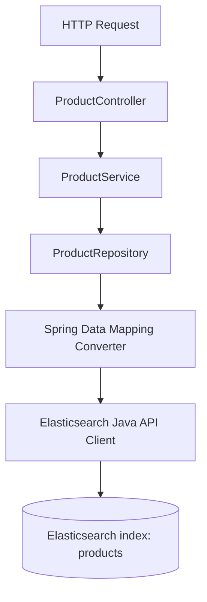
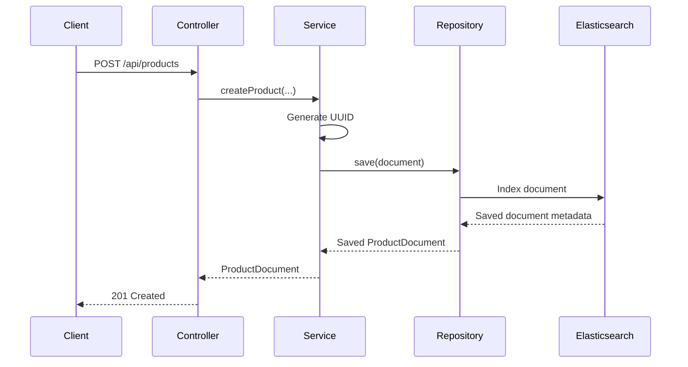

# Tạo Document, ElasticsearchRepository và dịch vụ đầu tiên

Trong Spring Data Elasticsearch, một chức năng lưu và tìm kiếm dữ liệu cơ bản thường bắt đầu từ ba thành phần: **Document** mô tả dữ liệu được lưu trong Elasticsearch, **`ElasticsearchRepository`** cung cấp các thao tác truy cập dữ liệu, và **Service** thực hiện quy tắc nghiệp vụ của ứng dụng.

Bài học này xây dựng một lát cắt hoàn chỉnh cho chức năng quản lý sản phẩm. Ứng dụng sẽ kết nối đến Elasticsearch, ánh xạ một lớp Java thành document trong index `products`, khai báo Repository, tạo Service và mở các endpoint REST để thử luồng tạo, tìm kiếm và xóa sản phẩm.

## 1. Luồng hoạt động của một chức năng dữ liệu

Elasticsearch lưu dữ liệu dưới dạng document JSON trong các index. Spring Data Elasticsearch giúp ứng dụng Java làm việc với những document đó thông qua entity mapping và Repository.



Mỗi thành phần có một trách nhiệm:

- **Document** mô tả cấu trúc dữ liệu và metadata mapping của index.
- **Repository** cung cấp API lưu, đọc, xóa và truy vấn document.
- **Service** kết hợp Repository với quy tắc nghiệp vụ, chẳng hạn tạo ID và xử lý một use case.
- **Controller** nhận HTTP request, gọi Service và trả HTTP response.
- **Elasticsearch** lưu document và thực hiện truy vấn theo mapping của index.

Repository được Spring Data tạo implementation khi ứng dụng khởi động. Ta chỉ cần khai báo interface và để Spring quản lý bean đó.

## 2. Thêm dependency và cấu hình kết nối

Với dự án Spring Boot dùng Gradle, thêm starter sau vào `build.gradle`:

```groovy
dependencies {
    implementation 'org.springframework.boot:spring-boot-starter-data-elasticsearch'
    testImplementation 'org.springframework.boot:spring-boot-starter-test'
}
```

`spring-boot-starter-test` cung cấp JUnit 5, Mockito và các thư viện kiểm thử Spring thường dùng trong dự án Spring Boot.

Nếu dự án dùng Maven, dependency tương ứng là:

```xml
<dependency>
    <groupId>org.springframework.boot</groupId>
    <artifactId>spring-boot-starter-data-elasticsearch</artifactId>
</dependency>
```

Khi dự án đã dùng Spring Boot dependency management, không cần tự gắn một phiên bản Spring Data Elasticsearch khác với phiên bản do Spring Boot quản lý. Hãy để bộ phiên bản tương thích của Spring Boot chọn các thư viện Spring Data và Elasticsearch Java Client.

Khai báo địa chỉ Elasticsearch trong `src/main/resources/application.yml`:

```yaml
spring:
  application:
    name: product-catalog
  elasticsearch:
    uris: ${ELASTICSEARCH_URIS:http://localhost:9200}
```

Trong cấu hình trên, ứng dụng dùng `http://localhost:9200` khi biến môi trường `ELASTICSEARCH_URIS` chưa được đặt. Khi triển khai ở môi trường khác, có thể truyền URI của cluster qua biến môi trường mà không phải sửa file cấu hình.

Đảm bảo Elasticsearch đang chạy và ứng dụng có thể truy cập địa chỉ đã khai báo. Với cluster bật bảo mật, cần cấu hình thông tin xác thực và TLS theo môi trường triển khai; không ghi mật khẩu hoặc credential thật vào Git.

Spring Boot tự cấu hình client và các thành phần Spring Data Elasticsearch khi starter có mặt trên classpath và cấu hình hợp lệ. Đặt class `@SpringBootApplication` ở package gốc, ví dụ `com.example.catalog`, rồi đặt các package `document`, `repository`, `service` và `controller` bên dưới package đó. Cách bố trí này giúp component scan và repository scan tìm thấy các thành phần mà không cần khai báo cấu hình quét riêng.

Ví dụ cấu trúc thư mục:

```text
src/main/java/com/example/catalog/
├── ProductCatalogApplication.java
├── product/
│   ├── document/
│   │   └── ProductDocument.java
│   ├── repository/
│   │   └── ProductRepository.java
│   ├── service/
│   │   └── ProductService.java
│   └── web/
│       ├── CreateProductRequest.java
│       └── ProductController.java
└──
src/main/resources/
└── application.yml
```

Lớp khởi động tối thiểu:

```java
package com.example.catalog;

import org.springframework.boot.SpringApplication;
import org.springframework.boot.autoconfigure.SpringBootApplication;

@SpringBootApplication
public class ProductCatalogApplication {

    public static void main(String[] args) {
        SpringApplication.run(ProductCatalogApplication.class, args);
    }
}
```

Thông thường không cần tự tạo `RestClient`, `ElasticsearchClient` hoặc `ElasticsearchOperations` chỉ để dùng Repository. Spring Boot cung cấp các bean cần thiết theo cấu hình tự động. Chỉ bổ sung cấu hình client riêng khi ứng dụng có yêu cầu cụ thể về kết nối, authentication, transport hoặc nhiều cluster.

## 3. Tạo Document class

Giả sử ứng dụng quản lý sản phẩm với các thông tin:

| Thuộc tính | Ý nghĩa | Kiểu mapping |
|---|---|---|
| `id` | ID của document | `_id` do Elasticsearch quản lý |
| `sku` | Mã sản phẩm | `keyword` |
| `name` | Tên sản phẩm | `text` |
| `category` | Danh mục | `keyword` |
| `price` | Giá sản phẩm | `double` |

Tạo file `ProductDocument.java`:

```java
package com.example.catalog.product.document;

import org.springframework.data.annotation.Id;
import org.springframework.data.elasticsearch.annotations.Document;
import org.springframework.data.elasticsearch.annotations.Field;
import org.springframework.data.elasticsearch.annotations.FieldType;

@Document(indexName = "products")
public class ProductDocument {

    @Id
    private String id;

    @Field(type = FieldType.Keyword)
    private String sku;

    @Field(type = FieldType.Text)
    private String name;

    @Field(type = FieldType.Keyword)
    private String category;

    @Field(type = FieldType.Double)
    private Double price;

    protected ProductDocument() {
    }

    public ProductDocument(
            String id,
            String sku,
            String name,
            String category,
            Double price) {
        this.id = id;
        this.sku = sku;
        this.name = name;
        this.category = category;
        this.price = price;
    }

    public String getId() {
        return id;
    }

    public String getSku() {
        return sku;
    }

    public String getName() {
        return name;
    }

    public String getCategory() {
        return category;
    }

    public Double getPrice() {
        return price;
    }
}
```

### 3.1. Ý nghĩa các annotation

**`@Document(indexName = "products")`** đánh dấu lớp Java là document được Spring Data Elasticsearch quản lý và liên kết lớp đó với index `products`. `createIndex` mặc định là `true`, cho phép Spring Data tạo index cùng mapping dựa trên metadata khi cơ chế tạo index được kích hoạt. Có thể đặt `createIndex = false` nếu index được provision bằng quy trình riêng.

**`@Id`** đánh dấu thuộc tính làm document ID, tương ứng với metadata `_id` của Elasticsearch. Annotation được import từ `org.springframework.data.annotation.Id`, không phải `jakarta.persistence.Id` của JPA.

**`@Field(type = FieldType.Keyword)`** khai báo field có kiểu `keyword`. Kiểu này phù hợp với mã sản phẩm, danh mục, trạng thái hoặc các giá trị cần so khớp chính xác, sort và aggregation.

**`@Field(type = FieldType.Text)`** khai báo field văn bản được phân tích qua analyzer. Kiểu này phù hợp với tìm kiếm toàn văn như tên hoặc mô tả sản phẩm. Query `match` thường được dùng cho field `text`.

**`@Field(type = FieldType.Double)`** khai báo field số thực. Khi lưu dữ liệu tiền tệ cần độ chính xác thập phân nghiêm ngặt, hãy chọn mô hình số phù hợp, chẳng hạn lưu đơn vị tiền nhỏ nhất bằng số nguyên hoặc thiết kế mapping `scaled_float`; không nên mặc định số thực dấu phẩy động là biểu diễn tiền tệ chính xác.

### 3.2. Document Java được chuyển thành JSON như thế nào?

Với một đối tượng:

```java
ProductDocument product = new ProductDocument(
    "p-1001",
    "SKU-1001",
    "Wireless Headphones",
    "audio",
    129.90
);
```

Spring Data sử dụng mapping converter để chuyển đối tượng Java thành document JSON. Dữ liệu tương ứng có dạng khái quát:

```json
{
  "sku": "SKU-1001",
  "name": "Wireless Headphones",
  "category": "audio",
  "price": 129.90
}
```

Giá trị `id` được dùng làm `_id` của document, không phải một field `_id` thông thường nằm trong `_source`. Các field còn lại được lưu trong `_source` theo mapping.

Không cần tự viết mã chuyển object thành JSON khi sử dụng Repository. Spring Data xử lý conversion dựa trên metadata của document và cấu hình converter.

### 3.3. Lựa chọn mapping ảnh hưởng trực tiếp đến truy vấn

Hai field `name` và `category` được khai báo với hai kiểu khác nhau vì cách tìm kiếm khác nhau:

- Tên sản phẩm cần tìm theo từ hoặc cụm từ đã phân tích: `text` và `match`.
- Danh mục cần lọc đúng giá trị `audio`: `keyword` và `term` hoặc truy vấn chính xác tương ứng.

Nếu khai báo một field thành `text` trong khi use case cần lọc chính xác, query có thể không hoạt động như kỳ vọng do analyzer đã biến đổi nội dung. Hãy xác định cách field được tìm kiếm trước khi chọn kiểu mapping.

Mapping là cấu trúc của index. Thay đổi kiểu của một field đã có dữ liệu thường không thể thực hiện trực tiếp như sửa kiểu thuộc tính Java; quy trình phổ biến là tạo index mới với mapping đúng, chuyển dữ liệu bằng reindex và chuyển ứng dụng sang index mới.

## 4. Tạo ElasticsearchRepository

Tạo `ProductRepository.java`:

```java
package com.example.catalog.product.repository;

import java.util.List;
import java.util.Optional;

import org.springframework.data.elasticsearch.repository.ElasticsearchRepository;

import com.example.catalog.product.document.ProductDocument;

public interface ProductRepository
        extends ElasticsearchRepository<ProductDocument, String> {

    Optional<ProductDocument> findBySku(String sku);

    List<ProductDocument> findByCategory(String category);
}
```

Hai tham số generic của `ElasticsearchRepository<ProductDocument, String>` có nghĩa:

- `ProductDocument`: kiểu document mà Repository quản lý.
- `String`: kiểu dữ liệu của ID document.

`ElasticsearchRepository` cung cấp các thao tác nền tảng như:

| Phương thức | Công dụng |
|---|---|
| `save(entity)` | Lưu document và trả về entity đã lưu. |
| `findById(id)` | Tìm document theo `_id`, trả về `Optional`. |
| `existsById(id)` | Kiểm tra document theo ID có tồn tại hay không. |
| `findAll()` | Lấy các document theo API Repository. |
| `deleteById(id)` | Xóa document theo ID. |
| `count()` | Đếm document theo API Repository. |

Ngoài các phương thức kế thừa, Spring Data có thể tạo truy vấn từ tên phương thức. Ví dụ:

```java
Optional<ProductDocument> findBySku(String sku);

List<ProductDocument> findByCategory(String category);
```

Spring Data phân tích tên `findBySku` và `findByCategory`, sau đó tạo truy vấn tương ứng trên các field trong mapping. Điều này giúp ta khai báo truy vấn thông thường mà không phải tự viết Query DSL.

Tên thuộc tính trong phương thức derived query phải khớp với thuộc tính của lớp document. Kiểu mapping của field vẫn phải phù hợp với ý nghĩa truy vấn. Với ví dụ này, `sku` và `category` là `keyword`, nên phù hợp với việc tìm giá trị chính xác.

### 4.1. Repository được Spring tạo implementation

Ta chỉ viết interface:

```java
public interface ProductRepository
        extends ElasticsearchRepository<ProductDocument, String> {
}
```

Khi ứng dụng khởi động, Spring Data tìm interface Repository trong phạm vi scan, tạo implementation proxy và đăng ký bean trong Application Context. Vì vậy, Service có thể inject `ProductRepository` bằng constructor.

Không cần tự viết class `ProductRepositoryImpl` cho các phương thức CRUD có sẵn hoặc derived query thông thường. Chỉ cần custom implementation khi có truy vấn hoặc hành vi không thể diễn đạt bằng các API Repository chuẩn.

Nếu package Repository nằm ngoài package scan mặc định, có thể cấu hình phạm vi bằng `@EnableElasticsearchRepositories` tại class cấu hình phù hợp. Với cấu trúc package nằm dưới package gốc của `@SpringBootApplication`, cấu hình riêng này thường không cần thiết.

## 5. Tạo Service đầu tiên

Repository tập trung vào truy cập dữ liệu. Service là nơi ứng dụng đặt use case, ví dụ tạo sản phẩm với ID do ứng dụng sinh ra, tìm sản phẩm theo SKU hoặc xóa sản phẩm.

Tạo `ProductService.java`:

```java
package com.example.catalog.product.service;

import java.util.List;
import java.util.Optional;
import java.util.UUID;

import org.springframework.stereotype.Service;

import com.example.catalog.product.document.ProductDocument;
import com.example.catalog.product.repository.ProductRepository;

@Service
public class ProductService {

    private final ProductRepository productRepository;

    public ProductService(ProductRepository productRepository) {
        this.productRepository = productRepository;
    }

    public ProductDocument createProduct(
            String sku,
            String name,
            String category,
            Double price) {

        ProductDocument product = new ProductDocument(
            UUID.randomUUID().toString(),
            sku,
            name,
            category,
            price
        );

        return productRepository.save(product);
    }

    public Optional<ProductDocument> findById(String id) {
        return productRepository.findById(id);
    }

    public Optional<ProductDocument> findBySku(String sku) {
        return productRepository.findBySku(sku);
    }

    public List<ProductDocument> findByCategory(String category) {
        return productRepository.findByCategory(category);
    }

    public void deleteById(String id) {
        productRepository.deleteById(id);
    }
}
```

### 5.1. Vì sao Service dùng constructor injection?

`ProductService` nhận `ProductRepository` qua constructor. Spring tự truyền bean Repository khi tạo Service. Cách này có một số lợi ích:

- Dependency được thể hiện rõ trong constructor.
- Trường phụ thuộc có thể khai báo `final`.
- Unit test có thể truyền một mock hoặc fake Repository trực tiếp.
- Không cần field injection hoặc gọi `ApplicationContext` để tìm bean thủ công.

Annotation `@Service` đăng ký lớp thành Spring bean và thể hiện đây là thành phần xử lý nghiệp vụ. `@Repository` không cần đặt trên interface `ProductRepository` vì Spring Data đã đăng ký bean Repository.

### 5.2. Vì sao sinh ID trong Service?

Trong ví dụ, Service sinh ID bằng `UUID.randomUUID()`. ID được gán trước khi gọi `save`, nên kết quả trả về có một ID ổn định để client tiếp tục dùng trong thao tác đọc hoặc xóa.

Elasticsearch cũng có khả năng tự sinh `_id` khi index document không có ID. Sinh ID trong ứng dụng hữu ích khi cần biết ID ngay trong mô hình nghiệp vụ hoặc muốn chủ động kiểm soát ID. Cần chọn một chiến lược ID nhất quán cho từng loại document.

Lưu ý rằng `save` là thao tác index/upsert theo ID. Nếu một document khác đã có cùng ID, thao tác lưu có thể thay thế nội dung document đó. Nếu nghiệp vụ yêu cầu từ chối trùng SKU hoặc chỉ tạo mới khi chưa tồn tại, cần thiết kế quy tắc kiểm tra và thao tác ghi phù hợp; chỉ gọi `findBySku` trước `save` không tạo ra bảo đảm duy nhất trong tình huống nhiều request đồng thời.

### 5.3. Service có nên mang `@Transactional` không?

Không nên thêm `@Transactional` theo thói quen từ Spring Data JPA. Elasticsearch không cung cấp transaction nhiều document theo semantics của relational database. Một phương thức Service gọi nhiều thao tác Elasticsearch không tự động có khả năng rollback toàn bộ như một transaction cơ sở dữ liệu quan hệ.

Hãy thiết kế xử lý lỗi, retry và tính nhất quán theo đặc tính của Elasticsearch và nghiệp vụ cụ thể.

## 6. Mở API REST để sử dụng Service

Để thử luồng từ HTTP request đến Elasticsearch, tạo request DTO:

```java
package com.example.catalog.product.web;

public record CreateProductRequest(
    String sku,
    String name,
    String category,
    Double price
) {
}
```

Sau đó tạo `ProductController.java`:

```java
package com.example.catalog.product.web;

import java.util.List;

import org.springframework.http.HttpStatus;
import org.springframework.http.ResponseEntity;
import org.springframework.web.bind.annotation.DeleteMapping;
import org.springframework.web.bind.annotation.GetMapping;
import org.springframework.web.bind.annotation.PathVariable;
import org.springframework.web.bind.annotation.PostMapping;
import org.springframework.web.bind.annotation.RequestBody;
import org.springframework.web.bind.annotation.RequestMapping;
import org.springframework.web.bind.annotation.RequestParam;
import org.springframework.web.bind.annotation.ResponseStatus;
import org.springframework.web.bind.annotation.RestController;

import com.example.catalog.product.document.ProductDocument;
import com.example.catalog.product.service.ProductService;

@RestController
@RequestMapping("/api/products")
public class ProductController {

    private final ProductService productService;

    public ProductController(ProductService productService) {
        this.productService = productService;
    }

    @PostMapping
    public ResponseEntity<ProductDocument> create(
            @RequestBody CreateProductRequest request) {

        ProductDocument saved = productService.createProduct(
            request.sku(),
            request.name(),
            request.category(),
            request.price()
        );

        return ResponseEntity.status(HttpStatus.CREATED).body(saved);
    }

    @GetMapping("/{id}")
    public ResponseEntity<ProductDocument> findById(@PathVariable String id) {
        return productService.findById(id)
            .map(ResponseEntity::ok)
            .orElseGet(() -> ResponseEntity.notFound().build());
    }

    @GetMapping
    public List<ProductDocument> findByCategory(
            @RequestParam String category) {
        return productService.findByCategory(category);
    }

    @DeleteMapping("/{id}")
    @ResponseStatus(HttpStatus.NO_CONTENT)
    public void deleteById(@PathVariable String id) {
        productService.deleteById(id);
    }
}
```

Controller không gọi Repository trực tiếp. Nó chuyển dữ liệu đầu vào cho Service và chuyển kết quả Service thành HTTP response. Khi ứng dụng phát triển, có thể bổ sung validation, response DTO, xử lý lỗi tập trung và phân quyền ở tầng web mà không phải đưa các chi tiết HTTP vào Repository.

## 7. Chạy thử luồng tạo, đọc, tìm kiếm và xóa

Khởi động Elasticsearch, kiểm tra URI kết nối và chạy ứng dụng Spring Boot. Sau đó gửi request tạo một sản phẩm:

```http
POST /api/products
Content-Type: application/json

{
  "sku": "SKU-1001",
  "name": "Wireless Headphones",
  "category": "audio",
  "price": 129.90
}
```

Ứng dụng tạo `ProductDocument`, sinh ID, gọi `productRepository.save(...)` và trả về HTTP `201 Created`. Response chứa document đã lưu, bao gồm ID do Service tạo.

Sử dụng ID trong response để đọc lại document:

```http
GET /api/products/{id}
```

Nếu document tồn tại, API trả về `200 OK` cùng nội dung sản phẩm. Nếu không tìm thấy, Controller trả về `404 Not Found`.

Tìm các sản phẩm theo danh mục:

```http
GET /api/products?category=audio
```

Request này đi qua `ProductController`, `ProductService`, rồi gọi derived query `findByCategory("audio")` của Repository.

Xóa document:

```http
DELETE /api/products/{id}
```

Controller gọi Service, Service gọi `deleteById` và API trả về `204 No Content`.

Các request trên minh họa đường đi của dữ liệu:



## 8. Index và mapping được tạo khi nào?

`@Document(indexName = "products")` liên kết `ProductDocument` với index có tên `products`. Theo mặc định, `createIndex` được bật. Spring Data Elasticsearch có thể tạo index và mapping dựa trên annotation khi repository khởi tạo và việc tạo index được cho phép.

Điều này thuận tiện trong môi trường học tập hoặc phát triển. Tuy nhiên, với production, vòng đời index thường cần được quản lý rõ ràng:

- Xác định mapping trước khi đưa dữ liệu vào index.
- Quản lý thay đổi mapping qua migration hoặc quy trình triển khai riêng.
- Dùng index versioned và alias khi cần thay đổi cấu trúc không tương thích.
- Không để nhiều instance ứng dụng đồng thời tự ý thay đổi mapping production.

Có thể kiểm tra mapping của index bằng Elasticsearch API:

```http
GET /products/_mapping
```

Kết quả giúp xác nhận các field như `sku`, `category`, `name` và `price` được ánh xạ theo kiểu mong muốn. Nếu mapping đã tồn tại trước khi ứng dụng khởi động, hãy kiểm tra mapping thực tế thay vì chỉ dựa vào annotation trong code.

## 9. Một số hành vi cần hiểu khi dùng Repository

### 9.1. `save` lưu document theo ID

`save` gửi thao tác index document lên Elasticsearch. ID xác định document đích. Nếu ID chưa tồn tại, document được tạo; nếu đã tồn tại, nội dung được cập nhật/thay thế theo semantics của thao tác index.

Do đó, `save` không tương đương với một lệnh SQL `INSERT` luôn từ chối khóa trùng. Hãy chọn ID và thao tác ghi dựa trên yêu cầu tạo mới hay cập nhật của nghiệp vụ.

### 9.2. `findById` và tìm kiếm có thể có thời điểm quan sát khác nhau

Elasticsearch hỗ trợ đọc document theo ID theo cơ chế realtime, trong khi search dựa trên các segment đã refresh. Vì vậy, ngay sau khi `save`, `findById` có thể thấy document nhưng một truy vấn search như `findByCategory` có thể chưa thấy ngay nếu refresh chưa diễn ra.

Elasticsearch là hệ thống tìm kiếm gần thời gian thực (near real-time). Không nên ép refresh cho mọi thao tác ghi chỉ để làm search nhìn thấy dữ liệu tức thì, vì điều đó có thể ảnh hưởng hiệu năng. Nếu use case yêu cầu đọc ngay sau khi ghi qua search, hãy tìm hiểu refresh policy và chọn cách xử lý có chủ đích.

### 9.3. Derived query phụ thuộc tên thuộc tính

Ví dụ `findByCategory` tham chiếu thuộc tính Java `category`. Nếu đổi tên thuộc tính thành `productCategory`, tên phương thức derived query cũng cần được cập nhật. Nếu tên field trong Elasticsearch khác tên thuộc tính Java do cấu hình mapping, Spring Data xử lý metadata mapping cho các derived query; còn các truy vấn viết trực tiếp theo Query DSL phải tham chiếu đúng tên field trong index.

### 9.4. Repository không thay thế thiết kế mapping

Repository giúp giảm mã truy cập dữ liệu, nhưng không tự quyết định field nào nên là `text`, `keyword`, `date` hoặc kiểu số. Mapping không phù hợp sẽ làm truy vấn, sort và aggregation cho kết quả không như mong đợi. Cần thiết kế document và mapping dựa trên cách ứng dụng đọc, lọc và tìm kiếm dữ liệu.

### 9.5. Không áp dụng tư duy quan hệ một cách máy móc

Document Elasticsearch thường được thiết kế theo nhu cầu truy vấn. Không nên mặc định rằng quan hệ giữa các lớp Java sẽ được lưu như foreign key hoặc join như trong relational database. Khi cần hiển thị dữ liệu liên quan, có thể phải denormalize một phần dữ liệu vào document hoặc dùng cơ chế truy vấn phù hợp với mô hình Elasticsearch.

## 10. Kiểm thử Service bằng unit test

Vì `ProductService` nhận Repository qua constructor, có thể kiểm thử Service mà không cần khởi động Elasticsearch. Ví dụ với JUnit 5 và Mockito:

```java
package com.example.catalog.product.service;

import static org.junit.jupiter.api.Assertions.assertEquals;
import static org.junit.jupiter.api.Assertions.assertNotNull;
import static org.mockito.ArgumentMatchers.any;
import static org.mockito.Mockito.verify;
import static org.mockito.Mockito.when;

import org.junit.jupiter.api.Test;
import org.junit.jupiter.api.extension.ExtendWith;
import org.mockito.InjectMocks;
import org.mockito.Mock;
import org.mockito.junit.jupiter.MockitoExtension;

import com.example.catalog.product.document.ProductDocument;
import com.example.catalog.product.repository.ProductRepository;

@ExtendWith(MockitoExtension.class)
class ProductServiceTest {

    @Mock
    private ProductRepository productRepository;

    @InjectMocks
    private ProductService productService;

    @Test
    void createProductShouldSaveDocumentWithGeneratedId() {
        when(productRepository.save(any(ProductDocument.class)))
            .thenAnswer(invocation -> invocation.getArgument(0));

        ProductDocument saved = productService.createProduct(
            "SKU-1001",
            "Wireless Headphones",
            "audio",
            129.90
        );

        assertNotNull(saved.getId());
        assertEquals("SKU-1001", saved.getSku());
        assertEquals("Wireless Headphones", saved.getName());
        verify(productRepository).save(any(ProductDocument.class));
    }
}
```

Unit test này xác nhận Service tạo document với ID và chuyển document đến Repository. Nó không kiểm tra kết nối, mapping hoặc khả năng truy vấn thật của Elasticsearch. Những phần đó cần integration test riêng với một Elasticsearch instance tương thích.

## 11. Các lỗi khởi đầu thường gặp

| Hiện tượng | Nguyên nhân cần kiểm tra |
|---|---|
| Không kết nối được Elasticsearch khi khởi động | Elasticsearch chưa chạy, URI sai, cổng không truy cập được hoặc cấu hình TLS/authentication chưa đúng. |
| Không inject được Repository | Package Repository nằm ngoài phạm vi scan hoặc cấu hình repository chưa được kích hoạt. |
| Document không có ID như mong đợi | Thuộc tính ID chưa được đánh dấu `@Id`, hoặc Service chưa gán ID theo chiến lược đã chọn. |
| Query theo category trả về không đúng | Kiểm tra mapping của `category`, giá trị dữ liệu và cách truy vấn exact match. |
| Search chưa thấy document vừa lưu | Có thể index chưa refresh; phân biệt đọc theo ID với tìm kiếm. |
| Ứng dụng không tạo được index | Kiểm tra quyền của user Elasticsearch, mapping/index đã tồn tại và cấu hình `createIndex`. |
| Mapping thực tế khác annotation | Index có thể đã được tạo từ trước với mapping cũ; cần kiểm tra mapping và lập kế hoạch migration/reindex. |

Khi chẩn đoán, hãy xem log khởi động để biết lỗi xảy ra ở bước tạo client, khởi tạo Repository, tạo index hay thực thi request. Các lỗi này thuộc những lớp khác nhau và cần được xử lý tại đúng lớp.

## 12. Tổng kết cấu trúc đã xây dựng

Sau bài học, chức năng sản phẩm có các thành phần:

| Thành phần | Trách nhiệm |
|---|---|
| `ProductDocument` | Mô tả document và mapping cho index `products`. |
| `ProductRepository` | Cung cấp CRUD và derived query trên `ProductDocument`. |
| `ProductService` | Thực hiện use case tạo, tìm và xóa sản phẩm. |
| `CreateProductRequest` | Mô tả dữ liệu đầu vào của API tạo sản phẩm. |
| `ProductController` | Cung cấp endpoint HTTP và gọi Service. |
| `application.yml` | Cấu hình URI kết nối Elasticsearch. |

Luồng cơ bản là Controller nhận request, Service xử lý nghiệp vụ, Repository thao tác với document, rồi Spring Data mapping object Java thành JSON để Elasticsearch lưu trữ hoặc truy vấn. Khi nắm rõ vai trò của Document, Repository và Service, ta có nền tảng để phát triển các truy vấn phức tạp hơn, phân trang, bulk operation, custom repository và các chức năng tìm kiếm chuyên sâu.
