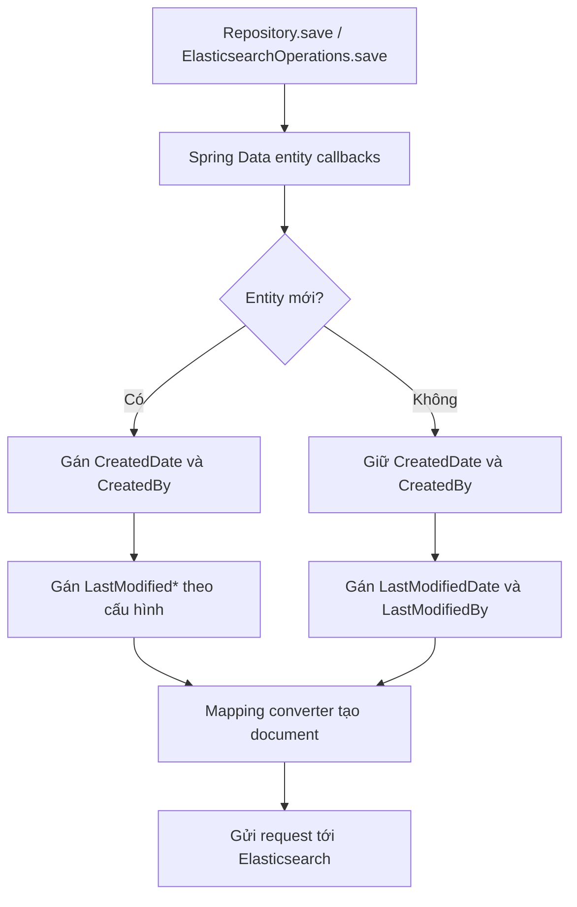
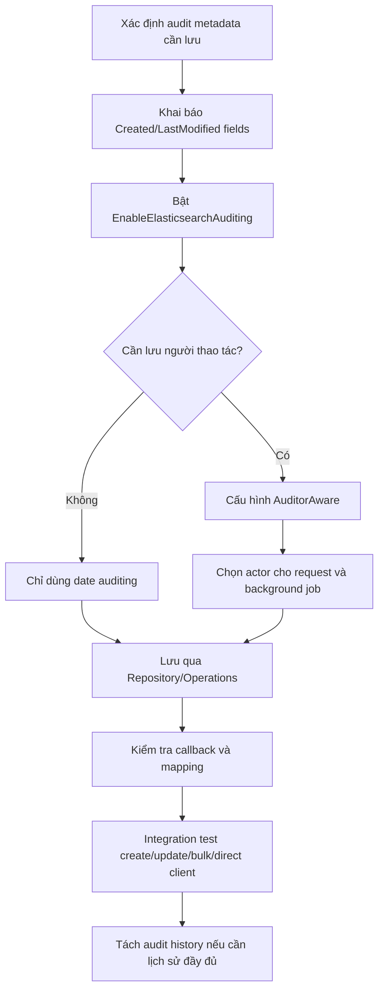

# @CreatedDate, @LastModifiedDate, @CreatedBy và @LastModifiedBy

Auditing giúp ứng dụng tự ghi nhận **ai tạo một document, ai sửa document và thời điểm các thao tác đó diễn ra**. Spring Data Elasticsearch tích hợp cơ chế auditing của Spring Data thông qua các annotation `@CreatedDate`, `@LastModifiedDate`, `@CreatedBy` và `@LastModifiedBy`.

Khi cấu hình auditing đúng cách, Spring Data cập nhật các thuộc tính audit trong vòng đời lưu entity. Ứng dụng không cần tự gán timestamp hoặc username ở mọi service. Tuy nhiên, auditing chỉ hoạt động qua những đường ghi có chạy callback của Spring Data; gọi Elasticsearch Java API Client trực tiếp không tự động kích hoạt các callback này.

Bốn annotation có ý nghĩa riêng:

- `@CreatedDate`: thời điểm document được tạo lần đầu.
- `@LastModifiedDate`: thời điểm document được sửa gần nhất.
- `@CreatedBy`: người dùng hoặc principal tạo document.
- `@LastModifiedBy`: người dùng hoặc principal thực hiện lần sửa gần nhất.

Các trường này hữu ích cho màn hình quản trị, truy vết thay đổi gần nhất và hỗ trợ vận hành. Chúng không phải một audit log đầy đủ: chúng chỉ lưu trạng thái tạo/sửa hiện tại, không giữ lịch sử của mọi lần cập nhật.

## 1. Auditing giải quyết vấn đề gì?

Giả sử ứng dụng quản lý sản phẩm. Một sản phẩm có thể được tạo bởi nhân viên nhập liệu, sau đó được sửa bởi một quản trị viên. Nếu không có auditing, mỗi service phải tự gán thời gian và người thao tác:

```java
product.setCreatedAt(Instant.now());
product.setCreatedBy(currentUsername);
```

Đến lần sửa, service khác lại phải nhớ cập nhật `lastModifiedAt` và `lastModifiedBy`. Cách làm này dễ thiếu sót, không nhất quán và khiến logic audit bị lặp trong nhiều nơi.

Spring Data Auditing tập trung logic đó vào một cơ chế chung:

1. Ứng dụng bật Elasticsearch auditing.
2. Cấu hình nguồn cung cấp người thao tác qua `AuditorAware<T>` nếu cần lưu user.
3. Đánh dấu các thuộc tính entity bằng annotation audit.
4. Khi entity được lưu qua Spring Data, auditing callback cập nhật các thuộc tính trước khi document được chuyển thành dữ liệu gửi đến Elasticsearch.

Ví dụ document sau khi được tạo:

```json
{
  "id": "P-100",
  "name": "Wireless Headphones",
  "createdAt": "2026-11-13T08:30:00Z",
  "lastModifiedAt": "2026-11-13T08:30:00Z",
  "createdBy": "alice",
  "lastModifiedBy": "alice"
}
```

Sau khi một nhân viên khác cập nhật tên sản phẩm, `createdAt` và `createdBy` giữ nguyên, còn `lastModifiedAt` và `lastModifiedBy` được cập nhật theo thao tác mới.

## 2. Bốn annotation audit

Các annotation được khai báo trong package Spring Data Commons:

```java
import org.springframework.data.annotation.CreatedDate;
import org.springframework.data.annotation.LastModifiedDate;
import org.springframework.data.annotation.CreatedBy;
import org.springframework.data.annotation.LastModifiedBy;
```

| Annotation | Ý nghĩa | Thời điểm được cập nhật |
|---|---|---|
| `@CreatedDate` | Thời điểm tạo entity/document | Khi entity được nhận diện là mới |
| `@LastModifiedDate` | Thời điểm sửa gần nhất | Khi entity được lưu; hành vi lúc tạo phụ thuộc `modifyOnCreate` |
| `@CreatedBy` | Principal tạo entity/document | Khi entity được nhận diện là mới và có auditor |
| `@LastModifiedBy` | Principal sửa gần nhất | Khi entity được lưu; hành vi lúc tạo phụ thuộc `modifyOnCreate` |

`Created*` mô tả nguồn gốc tạo bản ghi. `LastModified*` mô tả lần ghi gần nhất. Không nên dùng `@LastModifiedDate` thay cho `@CreatedDate`, vì khi cập nhật nó sẽ thay đổi.

## 3. Khai báo entity có audit metadata

Ví dụ entity `ProductDocument`:

```java
package com.example.catalog.document;

import java.time.Instant;

import org.springframework.data.annotation.CreatedBy;
import org.springframework.data.annotation.CreatedDate;
import org.springframework.data.annotation.Id;
import org.springframework.data.annotation.LastModifiedBy;
import org.springframework.data.annotation.LastModifiedDate;
import org.springframework.data.elasticsearch.annotations.Document;
import org.springframework.data.elasticsearch.annotations.Field;
import org.springframework.data.elasticsearch.annotations.FieldType;

@Document(indexName = "products")
public class ProductDocument {

    @Id
    private String id;

    @Field(type = FieldType.Keyword)
    private String name;

    @CreatedDate
    @Field(type = FieldType.Date)
    private Instant createdAt;

    @LastModifiedDate
    @Field(type = FieldType.Date)
    private Instant lastModifiedAt;

    @CreatedBy
    @Field(type = FieldType.Keyword)
    private String createdBy;

    @LastModifiedBy
    @Field(type = FieldType.Keyword)
    private String lastModifiedBy;

    protected ProductDocument() {
    }

    public ProductDocument(String id, String name) {
        this.id = id;
        this.name = name;
    }

    public String getId() {
        return id;
    }

    public String getName() {
        return name;
    }

    public void setName(String name) {
        this.name = name;
    }

    public Instant getCreatedAt() {
        return createdAt;
    }

    public Instant getLastModifiedAt() {
        return lastModifiedAt;
    }

    public String getCreatedBy() {
        return createdBy;
    }

    public String getLastModifiedBy() {
        return lastModifiedBy;
    }
}
```

Các trường audit được khai báo rõ mapping:

- Timestamp dùng kiểu ngày của Elasticsearch, ví dụ `FieldType.Date`.
- User identifier thường dùng `keyword` vì cần exact match/filter, không cần full-text analyzer.
- `Instant` là lựa chọn tốt cho thời điểm toàn hệ thống vì biểu diễn một mốc UTC độc lập timezone hiển thị.

Spring Data hỗ trợ các kiểu thời gian được auditing infrastructure nhận diện. Nếu dùng kiểu khác như `LocalDateTime`, `OffsetDateTime` hoặc `Date`, hãy xác nhận converter và mapping của phiên bản dự án. Tránh dùng chuỗi tùy ý cho timestamp nếu cần sort, range query hoặc date aggregation.

## 4. Bật Elasticsearch Auditing

Chỉ thêm annotation trên entity là chưa đủ. Cần bật auditing trong cấu hình Spring:

```java
import org.springframework.context.annotation.Configuration;
import org.springframework.data.elasticsearch.config.EnableElasticsearchAuditing;

@Configuration
@EnableElasticsearchAuditing
public class ElasticsearchAuditingConfiguration {
}
```

Khi được bật, Spring Data đăng ký auditing infrastructure và entity callback để áp dụng metadata trước khi entity được convert và lưu.

Nếu chỉ cần ngày tạo/ngày sửa, không cần cung cấp `AuditorAware`. Nếu muốn tự động điền `@CreatedBy` và `@LastModifiedBy`, cần khai báo một bean `AuditorAware<T>` với kiểu `T` phù hợp với kiểu của hai field auditor.

### 4.1. Tùy chọn cấu hình thường gặp

`@EnableElasticsearchAuditing` hỗ trợ các tùy chọn như:

| Thuộc tính | Mục đích |
|---|---|
| `auditorAwareRef` | Tên bean `AuditorAware` được dùng để lấy người thao tác |
| `dateTimeProviderRef` | Tên bean cung cấp thời gian audit |
| `setDates` | Bật/tắt việc tự gán các trường ngày audit |
| `modifyOnCreate` | Quyết định các trường `LastModified*` có được gán ngay lúc tạo hay không |

Các mặc định và chữ ký annotation cần kiểm tra theo release Spring Data Elasticsearch của dự án. Ví dụ dưới đây dùng tên bean tường minh để cấu hình nguồn auditor và clock.

## 5. `AuditorAware<T>` cung cấp người thao tác

`@CreatedBy` và `@LastModifiedBy` cần biết ai đang thực hiện thao tác. Spring Data lấy thông tin đó qua interface:

```java
import java.util.Optional;
import org.springframework.data.domain.AuditorAware;
```

`AuditorAware<T>` trả về `Optional<T>`. Kiểu `T` phải tương thích với kiểu của thuộc tính được đánh dấu `@CreatedBy` và `@LastModifiedBy`.

Ví dụ đơn giản dùng username dạng `String`:

```java
import java.util.Optional;

import org.springframework.data.domain.AuditorAware;
import org.springframework.stereotype.Component;

@Component("auditorAware")
public class CurrentUserAuditorAware implements AuditorAware<String> {

    @Override
    public Optional<String> getCurrentAuditor() {
        return Optional.of("system");
    }
}
```

Đây là ví dụ minh họa cho một ứng dụng chỉ có một system actor. Trong ứng dụng thực tế, `getCurrentAuditor()` cần lấy principal của request hiện tại hoặc actor của job đang chạy. Không hard-code `system` cho mọi thao tác nếu cần audit người dùng thật.

### 5.1. Tích hợp với Spring Security

Với ứng dụng dùng Spring Security, auditor có thể lấy từ `SecurityContextHolder`:

```java
import java.util.Optional;

import org.springframework.data.domain.AuditorAware;
import org.springframework.security.authentication.AnonymousAuthenticationToken;
import org.springframework.security.core.Authentication;
import org.springframework.security.core.context.SecurityContextHolder;
import org.springframework.stereotype.Component;

@Component("auditorAware")
public class SecurityAuditorAware implements AuditorAware<String> {

    @Override
    public Optional<String> getCurrentAuditor() {
        Authentication authentication =
            SecurityContextHolder.getContext().getAuthentication();

        if (authentication == null
                || !authentication.isAuthenticated()
                || authentication instanceof AnonymousAuthenticationToken) {
            return Optional.empty();
        }

        return Optional.ofNullable(authentication.getName());
    }
}
```

`authentication.getName()` trả về định danh principal theo cấu hình security. Ứng dụng có thể dùng username, subject của JWT hoặc user ID ổn định. Với hệ thống có thể đổi username, lưu một ID bất biến thường phù hợp hơn tên hiển thị.

Không nên trả trực tiếp toàn bộ đối tượng `Authentication` hoặc `UserDetails` vào field audit nếu document chỉ cần một định danh gọn và ổn định. Giữ kiểu auditor đơn giản như `String` hoặc ID domain giúp mapping, truy vấn và báo cáo dễ kiểm soát.

### 5.2. Cấu hình auditor bean

Nếu dùng tên bean cụ thể, chỉ định trong annotation:

```java
@Configuration
@EnableElasticsearchAuditing(auditorAwareRef = "auditorAware")
public class ElasticsearchAuditingConfiguration {
}
```

Nếu chỉ có một bean `AuditorAware` phù hợp, Spring có thể tự tìm bean theo quy tắc của infrastructure. Dùng `auditorAwareRef` giúp rõ ràng hơn khi ứng dụng có nhiều nguồn auditor.

## 6. Cấu hình nguồn thời gian bằng `DateTimeProvider`

Mặc định auditing dùng nguồn thời gian của hệ thống. Nếu muốn kiểm soát clock, ví dụ để test hoặc đồng bộ một quy tắc thời gian chung, có thể cung cấp `DateTimeProvider`:

```java
import java.time.Clock;
import java.util.Optional;

import org.springframework.context.annotation.Bean;
import org.springframework.context.annotation.Configuration;
import org.springframework.data.auditing.DateTimeProvider;
import org.springframework.data.elasticsearch.config.EnableElasticsearchAuditing;

@Configuration
@EnableElasticsearchAuditing(
    auditorAwareRef = "auditorAware",
    dateTimeProviderRef = "auditDateTimeProvider"
)
public class ElasticsearchAuditingConfiguration {

    @Bean
    Clock auditClock() {
        return Clock.systemUTC();
    }

    @Bean
    DateTimeProvider auditDateTimeProvider(Clock auditClock) {
        return () -> Optional.of(auditClock.instant());
    }
}
```

`DateTimeProvider` trả về `Optional<TemporalAccessor>`. Dùng `Clock` giúp test có thể thay clock hệ thống bằng `Clock.fixed(...)` để tạo thời điểm xác định.

Ví dụ tạo clock cố định trong test:

```java
import java.time.Instant;
import java.time.Clock;
import java.time.ZoneOffset;

Clock fixedClock = Clock.fixed(
    Instant.parse("2026-11-13T08:30:00Z"),
    ZoneOffset.UTC
);
```

Không cần custom provider nếu ứng dụng chấp nhận thời gian hệ thống. Chỉ thêm nó khi cần kiểm thử xác định, đồng bộ clock hoặc một quy tắc thời gian riêng.

## 7. Vòng đời auditing khi lưu entity

Auditing được thực hiện trong vòng đời callback của Spring Data Elasticsearch trước khi entity được chuyển đổi thành document gửi tới Elasticsearch.

Luồng khái quát:



Các nguyên tắc thường gặp:

- `@CreatedDate` và `@CreatedBy` được điền khi entity được nhận diện là mới.
- `@LastModifiedDate` và `@LastModifiedBy` được cập nhật khi entity được lưu.
- `modifyOnCreate` quyết định các trường `LastModified*` có được gán ngay trong lần tạo đầu hay không.
- Nếu `AuditorAware` trả `Optional.empty()`, không có auditor mới để gán; các field auditor có thể giữ null hoặc giá trị hiện tại theo trạng thái entity và handler.
- Callback chỉ chạy khi thao tác đi qua Spring Data auditing infrastructure.

Việc xác định entity mới hay cũ dựa trên cơ chế newness detection của Spring Data, có thể xét ID và version property. Với entity dùng ID tự gán, hãy kiểm thử lần save đầu tiên để chắc chắn auditing nhận diện đúng trạng thái mới.

## 8. Lưu qua Repository và ElasticsearchOperations

Repository:

```java
public interface ProductRepository
        extends ElasticsearchRepository<ProductDocument, String> {
}
```

Tạo document:

```java
ProductDocument product = new ProductDocument(
    "P-100",
    "Wireless Headphones"
);

ProductDocument saved = productRepository.save(product);
```

Hoặc dùng `ElasticsearchOperations`:

```java
ProductDocument saved = operations.save(product);
```

Khi auditing được bật và callback được kích hoạt, các trường audit được điền trước khi entity được chuyển đổi để lưu. Hãy sử dụng object được trả về từ thao tác save nếu cần đọc metadata mới nhất; một số API có thể trả về instance đã được cập nhật hoặc một kết quả tương ứng theo contract của phiên bản.

### 8.1. Cập nhật document

Ví dụ cập nhật sản phẩm:

```java
ProductDocument product = productRepository.findById("P-100")
    .orElseThrow();

product.setName("Wireless Headphones Pro");

ProductDocument saved = productRepository.save(product);
```

Kết quả mong muốn:

| Field | Trước cập nhật | Sau cập nhật |
|---|---|---|
| `createdAt` | Thời điểm tạo ban đầu | Giữ nguyên |
| `createdBy` | Người tạo ban đầu | Giữ nguyên |
| `lastModifiedAt` | Thời điểm sửa trước đó | Thời điểm lần save hiện tại |
| `lastModifiedBy` | Người sửa trước đó | Auditor hiện tại nếu có |

Không tự gán lại `createdAt` hoặc `createdBy` trong service update. Những trường này mô tả nguồn gốc tạo document và nên được bảo vệ khỏi request chỉnh sửa thông thường.

## 9. Auditing với thao tác ghi không đi qua entity callback

Đây là giới hạn quan trọng khi kết hợp Spring Data với Elasticsearch API Client.

Nếu gọi trực tiếp:

```java
client.index(request -> request
    .index("products")
    .id(product.getId())
    .document(product)
);
```

thì request đi thẳng qua Elasticsearch Java API Client. Nó không tự động chạy `AuditingEntityCallback` của Spring Data, không tự tìm `AuditorAware` và không tự gán các trường audit.

Các luồng ghi cần chú ý:

| Cách ghi | Auditing Spring Data |
|---|---|
| `ElasticsearchRepository.save(...)` | Có, khi auditing được bật và callback được cấu hình |
| `ElasticsearchOperations.save(...)` | Có, khi đi qua callback infrastructure |
| Gọi Java API Client trực tiếp | Không tự động |
| Bulk API trực tiếp qua Java API Client | Không tự động |
| Các API bulk/partial update của Spring Data | Phụ thuộc đường triển khai và phiên bản; cần kiểm tra callback thực tế |
| Update by query/Painless script | Không tự động chạy auditing callback trên từng entity |

Với các đường ghi không chạy callback, ứng dụng phải tự gán audit metadata trong service/script hoặc chuyển thao tác qua một adapter chung thực hiện logic audit. Không nên giả định mọi API có chữ “Spring Data” đều tự động áp dụng auditing theo cùng một cách.

Nếu hệ thống trộn Repository, Operations, bulk và Java API Client, hãy có integration test cho từng đường ghi để xác nhận `createdAt`, `lastModifiedAt`, `createdBy` và `lastModifiedBy` được cập nhật đúng.

## 10. `setDates` và `modifyOnCreate`

Hai tùy chọn này điều khiển việc điền date audit:

- `setDates`: bật/tắt cập nhật các trường `@CreatedDate` và `@LastModifiedDate`.
- `modifyOnCreate`: khi bật, `@LastModifiedDate` được gán ngay lúc tạo; khi tắt, trường modified có thể chưa có giá trị cho đến lần cập nhật sau.

Ví dụ không điền LastModified ngay lúc tạo:

```java
@EnableElasticsearchAuditing(
    auditorAwareRef = "auditorAware",
    setDates = true,
    modifyOnCreate = false
)
```

Với `modifyOnCreate = false`, một document mới có thể có `createdAt` nhưng `lastModifiedAt` vẫn null cho đến lần sửa tiếp theo. Điều này phù hợp nếu domain phân biệt rõ “được tạo” và “đã có lần sửa sau tạo”.

Mặc định phổ biến là `setDates = true` và `modifyOnCreate = true`. Hãy kiểm tra default của annotation trong release cụ thể, vì hành vi mặc định ảnh hưởng đến hợp đồng API và test.

Tương tự, `@CreatedBy` và `@LastModifiedBy` có semantics auditor riêng. Nếu muốn bỏ auditor lúc tạo hoặc điều chỉnh việc set auditor khi tạo, hãy kiểm tra các thuộc tính auditing có sẵn trong phiên bản Spring Data đang dùng thay vì suy luận từ `modifyOnCreate` vốn nói về modified metadata.

## 11. Kiểu dữ liệu của auditor

Kiểu `T` trong `AuditorAware<T>` phải khớp với kiểu của field `@CreatedBy` và `@LastModifiedBy`.

Ví dụ dùng String:

```java
@CreatedBy
private String createdBy;

@LastModifiedBy
private String lastModifiedBy;
```

```java
class SecurityAuditorAware implements AuditorAware<String> {
    // return Optional<String>
}
```

Nếu dùng user ID dạng UUID:

```java
@CreatedBy
private UUID createdBy;

@LastModifiedBy
private UUID lastModifiedBy;
```

```java
class UserIdAuditorAware implements AuditorAware<UUID> {
    // return Optional<UUID>
}
```

Chọn một kiểu ổn định, dễ serialize và có ý nghĩa trong hệ thống. Tránh dùng object user đầy đủ làm auditor nếu không có converter và mapping rõ ràng.

## 12. Background jobs, scheduler và system actor

Không phải mọi thao tác đều xuất phát từ HTTP request. Một scheduler, message consumer hoặc batch import có thể lưu document khi không có `SecurityContext`.

Nếu `AuditorAware` trả `Optional.empty()`, field auditor có thể không được điền. Nếu nghiệp vụ yêu cầu mọi thay đổi đều có actor, hãy định nghĩa actor cho tác vụ nền, ví dụ:

- `system:nightly-import`
- `system:price-sync`
- ID của service account.
- User ID của người đã khởi tạo job, được lưu trong job context.

Không dùng một username người dùng ngẫu nhiên để đại diện cho job nền. Actor cần cho biết thao tác được thực hiện bởi người dùng, hệ thống hay một integration service.

Với job chạy bất đồng bộ, nếu cần giữ người khởi tạo ban đầu, hãy truyền actor ID vào message/job context khi enqueue. Không phụ thuộc vào `SecurityContextHolder` ở worker thread nếu security context không được propagate.

## 13. Thread và async context

`SecurityContextHolder` mặc định thường dựa trên thread-local strategy. Khi request chuyển sang executor hoặc `@Async`, worker thread có thể không nhìn thấy authentication của request ban đầu.

Các cách xử lý:

- Dùng cơ chế Spring Security context propagation phù hợp với executor.
- Truyền actor ID rõ ràng trong command/job message.
- Với scheduler độc lập, dùng system actor có định danh.
- Không giữ authentication object trong static field hoặc tự copy security context không kiểm soát.

Với ứng dụng reactive, không nên dựa vào ThreadLocal như ứng dụng blocking. Cần dùng context propagation và auditing integration phù hợp với reactive stack; Spring Data Elasticsearch thông thường là API blocking, nên thiết kế ranh giới giữa reactive request và worker lưu dữ liệu thật rõ.

## 14. Custom DateTimeProvider để kiểm thử xác định

Test dựa trên `Instant.now()` có thể khó kiểm tra chính xác vì timestamp thay đổi theo thời gian chạy. Dùng `Clock` cố định giúp test có thể xác nhận audit timestamp:

```java
@Test
void createdDateUsesConfiguredClock() {
    Instant expected = Instant.parse("2026-11-13T08:30:00Z");
    Clock fixedClock = Clock.fixed(expected, ZoneOffset.UTC);

    // Cấu hình DateTimeProvider sử dụng fixedClock trong test context.
    // Lưu entity qua Repository hoặc ElasticsearchOperations.

    assertThat(saved.getCreatedAt()).isEqualTo(expected);
}
```

Đoạn code trên minh họa ý tưởng; cách inject test clock phụ thuộc cấu hình test Spring. Có thể dùng `@TestConfiguration` cung cấp bean `Clock`/`DateTimeProvider` thay cho clock production.

Nên kiểm tra cả hai tình huống:

1. Tạo document: `createdAt` được gán và `lastModifiedAt` theo cấu hình `modifyOnCreate`.
2. Cập nhật document: `createdAt` giữ nguyên, `lastModifiedAt` chuyển sang thời điểm mới.

## 15. Audit fields và mapping Elasticsearch

Auditing chỉ cập nhật giá trị Java trước khi lưu. Mapping Elasticsearch vẫn cần phù hợp với kiểu dữ liệu:

| Field | Java type gợi ý | Elasticsearch mapping |
|---|---|---|
| `createdAt` | `Instant` | `date` |
| `lastModifiedAt` | `Instant` | `date` |
| `createdBy` | `String` | `keyword` |
| `lastModifiedBy` | `String` | `keyword` |

Mapping minh họa:

```json
PUT products
{
  "mappings": {
    "properties": {
      "createdAt": { "type": "date" },
      "lastModifiedAt": { "type": "date" },
      "createdBy": { "type": "keyword" },
      "lastModifiedBy": { "type": "keyword" }
    }
  }
}
```

Không để các trường thời gian bị dynamic mapping thành `text`. Nếu index đã tồn tại với mapping sai, thêm annotation Java không tự đổi mapping trên cluster; cần tạo index mới/reindex nếu thay đổi kiểu field.

## 16. Bảo vệ audit fields khỏi dữ liệu đầu vào

Không nên cho REST client gửi trực tiếp các trường `createdAt`, `createdBy`, `lastModifiedAt` hoặc `lastModifiedBy` trong DTO cập nhật thông thường.

Nếu client có thể gán các trường này, một người dùng có thể giả mạo người tạo, thay đổi timestamp hoặc xóa dấu vết sửa gần nhất. Cách an toàn:

- Tách request DTO khỏi persistence entity.
- Không map audit fields từ request body.
- Không expose setter audit fields cho tầng web nếu không cần.
- Giữ logic auditing ở tầng persistence callback.
- Nếu có quy trình import cần giữ audit metadata nguồn, xử lý bằng một command/endpoint nội bộ có quyền riêng và quy tắc rõ ràng.

Ví dụ DTO cập nhật chỉ chứa field nghiệp vụ:

```java
public record UpdateProductRequest(
    String name
) {
}
```

Service nhận request và cập nhật `name`; các field audit được Spring Data quản lý. Không dùng `BeanUtils.copyProperties(request, entity)` nếu DTO có thể chứa field audit hoặc field nội bộ ngoài ý muốn.

## 17. Auditing không phải lịch sử thay đổi đầy đủ

`@CreatedDate`, `@LastModifiedDate`, `@CreatedBy` và `@LastModifiedBy` chỉ mô tả lần tạo và lần sửa gần nhất. Ví dụ:

```text
createdBy = alice
createdAt = 2026-01-01T10:00:00Z
lastModifiedBy = bob
lastModifiedAt = 2026-02-10T12:00:00Z
```

Nếu Carol sửa document sau đó, thông tin lần sửa của Bob sẽ bị thay thế. Không thể dùng bốn field này để trả lời đầy đủ:

- Bob đã thay đổi field nào?
- Giá trị trước và sau là gì?
- Có bao nhiêu lần cập nhật?
- Ai đã xóa một field vào tuần trước?
- Trạng thái document ở từng thời điểm trong quá khứ?

Nếu cần lịch sử, hãy thiết kế audit event riêng, ví dụ index `product-audit-events`, lưu mỗi thao tác thành một document append-only với entity ID, actor, timestamp, action và diff đã được chuẩn hóa. Có thể dùng event store, database audit table hoặc hệ thống log chuyên biệt tùy yêu cầu lưu trữ và tuân thủ.

Không nhầm metadata “last modified” với một audit trail bất biến.

## 18. Những lỗi thường gặp

| Hiện tượng | Nguyên nhân có thể | Cách xử lý |
|---|---|---|
| `@CreatedDate` luôn null | Chưa bật `@EnableElasticsearchAuditing` hoặc callback không chạy | Kiểm tra cấu hình và đường ghi qua Spring Data. |
| `@CreatedBy` luôn null | Không có `AuditorAware` hoặc provider trả `Optional.empty()` | Đăng ký `AuditorAware<T>` và kiểm tra security context. |
| Auditor không khớp kiểu field | Generic `AuditorAware<T>` khác kiểu `@CreatedBy`/`@LastModifiedBy` | Đồng nhất kiểu ID/username. |
| `lastModifiedAt` không đổi khi update | Đường ghi không kích hoạt callback hoặc date auditing bị tắt | Kiểm tra `setDates`, callback và API được gọi. |
| `createdAt` bị thay đổi khi update | Service tự gán lại hoặc callback/newness detection bị cấu hình sai | Không map field tạo từ request; kiểm tra trạng thái new/existing. |
| Bulk write thiếu audit | Bulk path không chạy callback như save thông thường | Kiểm tra API cụ thể; tự gán audit hoặc chuyển qua adapter. |
| Ghi trực tiếp Java API Client không có audit | Client bypass Spring Data callbacks | Gán metadata ở service hoặc dùng đường ghi Spring Data. |
| Background job không có `createdBy` | Không có SecurityContext trên worker thread | Truyền actor ID hoặc dùng system actor. |
| Timestamp lệch timezone | Dùng local time hoặc cấu hình clock không thống nhất | Ưu tiên `Instant`/UTC và chuẩn hóa khi hiển thị. |
| API cho phép giả mạo audit field | DTO nhận các field nội bộ | Tách DTO và không map audit metadata từ client. |
| Không xem được lịch sử cũ | Chỉ lưu LastModified fields | Dùng audit event/history store riêng. |

## 19. Kiểm thử auditing

Một integration test nên đi qua chính đường lưu mà ứng dụng sử dụng. Kiểm tra ít nhất:

1. Khi tạo mới, `createdAt` có giá trị.
2. Khi tạo mới, `createdBy` được điền nếu có auditor.
3. `lastModifiedAt` và `lastModifiedBy` tuân theo `modifyOnCreate`.
4. Khi cập nhật, `createdAt` và `createdBy` không đổi.
5. Khi cập nhật, `lastModifiedAt` và `lastModifiedBy` được thay mới.
6. Khi `AuditorAware` trả empty, ứng dụng xử lý đúng theo policy.
7. Background job dùng actor phù hợp.
8. Direct Java API Client không được giả định tự chạy auditing.
9. Mapping thực tế có `date` và `keyword` như mong đợi.

Ví dụ khung test cho tạo và cập nhật:

```java
import static org.assertj.core.api.Assertions.assertThat;

@Test
void auditingTracksCreationAndModification() {
    ProductDocument created = productRepository.save(
        new ProductDocument("P-100", "Headphones")
    );

    Instant originalCreatedAt = created.getCreatedAt();
    String originalCreatedBy = created.getCreatedBy();

    assertThat(originalCreatedAt).isNotNull();
    assertThat(originalCreatedBy).isEqualTo("alice");

    created.setName("Headphones Pro");
    ProductDocument updated = productRepository.save(created);

    assertThat(updated.getCreatedAt()).isEqualTo(originalCreatedAt);
    assertThat(updated.getCreatedBy()).isEqualTo(originalCreatedBy);
    assertThat(updated.getLastModifiedAt()).isNotNull();
    assertThat(updated.getLastModifiedBy()).isEqualTo("alice");
}
```

Để test thời gian thay đổi chính xác, nên dùng `DateTimeProvider`/`Clock` cố định hoặc tăng clock giữa hai lần save. Test tích hợp với Elasticsearch thật hoặc container tương thích giúp xác nhận callback, converter và mapping hoạt động cùng nhau.

## 20. Quy trình triển khai auditing



Các bước áp dụng:

1. Xác định ứng dụng cần timestamp, actor hay cả hai.
2. Khai báo `@CreatedDate`, `@LastModifiedDate`, `@CreatedBy` và `@LastModifiedBy` trên entity.
3. Chọn kiểu thời gian và auditor ổn định, ví dụ `Instant` và user ID dạng `String`/`UUID`.
4. Bật `@EnableElasticsearchAuditing`.
5. Cấu hình `AuditorAware<T>` nếu cần actor.
6. Xác định actor cho scheduler, consumer và background jobs.
7. Xác định các đường ghi có chạy callback; xử lý riêng direct client/bulk/update-by-query khi cần.
8. Kiểm tra mapping `date`/`keyword` và newness detection.
9. Tách audit fields khỏi DTO đầu vào.
10. Viết integration test cho tạo, cập nhật và các đường ghi thực tế.
11. Dùng audit event riêng nếu cần lịch sử đầy đủ.

## 21. Kết luận

Spring Data Elasticsearch hỗ trợ auditing qua bốn annotation: `@CreatedDate`, `@LastModifiedDate`, `@CreatedBy` và `@LastModifiedBy`. Bật `@EnableElasticsearchAuditing` để đăng ký auditing infrastructure; cung cấp `AuditorAware<T>` khi cần xác định người tạo và người sửa. Spring Data cập nhật các trường audit trong callback trước khi convert entity và lưu document qua những đường API có kích hoạt callback.

`@Created*` giữ thông tin tạo ban đầu; `@LastModified*` phản ánh lần ghi gần nhất. `modifyOnCreate` điều khiển việc gán metadata modified ngay lúc tạo, còn `DateTimeProvider` cho phép kiểm soát nguồn thời gian. Dùng `Instant`/UTC cho timestamp và một định danh auditor ổn định như user ID.

Hãy chú ý rằng gọi Elasticsearch Java API Client trực tiếp không tự chạy auditing callback. Bulk và các đường cập nhật đặc biệt cần được kiểm tra theo API/version cụ thể. Không cho client tự gửi audit fields và không dùng bốn thuộc tính này thay cho audit history đầy đủ. Khi cần lịch sử mọi thay đổi, lưu các audit event riêng. Kết hợp cấu hình callback, nguồn auditor, mapping đúng và integration test sẽ giúp metadata tạo/sửa nhất quán trên các luồng ghi của ứng dụng.
