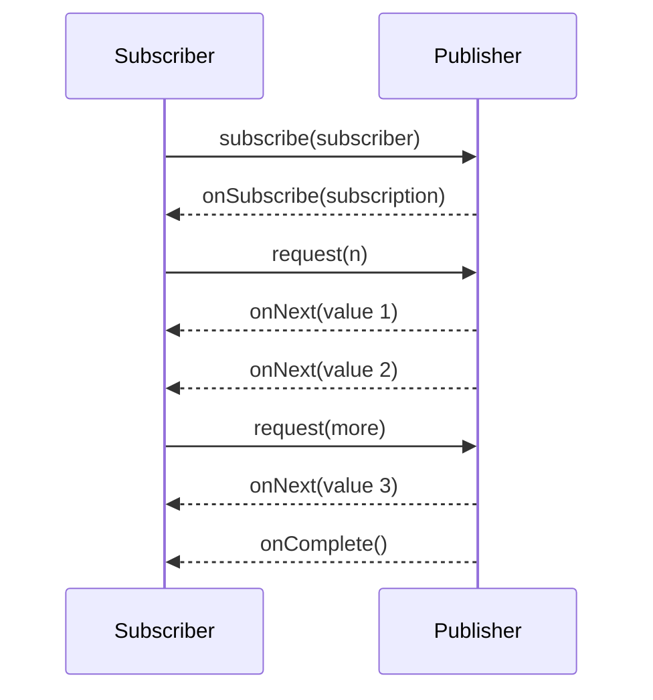
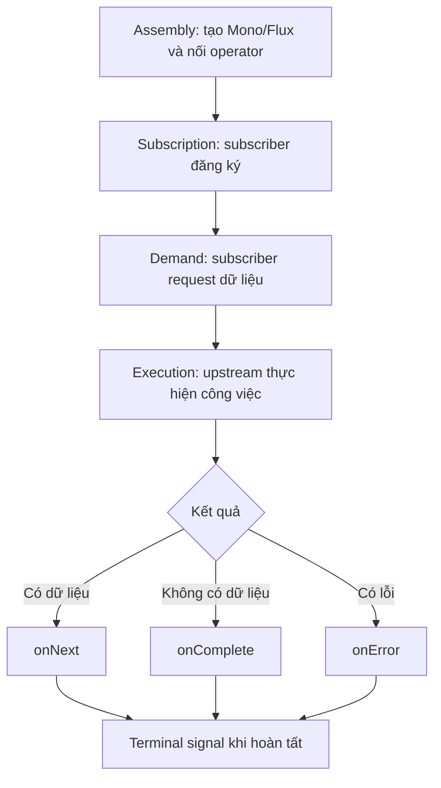

# Mô hình Publisher, Mono, Flux và thời điểm thực thi

Trong Spring Data Elasticsearch reactive, nhiều API không trả về một document hoặc một danh sách document ngay khi được gọi. Thay vào đó, chúng trả về một **Publisher**: một mô tả về công việc có thể phát ra dữ liệu trong tương lai. Reactor cung cấp hai kiểu phổ biến để biểu diễn publisher là `Mono<T>` và `Flux<T>`.

Điểm quan trọng nhất khi đọc hoặc viết code reactive là phân biệt ba thời điểm:

1. **Assembly time**: ứng dụng tạo publisher và nối các operator thành một pipeline.
2. **Subscription time**: một subscriber đăng ký nhận kết quả; publisher bắt đầu quá trình thực thi theo cách triển khai của nó.
3. **Signal/execution time**: dữ liệu, lỗi hoặc tín hiệu hoàn tất được phát qua pipeline khi có demand.

Một lời gọi như `reactiveRepository.findById(id)` thường chỉ tạo ra một `Mono` mô tả thao tác đọc. Elasticsearch request thực sự được thực hiện khi publisher được subscribe. Trong WebFlux, framework thường subscribe khi xử lý response; trong test, `StepVerifier` subscribe; trong một ứng dụng khác, một terminal operation có thể tạo subscription.

Hiểu đúng mô hình này giúp tránh các lỗi phổ biến như gọi `subscribe()` trong service, dùng `block()` trên event-loop, vô tình thực hiện cùng một query nhiều lần hoặc nghĩ rằng một lệnh `save()` đã ghi dữ liệu ngay tại thời điểm method trả về `Mono`.

## 1. Reactive Streams và Publisher

Reactive Streams là một đặc tả cho xử lý dữ liệu bất đồng bộ có cơ chế backpressure. Các thành phần cốt lõi gồm:

- `Publisher<T>`: nguồn có thể phát ra các phần tử kiểu `T`.
- `Subscriber<T>`: bên nhận các phần tử và tín hiệu kết thúc.
- `Subscription`: kết nối giữa publisher và subscriber, cho phép yêu cầu dữ liệu hoặc hủy đăng ký.
- `Processor<T, R>`: vừa là subscriber của kiểu `T`, vừa là publisher của kiểu `R`.

Trong Java, các interface này thuộc package `org.reactivestreams`:

```java
public interface Publisher<T> {
    void subscribe(Subscriber<? super T> subscriber);
}
```

Subscriber nhận các tín hiệu theo một giao thức xác định:

```java
public interface Subscriber<T> {
    void onSubscribe(Subscription subscription);
    void onNext(T value);
    void onError(Throwable error);
    void onComplete();
}
```

Subscription cho phép điều khiển demand và cancellation:

```java
public interface Subscription {
    void request(long n);
    void cancel();
}
```

Thông thường, thứ tự bắt đầu là `onSubscribe`. Sau đó publisher phát zero hoặc nhiều `onNext`, rồi kết thúc bằng đúng một tín hiệu terminal: `onComplete` hoặc `onError`. Sau terminal signal, publisher không được tiếp tục phát dữ liệu cho subscription đó.



Đây là mô hình khái quát. Reactor có thể tối ưu và kết hợp các operator nội bộ, nhưng contract của Reactive Streams vẫn là nền tảng cho việc phát dữ liệu và backpressure.

## 2. Mono và Flux khác nhau thế nào?

Project Reactor cung cấp hai implementation `Publisher` được dùng thường xuyên:

- `Mono<T>`: phát tối đa một phần tử kiểu `T`, hoặc hoàn tất rỗng, hoặc phát lỗi.
- `Flux<T>`: phát từ zero tới nhiều phần tử kiểu `T`, hoặc phát lỗi.

| Kiểu | Số phần tử `onNext` tối đa | Trường hợp điển hình |
|---|---:|---|
| `Mono<T>` | 1 | Đọc một document theo ID, lưu một entity, kết quả một thao tác |
| `Flux<T>` | Không giới hạn cố định | Tìm kiếm nhiều hit, đọc nhiều document, stream sự kiện |
| `Mono<Void>` | 0 | Thao tác chỉ cần báo hoàn tất như delete hoặc command không trả dữ liệu |

### 2.1. Mono có ba kiểu kết thúc thường gặp

Một `Mono<T>` có thể:

1. Phát một giá trị rồi complete.
2. Complete mà không phát giá trị (`Mono.empty()`).
3. Kết thúc bằng lỗi (`Mono.error(...)`).

Ví dụ:

```java
Mono<String> found = Mono.just("P-100");
Mono<String> missing = Mono.empty();
Mono<String> failed = Mono.error(
    new IllegalStateException("Search store unavailable")
);
```

`Mono.empty()` không tương đương `Mono.just(null)`. Reactive Streams không cho phép phát `null` qua `onNext`; Reactor cũng không chấp nhận null trong các factory như `Mono.just`.

### 2.2. Flux phát nhiều phần tử

Ví dụ:

```java
Flux<String> ids = Flux.just("P-100", "P-101", "P-102");
```

Khi subscribe, Flux có thể phát lần lượt ba giá trị rồi complete. Một Flux rỗng cũng hợp lệ:

```java
Flux<ProductDocument> noProducts = Flux.empty();
```

Flux không cần phát ít nhất một phần tử. Nếu truy vấn Elasticsearch không tìm thấy document, publisher thường hoàn tất mà không phát hit nào.

### 2.3. Vì sao delete thường trả Mono<Void>?

Một thao tác delete thường không cần trả document. `Mono<Void>` biểu diễn một tác vụ bất đồng bộ chỉ cần báo thành công hay lỗi:

```java
Mono<Void> delete = repository.deleteById("P-100");
```

Khi thành công, publisher hoàn tất mà không phát `onNext`. Nếu thất bại, nó phát `onError`. Không dùng `block()` chỉ để chờ một `Mono<Void>` trong service reactive; hãy composition nó bằng `then`, `thenReturn` hoặc trả thẳng publisher cho caller.

## 3. Publisher trong Spring Data Elasticsearch reactive

Spring Data Elasticsearch có các API reactive sử dụng Reactor. Repository reactive thường trả `Mono` hoặc `Flux` thay cho kiểu đồng bộ.

Ví dụ:

```java
import org.springframework.data.elasticsearch.repository.ReactiveElasticsearchRepository;

public interface ProductRepository
        extends ReactiveElasticsearchRepository<ProductDocument, String> {
}
```

Các method CRUD có hình dạng thường gặp:

```java
Mono<ProductDocument> findById(String id);

Flux<ProductDocument> findAll();

Mono<ProductDocument> save(ProductDocument product);

Mono<Void> deleteById(String id);
```

Các query method do Spring Data tạo ra cũng có thể trả `Mono<T>` hoặc `Flux<T>` tùy cardinality mong muốn. Ví dụ:

```java
public interface ProductRepository
        extends ReactiveElasticsearchRepository<ProductDocument, String> {

    Flux<ProductDocument> findByStatus(String status);

    Mono<ProductDocument> findFirstBySku(String sku);
}
```

`findByStatus` có thể trả nhiều sản phẩm, còn `findFirstBySku` biểu diễn một kết quả tối đa. Cần đảm bảo query và tên method phản ánh đúng semantics nghiệp vụ.

### 3.1. ReactiveElasticsearchOperations

Nếu cần query DSL linh hoạt hoặc kiểm soát index cụ thể, có thể dùng `ReactiveElasticsearchOperations`:

```java
import org.springframework.data.elasticsearch.core.ReactiveElasticsearchOperations;

@Service
public class ProductSearchService {

    private final ReactiveElasticsearchOperations operations;

    public ProductSearchService(ReactiveElasticsearchOperations operations) {
        this.operations = operations;
    }

    public Mono<ProductDocument> findById(String id) {
        return operations.get(id, ProductDocument.class);
    }
}
```

`operations.get(...)` trả một `Mono` vì thao tác đọc theo ID trả tối đa một document. Các API search có thể trả một publisher của search hit hoặc entity tùy method và phiên bản. Hãy kiểm tra signature của release Spring Data Elasticsearch đang dùng, vì kiểu generic và metadata response có thể khác giữa các API.

Điểm quan trọng không nằm ở việc chọn Repository hay Operations: cả hai đều trả publisher để caller composition. Việc gọi method không đồng nghĩa request đã hoàn tất.

## 4. Ba giai đoạn: Assembly, Subscription và Execution

Đây là mô hình quan trọng nhất để hiểu thời điểm thực thi.

### 4.1. Assembly time

Assembly là lúc ứng dụng gọi các factory và operator để tạo pipeline:

```java
Mono<ProductDocument> productMono = repository.findById("P-100")
    .map(this::toResponseSource);
```

Ở thời điểm này, code đang mô tả một chuỗi thao tác. Với publisher cold như các thao tác reactive thông thường, Elasticsearch request chưa được gửi chỉ vì biến `productMono` được tạo.

### 4.2. Subscription time

Khi một subscriber đăng ký:

```java
productMono.subscribe();
```

publisher bắt đầu kết nối subscription và upstream có cơ hội thực thi. Trong ứng dụng thực tế, `subscribe()` thường do WebFlux, một reactive runtime hoặc test framework thực hiện.

### 4.3. Signal/execution time

Sau khi có subscription và demand, publisher bắt đầu phát dữ liệu hoặc lỗi. Các operator xử lý từng signal:

```java
productMono
    .doOnNext(product -> log.info("Received {}", product.getId()))
    .doOnError(error -> log.error("Lookup failed", error));
```

`doOnNext` và `doOnError` chỉ chạy khi subscription thực sự nhận signal tương ứng. Khai báo operator ở assembly time không có nghĩa callback đã chạy.

Sơ đồ:



Không phải mọi publisher đều chờ demand theo cùng cách nội bộ, nhưng subscription là điểm kích hoạt quan trọng đối với các publisher cold/lazy. Backpressure điều khiển lượng dữ liệu mà subscriber yêu cầu.

## 5. Publisher cold và lazy

Một **cold publisher** thường bắt đầu công việc riêng cho mỗi subscriber. Mỗi lần subscribe có thể tạo một lần thực thi mới.

Ví dụ:

```java
Mono<ProductDocument> product = repository.findById("P-100");

product.subscribe();
product.subscribe();
```

Với một publisher cold đại diện cho repository lookup, hai subscription thường có nghĩa là hai lần thực hiện thao tác đọc. Đừng giả định kết quả của lần subscribe đầu được tự động dùng lại cho lần thứ hai.

Tương tự:

```java
Mono<ProductDocument> save = repository.save(productDocument);
```

Dòng trên tạo publisher mô tả thao tác save. Khi publisher được subscribe, thao tác ghi mới được thực thi. Nếu cùng publisher cold bị subscribe hai lần, có thể có hai lần gọi save. Với cùng ID và payload, hai lần index có thể ghi cùng trạng thái nhưng vẫn tạo hai request và có thể có side effect/version behavior riêng.

### 5.1. Lazy không có nghĩa là mọi biểu thức Java đều lazy

Đây là lỗi dễ gặp:

```java
Mono<String> result = Mono.just(callExternalService());
```

`callExternalService()` là biểu thức Java được thực thi ngay khi `Mono.just(...)` được gọi để tạo publisher. `Mono.just` giữ lại giá trị đã có; nó không trì hoãn việc đánh giá argument.

Nếu muốn gọi hàm khi có subscription:

```java
Mono<String> result = Mono.fromSupplier(this::callExternalService);
```

Hoặc:

```java
Mono<String> result = Mono.fromCallable(this::callExternalService);
```

`fromCallable` phù hợp khi hàm có thể ném checked exception và trả một giá trị. Nếu hàm có thể trả `null`, Reactor chuyển trường hợp đó thành publisher rỗng; không phát `null`.

### 5.2. `Mono.defer` trì hoãn việc tạo publisher

`Mono.defer` nhận một supplier trả về `Mono` và gọi supplier khi có subscription:

```java
Mono<ProductDocument> product = Mono.defer(() ->
    repository.findById("P-100")
);
```

Khác biệt quan trọng:

- `Mono.just(value)` giữ một giá trị đã được tính ở assembly time.
- `Mono.fromCallable(callable)` gọi callable khi subscribe.
- `Mono.defer(supplier)` gọi supplier khi subscribe để lấy một publisher mới.

`defer` hữu ích khi cần đọc trạng thái hiện tại, tạo query dựa trên context hoặc tạo publisher mới cho mỗi subscription.

## 6. Các factory thường dùng của Mono

| Factory | Ý nghĩa | Ví dụ |
|---|---|---|
| `Mono.just(value)` | Publisher chứa một giá trị đã có | `Mono.just("P-100")` |
| `Mono.empty()` | Publisher hoàn tất không có giá trị | `Mono.empty()` |
| `Mono.error(error)` | Publisher kết thúc bằng lỗi | `Mono.error(ex)` |
| `Mono.fromCallable(...)` | Gọi một callable khi subscribe | `Mono.fromCallable(this::load)` |
| `Mono.fromSupplier(...)` | Gọi supplier khi subscribe | `Mono.fromSupplier(this::currentValue)` |
| `Mono.defer(...)` | Tạo publisher mới theo subscription | `Mono.defer(this::loadReactive)` |
| `Mono.fromFuture(...)` | Bridge từ `CompletableFuture` | `Mono.fromFuture(future)` |
| `Mono.delay(...)` | Phát một giá trị sau khoảng thời gian | `Mono.delay(Duration.ofSeconds(1))` |

Ví dụ kết hợp:

```java
Mono<ProductDocument> findProduct(String id) {
    return Mono.defer(() -> repository.findById(id))
        .switchIfEmpty(Mono.error(new ProductNotFoundException(id)));
}
```

`switchIfEmpty` chỉ được kích hoạt nếu repository hoàn tất mà không phát document. Publisher lỗi không được coi là rỗng; lỗi đi theo error path.

## 7. Các factory thường dùng của Flux

| Factory | Ý nghĩa | Ví dụ |
|---|---|---|
| `Flux.just(...)` | Phát các giá trị đã có | `Flux.just("a", "b")` |
| `Flux.empty()` | Hoàn tất không có phần tử | `Flux.empty()` |
| `Flux.error(...)` | Kết thúc bằng lỗi | `Flux.error(ex)` |
| `Flux.fromIterable(...)` | Phát các phần tử của Iterable | `Flux.fromIterable(products)` |
| `Flux.range(start, count)` | Phát dãy số | `Flux.range(1, 10)` |
| `Flux.defer(...)` | Tạo Flux mới theo subscription | `Flux.defer(this::loadAll)` |
| `Flux.fromStream(...)` | Bridge từ Stream | `Flux.fromStream(streamSupplier)` |
| `Flux.generate(...)` | Sinh phần tử theo trạng thái tuần tự | Generator có state |
| `Flux.create(...)` | Bridge callback/event API | Callback-based source |

Ví dụ:

```java
Flux<ProductDocument> products = Flux.defer(() ->
    repository.findAllByStatus("ACTIVE")
);
```

Với `Flux.fromStream`, nên dùng overload nhận supplier nếu mỗi subscription cần một stream mới. Java Stream chỉ được tiêu thụ một lần; tái sử dụng cùng một Stream cho nhiều subscription sẽ gây lỗi hoặc hành vi không mong muốn.

## 8. map và flatMap trong pipeline

`map` biến đổi một giá trị đồng bộ thành một giá trị khác:

```java
Mono<ProductResponse> response = repository.findById(id)
    .map(ProductResponse::from);
```

`flatMap` dùng khi hàm biến đổi trả về một publisher khác:

```java
Mono<ProductResponse> response = repository.findById(id)
    .flatMap(product -> inventoryService.findAvailability(product.getId())
        .map(availability -> ProductResponse.from(product, availability))
    );
```

Nếu dùng `map` với một hàm trả `Mono`, kết quả sẽ là publisher lồng:

```java
Mono<Mono<Availability>> nested = repository.findById(id)
    .map(product -> inventoryService.findAvailability(product.getId()));
```

Thông thường muốn `Mono<Availability>` phẳng, nên dùng `flatMap`.

Với `Flux`, `flatMap` có thể subscribe các inner publisher đồng thời và phát kết quả khi chúng hoàn thành; thứ tự kết quả không nhất thiết giống thứ tự input. Nếu cần giữ thứ tự và xử lý tuần tự, cân nhắc `concatMap`.

## 9. Kết hợp nhiều publisher

Reactor cung cấp nhiều operator để kết hợp publisher:

### 9.1. `then`

Chờ publisher đầu hoàn tất rồi chạy publisher tiếp theo, bỏ qua giá trị của publisher đầu:

```java
Mono<ProductResponse> result = repository.save(product)
    .then(repository.findById(product.getId()))
    .map(ProductResponse::from);
```

### 9.2. `thenReturn`

Chờ tác vụ hoàn tất rồi phát một giá trị cố định:

```java
Mono<String> result = repository.deleteById(id)
    .thenReturn("deleted");
```

### 9.3. `zip`

Kết hợp kết quả từ nhiều publisher khi tất cả đều phát giá trị:

```java
Mono<ProductDetails> details = Mono.zip(
    repository.findById(id),
    inventoryService.findAvailability(id)
).map(tuple -> new ProductDetails(tuple.getT1(), tuple.getT2()));
```

Nếu một nguồn hoàn tất rỗng, `zip` có thể hoàn tất mà không tạo tuple. Hãy xác định semantics khi một nguồn không có dữ liệu.

### 9.4. `concat` và `merge`

- `Flux.concat(a, b)` đăng ký và phát publisher theo thứ tự tuần tự.
- `Flux.merge(a, b)` kết hợp tín hiệu từ các publisher theo thời điểm chúng phát; thứ tự có thể xen kẽ.

Chọn operator theo yêu cầu thứ tự và concurrency, không chỉ theo sự tiện lợi.

## 10. Thời điểm thực thi với Spring Data Elasticsearch

Ví dụ:

```java
Mono<ProductDocument> saved = repository.save(product);
log.info("Publisher assembled");
```

Log có thể xuất hiện trước khi Elasticsearch nhận write, vì `save` trả publisher. Nếu publisher chưa được subscribe, thao tác có thể chưa xảy ra.

Khi WebFlux controller trả publisher:

```java
@PostMapping("/products")
public Mono<ProductDocument> create(@RequestBody ProductDocument product) {
    return repository.save(product);
}
```

WebFlux quản lý subscription khi ghi response. Không cần gọi `.subscribe()` trong controller.

Với test:

```java
StepVerifier.create(repository.save(product))
    .expectNextMatches(saved -> saved.getId().equals(product.getId()))
    .verifyComplete();
```

`StepVerifier` subscribe publisher, yêu cầu dữ liệu và kiểm tra signal. Đây là lý do test có thể kích hoạt thao tác Elasticsearch dù code production không gọi `subscribe()` trực tiếp.

### 10.1. Ghi và đọc nối tiếp

Nếu cần đọc sau khi save hoàn tất, composition publisher:

```java
Mono<ProductDocument> saveThenRead(ProductDocument product) {
    return repository.save(product)
        .flatMap(saved -> repository.findById(saved.getId()));
}
```

Publisher đọc chỉ được subscribe khi publisher save phát giá trị và `flatMap` nối tiếp. Nếu cần chỉ chờ save rồi trả chính object đã lưu, có thể:

```java
Mono<ProductDocument> save(ProductDocument product) {
    return repository.save(product);
}
```

Đừng gọi `repository.save(product).subscribe()` rồi lập tức gọi `findById`; hai subscription độc lập có thể chạy không theo thứ tự mong muốn.

Lưu ý thêm: write acknowledgement không nhất thiết đồng nghĩa document đã search-visible. Nếu thao tác đọc tiếp theo là GET theo ID, semantics có thể khác search query do Elasticsearch near real-time. Khi cần search read-after-write, phải xác định refresh policy phù hợp.

## 11. Subscription và nhiều lần thực thi

Một publisher cold có thể thực thi lại mỗi lần subscribe:

```java
Mono<ProductDocument> product = repository.findById("P-100");

product.subscribe(first -> log.info("first={}", first));
product.subscribe(second -> log.info("second={}", second));
```

Đây thường là hai lần lookup độc lập. Nếu publisher đại diện một thao tác ghi, nhiều subscription có thể gây nhiều lần ghi.

Tránh tạo hai subscription chỉ để vừa log vừa lấy kết quả. Thay vào đó, gắn side-effect operator trong cùng pipeline:

```java
Mono<ProductDocument> product = repository.findById("P-100")
    .doOnNext(value -> log.info("Loaded {}", value.getId()));
```

### 11.1. `cache` và chia sẻ kết quả

Nếu thực sự cần chia sẻ kết quả giữa nhiều subscriber, có thể cân nhắc operator như `cache()` hoặc `share()`, nhưng semantics khác nhau:

- `cache()` có thể lưu và replay các signal cho subscriber sau, tùy overload và TTL.
- `share()` chia sẻ một subscription trong thời gian publisher đang hoạt động; lifecycle khi không còn subscriber cần được hiểu rõ.

Ví dụ:

```java
Mono<ProductDocument> cachedProduct = repository.findById("P-100")
    .cache();
```

Đây là cache trong vòng đời của publisher, không phải cache dữ liệu có invalidation tự động theo Elasticsearch. Nếu document được cập nhật sau đó, publisher đã cache có thể vẫn phát dữ liệu cũ. Không thêm `cache()` chỉ để tránh subscribe nhiều lần mà không xác định TTL, invalidation và yêu cầu freshness.

## 12. Cold publisher và hot publisher

**Cold publisher** thường bắt đầu phát dữ liệu riêng cho mỗi subscriber. Ví dụ các publisher được tạo từ `Mono.defer`, `Flux.fromIterable` hoặc reactive repository operation.

**Hot publisher** có thể phát dữ liệu độc lập với một subscriber cụ thể; subscriber đến muộn có thể bỏ lỡ các signal trước khi đăng ký, trừ khi nguồn có replay/cache.

Ví dụ hot source với `Sinks.Many`:

```java
Sinks.Many<String> events = Sinks.many()
    .multicast()
    .onBackpressureBuffer();

Flux<String> eventStream = events.asFlux();

events.tryEmitNext("product-created");
```

Subscriber đăng ký sau thời điểm emit có thể không nhận được event đã phát trước đó với multicast sink này. Các biến thể replay sink có semantics lưu và phát lại khác.

Trong Spring Data Elasticsearch, thao tác repository thông thường là publisher đại diện cho request theo subscription, không phải một stream event nóng dùng chung. Nếu muốn phát event khi document thay đổi, cần một nguồn event riêng như message broker, change stream hoặc application event; search query không tự trở thành hot stream chỉ vì trả `Flux`.

## 13. Backpressure: subscriber điều khiển demand

Backpressure là cơ chế để subscriber báo cho publisher biết nó sẵn sàng nhận bao nhiêu phần tử. Subscriber gọi `request(n)` để yêu cầu tối đa `n` phần tử tiếp theo.

Ví dụ khái niệm:

```java
subscription.request(10);
```

Publisher không nên phát nhiều hơn demand đã được yêu cầu. Điều này giúp tránh đẩy vô hạn dữ liệu vào subscriber không xử lý kịp.

Với Flux, có thể dùng các operator như `limitRate`, `buffer`, `window` hoặc `onBackpressureBuffer` để điều chỉnh cách xử lý demand/buffering.

Ví dụ:

```java
Flux<ProductDocument> products = repository.findAll()
    .limitRate(100);
```

`limitRate` điều chỉnh cách Reactor chia demand upstream thành các request nhỏ hơn. Nó không phải một giới hạn cứng về tổng số document và không thay thế pagination/batch strategy ở Elasticsearch.

### 13.1. Backpressure không tự động giải quyết mọi vấn đề bộ nhớ

Các operator có thể buffer dữ liệu. Ví dụ:

```java
Mono<List<ProductDocument>> allProducts = repository.findAll()
    .collectList();
```

`collectList()` giữ toàn bộ phần tử trong memory cho tới khi Flux hoàn tất. Với index lớn, cách này có thể tiêu thụ nhiều heap dù nguồn là reactive.

Nếu cần xử lý dữ liệu lớn, hãy xử lý từng phần tử hoặc theo batch:

```java
Mono<Void> processAll() {
    return repository.findAll()
        .flatMap(this::processProduct, 8)
        .then();
}
```

Concurrency `8` trong ví dụ giới hạn số inner publisher đang được xử lý đồng thời ở `flatMap`. Chọn con số dựa trên latency, connection pool và khả năng cluster; không mặc định tăng concurrency luôn tốt.

### 13.2. Backpressure ở tầng ứng dụng và Elasticsearch

Reactive Streams backpressure kiểm soát tín hiệu giữa publisher và subscriber. Điều đó không có nghĩa một `request(1)` luôn tương ứng với đúng một HTTP request hoặc Elasticsearch chỉ fetch một document. Client có thể dùng page, scroll, PIT hoặc buffer nội bộ tùy API.

Đối với truy vấn Elasticsearch lớn, vẫn cần giới hạn page size, dùng pagination phù hợp, kiểm soát số request đồng thời và tránh `collectList()` không giới hạn. Backpressure là một phần của kiểm soát tải, không thay thế thiết kế query và phân trang.

## 14. Cancellation và timeout

Subscriber có thể hủy subscription bằng `cancel()`. Trong Reactor, cancellation có thể phát sinh khi:

- Client HTTP đóng kết nối.
- Controller timeout hoặc request bị hủy.
- Operator như `take(n)` đã nhận đủ dữ liệu.
- Một publisher kết hợp không còn cần nguồn upstream.

Ví dụ:

```java
Flux<ProductDocument> firstTen = repository.findAll()
    .take(10);
```

Khi đã nhận đủ 10 phần tử, downstream có thể hủy phần còn lại của subscription. Client reactive có thể truyền cancellation xuống request/resource upstream nếu hỗ trợ.

Tuy nhiên, cancellation không phải rollback. Nếu một write đã được Elasticsearch thực hiện trước khi cancellation tới, dữ liệu không tự quay về trạng thái cũ. Với bulk hoặc update-by-query, một phần công việc có thể đã hoàn tất. Hãy thiết kế write idempotent và có khả năng đối soát khi request bị hủy giữa chừng.

## 15. Xử lý lỗi trong Mono và Flux

Lỗi được phát dưới dạng `onError`, là terminal signal cho subscription hiện tại. Có thể xử lý bằng các operator:

### 15.1. `onErrorMap`

Chuyển một loại lỗi thành lỗi khác:

```java
Mono<ProductDocument> product = repository.findById(id)
    .onErrorMap(DataAccessException.class,
        ex -> new ProductSearchException("Search failed", ex));
```

### 15.2. `onErrorResume`

Chuyển sang publisher dự phòng khi có lỗi phù hợp:

```java
Mono<ProductDocument> product = repository.findById(id)
    .onErrorResume(SearchStoreUnavailableException.class,
        ex -> cache.findById(id));
```

Chỉ dùng fallback nếu nghiệp vụ chấp nhận dữ liệu từ cache và có chính sách freshness rõ ràng. Không biến mọi lỗi thành `Mono.empty()` vì có thể che giấu sự cố.

### 15.3. `retryWhen`

Retry một publisher khi lỗi thỏa điều kiện:

```java
Mono<ProductDocument> product = repository.findById(id)
    .retryWhen(
        Retry.backoff(3, Duration.ofMillis(200))
            .filter(this::isTransientFailure)
    );
```

Mỗi lần retry có thể subscribe lại upstream và thực hiện request mới. Với thao tác ghi, chỉ retry khi operation an toàn khi lặp hoặc có idempotency/version strategy phù hợp. Không retry mapping error, authorization error hoặc conflict bằng cách gửi lại cùng dữ liệu cũ.

## 16. `subscribe()` và ai nên sở hữu subscription?

`subscribe()` là terminal action tạo subscription. Khi gọi nó, code hiện tại tự khởi chạy publisher.

Trong service/controller WebFlux, không nên tự gọi `subscribe()`:

```java
// Không nên trong controller/service reactive.
public Mono<ProductDocument> create(ProductDocument product) {
    repository.save(product).subscribe();
    return Mono.just(product);
}
```

Đoạn code này có nhiều vấn đề:

- Method trả response trước khi biết save thành công hay thất bại.
- Lỗi từ save không đi theo publisher trả về cho WebFlux.
- Cancellation của request không điều khiển subscription save độc lập.
- Test có thể hoàn tất trước khi save chạy xong.

Hãy trả publisher:

```java
public Mono<ProductDocument> create(ProductDocument product) {
    return repository.save(product);
}
```

Framework ở tầng ngoài cùng sẽ sở hữu subscription. Đây là nguyên tắc structured reactive flow: mỗi tầng composition công việc và trả publisher; một runtime hoặc caller ở ranh giới mới thực hiện subscribe.

Có những trường hợp ứng dụng cần khởi chạy một background process độc lập, nhưng khi đó phải thiết kế lifecycle, error handling, cancellation và logging rõ ràng thay vì gọi `subscribe()` tùy tiện trong một method nghiệp vụ.

## 17. Vì sao không dùng block() trong WebFlux?

`block()` chờ publisher hoàn tất và trả giá trị đồng bộ:

```java
ProductDocument product = repository.findById(id).block();
```

Đây là cách chuyển từ reactive sang blocking. Trên event-loop thread của WebFlux, blocking có thể làm thread không xử lý được các request khác và gây giảm throughput hoặc deadlock trong một số tình huống.

Thay vì:

```java
public ProductResponse get(String id) {
    ProductDocument product = repository.findById(id).block();
    return ProductResponse.from(product);
}
```

hãy giữ kiểu reactive:

```java
public Mono<ProductResponse> get(String id) {
    return repository.findById(id)
        .map(ProductResponse::from);
}
```

Nếu phải gọi một thư viện blocking, cô lập lời gọi trên scheduler phù hợp, chẳng hạn `Schedulers.boundedElastic()`, và giới hạn concurrency. Không dùng `boundedElastic` như lý do để biến toàn bộ ứng dụng reactive thành blocking.

## 18. Thời điểm thực thi trong WebFlux controller

Một controller trả `Mono` hoặc `Flux`:

```java
@RestController
@RequestMapping("/products")
public class ProductController {

    private final ProductRepository repository;

    public ProductController(ProductRepository repository) {
        this.repository = repository;
    }

    @GetMapping("/{id}")
    public Mono<ProductDocument> get(@PathVariable String id) {
        return repository.findById(id);
    }

    @GetMapping
    public Flux<ProductDocument> list() {
        return repository.findAll();
    }

    @PostMapping
    public Mono<ProductDocument> create(@RequestBody ProductDocument product) {
        return repository.save(product);
    }
}
```

Controller không cần tự subscribe. WebFlux nhận publisher và kết nối nó với quá trình ghi HTTP response. Khi có subscription, publisher được thực thi; khi có kết quả, framework serialize response theo kiểu trả về.

Với `Flux`, framework có thể stream nhiều phần tử theo cách response media type hỗ trợ. Nếu trả JSON array thông thường, response có thể cần giữ hoặc serialize theo framing phù hợp; với NDJSON/SSE, dữ liệu có thể được gửi theo từng phần tử. Chọn media type và response contract theo nhu cầu client.

## 19. Sự khác nhau giữa tạo publisher và tạo side effect

Một số đoạn code trông reactive nhưng thực tế side effect đã xảy ra ở assembly time.

Ví dụ:

```java
Mono<ProductDocument> save = repository.save(buildProduct());
```

`buildProduct()` chạy ngay khi method được gọi. Bản thân thao tác reactive save thường chờ subscription, nhưng phần tạo entity đã xảy ra.

Nếu cần tạo entity tại subscription time:

```java
Mono<ProductDocument> save = Mono.defer(() ->
    repository.save(buildProduct())
);
```

Điều này có thể quan trọng nếu ID, timestamp hoặc actor được tính tại thời điểm mỗi subscription. Tuy nhiên, không nên dùng `defer` chỉ theo thói quen; hãy chọn thời điểm tạo dữ liệu phù hợp với nghiệp vụ.

`doOnNext`, `doOnSuccess`, `doOnError`, `doFinally` là các operator side-effect để quan sát signal. Chúng không thay thế operator biến đổi dữ liệu và không nên chứa business logic cần bảo đảm thực thi đúng một lần nếu publisher có thể được subscribe nhiều lần.

Ví dụ:

```java
Mono<ProductDocument> save = repository.save(product)
    .doOnSuccess(saved -> log.info("Save publisher completed"))
    .doOnError(error -> log.error("Save failed", error))
    .doFinally(signal -> log.debug("Subscription finished: {}", signal));
```

Với `Mono`, `doOnSuccess` có thể nhận `null` khi publisher hoàn tất rỗng; cần lưu ý khi dùng với các operation không phát giá trị. `doFinally` được gọi khi subscription kết thúc bằng complete, error hoặc cancel.

## 20. Thực thi tuần tự và đồng thời

`flatMap` thường cho phép nhiều inner publisher chạy đồng thời. Ví dụ:

```java
Flux<ProductResponse> responses = repository.findAll()
    .flatMap(product -> inventoryService.findAvailability(product.getId())
        .map(availability -> ProductResponse.from(product, availability)),
        8
    );
```

Tham số `8` giới hạn concurrency của inner publisher. Nếu cần xử lý tuần tự và giữ thứ tự:

```java
Flux<ProductResponse> responses = repository.findAll()
    .concatMap(product -> inventoryService.findAvailability(product.getId())
        .map(availability -> ProductResponse.from(product, availability))
    );
```

`concatMap` chờ inner publisher hiện tại hoàn tất trước khi xử lý phần tử tiếp theo. Cách này giữ thứ tự nhưng có thể giảm throughput.

Không gọi Elasticsearch với concurrency không giới hạn chỉ vì publisher là non-blocking. Cluster vẫn có giới hạn CPU, heap, connection, thread pool và search/indexing capacity. Giới hạn concurrency và batch size dựa trên benchmark thực tế.

## 21. Kiểm thử thời điểm thực thi với StepVerifier

`StepVerifier` trong `reactor-test` cho phép subscribe và kiểm tra các signal theo thứ tự.

Ví dụ kiểm tra một Mono:

```java
StepVerifier.create(Mono.just("P-100"))
    .expectNext("P-100")
    .verifyComplete();
```

Kiểm tra publisher rỗng:

```java
StepVerifier.create(Mono.<String>empty())
    .verifyComplete();
```

Kiểm tra lỗi:

```java
StepVerifier.create(Mono.error(new IllegalStateException("failed")))
    .expectErrorMessage("failed")
    .verify();
```

### 21.1. Chứng minh publisher lazy

Có thể dùng counter để xác nhận callable chỉ chạy khi subscribe:

```java
AtomicInteger calls = new AtomicInteger();

Mono<Integer> source = Mono.fromCallable(calls::incrementAndGet);

assertThat(calls.get()).isZero();

StepVerifier.create(source)
    .expectNext(1)
    .verifyComplete();

assertThat(calls.get()).isEqualTo(1);
```

Sau đó subscribe lần nữa:

```java
StepVerifier.create(source)
    .expectNext(2)
    .verifyComplete();
```

Vì đây là cold publisher, callable được gọi lại cho subscription mới.

### 21.2. Test reactive repository

Với integration test Elasticsearch:

```java
StepVerifier.create(repository.save(product))
    .assertNext(saved -> assertThat(saved.getId()).isEqualTo(product.getId()))
    .verifyComplete();
```

`StepVerifier` tạo subscription để kích hoạt save. Nếu cần search ngay sau write, test cần refresh hoặc refresh policy phù hợp vì search của Elasticsearch là near real-time. Không dùng `Thread.sleep()` để đoán thời điểm refresh.

## 22. Debug pipeline và quan sát subscription

Các operator hữu ích khi debug:

```java
Mono<ProductDocument> result = repository.findById(id)
    .doOnSubscribe(subscription -> log.debug("Subscribed to product lookup"))
    .doOnRequest(n -> log.debug("Requested {} item(s)", n))
    .doOnNext(product -> log.debug("Received product {}", product.getId()))
    .doOnError(error -> log.error("Lookup failed", error))
    .doFinally(signal -> log.debug("Finished with signal {}", signal));
```

`log()` cũng có thể hiển thị signal ở một vị trí trong pipeline:

```java
repository.findById(id)
    .log("product-lookup")
    .map(ProductResponse::from);
```

Trong môi trường phát triển, `checkpoint()` có thể bổ sung assembly context khi điều tra lỗi:

```java
repository.findById(id)
    .checkpoint("load-product-for-details");
```

Các cơ chế debug sâu có thể tăng overhead. Không bật logging toàn bộ signal hoặc operator debugging nặng trong production mà không đánh giá chi phí và lượng dữ liệu log.

## 23. Những lỗi thường gặp

| Hiện tượng | Nguyên nhân có thể | Cách xử lý |
|---|---|---|
| Gọi `save()` nhưng document chưa được ghi | Publisher chưa được subscribe | Trả publisher cho WebFlux hoặc subscribe ở đúng runtime boundary. |
| Gọi `subscribe()` trong service và API trả trước khi lưu xong | Tạo subscription độc lập | Composition bằng `flatMap`/`then` và trả publisher. |
| Gọi repository hai lần ngoài ý muốn | Cold publisher bị subscribe nhiều lần | Tổ chức một subscription; chỉ dùng cache/share khi semantics phù hợp. |
| `Mono.just(call())` chạy hàm ngay | Argument được tính ở assembly time | Dùng `fromCallable`, `fromSupplier` hoặc `defer`. |
| Nhận `Mono<Mono<T>>` | Dùng `map` với hàm trả publisher | Dùng `flatMap`. |
| Dùng `block()` trong WebFlux | Chuyển reactive thành blocking trên event loop | Giữ pipeline bằng `map`/`flatMap`. |
| `collectList()` làm heap tăng | Giữ toàn bộ Flux trong memory | Xử lý từng phần tử hoặc batch có giới hạn. |
| Kết quả `flatMap` sai thứ tự | Inner publisher hoàn tất không theo thứ tự đầu vào | Dùng `concatMap` nếu thứ tự là yêu cầu. |
| Elasticsearch bị quá tải | Concurrency hoặc demand quá lớn | Giới hạn concurrency, page size và tải đầu vào. |
| Cancel request nhưng write vẫn đã xảy ra | Server xử lý trước khi cancellation tới | Thiết kế idempotency và đối soát; cancel không rollback. |
| Test hoàn tất trước khi operation chạy | Không có StepVerifier/terminal subscription | Dùng StepVerifier hoặc framework quản lý subscription. |
| Search test không thấy dữ liệu vừa save | Chưa refresh | Refresh tường minh hoặc dùng wait-for policy đúng trường hợp. |

## 24. Quy trình đọc một reactive pipeline

Khi đọc một đoạn code reactive, có thể lần lượt đặt các câu hỏi:

1. Publisher gốc là `Mono` hay `Flux`? Nó biểu diễn tối đa một kết quả hay nhiều kết quả?
2. Publisher được tạo ở đâu? Factory nào được dùng: `just`, `fromCallable`, `defer`, repository operation hay client call?
3. Side effect nào xảy ra ngay khi assembly và side effect nào chỉ xảy ra khi subscribe?
4. Ai sở hữu subscription: WebFlux, StepVerifier, scheduler hay code tự gọi `subscribe()`?
5. Operator nào biến đổi dữ liệu (`map`), nối publisher (`flatMap`) hoặc kết hợp nguồn (`zip`, `concat`, `merge`)?
6. Có nhiều subscription khiến query/write thực hiện nhiều lần không?
7. Có buffering hoặc `collectList()` làm dữ liệu tích tụ trong memory không?
8. Concurrency và backpressure được giới hạn ở đâu?
9. Error và cancellation được xử lý như thế nào?
10. Nếu có Elasticsearch write rồi search, refresh/read-after-write contract là gì?

## 25. Kết luận

Reactive Streams định nghĩa `Publisher`, `Subscriber` và `Subscription` để truyền dữ liệu bất đồng bộ với cơ chế backpressure. Reactor triển khai mô hình đó bằng `Mono<T>` cho tối đa một phần tử và `Flux<T>` cho zero tới nhiều phần tử. Spring Data Elasticsearch reactive dùng các kiểu này cho thao tác đọc, ghi, tìm kiếm và xóa; chúng mô tả công việc sẽ được thực hiện thay vì trả kết quả đồng bộ ngay tại method call.

Hãy phân biệt assembly time, subscription time và thời điểm publisher phát signal. `Mono.just` giữ giá trị đã có, trong khi `fromCallable`, `fromSupplier` và `defer` có thể trì hoãn công việc tới subscription. Cold publisher thường thực hiện lại công việc cho mỗi subscriber; hot publisher có lifecycle phát dữ liệu riêng. Vì vậy, nhiều lần subscribe có thể tạo nhiều request Elasticsearch.

Trong service và controller WebFlux, hãy composition publisher bằng `map`, `flatMap`, `concatMap`, `zip` hoặc `then`, rồi trả publisher cho framework quản lý subscription. Tránh gọi `subscribe()` hoặc `block()` tùy tiện. Backpressure giúp điều tiết demand nhưng không thay thế giới hạn page size, concurrency và memory. Cancellation không rollback write đã được server xử lý. Dùng StepVerifier để kiểm tra signal và thời điểm thực thi; khi test search sau write, kiểm soát refresh của Elasticsearch. Nắm chắc các khái niệm này là nền tảng để xây dựng pipeline Spring Data Elasticsearch reactive đúng thứ tự, có thể kiểm soát tải và dễ chẩn đoán.
