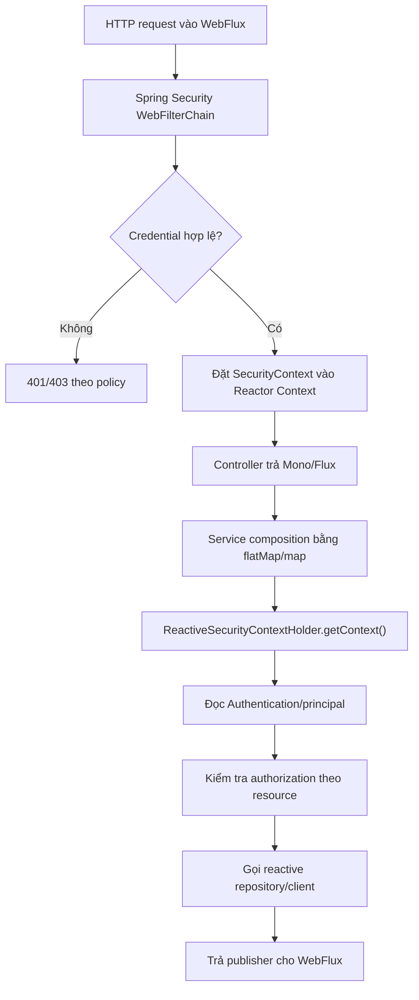

# Truyền ngữ cảnh xác thực qua Reactor Context

Trong ứng dụng Spring WebFlux, một request thường đi qua chuỗi xử lý reactive gồm `Mono`, `Flux`, các toán tử như `map`, `flatMap`, `filter` và có thể đổi thread bằng `publishOn` hoặc `subscribeOn`. Không thể giả định toàn bộ chuỗi xử lý luôn chạy trên cùng một thread. Vì vậy, cách lưu thông tin người dùng trong `ThreadLocal` như ứng dụng Servlet truyền thống không phù hợp để làm cơ chế chính cho bảo mật reactive.

Spring Security reactive lưu `SecurityContext` trong **Reactor Context**. Ứng dụng đọc thông tin xác thực bằng `ReactiveSecurityContextHolder`, còn Spring Security WebFlux tự đưa context xác thực vào reactive pipeline sau khi xác thực request. Reactor Context đi theo subscription, nên thông tin có thể được sử dụng qua các toán tử reactive mà không phụ thuộc thread hiện tại.

Các khái niệm cần nắm:

- `Reactor Context`: vùng dữ liệu bất biến gắn với một subscription.
- `ReactiveSecurityContextHolder`: API của Spring Security để đọc và ghi `SecurityContext` trong Reactor Context.
- `contextWrite(...)`: tạo context mà các operator ở phía upstream của vị trí đó nhìn thấy.
- `ReactiveSecurityContextHolder.getContext()`: trả về `Mono<SecurityContext>` từ context của subscription hiện tại.
- `ReactiveSecurityContextHolder.withAuthentication(...)`: helper để thêm một `Authentication` vào context, chủ yếu hữu ích cho test hoặc tích hợp có chủ đích.

## 1. Vì sao reactive cần Reactor Context?

Trong mô hình Servlet blocking, một request thường được xử lý trên một thread trong phần lớn vòng đời request. Spring Security có thể đặt `SecurityContext` vào `SecurityContextHolder`, vốn mặc định dùng `ThreadLocal`.

Trong WebFlux, một request có thể được xử lý qua nhiều thread khác nhau. Ví dụ:

```java
return repository.findById(id)
    .publishOn(Schedulers.boundedElastic())
    .map(this::toResponse);
```

`publishOn` có thể chuyển các thao tác tiếp theo sang thread khác. Nếu authentication chỉ nằm trong `ThreadLocal` của thread ban đầu, thread mới có thể không có giá trị đó. Hơn nữa, một thread có thể lần lượt phục vụ nhiều request khác nhau; dùng ThreadLocal sai cách có nguy cơ đọc nhầm hoặc giữ lại context không thuộc request hiện tại.

Reactor Context giải quyết vấn đề bằng cách gắn metadata với subscription thay vì gắn với thread. Khi Reactor thực thi một chuỗi operator, context của subscription được truyền qua pipeline ngay cả khi việc xử lý chuyển thread.

Điều này không có nghĩa mọi loại asynchronous code đều tự động nhận context. Một subscription Reactor mới, một `CompletableFuture` tự tạo hoặc một callback bên ngoài Reactor có thể không mang theo context ban đầu. Cần hiểu ranh giới đó để không làm mất thông tin xác thực.

## 2. Reactor Context hoạt động như thế nào?

Reactor Context là cấu trúc key/value bất biến, được gắn với subscriber. Mỗi lần cập nhật context tạo ra một context mới. Context không phải một `Map` toàn cục và không được chia sẻ tùy tiện giữa các request.

Ví dụ đơn giản:

```java
import reactor.core.publisher.Mono;

Mono<String> result = Mono.deferContextual(context ->
    Mono.just("request-id=" + context.get("requestId"))
).contextWrite(context -> context.put("requestId", "req-1001"));
```

Khi subscribe, `deferContextual` đọc được `requestId` đã được thêm bởi `contextWrite`:

```text
request-id=req-1001
```

`deferContextual` trì hoãn việc đọc context đến lúc subscription thực sự chạy. Đây là điểm quan trọng: không đọc context ngay khi xây dựng publisher, vì lúc đó chưa có subscriber context.

### 2.1. Hướng tác động của `contextWrite`

Một điểm dễ nhầm là `contextWrite` tác động theo hướng từ downstream về upstream. Context do nó ghi sẽ được nhìn thấy bởi các operator nằm phía trước nó trong chuỗi publisher.

Ví dụ:

```java
Mono<String> result = Mono.deferContextual(context ->
        Mono.just(context.get("user"))
    )
    .map(String::toUpperCase)
    .contextWrite(context -> context.put("user", "alice"));
```

Nguồn `deferContextual` và operator `map` phía upstream nhận context có `user=alice`. Nếu đặt `contextWrite` ở một vị trí khác, cần xem publisher nào nằm phía upstream của nó để biết publisher nào nhìn thấy giá trị.

Hãy nhớ:

- Subscriber tạo context ban đầu.
- `contextWrite` điều chỉnh context mà upstream nhìn thấy.
- `deferContextual` đọc context tại thời điểm subscription.
- Context là riêng cho subscription, không phải biến global.

## 3. Spring Security reactive lưu authentication ở đâu?

Trong Spring WebFlux, Spring Security dùng Reactor Context để giữ `SecurityContext` của request đã được xác thực. Các filter trong `SecurityWebFilterChain` thực hiện xác thực và thiết lập context cho phần xử lý tiếp theo.

Ứng dụng nên đọc authentication qua:

```java
ReactiveSecurityContextHolder.getContext()
```

Phương thức này trả về `Mono<SecurityContext>`. Bên trong đó có `Authentication`, chứa principal, authorities và thông tin xác thực theo cơ chế security đang sử dụng.

Không dùng `SecurityContextHolder.getContext()` trong code reactive để đọc người dùng hiện tại. Đó là API imperative dựa trên holder strategy, thường là ThreadLocal; nó không phải API truy cập reactive security context.

### 3.1. Cấu hình Spring Security WebFlux

Ví dụ cấu hình bảo vệ endpoint:

```java
import org.springframework.context.annotation.Bean;
import org.springframework.context.annotation.Configuration;
import org.springframework.security.config.annotation.web.reactive.EnableWebFluxSecurity;
import org.springframework.security.config.web.server.ServerHttpSecurity;
import org.springframework.security.web.server.SecurityWebFilterChain;

@Configuration
@EnableWebFluxSecurity
public class SecurityConfiguration {

    @Bean
    SecurityWebFilterChain springSecurityFilterChain(ServerHttpSecurity http) {
        return http
            .csrf(ServerHttpSecurity.CsrfSpec::disable)
            .authorizeExchange(exchanges -> exchanges
                .pathMatchers("/public/**").permitAll()
                .pathMatchers("/admin/**").hasRole("ADMIN")
                .anyExchange().authenticated()
            )
            .httpBasic(basic -> {})
            .build();
    }
}
```

Ví dụ dùng HTTP Basic để minh họa. Cấu hình xác thực thực tế có thể dùng JWT, OAuth2 Resource Server hoặc cơ chế khác. Khi request được Spring Security xác thực thành công, security context được đặt vào Reactor Context của luồng xử lý request.

Không tự gọi `contextWrite(withAuthentication(...))` trong mọi controller để thay thế security filter chain. Context do ứng dụng tự thêm không chứng minh người dùng đã được xác thực; authentication phải đến từ cơ chế bảo mật đã cấu hình.

## 4. Đọc Authentication bằng ReactiveSecurityContextHolder

Một service có thể lấy tên người dùng hiện tại như sau:

```java
import org.springframework.security.core.Authentication;
import org.springframework.security.core.context.SecurityContext;
import org.springframework.security.core.context.ReactiveSecurityContextHolder;
import reactor.core.publisher.Mono;

public Mono<String> currentUsername() {
    return ReactiveSecurityContextHolder.getContext()
        .map(SecurityContext::getAuthentication)
        .map(Authentication::getName);
}
```

Phương thức trả về `Mono<String>` vì thông tin xác thực được đọc trong reactive pipeline. Không gọi `.block()` để biến kết quả thành String trong một service WebFlux thông thường.

Nếu không có security context, `ReactiveSecurityContextHolder.getContext()` có thể hoàn tất mà không phát ra giá trị. Do đó, nếu endpoint cho phép anonymous access, hãy xác định rõ hành vi khi không có authentication.

Ví dụ cung cấp giá trị dự phòng:

```java
public Mono<String> currentUsernameOrAnonymous() {
    return ReactiveSecurityContextHolder.getContext()
        .map(SecurityContext::getAuthentication)
        .map(Authentication::getName)
        .defaultIfEmpty("anonymous");
}
```

Không dùng giá trị mặc định `anonymous` cho một thao tác cần quyền xác thực. Với thao tác nhạy cảm, hãy yêu cầu authenticated principal và trả lỗi nếu context không tồn tại.

## 5. Đọc principal trong controller và service

Controller WebFlux có thể nhận `Principal` trực tiếp qua tham số handler:

```java
import java.security.Principal;
import org.springframework.web.bind.annotation.GetMapping;
import org.springframework.web.bind.annotation.RestController;
import reactor.core.publisher.Mono;

@RestController
public class AccountController {

    @GetMapping("/me")
    public Mono<String> me(Principal principal) {
        return Mono.just(principal.getName());
    }
}
```

Đây là cách thuận tiện khi controller chỉ cần principal cho một endpoint. Nếu service ở sâu hơn trong pipeline cần authentication hoặc authority, có thể đọc bằng `ReactiveSecurityContextHolder`.

Ví dụ service gắn tên actor vào kết quả:

```java
public Mono<AccountResponse> getCurrentAccount() {
    return ReactiveSecurityContextHolder.getContext()
        .map(SecurityContext::getAuthentication)
        .flatMap(authentication ->
            accountRepository.findByUsername(authentication.getName())
        )
        .map(AccountResponse::from);
}
```

Repository reactive trả `Mono<Account>` trong ví dụ. `flatMap` dùng để nối publisher trả về từ repository vào pipeline hiện tại, vì vậy nó vẫn chạy trong subscription có security context.

## 6. Context được truyền qua các operator reactive

Khi vẫn ở trong cùng một reactive subscription, Reactor Context được giữ qua các operator như:

- `map` và `filter`.
- `flatMap` và `concatMap`.
- `switchIfEmpty` và `onErrorResume`.
- `publishOn` và `subscribeOn`.
- Các publisher được tạo và subscribe thông qua composition của cùng pipeline.

Ví dụ:

```java
public Mono<OrderResponse> getOrder(String orderId) {
    return orderRepository.findById(orderId)
        .flatMap(order -> ReactiveSecurityContextHolder.getContext()
            .map(SecurityContext::getAuthentication)
            .map(authentication -> new OrderResponse(
                order.getId(),
                order.getStatus(),
                authentication.getName()
            ))
        )
        .publishOn(Schedulers.parallel());
}
```

Trong cùng subscription, việc chuyển scheduler không tự làm mất Reactor Context. Tuy nhiên, ví dụ trên chỉ để minh họa việc đọc context trong pipeline; không cần thêm `publishOn` nếu không có lý do về scheduling.

### 6.1. `publishOn` và `subscribeOn` không phải context propagation API

Hai operator này điều khiển nơi thực thi công việc:

- `subscribeOn` ảnh hưởng scheduler dùng để bắt đầu subscription cho phần upstream.
- `publishOn` chuyển việc thực thi các operator downstream sang scheduler được chỉ định.

Reactor Context gắn với subscription, nên vẫn được truy cập qua các operator khi thread thay đổi. Không cần copy authentication sang ThreadLocal chỉ vì dùng `publishOn` hoặc `subscribeOn`.

Điều này khác với việc gọi một API imperative bên ngoài Reactor: API đó có thể không biết Reactor Context tồn tại.

## 7. Thêm Authentication vào Reactor Context

`ReactiveSecurityContextHolder.withAuthentication(authentication)` tạo một function có thể truyền cho `contextWrite`:

```java
Mono<String> result = currentUsername()
    .contextWrite(
        ReactiveSecurityContextHolder.withAuthentication(authentication)
    );
```

Sau khi thêm context, các publisher phía upstream có thể đọc authentication bằng `ReactiveSecurityContextHolder.getContext()`.

API này hữu ích trong:

- Unit test service reactive mà không dựng toàn bộ WebFlux security filter chain.
- Adapter nội bộ có một authentication đã được xác thực từ nguồn đáng tin cậy.
- Một luồng kiểm thử hoặc tích hợp có chủ đích cần thiết lập security context.

Trong ứng dụng web thông thường, không tự lấy username từ request body rồi tạo `UsernamePasswordAuthenticationToken` và ghi vào Reactor Context. Làm như vậy sẽ biến dữ liệu do client kiểm soát thành danh tính xác thực. Hãy để Spring Security xác thực credential và thiết lập context.

### 7.1. Dùng `withSecurityContext`

Nếu đã có `Mono<SecurityContext>`, có thể thêm trực tiếp:

```java
Mono<String> result = currentUsername()
    .contextWrite(
        ReactiveSecurityContextHolder.withSecurityContext(securityContextMono)
    );
```

`withSecurityContext(...)` nhận publisher của security context. `withAuthentication(...)` là helper thuận tiện khi đã có `Authentication`.

## 8. Context theo subscription và nhiều request đồng thời

Reactor Context được cô lập theo subscriber. Hai request chạy đồng thời có thể có hai authentication khác nhau mà không cần khóa một biến dùng chung.

Ví dụ:

```java
Mono<String> currentUser = ReactiveSecurityContextHolder.getContext()
    .map(SecurityContext::getAuthentication)
    .map(Authentication::getName);

Mono<String> alice = currentUser.contextWrite(
    ReactiveSecurityContextHolder.withAuthentication(aliceAuthentication)
);

Mono<String> bob = currentUser.contextWrite(
    ReactiveSecurityContextHolder.withAuthentication(bobAuthentication)
);
```

Mỗi publisher có context riêng khi subscribe. Context của Alice không được dùng chung với Bob.

Không lưu authentication hiện tại vào static field, singleton mutable field hoặc `ThreadLocal` tự quản lý để dùng lại giữa request. Những cách đó có thể làm lộ thông tin người dùng giữa các subscription.

## 9. Những ranh giới làm mất Reactor Context

Reactor Context được bảo toàn trong composition reactive thông thường, nhưng có thể bị mất khi code rời khỏi subscription hiện tại.

### 9.1. Tự gọi `subscribe()` bên trong service

Không nên viết:

```java
public Mono<Void> updateOrder(String id) {
    orderRepository.findById(id)
        .flatMap(order -> update(order))
        .subscribe();

    return Mono.empty();
}
```

`subscribe()` tạo một subscription độc lập. Nó không còn được điều khiển bởi subscriber của request ban đầu và có thể không nhận Reactor Context, cancellation, error handling hoặc backpressure của pipeline ngoài.

Hãy trả publisher để caller composition:

```java
public Mono<Void> updateOrder(String id) {
    return orderRepository.findById(id)
        .flatMap(this::update)
        .then();
}
```

### 9.2. Chuyển sang `CompletableFuture`

Ví dụ:

```java
return Mono.fromFuture(
    CompletableFuture.supplyAsync(() -> legacyClient.load())
);
```

`CompletableFuture` được tạo và chạy ngoài Reactor không tự biết subscriber context. Nếu logic trong future cần user ID, hãy lấy giá trị cần thiết trong reactive pipeline rồi truyền rõ ràng vào hàm:

```java
return ReactiveSecurityContextHolder.getContext()
    .map(SecurityContext::getAuthentication)
    .map(Authentication::getName)
    .flatMap(username -> Mono.fromFuture(
        CompletableFuture.supplyAsync(() -> legacyClient.loadFor(username))
    ));
```

Ví dụ này truyền một định danh đã đọc được qua pipeline. Nếu API imperative cần toàn bộ authentication hoặc security authorization, hãy thiết kế một adapter có kiểm soát và xác định cách truyền context rõ ràng.

### 9.3. Dùng `block()` hoặc tạo subscription mới

`block()` tạo một điểm chặn và có thể tạo subscription riêng. Trong WebFlux, nó còn có nguy cơ chặn event-loop thread. Không dùng `block()` để lấy principal trong controller/service reactive.

Thay vì:

```java
String username = ReactiveSecurityContextHolder.getContext()
    .map(SecurityContext::getAuthentication)
    .map(Authentication::getName)
    .block();
```

Hãy giữ giá trị trong pipeline:

```java
return ReactiveSecurityContextHolder.getContext()
    .map(SecurityContext::getAuthentication)
    .map(Authentication::getName)
    .flatMap(service::loadForUser);
```

## 10. Phân biệt Reactor Context với ThreadLocal

| Đặc điểm | Reactor Context | ThreadLocal / SecurityContextHolder imperative |
|---|---|---|
| Gắn với | Subscription | Thread |
| Phù hợp | Reactive pipeline | Blocking/Servlet code theo thread |
| Khi đổi thread | Context vẫn đi theo subscription | Giá trị ThreadLocal không tự chuyển sang thread mới |
| Cô lập request | Theo subscriber | Phụ thuộc quản lý và cleanup ThreadLocal |
| API Spring Security | `ReactiveSecurityContextHolder` | `SecurityContextHolder` |
| Cách đọc | `Mono<SecurityContext>` | Đọc trực tiếp từ holder |

Không gọi `SecurityContextHolder.clearContext()` như cách xử lý thông thường trong reactive pipeline; Spring Security reactive quản lý context theo lifecycle của Reactor Context. Ngược lại, nếu một ứng dụng kết hợp code Servlet blocking và WebFlux, phải xác định rõ ranh giới giữa hai mô hình và dùng cơ chế bridge phù hợp.

## 11. Context propagation qua thư viện và callback bên ngoài

Một số thư viện có cơ chế tích hợp với Reactor hoặc Micrometer Context Propagation. Tuy nhiên, không nên giả định mọi callback, executor hoặc thư viện bên thứ ba đều tự nhận Reactor Context.

Khi rời khỏi pipeline, có ba lựa chọn:

1. **Truyền dữ liệu cần thiết như tham số**: thường rõ ràng và dễ kiểm thử nhất. Ví dụ lấy `userId` trong pipeline rồi truyền vào hàm blocking.
2. **Dùng context propagation bridge**: khi thư viện hỗ trợ Micrometer Context Propagation/Reactor integration, cấu hình theo đúng phiên bản và kiểm thử rõ ràng.
3. **Giữ thao tác trong reactive API**: ưu tiên client/reactive adapter có thể composition trực tiếp trong cùng publisher.

Không bật cơ chế tự động sao chép mọi ThreadLocal chỉ để làm cho code reactive giống code blocking. Context propagation cần được cấu hình có chủ đích, vì việc đưa nhiều dữ liệu request vào thread có thể tạo rủi ro rò rỉ hoặc dùng nhầm context nếu lifecycle không được quản lý đúng.

## 12. Sử dụng authentication trong reactive auditing

Một use case thường gặp là ghi nhận ai tạo hoặc sửa document trong một service reactive. Khi dùng auditing của một Spring Data reactive module hỗ trợ reactive auditing, nguồn auditor cần là API reactive, thường thông qua `ReactiveAuditorAware<T>`, thay vì một `AuditorAware<T>` blocking đọc ThreadLocal.

Ví dụ khái niệm lấy username từ reactive security context:

```java
import org.springframework.data.domain.ReactiveAuditorAware;
import org.springframework.security.core.context.ReactiveSecurityContextHolder;
import org.springframework.security.core.context.SecurityContext;
import reactor.core.publisher.Mono;

public class SecurityReactiveAuditorAware
        implements ReactiveAuditorAware<String> {

    @Override
    public Mono<String> getCurrentAuditor() {
        return ReactiveSecurityContextHolder.getContext()
            .map(SecurityContext::getAuthentication)
            .filter(authentication -> authentication.isAuthenticated())
            .map(authentication -> authentication.getName());
    }
}
```

`ReactiveAuditorAware` trả `Mono<T>` và lấy principal từ Reactor Context. Cách bật reactive auditing và callback cụ thể phụ thuộc module Spring Data reactive đang sử dụng; hãy xác nhận annotation/cấu hình trong release của Spring Data Elasticsearch thay vì sao chép cấu hình auditing của MongoDB hoặc R2DBC.

Điểm cốt lõi là auditor phải được đọc trong reactive subscription nơi Spring Security đã thiết lập context. Nếu gọi trực tiếp Elasticsearch Java API Client hoặc tự tạo subscription mới, callback/auditor có thể không nhận được security context như mong đợi.

## 13. Bảo mật khi dùng Reactor Context

Reactor Context là cơ chế truyền metadata, không phải nơi để lưu bí mật hoặc dữ liệu tùy ý không kiểm soát.

Các nguyên tắc nên áp dụng:

- Chỉ lưu dữ liệu cần thiết cho pipeline, ví dụ correlation ID hoặc thông tin xác thực đã được Spring Security xác minh.
- Không ghi access token, refresh token hoặc password vào log khi debug context.
- Không dùng context do request body/client tự khai báo làm bằng chứng về danh tính.
- Không sửa hoặc thay thế security context trong tầng nghiệp vụ nếu không có lý do bảo mật rõ ràng.
- Không dùng một `Authentication` mutable chia sẻ giữa nhiều subscription.
- Khi chuyển sang executor hoặc API imperative, chỉ truyền các thông tin tối thiểu cần thiết.
- Giữ authorization check ở server; việc đọc được username không đồng nghĩa người dùng có quyền truy cập resource.

Đặc biệt, `Authentication.getName()` chỉ trả định danh principal. Nó không tự chứng minh người dùng có quyền trên một order cụ thể. Service vẫn phải kiểm tra ownership, tenant và authorities phù hợp trước khi trả dữ liệu.

## 14. Kiểm thử security context trong WebFlux

Với WebFlux, có thể kiểm thử endpoint bằng `WebTestClient` và Spring Security test support.

Ví dụ:

```java
import org.junit.jupiter.api.Test;
import org.springframework.beans.factory.annotation.Autowired;
import org.springframework.boot.test.autoconfigure.web.reactive.AutoConfigureWebTestClient;
import org.springframework.boot.test.context.SpringBootTest;
import org.springframework.test.web.reactive.server.WebTestClient;
import static org.springframework.security.test.web.reactive.server.SecurityMockServerConfigurers.mockUser;

@SpringBootTest
@AutoConfigureWebTestClient
class AccountControllerTest {

    @Autowired
    WebTestClient webTestClient;

    @Test
    void exposesAuthenticatedPrincipal() {
        webTestClient
            .mutateWith(mockUser("alice"))
            .get()
            .uri("/me")
            .exchange()
            .expectStatus().isOk()
            .expectBody(String.class).isEqualTo("alice");
    }
}
```

Test cần dependency `spring-security-test` tương thích với Spring Security trong dự án. `mockUser` thiết lập một authentication giả lập cho test request; nó không thay thế việc kiểm thử cơ chế xác thực thật như JWT signature hoặc password verification.

### 14.1. Unit test một service dùng ReactiveSecurityContextHolder

Nếu chỉ test service, có thể thiết lập context cho publisher:

```java
import static org.assertj.core.api.Assertions.assertThat;

import org.junit.jupiter.api.Test;
import org.springframework.security.authentication.UsernamePasswordAuthenticationToken;
import org.springframework.security.core.Authentication;
import org.springframework.security.core.context.ReactiveSecurityContextHolder;
import reactor.test.StepVerifier;

@Test
void readsUsernameFromReactorContext() {
    Authentication authentication =
        new UsernamePasswordAuthenticationToken("alice", "n/a");

    Mono<String> result = service.currentUsername()
        .contextWrite(
            ReactiveSecurityContextHolder.withAuthentication(authentication)
        );

    StepVerifier.create(result)
        .expectNext("alice")
        .verifyComplete();
}
```

Đây là test của việc đọc context, không phải test xác thực credential. `UsernamePasswordAuthenticationToken` được tạo trực tiếp chỉ phù hợp trong test hoặc luồng nội bộ đã xác thực; không lấy giá trị này từ request body để tự cấp danh tính.

## 15. Những lỗi thường gặp

| Hiện tượng | Nguyên nhân có thể | Cách xử lý |
|---|---|---|
| `SecurityContextHolder.getContext()` không có user trong WebFlux | Đang dùng API imperative/ThreadLocal | Dùng `ReactiveSecurityContextHolder.getContext()`. |
| `ReactiveSecurityContextHolder.getContext()` hoàn tất rỗng | Request anonymous hoặc publisher chạy ngoài security chain | Kiểm tra authorization, security filter chain và subscription. |
| Principal có trong controller nhưng mất trong service | Tạo subscription mới hoặc tự gọi `subscribe()` | Composition publisher bằng `flatMap` và trả publisher cho caller. |
| Authentication mất trong `CompletableFuture` | Future chạy ngoài Reactor Context | Truyền principal như tham số hoặc dùng bridge context propagation được cấu hình. |
| Authentication không mất khi `publishOn` nhưng ThreadLocal rỗng | Nhầm Reactor Context với ThreadLocal | Dùng reactive holder; không kỳ vọng ThreadLocal tự chuyển thread. |
| Dùng `.block()` để lấy username | Đang thoát khỏi reactive pipeline và có thể chặn event loop | Giữ dữ liệu trong `Mono`/`Flux` và composition bằng `flatMap`. |
| Hai request thấy cùng user | Dùng biến mutable/static để giữ principal | Dùng Reactor Context riêng theo subscription. |
| Auditor null trong async job | Không có SecurityContext trên worker hoặc context không được truyền | Truyền actor ID trong job context hoặc dùng reactive context propagation có chủ đích. |
| Endpoint test trả anonymous | Chưa thiết lập mock authentication hoặc filter chain test chưa được cấu hình | Dùng `mockUser` hoặc cấu hình test security phù hợp. |
| User đã đăng nhập nhưng đọc được dữ liệu tenant khác | Chỉ kiểm tra `Authentication.getName()` mà thiếu authorization theo resource | Kiểm tra ownership, tenant và authority trong service. |

## 16. Quy trình xử lý authentication trong reactive service



Quy trình áp dụng:

1. Cấu hình Spring Security WebFlux để xác thực request.
2. Để security filter chain thiết lập context cho request đã xác thực.
3. Dùng `ReactiveSecurityContextHolder` hoặc tham số `Principal` để đọc danh tính.
4. Giữ xử lý trong cùng `Mono`/`Flux` subscription.
5. Dùng `flatMap` để nối các lời gọi reactive; không gọi `subscribe()` hoặc `block()` trong service.
6. Khi chuyển sang API imperative/`CompletableFuture`, truyền principal tối thiểu hoặc dùng bridge context propagation đã cấu hình.
7. Phân biệt principal với quyền truy cập resource; thực hiện authorization ở service.
8. Nếu dùng reactive auditing, cung cấp reactive auditor và bật đúng auditing infrastructure của module/version.
9. Kiểm thử cả WebTestClient với mock user và service publisher với Reactor Context.
10. Theo dõi lỗi context bị mất ở các ranh giới scheduler, executor và subscription mới.

## 17. Kết luận

Spring Security reactive dùng Reactor Context để truyền `SecurityContext` qua WebFlux pipeline. Ứng dụng đọc authentication bằng `ReactiveSecurityContextHolder.getContext()`, nhận về `Mono<SecurityContext>`, rồi composition với phần còn lại của service. Cơ chế này không phụ thuộc thread, vì Reactor Context gắn với subscription và được giữ qua các operator reactive thông thường, kể cả khi dùng `publishOn` hoặc `subscribeOn`.

`contextWrite` điều chỉnh context mà các operator upstream nhìn thấy; `deferContextual` đọc context tại thời điểm subscription. `withAuthentication` và `withSecurityContext` hữu ích cho test hoặc tích hợp có chủ đích, trong khi request production nên để Spring Security filter chain xác thực và thiết lập context.

Context có thể không đi theo khi code tạo subscription mới, gọi `subscribe()` bên trong service, dùng `block()` hoặc chuyển sang `CompletableFuture`/callback bên ngoài Reactor. Hãy giữ xử lý trong cùng publisher, truyền principal như tham số qua ranh giới imperative hoặc cấu hình context propagation bridge đúng cách. Không dùng ThreadLocal/SecurityContextHolder imperative thay cho reactive holder, không tự tin tưởng username từ client và luôn kiểm tra quyền truy cập resource ngoài việc đọc principal. Những nguyên tắc này giúp authentication được truyền nhất quán và an toàn trong ứng dụng Spring Data Elasticsearch reactive.
