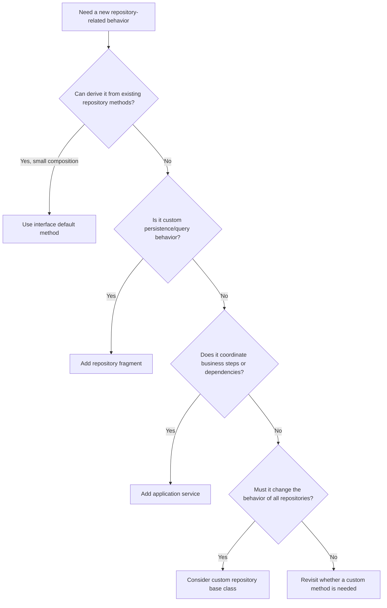

# Khi nên dùng default method, fragment hoặc dịch vụ

Khi một repository Spring Data Elasticsearch cần thêm hành vi ngoài các method CRUD và query method có sẵn, có ba nơi thường được cân nhắc: **default method trên repository interface**, **repository fragment** và **service của tầng ứng dụng**. Cả ba đều có thể gọi repository, nhưng chúng giải quyết những loại trách nhiệm khác nhau.

Default method phù hợp để ghép vài thao tác repository đã có thành một tiện ích nhỏ, không cần dependency riêng. Repository fragment phù hợp khi cần thêm hành vi truy cập dữ liệu tùy biến, cần inject `ElasticsearchOperations` hoặc cần tái sử dụng một nhóm thao tác persistence. Service phù hợp với logic use case, điều phối nhiều repository hoặc hệ thống bên ngoài, áp dụng quy tắc nghiệp vụ và xác định ranh giới xử lý của ứng dụng.

Không nên đưa mọi logic vào repository chỉ vì logic đó có đọc hoặc ghi dữ liệu. Repository biểu diễn cách ứng dụng truy cập một tập dữ liệu; service biểu diễn việc ứng dụng thực hiện một nghiệp vụ. Chọn đúng nơi giúp interface dễ hiểu, phần persistence có thể tái sử dụng và use case không bị gắn chặt với chi tiết Elasticsearch.

## 1. Repository Spring Data được tạo như thế nào?

Một repository Spring Data thường là interface kế thừa một interface nền như `ElasticsearchRepository`:

```java
import org.springframework.data.elasticsearch.repository.ElasticsearchRepository;

public interface ProductRepository
        extends ElasticsearchRepository<Product, String> {
}
```

Spring Data tạo implementation proxy cho interface này. Proxy cung cấp các method CRUD, method được suy ra từ tên như `findBySku(...)`, method có query annotation và các hành vi tùy biến được cấu hình qua repository composition.

Ví dụ thêm query method:

```java
public interface ProductRepository
        extends ElasticsearchRepository<Product, String> {

    Optional<Product> findBySku(String sku);

    List<Product> findByActiveTrue();
}
```

Không cần tự viết implementation cho các method mà Spring Data có thể tạo từ tên hoặc query metadata. Chỉ thêm phần tùy biến khi hành vi thực sự không phù hợp với các abstraction có sẵn.

### 1.1 Repository interface không phải nơi chứa mọi logic

Một interface repository có thể có nhiều loại method:

- Method kế thừa từ `CrudRepository`, `PagingAndSortingRepository` hoặc `ElasticsearchRepository`.
- Query method được Spring Data phân tích từ tên.
- Method có `@Query` hoặc query annotation tương ứng.
- Default method do ứng dụng viết trực tiếp trong interface.
- Method được cung cấp bởi repository fragment.

Service thường gọi các method đó để hoàn thành use case. Repository không cần biết controller gọi nó từ đâu, user đang ở màn hình nào hoặc quy trình nghiệp vụ có bao nhiêu bước.

## 2. Default method: ghép hành vi repository nhỏ

Java cho phép interface khai báo method có thân bằng từ khóa `default`. Spring Data repository có thể dùng các method này để bổ sung tiện ích dựa trên những method repository đã có.

Ví dụ repository đã có `findBySku(...)` và `findByActiveTrue()`. Có thể thêm một default method nhỏ:

```java
public interface ProductRepository
        extends ElasticsearchRepository<Product, String> {

    Optional<Product> findBySku(String sku);

    default Optional<Product> findActiveBySku(String sku) {
        return findBySku(sku)
            .filter(Product::isActive);
    }
}
```

`findActiveBySku` chỉ ghép một query method với một phép lọc đơn giản. Nó không cần `ElasticsearchOperations`, client, converter hoặc dependency khác. Đây là trường hợp default method phù hợp.

### 2.1 Khi default method là lựa chọn tốt

Default method thường phù hợp khi:

- Hành vi ngắn và có thể diễn đạt bằng các method repository đã có.
- Không cần inject dependency.
- Không cần tự xây Query DSL hoặc điều khiển `ElasticsearchOperations`.
- Hành vi gắn trực tiếp với khái niệm truy cập dữ liệu của repository.
- Logic không cần điều phối nhiều aggregate hoặc hệ thống bên ngoài.
- Tên method giúp người gọi hiểu một thao tác tiện ích của repository.

Ví dụ khác:

```java
public interface ProductRepository
        extends ElasticsearchRepository<Product, String> {

    List<Product> findByCategory(String category);

    default boolean existsActiveProductInCategory(String category) {
        return findByCategory(category).stream()
            .anyMatch(Product::isActive);
    }
}
```

Đây là ví dụ đơn giản về composition. Tuy nhiên, nếu category có rất nhiều sản phẩm, tải toàn bộ danh sách về Java chỉ để kiểm tra `anyMatch` là không hiệu quả. Khi có thể, hãy viết query phù hợp như `existsByCategoryAndActiveTrue(...)` hoặc dùng fragment với query tối ưu. Default method không tự làm một thuật toán kém hiệu quả trở nên tốt hơn.

### 2.2 Default method không có nơi inject dependency

Interface không có constructor để Spring inject `ElasticsearchOperations`, clock, HTTP client hoặc một service khác vào default method. Nếu default method cần các dependency đó, đây là dấu hiệu nên chuyển hành vi sang fragment hoặc service.

Không nên tìm cách truy cập ApplicationContext tĩnh, dùng service locator hoặc thêm biến static để lấy bean bên trong default method. Cách đó làm dependency ẩn, khó kiểm thử và phá vỡ mục đích của repository abstraction.

### 2.3 Default method nên giữ nhỏ

Một default method dài với nhiều nhánh điều kiện, gọi nhiều repository khác và điều phối API ngoài không còn là tiện ích repository. Nó khó hiểu vì interface phải chứa cả quy trình nghiệp vụ lẫn hợp đồng truy cập dữ liệu.

Ví dụ sau không phù hợp để đặt trong repository:

```java
default Product publishProduct(String id) {
    Product product = findById(id).orElseThrow();
    validateImages(product);
    inventoryClient.checkAvailability(product.getSku());
    product.markPublished();
    Product saved = save(product);
    eventPublisher.publish(new ProductPublished(saved.getId()));
    return saved;
}
```

Method này có validation nghiệp vụ, gọi service bên ngoài, thay đổi trạng thái và phát event. Nó thuộc một use case ở tầng service. Repository chỉ nên cung cấp các thao tác persistence cần thiết cho use case đó.

## 3. Repository fragment: thêm hành vi persistence tùy biến

Khi repository cần một thao tác không thể diễn đạt gọn bằng query method hoặc default method, Spring Data repository fragment là lựa chọn phù hợp.

Một fragment gồm:

1. Interface mô tả nhóm hành vi tùy biến.
2. Class implementation thực thi interface đó.
3. Repository chính kế thừa fragment interface.

Spring Data kết hợp fragment implementation với implementation repository được tạo tự động. Fragment có thể inject `ElasticsearchOperations`, converter hoặc dependency cần thiết qua constructor.

### 3.1 Khai báo fragment interface

Ví dụ cần một thao tác tìm kiếm sản phẩm dùng Query DSL tùy biến:

```java
import org.springframework.data.domain.Pageable;
import org.springframework.data.elasticsearch.core.SearchHits;

public interface ProductSearchOperations {

    SearchHits<Product> searchByText(String text, Pageable pageable);
}
```

Interface fragment chỉ mô tả hành vi cần bổ sung. Nó không cần kế thừa `ElasticsearchRepository`.

### 3.2 Viết fragment implementation

```java
import org.springframework.data.elasticsearch.client.elc.NativeQuery;
import org.springframework.data.elasticsearch.core.ElasticsearchOperations;
import org.springframework.data.elasticsearch.core.SearchHits;
import org.springframework.data.elasticsearch.core.query.Query;

public class ProductSearchOperationsImpl implements ProductSearchOperations {

    private final ElasticsearchOperations operations;

    public ProductSearchOperationsImpl(ElasticsearchOperations operations) {
        this.operations = operations;
    }

    @Override
    public SearchHits<Product> searchByText(String text, Pageable pageable) {
        Query query = NativeQuery.builder()
            .withQuery(q -> q.multiMatch(m -> m
                .query(text)
                .fields("name", "description")
            ))
            .withPageable(pageable)
            .build();

        return operations.search(
            query,
            Product.class,
            IndexCoordinates.of("products")
        );
    }
}
```

Implementation sử dụng `ElasticsearchOperations` để xây và thực thi native query. Nó có thể chứa logic persistence chuyên biệt mà không làm repository interface trở nên quá dài.

Các import và builder cụ thể có thể khác theo phiên bản Spring Data Elasticsearch/Elasticsearch Java Client. Ví dụ trên minh họa cấu trúc fragment và cách inject Operations; hãy dùng API đúng với dependency của dự án.

### 3.3 Kết hợp fragment vào repository

```java
public interface ProductRepository
        extends ElasticsearchRepository<Product, String>,
                ProductSearchOperations {

    Optional<Product> findBySku(String sku);
}
```

Repository chính có cả CRUD/query method do Spring Data cung cấp và method `searchByText` do fragment triển khai.

Caller sử dụng một repository bean:

```java
SearchHits<Product> hits = productRepository.searchByText(
    "wireless keyboard",
    PageRequest.of(0, 20)
);
```

Không cần inject riêng `ProductSearchOperationsImpl`; Spring Data composition kết hợp implementation fragment vào proxy repository.

### 3.4 Quy ước tên implementation

Với fragment interface tên `ProductSearchOperations`, implementation theo quy ước thường là `ProductSearchOperationsImpl`. Tên class được tạo từ tên fragment interface cộng postfix implementation mặc định `Impl`.

Điểm quan trọng là implementation phải tương ứng với fragment interface. Không nên nhầm quy ước fragment với kiểu custom repository implementation cũ dựa trên tên repository chính như `ProductRepositoryImpl`.

Các phiên bản Spring Data hiện đại khuyến nghị repository fragments để tổ chức phần tùy biến theo từng nhóm hành vi. Cấu hình postfix và cách scan có thể tùy chỉnh trong repository configuration; nếu dùng cấu hình khác mặc định, hãy bảo đảm Spring tìm thấy implementation.

## 4. Chia repository thành nhiều fragment

Một repository có thể kế thừa nhiều fragment, mỗi fragment đại diện một nhóm persistence capability.

```java
public interface ProductSearchOperations {
    SearchHits<Product> searchByText(String text, Pageable pageable);
}

public interface ProductInventoryOperations {
    UpdateResponse updateStock(String productId, int delta);
}

public interface ProductRepository extends
        ElasticsearchRepository<Product, String>,
        ProductSearchOperations,
        ProductInventoryOperations {

    Optional<Product> findBySku(String sku);
}
```

Mỗi fragment có implementation riêng:

```text
ProductSearchOperations
    -> ProductSearchOperationsImpl

ProductInventoryOperations
    -> ProductInventoryOperationsImpl

ProductRepository
    -> Spring Data repository proxy + các fragment
```

Điều này giúp nhóm hành vi theo mục đích. Fragment tìm kiếm có thể chứa `NativeQuery`, aggregation và highlight; fragment inventory có thể chứa script update và logic persistence liên quan stock.

### 4.1 Fragment có thể tái sử dụng

Nếu nhiều repository cần cùng một capability, có thể thiết kế fragment interface và implementation dùng lại, miễn là kiểu entity/index và hợp đồng method phù hợp. Tránh tạo fragment tổng quát đến mức phải truyền quá nhiều tên field tùy ý hoặc dùng generic reflection khó hiểu.

### 4.2 Thứ tự ưu tiên khi method trùng tên

Repository composition có quy tắc ưu tiên khi nhiều fragment hoặc phần triển khai cùng cung cấp method trùng nhau. Fragment được thêm vào composition có thể ảnh hưởng implementation được chọn. Không nên dựa vào xung đột tên để điều khiển hành vi; đặt tên method rõ ràng và tránh khai báo cùng chữ ký ở nhiều fragment nếu không có lý do cụ thể.

Nếu nhiều fragment cần cùng một helper, đưa helper vào một component dùng chung hoặc thiết kế interface tách biệt thay vì tạo xung đột method.

## 5. Khi nào nên dùng fragment?

Fragment phù hợp khi:

- Cần dùng `ElasticsearchOperations` hoặc Elasticsearch Java Client trực tiếp.
- Query cần nested, aggregation, highlight, script, scoring hoặc DSL phức tạp.
- Cần custom update/bulk operation ở mức persistence.
- Có một nhóm hành vi truy cập dữ liệu cần tái sử dụng.
- Muốn giữ repository chính là facade thống nhất cho caller.
- Cần dependency injection vào implementation.

Ví dụ các method phù hợp với fragment:

```java
public interface ProductSearchOperations {
    SearchHits<Product> searchWithFacets(ProductSearchCriteria criteria);
    SearchHits<Product> searchVariants(VariantCriteria criteria);
}

public interface ProductWriteOperations {
    UpdateResponse changeStock(String productId, int delta);
    void bulkReindex(Collection<Product> products);
}
```

Những method này biểu diễn kỹ thuật truy cập và thao tác Elasticsearch. Chúng không nên quyết định một quy trình nghiệp vụ như có cho phép bán sản phẩm hay không; service chịu trách nhiệm quy tắc đó.

## 6. Service: điều phối use case và quy tắc nghiệp vụ

Service là nơi phù hợp cho logic ứng dụng. Một use case có thể gọi nhiều repository, kiểm tra điều kiện, dùng clock, gọi dịch vụ thanh toán, gửi event hoặc phối hợp nhiều bước.

Ví dụ use case xuất bản sản phẩm:

```java
@Service
public class ProductPublishingService {

    private final ProductRepository products;
    private final InventoryClient inventoryClient;
    private final ProductEventPublisher eventPublisher;

    public ProductPublishingService(
            ProductRepository products,
            InventoryClient inventoryClient,
            ProductEventPublisher eventPublisher) {
        this.products = products;
        this.inventoryClient = inventoryClient;
        this.eventPublisher = eventPublisher;
    }

    public Product publish(String productId) {
        Product product = products.findById(productId)
            .orElseThrow(() -> new ProductNotFoundException(productId));

        if (!product.hasRequiredInformation()) {
            throw new ProductCannotBePublishedException(productId);
        }

        inventoryClient.verifySellable(product.getSku());
        product.markPublished();

        Product saved = products.save(product);
        eventPublisher.publishProductPublished(saved.getId());
        return saved;
    }
}
```

Service điều phối nghiệp vụ: đọc sản phẩm, kiểm tra thông tin, gọi inventory service, thay đổi trạng thái, lưu và phát event. Repository không cần biết thứ tự các bước hoặc lý do nghiệp vụ khiến sản phẩm được xuất bản.

### 6.1 Service có thể dùng nhiều repository

```java
@Service
public class CustomerOrderService {

    private final OrderRepository orders;
    private final CustomerRepository customers;
    private final ProductRepository products;

    public CustomerOrderService(
            OrderRepository orders,
            CustomerRepository customers,
            ProductRepository products) {
        this.orders = orders;
        this.customers = customers;
        this.products = products;
    }

    public OrderSummary getOrderSummary(String orderId) {
        Order order = orders.findById(orderId).orElseThrow();
        Customer customer = customers.findById(order.getCustomerId())
            .orElseThrow();

        List<Product> items = products.findAllById(order.getProductIds());
        return OrderSummary.from(order, customer, items);
    }
}
```

Đây là use case cần kết hợp dữ liệu từ nhiều aggregate. Service là nơi phù hợp để thực hiện orchestration và xây response model.

### 6.2 Service là nơi đặt transaction boundary của ứng dụng

Trong ứng dụng có database quan hệ, service thường đánh dấu transaction JPA cho use case cần atomicity trên các bảng thuộc cùng datasource:

```java
@Transactional
public void updateCustomerProfile(...) {
    // Các thao tác JPA thuộc cùng transaction manager.
}
```

Nhưng `@Transactional` của JPA không tự tạo transaction ACID đa document cho Elasticsearch. Nếu service vừa ghi database vừa ghi Elasticsearch, cần thiết kế outbox/saga hoặc quy trình đồng bộ phù hợp; không giả định annotation sẽ rollback Elasticsearch khi JPA rollback.

Với Elasticsearch là nguồn dữ liệu duy nhất cho một thao tác trên một document, service vẫn có thể điều phối validation và gọi repository/Operations. Transaction annotation không làm một chuỗi write nhiều document trở thành transaction.

## 7. Phân biệt trách nhiệm bằng câu hỏi thiết kế

Khi quyết định nơi đặt method, hãy tự hỏi:

1. Method chỉ ghép vài repository method đã có và không cần dependency? Default method có thể phù hợp.
2. Method cần tự xây query/update Elasticsearch hoặc inject Operations? Dùng fragment.
3. Method diễn tả một use case, kiểm tra business rule hoặc điều phối nhiều component? Dùng service.
4. Hành vi giống nhau trên mọi repository và cần thay đổi cách base repository hoạt động? Cân nhắc custom repository base class.
5. Hành vi có thể diễn đạt bằng query method hoặc `@Query` đơn giản? Có thể không cần custom code.

| Tiêu chí | Default method | Fragment | Service |
|---|---|---|---|
| Mục tiêu | Tiện ích nhỏ trên repository | Custom persistence capability | Use case/nghiệp vụ |
| Inject dependency | Không thuận tiện/không nên | Có qua constructor | Có qua constructor |
| Dùng `ElasticsearchOperations` | Không phù hợp | Rất phù hợp | Có thể gọi qua repository/Operations khi cần |
| Điều phối nhiều repository | Thường không | Không nên là mục tiêu | Phù hợp |
| Query DSL tùy biến | Không lý tưởng | Phù hợp | Nên ủy quyền cho repository/fragment |
| Business workflow | Không phù hợp | Không phải trách nhiệm chính | Phù hợp |
| Tái sử dụng | Logic nhỏ gắn với interface | Capability persistence | Use case/component ứng dụng |

## 8. So sánh cùng một yêu cầu qua ba cách

Giả sử yêu cầu là tìm sản phẩm đang hoạt động theo SKU, sau đó trả về sản phẩm nếu còn hàng.

### 8.1 Default method nếu chỉ ghép query method

```java
public interface ProductRepository extends ElasticsearchRepository<Product, String> {

    Optional<Product> findBySku(String sku);

    default Optional<Product> findActiveBySku(String sku) {
        return findBySku(sku).filter(Product::isActive);
    }
}
```

Phù hợp nếu lượng dữ liệu nhỏ, phép lọc đơn giản và không cần truy vấn tối ưu hơn. Nếu có thể viết một query method duy nhất cho cả điều kiện, ưu tiên query đó để Elasticsearch lọc phía server.

### 8.2 Fragment nếu cần query tùy biến

```java
public interface ProductAvailabilitySearch {
    Optional<Product> findAvailableBySku(String sku);
}

public class ProductAvailabilitySearchImpl implements ProductAvailabilitySearch {

    private final ElasticsearchOperations operations;

    public ProductAvailabilitySearchImpl(ElasticsearchOperations operations) {
        this.operations = operations;
    }

    @Override
    public Optional<Product> findAvailableBySku(String sku) {
        Query query = NativeQuery.builder()
            .withQuery(q -> q.bool(b -> b
                .filter(f -> f.term(t -> t.field("sku").value(sku)))
                .filter(f -> f.term(t -> t.field("active").value(true)))
                .filter(f -> f.range(r -> r.number(n -> n
                    .field("stock")
                    .gt(0.0)
                )))
            ))
            .withPageable(PageRequest.of(0, 1))
            .build();

        return operations.search(query, Product.class, PRODUCTS)
            .getSearchHits()
            .stream()
            .map(SearchHit::getContent)
            .findFirst();
    }
}
```

Fragment đẩy điều kiện xuống Elasticsearch và chỉ lấy một kết quả. Đây là hành vi persistence tùy biến, không phải một workflow nhiều bước.

### 8.3 Service nếu có quy tắc nghiệp vụ và nguồn ngoài

```java
@Service
public class ProductAvailabilityService {

    private final ProductRepository products;
    private final WarehouseClient warehouse;

    public ProductAvailabilityService(
            ProductRepository products,
            WarehouseClient warehouse) {
        this.products = products;
        this.warehouse = warehouse;
    }

    public ProductAvailability check(String sku) {
        Product product = products.findBySku(sku)
            .orElseThrow(() -> new ProductNotFoundException(sku));

        if (!product.isActive()) {
            return ProductAvailability.inactive(product);
        }

        int warehouseQuantity = warehouse.availableQuantity(sku);
        return ProductAvailability.of(product, warehouseQuantity);
    }
}
```

Service kết hợp trạng thái sản phẩm với tồn kho từ hệ thống kho và quyết định kết quả nghiệp vụ. Không nên nhét HTTP call tới warehouse vào fragment persistence của Elasticsearch.

## 9. Custom repository base class: một trường hợp khác

Ngoài default method, fragment và service, Spring Data cho phép thay implementation base repository class. Đây là lựa chọn khi cần thay đổi hành vi chung cho nhiều repository cùng một lúc, ví dụ một method base có quy tắc audit hoặc một cách triển khai chung được mọi repository kế thừa.

Custom base class thường mở rộng implementation mặc định của Spring Data Elasticsearch repository, rồi được cấu hình qua `repositoryBaseClass` trong repository configuration.

Ví dụ khung cấu hình:

```java
@Configuration
@EnableElasticsearchRepositories(
    basePackages = "com.example.catalog.repository",
    repositoryBaseClass = AuditedElasticsearchRepository.class
)
class ElasticsearchRepositoryConfig {
}
```

Tên base implementation, constructor và generic signature phải khớp với phiên bản Spring Data Elasticsearch. Không sao chép ví dụ base class từ một phiên bản khác mà không kiểm tra API hiện tại.

### 9.1 Khi nào base class tốt hơn fragment?

- Base class: hành vi phải áp dụng thống nhất cho nhiều repository như một phần của repository nền.
- Fragment: chỉ một số repository cần capability cụ thể; có thể kết hợp nhiều fragment độc lập.

Đừng dùng base class chỉ để tránh khai báo một fragment. Nó ảnh hưởng đến mọi repository trong phạm vi cấu hình và làm thay đổi hành vi mặc định rộng hơn.

## 10. Custom implementation kiểu cũ và repository fragments

Các tài liệu Spring Data cũ thường mô tả cách tạo class có tên như `ProductRepositoryImpl` để triển khai method tùy biến cho `ProductRepository`. Cơ chế này xuất hiện trước khi repository fragments trở thành mô hình composition được khuyến nghị.

Với code mới, nên ưu tiên fragment interface riêng và implementation tương ứng:

```text
ProductRepository
    extends ElasticsearchRepository<Product, String>, ProductSearchOperations

ProductSearchOperations
    implemented by ProductSearchOperationsImpl
```

Lợi ích là phần tùy biến được tách thành capability có tên rõ ràng, có thể kết hợp nhiều fragment và tái sử dụng độc lập. Khi bảo trì code cũ dùng `ProductRepositoryImpl`, hãy kiểm tra cách repository được cấu hình và tránh đổi tên tùy tiện nếu ứng dụng đang phụ thuộc vào convention cũ.

## 11. Tổ chức package

Một cấu trúc đơn giản:

```text
catalog/
  domain/
    Product.java
    ProductAvailability.java
  repository/
    ProductRepository.java
    ProductSearchOperations.java
    ProductSearchOperationsImpl.java
  service/
    ProductPublishingService.java
    ProductAvailabilityService.java
  web/
    ProductController.java
```

Repository và fragment nằm cùng vùng persistence. Service chứa use case. Controller chuyển HTTP input/output sang service. Tổ chức package cụ thể có thể khác theo kiến trúc dự án; mục tiêu là dependency đi từ service tới repository abstraction, không để repository phụ thuộc ngược vào controller.

## 12. Kiểm thử từng loại tùy biến

### 12.1 Kiểm thử default method

Default method thường có thể kiểm thử thông qua repository proxy với Elasticsearch test index hoặc mock các query method tùy cách tạo test. Điều quan trọng là xác nhận method composition gọi đúng query method và áp dụng logic nhỏ đúng kết quả.

Nếu dùng mock framework, cần kiểm tra cách proxy interface default method được gọi trong setup cụ thể. Integration test với repository bean thường phản ánh hành vi Spring Data chính xác hơn.

### 12.2 Kiểm thử fragment

Fragment implementation là class bình thường có thể unit test bằng cách mock `ElasticsearchOperations`:

```java
@ExtendWith(MockitoExtension.class)
class ProductSearchOperationsImplTest {

    @Mock
    ElasticsearchOperations operations;

    @Test
    void buildsSearchAndDelegatesToOperations() {
        ProductSearchOperations fragment =
            new ProductSearchOperationsImpl(operations);

        // Stub operations.search(...) và xác minh request/kết quả.
    }
}
```

Ngoài unit test implementation, nên có integration test để xác nhận Spring Data thực sự phát hiện fragment và gắn method vào repository proxy. Unit test class đơn lẻ không kiểm tra naming/convention composition.

### 12.3 Kiểm thử service

Service test tập trung vào use case: nhánh thành công, validation fail, document không tồn tại, lỗi từ hệ thống ngoài và event được phát đúng thời điểm. Có thể mock repository interface và client ngoài để không cần Elasticsearch cho mọi unit test.

Với transaction JPA, cần kiểm thử transaction manager thực tế. Với Elasticsearch, không giả định mock `@Transactional` chứng minh có rollback đa document.

## 13. Những lỗi thiết kế thường gặp

### 13.1 Đưa query DSL dài vào default method

Default method không có dependency injection và nhanh chóng trở nên khó bảo trì khi phải xây nested query, aggregation, script hoặc sort phức tạp. Chuyển phần đó sang fragment.

### 13.2 Đưa business workflow vào repository

Repository không nên gọi payment, inventory, notification hoặc điều phối nhiều aggregate. Đặt workflow trong service và để repository cung cấp thao tác persistence.

### 13.3 Fragment phụ thuộc vào service nghiệp vụ

Fragment nên tập trung vào persistence capability. Nếu fragment gọi ngược service để quyết định business policy, dependency direction bị đảo. Service có thể gọi fragment, không nên để fragment điều khiển use case.

### 13.4 Tạo fragment cho một query method đơn giản

Nếu method có thể diễn đạt rõ bằng `findByStatusAndCategory(...)` hoặc `@Query` ngắn, không cần tạo thêm interface/implementation chỉ để bọc lại một câu query.

### 13.5 Một fragment quá lớn

Fragment chứa search, bulk import, report, inventory update và audit không còn là một capability rõ ràng. Tách theo nhóm hành vi liên quan.

### 13.6 Dùng service chỉ để chuyển tiếp một lời gọi

Không cần tạo service class chỉ để gọi `repository.findById(id)` rồi trả nguyên kết quả nếu không có abstraction/use case nào được bổ sung. Nhưng nếu endpoint cần validation, authorization, DTO mapping hoặc orchestration, service có trách nhiệm rõ ràng.

### 13.7 Dùng base class cho một trường hợp riêng

Custom base repository ảnh hưởng phạm vi rộng. Nếu chỉ một repository cần custom search, dùng fragment riêng.

### 13.8 Đặt sai tên fragment implementation

Nếu Spring không phát hiện implementation theo convention, method fragment có thể không được gắn vào repository proxy. Kiểm tra tên interface/implementation, package scan, postfix cấu hình và log khởi tạo repository.

### 13.9 Nghĩ @Transactional trên service làm Elasticsearch có rollback đa document

Transaction manager chỉ quản lý resource mà nó hỗ trợ. Nếu workflow có JPA và Elasticsearch, cần outbox/saga hoặc chiến lược đồng bộ; không dựa vào annotation để tạo transaction phân tán.

## 14. Quy trình quyết định

Có thể dùng trình tự sau khi thêm method mới:



Ví dụ quyết định:

- `findActiveBySku` ghép một query method và lọc nhỏ: default method hoặc query method trực tiếp.
- `searchProductsWithFacets` dùng NativeQuery và aggregation: fragment.
- `publishProduct` kiểm tra dữ liệu, gọi kho, lưu trạng thái và phát event: service.
- Quy tắc audit chung cho mọi repository trong module: cân nhắc base class hoặc component dùng chung.

## 15. Nguyên tắc triển khai

- Dùng query method hoặc `@Query` trước khi viết custom code nếu biểu diễn được yêu cầu.
- Dùng default method cho composition nhỏ, không cần dependency và gắn trực tiếp với repository.
- Dùng repository fragment cho custom Elasticsearch query/update, cần inject Operations hoặc cần tách capability persistence.
- Dùng service cho business rule, orchestration, tích hợp hệ thống ngoài và use case.
- Cân nhắc custom base repository class chỉ khi cần thay đổi hành vi chung của nhiều repository.
- Đặt tên fragment interface theo capability và implementation theo convention/configuration của Spring Data.
- Giữ dependency direction: service gọi repository; fragment không điều khiển service nghiệp vụ.
- Không đưa HTTP/client calls hoặc quy trình nhiều bước vào repository default method.
- Không tạo fragment chỉ để bọc một query method đơn giản.
- Kiểm thử fragment cả ở mức class lẫn repository proxy composition.
- Kiểm tra transaction manager thực tế; `@Transactional` JPA không tạo transaction ACID đa document trong Elasticsearch.

## 16. Tổng kết

Default method, repository fragment và service đều có thể bổ sung hành vi cho ứng dụng Spring Data Elasticsearch, nhưng mỗi lựa chọn có một ranh giới trách nhiệm. Default method phù hợp với tiện ích nhỏ ghép các method repository có sẵn, không cần dependency. Repository fragment phù hợp với capability persistence tùy biến, đặc biệt khi cần `ElasticsearchOperations`, Query DSL, aggregation, script hoặc bulk operation. Service phù hợp với use case, business rule và điều phối nhiều repository hoặc hệ thống ngoài.

Nếu hành vi phải áp dụng chung cho mọi repository, có thể cân nhắc custom repository base class. Với code mới, repository fragments thường rõ ràng và dễ composition hơn convention custom implementation cũ gắn trực tiếp vào tên repository chính. Trước khi tạo abstraction mới, hãy xem query method hoặc `@Query` đã đáp ứng được yêu cầu chưa.

Một ranh giới dễ nhớ là: repository mô tả cách truy cập dữ liệu; fragment mở rộng cách truy cập dữ liệu; service mô tả việc ứng dụng làm với dữ liệu đó để hoàn thành một nghiệp vụ. Chọn đúng ranh giới giúp repository gọn, query tùy biến có chỗ chứa rõ ràng và workflow không bị khóa vào Elasticsearch.

## Tài liệu tham khảo

- [Spring Data Commons — Custom Implementations for Spring Data Repositories](https://docs.spring.io/spring-data/commons/reference/repositories/custom-implementations.html)
- [Spring Data Elasticsearch — Repository Support](https://docs.spring.io/spring-data/elasticsearch/reference/elasticsearch/repositories.html)
- [Spring Data Elasticsearch — Elasticsearch Operations](https://docs.spring.io/spring-data/elasticsearch/reference/elasticsearch/template.html)
- [Spring Framework — Classpath Scanning and Managed Components](https://docs.spring.io/spring-framework/reference/core/beans/classpath-scanning.html)
