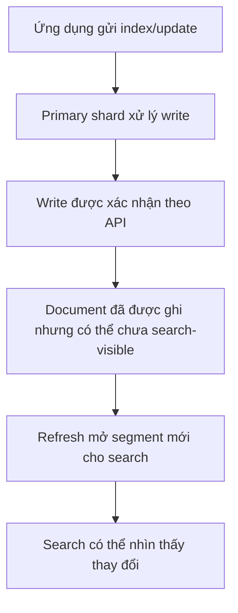
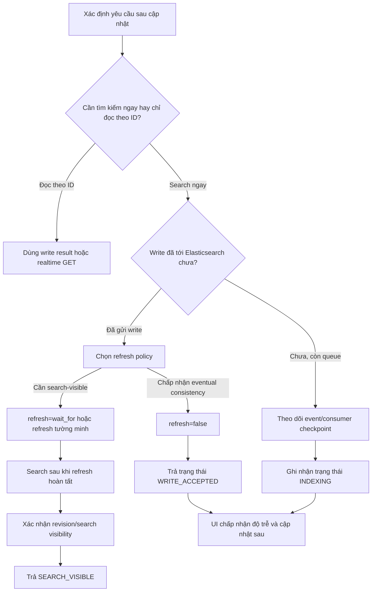

# Độ trễ lập chỉ mục và hợp đồng tìm kiếm sau cập nhật

Khi một ứng dụng ghi document vào Elasticsearch rồi tìm kiếm ngay sau đó, đôi khi document vừa ghi chưa xuất hiện trong kết quả search. Điều này thường không phải lỗi mất dữ liệu: Elasticsearch là hệ thống tìm kiếm **near real-time (NRT)**. Một thao tác ghi có thể đã được chấp nhận nhưng dữ liệu chỉ trở nên nhìn thấy qua search sau lần **refresh** tiếp theo.

Trong Spring Data Elasticsearch, các thao tác `save`, `index` hoặc bulk write thường không tự buộc một refresh tức thời sau mỗi lần ghi. Vì vậy, hệ thống cần xác định rõ hợp đồng đọc sau ghi:

- API chỉ xác nhận Elasticsearch đã nhận thao tác ghi.
- API xác nhận document đã có thể tìm thấy qua search.
- UI đọc lại document bằng ID và cần dữ liệu mới nhất.
- Một pipeline đồng bộ chạy bất đồng bộ và chấp nhận độ trễ tìm kiếm trong một khoảng thời gian.

Các lựa chọn refresh ảnh hưởng trực tiếp tới latency và throughput. Dùng `refresh=true` cho mọi thao tác có thể làm giảm hiệu năng đáng kể; `refresh=wait_for` thường phù hợp hơn khi một request cụ thể cần chờ dữ liệu có thể tìm kiếm; còn mặc định `refresh=false` phù hợp với phần lớn luồng ghi có thể chấp nhận eventual consistency.

## 1. Vì sao ghi xong nhưng search chưa thấy?

Elasticsearch sử dụng Lucene để lưu và tìm kiếm dữ liệu. Khi document được index hoặc update, thay đổi được ghi vào các cấu trúc ghi và translog. Search chỉ đọc các Lucene segment đã được mở cho search. Quá trình làm các thay đổi mới xuất hiện trong search được gọi là **refresh**.

Luồng khái quát:



Elasticsearch thường refresh index theo chu kỳ, mặc định phổ biến là khoảng **1 giây** khi index đang được refresh thường xuyên. Vì vậy, một write thành công không đồng nghĩa ngay lập tức search request tiếp theo sẽ thấy document đó.

Điểm quan trọng là phân biệt hai câu hỏi:

1. **Write đã được chấp nhận chưa?** Đây là kết quả của thao tác ghi và các điều kiện shard/replication của request.
2. **Thay đổi đã search-visible chưa?** Điều này phụ thuộc refresh.

Đừng dùng một kết quả search rỗng ngay sau write để kết luận document chưa được lưu. Hãy kiểm tra bằng GET theo ID và xem refresh policy của thao tác.

## 2. Refresh là gì?

Refresh làm các thay đổi mới trong Lucene trở nên nhìn thấy đối với search bằng cách mở các segment đã được tạo. Nó là một phần của cơ chế near-real-time của Elasticsearch.

Ví dụ gọi refresh thủ công:

```http
POST products/_refresh
```

Sau khi refresh hoàn tất, các thay đổi đã được ghi vào shard tương ứng có thể được tìm thấy qua search.

### 2.1. Refresh không giống flush

Không nhầm refresh với flush:

| Cơ chế | Mục đích | Ảnh hưởng chính |
|---|---|---|
| Refresh | Làm thay đổi mới có thể nhìn thấy qua search | Mở segment mới cho search; có chi phí tạo nhiều segment nhỏ nếu quá thường xuyên |
| Flush | Tạo Lucene commit và bắt đầu translog generation mới | Liên quan tới durability/recovery và quản lý translog |
| Search | Đọc các segment đã được refresh | Không tự buộc mọi write vừa xảy ra phải refresh ngay |
| GET theo ID | Đọc document theo ID | Mặc định realtime, có thể nhìn thấy write trước lần refresh tiếp theo |

Refresh không phải transaction commit của database quan hệ và cũng không phải thao tác thay thế backup/flush. Trong đa số ứng dụng, không cần gọi flush thủ công sau mỗi write.

## 3. GET theo ID và Search có semantics khác nhau

Một điểm dễ gây nhầm lẫn: **GET document theo ID mặc định là realtime**, trong khi search là near real-time.

Ví dụ ghi document:

```http
PUT products/_doc/P-100
{
  "name": "Wireless Headphones",
  "status": "ACTIVE"
}
```

Ngay sau đó, GET theo ID:

```http
GET products/_doc/P-100
```

Thông thường GET realtime có thể trả về nội dung mới ngay cả khi refresh chưa xảy ra.

Nhưng search:

```http
GET products/_search
{
  "query": {
    "term": {
      "status": "ACTIVE"
    }
  }
}
```

có thể chưa trả `P-100` cho tới lần refresh tiếp theo.

Do đó, nếu giao diện vừa tạo document và cần hiển thị chi tiết ngay, GET theo ID hoặc trả dữ liệu vừa ghi từ write response/domain command có thể phù hợp hơn việc search lại ngay lập tức.

GET realtime không giải quyết mọi vấn đề của một read-after-write contract. Nếu request đọc đi qua alias, tenant filter, routing khác hoặc một hệ thống projection khác, cần kiểm tra đúng đường đọc và phạm vi dữ liệu.

## 4. Ba refresh policy của write API

Các write API của Elasticsearch có tham số `refresh` với ba lựa chọn thường dùng:

| Giá trị | Hành vi | Khi phù hợp |
|---|---|---|
| `false` | Không yêu cầu refresh sau thao tác; đây là mặc định phổ biến | Throughput cao, chấp nhận search visibility trễ |
| `true` | Refresh shard liên quan ngay sau thao tác để thay đổi có thể search-visible | Trường hợp đặc biệt cần search thấy ngay và chấp nhận chi phí |
| `wait_for` | Chờ lần refresh tiếp theo làm thay đổi có thể search-visible; không chủ động refresh ngay trong điều kiện bình thường | Cần read-after-write qua search nhưng muốn tránh force refresh mỗi request |

### 4.1. `refresh=false`

Ví dụ:

```http
PUT products/_doc/P-100?refresh=false
{
  "name": "Wireless Headphones",
  "status": "ACTIVE"
}
```

Write API không đợi refresh. Request thường trả về nhanh hơn và Elasticsearch có thể gom nhiều thay đổi trước khi refresh. Đây là lựa chọn phù hợp cho các pipeline ingest, đồng bộ hoặc bulk indexing có thể chấp nhận một khoảng trễ search.

### 4.2. `refresh=true`

Ví dụ:

```http
PUT products/_doc/P-100?refresh=true
{
  "name": "Wireless Headphones",
  "status": "ACTIVE"
}
```

Thao tác yêu cầu refresh shard liên quan ngay để thay đổi có thể nhìn thấy qua search khi request hoàn tất. Điều này tăng latency và có thể tạo nhiều segment nhỏ nếu lặp lại trên từng document.

Không đặt `refresh=true` một cách mặc định cho mọi request CRUD. Nếu một batch gồm 1.000 document được ghi bằng 1.000 request và mỗi request đều force refresh, chi phí có thể lớn hơn nhiều so với gom thành bulk rồi chờ một lần refresh.

### 4.3. `refresh=wait_for`

Ví dụ:

```http
PUT products/_doc/P-100?refresh=wait_for
{
  "name": "Wireless Headphones",
  "status": "ACTIVE"
}
```

Request chờ cho tới khi một lần refresh làm thay đổi có thể search-visible. Nó không yêu cầu Elasticsearch refresh ngay lập tức như `true`; thông thường request tận dụng lần refresh tự động kế tiếp.

Đây thường là lựa chọn phù hợp khi một thao tác cụ thể cần bảo đảm rằng search sau khi response trả về sẽ thấy thay đổi, nhưng ứng dụng không muốn force refresh cho từng request.

Lưu ý: nếu `index.refresh_interval` bị tắt (`-1`) và không có refresh thủ công, request `wait_for` có thể phải chờ rất lâu. Chỉ dùng policy này khi lifecycle refresh của index đã được cấu hình phù hợp.

## 5. `index.refresh_interval` và độ trễ tìm kiếm

Setting `index.refresh_interval` xác định chu kỳ refresh tự động. Giá trị mặc định phổ biến là `1s`.

Kiểm tra setting:

```http
GET products/_settings?include_defaults=true
```

Thay đổi refresh interval:

```http
PUT products/_settings
{
  "index": {
    "refresh_interval": "5s"
  }
}
```

Tăng interval lên `5s`, `10s` hoặc cao hơn có thể giảm số lần refresh và cải thiện throughput indexing trong workload ghi nhiều. Đổi lại, độ trễ trước khi search nhìn thấy dữ liệu cũng tăng.

Có thể tắt automatic refresh trong một đợt bulk load lớn:

```http
PUT products/_settings
{
  "index": {
    "refresh_interval": "-1"
  }
}
```

Sau khi nạp dữ liệu xong, khôi phục interval và refresh một lần:

```http
PUT products/_settings
{
  "index": {
    "refresh_interval": "1s"
  }
}
```

```http
POST products/_refresh
```

Đây là quy trình dành cho batch load có kiểm soát. Không tắt refresh trên index đang phục vụ search mà không đánh giá hợp đồng tìm kiếm, vì dữ liệu mới sẽ không tự xuất hiện qua search cho tới khi refresh được thực hiện.

### 5.1. Trade-off giữa freshness và throughput

| Refresh interval | Độ trễ search dự kiến | Tác động tới indexing |
|---|---|---|
| Ngắn, ví dụ `1s` | Thấp | Refresh thường xuyên, nhiều segment nhỏ hơn |
| Trung bình, ví dụ `5s` | Cao hơn | Ít refresh hơn, có thể tăng throughput |
| Dài, ví dụ `30s` | Có thể thấy dữ liệu trễ đáng kể | Hữu ích cho ingest ưu tiên throughput |
| `-1` | Không có refresh tự động | Phù hợp một số batch load; cần refresh chủ động trước khi search cần dữ liệu mới |

Không có một interval tốt cho mọi index. Index phục vụ autocomplete hoặc giao diện cần cập nhật nhanh có thể cần interval ngắn. Index lịch sử hoặc batch analytics có thể ưu tiên throughput và chấp nhận độ trễ dài hơn.

## 6. Hợp đồng tìm kiếm sau cập nhật

Một API đồng bộ dữ liệu nên nói rõ điều gì được bảo đảm khi response trả về. Không nên để frontend tự suy luận từ việc HTTP status là 200.

Có thể định nghĩa ba mức:

| Mức hợp đồng | Bảo đảm khi API trả về | Cách đọc phù hợp |
|---|---|---|
| Write accepted | Elasticsearch đã chấp nhận thao tác ghi theo write API | GET theo ID hoặc đợi search visibility nếu cần |
| Search-visible | Thay đổi đã qua refresh và có thể tìm thấy qua search | Search ngay sau response |
| Projection synchronized | Pipeline nguồn → Elasticsearch đã xử lý đến revision/event mong muốn | Đọc theo revision/checkpoint hoặc trạng thái đồng bộ |

Ba mức này không tương đương. `refresh=wait_for` giải quyết độ trễ refresh của một write đã được gửi tới Elasticsearch. Nó không bảo đảm một event còn đang nằm trong message queue đã được consumer xử lý, và cũng không bảo đảm một nguồn dữ liệu khác đã đồng bộ.

### 6.1. Hợp đồng eventual consistency

Với phần lớn luồng đồng bộ dữ liệu, eventual consistency là lựa chọn hợp lý:

1. API ghi dữ liệu nguồn hoặc phát event.
2. Worker đồng bộ cập nhật Elasticsearch.
3. Elasticsearch xác nhận write.
4. Search nhìn thấy dữ liệu sau refresh kế tiếp.

API có thể trả `202 Accepted` hoặc trạng thái job `PENDING_INDEX` nếu đồng bộ chạy bất đồng bộ. UI hiển thị trạng thái đang đồng bộ và refresh lại kết quả sau một khoảng thời gian hoặc khi nhận thông báo hoàn tất.

Đừng trả thông điệp “đã có thể tìm kiếm” ngay sau khi chỉ enqueue event. Trạng thái enqueue và trạng thái search-visible là hai checkpoint khác nhau.

### 6.2. Hợp đồng read-your-own-write

Nếu người dùng cập nhật sản phẩm và ngay sau đó phải tìm thấy sản phẩm bằng một search query, có thể chọn một trong các cách:

- Dùng `refresh=wait_for` cho write request đó.
- Gom các thao tác liên quan vào một bulk request có `refresh=wait_for`.
- Trả document vừa ghi trực tiếp cho UI và chỉ cho phép search sau khi projection đã visible.
- Dùng GET theo ID nếu UI cần xem đúng document vừa cập nhật, không cần tìm theo điều kiện.

Không nên force refresh toàn index sau mọi thao tác chỉ để làm UI đơn giản hơn. Hãy áp dụng chính sách cho đúng endpoint hoặc batch cần read-after-write.

### 6.3. Hợp đồng theo revision

Với pipeline event-driven, có thể gắn một `sourceRevision` hoặc event sequence vào document Elasticsearch. API/job có thể báo trạng thái đã đồng bộ đến revision nào.

Ví dụ response:

```json
{
  "entityId": "P-100",
  "sourceRevision": 42,
  "indexingStatus": "SEARCH_VISIBLE"
}
```

Để trả `SEARCH_VISIBLE`, hệ thống phải biết event revision 42 đã được ghi và refresh phù hợp đã hoàn tất. Nếu chỉ biết worker đã gửi write, trạng thái đúng hơn là `WRITE_ACCEPTED` hoặc `INDEXING`.

Revision cũng giúp phát hiện event đến sai thứ tự. Có thể kết hợp external versioning/OCC hoặc điều kiện trong consumer để tránh event cũ ghi đè trạng thái mới. Refresh không giải quyết ordering hoặc duplicate delivery.

## 7. Spring Data Elasticsearch và refresh

Spring Data Elasticsearch cung cấp `ElasticsearchOperations`, `IndexOperations` và các API bulk để ghi document. Refresh behavior phụ thuộc method, option và release đang dùng.

### 7.1. Ghi qua Repository hoặc Operations

Ví dụ:

```java
ProductDocument saved = productRepository.save(product);
```

Hoặc:

```java
String id = operations.index(indexQuery, IndexCoordinates.of("products"));
```

Các API ghi thông thường không nên được hiểu là luôn force refresh ngay sau mỗi lần lưu. Nếu ứng dụng cần search visibility ngay, hãy chọn refresh policy được API/version hỗ trợ hoặc gọi refresh có chủ đích.

### 7.2. Refresh qua IndexOperations

Spring Data cung cấp `IndexOperations` để thao tác với index. Có thể yêu cầu refresh:

```java
IndexOperations indexOperations = operations.indexOps(
    IndexCoordinates.of("products")
);

indexOperations.refresh();
```

Đây là refresh tường minh, hữu ích trong test hoặc một bước đồng bộ được kiểm soát. Không gọi nó sau mỗi item trong vòng lặp bulk.

### 7.3. Refresh policy trong bulk options

Các release Spring Data Elasticsearch có thể expose refresh policy qua options của bulk operation. Ví dụ khái niệm:

```java
BulkOptions bulkOptions = BulkOptions.builder()
    .withRefreshPolicy(RefreshPolicy.WAIT_UNTIL)
    .build();

operations.bulkIndex(
    indexQueries,
    bulkOptions,
    IndexCoordinates.of("products")
);
```

Tên builder, enum và overload cụ thể phụ thuộc phiên bản Spring Data Elasticsearch trong dự án. Đối chiếu Javadoc/dependency đang dùng trước khi áp dụng. Các giá trị thường tương ứng với `NONE`, `IMMEDIATE` và `WAIT_UNTIL`, lần lượt biểu diễn không yêu cầu refresh, refresh ngay và đợi refresh.

Nếu release hiện tại không expose policy qua abstraction, dùng Elasticsearch Java API Client đã được Spring cấu hình hoặc REST endpoint qua adapter chuyên trách. Không tạo client mới cho mỗi request.

## 8. Bulk indexing và refresh một lần cho cả batch

Với dữ liệu đồng bộ số lượng lớn, bulk request thường hiệu quả hơn nhiều request đơn lẻ. Có thể yêu cầu refresh policy cho cả bulk request:

```http
POST _bulk?refresh=wait_for
{ "index": { "_index": "products", "_id": "P-100" } }
{ "name": "Headphones", "status": "ACTIVE" }
{ "index": { "_index": "products", "_id": "P-101" } }
{ "name": "Keyboard", "status": "ACTIVE" }
```

Với `refresh=wait_for`, response chờ lần refresh làm các thay đổi của bulk có thể search-visible. Đây thường là lựa chọn hợp lý hơn force refresh sau từng item.

Nếu bulk được chia thành nhiều batch, mỗi batch có thể chờ refresh riêng. Hãy cân nhắc kích thước batch và tần suất batch để không tạo quá nhiều refresh listeners hoặc làm pipeline bị chậm do chờ refresh liên tục.

Không nhầm việc bulk request trả HTTP 200 với việc mọi item thành công. Vẫn phải kiểm tra `errors` và từng item trong bulk response; refresh policy chỉ nói về visibility, không thay thế xử lý partial failure.

## 9. `refresh=wait_for` không thay thế các điều kiện shard khác

Write API có các tùy chọn khác như `wait_for_active_shards`. Chúng giải quyết một câu hỏi khác:

- `wait_for_active_shards`: chờ số shard copies cần thiết hoạt động trước khi xử lý write theo yêu cầu.
- `refresh=wait_for`: chờ thay đổi trở nên visible qua search.
- `timeout`: giới hạn thời gian chờ một số điều kiện/request ở API.

Ví dụ:

```http
PUT products/_doc/P-100?wait_for_active_shards=all&refresh=wait_for&timeout=10s
{
  "name": "Headphones",
  "status": "ACTIVE"
}
```

Các tùy chọn này không thể thay thế lẫn nhau. Chờ active shards không đồng nghĩa đã refresh; chờ refresh không đảm bảo một consumer upstream đã xử lý hết event; và timeout không tự biến một thao tác đã ghi một phần thành rollback.

## 10. Đồng bộ từ database hoặc message queue sang Elasticsearch

Trong kiến trúc có database nguồn và Elasticsearch là read model, write thường chạy bất đồng bộ:


Độ trễ tổng gồm nhiều thành phần:

1. Thời gian ghi transaction nguồn và phát event.
2. Thời gian event nằm trong queue.
3. Thời gian consumer xử lý và gọi Elasticsearch.
4. Thời gian Elasticsearch index document.
5. Thời gian chờ refresh.

`refresh=wait_for` chỉ xử lý phần cuối sau khi worker đã gửi write. Nó không loại bỏ queue lag, consumer lag hoặc retry backlog.

### 10.1. Đảm bảo event không bị ghi sai thứ tự

Giả sử một sản phẩm có revision 41 và 42. Nếu event 42 được xử lý trước, sau đó event 41 tới trễ, consumer có thể vô tình ghi dữ liệu cũ nếu không có version policy.

Có thể dùng:

- External versioning với revision do database nguồn cấp.
- OCC hoặc điều kiện kiểm tra `sourceRevision` trước khi ghi.
- Consumer partition theo entity ID để giữ thứ tự trong phạm vi key.
- Idempotent upsert và khả năng deduplicate event.

Refresh chỉ làm thay đổi đã ghi trở nên search-visible; nó không đảm bảo thứ tự nghiệp vụ hoặc chống duplicate.

### 10.2. Theo dõi các mốc đồng bộ

Nên tách các trạng thái:

```text
EVENT_PUBLISHED
    -> EVENT_CONSUMED
    -> WRITE_ACCEPTED
    -> SEARCH_VISIBLE
```

Mỗi trạng thái cần một nguồn xác nhận rõ ràng. Ví dụ, `WRITE_ACCEPTED` lấy từ write response; `SEARCH_VISIBLE` chỉ được xác nhận sau khi refresh policy đã hoàn tất hoặc một cơ chế kiểm tra search visibility đã xác nhận revision mục tiêu.

## 11. Kiểm thử read-after-write

Một integration test có thể lưu document rồi tìm kiếm lại. Vì search là near real-time, test cần refresh có chủ đích thay vì dựa vào `Thread.sleep`:

```java
@Test
void documentCanBeFoundAfterExplicitRefresh() {
    ProductDocument product = new ProductDocument("P-100", "Headphones");

    productRepository.save(product);

    operations.indexOps(IndexCoordinates.of("products")).refresh();

    Query query = NativeQuery.builder()
        .withQuery(q -> q
            .term(t -> t
                .field("name.keyword")
                .value("Headphones")
            )
        )
        .build();

    SearchHits<ProductDocument> hits = operations.search(
        query,
        ProductDocument.class,
        IndexCoordinates.of("products")
    );

    assertThat(hits.getTotalHits()).isEqualTo(1);
}
```

Đây là ví dụ minh họa; mapping của `name` phải có multi-field `keyword` nếu query dùng `name.keyword`. Có thể thay bằng field keyword thực tế của dự án. Test cần index riêng và không nên dùng `Thread.sleep(1000)` để chờ refresh vì làm test chậm và không ổn định.

Nếu đang test policy `WAIT_UNTIL`, hãy thực thi write với policy đó rồi search ngay sau khi write hoàn tất. Nếu đang test default eventual consistency, có thể kiểm tra GET realtime và search trước/sau refresh để xác nhận hai semantics khác nhau.

## 12. Đo độ trễ search visibility

Đừng chỉ đo thời gian của write API. Với hợp đồng read-after-write, cần đo từ lúc command được nhận tới lúc document thực sự tìm thấy qua search.

Các metric hữu ích:

| Metric | Cách hiểu |
|---|---|
| Write latency | Thời gian từ lúc gửi write tới response |
| Queue lag | Thời gian event chờ trước khi consumer xử lý |
| Consumer processing time | Thời gian worker chuyển event thành write request |
| Refresh wait time | Thời gian request chờ refresh khi dùng `wait_for` |
| Search visibility lag | Thời gian từ source update tới lúc search trả revision mong muốn |
| Bulk item failure rate | Tỷ lệ operation lỗi trong bulk |
| Retry backlog | Số event/document đang chờ retry |

Đối với pipeline đồng bộ, nên gắn correlation ID/entity ID và source revision để đo end-to-end. Tránh log toàn bộ document hoặc dữ liệu nhạy cảm chỉ để đo freshness.

## 13. Chọn refresh policy theo từng use case

| Use case | Lựa chọn gợi ý | Lý do |
|---|---|---|
| Import hàng triệu document, search có thể trễ | `refresh=false`, interval phù hợp hoặc tạm tắt refresh trong batch load | Ưu tiên throughput và giảm refresh overhead |
| CRUD thông thường, UI đọc chi tiết theo ID | Default `false`; trả document từ write hoặc GET theo ID | Không cần search-visible ngay |
| Người dùng sửa rồi search ngay theo filter | `refresh=wait_for` trên write/bulk cần thiết | Bảo đảm search visibility trước khi response hoàn tất |
| Bulk đồng bộ một batch cần search ngay sau batch | Một bulk request với `refresh=wait_for` | Chờ một lần refresh cho batch |
| Test tích hợp cần search dữ liệu vừa lưu | `IndexOperations.refresh()` hoặc policy wait-for | Deterministic, không cần sleep |
| Index log/analytics ưu tiên ingest | Interval dài hơn, chấp nhận freshness lag | Giảm refresh overhead |
| Event queue còn lag | Theo dõi consumer/checkpoint trước; refresh sau write nếu cần | Refresh không xử lý event chưa được consume |

Không nên áp dụng `refresh=true` toàn cục chỉ vì một màn hình cần kết quả mới ngay. Xác định endpoint/batch nào cần hợp đồng search-visible rồi chọn policy ở phạm vi đó.

## 14. Những lỗi thường gặp

| Hiện tượng | Nguyên nhân có thể | Cách xử lý |
|---|---|---|
| Save trả thành công nhưng search không thấy document | Chưa tới lần refresh tiếp theo | Dùng GET realtime, `refresh=wait_for` hoặc refresh có chủ đích tùy hợp đồng. |
| GET theo ID thấy dữ liệu mới nhưng search chưa thấy | GET realtime, search near real-time | Đây là khác biệt bình thường; kiểm tra refresh. |
| Mỗi lần save đều làm search chậm | Dùng `refresh=true` cho mọi request | Chuyển sang default hoặc `wait_for` đúng nơi cần. |
| Bulk import chậm bất thường | Refresh quá thường xuyên hoặc batch quá nhỏ | Gom bulk, tăng refresh interval và đo throughput. |
| `refresh=wait_for` chờ mãi | `refresh_interval=-1` và không có refresh thủ công | Khôi phục interval hoặc chủ động refresh theo quy trình. |
| Test phải sleep mới tìm thấy document | Test phụ thuộc refresh timing | Gọi `IndexOperations.refresh()` hoặc dùng wait-for policy. |
| Search sau update vẫn trả giá trị cũ | Query chạy trước refresh hoặc đọc alias/index khác | Xác nhận đúng index/routing và visibility policy. |
| `wait_for_active_shards=all` nhưng search vẫn chưa thấy | Đã chờ shard copies hoạt động, chưa chắc đã refresh | Dùng refresh policy riêng. |
| Event đã publish nhưng Elasticsearch chưa có dữ liệu | Consumer/queue chưa xử lý event | Theo dõi queue lag và trạng thái đồng bộ, không chỉ refresh. |
| Event cũ ghi đè event mới | Thiếu ordering/version policy | Dùng revision, external versioning hoặc OCC. |

## 15. Quy trình thiết kế hợp đồng search sau write



Các bước thực tế:

1. Xác định client cần write acknowledgement, realtime GET hay search-visible result.
2. Phân biệt độ trễ queue/consumer với độ trễ refresh.
3. Dùng default refresh policy cho luồng có thể eventual consistency.
4. Dùng `refresh=wait_for` cho write/bulk cần read-after-write qua search.
5. Chỉ dùng `refresh=true` khi thật sự cần force refresh và đã chấp nhận chi phí.
6. Điều chỉnh `index.refresh_interval` theo workload và freshness SLA.
7. Với batch load, gom write và refresh sau batch thay vì refresh từng document.
8. Với event-driven sync, lưu revision/checkpoint và chống event cũ ghi đè dữ liệu mới.
9. Trả trạng thái API chính xác: `WRITE_ACCEPTED`, `INDEXING` hoặc `SEARCH_VISIBLE`.
10. Kiểm thử bằng refresh tường minh/wait-for, không dựa vào sleep tùy ý.
11. Theo dõi write latency, queue lag, refresh wait và search visibility lag.

## 16. Kết luận

Elasticsearch là hệ thống near real-time. Một write có thể được xác nhận trước khi document xuất hiện trong search, vì refresh là bước làm các thay đổi mới trở nên search-visible. GET theo ID mặc định realtime nên có thể thấy dữ liệu mới trước khi search thấy nó. Refresh khác với flush và không phải transaction commit.

Ba lựa chọn refresh cần nhớ là `false`, `true` và `wait_for`. `false` là mặc định phù hợp với phần lớn workload ingest; `true` force refresh và có thể làm giảm throughput nếu dùng thường xuyên; `wait_for` đợi lần refresh kế tiếp và thường phù hợp cho read-after-write khi một request cụ thể cần search-visible. Nếu automatic refresh bị tắt, `wait_for` cần một refresh được thực hiện để hoàn tất.

Trong Spring Data Elasticsearch, có thể refresh có chủ đích qua `IndexOperations.refresh()` và dùng refresh policy qua các API/options mà release hiện tại hỗ trợ. Với bulk sync, nên gom thao tác thành batch rồi chờ refresh một lần nếu hợp đồng yêu cầu. Trong kiến trúc event-driven, cần tách trạng thái event đã publish, event đã consume, write đã được chấp nhận và projection đã search-visible. Refresh không giải quyết queue lag, event ordering hoặc duplicate delivery.

Hãy định nghĩa hợp đồng tìm kiếm sau cập nhật rõ ràng cho từng luồng. Khi UI chỉ cần document vừa ghi, trả write result hoặc GET realtime có thể đủ. Khi người dùng phải tìm thấy document ngay bằng search, dùng wait-for policy có chọn lọc. Khi throughput là ưu tiên, giữ eventual consistency và theo dõi độ trễ end-to-end. Sự phân biệt này giúp ứng dụng Spring Data Elasticsearch cân bằng được độ mới của dữ liệu, latency và năng lực indexing.
