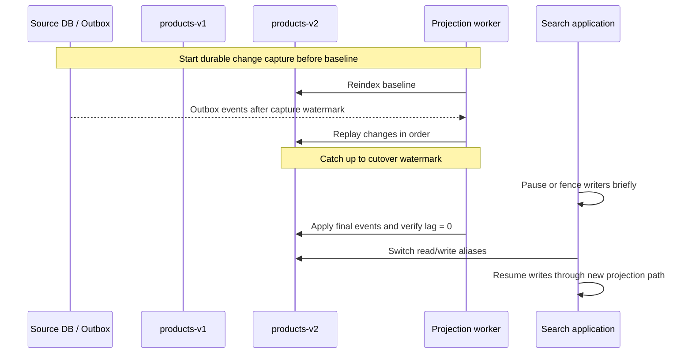
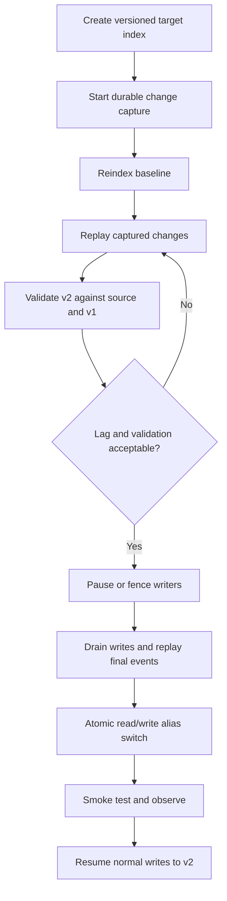

# Reindex mô hình chiếu, đổi alias và phương án quay lại

Trong ứng dụng Spring Data Elasticsearch, index thường đóng vai trò mô hình chiếu (read model): dữ liệu được tổ chức theo cách tối ưu cho tìm kiếm, lọc, sắp xếp và aggregation. Theo thời gian, mô hình này có thể cần thay đổi vì domain bổ sung field, mapping cũ không còn phù hợp, analyzer thay đổi, cấu trúc document được denormalize lại hoặc cách truy vấn đã khác.

Nhiều thay đổi mapping không thể áp dụng trực tiếp lên field đã tồn tại. Ví dụ, đổi `text` thành `keyword`, đổi kiểu số, thay analyzer hoặc chuyển cấu trúc object sang nested thường cần tạo index mới và nạp lại dữ liệu. Quy trình này gồm ba thao tác lớn:

1. **Reindex:** tạo index đích với mapping/settings mới và sao chép hoặc chuyển đổi document.
2. **Đổi alias:** chuyển alias đọc/ghi từ index cũ sang index mới bằng một thao tác alias update nguyên tử.
3. **Quay lại:** giữ index cũ và dữ liệu thay đổi đủ lâu để có thể rollback nếu phát hiện lỗi sau cutover.

Một alias ổn định giúp code ứng dụng không phải biết index vật lý đang mang version nào. Repository có thể trỏ đến alias `products`, trong khi alias lần lượt trỏ đến `products-v1`, `products-v2` hoặc phiên bản kế tiếp.

Điểm khó nhất của migration online là dữ liệu vẫn có thể được ghi trong lúc reindex. Reindex chỉ sao chép trạng thái mà nó đọc được; các cập nhật phát sinh sau mốc đọc cần được capture và replay bằng dual-write, change data capture (CDC), transactional outbox hoặc một khoảng dừng ghi có kiểm soát. Chỉ đổi alias quay lại index cũ không tự khôi phục những write đã chỉ được ghi vào index mới.

## 1. Mô hình chiếu trong Elasticsearch

Mô hình chiếu là cấu trúc dữ liệu được xây dựng để phục vụ một nhóm truy vấn. Nó có thể được tạo từ một hoặc nhiều aggregate/domain entity, rồi denormalize thành document phù hợp với Search API.

Ví dụ hệ thống thương mại điện tử có dữ liệu nguồn:

```text
Product (database)
  - productId
  - name
  - brandId
  - categoryId

Brand (database)
  - brandId
  - brandName

Category (database)
  - categoryId
  - categoryName
```

Mô hình chiếu cho Elasticsearch có thể gộp dữ liệu để tìm kiếm nhanh:

```json
{
  "product_id": "P-100",
  "name": "Mechanical Keyboard",
  "brand": {
    "id": "B-10",
    "name": "Acme"
  },
  "category": {
    "id": "C-20",
    "name": "Keyboard"
  },
  "price": 2500000,
  "active": true
}
```

Mô hình chiếu có thể khác schema database vì nó phục vụ cách đọc. Một thay đổi như chuyển `brand.name` từ `text` sang `keyword`, bổ sung `search_name`, đổi analyzer hoặc thay cấu trúc nested có thể yêu cầu xây dựng lại index.

### 1.1. Khi nào cần tạo index version mới?

Các tình huống thường gặp:

- Đổi kiểu field, ví dụ `long` sang `keyword`.
- Thay analyzer, normalizer hoặc synonym configuration.
- Đổi `object` thành `nested` hoặc ngược lại.
- Thay cách denormalize dữ liệu từ nhiều nguồn.
- Thêm field cần backfill từ dữ liệu nguồn.
- Loại bỏ field cũ hoặc đổi tên field theo schema mới.
- Thay shard count, replica, refresh interval hoặc index setting cần cấu hình lúc tạo.
- Thay cách tạo ID, routing hoặc cấu trúc document.

Không phải mọi thay đổi đều cần reindex. Một số mapping parameter có thể cập nhật bằng mapping API, còn setting động có thể đổi trực tiếp. Nhưng nếu thay đổi không tương thích với dữ liệu đã index hoặc cần chuyển đổi source document, hãy tạo index mới thay vì cố sửa index đang phục vụ production.

### 1.2. Chọn nguồn để dựng lại mô hình chiếu

Có hai hướng chính:

| Nguồn rebuild | Khi phù hợp | Giới hạn |
|---|---|---|
| Index Elasticsearch cũ | `_source` có đủ dữ liệu để tạo projection mới. | Không thể khôi phục field đã bị loại bỏ khỏi `_source` hoặc dữ liệu chưa từng được lưu. |
| Database/domain source of truth | Cần join dữ liệu mới, sửa logic projection hoặc khôi phục dữ liệu đầy đủ. | Cần batch reader, watermark/CDC và mapping logic ở ứng dụng. |

Nếu index cũ chỉ lưu một phần dữ liệu, reindex từ index đó không thể tự tạo lại thông tin đã mất. Khi projection phụ thuộc nhiều bảng hoặc aggregate, thường nên dựng lại từ nguồn dữ liệu có thẩm quyền.

## 2. Dùng tên index version và alias ổn định

Không nên để toàn bộ ứng dụng phụ thuộc trực tiếp vào tên index vật lý như `products-v1`. Thay vào đó, tạo index version riêng và một alias ổn định:

```text
products-v1  <--- alias: products
```

Khi migration hoàn tất:

```text
products-v2  <--- alias: products
```

Repository hoặc service tiếp tục sử dụng alias `products`; chỉ cấu hình hạ tầng thay đổi index vật lý mà alias trỏ đến.

Có thể tách alias đọc và ghi:

```text
products-read  ---> products-v2
products-write ---> products-v2 (is_write_index = true)
```

Tách alias hữu ích khi read/write có routing, filter hoặc chính sách vận hành khác nhau. Nếu ứng dụng chỉ cần một alias chung, có thể dùng một alias cho cả đọc và ghi và chỉ định write index rõ ràng khi alias trỏ tới nhiều index.

### 2.1. Alias không chứa dữ liệu

Alias là tên logic tham chiếu đến một hoặc nhiều index. Alias không sao chép document và không tạo một lớp transaction cho các thao tác ghi.

Alias có thể mang cấu hình như:

- `is_write_index`: index nhận thao tác ghi khi alias trỏ tới nhiều index.
- Filter: giới hạn document nhìn thấy qua alias.
- Search/index routing: điều hướng thao tác theo routing value.
- Các thuộc tính metadata liên quan đến alias.

Khi chuyển alias sang index mới, cần giữ các thuộc tính cần thiết. Nếu quên filter hoặc routing, ứng dụng có thể nhìn thấy tập dữ liệu khác sau cutover dù document đã được reindex đầy đủ.

### 2.2. Khai báo alias trong Spring Data Elasticsearch

Entity có thể trỏ đến tên alias ổn định:

```java
import org.springframework.data.annotation.Id;
import org.springframework.data.elasticsearch.annotations.Document;
import org.springframework.data.elasticsearch.annotations.Field;
import org.springframework.data.elasticsearch.annotations.FieldType;

@Document(indexName = "products")
public class ProductDocument {

    @Id
    private String id;

    @Field(type = FieldType.Text)
    private String name;

    @Field(type = FieldType.Keyword)
    private String brand;

    @Field(type = FieldType.Double)
    private double price;

    // constructors, getters, setters
}
```

`indexName = "products"` có thể là alias được Elasticsearch quản lý. Khi alias được chuyển từ `products-v1` sang `products-v2`, repository dùng cùng tên logic.

Nếu code gắn trực tiếp `@Document(indexName = "products-v1")`, đổi alias `products` sẽ không tác động đến repository đó. Vì vậy cần quyết định rõ index name trong entity là tên alias hay tên index vật lý.

## 3. Tạo index đích trước khi reindex

Reindex API không tự sao chép toàn bộ mapping, settings, template hoặc alias từ source index sang destination. Hãy tạo index đích trước với cấu hình đúng.

Ví dụ tạo `products-v2`:

```http
PUT /products-v2
Content-Type: application/json

{
  "settings": {
    "number_of_shards": 3,
    "number_of_replicas": 1,
    "analysis": {
      "analyzer": {
        "product_name_analyzer": {
          "type": "custom",
          "tokenizer": "standard",
          "filter": ["lowercase", "asciifolding"]
        }
      }
    }
  },
  "mappings": {
    "properties": {
      "product_id": { "type": "keyword" },
      "name": {
        "type": "text",
        "analyzer": "product_name_analyzer",
        "fields": {
          "keyword": { "type": "keyword" }
        }
      },
      "brand": { "type": "keyword" },
      "price": { "type": "scaled_float", "scaling_factor": 100 },
      "active": { "type": "boolean" },
      "created_at": { "type": "date" }
    }
  }
}
```

Đây chỉ là ví dụ mapping minh họa. Kiểu dữ liệu, analyzer, số shard và replica phải dựa trên workload, kích thước dữ liệu, query và yêu cầu vận hành thực tế.

### 3.1. Mapping của entity và mapping của index

Trong Spring Data Elasticsearch, `@Document` và các annotation `@Field` mô tả mapping của entity. Có thể dùng `IndexOperations` để làm việc với index và mapping qua Spring Data.

Ví dụ lấy operations cho một index cụ thể:

```java
import org.springframework.data.elasticsearch.core.IndexOperations;
import org.springframework.data.elasticsearch.core.mapping.IndexCoordinates;

IndexOperations targetIndex = operations.indexOps(
        IndexCoordinates.of("products-v2")
);
```

Tùy phiên bản Spring Data Elasticsearch, có thể dùng `create`, `createWithMapping`, `putMapping`, `getMapping` và các API index operations tương ứng. Khi dùng entity mapping, hãy xác nhận mapping thực tế trên index đích sau khi tạo.

Với mapping phụ thuộc settings analyzer, template hoặc cấu hình nâng cao, có thể tạo index bằng Elasticsearch REST API/Java API Client rồi dùng Spring Data cho phần đọc ghi entity. Điều quan trọng là index đích đã có mapping/settings hoàn chỉnh trước khi nhận bulk data.

### 3.2. Kiểm tra mapping trước khi nạp

Đọc mapping:

```http
GET /products-v2/_mapping
```

Đọc settings:

```http
GET /products-v2/_settings
```

Kiểm tra analyzer:

```http
POST /products-v2/_analyze
Content-Type: application/json

{
  "analyzer": "product_name_analyzer",
  "text": "Mechanical Keyboard"
}
```

Đừng đợi đến sau khi reindex hàng triệu document mới phát hiện field type hoặc analyzer không đúng. Mapping phải được kiểm tra bằng dữ liệu mẫu và query dự kiến trước khi chạy migration lớn.

## 4. Reindex API cơ bản

Reindex API đọc document từ source index và ghi sang destination index. Ví dụ sao chép toàn bộ `products-v1` sang `products-v2`:

```http
POST /_reindex
Content-Type: application/json

{
  "source": {
    "index": "products-v1"
  },
  "dest": {
    "index": "products-v2"
  }
}
```

Reindex cần `_source` của document nguồn. Nó không dùng alias để thay thế cho việc chuẩn bị mapping đích và không tự bảo đảm các write phát sinh trong lúc job chạy được đồng bộ sang destination.

Response thường chứa các thông tin như:

- `total`: số document được xét.
- `created`: số document được tạo ở destination.
- `updated`: số document được cập nhật.
- `deleted`: số document bị xóa trong ngữ cảnh thao tác phù hợp.
- `batches`: số batch đã xử lý.
- `version_conflicts`: số xung đột version.
- `failures`: lỗi từng item/batch.
- `took`: thời gian xử lý.

Không chỉ kiểm tra HTTP status. Phải kiểm tra `failures`, `version_conflicts` và các counter để xác định migration đã hoàn tất đúng mục tiêu hay chưa.

### 4.1. Dùng `op_type: create`

Nếu destination phải được tạo mới và không muốn ghi đè document đã tồn tại, có thể đặt:

```http
POST /_reindex
Content-Type: application/json

{
  "source": {
    "index": "products-v1"
  },
  "dest": {
    "index": "products-v2",
    "op_type": "create"
  }
}
```

Khi ID đã tồn tại ở destination, item có thể bị conflict thay vì ghi đè. Điều này hữu ích khi destination đã nhận dual-write hoặc khi chạy lại một phần job, nhưng cần có chính sách xử lý conflict rõ ràng.

Không bật `conflicts: proceed` rồi xem job thành công chỉ dựa trên số item được tạo. Conflict có thể là dấu hiệu dữ liệu destination đã được cập nhật mới hơn, hoặc là lỗi migration cần điều tra. Hãy xác định item nào là expected conflict và item nào cần xử lý.

### 4.2. Lọc document nguồn

Có thể chỉ reindex một tập document:

```http
POST /_reindex
Content-Type: application/json

{
  "source": {
    "index": "products-v1",
    "query": {
      "term": {
        "active": true
      }
    }
  },
  "dest": {
    "index": "products-v2"
  }
}
```

Query nguồn phải khớp đúng phạm vi dữ liệu cần chuyển. Nếu destination cần chứa cả inactive document nhưng query chỉ chọn active, migration sẽ thiếu dữ liệu dù Reindex API không báo lỗi.

## 5. Chuyển đổi document trong lúc reindex

Reindex API hỗ trợ script để biến đổi document trong quá trình sao chép. Ví dụ đổi tên field `old_price` thành `price` và bổ sung trạng thái mặc định:

```http
POST /_reindex
Content-Type: application/json

{
  "source": {
    "index": "products-v1"
  },
  "dest": {
    "index": "products-v2"
  },
  "script": {
    "lang": "painless",
    "source": "if (ctx._source.old_price != null) { ctx._source.price = ctx._source.old_price; } ctx._source.remove('old_price'); if (ctx._source.active == null) { ctx._source.active = true; }"
  }
}
```

Script chạy trên từng document. Cần kiểm tra:

- Field cũ có thể thiếu/null hay không.
- Kiểu dữ liệu sau transform có tương thích mapping đích không.
- Quy tắc mặc định có đúng nghiệp vụ không.
- Script có làm mất dữ liệu cần giữ không.
- Chi phí script có làm migration chậm đáng kể không.

Nếu logic projection phức tạp, cần join nhiều nguồn hoặc gọi service nghiệp vụ, reindex script thường không đủ. Khi đó nên đọc từ source of truth, transform trong ứng dụng hoặc dùng pipeline chuyên biệt rồi bulk index vào destination.

### 5.1. Dùng ingest pipeline

Destination có thể dùng ingest pipeline để chuẩn hóa document khi nhận dữ liệu. Ví dụ reindex chỉ định pipeline:

```http
POST /_reindex
Content-Type: application/json

{
  "source": {
    "index": "products-v1"
  },
  "dest": {
    "index": "products-v2",
    "pipeline": "products-projection-v2"
  }
}
```

Pipeline phải được tạo và kiểm thử trước. Không nên dùng pipeline vừa thay đổi giữa chừng trong một migration nếu cần kết quả có thể tái lập; hãy version hóa pipeline như mapping/index.

## 6. Chạy reindex lâu bằng task API

Với dataset lớn, không nhất thiết giữ HTTP connection mở cho đến khi toàn bộ reindex hoàn tất. Có thể chạy bất đồng bộ:

```http
POST /_reindex?wait_for_completion=false
Content-Type: application/json

{
  "source": {
    "index": "products-v1"
  },
  "dest": {
    "index": "products-v2"
  }
}
```

Response trả về task ID. Lưu task ID trong migration job metadata để theo dõi.

Kiểm tra trạng thái:

```http
GET /_tasks/<task_id>
```

Response cho biết task còn chạy hay đã hoàn tất, tiến độ, status và lỗi nếu có.

Có thể liệt kê các task reindex đang chạy:

```http
GET /_tasks?actions=*reindex&detailed=true
```

Nếu cần dừng task:

```http
POST /_tasks/<task_id>/_cancel
```

Cancel không tự rollback những document đã được ghi vào destination. Destination có thể chứa một phần dữ liệu và cần được dọn hoặc tiếp tục theo một quy trình có kiểm soát.

### 6.1. Theo dõi task và lưu kết quả

Một migration job nên lưu:

- Source index và destination index.
- Mapping/schema version.
- Reindex task ID.
- Thời điểm bắt đầu/kết thúc.
- Tổng document, created/updated và failure count.
- Version/watermark của change stream liên quan.
- Người/tiến trình khởi tạo và trạng thái cutover.

Nếu process quản lý migration restart, nó vẫn có thể tra task theo ID thay vì khởi động một reindex mới không rõ trạng thái.

## 7. Điều chỉnh tốc độ và chia reindex

Reindex có thể tạo tải lớn lên source và destination. Các tùy chọn thường dùng:

- `slices`: chia công việc thành các phần chạy song song.
- `requests_per_second`: throttle tốc độ batch.
- `max_docs`: giới hạn số document cho một lượt thử nghiệm hoặc migration có phạm vi.
- `scroll`: thời gian giữ context đọc source giữa các batch.
- `wait_for_completion=false`: chạy task nền.

Ví dụ throttle:

```http
POST /_reindex?wait_for_completion=false&requests_per_second=500
Content-Type: application/json

{
  "source": {
    "index": "products-v1"
  },
  "dest": {
    "index": "products-v2"
  }
}
```

Giá trị `requests_per_second` được hiểu theo tốc độ batch của Reindex API; không phải một bảo đảm số document/giây cố định. Đo thực tế và điều chỉnh theo CPU, disk I/O, indexing pressure, search latency và write rejection.

Có thể dùng slicing để chạy song song:

```http
POST /_reindex?wait_for_completion=false&slices=auto
Content-Type: application/json

{
  "source": {
    "index": "products-v1"
  },
  "dest": {
    "index": "products-v2"
  }
}
```

Tăng slicing không phải lúc nào cũng nhanh hơn. Nhiều slice có thể làm tăng số search context, request và áp lực lên cluster. Bắt đầu từ cấu hình vừa phải rồi benchmark.

## 8. Reindex không tự đồng bộ các write phát sinh

Đây là rủi ro quan trọng nhất của migration không downtime.

Giả sử reindex bắt đầu lúc 10:00. Trong lúc job chạy:

- 10:01: sản phẩm P-100 được cập nhật giá.
- 10:02: sản phẩm P-200 được tạo mới.
- 10:03: sản phẩm P-300 bị xóa.
- 10:05: reindex mới đọc đến một phần document cũ.

Nếu không có cơ chế capture change, destination có thể chứa trạng thái cũ, thiếu P-200 hoặc vẫn còn P-300. Chuyển alias sang destination lúc 10:10 có thể làm mất cập nhật mới nhất khỏi read path.

Reindex đọc source theo cơ chế scan/search của Elasticsearch. Nó không phải transaction snapshot kết hợp với write log có thể tự replay mọi thay đổi phát sinh trong suốt job. Hãy thiết kế một mốc đồng bộ và luồng delta riêng.

## 9. Chiến lược migration có downtime ngắn

Nếu hệ thống có thể tạm dừng ghi trong một khoảng thời gian, quy trình đơn giản nhất là:

1. Đưa ứng dụng vào maintenance/read-only mode hoặc dừng write producer.
2. Chờ các write đang xử lý hoàn tất.
3. Tạo index đích và reindex toàn bộ dữ liệu.
4. Refresh destination.
5. Đối soát count và sample.
6. Chuyển alias sang destination.
7. Xác minh read/write qua alias.
8. Mở lại write traffic.

```text
Stop writes
    |
    v
Drain in-flight writes
    |
    v
Reindex source -> destination
    |
    v
Refresh + validate
    |
    v
Atomic alias switch
    |
    v
Resume writes on destination
```

Ưu điểm là dễ hiểu và ít thành phần đồng bộ. Nhược điểm là thời gian dừng ghi phụ thuộc kích thước dữ liệu và tốc độ reindex. Với index lớn, downtime có thể quá dài.

## 10. Chiến lược online bằng dual-write

Dual-write là ghi thay đổi mới vào cả index cũ và index mới trong giai đoạn migration. Một luồng có thể thực hiện:

1. Bật ghi đồng thời vào `products-v1` và `products-v2`.
2. Chụp mốc bắt đầu dual-write.
3. Chạy backfill từ source sang destination.
4. Bảo đảm backfill không ghi đè phiên bản mới hơn do dual-write tạo ra.
5. Đối soát hai index.
6. Chuyển alias sang destination.
7. Tiếp tục ghi vào destination; giữ khả năng ghi/đồng bộ về v1 trong rollback window nếu cần rollback.

### 10.1. Rủi ro race giữa backfill và dual-write

Ví dụ:

1. Reindex đọc P-100 ở version cũ.
2. Ứng dụng dual-write P-100 version mới vào destination.
3. Reindex ghi lại P-100 version cũ sau đó.

Nếu thao tác reindex dùng semantics ghi đè thông thường, version cũ có thể ghi đè dữ liệu mới. Chỉ bật dual-write không tự giải quyết race này.

Một số cách kiểm soát:

- Dùng source version và external versioning phù hợp để phiên bản cũ không ghi đè phiên bản mới.
- Dùng destination được backfill trước rồi replay change log theo thứ tự version.
- Dùng deterministic ID và một bước reconciliation để tìm document có version thấp hơn.
- Tạm ngừng cập nhật ở thời điểm cuối, drain write queue và chạy delta cuối trước cutover.

Thiết kế versioning phải nhất quán giữa nguồn, reindex và write path. Không thêm `version_type` tùy tiện nếu source `_version` không đại diện cho version nghiệp vụ mong muốn.

### 10.2. Dual-write không phải transaction phân tán

Nếu ứng dụng ghi v1 thành công nhưng ghi v2 thất bại, hai index lệch nhau. Nếu ghi v2 thành công nhưng v1 thất bại, trạng thái cũng lệch. Một lần gọi hai request liên tiếp không tạo transaction nguyên tử giữa hai index.

Nếu dùng dual-write, cần:

- Ghi nhận kết quả từng đích.
- Retry có idempotency.
- Lưu trạng thái đồng bộ hoặc change event bền vững.
- Có reconciliation để phát hiện và sửa lệch.
- Xác định index nào là nguồn có thẩm quyền trong từng giai đoạn.

Đối với hệ thống quan trọng, transactional outbox/CDC thường đáng tin cậy hơn việc chỉ gọi hai thao tác ghi độc lập từ service.

## 11. Chiến lược online bằng CDC hoặc transactional outbox

Nếu database là nguồn dữ liệu có thẩm quyền, có thể capture thay đổi từ database bằng CDC hoặc transactional outbox rồi áp dụng vào mô hình chiếu Elasticsearch.

Quy trình tổng quát:

```text
Database transaction
      |
      +---- update domain rows
      |
      +---- append outbox event
                |
                v
         CDC / event consumer
                |
                +------> products-v1
                |
                +------> products-v2 (during migration)

Initial snapshot --------------------> products-v2
```

Các bước migration:

1. Xác định một change-log position/watermark `W0` có thể tái lập.
2. Bắt đầu lưu hoặc giữ lại mọi event từ `W0` trở đi.
3. Tạo index đích với mapping v2.
4. Nạp snapshot dữ liệu nguồn vào v2.
5. Replay event từ `W0` theo thứ tự phù hợp để đưa v2 đến trạng thái mới nhất.
6. Đối soát và chờ consumer lag về 0 hoặc dưới ngưỡng đã định.
7. Tạm chặn/serialize write trong thời gian ngắn, drain event cuối và xác nhận watermark cuối `W1`.
8. Chuyển alias sang v2.
9. Tiếp tục consumer vào v2; giữ event log đủ lâu cho rollback.

Điểm khó là xác định snapshot và watermark phải tương thích. Nếu snapshot phản ánh trạng thái sau `W0` nhưng replay lại event từ `W0`, cùng một thay đổi có thể được áp dụng hai lần. Nếu snapshot cũ hơn `W0` mà bỏ replay một phần event, có thể mất dữ liệu. Cần một cơ chế snapshot/CDC có quan hệ nhất quán, ví dụ database snapshot gắn với log position hoặc outbox có checkpoint rõ ràng.

### 11.1. Idempotency và thứ tự event

Event consumer cần xử lý:

- Event có thể được giao lại.
- Event có thể đến trễ hoặc sai thứ tự nếu nhiều partition/worker.
- Một entity có thể được cập nhật nhiều lần trước khi consumer xử lý.
- Delete cần được biểu diễn bằng tombstone hoặc delete event.

Dùng aggregate ID, event ID và version để xác định event đã xử lý và ngăn version cũ ghi đè version mới. Khi projection được dựng từ nhiều nguồn, cần đảm bảo event đủ thông tin hoặc consumer có thể đọc lại state chuẩn từ source of truth.

### 11.2. Dual-write trong rollback window

Sau khi alias đã chuyển sang v2, nếu muốn có thể quay lại v1 mà không mất write, cần tiếp tục giữ v1 đồng bộ hoặc giữ một change log đủ để replay ngược/forward theo chiến lược migration.

Không nhất thiết phải duy trì dual-write mãi mãi. Có thể giữ outbox/CDC event trong rollback window và chỉ ngừng đồng bộ v1 sau khi chấp nhận v2 ổn định. Tuy nhiên, nếu ngừng cập nhật v1, rollback sau đó cần một bước replay dữ liệu từ event log hoặc từ source of truth.

## 12. Đối soát trước khi cutover

Không chuyển alias chỉ vì Reindex API trả `completed`. Cần xác minh destination đúng về số lượng, dữ liệu và khả năng phục vụ query.

### 12.1. Refresh destination

Trước khi chạy các kiểm tra search/count, refresh destination:

```http
POST /products-v2/_refresh
```

Nếu reindex vẫn còn task hoặc CDC chưa replay xong, chưa nên xem kết quả đối soát là cuối cùng.

### 12.2. So sánh document count

```http
GET /products-v1/_count
```

```http
GET /products-v2/_count
```

Count phải được so sánh trong cùng phạm vi và tại cùng watermark. Nếu v1 vẫn nhận write trong lúc đối soát còn v2 chưa replay xong, hai số khác nhau chưa chắc là lỗi reindex; nhưng không thể cutover cho đến khi đã xử lý delta và đạt tiêu chí đồng bộ.

### 12.3. Kiểm tra sample ID

Chọn tập ID đại diện:

- Document mới tạo gần đây.
- Document vừa update.
- Document có field optional/null.
- Document có mảng nested hoặc dữ liệu đặc biệt.
- Document có ký tự Unicode, ngày giờ và numeric boundary.

Đọc theo ID từ cả hai index và so sánh các field quan trọng. Nếu transform có chủ đích, so sánh theo quy tắc chuyển đổi thay vì byte-for-byte.

### 12.4. Kiểm tra query thực tế

Chạy các query mà ứng dụng production sử dụng:

- Match/full-text theo analyzer mới.
- Term filter trên field keyword.
- Range filter/sort trên numeric/date.
- Nested query nếu mapping đổi sang nested.
- Aggregation và cardinality cần thiết.
- Geo query, routing hoặc alias filter nếu có.

Một index có count đúng vẫn có thể không tương thích với ứng dụng nếu mapping/analyzer làm thay đổi kết quả truy vấn.

### 12.5. Kiểm tra lỗi và phân bố dữ liệu

Kiểm tra:

- `failures` của reindex bằng 0 hoặc mọi failure đã được giải quyết.
- `version_conflicts` theo đúng chính sách.
- Count theo tenant/category/status hoặc partition nghiệp vụ.
- Field bắt buộc có tỷ lệ missing hợp lý.
- Không có mapping rejection hoặc bulk failure còn tồn đọng.
- CDC/outbox lag và watermark đã đạt mốc cutover.

## 13. Chuyển alias nguyên tử

Khi destination đã sẵn sàng, dùng một `_aliases` request để remove alias khỏi index cũ và add vào index mới. Elasticsearch xử lý toàn bộ action trong request như một thay đổi alias atomic ở cấp cluster state.

Ví dụ alias chung `products`:

```http
POST /_aliases
Content-Type: application/json

{
  "actions": [
    {
      "remove": {
        "index": "products-v1",
        "alias": "products"
      }
    },
    {
      "add": {
        "index": "products-v2",
        "alias": "products",
        "is_write_index": true
      }
    }
  ]
}
```

Sau khi request thành công, request mới qua alias `products` được định tuyến đến v2. Không có khoảng thời gian alias bị remove trong một request riêng rồi mới add ở request khác.

### 13.1. Chuyển read alias và write alias cùng lúc

Nếu dùng hai alias riêng:

```http
POST /_aliases
Content-Type: application/json

{
  "actions": [
    { "remove": { "index": "products-v1", "alias": "products-read" } },
    { "remove": { "index": "products-v1", "alias": "products-write" } },
    { "add": { "index": "products-v2", "alias": "products-read" } },
    {
      "add": {
        "index": "products-v2",
        "alias": "products-write",
        "is_write_index": true
      }
    }
  ]
}
```

Gộp các thao tác trong một request giúp read alias và write alias đổi đích cùng một lần cập nhật alias. Cần kiểm tra ứng dụng thực sự dùng đúng alias cho từng luồng.

### 13.2. Vì sao cần `is_write_index`?

Một alias có thể trỏ đến nhiều index để đọc dữ liệu kết hợp. Nhưng khi ghi qua alias nhiều index, Elasticsearch cần biết index nào là write index. `is_write_index: true` chỉ định index nhận thao tác ghi.

Nếu alias chỉ trỏ một index, Elasticsearch có thể mặc định index đó là write index, nhưng chỉ định tường minh giúp cấu hình dễ hiểu hơn, đặc biệt trong quá trình migration.

Không để alias write trỏ tới cả v1 và v2 với ý định tự động dual-write. Alias không fan-out thao tác ghi sang tất cả index; nó chọn write index theo metadata alias.

## 14. Spring Data Elasticsearch sau khi đổi alias

Nếu entity dùng alias ổn định:

```java
@Document(indexName = "products")
public class ProductDocument {
    // fields
}
```

repository tiếp tục dùng alias:

```java
public interface ProductRepository
        extends ElasticsearchRepository<ProductDocument, String> {
}
```

Sau khi alias `products` chuyển sang `products-v2`, các thao tác repository mới sẽ sử dụng alias theo cấu hình index name của entity.

### 14.1. Không giữ client cache index vật lý ngoài dự kiến

Ứng dụng có thể cache index name, `IndexCoordinates` hoặc tạo service riêng trỏ thẳng đến `products-v1`. Những đường đi này không tự đổi theo alias nếu chúng không dùng alias. Trước cutover, tìm tất cả nơi dùng tên index vật lý:

- `@Document(indexName = ...)`.
- `IndexCoordinates.of(...)`.
- Query REST trực tiếp.
- Job bulk/reindex.
- Dashboard, monitoring hoặc integration khác.
- Ingest pipeline và template.

Giữ tên alias ổn định trong code ứng dụng và quản lý tên index version trong migration/configuration giúp giảm rủi ro.

### 14.2. Repository và alias write

Khi `save()` hoặc `delete()` qua repository dùng alias, Elasticsearch cần resolve alias đến write index. Nếu alias trỏ nhiều index, phải có `is_write_index`. Nếu write path cần gửi đến index cụ thể trong migration, dùng custom operations/index coordinates hoặc client phù hợp, nhưng cần bảo đảm luồng này có kiểm soát và không làm repository thường vô tình bypass alias.

## 15. Phương án quay lại trước cutover

Nếu reindex thất bại trước khi alias chuyển:

1. Giữ alias đọc/ghi trên v1.
2. Không công bố v2.
3. Lưu kết quả task và danh sách failure để điều tra.
4. Sửa mapping/script/source rồi tạo lại hoặc dọn destination theo quy trình.
5. Chạy lại reindex và đối soát.

Người dùng vẫn dùng index cũ vì alias chưa đổi. Destination lỗi có thể được xóa và tạo lại nếu chưa chứa dữ liệu duy nhất cần giữ.

## 16. Phương án quay lại sau cutover

Sau khi alias đã chuyển sang v2, rollback có thể thực hiện bằng cách chuyển alias về v1:

```http
POST /_aliases
Content-Type: application/json

{
  "actions": [
    { "remove": { "index": "products-v2", "alias": "products" } },
    {
      "add": {
        "index": "products-v1",
        "alias": "products",
        "is_write_index": true
      }
    }
  ]
}
```

Thao tác alias có thể nhanh và atomic, nhưng nó chỉ đổi nơi alias trỏ đến. Nó không đồng bộ dữ liệu từ v2 về v1.

### 16.1. Rủi ro mất write sau cutover

Giả sử:

1. Alias chuyển sang v2 lúc 12:00.
2. Người dùng tạo P-500 lúc 12:05; write chỉ vào v2.
3. Người dùng cập nhật P-100 lúc 12:06; write chỉ vào v2.
4. Đến 12:10 phát hiện lỗi ứng dụng và chuyển alias về v1.

V1 không có P-500 và có thể vẫn chứa phiên bản cũ của P-100. Alias rollback làm read path quay về dữ liệu cũ, khiến các write sau cutover biến mất khỏi ứng dụng.

Vì vậy, **không được xem alias rollback là data rollback**. Cần kế hoạch đồng bộ write trong rollback window.

### 16.2. Các cách bảo đảm rollback không mất dữ liệu

Có thể chọn một trong các chiến lược:

**Giữ dual-write trong rollback window**

- Sau cutover, tiếp tục ghi các thay đổi vào cả v2 và v1.
- Theo dõi kết quả từng đích và retry/reconcile khi lệch.
- Nếu rollback, v1 đã nhận các write mới và có thể nhận alias lại.
- Chỉ ngừng dual-write khi rollback window kết thúc.

**Giữ CDC/outbox và replay về v1**

- Lưu bền vững mọi thay đổi sau cutover.
- Nếu rollback, replay event từ watermark phù hợp vào v1.
- Đảm bảo event idempotent, đúng thứ tự/version và có delete event.
- Chỉ chuyển alias sau khi replay bắt kịp.

**Tạm dừng write khi rollback**

- Chặn write producer hoặc đưa hệ thống vào read-only mode.
- Drain request đang chạy.
- Đồng bộ các thay đổi mới nhất từ v2/source of truth về v1.
- Xác minh dữ liệu và chuyển alias về v1.
- Mở lại write sau khi xác nhận.

**Khôi phục từ source of truth**

- Nếu database là nguồn chuẩn, dựng lại v1 từ source of truth hoặc replay event log.
- Đây có thể mất thời gian hơn, nhưng tránh phụ thuộc vào projection lỗi.

### 16.3. Giữ index cũ trong rollback window

Không xóa `products-v1` ngay sau cutover. Giữ index cũ trong khoảng thời gian đủ để:

- Quan sát lỗi mapping/query và lỗi nghiệp vụ.
- Đánh giá hiệu năng production.
- Thực hiện rollback nếu cần.
- Replay/đối soát dữ liệu.

Thời lượng rollback window phụ thuộc rủi ro và chi phí lưu trữ. Chỉ xóa v1 sau khi đã xác nhận v2 ổn định, write path đúng, CDC/dual-write không còn cần thiết và các bên liên quan chấp nhận kết thúc rollback window.

## 17. Ma trận quyết định cutover và rollback

| Tình huống | Hành động |
|---|---|
| Reindex lỗi, alias chưa đổi | Giữ v1; sửa lỗi và chạy lại v2. |
| Reindex thành công nhưng validation thất bại | Không cutover; điều tra mapping/transform/dữ liệu. |
| CDC lag chưa về ngưỡng | Chưa cutover; tiếp tục replay và đối soát. |
| Alias switch thành công, smoke test đạt | Theo dõi v2 và giữ v1 trong rollback window. |
| Lỗi sau cutover, v1 vẫn được dual-write | Có thể chuyển alias về v1 theo quy trình. |
| Lỗi sau cutover, v1 không nhận write mới | Đồng bộ delta về v1 hoặc dựng lại từ source of truth trước rollback. |
| V2 có lỗi nhưng dữ liệu cần giữ chỉ nằm ở v2 | Không xóa v2; trích/replay dữ liệu cần thiết trước khi rollback. |
| Rollback window kết thúc, v2 ổn định | Ngừng dual-write/CDC cũ theo kế hoạch và retire v1. |

## 18. Kịch bản migration mẫu theo từng giai đoạn

Một migration online có thể được tổ chức như sau:

```text
Giai đoạn A — Chuẩn bị
  - Tạo products-v2
  - Cài mapping/settings/pipeline v2
  - Kiểm tra alias hiện tại

Giai đoạn B — Capture thay đổi
  - Chốt watermark W0
  - Bật/giữ CDC hoặc outbox từ W0

Giai đoạn C — Backfill
  - Reindex hoặc đọc source snapshot vào v2
  - Theo dõi task, failures, throttling

Giai đoạn D — Catch-up
  - Replay event từ W0
  - Kiểm tra version, count, sample, query
  - Chờ lag về ngưỡng cutover

Giai đoạn E — Cutover
  - Drain/serialize write ngắn
  - Replay delta cuối đến W1
  - Atomic alias switch v1 -> v2
  - Smoke test read/write

Giai đoạn F — Rollback window
  - Giữ v1 và change log
  - Dual-write hoặc bảo đảm replay ngược về v1
  - Theo dõi lỗi và hiệu năng

Giai đoạn G — Hoàn tất
  - Kết thúc rollback window
  - Ngừng luồng đồng bộ cũ
  - Xóa v1 theo retention policy
```

Mốc `W0` và `W1` phải được ghi lại trong metadata migration. Không dựa vào thời gian wall-clock đơn thuần nếu event source có offset/sequence chính xác hơn.

## 19. Checklist trước khi chạy production migration

**Index đích**

- Tên version mới không trùng index hiện có.
- Mapping, analyzer, normalizer, template và settings đã được kiểm tra.
- Số shard/replica phù hợp.
- Destination không bị ứng dụng production ghi ngoài kế hoạch.

**Nguồn và đồng bộ**

- `_source` có đủ dữ liệu nếu reindex từ index cũ.
- Đã xác định source of truth.
- Đã chốt watermark và cơ chế capture write.
- Đã xử lý insert/update/delete phát sinh trong lúc backfill.
- Event replay có idempotency và version ordering.

**Reindex**

- Query source đúng phạm vi.
- Transform/pipeline đã được test.
- Batch, slicing, throttle và timeout phù hợp.
- Task ID được lưu và theo dõi.
- `failures` và `version_conflicts` được phân loại.

**Validation**

- Destination đã refresh.
- Count và phân bố dữ liệu được đối soát theo cùng watermark.
- Sample ID và field quan trọng đúng.
- Query, sort, aggregation và analyzer mới hoạt động.
- CDC lag đạt ngưỡng cutover.

**Cutover và rollback**

- Alias read/write được liệt kê và xác nhận trước thay đổi.
- Alias filter/routing được giữ nguyên.
- Một request `_aliases` thực hiện toàn bộ switch.
- Write index được chỉ định rõ.
- Có smoke test sau cutover.
- Index cũ được giữ lại.
- Có cách replay/dual-write để rollback không làm mất write sau cutover.
- Có người chịu trách nhiệm và điều kiện dừng/rollback rõ ràng.

## 20. Những lỗi thường gặp

| Hiện tượng | Nguyên nhân có thể | Cách xử lý |
|---|---|---|
| Reindex báo lỗi mapping | Destination mapping không tương thích source hoặc transform. | Kiểm tra field type, dữ liệu biên và script; tạo lại index đích nếu cần. |
| Reindex xong nhưng document thiếu | Query source lọc sai, `_source` thiếu hoặc failures bị bỏ qua. | Kiểm tra query, `_source`, `failures` và count theo partition. |
| Mapping đích giống mapping cũ ngoài ý muốn | Nghĩ rằng Reindex API tự copy mapping/settings. | Tạo destination với mapping/settings trước khi reindex. |
| Destination ghi đè dữ liệu mới bằng backfill cũ | Race giữa reindex và dual-write. | Dùng versioning hoặc backfill rồi replay change log theo thứ tự. |
| Document tạo trong lúc reindex không có ở v2 | Không capture write mới. | Dùng CDC/outbox, dual-write hoặc maintenance window. |
| Document bị xóa ở source vẫn còn ở v2 | Delete event không được replay. | Dùng tombstone/delete event và đối soát. |
| Alias không nhận write sau cutover | Alias trỏ nhiều index nhưng không có write index. | Đặt `is_write_index: true` cho index đích. |
| Ứng dụng vẫn đọc index cũ | Một số code path dùng tên index vật lý thay vì alias. | Tìm và chuyển các đường đọc/ghi về alias ổn định. |
| Alias filter/routing thay đổi sau cutover | Không tái tạo metadata alias. | So sánh alias config trước và sau migration. |
| Alias rollback nhưng mất dữ liệu mới | Write sau cutover chỉ được ghi vào v2. | Dual-write, replay event hoặc đồng bộ delta về v1 trước rollback. |
| Reindex task chạy quá lâu | Batch/slicing/concurrency hoặc cluster capacity chưa phù hợp. | Throttle, đo tải, tối ưu mapping và chọn slicing phù hợp. |
| Reindex task bị hủy nhưng destination còn dữ liệu dở | Cancel không rollback các item đã ghi. | Đánh dấu destination incomplete; dọn hoặc tiếp tục có kiểm soát. |
| Count hai index khác nhau | So sánh khác watermark hoặc CDC chưa catch up. | Đồng bộ đến cùng mốc rồi đối soát lại. |
| V2 chạy được nhưng query nghiệp vụ sai | Mapping/analyzer hoặc projection transform thay đổi semantics. | Chạy bộ query acceptance test trước cutover. |

## 21. Những điểm cần nhớ

- Mô hình chiếu Elasticsearch thường được version hóa khi mapping, analyzer hoặc cấu trúc document thay đổi không tương thích.
- Tạo index version mới với mapping/settings hoàn chỉnh trước khi nạp dữ liệu.
- Reindex API sao chép document từ source sang destination nhưng không tự copy mapping/settings và không tự đồng bộ mọi write phát sinh sau mốc đọc.
- Kiểm tra `failures`, `version_conflicts`, count và dữ liệu mẫu; HTTP thành công chưa đủ để kết luận migration đúng.
- Dùng task API, slicing và throttling khi reindex lớn hoặc chạy lâu.
- Alias là tên logic, không phải bản sao dữ liệu và không tự dual-write.
- Dùng một `_aliases` request để remove/add alias atomic; chỉ định `is_write_index` khi cần.
- Giữ alias ổn định trong `@Document(indexName = "...")` để repository không phụ thuộc index version vật lý.
- Reindex online cần capture/replay insert, update và delete bằng CDC, outbox, dual-write hoặc downtime có kiểm soát.
- Dual-write không phải transaction; phải xử lý partial failure, retry, idempotency và race với backfill.
- Trước cutover, refresh destination và đối soát theo cùng watermark.
- Alias rollback chỉ đổi read/write target; nó không đưa các write mới từ v2 về v1.
- Giữ index cũ trong rollback window và chỉ xóa sau khi đã chấp nhận kết thúc khả năng quay lại.
- Thiết kế rollback như một quy trình dữ liệu có replay/dual-write, không chỉ là một lệnh đổi alias.

Reindex mô hình chiếu, đổi alias và rollback là một quy trình đồng bộ dữ liệu có nhiều mốc nhất quán. Tạo index mới với mapping đúng, nạp snapshot, bắt kịp các thay đổi phát sinh, xác minh dữ liệu rồi chuyển alias trong một thao tác atomic. Giữ index cũ cùng change log trong rollback window để có thể quay lại mà không làm mất các write đã phát sinh sau cutover.

## Tài liệu tham khảo

- [Elasticsearch — Reindex API](https://www.elastic.co/guide/en/elasticsearch/reference/current/docs-reindex.html)
- [Elasticsearch — Index aliases](https://www.elastic.co/guide/en/elasticsearch/reference/current/aliases.html)
- [Elasticsearch — Update aliases API](https://www.elastic.co/guide/en/elasticsearch/reference/current/indices-aliases.html)
- [Elasticsearch — Tasks API](https://www.elastic.co/guide/en/elasticsearch/reference/current/tasks.html)
- [Elasticsearch — Tune for indexing speed](https://www.elastic.co/guide/en/elasticsearch/reference/current/tune-for-indexing-speed.html)
- [Spring Data Elasticsearch — Object mapping](https://docs.spring.io/spring-data/elasticsearch/reference/elasticsearch/object-mapping.html)
- [Spring Data Elasticsearch — Index operations](https://docs.spring.io/spring-data/elasticsearch/reference/elasticsearch/template.html)
# Reindex mô hình chiếu, đổi alias và phương án quay lại

Reindex migration tạo một index version mới với mapping, settings hoặc cấu trúc document mới, nạp dữ liệu vào đó, xác minh kết quả rồi chuyển alias ứng dụng sang index đích. Index vật lý có version như `products-v1` và `products-v2`; ứng dụng dùng alias ổn định như `products-read` và `products-write`.

Alias switch chỉ thay đổi đích truy cập. Nó không sao chép dữ liệu, không đồng bộ các write phát sinh trong lúc reindex và không tạo transaction giữa hai index. Một kế hoạch migration phải xử lý baseline, change capture, validation, cutover và rollback.
## 1. Mô hình chiếu và lý do cần reindex

Giả sử database nghiệp vụ có bảng sản phẩm. Một projection worker tạo document tìm kiếm:

```json
{
  "productId": "product-1001",
  "sku": "KB-1001",
  "name": "Mechanical Keyboard",
  "nameSort": "mechanical keyboard",
  "category": "keyboard",
  "price": 135.0,
  "active": true,
  "projectionVersion": 12
}
```

Index Elasticsearch có thể được tối ưu riêng cho tìm kiếm: name dùng text, nameSort dùng keyword, category dùng keyword để facet, price dùng numeric để range/sort. Cấu trúc này là read model, không nhất thiết trùng schema database.

Các lý do thường phải tạo index mới:

- Đổi field từ text sang keyword, hoặc ngược lại.
- Thêm multi-field, normalizer hoặc analyzer mới.
- Đổi kiểu dữ liệu, date format hoặc cách biểu diễn giá trị.
- Chuyển một mảng object sang nested để bảo toàn quan hệ phần tử.
- Đổi tên field, chuẩn hóa dữ liệu hoặc tạo field dẫn xuất.
- Thay đổi cách denormalize thông tin từ nhiều bảng/aggregate.
- Sửa lỗi trong projection logic khiến dữ liệu cũ không đúng.
- Tạo index mới với shard/replica/settings khác.

Thay đổi mapping hiện có có giới hạn. Ví dụ không thể đổi trực tiếp field đã index thành text sang keyword bằng một update mapping đơn giản. Tạo index mới với mapping mong muốn, nạp lại document rồi chuyển alias là cách triển khai an toàn hơn.

## 2. Dùng index có version và alias ổn định

Không nên để mọi service phụ thuộc trực tiếp vào tên index vật lý như products-v1. Dùng tên index có version và alias ổn định:

| Tên | Vai trò |
|---|---|
| products-v1 | Index vật lý hiện tại |
| products-v2 | Index vật lý mới |
| products-read | Alias đọc mà ứng dụng sử dụng |
| products-write | Alias ghi mà projection worker sử dụng |

Ứng dụng đọc qua products-read; worker ghi qua products-write. Khi migration hoàn tất, alias được chuyển từ products-v1 sang products-v2. Code ứng dụng không cần thay tên index ở mọi nơi.

### 2.1 Tách read alias và write alias

Tách alias đọc và ghi giúp kiểm soát cutover rõ ràng:

- products-read: có thể trỏ tới index được dùng để phục vụ truy vấn.
- products-write: xác định index nhận thao tác ghi mới.

Một alias trỏ tới nhiều index có thể dùng cho search, nhưng thao tác ghi cần xác định write index. Khi alias có nhiều index, đặt is_write_index: true trên index nhận ghi. Nếu alias chỉ trỏ tới một index, Elasticsearch có thể mặc định index đó là write index; khai báo tường minh vẫn giúp cấu hình dễ hiểu.

Ví dụ alias ban đầu:

```http
POST /_aliases
{
  "actions": [
    {
      "add": {
        "index": "products-v1",
        "alias": "products-read"
      }
    },
    {
      "add": {
        "index": "products-v1",
        "alias": "products-write",
        "is_write_index": true
      }
    }
  ]
}
```

products-v1 là index vật lý. Các request search/index từ ứng dụng sử dụng alias. Không tạo alias trùng tên với index hiện có.

### 2.2 Cấu hình Spring Data Elasticsearch

Entity có thể khai báo tên index mặc định là alias:

```java
@Document(indexName = "products-read")
public class ProductDocument {

    @Id
    private String productId;

    @Field(type = FieldType.Keyword)
    private String sku;

    @Field(type = FieldType.Text)
    private String name;

    @Field(type = FieldType.Double)
    private Double price;
}
```

Nếu cùng entity được dùng cho thao tác ghi, cần bảo đảm repository/template thực sự ghi vào products-write theo thiết kế. Có thể truyền IndexCoordinates tường minh cho ElasticsearchOperations:

```java
private static final IndexCoordinates READ_INDEX =
    IndexCoordinates.of("products-read");

private static final IndexCoordinates WRITE_INDEX =
    IndexCoordinates.of("products-write");

SearchHits<ProductDocument> search(Query query) {
    return operations.search(query, ProductDocument.class, READ_INDEX);
}

String index(ProductDocument document) {
    return operations.index(
        IndexQueryBuilder.newBuilder()
            .withId(document.getProductId())
            .withObject(document)
            .build(),
        WRITE_INDEX
    );
}
```

Tên builder và overload cụ thể phụ thuộc phiên bản Spring Data Elasticsearch; ý tưởng là giữ read/write target tường minh. Nếu repository mặc định dùng một alias duy nhất cho cả đọc và ghi, hãy xác định rõ alias đó có được cấu hình is_write_index và có phù hợp với quy trình migration hay không.

## 3. Tạo index đích trước khi reindex

Reindex sao chép document từ source sang destination, nhưng không tự sao chép toàn bộ index settings, mappings, templates hoặc alias theo cách thay thế cho bước chuẩn bị index. Hãy tạo index đích với cấu hình mong muốn trước.

Ví dụ tạo products-v2:

```http
PUT /products-v2
{
  "settings": {
    "number_of_shards": 3,
    "number_of_replicas": 1,
    "analysis": {
      "normalizer": {
        "lowercase_normalizer": {
          "type": "custom",
          "filter": ["lowercase", "asciifolding"]
        }
      }
    }
  },
  "mappings": {
    "properties": {
      "productId": { "type": "keyword" },
      "sku": { "type": "keyword" },
      "name": {
        "type": "text",
        "fields": {
          "raw": {
            "type": "keyword",
            "normalizer": "lowercase_normalizer"
          }
        }
      },
      "category": { "type": "keyword" },
      "price": { "type": "double" },
      "active": { "type": "boolean" },
      "projectionVersion": { "type": "long" }
    }
  }
}
```

Đây chỉ là cấu hình minh họa. Shard count, replica, analyzer, normalizer và mapping phải dựa trên workload, dữ liệu và phiên bản Elasticsearch thực tế.

### 3.1 Chuẩn bị mapping và template

Trước khi nạp dữ liệu, xác định:

- Mapping của tất cả field được query, sort, aggregate và highlight.
- Field nào là text, field nào là keyword.
- Date format, numeric type, nested/object structure.
- Analyzer/normalizer và synonym resources.
- Dynamic mapping policy.
- Shard/replica, refresh interval và allocation settings.
- Ingest pipeline nếu projection cần transform.

Nếu index được tạo tự động qua index template, kiểm tra template có thể áp dụng ngoài ý muốn lên index mới. Tên index version mới có thể khớp pattern template khác với index cũ.

### 3.2 Tách version của projection logic

Khi cấu trúc document thay đổi, nên ghi nhận phiên bản projection trong document hoặc metadata:

```json
{
  "productId": "product-1001",
  "projectionVersion": 12,
  "projectionSchema": "products-v2"
}
```

Phiên bản giúp xác định document được tạo theo logic nào, hỗ trợ debug và reconciliation. Không nhất thiết phải có cả hai field trong mọi hệ thống, nhưng migration nên có một cách nhận biết version schema/projection rõ ràng.

## 4. Reindex dữ liệu hiện có

API reindex đọc document từ source index và ghi vào destination index:

```http
POST /_reindex
{
  "source": {
    "index": "products-v1"
  },
  "dest": {
    "index": "products-v2"
  }
}
```

Nếu source có _id ổn định và destination dùng cùng ID, reindex giữ định danh document. _source của document được chuyển qua destination và được index theo mapping đích.

### 4.1 Reindex có transform

Có thể dùng script để đổi cấu trúc document trong lúc sao chép:

```http
POST /_reindex
{
  "source": {
    "index": "products-v1"
  },
  "dest": {
    "index": "products-v2"
  },
  "script": {
    "lang": "painless",
    "source": "ctx._source.nameSort = ctx._source.name.toLowerCase(); ctx._source.projectionVersion = 12;"
  }
}
```

Script phải xử lý field thiếu/null và dữ liệu legacy. Nếu transform phức tạp hoặc phụ thuộc nhiều nguồn dữ liệu, thường nên chạy projection builder từ nguồn chuẩn thay vì cố nhồi toàn bộ logic vào Painless.

### 4.2 Lọc dữ liệu khi reindex

Có thể chỉ reindex một tập document:

```http
POST /_reindex
{
  "source": {
    "index": "products-v1",
    "query": {
      "term": {
        "active": true
      }
    }
  },
  "dest": {
    "index": "products-v2"
  }
}
```

Chỉ dùng filter khi index đích thực sự chỉ nên chứa tập con đó. Nếu index mới phải là projection đầy đủ, vô tình thêm query filter có thể làm thiếu document.

### 4.3 Reindex bất đồng bộ

Với dữ liệu lớn, request có thể chạy lâu. Dùng wait_for_completion=false để nhận task ID:

```http
POST /_reindex?wait_for_completion=false
{
  "source": {
    "index": "products-v1"
  },
  "dest": {
    "index": "products-v2"
  }
}
```

Response trả task ID. Theo dõi tiến trình:

```http
GET /_tasks/<task_id>
```

Khi cần dừng task:

```http
POST /_tasks/<task_id>/_cancel
```

Cancel task không rollback những document đã ghi vào destination. Nếu chạy lại, cần xác định chiến lược ghi đè/skip/conflict phù hợp và kiểm tra index đích trước khi tiếp tục.

### 4.4 Slicing và throttling

Với tập dữ liệu lớn, reindex hỗ trợ slicing để chia công việc và throttling để giới hạn tốc độ:

```http
POST /_reindex?wait_for_completion=false&slices=auto&requests_per_second=500
{
  "source": {
    "index": "products-v1"
  },
  "dest": {
    "index": "products-v2"
  }
}
```

slices=auto có thể chia công việc theo shard; requests_per_second giới hạn tốc độ request/batch. Đây là tham số vận hành cần đo trên cluster thật. Tăng concurrency quá cao có thể ảnh hưởng search/ingest đang chạy.

### 4.5 Xử lý conflict và lỗi

conflicts=proceed cho phép reindex tiếp tục khi gặp version conflict:

```http
POST /_reindex?conflicts=proceed
{
  "source": {
    "index": "products-v1"
  },
  "dest": {
    "index": "products-v2"
  }
}
```

Nó không có nghĩa conflict đã được giải quyết hoặc dữ liệu chắc chắn đầy đủ. Response có thể báo version_conflicts, failures, created, updated, noops và số batch. Hãy xem xét các trường này và quyết định retry/reconcile. Không bỏ qua failures chỉ vì task hoàn tất.
## 5. Reindex khi nguồn vẫn có ghi mới

Đây là phần khó nhất của migration online. Giả sử:

1. 10:00 bắt đầu reindex từ products-v1 sang products-v2.
2. 10:05 một sản phẩm được cập nhật ở source.
3. Reindex đã đọc document đó trước 10:05.
4. Reindex hoàn tất lúc 10:20.

Destination có thể vẫn giữ giá trị trước 10:05. Reindex không phải cơ chế CDC tự động đồng bộ mọi thay đổi phát sinh sau khi scan document. Tương tự, document bị xóa khỏi source trong lúc migration có thể vẫn tồn tại ở destination nếu delete không được truyền sang.

Vì vậy, có ba chiến lược phổ biến:

1. Dừng ghi trong thời gian reindex (maintenance window).
2. Ghi đồng thời/dual-write sang hai index trong giai đoạn migration.
3. Dùng change capture như transactional outbox/CDC, reindex baseline rồi replay thay đổi trước khi cutover.

Chọn chiến lược dựa trên downtime chấp nhận được, volume thay đổi, nguồn dữ liệu chuẩn và yêu cầu rollback.

## 6. Chiến lược đơn giản: tạm dừng ghi

Nếu hệ thống có thể chịu maintenance window:

1. Chặn hoặc queue các lệnh ghi mới.
2. Chờ các request/worker đang chạy hoàn tất.
3. Reindex toàn bộ source sang destination.
4. Kiểm tra số lượng và dữ liệu.
5. Chuyển read/write aliases.
6. Mở lại ghi.

Ưu điểm là dễ hiểu và dễ kiểm chứng: không có thay đổi source trong lúc copy. Nhược điểm là downtime ghi có thể kéo dài theo thời gian reindex và validation.

Không chỉ dừng HTTP endpoint mà quên background worker, scheduled job, bulk importer hoặc consumer event. Mọi writer cần được pause hoặc queue nhất quán.

## 7. Chiến lược online: transactional outbox hoặc CDC

Nếu không thể dừng ghi lâu, cần một nguồn ghi nhận thay đổi bền vững. Khi database là nguồn chuẩn, transactional outbox là lựa chọn thường dùng:

1. Bắt đầu ghi mọi thay đổi nghiệp vụ vào outbox trước khi bắt đầu baseline.
2. Ghi nhận offset/high-watermark của event stream.
3. Reindex baseline từ source projection cũ hoặc dựng projection mới từ database.
4. Replay các event kể từ watermark vào destination mới.
5. Theo dõi lag và tiếp tục replay đến gần realtime.
6. Tạm dừng hoặc serialize writer trong khoảng cutover ngắn.
7. Replay phần event cuối cùng tới một watermark đã xác nhận.
8. Chuyển alias và resume writer theo luồng mới.



Outbox event cần đủ dữ liệu để dựng projection mới hoặc cho phép worker đọc lại aggregate hiện tại từ database. Nếu chỉ có event “product changed” mà không có payload/sequence rõ ràng, worker cần cơ chế load latest state và tránh event cũ ghi đè trạng thái mới.

### 7.1 Xử lý thứ tự và version

Mỗi aggregate nên có version tăng đơn điệu hoặc sequence number nghiệp vụ. Projection worker chỉ áp dụng event có version mới hơn phiên bản đã ghi:

```json
{
  "productId": "product-1001",
  "aggregateVersion": 42,
  "price": 135.0,
  "active": true
}
```

Version giúp:

- Nhận biết event lặp.
- Ngăn event cũ ghi đè event mới.
- Phát hiện khoảng trống hoặc thứ tự event sai.
- So sánh projection với nguồn chuẩn khi reconciliation.

Nếu dùng Elasticsearch external versioning, hãy hiểu semantics của version/version_type và cách xử lý conflict. Một chiến lược khác là worker kiểm tra aggregateVersion trong document rồi chỉ cập nhật khi version mới hơn. Không để baseline cũ ghi đè event mới đã replay.

### 7.2 Xử lý delete bằng tombstone/event

Reindex baseline chỉ sao chép document đang tồn tại. Nếu source xóa document sau khi baseline đã đọc nó, destination có thể giữ bản cũ. Change stream phải biểu diễn delete, ví dụ event ProductDeleted hoặc tombstone chứa aggregate ID và version. Worker áp dụng delete theo đúng thứ tự version.

Nếu event stream không lưu delete, cần có cách đối chiếu nguồn chuẩn để phát hiện document mồ côi ở destination. Chỉ replay create/update là chưa đủ cho projection đồng bộ đầy đủ.

### 7.3 Tránh race giữa baseline và replay

Không chạy baseline và replay song song một cách tùy tiện. Một baseline document cũ có thể ghi sau event mới và ghi đè trạng thái mới. Cách đơn giản là hoàn tất baseline rồi replay event từ watermark theo thứ tự. Nếu cần chạy song song, phải dùng version fence/external versioning đảm bảo phiên bản cũ không thể ghi đè phiên bản mới.

## 8. Dual-write trực tiếp sang hai index

Một lựa chọn khác là thay đổi projection worker để ghi cả index cũ và mới trong giai đoạn migration:

```text
ProductChanged event
      |
      +----> projection v1 -> products-v1
      |
      +----> projection v2 -> products-v2
```

Ưu điểm là cả hai index tiếp tục nhận cập nhật trong thời gian kiểm thử v2. Nhược điểm là hai write không atomic: một index có thể thành công, index kia thất bại. Worker phải retry riêng từng đích và theo dõi trạng thái đồng bộ.

Không nên dual-write bằng cách gọi hai thao tác ghi trong cùng method rồi coi như transaction. Cần event bền vững, retry idempotent và version ordering. Nếu database là nguồn chuẩn, outbox thường là cơ chế đáng tin cậy hơn để phát lại cả hai projection.

### 8.1 Định danh và payload ổn định

Hai index nên dùng cùng business ID làm _id khi mỗi business entity tương ứng một document trong từng projection. Payload nên được dựng từ cùng một event/version để dễ so sánh. Nếu v2 đổi cấu trúc, hai projection builder có thể chuyển cùng event sang hai schema khác nhau.

### 8.2 Theo dõi trạng thái từng projection

Một event chỉ được đánh dấu hoàn tất khi mọi projection bắt buộc đã được cập nhật hoặc khi trạng thái retry được lưu rõ. Nếu v1 thành công nhưng v2 lỗi, retry v2 không nên tạo duplicate và không cần ghi lại v1 nếu v1 đã xác nhận thành công.

## 9. Kiểm tra index mới trước cutover

Không chuyển alias chỉ vì reindex báo completed. Cần kiểm tra cả cấu trúc và nội dung.

### 9.1 So sánh document count

```http
GET /products-v1/_count
```

```http
GET /products-v2/_count
```

Nếu hai index phải chứa cùng tập document, số lượng nên khớp sau khi đã catch up. Nếu projection mới chủ ý lọc dữ liệu hoặc gộp/tách document, cần so sánh theo quy tắc tương ứng thay vì đòi count bằng nhau.

### 9.2 Kiểm tra mapping/settings

```http
GET /products-v2/_mapping
```

```http
GET /products-v2/_settings
```

Xác nhận field type, analyzer, normalizer, nested path, shard/replica và các setting quan trọng. Kiểm tra index template/ingest pipeline nếu có.

### 9.3 Chạy cùng bộ query trên v1 và v2

Chọn các truy vấn đại diện:

- Match/full-text query.
- Exact term query.
- Range query và sort.
- Aggregation/facet.
- Nested query nếu schema có nested.
- Highlight và source filtering.
- Trường hợp document thiếu/null/legacy.

So sánh kết quả theo semantics nghiệp vụ. Mapping mới có thể cố ý thay đổi ranking hoặc tokenization, vì vậy không phải mọi score đều cần bằng nhau; cần xác nhận kết quả mới đúng yêu cầu.

### 9.4 Kiểm tra sample document

Lấy một tập ID đại diện ở cả hai index:

```http
GET /products-v1/_doc/product-1001
```

```http
GET /products-v2/_doc/product-1001
```

So sánh field quan trọng, version projection và dữ liệu được transform. Có thể dùng checksum/manifest theo partition để xác nhận số lượng và nội dung ở tập dữ liệu lớn.

### 9.5 Đợi refresh và shard ổn định

Trước khi chạy validation search, bảo đảm dữ liệu đã searchable. Kiểm tra cluster health, shard allocation và task reindex hoàn tất. Nếu index đích đang có shard unassigned hoặc indexing backlog, cutover có thể gây latency/lỗi ngay sau khi chuyển alias.

## 10. Chuyển alias nguyên tử

Khi index mới đã sẵn sàng và đồng bộ tới cutover watermark, chuyển alias bằng một _aliases request. Các action trong một request alias được áp dụng như một thao tác cập nhật alias nguyên tử ở cluster state.

Ví dụ chuyển cả read và write alias:

```http
POST /_aliases
{
  "actions": [
    {
      "remove": {
        "index": "products-v1",
        "alias": "products-read"
      }
    },
    {
      "add": {
        "index": "products-v2",
        "alias": "products-read"
      }
    },
    {
      "remove": {
        "index": "products-v1",
        "alias": "products-write"
      }
    },
    {
      "add": {
        "index": "products-v2",
        "alias": "products-write",
        "is_write_index": true
      }
    }
  ]
}
```

Alias switch giúp request mới dùng alias trỏ tới index mới mà không phải sửa cấu hình từng service. Nhưng alias switch không:

- Sao chép dữ liệu còn thiếu.
- Đồng bộ thay đổi phát sinh đồng thời.
- Kiểm tra mapping hoặc query.
- Tạo transaction giữa hai index.
- Tự bảo đảm có thể rollback dữ liệu sau cutover.

Vì thế chỉ thực hiện switch sau khi migration và validation hoàn tất.

### 10.1 Xác nhận alias sau switch

```http
GET /_alias/products-read
```

```http
GET /_alias/products-write
```

Kiểm tra alias đang trỏ tới index đúng và write alias có is_write_index: true khi cần. Chạy một read smoke test và một write test có kiểm soát qua alias, sau đó xác nhận document xuất hiện ở index đích theo refresh policy đã chọn.

### 10.2 Tránh khoảng trống alias

Đừng gửi request remove alias riêng rồi mới gửi request add alias sau đó. Khoảng giữa hai request có thể làm client không tìm thấy alias hoặc ghi sai đích. Gộp remove/add vào một _aliases request để switch nguyên tử.
## 11. Kế hoạch cutover có kiểm soát

Một cutover online có thể theo trình tự:

1. Tạo products-v2 với mapping/settings mới.
2. Bắt đầu capture event/change log và lưu watermark.
3. Reindex baseline.
4. Replay event sau watermark vào v2 theo thứ tự version.
5. Chạy validation song song v1/v2.
6. Theo dõi lag đến mức có thể cutover.
7. Fence hoặc pause writer trong khoảng ngắn; chờ request đang chạy hoàn tất.
8. Lấy cutover watermark cuối và replay tới watermark đó.
9. Xác nhận không còn event pending trước watermark, kiểm tra delete và version.
10. Chuyển read/write alias trong một request.
11. Chạy smoke test và quan sát lỗi/latency.
12. Mở lại writer và tiếp tục projection vào v2.



Nếu không thể pause writer, cần một cơ chế fencing/sequence watermark đủ mạnh để xác định chính xác ranh giới cutover và đảm bảo không có write bị gửi nhầm sang index cũ sau switch.

## 12. Quay lại index cũ (rollback)

Giữ products-v1 sau cutover là cần thiết cho thời gian quan sát và khả năng quay lại. Nhưng **giữ index cũ không đồng nghĩa index cũ vẫn có dữ liệu mới nhất**.

Giả sử alias đã chuyển sang v2 và tất cả write mới chỉ đi vào v2. Sau 30 phút phát hiện lỗi projection, chuyển alias về v1 sẽ khiến ứng dụng đọc dữ liệu cũ. Những thay đổi chỉ có trong v2 sẽ không xuất hiện ở v1.

Rollback alias chỉ an toàn khi index cũ vẫn đồng bộ tới trạng thái cần khôi phục hoặc khi có kế hoạch replay/rebuild dữ liệu mới trước khi đưa nó trở lại phục vụ.

### 12.1 Rollback nhanh khi cả hai index vẫn được đồng bộ

Nếu trong rollback window, outbox/dual-write tiếp tục cập nhật cả v1 và v2 theo cùng version, có thể chuyển alias về v1:

```http
POST /_aliases
{
  "actions": [
    {
      "remove": {
        "index": "products-v2",
        "alias": "products-read"
      }
    },
    {
      "add": {
        "index": "products-v1",
        "alias": "products-read"
      }
    },
    {
      "remove": {
        "index": "products-v2",
        "alias": "products-write"
      }
    },
    {
      "add": {
        "index": "products-v1",
        "alias": "products-write",
        "is_write_index": true
      }
    }
  ]
}
```

Đây là rollback nhanh vì v1 vẫn nhận các thay đổi mới. Sau switch, worker cần tiếp tục ghi vào v1 và dừng/đóng projection v2 theo kế hoạch. Kiểm tra version và event lag trước khi rollback.

### 12.2 Rollback khi v1 đã ngừng nhận write

Nếu v1 stale:

1. Pause/fence writer.
2. Xác định khoảng thay đổi phát sinh kể từ cutover watermark.
3. Replay event vào v1 hoặc dựng lại v1 từ nguồn chuẩn.
4. Kiểm tra count/version và dữ liệu.
5. Chuyển alias về v1.
6. Chuyển writer về v1 và tiếp tục capture event.

Không chuyển alias về v1 trước khi dữ liệu cần giữ đã được replay, trừ khi chấp nhận đọc dữ liệu cũ hoặc thiếu.

### 12.3 Rollback không phải lúc nào cũng là lựa chọn đúng

Nếu v2 thay đổi schema theo cách không tương thích ngược, hoặc các write mới đã tạo dữ liệu mà v1 không thể biểu diễn, rollback có thể cần transform ngược hoặc rebuild từ nguồn chuẩn. Có trường hợp forward-fix v2 an toàn hơn quay lại v1.

Kế hoạch rollback cần nêu rõ:

- Điều kiện kích hoạt rollback.
- Ai quyết định và trong bao lâu sau cutover.
- Nguồn nào giữ event/write log.
- Cách replay thay đổi về v1.
- Cách xử lý field chỉ có trong schema v2.
- Cách chuyển writer/read alias và xác nhận sau switch.
- Khi nào v1 có thể bị xóa.

## 13. Giữ index cũ trong rollback window

Không xóa v1 ngay sau alias switch. Giữ index cũ trong một khoảng quan sát đủ dài để:

- Theo dõi query error, latency và resource usage.
- Phát hiện lỗi mapping/analyzer hoặc projection.
- So sánh dữ liệu thực tế.
- Có thời gian quyết định rollback.
- Replay event hoặc rebuild nếu cần.

Tuy nhiên, index cũ tiêu thụ storage, shard và tài nguyên cluster. Đặt thời hạn rõ ràng cho rollback window và chỉ xóa sau khi xác nhận không còn consumer hoặc quy trình phục hồi nào cần nó.

### 13.1 Snapshot trước migration

Với dữ liệu quan trọng, cân nhắc snapshot repository trước khi migration. Snapshot hỗ trợ phục hồi index khi có sự cố vận hành, nhưng không thay thế change capture: snapshot cũ không tự chứa các write phát sinh sau thời điểm snapshot.

Snapshot và index cũ phục vụ hai mục tiêu khác nhau:

- Index cũ hỗ trợ rollback nhanh nếu còn đồng bộ.
- Snapshot hỗ trợ phục hồi dữ liệu/index theo thời điểm snapshot.
- Outbox/CDC giữ các thay đổi phát sinh trong migration và rollback window.

## 14. Reindex từ nguồn chuẩn hay từ index cũ?

Có hai cách tạo v2:

| Nguồn | Ưu điểm | Giới hạn |
|---|---|---|
| Reindex từ v1 | Nhanh, dùng lại _source hiện tại, phù hợp transform schema đơn giản | Có thể mang theo dữ liệu projection lỗi/cũ; thiếu dữ liệu không có trong v1 |
| Rebuild từ database/event stream | Tạo projection theo logic mới và dữ liệu chuẩn; sửa được lỗi projection cũ | Cần worker/backfill, có thể tốn thời gian và phải kiểm soát consistency |

Nếu v1 chỉ khác mapping nhưng _source đã đầy đủ, reindex từ v1 thường phù hợp. Nếu v1 có lỗi logic, thiếu field nguồn hoặc v2 cần dữ liệu mới từ nhiều bảng, nên dựng lại từ nguồn chuẩn.

Không dùng một search index làm nguồn chân lý duy nhất nếu dữ liệu nghiệp vụ chuẩn nằm ở database. Reindex từ projection cũ có thể nhân bản cả lỗi đã tồn tại trong projection đó.

## 15. Reindex bằng Spring Data Elasticsearch

Spring Data Elasticsearch có thể thực hiện index operation và bulk indexing qua ElasticsearchOperations. Với migration phức tạp, _reindex REST API thường là cách hiệu quả khi source/destination đều là Elasticsearch và chỉ cần transform đơn giản. Nếu cần dựng projection từ database hoặc event, dùng service/worker với batch.

### 15.1 Tạo index mới qua IndexOperations

```java
IndexOperations indexOps = operations.indexOps(
    IndexCoordinates.of("products-v2")
);

if (!indexOps.exists()) {
    indexOps.create();
    indexOps.putMapping(ProductV2Document.class);
}
```

Ví dụ minh họa cách tạo index và mapping qua template. Trong production, nên xác nhận settings/mapping đã được áp dụng đúng trước khi ingest; nếu cần settings tùy chỉnh, tạo index bằng create(settings) hoặc migration REST/API tương ứng của phiên bản.

### 15.2 Rebuild projection theo batch

Nếu nguồn chuẩn là database hoặc repository, có thể đọc theo batch và bulk index vào target:

```java
public void rebuildProducts(List<ProductEntity> sourceBatch) {
    List<IndexQuery> queries = sourceBatch.stream()
        .map(entity -> {
            ProductV2Document projection = projector.toV2(entity);

            return new IndexQueryBuilder()
                .withId(projection.getProductId())
                .withObject(projection)
                .build();
        })
        .toList();

    operations.bulkIndex(
        queries,
        IndexCoordinates.of("products-v2")
    );
}
```

Đây là ví dụ theo lối imperative; API bulk và kiểu IndexQuery tùy phiên bản. Với nguồn lớn, chia batch, checkpoint theo key/partition và retry lỗi từng item. Không tải toàn bộ database vào heap.

### 15.3 Worker có thể tạo hai projection version

Trong giai đoạn dual projection:

```java
ProductV1Document v1 = projectorV1.toDocument(event);
ProductV2Document v2 = projectorV2.toDocument(event);

indexV1(v1);
indexV2(v2);
```

Hai lệnh index không atomic. Worker cần lưu trạng thái thành công riêng cho từng target, retry độc lập và bảo đảm event version cũ không ghi đè dữ liệu mới. Nếu một target lỗi, không đánh dấu event hoàn tất cho cả hai.

### 15.4 Dùng alias trong runtime, index vật lý trong migration

Ứng dụng runtime nên đọc/ghi qua alias ổn định. Migration worker cần target cụ thể products-v2 để tránh alias write thay đổi trong lúc migration. Trộn alias runtime và tên index vật lý có thể làm worker ghi nhầm index sau cutover.

## 16. Theo dõi tiến trình và vận hành

Trong lúc reindex/cutover, theo dõi:

- Task progress: total, created, updated, noops, conflicts và failures.
- Event lag hoặc outbox backlog.
- Số document/version mismatch giữa nguồn và target.
- Cluster health, shard allocation, disk watermark.
- CPU, heap, search latency và indexing latency.
- Bulk rejection, retry count và dead-letter count.
- Alias target và write index.
- Query error rate, response latency sau cutover.

Task API:

```http
GET /_tasks/<task_id>
```

Alias state:

```http
GET /_cat/aliases/products-*?v
```

Cluster health:

```http
GET /_cluster/health/products-v2
```

Đừng chỉ dựa vào log “reindex finished”. Migration hoàn tất khi dữ liệu, mapping, query behavior, event lag và alias state đều đạt điều kiện cutover.

## 17. Các lỗi thường gặp

### 17.1 Reindex trong khi source vẫn thay đổi mà không capture change

Baseline có thể bỏ lỡ update/delete phát sinh trong quá trình scan. Dừng write hoặc dùng outbox/CDC/dual-write có version để đồng bộ thay đổi.

### 17.2 Nghĩ reindex sao chép cả settings và alias

Reindex chủ yếu chuyển document từ source sang destination. Tạo index đích với mapping/settings/alias riêng trước khi chạy.

### 17.3 Chuyển alias trước khi replay xong

Alias switch không đồng bộ event còn pending. Chờ catch up tới cutover watermark và xác nhận lag theo policy.

### 17.4 Remove và add alias bằng hai request

Có thể tạo khoảng trống hoặc lỗi ghi. Gộp các action remove/add vào một _aliases request.

### 17.5 Rollback alias nhưng v1 đã stale

Ứng dụng sẽ đọc dữ liệu cũ hoặc thiếu write sau cutover. Giữ dual-write/change capture trong rollback window hoặc replay dữ liệu về v1 trước khi chuyển alias.

### 17.6 Chạy conflicts=proceed rồi bỏ qua failure

Task có thể hoàn tất nhưng bỏ sót document. Kiểm tra version_conflicts, failures, count và reconciliation.

### 17.7 Dùng ID ngẫu nhiên khi rebuild

Rebuild có thể tạo document trùng cho cùng entity. Dùng business ID ổn định làm _id.

### 17.8 Baseline ghi đè event mới

Nếu baseline và replay chạy song song, document cũ có thể ghi sau event mới. Hoàn tất baseline trước replay hoặc dùng version fence/external versioning.

### 17.9 Quên delete event

Update/create được replay nhưng delete không được truyền khiến document đã xóa vẫn tồn tại trong target. Capture tombstone/delete và áp dụng theo version.

### 17.10 Xóa index cũ ngay sau cutover

Mất đường rollback nhanh và bằng chứng so sánh. Giữ v1 trong rollback window, sau đó xóa theo retention policy.

## 18. Checklist vận hành migration

### Trước migration

- [ ] Xác định nguồn dữ liệu chuẩn và projection version đích.
- [ ] Tạo mapping/settings/index template cho index mới.
- [ ] Xác nhận alias read/write và write index hiện tại.
- [ ] Xác định cách bắt write/delete phát sinh trong migration.
- [ ] Chọn maintenance window, dual-write hoặc outbox/CDC.
- [ ] Xác định event watermark, aggregate version và idempotency key.
- [ ] Lập kế hoạch rollback và thời gian giữ index cũ.
- [ ] Chụp snapshot nếu yêu cầu phục hồi cần thiết.

### Trong migration

- [ ] Chạy baseline reindex/rebuild theo batch.
- [ ] Theo dõi task, failure, conflict và cluster health.
- [ ] Replay event theo thứ tự/version.
- [ ] Kiểm tra delete/tombstone.
- [ ] Không để baseline cũ ghi đè projection mới.
- [ ] Chạy query comparison và data validation.
- [ ] Theo dõi lag đến cutover watermark.

### Khi cutover

- [ ] Fence/pause writer hoặc có cơ chế sequence watermark chắc chắn.
- [ ] Drain request/worker đang ghi.
- [ ] Replay event cuối và xác nhận lag bằng 0 theo watermark.
- [ ] Kiểm tra index đích searchable và shard ổn định.
- [ ] Chuyển read/write alias trong một request.
- [ ] Xác nhận alias và write index.
- [ ] Chạy smoke test đọc/ghi qua alias.
- [ ] Theo dõi lỗi, latency và projection lag.

### Sau cutover

- [ ] Tiếp tục đồng bộ projection mới.
- [ ] Giữ v1 trong rollback window.
- [ ] Duy trì event log đủ lâu để replay nếu cần.
- [ ] Nếu rollback, đồng bộ v1 trước khi chuyển alias hoặc chấp nhận rõ ràng dữ liệu cũ.
- [ ] Chỉ xóa v1 sau khi hết rollback window và xác nhận không còn consumer.
- [ ] Ghi lại mapping/projection version và kết quả migration.

## 19. Nguyên tắc lựa chọn phương án

- Nếu có thể dừng ghi đủ lâu, maintenance window + reindex + validation + alias switch là quy trình đơn giản nhất.
- Nếu cần giảm downtime, dùng outbox/CDC hoặc dual projection có version và replay.
- Nếu database là nguồn chuẩn, ưu tiên rebuild projection từ database/event stream khi logic v2 thay đổi đáng kể.
- Nếu chỉ thay mapping nhưng _source cũ đã đủ dữ liệu, reindex từ index cũ có thể nhanh hơn.
- Dùng index versioned và alias ổn định để runtime không phụ thuộc tên vật lý.
- Dùng tên index vật lý trong migration worker để target không thay đổi bất ngờ khi alias switch.
- Xác nhận count, mapping, query behavior, delete, version và event lag trước cutover.
- Chuyển alias bằng một _aliases request chứa cả remove/add.
- Giữ index cũ và change log trong rollback window.
- Chỉ rollback alias nhanh khi index cũ vẫn đồng bộ; nếu đã stale, replay/rebuild trước.
- Không coi reindex task completion hoặc alias switch là bằng chứng dữ liệu nhất quán.

## 20. Tổng kết

Reindex mô hình chiếu là quy trình tạo index version mới với mapping/settings và projection logic mong muốn, sau đó sao chép hoặc dựng lại document từ index cũ hay nguồn dữ liệu chuẩn. Ứng dụng nên dùng alias đọc/ghi ổn định để tách tên index vật lý khỏi runtime. Khi reindex hoàn tất và dữ liệu được xác nhận, chuyển alias bằng một _aliases request để cutover không tạo khoảng trống giữa thao tác remove và add.

Thách thức lớn nhất là thay đổi phát sinh trong lúc reindex. Reindex không tự capture mọi update/delete sau khi document đã được scan. Có thể dừng write, dual-write hoặc dùng transactional outbox/CDC để bắt và replay thay đổi. Cần version ordering, idempotency, tombstone cho delete và một cutover watermark rõ ràng để tránh dữ liệu cũ ghi đè dữ liệu mới.

Rollback cũng cần dữ liệu đồng bộ. Nếu sau cutover mọi write chỉ đi vào v2, chuyển alias về v1 sẽ làm mất các thay đổi mới khỏi góc nhìn ứng dụng. Hãy giữ v1 được đồng bộ trong rollback window hoặc replay/rebuild v1 trước khi chuyển về. Alias chỉ đổi đích truy cập; nó không sao chép dữ liệu và không tạo transaction đa index. Một migration hoàn chỉnh phải có mapping đích, baseline, change capture, validation, atomic alias switch, quan sát sau cutover và phương án phục hồi đã được chuẩn bị trước.

## Tài liệu tham khảo

- [Elasticsearch — Reindex API](https://www.elastic.co/guide/en/elasticsearch/reference/current/docs-reindex.html)
- [Elasticsearch — Aliases](https://www.elastic.co/guide/en/elasticsearch/reference/current/aliases.html)
- [Elasticsearch — Update API](https://www.elastic.co/guide/en/elasticsearch/reference/current/docs-update.html)
- [Elasticsearch — Tasks API](https://www.elastic.co/guide/en/elasticsearch/reference/current/tasks.html)
- [Elasticsearch — Index templates](https://www.elastic.co/guide/en/elasticsearch/reference/current/index-templates.html)
- [Elasticsearch — Snapshot and restore](https://www.elastic.co/guide/en/elasticsearch/reference/current/snapshot-restore.html)
- [Spring Data Elasticsearch Reference — Index Operations](https://docs.spring.io/spring-data/elasticsearch/reference/elasticsearch/template.html)
