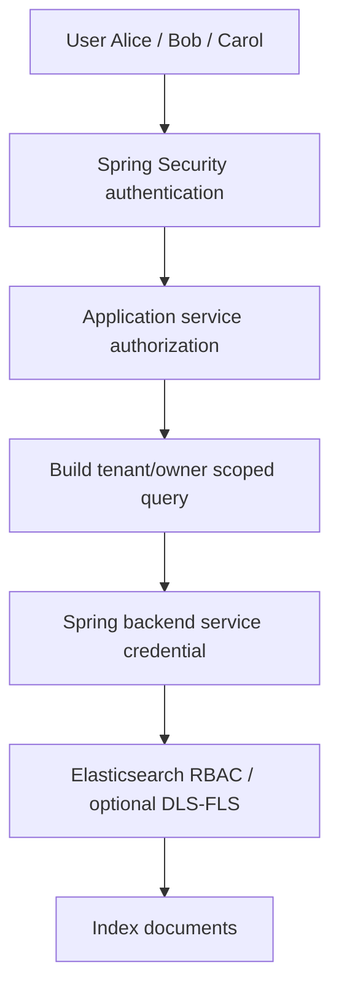
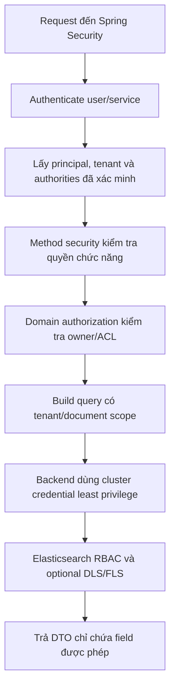

# Phân quyền dữ liệu ở dịch vụ và khả năng bảo vệ phía cluster

Spring Data Elasticsearch giúp ứng dụng tìm kiếm và lưu document, nhưng việc một người dùng có được đọc, sửa hoặc xóa một document cụ thể hay không là trách nhiệm bảo mật cần được thiết kế ở nhiều lớp. Có hai ranh giới quan trọng:

- **Phân quyền ở ứng dụng/dịch vụ**: xác định người dùng hiện tại được thực hiện hành động nào trên dữ liệu nào. Ví dụ, người dùng chỉ được xem sản phẩm thuộc tenant của mình hoặc chỉ được sửa đơn hàng do mình sở hữu.
- **Bảo vệ ở Elasticsearch cluster**: xác thực client kết nối tới cluster, giới hạn index/action mà credential được phép sử dụng, và trong môi trường phù hợp có thể áp dụng document-level security (DLS) hoặc field-level security (FLS).

Hai lớp này bổ sung cho nhau. Trong kiến trúc phổ biến, backend Spring dùng một service credential để kết nối Elasticsearch thay mặt nhiều người dùng cuối. Cluster khi đó nhìn thấy danh tính của backend, không tự biết request HTTP ban đầu thuộc user nào. Vì vậy, service phải thực hiện authorization theo user/tenant trước khi tạo query hoặc ghi document. Cluster role vẫn cần giới hạn quyền của backend để một lỗi trong ứng dụng không tự động trở thành quyền quản trị toàn cluster.

## 1. Phân biệt authentication và authorization

Hai khái niệm thường được dùng cùng nhau nhưng giải quyết câu hỏi khác nhau:

- **Authentication (xác thực)**: xác định caller là ai. Ví dụ, Spring Security xác minh session, JWT hoặc credential và tạo `Authentication`.
- **Authorization (phân quyền)**: xác định caller được phép làm gì trên resource nào. Ví dụ, user có role `PRODUCT_EDITOR` được sửa sản phẩm trong tenant của mình nhưng không được đọc sản phẩm của tenant khác.

Một request có thể đã authenticated nhưng vẫn không được phép truy cập document đang yêu cầu.

Ví dụ: user `alice` đã đăng nhập và có authority `PRODUCT_READ`. Điều đó chưa đủ để kết luận Alice được đọc mọi document trong index `products`. Service còn phải kiểm tra tenant, owner, trạng thái hoặc chính sách chia sẻ của sản phẩm.

Trong Spring Security, authentication thường được lấy từ `Authentication` hoặc principal; authorization có thể được kiểm tra ở URL, method hoặc trong logic domain. Với dữ liệu Elasticsearch, kiểm tra quyền phải gắn với phạm vi document và field mà user được phép nhìn thấy.

## 2. Vì sao cần phân quyền ở tầng service?

Giả sử một hệ thống SaaS dùng chung index `orders` cho nhiều tenant. Document có cấu trúc:

```json
{
  "id": "ORD-1001",
  "tenantId": "tenant-a",
  "ownerId": "user-17",
  "status": "PAID",
  "total": 250000
}
```

Nếu API chỉ tìm theo ID:

```java
return operations.get(orderId, OrderDocument.class);
```

thì bất kỳ người dùng nào biết ID đều có thể đọc document, trừ khi một lớp authorization khác kiểm tra quyền. ID khó đoán không phải cơ chế bảo mật.

Service cần xác định tenant/user từ danh tính đã xác thực, rồi giới hạn query theo chính sách. Tương tự, update và delete phải kiểm tra quyền trên document mục tiêu trước khi thay đổi dữ liệu.

Không để client tự gửi `tenantId` rồi coi đó là tenant đã được xác thực. Client có thể thay giá trị trong request. Tenant và actor phải được suy ra từ principal/token đã được server xác minh hoặc từ một context đáng tin cậy do gateway cấp và bảo vệ.

## 3. Mô hình tenant và owner trong document

Một document thường cần field dùng để xác định phạm vi truy cập:

```java
import org.springframework.data.annotation.Id;
import org.springframework.data.elasticsearch.annotations.Document;
import org.springframework.data.elasticsearch.annotations.Field;
import org.springframework.data.elasticsearch.annotations.FieldType;

@Document(indexName = "orders")
public class OrderDocument {

    @Id
    private String id;

    @Field(type = FieldType.Keyword)
    private String tenantId;

    @Field(type = FieldType.Keyword)
    private String ownerId;

    @Field(type = FieldType.Keyword)
    private String status;

    @Field(type = FieldType.Long)
    private Long total;

    protected OrderDocument() {
    }

    public String getId() {
        return id;
    }

    public String getTenantId() {
        return tenantId;
    }

    public String getOwnerId() {
        return ownerId;
    }
}
```

`tenantId` và `ownerId` thường là `keyword`, vì service cần exact match/filter. Tránh mapping các ID này thành `text` nếu không có nhu cầu full-text search.

Các nguyên tắc mô hình dữ liệu:

- Mỗi document có tenant identifier rõ ràng nếu index dùng chung nhiều tenant.
- Tenant/owner identifier được thiết lập từ danh tính đã xác thực ở phía server.
- Các field phân quyền không được cho phép người dùng thông thường tự sửa.
- Mapping và query dùng đúng kiểu field, thường là `keyword`.
- Nếu quyền truy cập phức tạp, mô hình hóa ACL/visibility rõ ràng và có giới hạn kích thước.

Với dữ liệu có yêu cầu cô lập cao, cân nhắc index riêng hoặc cluster riêng theo tenant thay vì chỉ dựa vào một field filter. Quyết định này phụ thuộc số tenant, quy mô dữ liệu, yêu cầu tuân thủ và chi phí vận hành.

## 4. Bật method security trong Spring Security

Method security giúp đặt quy tắc authorization ngay tại service method, nơi chứa nghiệp vụ đọc/sửa/xóa dữ liệu.

```java
import org.springframework.context.annotation.Configuration;
import org.springframework.security.config.annotation.method.configuration.EnableMethodSecurity;

@Configuration
@EnableMethodSecurity
public class MethodSecurityConfiguration {
}
```

Sau đó có thể dùng `@PreAuthorize`:

```java
import org.springframework.security.access.prepost.PreAuthorize;
import org.springframework.stereotype.Service;

@Service
public class OrderService {

    @PreAuthorize("hasAuthority('ORDER_READ')")
    public OrderResponse getOrder(String orderId) {
        // Load and authorize the document.
        return null;
    }
}
```

Ví dụ trên chỉ kiểm tra authority chung. Với multi-tenant, còn cần ràng buộc document theo tenant/owner. Có thể dùng bean authorization trong SpEL:

```java
@PreAuthorize("@orderAuthorization.canRead(authentication, #orderId)")
public OrderResponse getOrder(String orderId) {
    // ...
}
```

Bean `orderAuthorization` cần kiểm tra đúng chính sách và dữ liệu. Không đặt toàn bộ logic phức tạp vào một biểu thức SpEL khó kiểm thử.

Method security là lớp kiểm soát lời gọi service. Nó không tự thêm tenant filter vào Elasticsearch query. Query vẫn phải giới hạn document để tránh trường hợp code bên trong method trả về dữ liệu vượt phạm vi.

## 5. Lấy tenant và actor từ principal đã xác thực

Ví dụ principal ứng dụng:

```java
public record AppPrincipal(
    String userId,
    String tenantId,
    Set<String> permissions
) {
}
```

Một component có thể lấy principal từ `Authentication`:

```java
import org.springframework.security.core.Authentication;
import org.springframework.stereotype.Component;

@Component
public class CurrentActor {

    public AppPrincipal requirePrincipal(Authentication authentication) {
        Object principal = authentication.getPrincipal();

        if (!(principal instanceof AppPrincipal appPrincipal)) {
            throw new AccessDeniedException("Unsupported authenticated principal");
        }

        return appPrincipal;
    }
}
```

Trong hệ thống dùng JWT, `AppPrincipal` có thể được tạo từ claims đã được xác minh bởi Spring Security Resource Server. Không tự parse JWT chưa xác minh hoặc tin một `tenantId` đến từ header tùy ý.

Định danh tenant cần được chuẩn hóa và kiểm tra. Nếu user có thể thuộc nhiều tenant, service phải xác định tenant context đang hoạt động và kiểm tra user có quyền chọn tenant đó. Không coi việc client gửi `X-Tenant-Id` là bằng chứng user thuộc tenant.

## 6. Đưa tenant filter vào mọi query đọc

Một nguyên tắc quan trọng là **phạm vi quyền phải được đưa vào query gửi tới Elasticsearch**. Không tải tất cả kết quả rồi lọc tenant ở Java sau đó.

Ví dụ dùng `NativeQuery` và Elasticsearch Java API Client builder:

```java
import co.elastic.clients.elasticsearch._types.FieldValue;
import org.springframework.data.elasticsearch.client.elc.NativeQuery;
import org.springframework.data.elasticsearch.core.SearchHits;
import org.springframework.data.elasticsearch.core.query.Query;

public SearchHits<OrderDocument> findOrdersForTenant(
        String tenantId,
        String status) {

    Query query = NativeQuery.builder()
        .withQuery(q -> q
            .bool(b -> b
                .filter(f -> f
                    .term(t -> t
                        .field("tenantId")
                        .value(FieldValue.of(tenantId))
                    )
                )
                .filter(f -> f
                    .term(t -> t
                        .field("status")
                        .value(FieldValue.of(status))
                    )
                )
            )
        )
        .build();

    return operations.search(
        query,
        OrderDocument.class,
        IndexCoordinates.of("orders")
    );
}
```

Trong service thực tế, `tenantId` phải được lấy từ principal đã xác thực, không nhận trực tiếp từ request query parameter. Điều kiện tenant đặt trong `bool.filter` để Elasticsearch chỉ xét document trong phạm vi tenant đó.

### 6.1. Kết hợp điều kiện tìm kiếm của người dùng

Nếu API cho phép lọc theo trạng thái, ngày tạo hoặc từ khóa, hãy kết hợp điều kiện người dùng với tenant constraint bằng `bool.filter`/`bool.must` theo semantics phù hợp. Tenant constraint phải luôn được thêm vào query cuối cùng.

Không cho client gửi raw Query DSL, field name tùy ý hoặc một query có thể thay thế toàn bộ điều kiện bảo mật. Hãy chuyển request DTO thành một tập filter được whitelist.

### 6.2. Đừng dùng post-filter làm ranh giới bảo mật

`post_filter` được áp dụng sau aggregation và có semantics khác query filter. Tương tự, lọc danh sách hit trong Java sau khi search không phải cách tốt để cô lập tenant:

- Elasticsearch đã trả dữ liệu ngoài phạm vi tới ứng dụng.
- `totalHits`, pagination và aggregation có thể phản ánh dữ liệu rộng hơn.
- Dễ bỏ sót một code path hoặc endpoint khác.
- Dữ liệu nhạy cảm đã đi qua network và heap của backend.

Đưa điều kiện truy cập vào query trước khi gửi request. `@PostFilter` hoặc lọc trong controller có thể là tiện ích bổ sung cho collection nhỏ, nhưng không thay thế query scoping và authorization ở tầng service.

## 7. Đọc document theo ID vẫn phải kiểm tra tenant

GET theo ID thường được dùng cho chi tiết một document. Không nên giả định ID là bí mật hoặc không thể đoán.

Một cách an toàn là tìm theo cả ID và tenant:

```java
public OrderDocument findOrderForTenant(String orderId, String tenantId) {
    Query query = NativeQuery.builder()
        .withQuery(q -> q
            .bool(b -> b
                .filter(f -> f.term(t -> t
                    .field("_id")
                    .value(FieldValue.of(orderId))
                ))
                .filter(f -> f.term(t -> t
                    .field("tenantId")
                    .value(FieldValue.of(tenantId))
                ))
            )
        )
        .withMaxResults(1)
        .build();

    return operations.searchOne(
        query,
        OrderDocument.class,
        IndexCoordinates.of("orders")
    );
}
```

Đây là một cách triển khai query scoped; có thể dùng Repository method như `findByIdAndTenantId(...)` nếu API và mapping của dự án phù hợp. Nếu dùng `operations.get(id, ...)` vốn chỉ lấy theo ID, hãy kiểm tra tenant sau khi đọc và tuyệt đối không trả document trước khi kiểm tra. Với yêu cầu cô lập nghiêm ngặt, query kết hợp ID và tenant tránh đưa document ngoài phạm vi vào logic nghiệp vụ.

Khi không tìm thấy document trong tenant, API thường trả 404 để không tiết lộ document có tồn tại ở tenant khác hay không. Một số hệ thống chọn 403; cần thống nhất theo chính sách sản phẩm và tránh tạo side channel tiết lộ sự tồn tại của dữ liệu.

## 8. Phân quyền owner và chia sẻ document

Không phải mọi hệ thống chỉ có tenant boundary. Một số document chỉ được owner hoặc nhóm được chia sẻ truy cập.

Ví dụ query phải giới hạn tenant và owner:

```json
GET documents/_search
{
  "query": {
    "bool": {
      "filter": [
        { "term": { "tenantId": "tenant-a" } },
        { "term": { "ownerId": "user-17" } }
      ]
    }
  }
}
```

Nếu tài liệu được chia sẻ cho nhiều user, có thể có field `readerIds` dạng `keyword` hoặc mô hình ACL riêng. Query cần kết hợp owner, tenant và quyền chia sẻ theo logic rõ ràng. ACL array có thể tăng kích thước document và làm query phức tạp; hãy giới hạn số entry hoặc chuyển quan hệ chia sẻ thành một read model phù hợp nếu quy mô lớn.

Không dùng một điều kiện `ownerId` nếu nghiệp vụ cho phép quản trị viên tenant hoặc nhóm được chia sẻ đọc document. Authorization service nên là nơi tập trung chính sách này và tạo query constraint tương ứng.

## 9. Phân quyền khi ghi, cập nhật và xóa

Authorization không chỉ áp dụng cho search. Cần kiểm soát mọi đường ghi:

### 9.1. Tạo document

Tenant và owner được gán từ principal:

```java
public OrderDocument createOrder(
        CreateOrderRequest request,
        AppPrincipal actor) {

    OrderDocument order = new OrderDocument();
    order.setTenantId(actor.tenantId());
    order.setOwnerId(actor.userId());
    order.setStatus("DRAFT");
    order.setTotal(request.total());

    return operations.save(order);
}
```

`CreateOrderRequest` không nên có `tenantId`, `ownerId`, `createdBy` hoặc các field bảo mật mà client có thể tự gán. Nếu DTO có các field này vì lý do tương thích, service vẫn phải bỏ qua hoặc xác thực chúng theo chính sách.

### 9.2. Cập nhật document

Quy trình cập nhật an toàn:

1. Xác thực authority chung, ví dụ `ORDER_EDIT`.
2. Tìm document theo ID trong tenant của actor.
3. Kiểm tra owner/ACL hoặc chính sách quản trị.
4. Chỉ copy các field nghiệp vụ được phép sửa.
5. Giữ nguyên `tenantId`, `ownerId` và metadata bảo mật.
6. Lưu document với version/OCC nếu có cập nhật đồng thời.

Không deserialize request thành toàn bộ entity rồi gọi `save` một cách mù quáng. Cách đó có thể cho phép client thay tenant, owner, trạng thái nội bộ hoặc field audit.

### 9.3. Xóa document

Xóa phải dùng cùng một authorization rule như đọc/cập nhật. Không xóa chỉ theo ID nếu caller có thể đoán ID của document khác tenant.

Với bulk delete hoặc update-by-query, query phải chứa tenant constraint và chỉ service nội bộ được quyền gọi thao tác hàng loạt. Một lỗi thiếu filter trong migration có thể tác động tới toàn bộ index.

## 10. Method security và domain authorization nên phối hợp

Một mẫu thiết kế dễ kiểm thử là tách hai phần:

- Method security kiểm tra quyền chức năng chung: user có `ORDER_READ`, `ORDER_EDIT` hoặc `ORDER_DELETE` hay không.
- Domain authorization kiểm tra quyền trên document cụ thể: document thuộc tenant nào, owner nào, có được chia sẻ hay không.

Ví dụ:

```java
@PreAuthorize("hasAuthority('ORDER_READ')")
public OrderResponse getOrder(String orderId) {
    AppPrincipal actor = currentActor.requireCurrentPrincipal();

    OrderDocument order = findByIdAndTenant(orderId, actor.tenantId());
    if (order == null) {
        throw new OrderNotFoundException(orderId);
    }

    orderAuthorization.requireCanRead(actor, order);
    return OrderResponse.from(order);
}
```

Ví dụ minh họa cấu trúc service. `requireCurrentPrincipal`, `findByIdAndTenant` và `requireCanRead` là các abstraction của ứng dụng cần được triển khai theo domain. Không dựa vào annotation method security đơn lẻ để thay thế kiểm tra ownership.

## 11. Bảo vệ ở Elasticsearch cluster

Tầng cluster bảo vệ Elasticsearch khỏi các client không được phép và giới hạn những hành động mà một credential có thể thực hiện.

Các lớp kiểm soát thường gồm:

- Authentication cho client: username/password, API key hoặc cơ chế identity được cluster hỗ trợ.
- TLS cho kết nối client-node và node-node theo cấu hình cluster.
- Role-based access control (RBAC): quyền theo cluster, index, action và resource.
- Document-level security (DLS): giới hạn document mà một role được đọc.
- Field-level security (FLS): giới hạn field mà một role được đọc.
- Audit logging và network controls để giám sát, giới hạn nguồn truy cập.

Tên API, khả năng DLS/FLS và yêu cầu license khác nhau theo Elasticsearch distribution/version. Hãy xác nhận khả năng của cluster đang triển khai trước khi phụ thuộc vào các tính năng này.

## 12. Cấp quyền index tối thiểu cho backend

Một backend chỉ cần đọc và ghi index `orders` không nên có quyền quản trị toàn cluster.

Nguyên tắc least privilege:

- Chỉ cấp quyền trên index/alias/data stream cần thiết.
- Tách credential read-only khỏi credential có quyền ghi nếu workload phù hợp.
- Không cấp `manage`, `all` hoặc cluster administration cho service thông thường.
- Chỉ cấp quyền tạo index/template cho component provisioning riêng.
- Không dùng credential của người quản trị trong ứng dụng production.
- Thu hồi và rotate API key/secret định kỳ hoặc khi có sự cố.

Ví dụ role khái niệm cho backend đọc/ghi một index:

```json
PUT /_security/role/orders_app_role
{
  "indices": [
    {
      "names": ["orders-*"],
      "privileges": ["read", "write"]
    }
  ]
}
```

Đây là ví dụ role đơn giản; privilege chính xác cần chọn theo các API mà backend thực sự gọi. Một ứng dụng chỉ index/update có thể cần tập quyền khác ứng dụng chạy search, bulk delete, index creation hoặc mapping management.

Nếu ứng dụng chỉ truy cập alias `orders-read` và `orders-write`, hãy cấu hình quyền phù hợp với alias và index backing tương ứng. Kiểm tra quyền đối với alias, data stream và index rollover theo phiên bản cluster.

## 13. DLS và FLS ở phía cluster

Trong môi trường Elasticsearch hỗ trợ các tính năng này, DLS/FLS có thể bổ sung một lớp bảo vệ:

- DLS giới hạn document mà role được đọc bằng một query filter gắn với role.
- FLS giới hạn các field mà role được đọc.

Ví dụ role minh họa chỉ đọc document thuộc `tenant-a` và chỉ thấy một số field:

```json
PUT /_security/role/tenant_a_orders_reader
{
  "indices": [
    {
      "names": ["orders"],
      "privileges": ["read"],
      "query": {
        "term": {
          "tenantId": "tenant-a"
        }
      },
      "field_security": {
        "grant": [
          "id",
          "tenantId",
          "status",
          "createdAt"
        ]
      }
    }
  ]
}
```

Ví dụ sử dụng tenant cố định để minh họa role. Nếu mỗi end user có tenant khác nhau, không tạo role tĩnh một cách tùy tiện cho từng request; hãy thiết kế identity/API key/role strategy phù hợp với khả năng cluster và quy mô tenant.

### 13.1. DLS/FLS không thay thế authorization ở service

DLS/FLS có thể là defense-in-depth, nhưng không nên mặc định rằng chúng thay thế mọi kiểm tra ứng dụng:

- DLS/FLS chủ yếu kiểm soát dữ liệu đọc; không coi DLS là cơ chế đầy đủ để giới hạn mọi thao tác ghi/update/delete theo tenant.
- Một role có nhiều quyền kết hợp có thể tạo kết quả truy cập rộng hơn dự kiến; cần kiểm tra tổng hợp tất cả role của principal.
- Một số API hoặc thao tác quản trị có semantics khác search thông thường; cần kiểm tra tài liệu của phiên bản.
- FLS không thay thế việc thiết kế DTO và tránh đưa field nhạy cảm vào response.
- DLS/FLS có thể ảnh hưởng tới aggregation, terms enumeration hoặc các tính năng khác theo semantics và giới hạn của phiên bản.

Hãy dùng service authorization để bảo vệ hành động nghiệp vụ và query scope; dùng cluster security để giới hạn quyền của credential và bổ sung rào chắn ở tầng lưu trữ.

## 14. Một service credential dùng chung cho nhiều user

Đây là kiến trúc phổ biến:



Cluster chỉ xác thực backend credential. Nếu backend dùng cùng một API key cho tất cả người dùng, cluster không thể tự phân biệt Alice và Bob chỉ từ request đó. Do vậy, service phải đưa tenant/owner constraints vào mọi query và kiểm tra quyền trên mọi thao tác ghi.

Nếu muốn cluster nhận dạng từng end user, cần thiết kế cơ chế credential delegation/identity propagation được Elasticsearch hỗ trợ và được kiểm soát. Không chuyển username do client gửi thành credential hoặc API key tùy ý. Dùng API key riêng theo tenant/user có thể tăng mức cô lập nhưng làm tăng số lượng key, vòng đời, rotate và quản lý quyền; cần cân nhắc ở quy mô hệ thống.

## 15. Kết nối Spring Data với credential cluster

Spring Data Elasticsearch sử dụng client/transport được cấu hình trong application context. Credential nên được cung cấp qua secret management hoặc biến môi trường được bảo vệ, không hard-code trong source code.

Ví dụ cấu hình khái niệm với Elasticsearch Java API Client và TLS:

```java
@Configuration
public class ElasticsearchClientConfiguration {

    @Bean
    ElasticsearchClient elasticsearchClient(
            @Value("${app.elasticsearch.url}") String endpoint,
            @Value("${app.elasticsearch.api-key}") String apiKey,
            RestClientTransport transport) {

        // Build/configure the low-level REST client with TLS and the API-key
        // credentials, then expose the Java API Client through Spring.
        // Exact transport wiring depends on the Spring Data/Elasticsearch
        // client version used by the application.
        return createConfiguredClient(endpoint, apiKey, transport);
    }
}
```

Đây là khung cấu hình, không phải implementation có thể copy nguyên trạng: việc tạo `RestClient`, TLS context, `RestClientTransport` và API-key header phụ thuộc phiên bản client/transport. Trong ứng dụng Spring Boot, ưu tiên cấu hình client theo cơ chế Spring Data Elasticsearch cung cấp và chỉ expose bean đã cấu hình.

Các nguyên tắc cấu hình:

- Dùng HTTPS và xác minh certificate của cluster.
- Lưu API key/password trong secret manager hoặc secret của môi trường triển khai.
- Không ghi credential vào log hoặc exception message trả cho client.
- Tách credential development, staging và production.
- Rotate key và có quy trình revoke khi lộ secret.
- Không cấp quyền quản trị cluster cho credential của API backend.

Không tắt certificate verification để “sửa nhanh” lỗi TLS trong production. Hãy cài CA certificate đúng và cấu hình trust chain.

## 16. FLS khác source filtering và DTO như thế nào?

Ba cơ chế thường bị nhầm:

| Cơ chế | Thực hiện ở đâu? | Mục đích | Có phải ranh giới bảo mật độc lập? |
|---|---|---|---|
| Field-level security | Elasticsearch cluster role | Hạn chế field role được đọc | Có thể là lớp bảo vệ cluster khi được hỗ trợ và cấu hình đúng |
| `_source` filtering | Search request | Chỉ trả một số field để giảm payload | Không đủ làm authorization nếu caller có thể gửi request khác |
| DTO/projection | Tầng ứng dụng | Chỉ expose field phù hợp với API | Cần kết hợp authorization; không thay thế cluster controls |

Ví dụ `_source` filtering:

```java
Query query = NativeQuery.builder()
    .withSourceFilter(new FetchSourceFilter(
        new String[] {"id", "name", "status"},
        new String[] {"internalNotes", "costPrice"}
    ))
    .build();
```

Đây là tối ưu response và giảm dữ liệu backend nhận. Nếu credential có quyền đọc index và có thể gửi query khác, source filtering trong một request không ngăn caller lấy field khác. Dùng FLS hoặc một service boundary được kiểm soát khi field thực sự nhạy cảm.

## 17. Search, aggregation và pagination cũng phải được phân quyền

Tenant filter phải áp dụng trước khi tính kết quả search. Nếu chỉ lọc hit sau khi nhận response:

- `totalHits` có thể tiết lộ số document của tenant khác.
- Aggregation có thể tiết lộ thống kê dữ liệu ngoài phạm vi.
- Pagination có thể bỏ sót hoặc làm lộ số lượng record.
- Highlight hoặc inner hits có thể trả nội dung không được phép.

Đưa tenant/owner constraint vào query chính trước khi thêm aggregation, sort, highlight hoặc pagination. Với aggregation lồng trong bucket, query scope ở root sẽ giới hạn tập document cha được đưa vào tính toán.

Không cho client gửi aggregation DSL tùy ý nếu API không có nhu cầu đó. Whitelist field và bucket size, đặc biệt với field nhạy cảm hoặc cardinality cao.

## 18. Index riêng hay tenant filter trong index dùng chung?

Có hai mô hình phổ biến:

| Mô hình | Ưu điểm | Đánh đổi |
|---|---|---|
| Shared index + `tenantId` | Ít index, mapping thống nhất, dễ vận hành nhiều tenant nhỏ | Mọi query phải luôn scope tenant; rủi ro cao nếu thiếu filter; cluster credential chung không tự phân biệt tenant |
| Index riêng theo tenant | Có thể cấp quyền index riêng, mapping/lifecycle độc lập | Số lượng index/shard tăng; provisioning, rollover, migration và query đa tenant phức tạp |
| Cluster riêng theo tenant/nhóm tenant | Cô lập vận hành và quyền mạnh hơn | Chi phí hạ tầng, giám sát và triển khai cao |

Chọn mô hình theo mức độ cô lập cần thiết. Một tenant lớn hoặc có yêu cầu pháp lý đặc biệt có thể cần index/cluster riêng; nhiều tenant nhỏ có thể dùng shared index với service-level scoping và cluster least privilege.

Dù chọn mô hình nào, vẫn cần xác thực caller và kiểm tra quyền. Index riêng không thay thế authorization trong API, vì user vẫn có thể yêu cầu index/tenant khác nếu service cho phép truyền tên index tùy ý.

## 19. Các lỗi bảo mật thường gặp

| Hiện tượng | Nguyên nhân | Cách xử lý |
|---|---|---|
| User đọc được document tenant khác | Query chỉ lọc theo ID hoặc quên tenant constraint | Lấy tenant từ principal và đưa vào query chính. |
| User sửa tenant/owner của document | Map request body trực tiếp vào entity | Server tự gán và bảo vệ field phân quyền. |
| Method có `@PreAuthorize` nhưng query vẫn trả dữ liệu rộng | Chỉ kiểm tra authority chung, thiếu document scope | Kết hợp method security với query/ownership authorization. |
| Search hits đã lọc nhưng totalHits/aggregation lộ dữ liệu | Lọc ở Java hoặc `post_filter` sau khi query | Đặt access filter trong query chính. |
| API backend có quyền `all` trên cluster | Dùng credential quản trị hoặc role quá rộng | Tạo role/index privilege tối thiểu. |
| DLS được kỳ vọng chặn update/delete ngoài tenant | Nhầm DLS là write authorization toàn diện | Kiểm tra quyền ghi ở service; dùng cluster privileges phù hợp. |
| FLS được thay bằng `_source` filtering | Coi projection là bảo vệ field | Dùng FLS khi cần cluster enforcement và giữ DTO filtering. |
| Credential lộ trong Git/log | Hard-code hoặc log header | Secret manager, redact log và rotate key. |
| TLS bị tắt để kết nối được | Bỏ certificate verification | Cấu hình CA/truststore và HTTPS đúng cách. |
| User chọn index tùy ý | Nhận index name từ request | Whitelist index/alias ở server. |
| Bulk/update-by-query tác động toàn index | Query thiếu tenant hoặc quyền nội bộ quá rộng | Chỉ service đặc quyền chạy batch; preview/count và giới hạn phạm vi. |

## 20. Kiểm thử authorization và cluster boundary

Test bảo mật phải xác minh cả trường hợp được phép và bị từ chối. Một test chỉ kiểm tra user hợp lệ đọc được dữ liệu của mình chưa đủ.

Các trường hợp quan trọng:

1. User tenant A đọc document tenant A thành công.
2. User tenant A không đọc được document tenant B dù biết ID.
3. User không có `ORDER_EDIT` không thể cập nhật.
4. User tenant A không thể sửa `tenantId` hoặc `ownerId` qua request body.
5. Owner và user được chia sẻ có quyền theo đúng ACL.
6. Search, count, aggregation, pagination và export đều áp dụng cùng access scope.
7. Update/delete/bulk operations không bỏ qua tenant constraint.
8. Cluster credential của backend không thể quản trị index ngoài phạm vi.
9. DLS/FLS role được kiểm thử bằng credential riêng nếu cluster hỗ trợ.
10. TLS, API key expiration, rotation và revoke được kiểm tra trong môi trường triển khai.

Ví dụ test service với hai tenant cần xác nhận kết quả không chứa document ngoài phạm vi. Nên dùng Elasticsearch integration test cho query thực tế, vì mock repository không thể chứng minh DSL đã thêm tenant filter đúng.

## 21. Quy trình thiết kế phân quyền dữ liệu



Các bước áp dụng:

1. Xác định actor, tenant, owner và loại resource cần bảo vệ.
2. Chọn mô hình shared index, index riêng hoặc cluster riêng.
3. Lưu tenant/owner/access metadata bằng field mapping phù hợp.
4. Xác thực request bằng Spring Security và lấy principal từ nguồn đã xác minh.
5. Dùng method security cho quyền chức năng chung.
6. Dùng domain authorization cho quyền trên document cụ thể.
7. Đưa tenant/owner constraints vào query chính của mọi search/get/list/export.
8. Gán tenant/owner ở server khi create; không nhận quyền sở hữu từ client.
9. Kiểm tra quyền trước update/delete và các thao tác bulk.
10. Cấp cluster role/API key tối thiểu, bật TLS và quản lý secret an toàn.
11. Bổ sung DLS/FLS khi cluster/version/license và mô hình identity hỗ trợ.
12. Kiểm thử cross-tenant access, aggregation leakage, write paths và cluster credentials.
13. Ghi audit log cho các hành động nhạy cảm mà không log secret hoặc toàn bộ dữ liệu riêng tư.

## 22. Kết luận

Phân quyền dữ liệu trong Spring Data Elasticsearch cần kết hợp kiểm soát ở tầng dịch vụ và bảo vệ ở phía cluster. Spring Security xác thực caller; method security kiểm tra quyền chức năng; domain authorization xác định caller có quyền trên document nào; query phải chứa tenant/owner filter trước khi gửi tới Elasticsearch. Khi tạo document, tenant và owner phải được gán từ principal đáng tin cậy. Update, delete, bulk và aggregation cũng phải tuân theo cùng phạm vi truy cập.

Elasticsearch cluster cần RBAC, credential riêng, TLS và least privilege. DLS/FLS có thể bổ sung giới hạn document/field khi phiên bản và license hỗ trợ, nhưng không nên xem chúng là thay thế toàn bộ authorization của ứng dụng hoặc cơ chế bảo vệ mọi thao tác ghi. Đặc biệt, nếu backend dùng một service credential chung cho nhiều user, cluster chỉ nhận dạng backend; service phải thực thi quyền theo danh tính end user.

Đừng dựa vào ID khó đoán, lọc kết quả sau search, `_source` filtering hoặc DTO projection như ranh giới bảo mật duy nhất. Kết hợp principal đã xác minh, query scoping, kiểm tra ownership, cluster role tối thiểu, quản lý credential/TLS và integration test cross-tenant sẽ tạo ra nhiều lớp bảo vệ nhất quán cho dữ liệu Elasticsearch.
