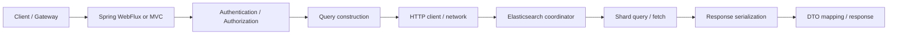
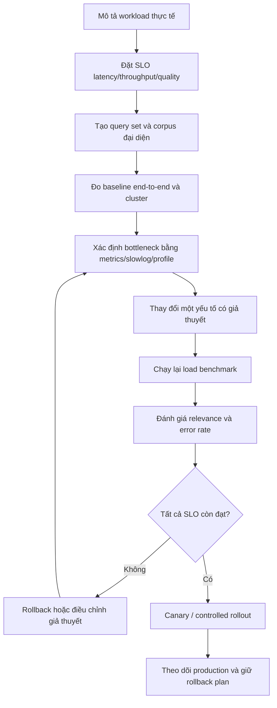

# Xác định mục tiêu độ trễ, thông lượng và chất lượng tìm kiếm

Tối ưu hiệu năng cho Spring Data Elasticsearch không chỉ là làm một query chạy nhanh hơn. Một hệ thống tìm kiếm cần cân bằng ít nhất ba mục tiêu: **độ trễ (latency)**, **thông lượng (throughput)** và **chất lượng kết quả (search quality)**. Nếu chỉ tối ưu một mục tiêu, hệ thống có thể đạt kết quả xấu ở hai mục tiêu còn lại: tăng số request/giây bằng cách trả ít kết quả hơn có thể làm giảm chất lượng; force refresh sau mọi lần ghi có thể cải thiện độ mới nhưng giảm throughput indexing; tăng concurrency có thể nâng throughput đến một điểm rồi làm tail latency và rejection tăng mạnh.

Vì vậy, trước khi thay đổi mapping, query, shard hoặc cấu hình JVM, cần xác định workload thực tế và đặt mục tiêu đo được. Sau đó xây benchmark có dữ liệu, truy vấn và tải gần production, theo dõi kết quả theo percentile, kiểm tra relevance, rồi thay đổi từng yếu tố có chủ đích.

## 1. Ba mục tiêu cần tối ưu cùng nhau

| Mục tiêu | Câu hỏi cần trả lời | Chỉ số thường dùng |
|---|---|---|
| Độ trễ (latency) | Một thao tác mất bao lâu từ góc nhìn caller? | p50, p95, p99, max, timeout rate |
| Thông lượng (throughput) | Hệ thống xử lý được bao nhiêu công việc trong một đơn vị thời gian? | Search QPS, indexing documents/s, bulk bytes/s, event lag |
| Chất lượng tìm kiếm (quality) | Kết quả trả về có đúng và hữu ích với người dùng không? | Precision@k, Recall@k, MRR, NDCG@k, zero-result rate, task success |

Ba mục tiêu phải được đánh giá trong cùng một workload. Một cấu hình có p95 thấp khi chỉ có 1 request đồng thời chưa chắc đáp ứng p95 khi có 200 request/giây và bulk indexing đang chạy. Một query trả nhanh 10 kết quả cũng chưa chắc tốt nếu kết quả liên quan bị đẩy xuống cuối danh sách.

## 2. Xác định workload trước khi đặt SLO

Không có một cấu hình tối ưu chung cho mọi ứng dụng. Hãy mô tả các nhóm công việc mà cluster thực sự phải phục vụ.

Ví dụ với một catalog thương mại điện tử:

| Nhóm workload | Ví dụ | Đặc điểm cần đo |
|---|---|---|
| Search tương tác | Tìm sản phẩm theo từ khóa, filter và sort | p95/p99, QPS, relevance, zero-result rate |
| Autocomplete | Gợi ý khi người dùng nhập từng ký tự | Latency thấp, QPS cao, payload nhỏ |
| Chi tiết theo ID | Đọc một document sau khi click | GET latency, cache và quyền truy cập |
| Faceted search | Terms/range aggregation theo category/price | Bucket count, aggregation latency, memory |
| Indexing đồng bộ | Ghi sản phẩm từ database hoặc event | Documents/s, queue lag, refresh visibility |
| Bulk import | Nạp catalog lớn | Bulk throughput, batch failure, merge pressure |
| Báo cáo | Aggregation trên tập dữ liệu rộng | Runtime, resource usage, concurrency thấp hơn |

Không gộp mọi request vào một con số trung bình. Autocomplete và báo cáo có đặc điểm khác nhau; một truy vấn aggregation 5 giây có thể được chấp nhận trong báo cáo nhưng không phù hợp với hộp tìm kiếm tương tác.

### 2.1. Mô tả workload bằng dữ liệu cụ thể

Với mỗi nhóm, ghi lại:

- Số request trung bình và peak trong một giây/phút.
- Số request đồng thời và cách burst xảy ra.
- Tỷ lệ query đơn giản, full-text, filter, sort, aggregation và nested query.
- Số kết quả/page size trung bình và tối đa.
- Kích thước document và số lượng field thường được trả về.
- Tỷ lệ đọc/ghi, bulk size và thời gian refresh yêu cầu.
- Phân bố tenant, category, từ khóa phổ biến và cardinality của field.
- Mức độ mới dữ liệu mà người dùng mong đợi.

Ví dụ, “10.000 request/ngày” chưa đủ để thiết kế capacity. 10.000 request dàn đều trong ngày khác hoàn toàn với 5.000 request dồn vào một phút khi bắt đầu chiến dịch.

## 3. Đặt SLO cho latency

Latency là thời gian một request cần để hoàn thành. Nên xác định rõ điểm bắt đầu và điểm kết thúc đo lường.

Một request search có thể đi qua:

1. Client gửi request tới backend.
2. Spring Security và controller xử lý request.
3. Service xác thực quyền, xây `NativeQuery` và gọi Spring Data.
4. HTTP client gửi request tới Elasticsearch.
5. Coordinator và shard xử lý query.
6. Response được deserialize và map thành `SearchHits`.
7. Backend chuyển kết quả thành DTO và trả response.

Thời gian Elasticsearch xử lý query không bằng tổng latency mà người dùng trải nghiệm. Nếu chỉ nhìn `took` của Elasticsearch, bạn có thể bỏ qua thời gian queue ở backend, network, connection pool, serialization hoặc xử lý DTO.

### 3.1. Dùng percentile thay vì chỉ dùng average

Các percentile phổ biến:

- **p50**: một nửa request nhanh hơn hoặc bằng giá trị này; thể hiện trải nghiệm điển hình.
- **p95**: 95% request hoàn thành trong hoặc dưới giá trị này; hữu ích cho SLO người dùng.
- **p99**: 99% request hoàn thành trong hoặc dưới giá trị này; cho thấy tail latency.
- **Max**: request chậm nhất trong cửa sổ đo; nhạy với outlier và hữu ích khi điều tra sự cố.

Ví dụ một benchmark có kết quả:

| Chỉ số | Latency |
|---|---:|
| p50 | 35 ms |
| p95 | 120 ms |
| p99 | 420 ms |
| Max | 1.8 s |

Average có thể là 55 ms nhưng p99 vẫn là 420 ms. Nếu chỉ báo cáo average, phần request chậm mà người dùng cảm nhận sẽ bị che khuất.

### 3.2. Viết SLO cụ thể

Một SLO tốt xác định workload, percentile, cửa sổ thời gian và điều kiện tải. Ví dụ minh họa:

- Search tương tác: p95 dưới 200 ms tại 150 QPS với 80 request đồng thời.
- Autocomplete: p95 dưới 80 ms tại 300 QPS.
- Bulk indexing: duy trì ít nhất 5.000 document/giây trong khi search p95 không vượt 250 ms.
- Tỷ lệ timeout và lỗi server dưới 0,1% trong cửa sổ 30 phút.

Đây chỉ là con số mẫu, không phải mặc định cho Elasticsearch. Mục tiêu thực tế cần dựa vào latency budget của sản phẩm, kích thước dữ liệu, phần cứng, network và trải nghiệm người dùng.

### 3.3. Tail latency và coordinated omission

Khi hệ thống chậm, một load generator kiểu đóng (closed-loop) thường chờ request hiện tại hoàn tất rồi mới gửi request tiếp theo. Nếu server bị treo 2 giây, generator cũng ngừng tạo tải trong 2 giây và có thể đánh giá thấp mức độ chậm thực tế.

Với workload có tốc độ đến cố định, cần cân nhắc mô hình open-loop hoặc công cụ benchmark xử lý được coordinated omission. Nếu không, p99 trong benchmark có thể đẹp hơn trải nghiệm thực tế khi traffic tiếp tục đến trong lúc hệ thống quá tải.

## 4. Đặt mục tiêu throughput

Throughput là lượng công việc xử lý được trong một đơn vị thời gian. Không dùng một đơn vị duy nhất cho cả search và indexing.

| Hoạt động | Đơn vị đo gợi ý |
|---|---|
| Search | Queries per second (QPS) |
| Indexing | Documents per second |
| Bulk indexing | Documents/s và MB/s |
| Event synchronization | Events/s và consumer lag |
| Update/delete | Operations/s và tỷ lệ conflict/failure |
| Aggregation | Queries/s theo loại aggregation và bucket count |

Throughput luôn gắn với một điều kiện chất lượng và latency. “Cluster xử lý 1.000 QPS” không có nhiều ý nghĩa nếu p99 là 8 giây, 20% request timeout hoặc kết quả search không đáp ứng relevance.

### 4.1. Throughput khi có tải hỗn hợp

Trong production, indexing và search thường chạy đồng thời. Bulk import có thể làm tăng segment merge, disk I/O và indexing pressure; search có thể bị ảnh hưởng dù query không thay đổi.

Benchmark nên có ít nhất ba tình huống:

1. Search-only để biết năng lực tìm kiếm nền.
2. Indexing-only để biết năng lực nạp dữ liệu.
3. Mixed workload để đo khả năng phục vụ traffic thực khi đọc và ghi cùng lúc.

Nếu SLO yêu cầu search ổn định trong lúc đồng bộ dữ liệu, chỉ benchmark search-only sẽ không phản ánh production.

## 5. Chất lượng tìm kiếm là một mục tiêu đo được

Một query nhanh nhưng trả kết quả không liên quan là một query thất bại về sản phẩm. Chất lượng tìm kiếm cần được đo bằng tập truy vấn đại diện và đánh giá kết quả có liên quan hay không.

Ví dụ người dùng tìm “wireless noise cancelling headphones”. Kết quả tốt cần ưu tiên tai nghe không dây có chống ồn; một sản phẩm chỉ có chữ “wireless” trong phần mô tả có thể ít liên quan hơn.

Các câu hỏi cần xác định:

- Kết quả nào được coi là relevant?
- Kết quả quan trọng nhất phải xuất hiện trong top 3, top 5 hay top 10?
- Có cần ưu tiên sản phẩm còn hàng, đúng tenant hoặc đúng khu vực không?
- Có cần cân bằng độ liên quan với độ mới, giá hoặc mức phổ biến không?
- Người dùng thường không tìm thấy kết quả vì thiếu dữ liệu, analyzer sai hay query quá chặt?

### 5.1. Precision@k

Precision@k đo tỷ lệ kết quả relevant trong top k:

\[
Precision@k = \frac{\text{số kết quả relevant trong top k}}{k}
\]

Nếu top 5 có 4 kết quả relevant, Precision@5 = 0,8. Metric này hữu ích khi muốn các kết quả được hiển thị đầu tiên có chất lượng cao.

### 5.2. Recall@k

Recall@k đo tỷ lệ kết quả relevant được tìm thấy trong top k so với toàn bộ kết quả relevant đã biết:

\[
Recall@k = \frac{\text{số kết quả relevant trong top k}}{\text{tổng số kết quả relevant đã biết}}
\]

Nếu có 10 tài liệu relevant và top 10 tìm thấy 7, Recall@10 = 0,7. Recall quan trọng khi người dùng cần tìm được nhiều kết quả phù hợp, ví dụ tra cứu tài liệu hoặc catalog lớn.

### 5.3. MRR (Mean Reciprocal Rank)

MRR đo vị trí của kết quả relevant đầu tiên. Với một query, reciprocal rank là `1 / rank` của kết quả relevant đầu tiên; MRR là trung bình trên tập query.

Nếu kết quả relevant đầu tiên ở vị trí 1, điểm là 1. Nếu ở vị trí 4, điểm là 0,25. MRR hữu ích với use case mà người dùng thường chỉ cần kết quả tốt đầu tiên.

### 5.4. NDCG@k

NDCG@k (Normalized Discounted Cumulative Gain) hỗ trợ relevance theo nhiều mức, ví dụ 0 = không liên quan, 1 = hơi liên quan, 2 = liên quan, 3 = rất liên quan. Kết quả relevant ở vị trí đầu được đánh giá cao hơn cùng kết quả ở vị trí thấp.

NDCG phù hợp khi relevance không chỉ là đúng/sai và thứ tự top result có ý nghĩa. Hãy xây dựng relevance judgment nhất quán và xác định rõ cách gán điểm.

### 5.5. Metric sản phẩm bổ sung

Không phải mọi chất lượng đều được phản ánh bởi một metric offline. Có thể theo dõi thêm:

- Zero-result rate: tỷ lệ query không có kết quả.
- Query reformulation rate: người dùng phải sửa từ khóa bao nhiêu lần.
- Click-through rate theo vị trí và loại query.
- Search-to-conversion hoặc task completion rate.
- Abandonment rate: người dùng rời trang sau search.
- Tỷ lệ kết quả sai tenant, sai trạng thái hoặc không còn hiệu lực; đây là yêu cầu correctness/security, không phải chỉ số relevance có thể đánh đổi.

Click-through rate có bias theo vị trí: kết quả đầu được click nhiều hơn chỉ vì nó đứng đầu. Không dùng CTR đơn lẻ làm ground truth cho relevance.

## 6. Xây dựng tập query đánh giá chất lượng

Một benchmark relevance cần có query thật hoặc query đại diện và nhãn relevance do con người hoặc quy trình đánh giá đáng tin cậy cung cấp.

Ví dụ tập query cho catalog:

| Query | Kết quả relevant mức cao | Ý nghĩa đánh giá |
|---|---|---|
| `wireless headphones` | Tai nghe không dây | Full-text cơ bản |
| `sony wh-1000xm5` | Đúng model | Exact identifier/phrase |
| `tai nghe chống ồn` | Sản phẩm có tính năng chống ồn | Tiếng Việt, synonym/analyzer |
| `usb c charger 65w` | Bộ sạc USB-C 65W | Nhiều thuộc tính cùng query |
| `running shoes size 42` | Giày chạy đúng size | Filter kết hợp text |
| `nonexistent model xyz` | Không có kết quả phù hợp | Zero-result behavior |

Tập query nên bao gồm:

- Query phổ biến và query hiếm.
- Query ngắn, query dài và query nhiều thuộc tính.
- Lỗi chính tả, dấu tiếng Việt, từ đồng nghĩa và biến thể ngôn ngữ.
- Exact identifier, SKU, tên sản phẩm và mô tả.
- Query có filter tenant, category, date hoặc availability.
- Query không có kết quả phù hợp.
- Các query từng gây khiếu nại hoặc sửa lại nhiều lần.

Giữ một tập query cố định làm regression set. Khi thay analyzer, boost, synonym hoặc mapping, chạy lại cùng tập để so sánh relevance.

## 7. Định nghĩa latency budget theo tầng

Để tìm bottleneck, chia tổng latency thành các thành phần:



Latency end-to-end gần đúng là tổng thời gian của các bước cộng với queueing và contention. Không thể đơn giản cộng `took` vào mọi số liệu nếu các tầng có thời gian chồng lấp hoặc metric đo ở các mốc khác nhau; cần định nghĩa chính xác instrumentation.

Ví dụ latency budget cho search API 200 ms:

| Thành phần | Budget minh họa |
|---|---:|
| Gateway/network vào backend | 15 ms |
| Authentication/authorization | 10 ms |
| Query build và validation | 5 ms |
| Elasticsearch request + response | 130 ms |
| DTO mapping/serialization | 20 ms |
| Dự phòng | 20 ms |

Budget này giúp đội ngũ biết tầng nào cần tối ưu. Nếu Elasticsearch chỉ chiếm 30 ms nhưng API mất 250 ms, tăng shard hoặc chỉnh query có thể không giải quyết bottleneck.

## 8. Đo latency trong Spring service

Micrometer `Timer` có thể đo thời gian một thao tác ở tầng ứng dụng. Ví dụ:

```java
import io.micrometer.core.instrument.MeterRegistry;
import io.micrometer.core.instrument.Timer;
import org.springframework.stereotype.Service;

@Service
public class ProductSearchService {

    private final ElasticsearchOperations operations;
    private final Timer searchTimer;

    public ProductSearchService(
            ElasticsearchOperations operations,
            MeterRegistry meterRegistry) {
        this.operations = operations;
        this.searchTimer = Timer.builder("catalog.search.duration")
            .description("End-to-end duration of product search in the service")
            .tag("operation", "search")
            .register(meterRegistry);
    }

    public SearchHits<ProductDocument> search(Query query) {
        return searchTimer.record(() ->
            operations.search(
                query,
                ProductDocument.class,
                IndexCoordinates.of("products")
            )
        );
    }
}
```

Timer này đo thời gian gọi Spring Data từ service, gồm phần chờ client/network và xử lý response liên quan. Nó không nhất thiết bằng thời gian `took` của Elasticsearch.

Không thêm `userId`, `tenantId`, query string hoặc document ID làm metric tag. Tag có cardinality cao có thể làm hệ thống metrics phình lớn và gây tốn bộ nhớ. Dùng tag có tập giá trị nhỏ như operation type, index family, outcome hoặc query class đã được phân loại.

Với API reactive, không dùng một `Timer.record(...)` kiểu đồng bộ quanh việc tạo `Mono`, vì publisher có thể chưa thực thi khi method return. Dùng instrumentation reactive tương thích Micrometer/Observation hoặc đo bằng `doOnEach`/`elapsed` trong pipeline với lifecycle được quản lý đúng.

## 9. Đo thời gian Elasticsearch xử lý query

Nếu cần phân biệt thời gian trong Elasticsearch với thời gian end-to-end, có thể đọc trường `took` từ Search API response khi dùng Elasticsearch Java API Client:

```java
SearchResponse<ProductDocument> response = client.search(
    request -> request
        .index("products")
        .query(query -> query
            .match(match -> match
                .field("name")
                .query("wireless headphones")
            )
        ),
    ProductDocument.class
);

long elasticsearchTookMillis = response.took();
```

`took` phản ánh thời gian Elasticsearch xử lý search request theo semantics của response. Nó không bao gồm toàn bộ thời gian client chờ ở gateway, Spring service, connection pool hoặc DTO serialization.

Nếu dùng `ElasticsearchOperations.search(...)`, kiểu `SearchHits` và metadata expose thay đổi theo phiên bản Spring Data. Kiểm tra API của release dự án để lấy execution duration nếu có; không giả định mọi version có cùng accessor.

## 10. Theo dõi các chỉ số ở Elasticsearch

Latency API cần được đối chiếu với trạng thái cluster. Các API stats thường dùng:

```http
GET _cluster/health
GET _nodes/stats/jvm,process,os,fs,thread_pool,indices,breaker
GET products/_stats/docs,store,indexing,search,merge,refresh,segments
GET _cat/shards/products?v
GET _cat/nodes?v
```

Những nhóm chỉ số đáng theo dõi:

| Nhóm | Chỉ số/hiện tượng | Câu hỏi |
|---|---|---|
| Search | Query/fetch time, query count, search queue/rejected | Query chậm do xử lý hay phải đợi queue? |
| Indexing | Indexing time, operations, indexing pressure | Bulk đang quá lớn hoặc quá nhiều worker? |
| JVM | Heap usage, GC pause, old-gen pressure | Heap/GC có làm tail latency tăng? |
| Disk | IOPS, throughput, latency, free space | Search/fetch/merge có bị giới hạn bởi storage? |
| Merge | Merge time, segment count, throttling | Ingest tạo quá nhiều segment hoặc merge backlog? |
| Refresh | Refresh count/time | Refresh quá thường xuyên làm giảm throughput? |
| Shards | Số shard, shard size, allocation | Có quá nhiều shard nhỏ hoặc shard mất cân bằng? |
| Circuit breakers | Breaker trips, request rejection | Aggregation/query có tiêu thụ quá nhiều bộ nhớ? |
| Cluster | Node health, relocation, pending tasks | Cluster có đang rebalance hoặc chịu sự cố? |

Tên field stats có thể thay đổi giữa các phiên bản Elasticsearch. Dùng API stats và monitoring phù hợp với phiên bản cluster, đồng thời xác định dashboard có đơn vị và cửa sổ thời gian rõ ràng.

## 11. Slow logs và Profile API

### 11.1. Search slow logs

Search slow logs ghi nhận query hoặc fetch phase vượt ngưỡng cấu hình. Chúng hữu ích để tìm request chậm trên shard cụ thể trong workload production.

Ví dụ cấu hình ngưỡng minh họa:

```json
PUT products/_settings
{
  "index.search.slowlog.threshold.query.warn": "2s",
  "index.search.slowlog.threshold.fetch.warn": "1s"
}
```

Không đặt ngưỡng quá thấp ngay lập tức trên mọi index nếu log volume lớn. Chọn threshold dựa trên SLO và kiểm tra log rotation/retention. Slow log giúp phát hiện query chậm nhưng không tự giải thích toàn bộ nguyên nhân.

### 11.2. Profile API

Profile API cho biết thời gian và cấu trúc thực thi của các phần query trên shard. Có thể dùng để xem clause nào tốn thời gian, nhưng profiling tạo overhead và số liệu profile không đại diện hoàn hảo cho latency end-to-end.

Ví dụ:

```json
GET products/_search
{
  "profile": true,
  "query": {
    "bool": {
      "must": [
        { "match": { "name": "wireless headphones" } }
      ],
      "filter": [
        { "term": { "status": "ACTIVE" } }
      ]
    }
  }
}
```

Dùng profile khi đã xác định query cụ thể có vấn đề. Không bật profile cho mọi request production như một cơ chế metrics thường trực.

## 12. Thiết kế benchmark có ý nghĩa

Một benchmark tốt cần tái hiện cả dữ liệu lẫn hành vi người dùng. Benchmark với 1.000 document nhỏ và một query lặp lại không dự đoán tốt hiệu năng trên index nhiều triệu document với cardinality cao.

### 12.1. Dữ liệu phải đại diện

Chuẩn bị corpus gần production về:

- Tổng số document và tổng dung lượng `_source`.
- Phân bố kích thước document.
- Mapping, nested fields và multi-valued fields.
- Cardinality của keyword fields.
- Tỷ lệ field thiếu/null.
- Phân bố từ khóa và độ phổ biến của term.
- Số shard, replica và refresh interval.
- Segment count và trạng thái warm/cold cache.

Nếu benchmark dùng dữ liệu quá đồng đều, query cache và filesystem cache có thể cho kết quả tốt giả tạo so với production.

### 12.2. Query set phải đại diện

Không chỉ lặp lại một query dễ. Hãy phân nhóm query theo:

- Match đơn giản, multi-match, phrase và fuzzy.
- Filter-only và text + filter.
- Sort theo score, date, price hoặc geo distance.
- Aggregation và nested aggregation.
- Pagination sâu hoặc `search_after`.
- Query không có kết quả và query có rất nhiều kết quả.
- Các tenant có dữ liệu nhỏ/lớn khác nhau.

Ghi lại query set và random seed để benchmark có thể lặp lại. Không dùng dữ liệu nhạy cảm production trong môi trường test nếu chưa có cơ chế bảo vệ/ẩn danh phù hợp.

### 12.3. Tải và concurrency

Chạy nhiều mức tải:

1. Baseline một client hoặc tải thấp.
2. Tăng dần QPS/concurrency.
3. Duy trì peak load đủ lâu để quan sát steady state.
4. Burst load để xem hệ thống phục hồi ra sao.
5. Mixed search + indexing.
6. Soak test dài để phát hiện memory/segment/queue tích tụ.

Đo cả throughput đạt được, p95/p99, error rate, rejection và resource utilization. Điểm tối ưu thường nằm trước khi queue và tail latency tăng mất kiểm soát.

### 12.4. Dùng Elasticsearch Rally khi phù hợp

Elasticsearch Rally là công cụ benchmark chuyên dụng có thể chạy track, challenge và workload với dữ liệu/query được định nghĩa. Nó hữu ích cho benchmark có thể tái lập, so sánh phiên bản Elasticsearch hoặc kiểm tra thay đổi cấu hình trên cluster.

Một quy trình benchmark có thể:

1. Chuẩn bị track mô tả corpus và operations.
2. Chọn challenge phản ánh workload.
3. Chạy baseline trên cluster ổn định.
4. Lưu kết quả latency, throughput và service time.
5. Thay đổi một yếu tố.
6. Chạy lại cùng track/challenge và so sánh.

Rally không thay thế test API end-to-end của ứng dụng Spring. Nên kết hợp benchmark cluster-level với load test đi qua backend để đo cả auth, query construction, network và mapping.

## 13. Tách benchmark latency khỏi search quality

Search quality cần một tập relevance judgments riêng. Không dùng benchmark QPS để kết luận relevance tốt hơn.

Quy trình đánh giá offline:

1. Thu thập query đại diện.
2. Xây tập document liên quan cho mỗi query.
3. Gán relevance grade theo hướng dẫn nhất quán.
4. Chạy query version hiện tại và query version thử nghiệm.
5. Tính Precision@k, Recall@k, MRR hoặc NDCG@k.
6. Phân tích query có quality giảm, không chỉ nhìn average toàn tập.
7. Chỉ đưa thay đổi lên thử nghiệm online khi metric offline đạt ngưỡng.

Một thay đổi có thể làm query nhanh hơn vì bỏ synonym expansion hoặc giảm `minimum_should_match`, nhưng relevance có thể giảm. Ngược lại, thêm nhiều phrase/fuzzy clauses có thể tăng recall nhưng tốn CPU hơn. Cần ghi lại cả hai kết quả.

## 14. Những yếu tố thường ảnh hưởng latency và throughput

### 14.1. Query shape

- Ưu tiên `bool.filter` cho điều kiện exact/range không cần scoring.
- Tránh wildcard/regexp rộng trên field có cardinality lớn nếu không cần.
- Hạn chế nested query/aggregation sâu và nhiều bucket.
- Chỉ yêu cầu field cần thiết trong `_source` hoặc dùng `fields`/projection phù hợp.
- Giới hạn `track_total_hits` nếu UI không cần tổng chính xác trên toàn index.
- Tránh deep pagination bằng `from`/`size`; cân nhắc `search_after` và PIT cho pagination sâu.
- Giới hạn `inner_hits`, aggregation size và response payload.

Các thay đổi này có thể ảnh hưởng search quality hoặc hợp đồng API. Ví dụ giảm `track_total_hits` có thể làm total hits không còn chính xác tuyệt đối; cần thống nhất với frontend.

### 14.2. Mapping và dữ liệu

- Dùng `keyword` cho exact filter/sort/aggregation và `text` cho full-text search theo đúng nhu cầu.
- Chọn analyzer phù hợp ngôn ngữ và domain.
- Tránh field mapping động không kiểm soát.
- Chỉ dùng nested khi cần giữ quan hệ giữa object con.
- Giảm `_source` payload nếu document quá lớn và use case không cần toàn bộ.
- Đánh giá doc values cho field sort/aggregation.

Mapping là quyết định dài hạn. Thay mapping thường cần tạo index mới và reindex; không thay chỉ vì một benchmark nhỏ.

### 14.3. Shard và replica

Quá ít shard có thể hạn chế song song hóa và tạo shard lớn; quá nhiều shard nhỏ làm tăng overhead cluster, heap và quản lý metadata. Replica tăng khả năng phục vụ search và availability nhưng cũng tăng chi phí lưu trữ và indexing.

Không chọn số shard bằng một công thức cứng mà không đo. Xem kích thước index, số node, tốc độ ingest, query concurrency, recovery time và khả năng mở rộng. Benchmark với topology gần production.

### 14.4. Refresh và indexing

Refresh thường xuyên giúp dữ liệu mới search-visible nhanh hơn nhưng có chi phí tạo segment và merge. Với bulk import, gom thao tác và chọn refresh interval/policy phù hợp có thể cải thiện throughput đáng kể.

Nếu SLO yêu cầu search freshness thấp, hãy đưa freshness vào benchmark mixed workload. Đừng tối ưu indexing throughput bằng cách tắt refresh rồi bỏ qua tác động tới người dùng.

### 14.5. Connection pool và concurrency ở ứng dụng

Backend Spring cần đủ connection để phục vụ concurrency nhưng không nên mở số lượng request không giới hạn. Kiểm tra connection pool, request timeout, queue ở executor và backpressure.

Nếu service tạo quá nhiều request đồng thời, Elasticsearch có thể tăng search queue/rejection và p99. Giới hạn concurrency ở tầng ứng dụng và áp dụng backpressure thường tốt hơn việc tiếp tục tăng thread.

## 15. Chất lượng relevance và tuning query

Các thành phần query có thể ảnh hưởng cả quality lẫn cost:

| Thành phần | Tác động quality | Tác động hiệu năng cần theo dõi |
|---|---|---|
| `multi_match` trên nhiều field | Tìm thấy document có term ở nhiều vùng nội dung | Số field và type query làm tăng công việc scoring |
| Phrase query | Tăng độ chính xác thứ tự từ | Có thể tốn hơn match đơn giản |
| Fuzzy query | Hỗ trợ lỗi chính tả | Expansion có thể tăng mạnh số term được xét |
| Synonym graph | Mở rộng từ đồng nghĩa | Query rewrite và số nhánh tăng |
| Function score/decay | Kết hợp popularity, freshness hoặc distance | Script/function scoring có chi phí bổ sung |
| Nested query | Giữ correlation giữa thuộc tính object con | Join-like nested processing và nested docs |
| Aggregation | Cung cấp facet/statistics | Tốn tài nguyên theo số document và bucket |

Đừng loại bỏ một thành phần relevance chỉ để đạt latency nếu không đánh giá ảnh hưởng tới kết quả. Thay đổi analyzer/synonym cần chạy lại regression query set và so sánh offline/online.

## 16. Theo dõi relevance trong production

Metric online nên được diễn giải cẩn thận:

- CTR có thể tăng do thay đổi vị trí, thiết kế giao diện hoặc traffic source, không chỉ relevance.
- Conversion có thể bị ảnh hưởng bởi giá, tồn kho, khuyến mãi và mùa vụ.
- Zero-result rate có thể giảm khi nới query, nhưng kết quả irrelevant có thể tăng.
- Query reformulation có thể tăng do autocomplete hoặc UI thay đổi.

Kết hợp telemetry với query sampling, human review và A/B test. Khi thử nghiệm A/B, phân nhóm ổn định, tránh để một user nhận hai ranking khác nhau trong cùng phiên nếu điều đó làm sai kết quả đo.

Không log raw query hoặc user identifier nếu có thể chứa dữ liệu cá nhân/nhạy cảm mà không có policy rõ ràng. Dùng sampling, masking và retention phù hợp.

## 17. Đọc kết quả benchmark đúng cách

Giả sử hai cấu hình có kết quả:

| Chỉ số | Cấu hình A | Cấu hình B |
|---|---:|---:|
| Search throughput | 500 QPS | 620 QPS |
| p95 | 140 ms | 210 ms |
| p99 | 320 ms | 690 ms |
| Error/rejection | 0,02% | 0,4% |
| NDCG@10 | 0,91 | 0,90 |

Cấu hình B tăng throughput nhưng p95/p99 và error rate xấu hơn. Nếu SLO p95 là 200 ms và error rate dưới 0,1%, B không đáp ứng dù QPS cao hơn. A có thể là lựa chọn phù hợp hơn hoặc cần tiếp tục tối ưu để tăng throughput trong giới hạn SLO.

Khi so sánh, cần bảo đảm:

- Cùng corpus, mapping và query set.
- Cùng topology, shard/replica và phần cứng.
- Cùng cache warm/cold condition.
- Cùng traffic mix và concurrency model.
- Cùng thời lượng steady state.
- Ghi lại phiên bản Elasticsearch, Spring Data, Java và cấu hình.
- Lặp lại benchmark để biết độ biến thiên.

Nếu thay nhiều yếu tố cùng lúc, khó xác định thay đổi nào tạo ra kết quả. Thử từng biến độc lập trước, sau đó chạy mixed workload để xác nhận tương tác giữa chúng.

## 18. Quy trình tối ưu theo vòng lặp



Quy trình thực tế:

1. Phân loại workload và xác định peak traffic.
2. Đặt SLO riêng cho latency, throughput, freshness và relevance.
3. Chuẩn bị corpus, query set và relevance judgments.
4. Đo baseline ở tầng ứng dụng và Elasticsearch.
5. Tìm bottleneck bằng metrics, slow logs và Profile API.
6. Nêu giả thuyết cụ thể trước khi đổi query/mapping/configuration.
7. Thay một yếu tố và chạy lại benchmark cùng điều kiện.
8. Kiểm tra p50/p95/p99, throughput, error rate và relevance metrics.
9. Chạy mixed workload và soak test nếu thay đổi ảnh hưởng indexing/refresh/resource.
10. Rollout có kiểm soát, theo dõi production và giữ khả năng rollback.

## 19. Những sai lầm thường gặp

| Sai lầm | Vì sao gây hiểu nhầm | Cách khắc phục |
|---|---|---|
| Chỉ đo average latency | Che khuất tail latency | Theo dõi p50, p95, p99 và timeout rate. |
| Chỉ benchmark một query | Không phản ánh query mix production | Dùng tập query đại diện và traffic mix. |
| Dùng corpus quá nhỏ | Cache và segment behavior khác production | Dùng dữ liệu có quy mô/phân bố gần thực tế. |
| Đo search-only trong khi production vừa search vừa index | Bỏ qua contention, merge và refresh | Chạy mixed workload. |
| Tăng concurrency liên tục | Queue/rejection và p99 có thể tăng | Tìm điểm throughput tối đa vẫn đạt SLO. |
| Chỉ nhìn Elasticsearch `took` | Bỏ qua backend, network và mapping | Đo end-to-end bằng Micrometer/Observation. |
| Chỉ tối ưu latency | Có thể làm relevance giảm hoặc indexing lag tăng | Đánh giá đồng thời quality và freshness. |
| Dùng CTR làm relevance duy nhất | Click bị bias bởi vị trí và UI | Dùng offline judgments, NDCG/MRR và A/B test. |
| Thay nhiều cấu hình cùng lúc | Không biết nguyên nhân cải thiện/xấu đi | Thay một yếu tố, ghi lại giả thuyết và baseline. |
| Chỉ test lúc cache warm | Không phản ánh cold start hoặc query mới | Đo cả warm/cold và soak condition. |
| Không đo lỗi/rejection | Throughput có thể cao do bỏ qua request thất bại | Báo cáo error rate, timeout và partial failure. |
| Không giữ benchmark reproducible | Không thể so sánh trước/sau đáng tin cậy | Version hóa corpus, query set, config và script tải. |

## 20. Checklist dữ liệu cần ghi cho mỗi benchmark

Một báo cáo benchmark nên lưu tối thiểu:

| Nhóm | Thông tin |
|---|---|
| Mục tiêu | SLO latency, throughput, relevance và freshness |
| Ứng dụng | Spring Boot, Spring Data Elasticsearch, Java, client version |
| Cluster | Elasticsearch version, node count/type, heap, disk, zone |
| Index | Mapping version, document count, store size, shard/replica, refresh interval |
| Corpus | Nguồn dữ liệu, kích thước, phân bố field/cardinality |
| Query | Query set version, tỷ lệ từng loại query, page size, aggregation |
| Tải | QPS, concurrency, open/closed-loop model, warm-up, duration |
| Kết quả | p50/p95/p99/max, throughput, errors, rejections, timeouts |
| Chất lượng | Precision/Recall/MRR/NDCG, zero-result và task success |
| Resource | CPU, heap, GC, disk I/O, merge, refresh, queue |
| Thay đổi | Một biến được thay, giả thuyết và rollback plan |

Giữ báo cáo ở dạng có thể so sánh giữa các lần chạy. Một con số “QPS = 800” không đủ nếu không biết query set, latency, error rate, topology và điều kiện cache.

## 21. Kết luận

Hiệu năng tìm kiếm cần được quản lý như một bài toán nhiều mục tiêu. Latency phải đo bằng percentile và ở cả tầng end-to-end lẫn Elasticsearch; throughput phải gắn với query mix, concurrency và tỷ lệ lỗi; search quality phải được đánh giá bằng relevance judgments và metric như Precision@k, Recall@k, MRR hoặc NDCG@k. Freshness và indexing throughput cũng cần được đưa vào workload khi hệ thống đồng bộ dữ liệu liên tục.

Với Spring Data Elasticsearch, hãy đo thời gian từ service qua Micrometer/Observation, đối chiếu với `took` của Elasticsearch, và dùng cluster/node/index stats, slow logs hoặc Profile API để tìm bottleneck. Benchmark phải dùng corpus, mapping, query set và tải gần production; bao gồm search-only, indexing-only và mixed workload. Elasticsearch Rally hữu ích cho benchmark cluster có thể tái lập, còn load test qua backend cho biết trải nghiệm thực tế của ứng dụng.

Tối ưu bằng vòng lặp có giả thuyết: đo baseline, xác định bottleneck, thay một yếu tố, chạy lại cùng benchmark, kiểm tra đồng thời latency, throughput, error rate và relevance, rồi rollout có kiểm soát. Đừng đổi chất lượng tìm kiếm lấy một con số QPS hoặc giảm p95 bằng cách bỏ qua request lỗi. Khi mục tiêu và phép đo được định nghĩa rõ, đội ngũ có thể đưa ra quyết định tuning dựa trên bằng chứng và giữ được trải nghiệm tìm kiếm ổn định khi tải tăng.
