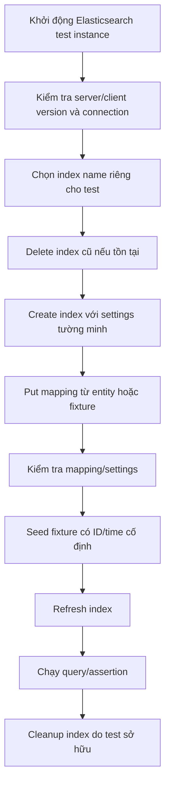

# Chuẩn bị index, settings, mapping và dữ liệu có tính xác định

Một integration test với Spring Data Elasticsearch chỉ đáng tin cậy khi nó chạy trên một index có cấu trúc đã biết và dữ liệu có thể tái tạo. Nếu test dùng index cũ từ lần chạy trước, phụ thuộc dynamic mapping, chờ refresh bằng `Thread.sleep()` hoặc tạo fixture ngẫu nhiên, kết quả có thể lúc đúng lúc sai dù code không thay đổi.

Chuẩn bị test cần kiểm soát bốn phần:

- **Index lifecycle**: index được tạo mới cho test, có tên và phạm vi rõ ràng, rồi được dọn sau khi test kết thúc.
- **Settings**: shard, replica, refresh interval và các cấu hình liên quan được đặt tường minh cho môi trường test.
- **Mapping**: field type, analyzer, date format, nested path và các thuộc tính cần thiết được tạo trước khi nạp dữ liệu.
- **Fixtures**: ID, timestamp, giá trị field và thứ tự dữ liệu được xác định trước để kết quả có thể lặp lại.

Mục tiêu không phải mô phỏng toàn bộ production cluster trong mọi test. Mục tiêu là làm cho điều kiện đầu vào của test rõ ràng, độc lập và có thể tái tạo; những khác biệt có chủ đích giữa test và production phải được ghi nhận.

## 1. Vì sao test cần index và dữ liệu xác định?

Giả sử một test tìm sản phẩm đang hoạt động:

```java
SearchHits<ProductDocument> hits = operations.search(
    NativeQuery.builder()
        .withQuery(q -> q.term(t -> t.field("status").value("ACTIVE")))
        .build(),
    ProductDocument.class
);
```

Nếu index `products` đã tồn tại từ một test trước, mapping có thể khác với entity hiện tại. Một field từng được tạo thành `text` có thể không có subfield `keyword` như test mong đợi. Nếu fixture cũ vẫn còn, kết quả có thể có thêm document ngoài dự kiến. Nếu refresh chưa xảy ra, search có thể trả về ít document hơn số đã lưu.

Những nguồn gây test không ổn định thường gặp:

- Dùng chung index với môi trường development hoặc với test khác.
- Không xóa dữ liệu trước khi nạp fixture.
- Dựa vào dynamic mapping được tạo từ document đầu tiên.
- Không tạo mapping trước khi index dữ liệu.
- Dùng `Instant.now()`, `UUID.randomUUID()` hoặc dữ liệu ngẫu nhiên mà không cố định seed.
- Giả định thứ tự kết quả search giống thứ tự insert.
- Dùng `Thread.sleep(1000)` để đoán thời điểm refresh.
- Chạy test song song trên cùng một index rồi cùng xóa/tạo index.
- Phụ thuộc index template hoặc alias từ cluster bên ngoài mà test không kiểm soát.

Một test tốt phải có thể chạy riêng lẻ, chạy lại nhiều lần và chạy trong CI mà không phụ thuộc thứ tự thực thi của test suite.

## 2. Phân biệt unit test và Elasticsearch integration test

Không phải mọi test đều cần khởi động Elasticsearch.

| Loại test | Mục tiêu | Có cần Elasticsearch thật? |
|---|---|---|
| Unit test service | Kiểm tra business rule, validation, authorization | Không; có thể mock repository/port |
| Test mapping metadata | Kiểm tra annotation/entity metadata ở mức Java | Có thể kiểm tra metadata, nhưng chưa chứng minh mapping trên cluster |
| Repository integration test | Kiểm tra converter, query, save/read và mapping thực tế | Có |
| Search integration test | Kiểm tra analyzer, filter, sort, aggregation, refresh | Có |
| Cluster/operations test | Kiểm tra settings, alias, template, shard behavior | Có cluster tương thích; thường dùng Testcontainers hoặc môi trường riêng |

Unit test không nên cố mock mọi chi tiết của Elasticsearch DSL. Ngược lại, integration test không cần khởi động cả ứng dụng nếu chỉ cần kiểm tra một repository hoặc một thao tác mapping. Chọn phạm vi test nhỏ nhất vẫn chứng minh được hành vi cần kiểm tra.

## 3. Dùng Elasticsearch riêng cho test

Không trỏ integration test vào cluster production hoặc index dùng chung của developer. Nên khởi động một Elasticsearch node riêng trong CI/dev test bằng Testcontainers hoặc dùng một cluster test được quản lý riêng.

Ví dụ với Testcontainers:

```java
import org.junit.jupiter.api.Test;
import org.springframework.boot.test.context.SpringBootTest;
import org.springframework.test.context.DynamicPropertyRegistry;
import org.springframework.test.context.DynamicPropertySource;
import org.testcontainers.elasticsearch.ElasticsearchContainer;
import org.testcontainers.junit.jupiter.Container;
import org.testcontainers.junit.jupiter.Testcontainers;

@Testcontainers
@SpringBootTest
class ProductRepositoryIntegrationTest {

    @Container
    static final ElasticsearchContainer elasticsearch =
        new ElasticsearchContainer(
            "docker.elastic.co/elasticsearch/elasticsearch:8.15.0"
        );

    @DynamicPropertySource
    static void elasticsearchProperties(DynamicPropertyRegistry registry) {
        registry.add("spring.elasticsearch.uris", elasticsearch::getHttpHostAddress);
    }

    @Test
    void contextStartsAgainstTestCluster() {
        // Test body
    }
}
```

Ví dụ minh họa cho Spring Boot có cấu hình `spring.elasticsearch.uris` và Testcontainers Elasticsearch module tương thích. Hãy chọn image Elasticsearch cùng major version với Java API Client/Spring Data Elasticsearch của dự án; phiên bản image, package Testcontainers và cách cấu hình security/TLS có thể khác theo release.

Một số image Elasticsearch bật security mặc định hoặc yêu cầu credential/certificate. Khi đó, cấu hình Testcontainers và Spring properties phải lấy đúng endpoint, username/password hoặc CA certificate mà container cung cấp. Không tắt xác minh TLS trong production chỉ để làm test chạy; nếu test dùng security disabled, giới hạn điều đó trong container test riêng.

### 3.1. Vì sao Testcontainers hữu ích?

Testcontainers giúp test có môi trường Elasticsearch thật với:

- Phiên bản server được khai báo trong code/build.
- Index settings và mapping thật.
- Query DSL, analyzer và converter được thực thi trên cluster.
- Vòng đời container có thể gắn với test suite.
- CI có thể tái tạo môi trường nếu có Docker/container runtime phù hợp.

Testcontainers không làm test tự động xác định. Test vẫn phải tạo index, mapping và fixture rõ ràng, đồng thời kiểm soát refresh và cleanup.

### 3.2. Giữ phiên bản server và client tương thích

Đừng dùng một Elasticsearch image tùy ý mới hơn client chỉ vì image đó tải được. Hãy căn cứ vào ma trận tương thích của Spring Boot, Spring Data Elasticsearch, Elasticsearch Java API Client và Elasticsearch server. Ghi rõ version trong build/test configuration để nâng cấp có chủ đích.

Nếu CI dùng external test cluster, kiểm tra cluster version trước khi test bắt đầu và fail sớm nếu không phù hợp. Một test pass trên server version khác với production có thể bỏ sót khác biệt mapping/query.

## 4. Chọn phạm vi index cho test

Có ba cách phổ biến:

| Phạm vi | Cách tổ chức | Khi phù hợp |
|---|---|---|
| Một index cho test class | Xóa/tạo lại index trước mỗi test method | Test chạy tuần tự và index nhỏ |
| Một index cho test suite | Tạo một lần, seed dữ liệu riêng cho từng test | Nhiều test cần cùng fixture lớn, có cleanup rõ ràng |
| Index riêng cho từng test | Tạo tên index duy nhất theo test | Chạy song song hoặc test cần trạng thái độc lập tuyệt đối |

Đối với Repository dùng `@Document(indexName = "products-test")`, cách đơn giản là một index cố định cho test class và xóa/tạo lại trước mỗi test. Không chạy song song các test cùng thao tác xóa/tạo index đó.

Nếu cần index riêng cho từng test method, dùng tên index động và truyền `IndexCoordinates.of(indexName)` vào các thao tác `ElasticsearchOperations`. Repository mặc định lấy index từ metadata `@Document`, nên tên động cần được thiết kế rõ qua mapping metadata/SpEL hoặc một adapter riêng; không giả định chỉ đổi biến `IndexCoordinates` là Repository tự chuyển index.

Không dùng tên index production như `products` trong integration test. Chọn suffix dễ nhận biết, ví dụ `products-it`, `products-test-<run-id>` hoặc prefix riêng của test.

## 5. Khai báo entity với mapping tường minh

Ví dụ entity sản phẩm:

```java
import java.time.Instant;

import org.springframework.data.annotation.Id;
import org.springframework.data.elasticsearch.annotations.Document;
import org.springframework.data.elasticsearch.annotations.Field;
import org.springframework.data.elasticsearch.annotations.FieldType;
import org.springframework.data.elasticsearch.annotations.Setting;

@Document(indexName = "products-test", createIndex = false)
@Setting(
    shards = 1,
    replicas = 0,
    refreshInterval = "-1"
)
public class ProductDocument {

    @Id
    private String id;

    @Field(type = FieldType.Keyword)
    private String sortKey;

    @Field(type = FieldType.Text)
    private String name;

    @Field(type = FieldType.Keyword)
    private String status;

    @Field(type = FieldType.Long)
    private Long priceInCents;

    @Field(type = FieldType.Date)
    private Instant createdAt;

    protected ProductDocument() {
    }

    public ProductDocument(
            String id,
            String sortKey,
            String name,
            String status,
            Long priceInCents,
            Instant createdAt) {
        this.id = id;
        this.sortKey = sortKey;
        this.name = name;
        this.status = status;
        this.priceInCents = priceInCents;
        this.createdAt = createdAt;
    }

    public String getId() {
        return id;
    }
}
```

Các lựa chọn trong ví dụ có mục đích:

- `createIndex = false`: tắt việc Spring Data tự tạo index khi khởi tạo metadata, để test kiểm soát thời điểm tạo index.
- `shards = 1`: giảm overhead và giúp test local dễ dự đoán.
- `replicas = 0`: không cần replica cho một node test đơn lẻ.
- `refreshInterval = "-1"`: tắt refresh tự động trong fixture setup; test sẽ refresh tường minh sau khi seed.
- `keyword`: dùng cho exact filter/sort.
- `text`: dùng cho full-text search.
- `date`: dùng cho range/sort theo thời gian.

Các giá trị này là cấu hình test, không phải cấu hình production mặc định. Nếu test cần kiểm tra refresh behavior hoặc replica allocation, hãy tạo một nhóm test có settings riêng phản ánh use case đó.

## 6. Tạo index, settings và mapping theo thứ tự

Thứ tự tạo dữ liệu quan trọng:

1. Xóa index cũ nếu có.
2. Tạo index với settings xác định.
3. Đưa mapping tường minh lên index.
4. Kiểm tra index đã tồn tại và mapping/settings đúng.
5. Nạp fixture.
6. Refresh để search thấy fixture.
7. Chạy test.

Nếu dùng `@Setting` và mapping annotation trên entity, Spring Data có thể tạo index cùng mapping qua `createWithMapping()`:

```java
IndexOperations indexOperations = operations.indexOps(ProductDocument.class);

if (indexOperations.exists()) {
    indexOperations.delete();
}

boolean created = indexOperations.createWithMapping();
if (!created) {
    throw new IllegalStateException("Could not create products-test index");
}
```

`createWithMapping()` dùng metadata entity để tạo index và mapping. Cách này thuận tiện khi muốn test đúng mapping được khai báo bởi Spring Data annotations.

Nếu test cần kiểm tra settings độc lập hoặc dùng mapping JSON fixture riêng, có thể tạo index với settings rồi gọi `putMapping()` bằng API `IndexOperations` phù hợp phiên bản. Ví dụ REST tương đương:

```json
PUT products-test
{
  "settings": {
    "number_of_shards": 1,
    "number_of_replicas": 0,
    "refresh_interval": "-1"
  },
  "mappings": {
    "properties": {
      "sortKey": { "type": "keyword" },
      "name": {
        "type": "text",
        "fields": {
          "keyword": { "type": "keyword" }
        }
      },
      "status": { "type": "keyword" },
      "priceInCents": { "type": "long" },
      "createdAt": { "type": "date" }
    }
  }
}
```

Không vừa tạo mapping từ annotation vừa tạo mapping JSON khác nhau mà không có chủ đích. Hãy chọn một nguồn sự thật cho test: mapping entity để xác minh Spring Data metadata, hoặc mapping JSON fixture khi kiểm thử template/migration.

## 7. Phân biệt settings tĩnh và settings có thể cập nhật

Không phải mọi index setting đều có thể thay đổi khi index đang mở.

| Nhóm setting | Ví dụ | Lưu ý |
|---|---|---|
| Cấu hình tạo index | `number_of_shards`, analyzer/normalizer liên quan mapping | Thường phải xác định lúc tạo index; một số thay đổi cần index mới và reindex |
| Cấu hình có thể cập nhật | `number_of_replicas`, `refresh_interval` | Nhiều setting có thể thay đổi qua Update Index Settings API |
| Mapping field type | `keyword`, `text`, `date`, `nested` | Không thể tùy ý đổi type của field đã có dữ liệu |
| Mapping field parameter | Analyzer, normalizer, doc_values và một số thuộc tính | Khả năng đổi phụ thuộc parameter; thường cần tạo index mới khi thay đổi ảnh hưởng dữ liệu đã index |

Trong test, tạo index mới cho từng bộ settings/mapping giúp tránh phải thay đổi các thuộc tính không thể cập nhật trên index hiện hữu. Nếu mục tiêu của test là kiểm tra migration, hãy test quy trình tạo index mới/reindex/alias riêng.

## 8. Kiểm tra mapping và settings thực tế

Đừng chỉ tin annotation Java. Sau khi tạo index, có thể kiểm tra trực tiếp:

```http
GET products-test/_mapping
GET products-test/_settings?include_defaults=true
```

Mapping cần phản ánh đúng field type mong muốn, ví dụ:

```json
{
  "properties": {
    "name": {
      "type": "text",
      "fields": {
        "keyword": { "type": "keyword" }
      }
    },
    "status": { "type": "keyword" },
    "priceInCents": { "type": "long" },
    "createdAt": { "type": "date" }
  }
}
```

Settings quan trọng trong test gồm:

- Số primary shard.
- Số replica.
- Refresh interval.
- Analyzer/normalizer nếu query phụ thuộc tokenization.
- Các setting liên quan routing, similarity hoặc codec nếu test thực sự cần.

Với Spring Data, `IndexOperations` cung cấp API đọc mapping/settings; chữ ký và kiểu trả về có thể khác theo phiên bản. Có thể dùng REST/Java API Client để kiểm tra ở integration test khi cần assertions chính xác về cấu trúc server trả về.

## 9. Tạo fixture có tính xác định

Fixture là tập dữ liệu chuẩn được tạo trước khi chạy test. Fixture nên có ID, giá trị field và timestamp cố định.

Ví dụ:

```java
import java.time.Instant;
import java.util.List;

List<ProductDocument> fixtures = List.of(
    new ProductDocument(
        "P-001", "001", "Wireless Headphones", "ACTIVE", 129900L,
        Instant.parse("2026-01-10T08:00:00Z")
    ),
    new ProductDocument(
        "P-002", "002", "Studio Headphones", "ACTIVE", 189900L,
        Instant.parse("2026-01-11T08:00:00Z")
    ),
    new ProductDocument(
        "P-003", "003", "USB-C Charger", "INACTIVE", 49900L,
        Instant.parse("2026-01-12T08:00:00Z")
    )
);
```

Fixture cố định giúp test diễn đạt rõ điều kiện và expected result. Ví dụ test tìm `ACTIVE` có thể mong đợi chính xác `P-001` và `P-002`.

Tránh:

```java
Instant createdAt = Instant.now();
String id = UUID.randomUUID().toString();
```

trong fixture mà test cần so sánh chính xác. Nếu cần kiểm thử sinh ID ngẫu nhiên hoặc thời gian hiện tại, hãy inject `Clock`/ID generator và cố định giá trị trong test.

### 9.1. Dùng Clock cố định cho logic thời gian

Service có thể nhận `Clock`:

```java
@Service
public class ProductService {

    private final Clock clock;

    public ProductService(Clock clock) {
        this.clock = clock;
    }

    public ProductDocument create(String id, String name) {
        return new ProductDocument(
            id,
            id,
            name,
            "ACTIVE",
            10000L,
            clock.instant()
        );
    }
}
```

Trong test, cung cấp `Clock.fixed(...)`:

```java
@TestConfiguration
static class FixedClockConfiguration {

    @Bean
    @Primary
    Clock testClock() {
        return Clock.fixed(
            Instant.parse("2026-01-01T00:00:00Z"),
            ZoneOffset.UTC
        );
    }
}
```

Điều này giúp kết quả date range, audit timestamp và sort theo thời gian ổn định qua mọi lần chạy.

### 9.2. Dùng ID ổn định và tránh phụ thuộc thứ tự insert

ID ổn định giúp:

- Đọc lại document bằng ID trong assertion.
- Dễ đối chiếu fixture và lỗi bulk item.
- Cleanup hoặc cập nhật một record cụ thể.
- Tái tạo cùng dữ liệu khi test thất bại.

Tuy nhiên, Elasticsearch search không bảo đảm trả kết quả theo thứ tự insert. Nếu test cần thứ tự, query phải có sort tường minh.

Nếu nhiều document có cùng `createdAt` hoặc `_score`, thứ tự giữa chúng có thể không xác định. Thêm một field sort key duy nhất, được mapping `keyword`/numeric phù hợp và có doc values, làm tie-breaker:

```java
Query query = NativeQuery.builder()
    .withQuery(q -> q.term(t -> t.field("status").value("ACTIVE")))
    .withSort(s -> s.field(f -> f.field("createdAt").order(SortOrder.Asc)))
    .withSort(s -> s.field(f -> f.field("sortKey").order(SortOrder.Asc)))
    .build();
```

`sortKey` cần duy nhất trong tập kết quả nếu test cần thứ tự tuyệt đối. Không dựa vào `_id` như một field sort thông thường nếu mapping/cluster không hỗ trợ; `_id` có những giới hạn riêng cho sorting và aggregation.

## 10. Nạp fixture và refresh trước khi search

Sau khi index được tạo và mapping đã sẵn sàng, nạp dữ liệu:

```java
fixtures.forEach(product -> operations.save(product));
```

Sau đó refresh index trước khi chạy search assertion:

```java
operations.indexOps(ProductDocument.class).refresh();
```

Khi test cần xác nhận search nhìn thấy dữ liệu vừa ghi, refresh tường minh là cách xác định. Không dùng:

```java
Thread.sleep(1000);
```

vì refresh interval có thể thay đổi, CI có thể chậm hoặc nhanh hơn máy local, và sleep không chứng minh refresh đã hoàn tất.

Nếu đang test chính sách `refresh=wait_for`, hãy gọi write với policy đó rồi search ngay sau khi write trả về. Nếu đang test default NRT behavior, hãy kiểm tra GET theo ID và search trước/sau refresh như hai hành vi khác nhau.

### 10.1. Seed nhiều document bằng bulk

Khi fixture lớn, bulk indexing giảm overhead so với gọi `save` từng document:

```java
List<IndexQuery> indexQueries = fixtures.stream()
    .map(product -> new IndexQueryBuilder()
        .withId(product.getId())
        .withObject(product)
        .build())
    .toList();

operations.bulkIndex(
    indexQueries,
    IndexCoordinates.of("products-test")
);

operations.indexOps(IndexCoordinates.of("products-test")).refresh();
```

Nếu bulk có item failure, cần xử lý `BulkFailureException`/response tương ứng thay vì tiếp tục assertion như thể fixture đã đầy đủ. Test nên fail với thông tin document ID và nguyên nhân lỗi để chẩn đoán nhanh.

## 11. Tổ chức setup và cleanup trong JUnit

Một pattern phổ biến là xóa/tạo index và seed fixture trước mỗi test:

```java
import org.junit.jupiter.api.AfterEach;
import org.junit.jupiter.api.BeforeEach;
import org.springframework.beans.factory.annotation.Autowired;
import org.springframework.boot.test.context.SpringBootTest;
import org.springframework.data.elasticsearch.core.ElasticsearchOperations;
import org.springframework.data.elasticsearch.core.IndexOperations;
import org.springframework.data.elasticsearch.core.mapping.IndexCoordinates;

@SpringBootTest
class ProductSearchIntegrationTest {

    @Autowired
    ElasticsearchOperations operations;

    @Autowired
    ProductRepository repository;

    private IndexOperations indexOperations;

    @BeforeEach
    void setUp() {
        indexOperations = operations.indexOps(ProductDocument.class);

        if (indexOperations.exists()) {
            indexOperations.delete();
        }

        if (!indexOperations.createWithMapping()) {
            throw new IllegalStateException("Could not create test index");
        }

        repository.saveAll(fixtures());
        indexOperations.refresh();
    }

    @AfterEach
    void tearDown() {
        if (indexOperations != null && indexOperations.exists()) {
            indexOperations.delete();
        }
    }

    private List<ProductDocument> fixtures() {
        // Return a new list with fixed IDs and fixed values.
        return List.of(/* deterministic fixtures */);
    }
}
```

Ví dụ giả định `ProductDocument` có `@Document(indexName = "products-test", createIndex = false)` và `@Setting` phù hợp. Nếu index được dùng chung bởi nhiều test class, không chạy song song các class cùng xóa/tạo index. Với test song song, cấp index riêng hoặc cluster/container riêng cho từng worker.

### 11.1. Cleanup khi test thất bại

JUnit gọi `@AfterEach` ngay cả khi assertion hoặc test body thất bại trong vòng đời thông thường. Tuy nhiên, process bị kill hoặc container crash có thể bỏ qua cleanup. Dùng container tạm thời và prefix index test giúp dữ liệu rác không ảnh hưởng môi trường khác; có thể thêm cleanup toàn bộ index theo prefix trong teardown suite nếu cần.

Không viết cleanup wildcard có thể xóa index ngoài phạm vi test. Chỉ xóa index mà test đã tạo hoặc index có prefix riêng được kiểm soát.

## 12. Tạo mapping từ entity hay từ JSON fixture?

Hai cách đều hữu ích nhưng phục vụ mục tiêu khác nhau.

| Cách tạo | Điều được kiểm tra | Rủi ro cần biết |
|---|---|---|
| `createWithMapping()` từ entity | Annotation và Spring Data mapping metadata tạo ra mapping phù hợp | Không kiểm tra template/migration riêng nếu chúng không tham gia |
| Mapping JSON fixture | Mapping server-side mong muốn, ví dụ analyzer và multi-field | Có thể lệch mapping thực tế do converter/entity metadata |
| Index template | Quy tắc tự áp dụng cho index pattern | Cần test pattern/priority và thứ tự template |
| Migration script | Quy trình chuyển index cũ sang index mới | Cần dữ liệu cũ và alias/reindex lifecycle đại diện |

Nếu mục tiêu là kiểm tra `@Field(type = FieldType.Keyword)` được chuyển đúng, tạo mapping từ entity và đọc mapping server-side. Nếu mục tiêu là kiểm tra index template, tạo index có tên khớp pattern và xác nhận template đã áp dụng. Nếu mục tiêu là kiểm tra migration, test riêng luồng index version mới, reindex và alias switch.

Không dùng mapping JSON fixture giống hệt mong đợi rồi chỉ test query trên đó nếu câu hỏi thực sự là annotation Spring Data có sinh đúng mapping hay không. Test phải đi qua thành phần đang cần xác minh.

## 13. Chuẩn bị analyzer và normalizer có tính xác định

Nếu query phụ thuộc analyzer, mapping test phải khai báo analyzer rõ ràng. Ví dụ một field có multi-field:

```java
@MultiField(
    mainField = @Field(type = FieldType.Text, analyzer = "standard"),
    otherFields = {
        @InnerField(suffix = "keyword", type = FieldType.Keyword)
    }
)
private String name;
```

Sau đó test có thể dùng `name` cho full-text và `name.keyword` cho exact match/sort. Analyzer mặc định có thể khác theo cấu hình index hoặc template; test cần khai báo đúng analyzer/normalizer mà query dựa vào.

Với analyzer tùy chỉnh, settings phải được tạo cùng index trước khi mapping field tham chiếu analyzer đó. Ví dụ REST:

```json
PUT products-test
{
  "settings": {
    "analysis": {
      "analyzer": {
        "catalog_analyzer": {
          "type": "custom",
          "tokenizer": "standard",
          "filter": ["lowercase"]
        }
      }
    }
  },
  "mappings": {
    "properties": {
      "name": {
        "type": "text",
        "analyzer": "catalog_analyzer"
      }
    }
  }
}
```

Không tạo index trước rồi mới thêm analyzer cần thiết nếu Elasticsearch yêu cầu analyzer được khai báo khi tạo index. Nếu analyzer thay đổi, thường phải tạo index mới và reindex dữ liệu.

## 14. Chuẩn bị date, numeric và nested fixtures

Test mapping/query nên có fixture bao phủ các giá trị biên có ý nghĩa:

- Date ở trước, đúng và sau mốc filter.
- Numeric bằng ngưỡng, nhỏ hơn và lớn hơn ngưỡng.
- Keyword có phân biệt chữ hoa/thường theo analyzer/normalizer đã chọn.
- Field thiếu, null hoặc có giá trị rỗng nếu domain cho phép.
- Mảng có một và nhiều phần tử.
- Nested object có các field cố ý đặt giá trị khác nhau để kiểm tra correlation.

Ví dụ date range:

```java
Instant before = Instant.parse("2026-01-01T00:00:00Z");
Instant atBoundary = Instant.parse("2026-01-10T00:00:00Z");
Instant after = Instant.parse("2026-01-11T00:00:00Z");
```

Không dùng timezone local của máy chạy test để tạo fixture. Dùng `Instant` hoặc `OffsetDateTime` với offset rõ ràng, rồi kiểm tra mapping/date format.

Với nested mapping, tạo fixture có ít nhất hai nested object với các cặp giá trị khác nhau. Ví dụ object A có `color=black, size=S`, object B có `color=white, size=L`; query `color=black AND size=L` không được match nếu cần semantics cùng một nested object. Dữ liệu này giúp phát hiện nhầm `object` và `nested`.

## 15. Đảm bảo thứ tự kết quả xác định

Elasticsearch không đảm bảo thứ tự search theo thứ tự insert. Nếu nhiều hit có cùng score hoặc cùng sort value, thứ tự tie có thể thay đổi giữa lần chạy, shard hoặc segment.

Để test ổn định:

1. Khai báo sort rõ ràng trong query.
2. Thêm tie-breaker duy nhất, ví dụ `sortKey` dạng `keyword` có doc values.
3. Không so sánh list theo thứ tự nếu API không cam kết thứ tự.
4. Nếu chỉ cần kiểm tra tập kết quả, so sánh ID dưới dạng set.
5. Nếu test pagination, dùng sort ổn định và kiểm tra không trùng/không thiếu ID giữa các trang.

Ví dụ khi không cần thứ tự:

```java
Set<String> ids = hits.getSearchHits().stream()
    .map(hit -> hit.getId())
    .collect(Collectors.toSet());

assertThat(ids).containsExactlyInAnyOrder("P-001", "P-002");
```

Nếu cần thứ tự:

```java
assertThat(sortedIds)
    .containsExactly("P-001", "P-002", "P-003");
```

Chỉ assertion thứ tự khi query có sort xác định. Không dựa vào thứ tự trả về mặc định của Elasticsearch.

## 16. Kiểm soát dữ liệu và index giữa các test

Có thể chọn xóa toàn index hoặc xóa từng document:

| Chiến lược | Ưu điểm | Đánh đổi |
|---|---|---|
| Delete + recreate index | Reset mapping, settings và dữ liệu về trạng thái sạch | Chậm hơn; không phù hợp test chạy song song trên index chung |
| Delete all documents | Giữ mapping/settings, seed nhanh hơn | Không phát hiện mapping/settings cũ sai; cần refresh sau delete |
| Index riêng theo test | Cô lập mạnh, chạy song song tốt | Tạo/xóa nhiều index, cần quản lý tên và shard overhead |
| Container riêng theo suite | Cluster state sạch giữa suite | Startup tốn thời gian và tài nguyên |

Nếu test đang kiểm tra mapping hoặc settings, phải tạo lại index. Xóa document thôi không đủ vì mapping cũ vẫn còn.

Nếu test chỉ kiểm tra business query trên mapping đã được kiểm soát, có thể xóa document và seed lại để tiết kiệm thời gian. Hãy bảo đảm test không phụ thuộc dữ liệu còn sót lại.

## 17. Index template và alias trong integration test

Một số ứng dụng không tạo index trực tiếp từ entity mà dùng index template và alias theo version, ví dụ:

```text
products-v1  <- alias products-read, products-write
products-v2  <- alias products-read, products-write sau migration
```

Nếu production dựa vào template, test cần tạo template trước index và dùng index name khớp pattern. Sau khi tạo index, kiểm tra settings/mapping thực tế để xác nhận template priority và component template đã được áp dụng.

Nếu test alias switch:

1. Tạo index version cũ.
2. Tạo index version mới với mapping/settings mong đợi.
3. Nạp dữ liệu hoặc reindex.
4. Kiểm tra document count và sample document.
5. Thực hiện alias switch nguyên tử theo API.
6. Xác nhận read/write alias trỏ đúng index.
7. Dọn các index test.

Không để test phụ thuộc alias production hoặc template toàn cluster có thể thay đổi ngoài test. Dùng tên template/pattern riêng cho integration test.

## 18. Refresh và visibility trong test

Test cần phân biệt write acknowledgement với search visibility. Sau `save` hoặc bulk write, search có thể chưa thấy dữ liệu vì Elasticsearch near real-time.

Các cách đồng bộ:

- `IndexOperations.refresh()` sau khi seed fixture.
- Dùng refresh policy `WAIT_UNTIL` nếu test chính sách read-after-write.
- Dùng GET theo ID khi test semantics realtime GET, không cần search.
- Không dùng `Thread.sleep()` để chờ refresh.

Nếu test dùng `refresh_interval = -1`, hãy gọi refresh tường minh trước search. Không dùng `refresh=wait_for` mà không có refresh nào diễn ra, vì request có thể phải chờ vô thời hạn hoặc timeout theo cấu hình.

Test refresh policy nên dùng một index/settings riêng để tránh làm thay đổi timing của các test khác.

## 19. Cấu trúc một integration test hoàn chỉnh

Ví dụ tổng hợp với Repository, index lifecycle, fixture cố định và refresh tường minh:

```java
import static org.assertj.core.api.Assertions.assertThat;

import java.time.Instant;
import java.util.List;
import java.util.Set;
import java.util.stream.Collectors;

import org.junit.jupiter.api.AfterEach;
import org.junit.jupiter.api.BeforeEach;
import org.junit.jupiter.api.Test;
import org.springframework.beans.factory.annotation.Autowired;
import org.springframework.boot.test.context.SpringBootTest;
import org.springframework.data.elasticsearch.core.ElasticsearchOperations;
import org.springframework.data.elasticsearch.core.IndexOperations;
import org.springframework.data.elasticsearch.core.SearchHits;
import org.springframework.data.elasticsearch.core.query.Query;
import org.springframework.data.elasticsearch.client.elc.NativeQuery;

@SpringBootTest
class ProductSearchIntegrationTest {

    @Autowired
    ElasticsearchOperations operations;

    @Autowired
    ProductRepository repository;

    private IndexOperations indexOperations;

    @BeforeEach
    void prepareIndexAndFixtures() {
        indexOperations = operations.indexOps(ProductDocument.class);

        if (indexOperations.exists()) {
            indexOperations.delete();
        }

        indexOperations.createWithMapping();
        repository.saveAll(List.of(
            new ProductDocument(
                "P-001", "001", "Wireless Headphones", "ACTIVE", 129900L,
                Instant.parse("2026-01-10T08:00:00Z")
            ),
            new ProductDocument(
                "P-002", "002", "Studio Headphones", "ACTIVE", 189900L,
                Instant.parse("2026-01-11T08:00:00Z")
            ),
            new ProductDocument(
                "P-003", "003", "USB-C Charger", "INACTIVE", 49900L,
                Instant.parse("2026-01-12T08:00:00Z")
            )
        ));

        indexOperations.refresh();
    }

    @AfterEach
    void removeTestIndex() {
        if (indexOperations != null && indexOperations.exists()) {
            indexOperations.delete();
        }
    }

    @Test
    void findsOnlyActiveProducts() {
        Query query = NativeQuery.builder()
            .withQuery(q -> q.term(t -> t.field("status").value("ACTIVE")))
            .build();

        SearchHits<ProductDocument> hits = operations.search(
            query,
            ProductDocument.class
        );

        Set<String> ids = hits.getSearchHits().stream()
            .map(hit -> hit.getId())
            .collect(Collectors.toSet());

        assertThat(ids).containsExactlyInAnyOrder("P-001", "P-002");
    }
}
```

Đây là khung minh họa; entity cần có constructor/getter tương ứng và `@Document(indexName = "products-test", createIndex = false)`. Nếu `createWithMapping()` trả false hoặc ném exception, test phải dừng thay vì tiếp tục trên index không hợp lệ. Trong code thực tế, hãy kiểm tra kết quả tạo index và cấu hình Testcontainers/connection trước khi chạy assertion.

## 20. Các lỗi thường gặp

| Hiện tượng | Nguyên nhân có thể | Cách xử lý |
|---|---|---|
| Test pass riêng lẻ nhưng fail khi chạy cả suite | Dùng chung index hoặc dữ liệu còn sót | Reset index/fixture và cô lập test song song. |
| Query `.keyword` không hoạt động | Mapping không có multi-field keyword | Tạo mapping rõ ràng và kiểm tra `_mapping`. |
| Search không thấy document vừa save | Chưa refresh | Gọi refresh tường minh hoặc dùng wait-for policy đúng trường hợp. |
| Test thỉnh thoảng timeout khi dùng wait-for | Refresh interval bị tắt và không có refresh | Refresh chủ động hoặc cấu hình interval phù hợp. |
| Thứ tự hit thay đổi giữa lần chạy | Không có sort hoặc sort không có tie-breaker | Thêm sort ổn định hoặc so sánh set ID. |
| Date range lúc pass lúc fail | Fixture dùng timezone/local clock hoặc `now` | Dùng Instant cố định và mốc UTC tường minh. |
| Mapping thay đổi theo thứ tự seed | Dựa vào dynamic mapping | Khai báo mapping trước khi index fixture. |
| Test xóa nhầm dữ liệu khác | Dùng index chung hoặc cleanup wildcard rộng | Prefix riêng và chỉ xóa index do test tạo. |
| Test song song làm mất index | Nhiều test cùng delete/create một index | Index riêng từng test hoặc tuần tự hóa test. |
| CI khác local | Server/client version, settings hoặc Docker image khác | Pin version và kiểm tra cluster settings trong test. |
| Test template không áp dụng | Index name không khớp pattern hoặc priority sai | Dùng pattern riêng, tạo template trước index và kiểm tra mapping. |
| Bulk seed thiếu document | Item-level bulk failure bị bỏ qua | Kiểm tra bulk response/exception trước khi search. |

## 21. Checklist thông tin cần cố định cho mỗi test

| Nhóm | Giá trị cần kiểm soát |
|---|---|
| Elasticsearch | Server version, image, security/TLS và endpoint |
| Spring | Spring Boot, Spring Data Elasticsearch, Java API Client versions |
| Index | Tên/prefix, lifecycle, cleanup và parallelism |
| Settings | Shards, replicas, refresh interval và analyzer settings |
| Mapping | Field types, date formats, multi-fields, nested paths, normalizers |
| Fixture | IDs, timestamps, numeric values, null/missing fields và document count |
| Search | Query, filter, sort, tie-breaker, page size và aggregation |
| Visibility | Refresh policy hoặc explicit refresh point |
| Isolation | Index riêng, container riêng hoặc cleanup trước/sau test |
| Assertions | ID set, thứ tự có sort, expected count và boundary values |

Ghi các thông tin này cùng test configuration để một người khác có thể tái tạo kết quả. Khi test fail trên CI, log index name, server version, fixture IDs và query class sẽ giúp điều tra mà không phải log toàn bộ document nhạy cảm.

## 22. Quy trình chuẩn bị index và fixture



Trình tự thực tế:

1. Chọn server version tương thích với Spring Data/client.
2. Khởi động Testcontainers hoặc cluster test riêng.
3. Cấu hình endpoint/credential qua test properties, không hard-code secret.
4. Chọn index test và quy tắc chạy song song.
5. Xóa index cũ nếu test sở hữu index đó.
6. Tạo index với settings cố định.
7. Tạo mapping tường minh và kiểm tra server-side mapping.
8. Seed dữ liệu với ID, timestamp và giá trị xác định.
9. Kiểm tra bulk failures nếu nạp bằng bulk.
10. Refresh trước khi chạy search assertion.
11. Dùng query có sort ổn định hoặc so sánh tập ID.
12. Cleanup đúng index trong teardown.
13. Với test template/migration, tạo template/index/alias riêng và kiểm tra toàn bộ lifecycle.

## 23. Kết luận

Integration test Spring Data Elasticsearch ổn định bắt đầu từ một index có lifecycle rõ ràng, settings được cố định, mapping được tạo trước khi nạp dữ liệu và fixture có thể tái tạo. Dùng Elasticsearch riêng cho test, pin server/client version, đặt shard/replica/refresh interval phù hợp và không dựa vào dynamic mapping ngoài ý muốn.

Fixture nên dùng ID, timestamp và giá trị cố định; inject `Clock` khi logic cần thời gian hiện tại. Search không bảo đảm thứ tự insert, vì vậy hãy khai báo sort cùng tie-breaker duy nhất hoặc so sánh kết quả dưới dạng set. Sau khi seed dữ liệu, refresh tường minh trước search assertion; không dùng `Thread.sleep()` để đoán thời điểm refresh.

Spring Data `IndexOperations` hỗ trợ kiểm tra, xóa và tạo index; `createWithMapping()` hữu ích khi muốn test mapping được sinh từ entity annotations. Nếu cần kiểm tra index template hoặc migration, hãy test chính template/migration đó bằng index pattern riêng. Tách index/container theo phạm vi test, cleanup đúng tài nguyên sở hữu và tránh chạy song song trên một index dùng chung. Khi điều kiện đầu vào được kiểm soát, test có thể chạy lặp lại trên máy developer và CI, đồng thời phát hiện được lỗi thực tế ở mapping, converter, query và refresh behavior.
