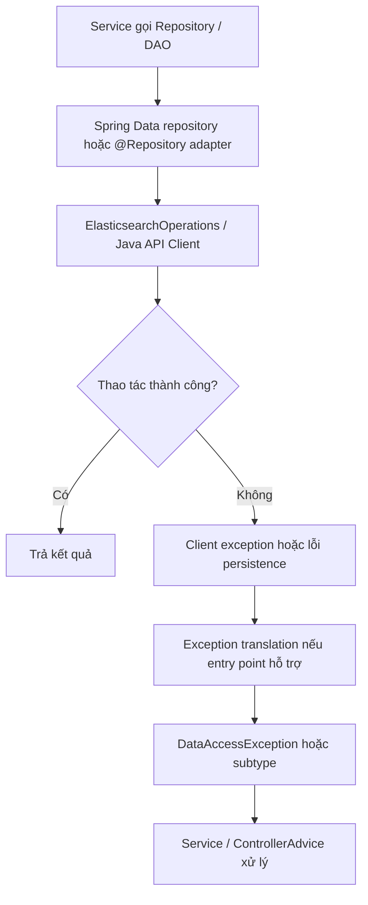
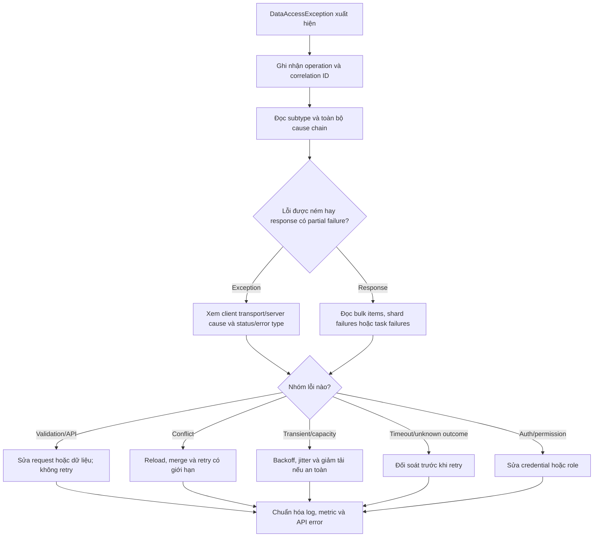

# Đọc DataAccessException và chuỗi nguyên nhân từ client

Khi Spring Data Elasticsearch không thể hoàn thành một thao tác, exception mà service nhận được đôi khi không phải lỗi gốc từ Elasticsearch. Spring có thể chuyển đổi lỗi của persistence client thành một exception thuộc hệ thống `DataAccessException`. Exception bên ngoài mô tả lỗi theo góc nhìn truy cập dữ liệu; các exception lồng bên trong thường chứa thông tin cụ thể hơn như HTTP status, Elasticsearch error type, lỗi transport, timeout hoặc lỗi kết nối.

Để chẩn đoán đúng, cần đọc cả **loại exception bên ngoài và toàn bộ chuỗi nguyên nhân (cause chain)**. Chỉ log `ex.getMessage()` thường không đủ. Đồng thời, không phải mọi lỗi đều được ném thành exception: Bulk API có thể trả HTTP thành công nhưng một số item thất bại; Search API có thể trả kết quả một phần kèm shard failure hoặc timeout. Những trường hợp đó phải được kiểm tra trong response.

Bài học này trình bày cách đọc `DataAccessException`, tìm root cause từ client, phân biệt lỗi request với lỗi từng item, phân loại khả năng retry và chuyển lỗi thành phản hồi ứng dụng an toàn.

## 1. `DataAccessException` là gì?

`DataAccessException` thuộc package `org.springframework.dao`. Đây là lớp exception unchecked của Spring dùng để biểu diễn lỗi khi truy cập dữ liệu, độc lập với công nghệ lưu trữ cụ thể.

Spring Data có thể dùng cùng một hệ thống exception cho nhiều loại persistence store. Vì vậy, tầng service có thể bắt một nhóm lỗi chung mà không cần phụ thuộc trực tiếp vào exception của một client cụ thể.

Ví dụ:

```java
import org.springframework.dao.DataAccessException;

try {
    ProductDocument saved = productRepository.save(product);
} catch (DataAccessException ex) {
    log.error("Could not save product", ex);
    throw ex;
}
```

`DataAccessException` là lớp cơ sở của nhiều exception cụ thể và bản thân nó là abstract. Vì vậy, ứng dụng thường bắt nó để xử lý ở ranh giới persistence, còn logic retry hoặc chuyển đổi HTTP nên dựa trên subtype và nguyên nhân thực tế.

Lợi ích của abstraction này:

- Tầng service ít phụ thuộc vào implementation client.
- Có thể phân loại một số lỗi theo ý nghĩa dữ liệu chung như optimistic locking hoặc integrity violation.
- Dễ xây dựng exception handling nhất quán giữa repository và các persistence adapter.
- Có thể giữ exception gốc làm cause để điều tra chi tiết khi cần.

Tuy nhiên, abstraction không có nghĩa mọi Elasticsearch error đều được ánh xạ thành một subtype Spring cụ thể giống nhau ở mọi phiên bản. Cần kiểm tra exception thực tế từ release Spring Data Elasticsearch và entry point mà ứng dụng đang gọi.

## 2. Spring exception translation hoạt động ở đâu?

Spring sử dụng cơ chế exception translation để chuyển một số exception đặc thù của persistence technology thành exception trong `org.springframework.dao`.

Với Spring Data Repository, hạ tầng repository cung cấp lớp proxy và exception translation phù hợp với store. Với một lớp DAO tự viết, annotation `@Repository` cùng exception translation infrastructure có thể tham gia chuyển đổi exception.

Luồng khái quát:



Điểm cần nhớ là đường gọi quyết định exception nào xuất hiện:

| Entry point | Điều cần lưu ý |
|---|---|
| `ElasticsearchRepository` | Đi qua Spring Data repository infrastructure và exception translation của store. |
| `ElasticsearchOperations` | Dùng abstraction Spring Data; các lỗi persistence có thể được chuyển thành exception thuộc Spring DAO theo implementation/version. |
| Custom DAO có `@Repository` | Có thể tham gia exception translation khi Spring exception translation infrastructure được cấu hình. |
| Gọi `ElasticsearchClient` trực tiếp | Client exception thường được ném trực tiếp; không mặc định được chuyển thành `DataAccessException`. |
| HTTP/REST client tự tạo | Exception phụ thuộc client và adapter; ứng dụng cần chuẩn hóa ở boundary của mình. |

Nếu một service gọi Java API Client trực tiếp rồi nhận `TransportException`, đừng mặc định nó sẽ xuất hiện thành `DataAccessResourceFailureException`. Muốn tầng service chỉ phụ thuộc Spring DAO, hãy bọc direct client trong adapter/repository có trách nhiệm chuyển đổi lỗi rõ ràng.

## 3. Những subtype `DataAccessException` thường gặp

Spring cung cấp nhiều subtype mô tả nhóm lỗi. Một số loại có thể hữu ích khi làm việc với Elasticsearch:

| Exception | Ý nghĩa | Cách diễn giải thường gặp |
|---|---|---|
| `DataAccessResourceFailureException` | Không thể truy cập tài nguyên dữ liệu | Cluster/connection/resource không sẵn sàng; cần đọc cause để biết cụ thể |
| `TransientDataAccessResourceException` | Lỗi tài nguyên có tính tạm thời | Có thể cân nhắc retry có giới hạn nếu thao tác an toàn |
| `TransientDataAccessException` | Nhóm lỗi truy cập dữ liệu có thể tạm thời | Là tín hiệu cho chính sách retry, không phải bảo đảm retry luôn thành công |
| `QueryTimeoutException` | Query vượt quá thời gian cho phép | Kiểm tra query, timeout, cluster load và khả năng request đã được xử lý |
| `DataIntegrityViolationException` | Vi phạm ràng buộc/tính toàn vẹn dữ liệu | Kiểm tra dữ liệu, mapping hoặc constraint nghiệp vụ |
| `DuplicateKeyException` | Khóa bị trùng | Có thể do create document với ID đã tồn tại hoặc unique-key semantics của ứng dụng |
| `OptimisticLockingFailureException` | Cập nhật dựa trên version cũ | Đọc lại document và giải quyết xung đột |
| `InvalidDataAccessApiUsageException` | Cách gọi persistence API không hợp lệ | Sửa query/request hoặc cách dùng API; không retry nguyên trạng |
| `IncorrectResultSizeDataAccessException` | Số kết quả không đúng kỳ vọng | Kiểm tra query và assumption của ứng dụng |
| `UncategorizedDataAccessException` | Lỗi chưa được phân loại thành subtype cụ thể | Đọc cause chain và metadata từ client |

Các subtype trên là vocabulary chung của Spring. Không suy luận rằng một HTTP status Elasticsearch luôn ánh xạ thành đúng một subtype trong mọi release. Exception translator, operation và client version có thể ảnh hưởng kết quả.

### 3.1. Ví dụ phân biệt lỗi theo ý nghĩa

- Nếu một entity được lưu với version cũ và Spring Data phát hiện conflict, ứng dụng có thể nhận `OptimisticLockingFailureException`.
- Nếu query builder được gọi với tham số không hợp lệ, có thể nhận lỗi API usage.
- Nếu cluster không thể truy cập, có thể nhận lỗi resource failure hoặc một exception khác giữ nguyên client cause.
- Nếu document có dữ liệu không phù hợp mapping, có thể nhận integrity-related exception hoặc exception tổng quát tùy translation.

Hãy xem subtype là lớp phân loại đầu tiên, sau đó đọc cause và error metadata để xác nhận nguyên nhân thực tế.

## 4. Cause chain là gì?

Một exception có thể bọc exception khác. Ví dụ:

```text
DataAccessResourceFailureException
  caused by: TransportException
    caused by: IOException
      caused by: SocketTimeoutException
```

Exception ngoài cùng thường phản ánh abstraction của Spring. Exception bên trong có thể cho biết lỗi xảy ra ở transport, network hoặc server.

Trong Java, đọc cause trực tiếp bằng:

```java
Throwable cause = exception.getCause();
```

Sau đó tiếp tục gọi `getCause()` cho tới khi không còn cause. Không nên chỉ giả định cause đầu tiên là root cause cuối cùng.

Spring `NestedRuntimeException`, lớp cha trong hệ thống exception lồng của Spring, cung cấp các helper:

```java
Throwable root = ex.getRootCause();
Throwable mostSpecific = ex.getMostSpecificCause();
```

- `getRootCause()` trả nguyên nhân sâu nhất nếu có; có thể trả `null` khi không có cause.
- `getMostSpecificCause()` trả root cause nếu có, nếu không thì trả chính exception hiện tại.

Ví dụ:

```java
catch (DataAccessException ex) {
    Throwable root = ex.getMostSpecificCause();

    log.error(
        "Persistence failure: outerType={}, rootType={}, rootMessage={}",
        ex.getClass().getName(),
        root.getClass().getName(),
        root.getMessage(),
        ex
    );
}
```

`getMostSpecificCause()` thuận tiện khi cần một nguyên nhân sâu nhất để phân loại sơ bộ. Khi điều tra đầy đủ, vẫn nên duyệt toàn bộ chain vì một exception trung gian có thể chứa thông tin hữu ích mà root cause thấp nhất không có.

## 5. Duyệt toàn bộ cause chain an toàn

Một helper có thể in loại exception và message ở từng tầng:

```java
import java.util.ArrayList;
import java.util.Collections;
import java.util.IdentityHashMap;
import java.util.List;
import java.util.Set;

public final class ExceptionChains {

    private ExceptionChains() {
    }

    public static List<Throwable> causes(Throwable error) {
        List<Throwable> result = new ArrayList<>();
        Set<Throwable> visited = Collections.newSetFromMap(
            new IdentityHashMap<>()
        );

        Throwable current = error;
        while (current != null && visited.add(current)) {
            result.add(current);
            current = current.getCause();
        }

        return List.copyOf(result);
    }
}
```

Dùng `IdentityHashMap` để tránh lặp vô hạn nếu một exception graph bất thường có tham chiếu vòng. Trong thực tế cause chain thường là tuyến tính, nhưng helper an toàn không nên phụ thuộc giả định đó.

Ghi log từng tầng:

```java
catch (DataAccessException ex) {
    int depth = 0;

    for (Throwable cause : ExceptionChains.causes(ex)) {
        log.error(
            "Persistence cause depth={}, type={}, message={}",
            depth++,
            cause.getClass().getName(),
            cause.getMessage()
        );
    }

    throw ex;
}
```

Trong production, thường chỉ cần log exception một lần bằng `log.error("...", ex)` để giữ stack trace và cause chain. Helper hữu ích khi xây diagnostic event hoặc test exception translation; tránh log lặp stack trace ở mọi tầng.

## 6. Suppressed exceptions và stack trace

Cause chain không phải cấu trúc duy nhất có thể chứa thông tin lỗi. Java hỗ trợ suppressed exceptions qua `Throwable.getSuppressed()`.

Ví dụ suppressed exception thường xuất hiện khi một lỗi chính xảy ra trong `try` và lỗi khác xảy ra lúc đóng resource trong try-with-resources.

```java
try (SomeResource resource = openResource()) {
    performOperation(resource);
} catch (Exception ex) {
    for (Throwable suppressed : ex.getSuppressed()) {
        log.warn(
            "Suppressed exception: type={}, message={}",
            suppressed.getClass().getName(),
            suppressed.getMessage()
        );
    }
    throw ex;
}
```

Stack trace cho biết đường đi của lỗi trong code; cause chain cho biết lỗi được bọc qua các tầng nào. Khi log exception bằng logger:

```java
log.error("Elasticsearch operation failed", ex);
```

logger sẽ ghi stack trace cùng các cause/suppressed exception theo formatter. Tránh chỉ ghi `ex.getMessage()` vì sẽ mất phần lớn thông tin chẩn đoán.

## 7. Đọc exception từ Elasticsearch Java API Client

Khi dùng Elasticsearch Java API Client trực tiếp, lỗi thường được chia thành hai nhóm lớn:

- **Transport/client-side failure**: không gửi hoặc không đọc được response đúng cách, ví dụ lỗi kết nối, timeout, TLS, serialization hoặc transport.
- **Elasticsearch server error**: server trả response lỗi cho request, ví dụ query sai, mapping không phù hợp, version conflict, thiếu quyền hoặc resource không tồn tại.

Java API Client có các exception thuộc transport layer; tên class và package cụ thể cần căn cứ vào version dependency. Một số lỗi server được biểu diễn qua exception chứa error response từ Elasticsearch. Đừng viết code phụ thuộc vào tên class được nhớ từ một version khác mà không kiểm tra dependency hiện tại.

Ví dụ gọi client trực tiếp và giữ nguyên lỗi:

```java
try {
    SearchResponse<ProductDocument> response = client.search(
        request -> request
            .index("products")
            .query(query -> query
                .match(match -> match
                    .field("name")
                    .query("wireless headphones")
                )
            ),
        ProductDocument.class
    );

    return response;
} catch (RuntimeException ex) {
    log.error("Direct Elasticsearch client call failed", ex);
    throw ex;
}
```

Ví dụ này không phân loại mọi runtime exception thành lỗi Elasticsearch. Trong code thực tế, catch đúng các exception client mà dependency đang dùng cung cấp, hoặc để exception truyền tới adapter chịu trách nhiệm chuẩn hóa.

### 7.1. Đọc status và error type

Khi server trả lỗi, thông tin hữu ích thường gồm:

- HTTP status.
- Elasticsearch error type.
- Reason/message.
- `caused_by` và `root_cause` nếu có.
- Index, shard hoặc resource liên quan.

Ví dụ một response lỗi minh họa:

```json
{
  "error": {
    "type": "mapper_parsing_exception",
    "reason": "failed to parse field [price]",
    "caused_by": {
      "type": "number_format_exception",
      "reason": "For input string: \"unknown\""
    }
  },
  "status": 400
}
```

HTTP 400 cho biết request/document không hợp lệ; `mapper_parsing_exception` và `number_format_exception` giải thích lỗi cụ thể. Nếu Spring bọc response này trong `DataAccessException`, cause chain có thể giữ một phần hoặc toàn bộ thông tin tùy translator/client version.

Không chỉ phân loại bằng status. Cùng status 400 có thể đến từ nhiều error type; cùng status 409 có thể là version conflict hoặc một xung đột khác.

## 8. Lỗi transport và lỗi server không giống nhau

| Nhóm | Ví dụ | Dấu hiệu cần xem | Hướng xử lý đầu tiên |
|---|---|---|---|
| DNS/connect | Không resolve host, connection refused | `UnknownHostException`, `ConnectException` hoặc transport cause tương ứng | Kiểm tra endpoint, DNS, network và cluster availability |
| Socket timeout | Request/response quá thời gian | `SocketTimeoutException`, timeout exception của client | Kiểm tra latency, timeout và trạng thái request |
| TLS/certificate | Certificate không tin cậy, hostname mismatch | SSL/TLS exception trong chain | Kiểm tra CA, certificate và hostname verification |
| Serialization | Document/query không serialize được | Jackson/JSON mapper hoặc serialization exception | Kiểm tra DTO, custom serializer và request model |
| Authentication | Credential sai hoặc hết hạn | HTTP 401 hoặc auth error | Sửa credential/rotation; không retry liên tục |
| Authorization | Role thiếu quyền | HTTP 403 hoặc security error | Sửa role/index privilege theo least privilege |
| Bad request | Query/mapping/request không hợp lệ | HTTP 400 và error type | Sửa query, field hoặc dữ liệu |
| Conflict | Version/OCC hoặc duplicate operation | HTTP 409 và error type | Đọc lại/reconcile theo nghiệp vụ |
| Capacity/rejection | Cluster quá tải hoặc queue đầy | HTTP 429/503, rejection cause | Giảm concurrency và retry có backoff nếu an toàn |
| Server/internal | Lỗi xử lý phía cluster | HTTP 5xx và error response | Kiểm tra cluster logs/health; retry có giới hạn nếu thao tác an toàn |

Transport failure không chứng minh server chưa thực hiện thao tác. Ví dụ client timeout sau khi gửi write: server có thể đã ghi document nhưng response không đến được client. Đây là trạng thái outcome chưa rõ, cần đối soát trước khi retry thao tác không idempotent.

## 9. Phân biệt exception với lỗi nằm trong response

Một lỗi phổ biến trong chẩn đoán là chỉ bắt exception mà không kiểm tra response. Elasticsearch có nhiều API trả về một response bình thường nhưng chứa thông tin partial failure.

### 9.1. Bulk API

Bulk API có thể trả HTTP 200 dù một hoặc nhiều item thất bại. Cần kiểm tra:

```java
BulkResponse response = client.bulk(request);

if (response.errors()) {
    for (BulkResponseItem item : response.items()) {
        if (item.error() != null) {
            log.warn(
                "Bulk item failed: index={}, id={}, status={}, type={}, reason={}",
                item.index(),
                item.id(),
                item.status(),
                item.error().type(),
                item.error().reason()
            );
        }
    }
}
```

Tên package/import và accessor của Java API Client cần khớp version dự án. Ý nghĩa không thay đổi: `errors()` là cờ tổng hợp, còn `items()` chứa kết quả từng operation theo thứ tự request.

Spring Data có thể báo lỗi bulk qua `BulkFailureException` với danh sách document thất bại. Nếu cần cả kết quả thành công lẫn lỗi chi tiết từng operation, response từ Java API Client thường cung cấp nhiều metadata hơn.

### 9.2. Search API

Search response có thể chứa:

- `timed_out` cho biết search có timeout hay không.
- Thông tin `_shards.failed` cho biết có shard failure.
- Một số hit trả về dù một shard khác thất bại, tùy request setting và hành vi server.
- `terminated_early` nếu request dùng cơ chế early termination phù hợp.

Ví dụ response một phần:

```json
{
  "timed_out": true,
  "_shards": {
    "total": 5,
    "successful": 4,
    "skipped": 0,
    "failed": 1
  },
  "hits": {
    "total": { "value": 120, "relation": "eq" },
    "hits": []
  }
}
```

Không coi việc nhận được `SearchHits` hoặc HTTP 200 là bằng chứng kết quả đầy đủ. Nếu use case yêu cầu kết quả đầy đủ, cần kiểm tra timeout và shard failures theo response API của phiên bản đang dùng.

### 9.3. Update By Query và Delete By Query

Các tác vụ theo query có thể trả response chứa `failures`, `version_conflicts`, `timed_out`, số document đã update/delete và số batch. Tác vụ có thể đã cập nhật một phần trước khi báo lỗi.

Không chỉ dựa vào exception tổng quát hoặc HTTP status. Hãy đọc các counter và danh sách failure trong response, rồi đối soát các document còn lại.

## 10. Đọc `BulkFailureException` và các exception chuyên biệt

Khi Spring Data bulk operation phát hiện item lỗi, có thể ném `BulkFailureException`. Đây là trường hợp cần đọc danh sách failed document thay vì chỉ log message chung.

Ví dụ với API Spring Data Elasticsearch có `FailureDetails`:

```java
try {
    operations.bulkIndex(indexQueries, IndexCoordinates.of("products"));
} catch (BulkFailureException ex) {
    ex.getFailedDocuments().forEach((id, failure) ->
        log.error(
            "Bulk index failed: id={}, status={}, reason={}",
            id,
            failure.status(),
            failure.errorMessage()
        )
    );
}
```

Kiểu trả về của `getFailedDocuments()` thay đổi theo phiên bản Spring Data Elasticsearch. Ở một số release cũ, value là chuỗi message; release mới có thể dùng record `FailureDetails` chứa status và message. Kiểm tra signature thực tế trong dependency đang dùng trước khi copy code.

Các exception khác cũng có thể cung cấp thông tin riêng, ví dụ `OptimisticLockingFailureException` cho xung đột cập nhật. Hãy bắt subtype cụ thể khi có hành động phục hồi rõ ràng; nếu không, giữ nguyên exception và cause chain để tầng cao hơn xử lý.

## 11. Một helper chuẩn hóa thông tin exception

Một ứng dụng có thể tạo DTO diagnostic nội bộ để ghi log, metric hoặc trả về cho hệ thống observability:

```java
public record ExceptionDiagnostic(
    String outerType,
    String outerMessage,
    String rootType,
    String rootMessage,
    int causeDepth
) {
}
```

Mapper:

```java
public final class ExceptionDiagnosticMapper {

    private ExceptionDiagnosticMapper() {
    }

    public static ExceptionDiagnostic from(Throwable error) {
        List<Throwable> chain = ExceptionChains.causes(error);
        Throwable root = chain.get(chain.size() - 1);

        return new ExceptionDiagnostic(
            error.getClass().getName(),
            error.getMessage(),
            root.getClass().getName(),
            root.getMessage(),
            chain.size() - 1
        );
    }
}
```

Đây là diagnostic nội bộ, không phải response API công khai. Message có thể chứa tên index, field, query fragment hoặc dữ liệu đầu vào; trước khi lưu/hiển thị, hãy áp dụng chính sách redaction phù hợp.

Nếu cần phân tích error type/status từ Elasticsearch, bổ sung các trường đã được trích xuất ở adapter nơi client response còn đầy đủ metadata. Không cố parse chuỗi message bằng regex như nguồn dữ liệu chính nếu có structured error response.

## 12. Phân loại lỗi để quyết định retry

Không phải lỗi nào cũng nên retry. Một chiến lược tốt phân loại theo subtype Spring, cause chain, status/error type của server và tính idempotent của operation.

| Nhóm lỗi | Ví dụ | Retry? | Hành động |
|---|---|---|---|
| Validation/mapping | `mapper_parsing_exception`, field type sai | Không retry nguyên trạng | Sửa dữ liệu hoặc mapping |
| API usage/query | Query sai field, builder sai, tham số không hợp lệ | Không | Sửa code/request |
| Authentication/authorization | 401/403 | Không retry tự động | Kiểm tra credential và role |
| Version conflict | `OptimisticLockingFailureException`, 409 | Không retry cùng entity cũ | Đọc lại, merge ý định và thử lại có giới hạn |
| Capacity/rejection | 429, queue rejection | Có thể | Backoff, jitter, giảm concurrency/batch |
| Temporary unavailability | Một số lỗi 503/5xx hoặc resource failure | Có thể | Retry giới hạn nếu operation idempotent và outcome rõ |
| Timeout | Query/write timeout | Cần thận trọng | Xác định query có thể retry; với write phải đối soát outcome |
| Unknown outcome | Client mất kết nối sau khi gửi write | Không retry mù | GET/reconcile theo ID hoặc revision trước |

Subtype `TransientDataAccessException` là tín hiệu hữu ích, nhưng không phải điều kiện duy nhất. Một lỗi transport có thể tạm thời nhưng write đã được server xử lý; retry mù có thể gây side effect lặp.

### 12.1. Backoff có giới hạn

Với lỗi tạm thời có thể retry, dùng exponential backoff và jitter:

```text
delay = min(maxDelay, baseDelay * 2^attempt) + randomJitter
```

Ví dụ policy:

- Tối đa 3–5 lần thử tùy use case.
- Delay tăng dần, có giới hạn trên.
- Có jitter để nhiều worker không retry đồng loạt.
- Có tổng deadline cho cả operation.
- Giảm concurrency hoặc batch size khi cluster bị rejection.
- Ghi nhận số lần retry và nguyên nhân cuối cùng.

Không dùng vòng lặp retry vô hạn hoặc retry ngay lập tức trong `catch`. Cách đó có thể làm cluster đang quá tải càng quá tải hơn.

### 12.2. Retry phải tính đến idempotency

| Operation | Rủi ro khi retry |
|---|---|
| Index cùng ID với cùng payload | Thường có thể đưa document về cùng trạng thái mong muốn |
| Create cùng ID | Có thể nhận duplicate/conflict nếu lần trước đã thành công nhưng response bị mất |
| Update gán giá trị cố định | Thường dễ retry hơn nếu điều kiện nghiệp vụ không đổi |
| Script tăng counter | Có thể tăng hai lần |
| Trừ tồn kho hoặc cộng điểm | Có thể áp dụng side effect lặp nếu không có idempotency key/version guard |
| Delete cùng ID | Có thể idempotent theo nghiệp vụ, nhưng cần xử lý `not_found` đúng cách |

Nếu client timeout sau khi gửi request, hãy coi outcome là chưa rõ cho tới khi đối soát. Dùng document ID ổn định, idempotency key hoặc source revision giúp xử lý trường hợp này.

## 13. Xử lý optimistic locking conflict

Nếu Spring Data ném `OptimisticLockingFailureException`, thường có một writer khác đã thay đổi document sau lần đọc của request hiện tại.

Không làm như sau:

```java
catch (OptimisticLockingFailureException ex) {
    // Sai: gửi lại cùng entity với version cũ.
    repository.save(staleEntity);
}
```

Thay vào đó:

1. Đọc lại document mới nhất.
2. Kiểm tra ý định cập nhật của request còn hợp lệ không.
3. Áp dụng thay đổi lên bản mới.
4. Lưu với version mới.
5. Giới hạn retry và trả conflict nếu vẫn xung đột.

Ví dụ thao tác gán một field:

```java
public ProductDocument changePrice(String id, long newPrice) {
    for (int attempt = 1; attempt <= 3; attempt++) {
        ProductDocument current = repository.findById(id)
            .orElseThrow(() -> new ProductNotFoundException(id));

        current.setPriceInCents(newPrice);

        try {
            return repository.save(current);
        } catch (OptimisticLockingFailureException ex) {
            if (attempt == 3) {
                throw new ProductUpdateConflictException(id, ex);
            }
        }
    }

    throw new IllegalStateException("Unreachable retry state");
}
```

Ví dụ chỉ phù hợp khi quy tắc gán giá có thể áp dụng lại lên document mới nhất. Với thao tác cộng/trừ, cần tính lại nghiệp vụ hoặc dùng atomic/versioned command; không áp dụng cùng một retry loop cho mọi loại update.

## 14. Xử lý timeout và outcome chưa rõ

Timeout có thể xảy ra ở nhiều tầng:

- Connection pool không cấp được connection kịp thời.
- Network connect/read timeout.
- Elasticsearch query timeout.
- Gateway/backend request timeout.
- Client hết thời gian chờ nhưng server vẫn tiếp tục xử lý.

Timeout không đồng nghĩa server đã hủy request. Với write, có thể server đã index document nhưng response bị mất. Với bulk, một số item có thể đã thành công.

Quy trình an toàn:

1. Xác định timeout xảy ra trước khi gửi request hay sau khi gửi.
2. Nếu có document ID, kiểm tra trạng thái bằng GET hoặc query có revision phù hợp.
3. Nếu operation dùng external version/OCC/idempotency key, dùng token đó để đối soát.
4. Chỉ retry khi operation có thể lặp an toàn hoặc đã xác định lần trước chưa được áp dụng.
5. Ghi trạng thái `UNKNOWN_OUTCOME` nếu chưa thể xác nhận kết quả.

Không tự động chuyển mọi timeout thành lỗi 503 rồi yêu cầu client gửi lại cùng một lệnh ghi không idempotent.

## 15. Chuẩn hóa lỗi ở tầng repository/adapter

Nếu ứng dụng gọi trực tiếp Java API Client, nên đặt client sau một adapter có hợp đồng rõ ràng. Adapter có thể chuyển lỗi transport/server thành exception nghiệp vụ hoặc Spring DAO mà service hiểu được.

Ví dụ exception ứng dụng:

```java
public class SearchStoreUnavailableException extends RuntimeException {

    public SearchStoreUnavailableException(String message, Throwable cause) {
        super(message, cause);
    }
}

public class SearchStoreRejectedException extends RuntimeException {

    public SearchStoreRejectedException(String message, Throwable cause) {
        super(message, cause);
    }
}
```

Adapter:

```java
@Repository
public class ProductSearchAdapter {

    private final ElasticsearchClient client;

    public ProductSearchAdapter(ElasticsearchClient client) {
        this.client = client;
    }

    public SearchResponse<ProductDocument> search(Query query) {
        try {
            return executeSearch(query);
        } catch (RuntimeException ex) {
            if (isCapacityRejection(ex)) {
                throw new SearchStoreRejectedException(
                    "Elasticsearch rejected the search operation",
                    ex
                );
            }

            if (isTransportUnavailable(ex)) {
                throw new SearchStoreUnavailableException(
                    "Elasticsearch is temporarily unavailable",
                    ex
                );
            }

            throw ex;
        }
    }
}
```

`executeSearch`, `isCapacityRejection` và `isTransportUnavailable` là phần triển khai phụ thuộc client version và structured error metadata; không nên phân loại bằng cách so khớp một đoạn message tùy tiện. Ví dụ cho thấy vị trí chuẩn hóa exception, không phải một adapter hoàn chỉnh có thể copy nguyên trạng.

Nếu dùng Spring DAO hierarchy cho adapter, có thể ném `DataAccessResourceFailureException`, `TransientDataAccessResourceException` hoặc subtype phù hợp, giữ cause gốc. Đừng tạo subtype sai nghĩa chỉ để ép mọi lỗi vào một nhóm.

## 16. Chuyển lỗi thành HTTP response an toàn

REST API không nên trả trực tiếp class name, stack trace, error body đầy đủ hoặc thông tin cluster cho client. Dùng `@RestControllerAdvice` để ánh xạ lỗi theo hợp đồng sản phẩm.

Ví dụ:

```java
@RestControllerAdvice
public class ApiExceptionHandler {

    @ExceptionHandler(ProductNotFoundException.class)
    ResponseEntity<ApiError> notFound(ProductNotFoundException ex) {
        return ResponseEntity.status(HttpStatus.NOT_FOUND)
            .body(new ApiError("PRODUCT_NOT_FOUND", "Product was not found"));
    }

    @ExceptionHandler(OptimisticLockingFailureException.class)
    ResponseEntity<ApiError> conflict(OptimisticLockingFailureException ex) {
        return ResponseEntity.status(HttpStatus.CONFLICT)
            .body(new ApiError(
                "CONCURRENT_MODIFICATION",
                "The product changed. Reload it and try again."
            ));
    }

    @ExceptionHandler(DataAccessResourceFailureException.class)
    ResponseEntity<ApiError> unavailable(DataAccessResourceFailureException ex) {
        return ResponseEntity.status(HttpStatus.SERVICE_UNAVAILABLE)
            .body(new ApiError(
                "SEARCH_STORE_UNAVAILABLE",
                "The search service is temporarily unavailable"
            ));
    }

    @ExceptionHandler(DataAccessException.class)
    ResponseEntity<ApiError> dataAccess(DataAccessException ex) {
        return ResponseEntity.status(HttpStatus.INTERNAL_SERVER_ERROR)
            .body(new ApiError(
                "DATA_ACCESS_FAILED",
                "The data operation could not be completed"
            ));
    }
}
```

`ApiError` là DTO của ứng dụng. Trong production, handler nên log exception một lần với correlation ID, còn response chỉ chứa code/message đã được chuẩn hóa.

Không ánh xạ mọi `DataAccessException` thành 400. Nhiều lỗi là vấn đề server/cluster, không phải lỗi request của client. Cũng không ánh xạ mọi exception thành 503: lỗi mapping hoặc API misuse cần được sửa, còn conflict cần có semantics riêng.

## 17. Logging cause chain có cấu trúc

Một log chẩn đoán hữu ích thường cần:

- Operation: search, index, update, delete, bulk hoặc update-by-query.
- Index/alias family, không nhất thiết tên index nội bộ đầy đủ.
- Correlation/request ID.
- Exception type ngoài cùng.
- Root cause type và status/error type nếu có.
- Thời gian thực thi và retry attempt.
- Document ID hoặc business key đã được masking nếu cần.

Ví dụ:

```java
log.error(
    "Elasticsearch operation failed: operation={}, index={}, correlationId={}, " +
        "exceptionType={}, rootCauseType={}",
    operation,
    indexName,
    correlationId,
    ex.getClass().getName(),
    ex.getMostSpecificCause().getClass().getName(),
    ex
);
```

Tránh log:

- Password, API key, bearer token hoặc TLS secret.
- Toàn bộ `_source` của document.
- Query có chứa dữ liệu cá nhân hoặc thông tin nhạy cảm.
- Toàn bộ request body từ client nếu không có masking.
- Message exception như một metric label có cardinality cao.

Log một exception ở một tầng có trách nhiệm. Nếu adapter, service và controller đều log cùng một exception với stack trace, log volume tăng nhưng không thêm thông tin mới. Các tầng trên có thể thêm context nghiệp vụ rồi rethrow mà không lặp stack trace.

## 18. Metrics và tracing cho lỗi persistence

Ngoài log, nên theo dõi:

| Metric | Ý nghĩa |
|---|---|
| Số lỗi theo operation | Biết search/index/update/bulk lỗi ở đâu |
| Số lỗi theo exception category | Phân biệt conflict, timeout, resource failure và validation |
| Retry count | Phát hiện hệ thống đang phụ thuộc quá nhiều vào retry |
| Timeout rate | Theo dõi request không hoàn thành đúng hạn |
| Bulk item failure rate | Phát hiện partial failure dù request HTTP thành công |
| Search shard failure rate | Phát hiện kết quả search một phần |
| Cluster rejection rate | Phát hiện quá tải hoặc concurrency quá cao |
| End-to-end latency | Phân biệt backend/network với thời gian Elasticsearch xử lý |

Với Micrometer, dùng tag có cardinality thấp như `operation`, `outcome`, `exception_category` hoặc `index_family`. Không dùng document ID, user ID, query string hoặc exception message làm tag.

Distributed tracing có thể ghi span từ service tới Elasticsearch client. Khi điều tra, đối chiếu span latency, client exception, Elasticsearch slow log và cluster metrics theo cùng correlation/trace ID.

## 19. Xử lý lỗi trong reactive pipeline

Nếu một API trả `Mono`/`Flux`, lỗi được truyền dưới dạng terminal error signal. Có thể chuẩn hóa bằng `onErrorMap` hoặc xử lý có điều kiện bằng `onErrorResume`:

```java
public Mono<ProductDocument> findProduct(String id) {
    return reactiveOperations.get(id, ProductDocument.class)
        .onErrorMap(DataAccessException.class, ex ->
            new SearchStoreUnavailableException(
                "Could not read product from search store",
                ex
            )
        );
}
```

Ví dụ minh họa; chữ ký reactive operation và exception translation phụ thuộc module/version. Không dùng `block()` trong reactive service chỉ để bắt exception đồng bộ.

Khi dùng `onErrorResume`, chỉ fallback khi có semantics hợp lệ. Ví dụ trả cache có thể phù hợp với một số lỗi tạm thời, nhưng không nên biến lỗi authorization, mapping hoặc dữ liệu sai thành kết quả rỗng một cách im lặng.

Nếu cần retry reactive, dùng retry operator với predicate, backoff và giới hạn rõ ràng. Không retry mọi `onError` vì validation error và conflict cần xử lý khác lỗi tạm thời.

## 20. Các lỗi thường gặp khi đọc exception

| Hiện tượng | Nguyên nhân | Cách xử lý |
|---|---|---|
| Chỉ thấy `DataAccessException` chung | Chưa đọc cause chain hoặc translator không phân loại cụ thể | Log type từng tầng và root cause. |
| Cause đầu tiên không phải nguyên nhân cuối | Exception lồng nhiều tầng | Duyệt tới cause sâu nhất và giữ cả intermediate causes. |
| Không thấy exception nhưng bulk có document lỗi | Bulk response chứa partial failure | Kiểm tra `errors()` và từng item hoặc `BulkFailureException`. |
| Search trả kết quả nhưng thiếu shard | Search response có shard failure/timeout | Kiểm tra `timed_out` và `_shards.failed`. |
| Direct Java API Client không ném `DataAccessException` | Bỏ qua Spring Data exception translation | Chuẩn hóa lỗi trong adapter hoặc bắt client exception phù hợp. |
| Retry làm tăng counter hai lần | Operation không idempotent | Dùng idempotency key/version guard và đối soát trước retry. |
| Retry conflict liên tục | Gửi lại entity có version cũ | Đọc lại, merge và giới hạn retry. |
| Timeout nhưng document vẫn tồn tại | Server có thể đã xử lý write, response bị mất | Kiểm tra theo ID/revision trước khi gửi lại. |
| API trả stack trace cho client | Expose exception nội bộ | Dùng `@RestControllerAdvice` và error DTO ổn định. |
| Log quá nhiều hoặc lộ dữ liệu | Log stack trace ở mọi tầng hoặc log full request | Log một lần, masking và dùng correlation ID. |
| Metric backend bị phình cardinality | Dùng ID/message/query làm tag | Chỉ dùng tag có tập giá trị nhỏ. |

## 21. Quy trình chẩn đoán một lỗi DataAccessException



Các bước thực tế:

1. Xác định operation, index/alias và correlation ID.
2. Ghi nhận exception ngoài cùng, không chỉ message.
3. Duyệt cause chain, lấy root cause và xem suppressed exceptions khi có.
4. Xác định entry point là Repository, `ElasticsearchOperations` hay direct Java API Client.
5. Nếu không có exception, kiểm tra response-level failure như bulk item, search shard hoặc update-by-query failure.
6. Đọc HTTP status, Elasticsearch error type/reason và transport cause nếu có.
7. Phân loại validation, conflict, auth, timeout, capacity hoặc unknown outcome.
8. Chỉ retry khi lỗi có thể phục hồi và operation an toàn khi lặp.
9. Chuẩn hóa thành exception/API error phù hợp, giữ cause gốc.
10. Ghi log/metric có cấu trúc, masking dữ liệu và theo dõi tỷ lệ lỗi/retry.

## 22. Kết luận

`DataAccessException` là abstraction unchecked của Spring cho lỗi truy cập dữ liệu. Trong Spring Data Elasticsearch, exception translation có thể bọc lỗi từ persistence client thành các subtype Spring DAO. Exception ngoài cùng cho biết nhóm lỗi ở tầng ứng dụng; cause chain có thể chứa exception transport, network hoặc server cụ thể. Dùng `getCause()`, `getRootCause()` và `getMostSpecificCause()` để đi sâu, đồng thời giữ stack trace và suppressed exceptions khi chẩn đoán.

Không phải mọi lỗi đều xuất hiện dưới dạng exception. Bulk API có thể trả HTTP 200 nhưng một số item thất bại; Search API có thể trả kết quả một phần kèm timeout hoặc shard failure; Update By Query có thể đã cập nhật một phần trước khi báo failure. Luôn kiểm tra response metadata phù hợp với API.

Phân loại lỗi theo subtype, cause, status/error type và tính idempotent của thao tác. Không retry mapping/validation/auth error; xử lý version conflict bằng reload/merge; dùng backoff và jitter cho lỗi tạm thời; đối soát trước khi retry write có outcome chưa rõ. Nếu gọi Java API Client trực tiếp, chuẩn hóa exception trong adapter thay vì giả định Spring DAO translation tự động. Cuối cùng, log cause chain có cấu trúc, bảo vệ dữ liệu nhạy cảm và chuyển lỗi thành API response ổn định. Cách tiếp cận này giúp chẩn đoán lỗi Elasticsearch chính xác hơn và tránh biến lỗi tạm thời thành sự cố lặp lại do retry sai cách.
