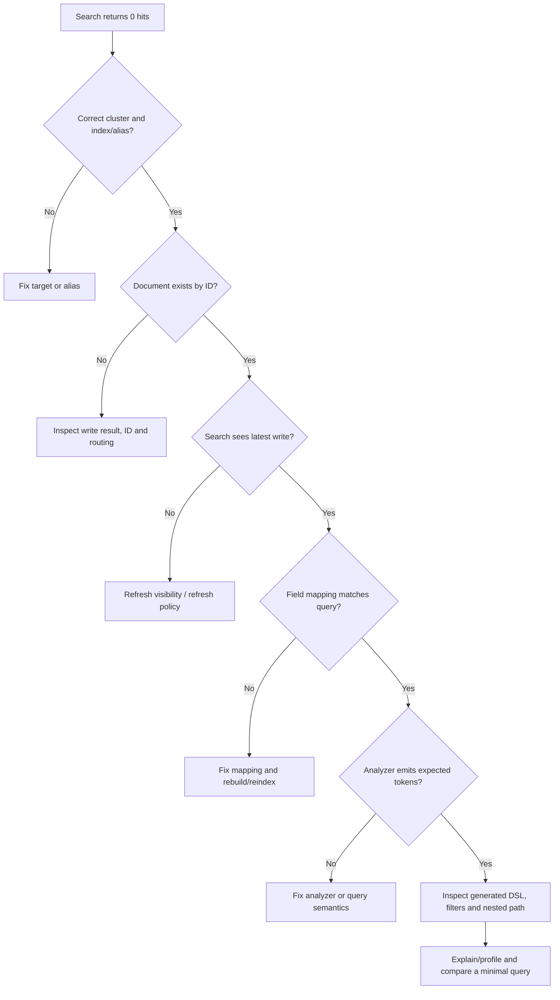

# Kết quả rỗng do analyzer, mapping hoặc refresh

Một truy vấn Elasticsearch có thể chạy thành công nhưng trả về `0 hits`. Đây là tình huống khó chẩn đoán vì không nhất thiết có exception, HTTP error hay lỗi trong Spring Data Elasticsearch. Document có thể đã được ghi nhưng chưa searchable; field có thể được map sai kiểu; analyzer có thể tách token khác với điều ta nghĩ; hoặc query đang nhắm sai index, alias, field hay routing.

Khi gặp kết quả rỗng, đừng vội sửa query hoặc tăng `size`. Hãy kiểm tra theo thứ tự: **đích truy vấn và dữ liệu có tồn tại không, mapping có đúng không, analyzer tạo token gì, query DSL thực tế có đúng không, và thay đổi đã được refresh để search nhìn thấy chưa**. Mỗi nhóm nguyên nhân có dấu hiệu và cách xác minh khác nhau.

## 1. Phân biệt các loại “không tìm thấy”

Trước khi xem analyzer hoặc mapping, hãy xác định chính xác thao tác nào trả kết quả rỗng:

| Thao tác | Hành vi khi không có document | Điều cần phân biệt |
|---|---|---|
| `GET /index/_doc/id` | Trả `found: false` | Document có tồn tại theo `_id` không? |
| Search API | Trả `hits.total.value: 0` | Query có match document nào không? |
| Spring Data `findById(id)` | Thường trả `Optional.empty()` | ID có đúng và index target có đúng không? |
| Spring Data `search(...)` | Search hits rỗng | Query, mapping, analyzer, filter và refresh |
| Count query | Trả `0` | Điều kiện count có khớp và đã searchable chưa? |
| Aggregation | Bucket rỗng hoặc không có bucket | Query/filter trước aggregation có loại hết document không? |

Một document có thể đọc được bằng GET theo ID nhưng chưa xuất hiện trong search. GET theo ID mặc định là realtime; search phụ thuộc refresh. Vì vậy, trường hợp GET tìm thấy nhưng search chưa tìm thấy thường là dấu hiệu cần kiểm tra refresh trước.

Ngược lại, nếu GET theo ID cũng trả `found: false`, hãy kiểm tra ID, index/alias, routing và kết quả ghi trước khi kết luận analyzer làm query rỗng.

## 2. Quy trình chẩn đoán tổng quát

Khi một query bất ngờ trả `0 hits`, đi theo trình tự sau:

1. Xác nhận ứng dụng đang truy vấn đúng cluster, index và alias.
2. Kiểm tra document có tồn tại và đã được ghi thành công hay chưa.
3. Kiểm tra document count và một document mẫu trong `_source`.
4. Đọc mapping của field mà query sử dụng.
5. Kiểm tra analyzer/normalizer và token thực tế bằng `_analyze`.
6. Xem query DSL thực tế được gửi từ Spring Data.
7. Kiểm tra filter, nested path, routing, tenant và điều kiện phụ.
8. Xác định write đã được refresh để search nhìn thấy chưa.
9. Dùng `_explain` hoặc query profile khi cần tìm hiểu vì sao document không match.

Luồng này giúp phân loại nguyên nhân thay vì thay nhiều thứ cùng lúc:



Không nên bắt đầu bằng `_refresh` cho mọi trường hợp. Refresh chỉ giải quyết khả năng search nhìn thấy thay đổi mới; nó không sửa mapping sai, analyzer không tương thích hoặc query dùng sai field.

## 3. Kiểm tra cluster, index và alias trước

Một nguyên nhân đơn giản nhưng thường bị bỏ sót là ứng dụng ghi vào một index nhưng đọc từ index khác. Điều này xảy ra khi có nhiều môi trường, nhiều alias, index version hoặc cấu hình `IndexCoordinates` riêng cho từng thao tác.

### 3.1 Xem index đang tồn tại

```http
GET /_cat/indices/products-*?v
```

Kiểm tra index vật lý, trạng thái, số document và kích thước. Nếu ứng dụng dùng alias, xem alias đang trỏ tới đâu:

```http
GET /_alias/products-read
```

```http
GET /_alias/products-write
```

Tên alias `products-read` và `products-write` chỉ là ví dụ. Thay bằng tên thực tế của ứng dụng.

### 3.2 Xác nhận đích trong Spring Data Elasticsearch

Với repository, index thường được khai báo qua `@Document`:

```java
@Document(indexName = "products-read")
public class ProductDocument {
    @Id
    private String id;
}
```

Với `ElasticsearchOperations`, index có thể được truyền trực tiếp:

```java
IndexCoordinates readIndex = IndexCoordinates.of("products-read");

SearchHits<ProductDocument> hits = operations.search(
    query,
    ProductDocument.class,
    readIndex
);
```

Nếu một service dùng `products-v2`, repository khác dùng `products-read`, còn writer dùng `products-write`, hãy xác nhận các tên đó đang trỏ tới đúng index vật lý. Không giả định annotation `@Document` và `IndexCoordinates` ở mọi call site luôn giống nhau.

### 3.3 Kiểm tra document bằng ID và _source

```http
GET /products-v2/_doc/product-1001
```

Nếu tìm thấy, đọc `_source` để xác nhận tên field, kiểu dữ liệu và giá trị thực tế:

```json
{
  "_index": "products-v2",
  "_id": "product-1001",
  "found": true,
  "_source": {
    "sku": "KB-1001",
    "name": "Mechanical Keyboard",
    "active": true,
    "price": 135.0
  }
}
```

Field trong `_source` có thể khác tên Java property nếu dùng `@Field(name = "...")`, converter hoặc transform ở projection worker. Query phải dùng field theo mapping Elasticsearch, không tự suy ra tên field từ tên thuộc tính Java.

### 3.4 Kiểm tra routing

Nếu index sử dụng custom routing, document được định tuyến tới shard theo routing value. GET/search theo routing không đúng có thể không tìm thấy dữ liệu như mong đợi.

Ví dụ document được index với routing `tenant-42`:

```http
PUT /products/_doc/product-1001?routing=tenant-42
{
  "sku": "KB-1001",
  "name": "Mechanical Keyboard"
}
```

Khi GET theo ID, nếu cần định tuyến chính xác:

```http
GET /products/_doc/product-1001?routing=tenant-42
```

Với search, kiểm tra request có routing phù hợp và ứng dụng có nhất quán routing khi index, update, get và search hay không. Một hệ thống multi-tenant có thể lọc thêm `tenantId`; document đúng nhưng tenant filter sai cũng trả kết quả rỗng.

## 4. Kiểm tra document đã được ghi thành công

Đừng giả định gọi `save()` hoặc gửi bulk request đồng nghĩa mọi document đã được index thành công.

### 4.1 Kiểm tra kết quả Bulk

Bulk API có thể thành công một phần. Một item lỗi mapping hoặc version conflict không làm các item khác tự rollback:

```http
POST /_bulk
{ "index": { "_index": "products", "_id": "product-1001" } }
{ "sku": "KB-1001", "name": "Mechanical Keyboard" }
{ "index": { "_index": "products", "_id": "product-1002" } }
{ "sku": "MS-2001", "name": "Wireless Mouse" }
```

Kiểm tra `errors` và kết quả từng item trong response. Nếu item có lỗi, ghi lại `_id`, status và error type. Không chỉ kiểm tra HTTP status tổng thể.

Trong Spring Data, xem response của bulk operation theo API version đang dùng. Nếu service chỉ log “bulk finished” mà không kiểm tra từng item, document thiếu có thể bị nhầm thành vấn đề search.

### 4.2 Kiểm tra count không điều kiện

```http
GET /products/_count
```

Nếu count bằng 0, query cụ thể không phải vấn đề đầu tiên cần điều tra: index có thể chưa được nạp dữ liệu, app đang ghi vào index khác, bulk đã lỗi hoặc alias trỏ nhầm.

Nếu count lớn hơn 0, hãy kiểm tra một document mẫu và sau đó thử query đơn giản nhất:

```http
GET /products/_search
{
  "query": {
    "match_all": {}
  },
  "size": 5
}
```

Nếu `match_all` trả dữ liệu nhưng query nghiệp vụ không có hit, tập trung vào mapping, analyzer và điều kiện query.

## 5. Mapping quyết định cách field được tìm kiếm

Mapping cho Elasticsearch biết kiểu dữ liệu và cách index từng field. Một giá trị JSON nhìn giống chuỗi không có nghĩa field đó là `text`; mapping có thể là `keyword`, `date`, numeric, boolean, object hoặc nested.

Ví dụ mapping:

```json
{
  "properties": {
    "sku": {
      "type": "keyword"
    },
    "name": {
      "type": "text",
      "analyzer": "standard"
    },
    "price": {
      "type": "double"
    },
    "active": {
      "type": "boolean"
    }
  }
}
```

### 5.1 text và keyword có semantics khác nhau

| Kiểu field | Cách index | Query thường phù hợp |
|---|---|---|
| `text` | Phân tích thành token bằng analyzer | `match`, `match_phrase`, full-text query |
| `keyword` | Index toàn bộ giá trị như một term | `term`, `terms`, exact filter, sort/aggregation |

Ví dụ `name` là `text`:

```http
GET /products/_search
{
  "query": {
    "match": {
      "name": "mechanical keyboard"
    }
  }
}
```

Ví dụ `sku` là `keyword`:

```http
GET /products/_search
{
  "query": {
    "term": {
      "sku": "KB-1001"
    }
  }
}
```

Dùng `term` để tìm một chuỗi trên field `text` thường gây bất ngờ vì `term` không chạy search analyzer trên query value. Nó so khớp term đã index. Với full-text field, dùng `match` trừ khi có lý do rõ ràng để query raw term.

### 5.2 Trường hợp dùng sai query type

Giả sử document có:

```json
{
  "name": "Mechanical Keyboard"
}
```

Mapping `name` là `text` với analyzer chuẩn. Analyzer có thể tạo hai token `mechanical` và `keyboard`.

Query sau có thể không match:

```json
{
  "query": {
    "term": {
      "name": "Mechanical Keyboard"
    }
  }
}
```

Vì query value nguyên chuỗi không phải term đã index. Dùng:

```json
{
  "query": {
    "match": {
      "name": "Mechanical Keyboard"
    }
  }
}
```

Nếu cần exact match trên một field text có multi-field, query `name.raw` hoặc `name.keyword` theo mapping thực tế:

```json
{
  "query": {
    "term": {
      "name.raw": "Mechanical Keyboard"
    }
  }
}
```

Tên subfield không mặc định là `raw` hay `keyword`; hãy đọc mapping.

### 5.3 Đọc mapping thực tế

```http
GET /products/_mapping
```

Chỉ xem một field:

```http
GET /products/_mapping/field/name
```

Field capabilities giúp kiểm tra cùng một field giữa nhiều index có type gì:

```http
GET /products-*/_field_caps?fields=name,sku,price
```

Đặc biệt hữu ích khi alias trỏ tới nhiều index có mapping khác nhau. Một query có thể hoạt động trên một index nhưng không hoạt động như mong đợi trên index khác.

### 5.4 Field type sai hoặc dynamic mapping

Nếu mapping được tạo động, document đầu tiên ghi vào field có thể quyết định kiểu field. Ví dụ một giá trị ngày gửi dưới dạng chuỗi không rõ format có thể bị dynamic mapping nhận là `text` thay vì `date`, hoặc một số field bị nhận sai kiểu do payload đầu tiên.

Khi mapping đã được tạo, gửi dữ liệu kiểu khác có thể gây lỗi parsing hoặc bị từ chối. Đọc `_mapping` thay vì chỉ nhìn `_source`.

Đối với field đã có mapping sai, không thể đổi type tùy ý trên index đang chứa dữ liệu. Tạo index mới với mapping đúng, reindex/rebuild dữ liệu và chuyển alias.

### 5.5 Sai tên field hoặc field path

Các nguyên nhân phổ biến:

- Java property `status` được map thành `product_status`.
- Field được đặt trong object `manufacturer.name`, nhưng query dùng `name`.
- Field nằm trong nested path `variants.sku`, nhưng query thiếu nested query.
- Query dùng subfield `name.keyword` nhưng mapping không khai báo multi-field đó.
- Field name phân biệt chữ hoa/thường và ứng dụng gửi sai path.

Luôn so sánh query field với mapping thật và `_source` của document.

## 6. Object và nested query

Elasticsearch mặc định map array of objects thành `object`, làm phẳng field con. Khi cần đảm bảo các điều kiện khớp trên cùng một phần tử, phải dùng `nested` mapping và `nested` query.

Ví dụ document:

```json
{
  "variants": [
    { "sku": "RED-M", "color": "red" },
    { "sku": "BLUE-L", "color": "blue" }
  ]
}
```

Nếu `variants` là `nested`, query phải khai báo nested path:

```json
{
  "query": {
    "nested": {
      "path": "variants",
      "query": {
        "bool": {
          "filter": [
            { "term": { "variants.sku": "RED-M" } },
            { "term": { "variants.color": "red" } }
          ]
        }
      }
    }
  }
}
```

Nếu field là `object`, nested query không phù hợp. Nếu field là `nested`, query bình thường vào `variants.sku` có thể không trả kết quả như mong muốn vì nested document được index riêng theo semantics của nested mapping.

Kiểm tra mapping:

```http
GET /products/_mapping
```

Tìm xem `variants` có `"type": "nested"` hay `"type": "object"`. Nếu cần đổi từ object sang nested, tạo index mới và reindex; không thể đổi type field đã tồn tại trực tiếp.

## 7. Analyzer ảnh hưởng token được index và query

Analyzer là chuỗi xử lý văn bản trước khi index hoặc trước khi phân tích query. Một analyzer thường gồm:

1. Character filters: biến đổi ký tự đầu vào trước khi tokenize.
2. Tokenizer: chia chuỗi thành token.
3. Token filters: chuẩn hóa, lowercase, stemming, stop words, synonym hoặc các phép biến đổi khác.

Ví dụ analyzer chuẩn có thể biến:

```text
Input:  "The QUICK Brown Foxes"
Tokens: "the", "quick", "brown", "foxes"
```

Tùy analyzer, stop words có thể bị loại, từ có thể được lowercase hoặc stem. Vì vậy chuỗi hiển thị trong `_source` không nhất thiết giống term được lưu trong inverted index.

### 7.1 Index analyzer và search analyzer

`analyzer` dùng khi index field. `search_analyzer` dùng khi phân tích query cho field đó. Hai analyzer cần tạo token tương thích để truy vấn có thể tìm được document.

Ví dụ:

```json
{
  "settings": {
    "analysis": {
      "analyzer": {
        "product_index": {
          "tokenizer": "standard",
          "filter": ["lowercase", "asciifolding"]
        },
        "product_search": {
          "tokenizer": "standard",
          "filter": ["lowercase", "asciifolding"]
        }
      }
    }
  },
  "mappings": {
    "properties": {
      "name": {
        "type": "text",
        "analyzer": "product_index",
        "search_analyzer": "product_search"
      }
    }
  }
}
```

Nếu index analyzer và search analyzer tạo token khác nhau, query có thể bỏ lỡ document. Ví dụ index dùng stemming nhưng search không dùng stemming, hoặc index loại stop word còn search vẫn giữ token đó.

### 7.2 Kiểm tra token bằng _analyze

Đừng đoán analyzer tạo token gì. Gọi Analyze API:

```http
POST /products/_analyze
{
  "field": "name",
  "text": "The QUICK Brown Foxes"
}
```

Khi truyền `field`, Elasticsearch sử dụng analyzer được cấu hình cho field đó. Có thể kiểm tra analyzer cụ thể:

```http
POST /products/_analyze
{
  "analyzer": "product_search",
  "text": "The QUICK Brown Foxes"
}
```

Response chứa danh sách token, position và offset. So sánh token từ text đã index với token từ query. Nếu chúng không giao nhau theo cách query yêu cầu, kết quả có thể rỗng.

### 7.3 Kiểm tra index analyzer và search analyzer riêng

Ví dụ kiểm tra analyzer index:

```http
POST /products/_analyze
{
  "analyzer": "product_index",
  "text": "Café KEYBOARD"
}
```

Kiểm tra search analyzer:

```http
POST /products/_analyze
{
  "analyzer": "product_search",
  "text": "cafe keyboard"
}
```

Nếu index analyzer có `asciifolding`, `café` có thể được chuẩn hóa thành token tương thích với `cafe`. Nếu analyzer không có filter đó, hai token có thể khác nhau.

### 7.4 Lowercase và case sensitivity

Với field `text`, analyzer thường lowercase token. Query `match` cũng áp dụng search analyzer, vì vậy `Keyboard`, `KEYBOARD` và `keyboard` thường có thể match cùng token.

Với `keyword`, giá trị thường được giữ nguyên. `term` trên keyword có thể phân biệt hoa/thường:

```json
{
  "query": {
    "term": {
      "sku": "kb-1001"
    }
  }
}
```

Nếu giá trị được index là `KB-1001`, query lowercase có thể không match. Có thể chuẩn hóa ở ứng dụng hoặc cấu hình normalizer cho keyword field.

### 7.5 Normalizer chỉ áp dụng cho keyword

Normalizer biến đổi toàn bộ giá trị keyword thành một term duy nhất. Nó không chia chuỗi thành nhiều token như analyzer của text field.

Ví dụ:

```json
{
  "settings": {
    "analysis": {
      "normalizer": {
        "lowercase_normalizer": {
          "type": "custom",
          "filter": ["lowercase", "asciifolding"]
        }
      }
    }
  },
  "mappings": {
    "properties": {
      "sku": {
        "type": "keyword",
        "normalizer": "lowercase_normalizer"
      }
    }
  }
}
```

Với keyword normalizer, term query được chuẩn hóa theo normalizer của field. Không dùng normalizer thay analyzer cho full-text search.

### 7.6 Stop words có thể làm query thành rỗng

Một số analyzer loại bỏ stop words như `the`, `a`, `and`. Nếu query chỉ chứa stop words, sau phân tích có thể không còn token nào để tìm. Tùy query và analyzer, Elasticsearch có thể trả 0 hits hoặc xử lý query rỗng theo semantics của query.

Khi người dùng nhập một cụm từ ngắn hoặc chỉ có stop words, kiểm tra output `_analyze` để biết query còn token hay không. Không nên tự xóa từ ở tầng ứng dụng nếu analyzer server đã xử lý, trừ khi có lý do nhất quán rõ ràng.

### 7.7 Stemming, synonyms và ngôn ngữ

Stemming có thể đưa các biến thể từ về cùng gốc; synonym filter có thể mở rộng hoặc thay token. Với tiếng Việt, tiếng Anh và các ngôn ngữ có quy tắc tách từ khác nhau, analyzer mặc định có thể không phù hợp yêu cầu tìm kiếm.

Đừng kết luận dữ liệu “không có” chỉ từ một chuỗi query. Kiểm tra analyzer đang dùng, token output và thiết kế analyzer theo ngôn ngữ thực tế. Nếu thay analyzer sau khi đã index dữ liệu, cần reindex để tạo lại inverted index với analyzer mới.
## 8. Multi-fields và dữ liệu cũ

Một field có thể có nhiều cách index:

```json
{
  "mappings": {
    "properties": {
      "name": {
        "type": "text",
        "fields": {
          "keyword": {
            "type": "keyword"
          }
        }
      }
    }
  }
}
```

`name` phục vụ full-text; `name.keyword` phục vụ exact match, sort hoặc aggregation.

Nếu thêm multi-field vào mapping sau khi document đã được index, Elasticsearch không tự tạo lại indexed terms cho tất cả document cũ. Mapping mới có thể xuất hiện trong `_mapping`, nhưng `name.keyword` vẫn chưa có giá trị được index cho document cũ cho đến khi dữ liệu được reindex hoặc update để field được index lại.

Có thể dùng `_update_by_query` với script không thay đổi source để yêu cầu reindex document theo mapping mới, hoặc tạo index mới rồi reindex. Với migration mapping quan trọng, index mới thường dễ kiểm soát và xác minh hơn.

## 9. Query match, term và các điều kiện kết hợp

Ngay cả khi mapping/analyzer đúng, query có thể rỗng do dùng sai query type hoặc điều kiện filter quá chặt.

### 9.1 match

`match` phân tích query text bằng search analyzer:

```json
{
  "query": {
    "match": {
      "name": {
        "query": "wireless keyboard",
        "operator": "and"
      }
    }
  }
}
```

Với `operator: "and"`, tất cả token cần match. Nếu một token bị analyzer loại hoặc document không chứa token đó, query có thể không trả kết quả. Mặc định `match` thường dùng OR giữa token; hãy chọn semantics phù hợp.

### 9.2 term

`term` dùng để so khớp một term đã index, thường phù hợp với keyword, boolean hoặc numeric field:

```json
{
  "query": {
    "term": {
      "active": true
    }
  }
}
```

Không dùng `term` cho full-text field nếu mục tiêu là phân tích từ người dùng nhập.

### 9.3 bool filter

Một query có thể match text nhưng bị filter loại hết document:

```json
{
  "query": {
    "bool": {
      "must": [
        {
          "match": {
            "name": "wireless keyboard"
          }
        }
      ],
      "filter": [
        {
          "term": {
            "active": true
          }
        },
        {
          "range": {
            "price": {
              "lte": 100
            }
          }
        }
      ]
    }
  }
}
```

Nếu document có price `135`, filter `price <= 100` loại document dù match text thành công. Khi chẩn đoán, bỏ từng filter để tìm điều kiện làm kết quả về 0, sau đó khôi phục từng điều kiện.

### 9.4 Range và kiểu dữ liệu

Range query cần field có kiểu phù hợp:

```json
{
  "query": {
    "range": {
      "price": {
        "gte": 100,
        "lt": 200
      }
    }
  }
}
```

Nếu `price` bị map thành `keyword`, range có thể mang semantics khác hoặc request bị từ chối tùy query. Nếu date được lưu dưới dạng text, date range không hoạt động như mong muốn. Đọc mapping và thử một query tối thiểu trước.

### 9.5 Exists query

Để xác nhận field có giá trị được index:

```json
{
  "query": {
    "exists": {
      "field": "name"
    }
  }
}
```

`exists` kiểm tra field có giá trị được index theo semantics Elasticsearch. Field thiếu, null hoặc giá trị không tạo indexed value có thể không match. `_source` có key không luôn đồng nghĩa field có thể được query theo cách mong đợi.

## 10. Kiểm tra query DSL mà Spring Data thực sự gửi

Một repository method có tên đơn giản có thể tạo query khác với suy nghĩ của người viết. Ví dụ:

```java
List<ProductDocument> findByName(String name);
```

Spring Data sẽ tạo query theo metadata/mapping và quy tắc query derivation của phiên bản. Đừng giả định method này luôn tương đương một `term` hay một `match` cụ thể nếu chưa xác minh.

### 10.1 Query method và @Query

Query method:

```java
Optional<ProductDocument> findBySku(String sku);
```

Với keyword field, đây thường là lựa chọn phù hợp cho exact match.

Raw query:

```java
@Query("""
{
  "match": {
    "name": {
      "query": "?0"
    }
  }
}
""")
List<ProductDocument> searchByName(String text);
```

`@Query` cho phép định nghĩa query JSON cụ thể. Cú pháp parameter binding và text block phụ thuộc Java/Spring Data version. Hãy kiểm tra query thực tế được gửi và escaping của giá trị.

### 10.2 NativeQuery

Với Elasticsearch Java Client query builder:

```java
Query query = NativeQuery.builder()
    .withQuery(q -> q.match(m -> m
        .field("name")
        .query("wireless keyboard")
    ))
    .withPageable(PageRequest.of(0, 20))
    .build();

SearchHits<ProductDocument> hits = operations.search(
    query,
    ProductDocument.class,
    IndexCoordinates.of("products")
);
```

Nếu cần exact filter:

```java
Query query = NativeQuery.builder()
    .withQuery(q -> q.bool(b -> b
        .must(m -> m.match(mm -> mm
            .field("name")
            .query("wireless keyboard")
        ))
        .filter(f -> f.term(t -> t
            .field("active")
            .value(true)
        ))
    ))
    .build();
```

Tên builder/import có thể khác theo Spring Data Elasticsearch và Elasticsearch Java Client version. Quan trọng là xác minh field path và query type trong JSON cuối cùng.

### 10.3 Bật logging để quan sát request

Trong quá trình debug, bật logging phù hợp cho client/transport đang dùng để xem request và response Elasticsearch. Package logger thay đổi theo client generation; kiểm tra tài liệu của phiên bản thay vì sao chép một logger name cũ.

Không bật logging payload nhạy cảm trong production. Query có thể chứa thông tin người dùng, tenant, dữ liệu tìm kiếm hoặc giá trị nghiệp vụ. Chỉ bật ở môi trường test/debug và giới hạn thời gian.

## 11. Dùng _explain để tìm lý do document không match

Nếu biết document ID nhưng query không trả nó, `_explain` cho biết document có match query hay không và cung cấp lý do:

```http
GET /products/_explain/product-1001
{
  "query": {
    "match": {
      "name": "wireless keyboard"
    }
  }
}
```

Nếu response có `"matched": false`, đọc phần explanation để xem clause nào không match. Với bool query phức tạp, đây là cách tốt để xác định điều kiện nào loại document.

`_explain` không thay thế việc kiểm tra mapping và analyzer. Nó giải thích query đối với một document cụ thể, không tự cho biết mọi document khác bị loại vì lý do gì.

## 12. Dùng Profile API khi cần phân tích query

Profile API cung cấp thông tin thực thi các query component:

```http
GET /products/_search
{
  "profile": true,
  "query": {
    "bool": {
      "must": [
        {
          "match": {
            "name": "wireless keyboard"
          }
        }
      ],
      "filter": [
        {
          "term": {
            "active": true
          }
        }
      ]
    }
  }
}
```

Profile hữu ích khi cần hiểu query execution và chi phí từng clause. Nó không phải công cụ đầu tiên cho mọi trường hợp `0 hits`; bắt đầu bằng một query đơn giản, mapping và `_analyze` thường nhanh hơn.

## 13. Refresh và near-real-time search

Elasticsearch là hệ thống near-real-time. Khi một write được xác nhận, document có thể đã được lưu nhưng chưa xuất hiện trong search cho đến khi shard refresh và mở searcher mới.

Điều này tạo ra tình huống:

1. Ứng dụng gọi `save(document)`.
2. Elasticsearch trả response thành công.
3. Ứng dụng search ngay lập tức.
4. Search vẫn chưa thấy document mới vì refresh chưa xảy ra.
5. Sau refresh tiếp theo, cùng query bắt đầu trả kết quả.

### 13.1 Write acknowledgement không đồng nghĩa searchable ngay

Index/update/delete response xác nhận thao tác write theo semantics của Elasticsearch. Search visibility là một bước khác. GET theo ID mặc định realtime, trong khi search cần refresh.

Vì vậy:

- GET theo ID thấy document nhưng search chưa thấy: kiểm tra refresh.
- GET theo ID không thấy document: kiểm tra write result, ID, routing và index target.
- Search cũ thấy document nhưng query mới không thấy: kiểm tra query/mapping/analyzer/filter.

### 13.2 Refresh định kỳ

Elasticsearch thường refresh index theo chu kỳ cấu hình, với giá trị mặc định phổ biến khoảng một giây khi index đang được search. Không nên viết test hoặc logic nghiệp vụ phụ thuộc vào một khoảng thời gian chính xác; refresh interval có thể được cấu hình và cluster đang tải có thể có độ trễ.

Kiểm tra setting:

```http
GET /products/_settings?include_defaults=true
```

Tìm `index.refresh_interval`. Giá trị `-1` tắt refresh định kỳ; trong giai đoạn bulk load, hệ thống có thể chủ động tắt refresh để tăng indexing throughput rồi bật lại sau đó.

### 13.3 Refresh API

Có thể yêu cầu refresh index:

```http
POST /products/_refresh
```

Sau khi refresh hoàn tất, các thay đổi đã được index trước đó có thể được tìm thấy qua search. Refresh không sửa mapping, không chạy lại analyzer cho document cũ và không làm query sai trở thành đúng.

### 13.4 refresh=false, wait_for và true

Write APIs của Elasticsearch có refresh policy:

| Giá trị | Ý nghĩa |
|---|---|
| `false` | Không yêu cầu refresh bởi request; search thấy thay đổi ở lần refresh sau |
| `wait_for` | Chờ một lần refresh làm thay đổi của request searchable |
| `true` | Yêu cầu refresh ngay các shard liên quan trước khi trả response |

Ví dụ:

```http
PUT /products/_doc/product-1001?refresh=wait_for
{
  "sku": "KB-1001",
  "name": "Mechanical Keyboard"
}
```

`refresh=wait_for` thường phù hợp khi cần read-after-write cho một thao tác test/API mà không muốn ép refresh ngay lập tức. `refresh=true` có chi phí cao hơn khi dùng thường xuyên vì refresh tạo segment và ảnh hưởng indexing throughput.

### 13.5 Refresh trong Spring Data Elasticsearch

Spring Data Elasticsearch cung cấp các tùy chọn refresh qua request/query APIs tùy phiên bản. Một số API dùng `RefreshPolicy` với các giá trị tương ứng `NONE`, `IMMEDIATE` và `WAIT_UNTIL`; tên enum/overload cụ thể có thể khác theo version.

Ví dụ khái niệm với `IndexQuery`:

```java
IndexQuery indexQuery = new IndexQueryBuilder()
    .withId(product.getId())
    .withObject(product)
    .build();

operations.index(
    indexQuery,
    IndexCoordinates.of("products")
);

operations.indexOps(ProductDocument.class).refresh();
```

Đoạn trên minh họa việc ghi rồi refresh index operations. Hãy kiểm tra Javadoc đúng version để chọn overload refresh policy cho từng request nếu cần `WAIT_UNTIL`. Không gọi refresh sau mỗi document trong luồng ingest lớn.

### 13.6 Dùng refresh trong test

Trong repository integration test, có thể:

1. Ghi fixture.
2. Refresh index.
3. Chạy search assertion.

Ví dụ:

```java
products.save(product);
operations.indexOps(ProductDocument.class).refresh();

assertThat(products.findBySku("KB-1001")).isPresent();
```

API trả về đồng bộ/reactive tùy template. Với reactive template, cần compose publisher và chờ refresh hoàn tất trước khi search; không gọi `subscribe()` rời rạc rồi chạy assertion ngay.

Nếu test chỉ dùng GET theo ID, có thể không cần refresh. Chỉ refresh khi assertion dựa vào search/query/aggregation.

## 14. Refresh không phải analyzer hay mapping migration

Ba khái niệm dễ bị nhầm:

| Cơ chế | Giải quyết điều gì? | Không giải quyết điều gì? |
|---|---|---|
| Refresh | Làm write đã index trở nên searchable | Không sửa analyzer/mapping/query |
| Reindex | Tạo lại indexed terms/document theo mapping và analyzer đích | Không tự đồng bộ write phát sinh sau khi scan |
| Update mapping | Thay đổi một số metadata mapping được phép | Không thể đổi tùy ý field type hoặc tự tái phân tích dữ liệu cũ |

Ví dụ: vừa thêm multi-field `name.keyword`, gọi `_refresh` không làm giá trị cũ tự được index vào subfield mới. Cần reindex hoặc update document để tạo indexed value cho field đó.

Tương tự, đổi analyzer trong mapping không tự tái phân tích document đã tồn tại. Analyzer mới chỉ áp dụng khi index/reindex document. Nếu muốn thay cách tokenize dữ liệu cũ, cần reindex sang index mới.
## 8. Multi-fields và dữ liệu cũ

Một field có thể có nhiều cách index:

```json
{
  "mappings": {
    "properties": {
      "name": {
        "type": "text",
        "fields": {
          "keyword": {
            "type": "keyword"
          }
        }
      }
    }
  }
}
```

`name` phục vụ full-text; `name.keyword` phục vụ exact match, sort hoặc aggregation.

Nếu thêm multi-field vào mapping sau khi document đã được index, Elasticsearch không tự tạo lại indexed terms cho tất cả document cũ. Mapping mới có thể xuất hiện trong `_mapping`, nhưng `name.keyword` vẫn chưa có giá trị được index cho document cũ cho đến khi dữ liệu được reindex hoặc update để field được index lại.

Có thể dùng `_update_by_query` với script không thay đổi source để yêu cầu reindex document theo mapping mới, hoặc tạo index mới rồi reindex. Với migration mapping quan trọng, index mới thường dễ kiểm soát và xác minh hơn.

## 9. Query match, term và các điều kiện kết hợp

Ngay cả khi mapping/analyzer đúng, query có thể rỗng do dùng sai query type hoặc điều kiện filter quá chặt.

### 9.1 match

`match` phân tích query text bằng search analyzer:

```json
{
  "query": {
    "match": {
      "name": {
        "query": "wireless keyboard",
        "operator": "and"
      }
    }
  }
}
```

Với `operator: "and"`, tất cả token cần match. Nếu một token bị analyzer loại hoặc document không chứa token đó, query có thể không trả kết quả. Mặc định `match` thường dùng OR giữa token; hãy chọn semantics phù hợp.

### 9.2 term

`term` dùng để so khớp một term đã index, thường phù hợp với keyword, boolean hoặc numeric field:

```json
{
  "query": {
    "term": {
      "active": true
    }
  }
}
```

Không dùng `term` cho full-text field nếu mục tiêu là phân tích từ người dùng nhập.

### 9.3 bool filter

Một query có thể match text nhưng bị filter loại hết document:

```json
{
  "query": {
    "bool": {
      "must": [
        {
          "match": {
            "name": "wireless keyboard"
          }
        }
      ],
      "filter": [
        {
          "term": {
            "active": true
          }
        },
        {
          "range": {
            "price": {
              "lte": 100
            }
          }
        }
      ]
    }
  }
}
```

Nếu document có price `135`, filter `price <= 100` loại document dù match text thành công. Khi chẩn đoán, bỏ từng filter để tìm điều kiện làm kết quả về 0, sau đó khôi phục từng điều kiện.

### 9.4 Range và kiểu dữ liệu

Range query cần field có kiểu phù hợp:

```json
{
  "query": {
    "range": {
      "price": {
        "gte": 100,
        "lt": 200
      }
    }
  }
}
```

Nếu `price` bị map thành `keyword`, range có thể mang semantics khác hoặc request bị từ chối tùy query. Nếu date được lưu dưới dạng text, date range không hoạt động như mong muốn. Đọc mapping và thử một query tối thiểu trước.

### 9.5 Exists query

Để xác nhận field có giá trị được index:

```json
{
  "query": {
    "exists": {
      "field": "name"
    }
  }
}
```

`exists` kiểm tra field có giá trị được index theo semantics Elasticsearch. Field thiếu, null hoặc giá trị không tạo indexed value có thể không match. `_source` có key không luôn đồng nghĩa field có thể được query theo cách mong đợi.

## 10. Kiểm tra query DSL mà Spring Data thực sự gửi

Một repository method có tên đơn giản có thể tạo query khác với suy nghĩ của người viết. Ví dụ:

```java
List<ProductDocument> findByName(String name);
```

Spring Data sẽ tạo query theo metadata/mapping và quy tắc query derivation của phiên bản. Đừng giả định method này luôn tương đương một `term` hay một `match` cụ thể nếu chưa xác minh.

### 10.1 Query method và @Query

Query method:

```java
Optional<ProductDocument> findBySku(String sku);
```

Với keyword field, đây thường là lựa chọn phù hợp cho exact match.

Raw query:

```java
@Query("""
{
  "match": {
    "name": {
      "query": "?0"
    }
  }
}
""")
List<ProductDocument> searchByName(String text);
```

`@Query` cho phép định nghĩa query JSON cụ thể. Cú pháp parameter binding và text block phụ thuộc Java/Spring Data version. Hãy kiểm tra query thực tế được gửi và escaping của giá trị.

### 10.2 NativeQuery

Với Elasticsearch Java Client query builder:

```java
Query query = NativeQuery.builder()
    .withQuery(q -> q.match(m -> m
        .field("name")
        .query("wireless keyboard")
    ))
    .withPageable(PageRequest.of(0, 20))
    .build();

SearchHits<ProductDocument> hits = operations.search(
    query,
    ProductDocument.class,
    IndexCoordinates.of("products")
);
```

Nếu cần exact filter:

```java
Query query = NativeQuery.builder()
    .withQuery(q -> q.bool(b -> b
        .must(m -> m.match(mm -> mm
            .field("name")
            .query("wireless keyboard")
        ))
        .filter(f -> f.term(t -> t
            .field("active")
            .value(true)
        ))
    ))
    .build();
```

Tên builder/import có thể khác theo Spring Data Elasticsearch và Elasticsearch Java Client version. Quan trọng là xác minh field path và query type trong JSON cuối cùng.

### 10.3 Bật logging để quan sát request

Trong quá trình debug, bật logging phù hợp cho client/transport đang dùng để xem request và response Elasticsearch. Package logger thay đổi theo client generation; kiểm tra tài liệu của phiên bản thay vì sao chép một logger name cũ.

Không bật logging payload nhạy cảm trong production. Query có thể chứa thông tin người dùng, tenant, dữ liệu tìm kiếm hoặc giá trị nghiệp vụ. Chỉ bật ở môi trường test/debug và giới hạn thời gian.
## 11. Dùng _explain để tìm lý do document không match

Nếu biết document ID nhưng query không trả nó, `_explain` cho biết document có match query hay không và cung cấp lý do:

```http
GET /products/_explain/product-1001
{
  "query": {
    "match": {
      "name": "wireless keyboard"
    }
  }
}
```

Nếu response có `"matched": false`, đọc phần explanation để xem clause nào không match. Với bool query phức tạp, đây là cách tốt để xác định điều kiện nào loại document.

`_explain` không thay thế việc kiểm tra mapping và analyzer. Nó giải thích query đối với một document cụ thể, không tự cho biết mọi document khác bị loại vì lý do gì.

## 12. Dùng Profile API khi cần phân tích query

Profile API cung cấp thông tin thực thi các query component:

```http
GET /products/_search
{
  "profile": true,
  "query": {
    "bool": {
      "must": [
        {
          "match": {
            "name": "wireless keyboard"
          }
        }
      ],
      "filter": [
        {
          "term": {
            "active": true
          }
        }
      ]
    }
  }
}
```

Profile hữu ích khi cần hiểu query execution và chi phí từng clause. Nó không phải công cụ đầu tiên cho mọi trường hợp `0 hits`; bắt đầu bằng một query đơn giản, mapping và `_analyze` thường nhanh hơn.

## 13. Refresh và near-real-time search

Elasticsearch là hệ thống near-real-time. Khi một write được xác nhận, document có thể đã được lưu nhưng chưa xuất hiện trong search cho đến khi shard refresh và mở searcher mới.

Điều này tạo ra tình huống:

1. Ứng dụng gọi `save(document)`.
2. Elasticsearch trả response thành công.
3. Ứng dụng search ngay lập tức.
4. Search vẫn chưa thấy document mới vì refresh chưa xảy ra.
5. Sau refresh tiếp theo, cùng query bắt đầu trả kết quả.

### 13.1 Write acknowledgement không đồng nghĩa searchable ngay

Index/update/delete response xác nhận thao tác write theo semantics của Elasticsearch. Search visibility là một bước khác. GET theo ID mặc định realtime, trong khi search cần refresh.

Vì vậy:

- GET theo ID thấy document nhưng search chưa thấy: kiểm tra refresh.
- GET theo ID không thấy document: kiểm tra write result, ID, routing và index target.
- Search cũ thấy document nhưng query mới không thấy: kiểm tra query/mapping/analyzer/filter.

### 13.2 Refresh định kỳ

Elasticsearch thường refresh index theo chu kỳ cấu hình, với giá trị mặc định phổ biến khoảng một giây khi index đang được search. Không nên viết test hoặc logic nghiệp vụ phụ thuộc vào một khoảng thời gian chính xác; refresh interval có thể được cấu hình và cluster đang tải có thể có độ trễ.

Kiểm tra setting:

```http
GET /products/_settings?include_defaults=true
```

Tìm `index.refresh_interval`. Giá trị `-1` tắt refresh định kỳ; trong giai đoạn bulk load, hệ thống có thể chủ động tắt refresh để tăng indexing throughput rồi bật lại sau đó.

### 13.3 Refresh API

Có thể yêu cầu refresh index:

```http
POST /products/_refresh
```

Sau khi refresh hoàn tất, các thay đổi đã được index trước đó có thể được tìm thấy qua search. Refresh không sửa mapping, không chạy lại analyzer cho document cũ và không làm query sai trở thành đúng.

### 13.4 refresh=false, wait_for và true

Write APIs của Elasticsearch có refresh policy:

| Giá trị | Ý nghĩa |
|---|---|
| `false` | Không yêu cầu refresh bởi request; search thấy thay đổi ở lần refresh sau |
| `wait_for` | Chờ một lần refresh làm thay đổi của request searchable |
| `true` | Yêu cầu refresh ngay các shard liên quan trước khi trả response |

Ví dụ:

```http
PUT /products/_doc/product-1001?refresh=wait_for
{
  "sku": "KB-1001",
  "name": "Mechanical Keyboard"
}
```

`refresh=wait_for` thường phù hợp khi cần read-after-write cho một thao tác test/API mà không muốn ép refresh ngay lập tức. `refresh=true` có chi phí cao hơn khi dùng thường xuyên vì refresh tạo segment và ảnh hưởng indexing throughput.

### 13.5 Refresh trong Spring Data Elasticsearch

Spring Data Elasticsearch cung cấp các tùy chọn refresh qua request/query APIs tùy phiên bản. Một số API dùng `RefreshPolicy` với các giá trị tương ứng `NONE`, `IMMEDIATE` và `WAIT_UNTIL`; tên enum/overload cụ thể có thể khác theo version.

Ví dụ khái niệm với `IndexQuery`:

```java
IndexQuery indexQuery = new IndexQueryBuilder()
    .withId(product.getId())
    .withObject(product)
    .build();

operations.index(
    indexQuery,
    IndexCoordinates.of("products")
);

operations.indexOps(ProductDocument.class).refresh();
```

Đoạn trên minh họa việc ghi rồi refresh index operations. Hãy kiểm tra Javadoc đúng version để chọn overload refresh policy cho từng request nếu cần `WAIT_UNTIL`. Không gọi refresh sau mỗi document trong luồng ingest lớn.

### 13.6 Dùng refresh trong test

Trong repository integration test, có thể:

1. Ghi fixture.
2. Refresh index.
3. Chạy search assertion.

Ví dụ:

```java
products.save(product);
operations.indexOps(ProductDocument.class).refresh();

assertThat(products.findBySku("KB-1001")).isPresent();
```

API trả về đồng bộ/reactive tùy template. Với reactive template, cần compose publisher và chờ refresh hoàn tất trước khi search; không gọi `subscribe()` rời rạc rồi chạy assertion ngay.

Nếu test chỉ dùng GET theo ID, có thể không cần refresh. Chỉ refresh khi assertion dựa vào search/query/aggregation.

## 14. Refresh không phải analyzer hay mapping migration

Ba khái niệm dễ bị nhầm:

| Cơ chế | Giải quyết điều gì? | Không giải quyết điều gì? |
|---|---|---|
| Refresh | Làm write đã index trở nên searchable | Không sửa analyzer/mapping/query |
| Reindex | Tạo lại indexed terms/document theo mapping và analyzer đích | Không tự đồng bộ write phát sinh sau khi scan |
| Update mapping | Thay đổi một số metadata mapping được phép | Không thể đổi tùy ý field type hoặc tự tái phân tích dữ liệu cũ |

Ví dụ: vừa thêm multi-field `name.keyword`, gọi `_refresh` không làm giá trị cũ tự được index vào subfield mới. Cần reindex hoặc update document để tạo indexed value cho field đó.

Tương tự, đổi analyzer trong mapping không tự tái phân tích document đã tồn tại. Analyzer mới chỉ áp dụng khi index/reindex document. Nếu muốn thay cách tokenize dữ liệu cũ, cần reindex sang index mới.
## 15. Mapping trong Spring Data Elasticsearch

Spring Data dùng annotation để mô tả mapping cho entity:

```java
@Document(indexName = "products")
public class ProductDocument {

    @Id
    private String id;

    @Field(type = FieldType.Keyword)
    private String sku;

    @MultiField(
        mainField = @Field(type = FieldType.Text, analyzer = "product_index"),
        otherFields = {
            @InnerField(
                suffix = "keyword",
                type = FieldType.Keyword,
                normalizer = "lowercase_normalizer"
            )
        }
    )
    private String name;

    @Field(type = FieldType.Double)
    private Double price;

    @Field(type = FieldType.Boolean)
    private Boolean active;
}
```

`@MultiField` tạo field chính và các subfield. `@InnerField` mô tả một subfield như `name.keyword`. Annotation và thuộc tính chính xác phụ thuộc Spring Data Elasticsearch version; hãy xác nhận generated mapping thay vì chỉ tin rằng annotation đã được áp dụng.

### 15.1 Tạo mapping trước khi index fixture

Trong test hoặc môi trường migration, có thể dùng index operations:

```java
IndexOperations indexOperations =
    operations.indexOps(ProductDocument.class);

if (!indexOperations.exists()) {
    indexOperations.createWithMapping();
}
```

Tên API tạo index/mapping thay đổi theo phiên bản và có thể cần cấu hình settings riêng. Điều quan trọng là tạo index với mapping mong muốn trước khi document đầu tiên khiến dynamic mapping quyết định field type.

### 15.2 Kiểm tra mapping được tạo từ annotation

Không chỉ xem Java class. Gọi:

```http
GET /products/_mapping
```

Xác nhận `sku`, `name`, `name.keyword`, `price`, analyzer, normalizer và nested path đúng như dự kiến. Nếu index đã tồn tại trước khi mapping mới được deploy, annotation có thể không thay đổi mapping vật lý đã có.

### 15.3 @Document(createIndex = true)

Spring Data Elasticsearch có thể tạo index/mapping tự động theo metadata khi được cấu hình và index chưa tồn tại. Tuy nhiên, không nên giả định thay đổi annotation sẽ tự migrate index đang tồn tại. Nếu index đã có mapping cũ, cần quy trình migration/reindex riêng.

Trong production, nhiều nhóm quản lý index template/mapping bằng migration versioned thay vì để mỗi ứng dụng tự tạo index theo thời điểm khởi động. Điều này tránh nhiều instance khởi động đồng thời tạo mapping khác nhau hoặc index đầu tiên được tạo bởi code version cũ.

## 16. Ví dụ chẩn đoán end-to-end

Giả sử repository có method:

```java
List<ProductDocument> findByName(String name);
```

Người dùng tìm `Mechanical Keyboard` nhưng kết quả rỗng. Làm theo các bước sau.

### Bước 1: Xác nhận index có dữ liệu

```http
GET /products/_count
```

Nếu count bằng 0, kiểm tra writer/index alias/bulk result. Nếu count lớn hơn 0, tiếp tục.

### Bước 2: Đọc document cụ thể

```http
GET /products/_doc/product-1001
```

Xác nhận `_source.name` là `Mechanical Keyboard`.

### Bước 3: Đọc mapping

```http
GET /products/_mapping/field/name
```

Giả sử field là `text` với analyzer `standard`.

### Bước 4: Kiểm tra analyzer

```http
POST /products/_analyze
{
  "field": "name",
  "text": "Mechanical Keyboard"
}
```

Giả sử output có token `mechanical` và `keyboard`.

### Bước 5: Thử query trực tiếp

```http
GET /products/_search
{
  "query": {
    "match": {
      "name": "Mechanical Keyboard"
    }
  }
}
```

Nếu query trực tiếp có hit nhưng repository không có, hãy xem query DSL mà Spring Data tạo, field mapping metadata, index coordinates và filter bổ sung.

### Bước 6: Kiểm tra refresh

Nếu GET theo ID tìm thấy document mới nhưng search trực tiếp chưa có hit, thử:

```http
POST /products/_refresh
```

Sau đó chạy lại query. Nếu query bắt đầu có hit, nguyên nhân là search visibility sau write.

### Bước 7: Kiểm tra term query ngoài ý muốn

Nếu query thực tế dùng `term` trên `name`, đổi sang `match` cho full-text search hoặc dùng subfield keyword nếu muốn exact match. Kiểm tra log request trước khi thay repository method.
## 17. Ví dụ mapping và query sai thường gặp

### 17.1 Query term trên text

Mapping:

```json
{
  "name": {
    "type": "text",
    "analyzer": "standard"
  }
}
```

Query dễ sai:

```json
{
  "term": {
    "name": "Mechanical Keyboard"
  }
}
```

Query full-text phù hợp:

```json
{
  "match": {
    "name": "Mechanical Keyboard"
  }
}
```

### 17.2 Query match trên keyword

Mapping:

```json
{
  "sku": {
    "type": "keyword"
  }
}
```

Query exact:

```json
{
  "term": {
    "sku": "KB-1001"
  }
}
```

Với field keyword, dùng `match` thường không mang ý nghĩa full-text vì không có tokenization như `text`. Dùng exact term hoặc chuẩn hóa bằng normalizer theo yêu cầu.

### 17.3 Query sai subfield

Mapping chỉ có:

```json
{
  "name": {
    "type": "text"
  }
}
```

Query:

```json
{
  "term": {
    "name.keyword": "Mechanical Keyboard"
  }
}
```

Subfield `name.keyword` không tồn tại. Hãy kiểm tra mapping và thêm multi-field qua index mới/reindex nếu cần exact search.

### 17.4 Filter loại hết document

Document:

```json
{
  "name": "Mechanical Keyboard",
  "active": true,
  "price": 135
}
```

Query:

```json
{
  "query": {
    "bool": {
      "must": [
        {
          "match": {
            "name": "Mechanical Keyboard"
          }
        }
      ],
      "filter": [
        {
          "term": {
            "active": false
          }
        }
      ]
    }
  }
}
```

Text match thành công nhưng filter `active=false` loại document. Thử bỏ filter rồi thêm lại từng điều kiện.

## 18. Các dấu hiệu giúp khoanh vùng nhanh

| Dấu hiệu quan sát | Nguyên nhân nên kiểm tra trước |
|---|---|
| GET theo ID thấy document, search không thấy ngay sau write | Refresh visibility |
| `_count` bằng 0 | Sai index/alias, chưa ghi, bulk lỗi hoặc chưa refresh |
| `match_all` có hits nhưng query nghiệp vụ rỗng | Mapping, analyzer, field path hoặc filter |
| Query `match` có kết quả nhưng `term` không có | Khác semantics full-text/exact term |
| Chỉ giá trị khác hoa/thường không match | Keyword không có normalizer hoặc app normalize không nhất quán |
| Từ có dấu không match từ không dấu | Thiếu asciifolding/normalizer phù hợp |
| Một index trong alias có kết quả, index khác không | Mapping không đồng nhất giữa các index |
| Field mới xuất hiện trong mapping nhưng document cũ không match | Multi-field chưa được backfill/reindex |
| Query nested không trả kết quả | Field là object hoặc nested path/query sai |
| Search từ app rỗng nhưng REST query trực tiếp có hit | App query DSL, index coordinates, routing hoặc filter khác |
| GET theo ID cũng không tìm thấy | ID, routing, index target hoặc write failure |

## 19. Checklist điều tra

Khi cần ghi lại một sự cố search rỗng, thu thập:

- [ ] Cluster URL/environment mà ứng dụng kết nối.
- [ ] Index hoặc alias thực tế dùng cho read và write.
- [ ] Document ID, routing và tenant nếu có.
- [ ] Kết quả GET theo ID và `_source`.
- [ ] `_count` và `match_all` trên index target.
- [ ] Response của write/bulk item.
- [ ] Mapping field và multi-field liên quan.
- [ ] Analyzer/normalizer cấu hình cho field.
- [ ] Output `_analyze` cho text document và text query.
- [ ] Query DSL thực tế, gồm bool/filter/nested/range.
- [ ] Refresh interval và thời điểm refresh gần nhất nếu liên quan.
- [ ] Kết quả `_explain` cho document mẫu.
- [ ] Mapping/version của index cũ và index mới nếu alias có nhiều target.

Không cần thu thập mọi mục trong mọi trường hợp. Bắt đầu từ dấu hiệu quan sát để chọn phần cần kiểm tra.

## 20. Những lỗi chẩn đoán thường gặp

### 20.1 Gọi refresh liên tục

Refresh có thể khiến search thấy write mới, nhưng refresh liên tục làm tăng chi phí indexing. Chỉ dùng `refresh=wait_for` hoặc refresh thủ công khi yêu cầu read-after-write thực sự cần; không dùng để che lỗi mapping/analyzer.

### 20.2 Sửa analyzer nhưng không reindex

Thay mapping analyzer không tái phân tích document cũ. Tạo index mới và reindex/rebuild nếu muốn thay indexed tokens.

### 20.3 Thêm multi-field rồi query ngay dữ liệu cũ

Mapping có `name.keyword` không đảm bảo document cũ đã có term ở subfield. Reindex hoặc update lại document để backfill.

### 20.4 Chỉ nhìn _source

`_source` lưu JSON gốc, không cho thấy token đã index. Dùng mapping, `_analyze` và query để hiểu inverted index.

### 20.5 Dùng term cho full-text

`term` không phân tích query text như `match`. Chọn query theo field type và mục đích tìm kiếm.

### 20.6 Chỉ nhìn code Java

Query method, converter và mapping metadata có thể tạo request khác với dự kiến. Xem query DSL/transport log và thử REST query tối thiểu.

### 20.7 Nhầm lỗi search với lỗi ghi

Một bulk item có thể thất bại trong khi request tổng thể trả response. Kiểm tra item-level errors và GET theo ID.

### 20.8 Giả định alias có một index

Alias có thể trỏ nhiều index. Field mapping giữa các index có thể khác nhau. Kiểm tra `_alias` và `_field_caps`.

## 21. Nguyên tắc khắc phục

- Xác nhận cluster, index, alias, ID và routing trước khi sửa query.
- Dùng `_count`, `match_all` và GET theo ID để xác định dữ liệu có thực sự tồn tại.
- Kiểm tra bulk item result thay vì chỉ HTTP status tổng.
- Đọc mapping thực tế; không suy luận type từ Java property hoặc `_source`.
- Dùng `match` cho full-text field và `term` cho exact term/keyword/boolean/numeric theo semantics phù hợp.
- Dùng `_analyze` để so sánh token của nội dung index và query.
- Kiểm tra `search_analyzer`, normalizer, lowercase, asciifolding, stop words, stemming và synonyms.
- Kiểm tra field path, multi-field, nested path, bool filter và range.
- Dùng `_explain` cho document cụ thể không match; dùng Profile API khi cần phân tích thực thi.
- Nhớ search là near-real-time; GET theo ID có thể thấy write trước search.
- Dùng `refresh=wait_for` cho read-after-write có chủ đích; tránh `refresh=true` trên mọi write.
- Nếu đổi field type hoặc analyzer, tạo index mới và reindex/rebuild.
- Nếu thêm multi-field, backfill document cũ trước khi query subfield đó.

## 22. Tổng kết

Kết quả search rỗng có thể đến từ nhiều tầng khác nhau. Trước tiên xác nhận ứng dụng đang đọc đúng cluster/index/alias và document đã được ghi thành công. Sau đó kiểm tra mapping field, vì `text`, `keyword`, numeric, date, object và nested có query semantics khác nhau. Với text field, analyzer quyết định token được index và search; dùng `_analyze` để xem token thực tế thay vì phỏng đoán. Tiếp theo xem query DSL, bool filters, nested path, routing và tenant condition. Cuối cùng kiểm tra refresh nếu write vừa thành công nhưng search chưa nhìn thấy.

Elasticsearch là near-real-time: write acknowledgement không đảm bảo search thấy document ngay. GET theo ID mặc định realtime, còn search cần refresh. `refresh=wait_for` phù hợp khi cần chờ searchable mà không ép refresh tức thì; refresh không sửa mapping hay analyzer. Thay đổi analyzer hoặc field type thường cần index version mới và reindex; thêm multi-field cũng cần backfill document cũ.

Spring Data Elasticsearch chỉ là lớp tạo và gửi thao tác/query. Khi repository trả rỗng, hãy so sánh index coordinates, mapping metadata và query DSL mà nó thực sự gửi với một REST query tối thiểu. Một quy trình chẩn đoán theo thứ tự target → dữ liệu → mapping → analyzer → query → refresh sẽ giúp xác định nguyên nhân nhanh và tránh thay đổi cấu hình không liên quan.

## Tài liệu tham khảo

- [Elasticsearch — Analyze API](https://www.elastic.co/guide/en/elasticsearch/reference/current/indices-analyze.html)
- [Elasticsearch — Mapping](https://www.elastic.co/guide/en/elasticsearch/reference/current/mapping.html)
- [Elasticsearch — Text analysis](https://www.elastic.co/guide/en/elasticsearch/reference/current/analysis.html)
- [Elasticsearch — Refresh API](https://www.elastic.co/guide/en/elasticsearch/reference/current/indices-refresh.html)
- [Elasticsearch — Near real-time search](https://www.elastic.co/guide/en/elasticsearch/reference/current/near-real-time.html)
- [Elasticsearch — Match query](https://www.elastic.co/guide/en/elasticsearch/reference/current/query-dsl-match-query.html)
- [Elasticsearch — Term query](https://www.elastic.co/guide/en/elasticsearch/reference/current/query-dsl-term-query.html)
- [Elasticsearch — Explain API](https://www.elastic.co/guide/en/elasticsearch/reference/current/search-explain.html)
- [Elasticsearch — Profile search requests](https://www.elastic.co/guide/en/elasticsearch/reference/current/search-profile.html)
- [Spring Data Elasticsearch Reference — Mapping](https://docs.spring.io/spring-data/elasticsearch/reference/elasticsearch/object-mapping.html)
- [Spring Data Elasticsearch Reference — Query methods and repositories](https://docs.spring.io/spring-data/elasticsearch/reference/elasticsearch/repositories.html)
