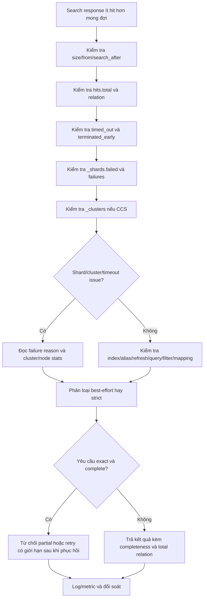

# Chẩn đoán kết quả thiếu, shard thất bại và tổng số chỉ là ước lượng

Một search request trong Elasticsearch có thể trả về HTTP thành công nhưng kết quả vẫn chưa đầy đủ. Một hoặc nhiều shard có thể thất bại, truy vấn có thể hết thời gian chờ, hoặc Elasticsearch có thể chỉ tính tổng số hit tới một ngưỡng để tiết kiệm chi phí. Vì vậy, khi ứng dụng Spring Data Elasticsearch thấy ít kết quả hơn dự kiến, không nên chỉ nhìn danh sách hit hoặc HTTP status.

Cần phân biệt ít nhất bốn khái niệm:

- **Page size**: số hit được yêu cầu trả về trong trang hiện tại (`size`).
- **Total hits**: tổng số document khớp query theo phạm vi mà Elasticsearch đã đếm.
- **Total hits relation**: tổng số đó là chính xác (`eq`) hay chỉ là cận dưới (`gte`).
- **Completeness**: kết quả có đầy đủ trên tất cả shard và hoàn thành trước timeout hay không.

Một response có thể báo `hits.total.value = 10000` với relation `gte`, nghĩa là có ít nhất 10.000 document khớp, chứ không khẳng định tổng chính xác là 10.000. Một response khác có relation `eq` nhưng một shard thất bại vẫn có thể thiếu document của shard đó. Độ chính xác của bộ đếm và tính đầy đủ của truy vấn là hai vấn đề riêng.

## 1. Phân biệt số hit trong trang và tổng số hit

Search API có thể trả về một trang nhỏ dù tổng số document khớp lớn hơn nhiều.

Ví dụ:

```http
GET products/_search
{
  "from": 0,
  "size": 20,
  "query": {
    "term": {
      "status": "ACTIVE"
    }
  }
}
```

`size: 20` yêu cầu tối đa 20 hit trong response. Nó không giới hạn tổng số document khớp query ở 20. Metadata `hits.total` cho biết số hit được đếm, nếu request đang yêu cầu theo dõi total hits.

Ví dụ response:

```json
{
  "hits": {
    "total": {
      "value": 4287,
      "relation": "eq"
    },
    "hits": [
      { "_id": "P-001", "_source": { "status": "ACTIVE" } },
      { "_id": "P-002", "_source": { "status": "ACTIVE" } }
    ]
  }
}
```

Ví dụ rút gọn chỉ hiển thị hai hit để dễ đọc; request thực tế có thể trả tối đa 20. `value: 4287` cùng `relation: eq` có nghĩa tổng được đếm chính xác là 4.287 trong lần thực thi đó.

Trong Spring Data Elasticsearch, `SearchHits<T>` thường cung cấp danh sách `getSearchHits()` và tổng số `getTotalHits()`. Tổng số hit không phải số phần tử trong list hiện tại. Ví dụ, page có 20 phần tử nhưng `getTotalHits()` có thể lớn hơn 20.

Không dùng `hits.getSearchHits().size()` làm tổng số kết quả nếu ứng dụng có pagination.

## 2. `hits.total.relation`: `eq` và `gte`

Elasticsearch biểu diễn độ chính xác của total hits bằng `relation`:

| Relation | Ý nghĩa | Cách diễn giải |
|---|---|---|
| `eq` | Tổng số hit được đếm chính xác | `value` là tổng số hit của lần search, xét trong phạm vi thực thi thành công |
| `gte` | Tổng số hit là cận dưới | Có ít nhất `value` hit; tổng thực tế có thể lớn hơn |

Ví dụ:

```json
"total": {
  "value": 10000,
  "relation": "gte"
}
```

Response này không nói tổng là đúng 10.000. Nó nói Elasticsearch đã xác định có ít nhất 10.000 hit và không tiếp tục đếm chính xác toàn bộ theo cấu hình request.

### 2.1. Vì sao Elasticsearch không luôn đếm chính xác?

Đếm chính xác toàn bộ document khớp query có thể tốn thêm công việc, đặc biệt với tập dữ liệu lớn, nhiều shard hoặc query phức tạp. Với nhiều giao diện, biết “có ít nhất 10.000 kết quả” đã đủ để hiển thị “10.000+”.

Search API có tham số `track_total_hits`:

- `true`: yêu cầu đếm chính xác toàn bộ total hits.
- `false`: không theo dõi total hits; response có thể không chứa `hits.total`.
- Một số nguyên dương: theo dõi chính xác tới ngưỡng đó; khi vượt ngưỡng, relation có thể là `gte`.

Ví dụ yêu cầu total hits chính xác:

```http
GET products/_search
{
  "track_total_hits": true,
  "query": {
    "term": {
      "status": "ACTIVE"
    }
  }
}
```

Ví dụ chỉ cần đếm chính xác tới 500:

```http
GET products/_search
{
  "track_total_hits": 500,
  "query": {
    "term": {
      "status": "ACTIVE"
    }
  }
}
```

Nếu số hit vượt ngưỡng 500, ứng dụng có thể nhận `value: 500` và `relation: gte`. Điều này phù hợp với UI chỉ cần biết có nhiều hơn 500 kết quả.

### 2.2. Mặc định và giới hạn đếm

Elasticsearch thường dùng ngưỡng mặc định 10.000 cho `track_total_hits`. Vì vậy, với query khớp nhiều hơn ngưỡng, response có thể trả `value: 10000` và `relation: gte`. Hãy kiểm tra request thực tế, vì ứng dụng có thể override tham số này hoặc tắt tracking total hits.

Không nên bật exact count cho mọi request một cách máy móc. Đếm chính xác có thể tăng chi phí query và làm giảm throughput. Hãy chọn theo hợp đồng sản phẩm:

- UI chỉ cần biết có kết quả và hiển thị “10.000+”: dùng ngưỡng hoặc không cần exact count.
- API cần tổng chính xác để đối soát hoặc báo cáo: cân nhắc `track_total_hits: true` và đo chi phí.
- Pagination thông thường: có thể dùng một ngưỡng phù hợp thay vì exact count toàn index.

### 2.3. `eq` không đồng nghĩa kết quả chắc chắn đầy đủ

`relation: eq` nói rằng bộ đếm hit của lần thực thi được báo là chính xác theo những shard đã tham gia và hoàn tất. Nếu một shard thất bại hoặc truy vấn timeout, response vẫn có thể thiếu dữ liệu từ phần chưa hoàn thành.

Vì vậy, luôn đọc `timed_out`, shard statistics và các cờ partial result bên cạnh `hits.total.relation`.

## 3. Vì sao một search có thể trả partial results?

Elasticsearch chia index thành primary shards và replica shards. Search được điều phối tới các shard liên quan; mỗi shard thực hiện phần query của mình, sau đó coordinator tổng hợp kết quả.

Nếu một shard không hoàn tất, coordinator có thể trả kết quả từ những shard thành công còn lại, tùy chính sách partial results của request/cluster.

Các nguyên nhân thường gặp:

- Shard chưa được gán hoặc đang chuyển trạng thái.
- Node chứa shard không phản hồi hoặc rời cluster.
- Shard query gặp exception do mapping, script, field hoặc dữ liệu.
- Search bị timeout trước khi tất cả shard hoàn tất.
- Circuit breaker hoặc giới hạn tài nguyên từ chối xử lý.
- Cluster đang recovery, relocation hoặc chịu tải cao.
- Remote cluster trong cross-cluster search không sẵn sàng.

Khi đó, response có thể chứa một số hit hợp lệ nhưng không đại diện toàn bộ tập document cần tìm.

## 4. Đọc shard statistics trong search response

Search response có metadata `_shards`:

```json
{
  "_shards": {
    "total": 5,
    "successful": 4,
    "skipped": 0,
    "failed": 1
  },
  "hits": {
    "total": {
      "value": 120,
      "relation": "eq"
    },
    "hits": []
  }
}
```

Ý nghĩa:

- `total`: số shard được tính trong thao tác search.
- `successful`: số shard hoàn tất thành công.
- `skipped`: số shard được bỏ qua hợp lệ nhờ cơ chế pre-filtering/optimization.
- `failed`: số shard gặp lỗi.

`skipped` không đồng nghĩa `failed`. Elasticsearch có thể xác định một shard chắc chắn không có khả năng khớp query và bỏ qua shard đó. Đây là tối ưu bình thường khi điều kiện query cho phép loại shard.

Nếu `failed > 0`, hãy xem danh sách `failures` để biết shard, index, node, status và nguyên nhân. Không chỉ log con số tổng.

Ví dụ failure rút gọn:

```json
{
  "_shards": {
    "total": 5,
    "successful": 4,
    "skipped": 0,
    "failed": 1,
    "failures": [
      {
        "shard": 2,
        "index": "products-000001",
        "node": "node-3",
        "reason": {
          "type": "query_shard_exception",
          "reason": "failed to create query"
        },
        "status": "400"
      }
    ]
  }
}
```

Response thực tế có thể chứa `root_cause`, `caused_by`, resource và thông tin chi tiết hơn. Giữ nguyên error object trong log chẩn đoán nội bộ, đồng thời tránh trả nguyên thông tin cluster cho client cuối.

## 5. `timed_out` và timeout của search

Một response có thể có:

```json
{
  "timed_out": true,
  "_shards": {
    "total": 5,
    "successful": 5,
    "skipped": 0,
    "failed": 0
  }
}
```

Ngay cả khi không có shard failure, `timed_out: true` cho biết search không hoàn thành trong giới hạn thời gian được yêu cầu. Tùy execution path, response có thể chứa một phần hit đã thu thập được.

Có thể đặt timeout trong Search API:

```http
GET products/_search?timeout=2s
{
  "query": {
    "match": {
      "name": "wireless headphones"
    }
  }
}
```

Timeout là giới hạn chờ cho xử lý search theo semantics của API; nó không phải cách bảo đảm mọi shard đã hoàn thành. Nếu SLO yêu cầu kết quả đầy đủ, cần coi `timed_out: true` là trạng thái incomplete và không báo kết quả như một search thành công đầy đủ.

Timeout ở gateway, Spring client và Elasticsearch cũng là các lớp khác nhau. Một HTTP client timeout có thể khiến ứng dụng không nhận được response metadata để biết server đã xử lý tới đâu. Phân biệt:

- Elasticsearch search response có `timed_out: true`.
- Client timeout khi chờ response.
- Gateway timeout trước khi backend hoàn tất.

Mỗi loại cần quan sát ở tầng tương ứng.

## 6. `allow_partial_search_results`

Elasticsearch có tùy chọn `allow_partial_search_results` để quyết định có chấp nhận trả partial result khi shard failure hay không.

Ví dụ cho phép partial result:

```http
GET products/_search?allow_partial_search_results=true
{
  "query": {
    "match_all": {}
  }
}
```

Ví dụ yêu cầu tất cả shard liên quan phải thành công:

```http
GET products/_search?allow_partial_search_results=false
{
  "query": {
    "match_all": {}
  }
}
```

Khi không cho phép partial results, shard failure có thể làm toàn bộ search request trả lỗi thay vì trả một tập hit không đầy đủ. Đây là lựa chọn phù hợp cho một số API báo cáo, đối soát hoặc nghiệp vụ yêu cầu kết quả đầy đủ.

Không có một policy đúng cho mọi endpoint:

| Use case | Policy có thể phù hợp |
|---|---|
| Gợi ý/autocomplete, chấp nhận thiếu tạm thời một phần kết quả | Có thể chấp nhận partial result nhưng cần telemetry/cờ cảnh báo |
| Dashboard vận hành, dữ liệu gần đúng được chấp nhận | Có thể cho partial result và hiển thị trạng thái dữ liệu |
| Báo cáo tài chính/đối soát cần đủ dữ liệu | Cân nhắc từ chối partial result và báo lỗi rõ ràng |
| Export toàn bộ dữ liệu theo điều kiện | Thường cần strict completeness, kiểm tra shard failure và timeout |
| Search tương tác thông thường | Quyết định theo sản phẩm; không được âm thầm coi partial là đầy đủ |

Tùy chọn này không thay thế việc kiểm tra `timed_out` và total hits relation. Một request có thể timeout mà không có shard failure; `allow_partial_search_results=false` không tự biến mọi response thành exact/complete nếu query bị giới hạn theo cách khác.

## 7. Early termination với `terminate_after`

Search API có thể giới hạn số document được thu thập ở mỗi shard bằng `terminate_after`:

```http
GET products/_search?terminate_after=1000
{
  "query": {
    "term": {
      "status": "ACTIVE"
    }
  }
}
```

Tham số này dừng thu thập sau ngưỡng chỉ định trên từng shard trong query phase. Response có thể báo `terminated_early: true`.

Đây là một cơ chế tối ưu có chủ đích khi ứng dụng chỉ cần một tập kết quả giới hạn. Nó không phù hợp nếu cần:

- Tất cả document khớp query.
- Tổng số hit chính xác.
- Aggregation đại diện toàn bộ tập dữ liệu.
- Export hoặc reconciliation đầy đủ.

Đừng nhầm `terminate_after` với `size`. `size` giới hạn số hit được trả về sau khi search xử lý; `terminate_after` có thể dừng thu thập sớm trên từng shard và ảnh hưởng tính đầy đủ của kết quả.

## 8. Cross-cluster search và kết quả một phần

Nếu ứng dụng tìm kiếm trên nhiều cluster, response có thể chứa metadata `_clusters` ngoài `_shards`. Các cluster từ xa có thể thành công, thất bại, bị bỏ qua hoặc trả partial result.

Ví dụ khái niệm:

```json
{
  "_clusters": {
    "total": 3,
    "successful": 2,
    "skipped": 0,
    "running": 0,
    "partial": 0,
    "failed": 1
  }
}
```

Với cross-cluster search, cần kiểm tra cả trạng thái cluster từ xa và shard bên trong mỗi cluster. Cấu hình `skip_unavailable` có thể cho phép bỏ qua remote cluster không sẵn sàng trong một số thiết lập; khi đó response không nhất thiết thất bại toàn bộ.

Nếu nghiệp vụ yêu cầu tất cả nguồn dữ liệu, không được coi việc remote cluster bị skip là thành công đầy đủ. API nên trả trạng thái partial/unavailable hoặc fail theo hợp đồng.

## 9. Total hits chính xác vẫn có thể thiếu dữ liệu

Đây là một trường hợp dễ gây hiểu nhầm:

```json
{
  "timed_out": false,
  "_shards": {
    "total": 5,
    "successful": 4,
    "skipped": 0,
    "failed": 1
  },
  "hits": {
    "total": {
      "value": 120,
      "relation": "eq"
    }
  }
}
```

`relation: eq` không chứng minh tổng toàn bộ index là 120, vì một shard không tham gia thành công. Nó chỉ nói count mà response báo là exact theo phần thực thi đã hoàn tất. Nếu shard thất bại chứa document phù hợp, các document đó không nằm trong kết quả.

Ngược lại, một response có tất cả shard thành công nhưng `relation: gte` có thể đầy đủ về shard execution nhưng tổng hit chỉ là cận dưới do `track_total_hits` threshold.

Do đó, nên xem completeness như một trạng thái tổng hợp từ nhiều tín hiệu:

- `timed_out` phải false.
- `shards.failed` phải bằng 0.
- Với cross-cluster search, các cluster bắt buộc phải ở trạng thái thành công và không partial.
- `terminated_early` phải false nếu cần toàn bộ kết quả.
- `hits.total.relation` phải là `eq` nếu cần exact count.
- Query phải không bị giới hạn bởi pagination, filter hoặc policy ngoài ý muốn.

## 10. Chẩn đoán kết quả thiếu không phải lúc nào cũng do shard

Nếu shard đều thành công và không timeout, kết quả vẫn có thể ít hơn mong đợi do query hoặc cách truy cập index.

### 10.1. Sai index, alias hoặc data stream

Kiểm tra index/alias mà request thực sự truy cập:

```http
GET _resolve/index/products
GET _alias/products
```

Các nguyên nhân thường gặp:

- Alias chưa trỏ tới index mới sau rollover.
- Search đang đọc read alias khác write alias.
- Index pattern không bao gồm index mới.
- Query gửi tới một index cụ thể trong khi document được ghi ở index khác.
- Data stream backing index thay đổi theo thời gian.

Không nhận index name tùy ý từ request người dùng nếu service phải kiểm soát phạm vi dữ liệu.

### 10.2. Chưa refresh sau write

Elasticsearch là near-real-time. Write có thể được xác nhận trước khi document xuất hiện trong search. GET theo ID thường realtime, còn search chỉ nhìn thấy segment đã refresh.

Nếu vừa ghi rồi search ngay, kiểm tra refresh policy (`false`, `true`, `wait_for`) và refresh interval. Trong test, gọi refresh tường minh thay vì `Thread.sleep()`.

### 10.3. Filter, tenant và security policy

Kiểm tra các điều kiện được thêm bởi service:

- Tenant/owner filter.
- Soft-delete hoặc status filter.
- Date range và timezone.
- `post_filter`.
- `min_score`.
- Alias filter.
- Document-level security (DLS) hoặc field-level security (FLS).
- Routing hoặc preference được truyền vào request.

Nếu service thêm tenant filter từ principal, một query người dùng nhìn thấy trên log có thể không phải toàn bộ query cuối cùng. Cần log query class/correlation ID và filter metadata đã được masking để đối chiếu.

### 10.4. Mapping và analyzer

Một query match có thể không trả document do analyzer/tokenization khác dự kiến, field sai kiểu hoặc query đang dùng subfield không tồn tại.

Kiểm tra mapping:

```http
GET products/_mapping
```

Kiểm tra analyzer với Analyze API khi cần:

```http
POST products/_analyze
{
  "field": "name",
  "text": "Wireless Headphones"
}
```

Đừng dùng exact `term` query trên field `text` khi mục tiêu là exact match; thường cần field `keyword` tương ứng. Ngược lại, `match` trên keyword không có semantics phân tích từ như text.

### 10.5. Pagination và sort

Nếu response chỉ có 20 hit, kiểm tra `size`, `from`, `search_after` và cursor. `hits.total` không phải số phần tử trong page.

Sort có thể khiến người dùng nghĩ thiếu dữ liệu nếu chỉ xem trang đầu. Khi dùng `search_after`, cần giữ sort values và query/PIT nhất quán. Với pagination sâu, cân nhắc Point in Time (PIT) kết hợp `search_after` thay vì tăng `from` vô hạn.

### 10.6. Collapse và aggregation

Field collapse có thể trả một hit đại diện cho mỗi giá trị field, nên số hit ít hơn số document khớp. Aggregation có thể dùng `post_filter` hoặc filter aggregation với scope khác nhau. Kiểm tra semantics query thay vì kết luận lỗi shard.

## 11. Đọc response bằng Elasticsearch Java API Client

Khi cần metadata chi tiết hơn Spring Data abstraction đang expose, có thể dùng Elasticsearch Java API Client trong một adapter chẩn đoán.

Ví dụ đọc các cờ chính:

```java
SearchResponse<ProductDocument> response = client.search(
    request -> request
        .index("products")
        .query(query -> query
            .term(term -> term
                .field("status")
                .value("ACTIVE")
            )
        )
        .trackTotalHits(track -> track.enabled(true)),
    ProductDocument.class
);

boolean timedOut = response.timedOut();
long failedShards = response.shards().failed();
long successfulShards = response.shards().successful();
boolean terminatedEarly = Boolean.TRUE.equals(response.terminatedEarly());

var totalHits = response.hits().total();
if (totalHits != null) {
    long totalValue = totalHits.value();
    var relation = totalHits.relation();
    log.info("totalHits={}, relation={}", totalValue, relation);
}

response.shards().failures().forEach(failure ->
    log.warn(
        "Search shard failure: index={}, shard={}, node={}, status={}, reason={}",
        failure.index(),
        failure.shard(),
        failure.node(),
        failure.status(),
        failure.reason()
    )
);
```

Tên builder và generated type có thể thay đổi theo version Elasticsearch Java API Client; hãy xác nhận signature của dependency dự án. Ý nghĩa cần kiểm tra là timeout, shard counters, early termination, total hits value/relation và danh sách failure.

Nếu muốn dùng threshold thay vì exact count, builder có thể nhận ngưỡng `trackTotalHitsUpTo(...)` tùy phiên bản client. Đừng bật exact count trong code chẩn đoán rồi để mặc định thành production behavior mà chưa đo chi phí.

## 12. Đọc metadata qua Spring Data Elasticsearch

Với `ElasticsearchOperations.search(...)`, kết quả thường được trả dưới dạng `SearchHits<T>`:

```java
SearchHits<ProductDocument> searchHits = operations.search(
    query,
    ProductDocument.class,
    IndexCoordinates.of("products")
);

long totalHits = searchHits.getTotalHits();
List<SearchHit<ProductDocument>> hits = searchHits.getSearchHits();
```

`getTotalHits()` trả tổng count được response cung cấp; không nên tự giả định đó luôn là exact. Tùy release, `SearchHits` có thể expose thêm total-hits relation, execution duration và `SearchShardStatistics`. Hãy kiểm tra API version đang dùng để đọc các metadata này.

Nếu abstraction hiện tại chỉ expose tổng hit nhưng không expose đầy đủ failure reason, có thể:

- Dùng Java API Client ở một adapter riêng cho endpoint cần completeness metadata.
- Mở rộng adapter để giữ metadata từ raw response nếu API Spring Data cho phép.
- Dùng logging/observability ở client transport hoặc tầng cluster.

Không nên âm thầm bỏ metadata lỗi chỉ vì DTO hiện tại chỉ chứa `List<T>`. Nếu nghiệp vụ cần kết quả đầy đủ, service phải biết request có timeout/shard failure hay không trước khi báo thành công.

### 12.1. SearchHits và SearchPage

Khi dùng Spring Data Repository, `SearchPage<T>` hoặc `SearchHits<T>` có thể cung cấp thông tin về kết quả, page và total hits. Tuy nhiên, page abstraction không tự giải quyết vấn đề partial shard response hoặc total hits relation. Hãy xem raw search metadata khi completeness là yêu cầu nghiệp vụ.

## 13. Thiết kế response API có trạng thái completeness

Không nên trả một list hit đơn giản nếu client cần biết dữ liệu có đầy đủ không. Có thể thiết kế response envelope:

```java
public record SearchCompleteness(
    boolean complete,
    boolean timedOut,
    long totalShards,
    long successfulShards,
    long skippedShards,
    long failedShards,
    boolean totalHitsExact,
    boolean terminatedEarly
) {
}

public record ProductSearchResponse(
    List<ProductResponse> items,
    long totalHits,
    String totalHitsRelation,
    SearchCompleteness completeness
) {
}
```

`complete` là trạng thái tổng hợp do ứng dụng tính theo hợp đồng. Ví dụ, endpoint export có thể yêu cầu `failedShards == 0`, `timedOut == false`, `terminatedEarly == false` và không có remote cluster partial. `totalHitsExact` phản ánh relation `eq`, nhưng không tự bảo đảm complete nếu shard fail.

Ví dụ response:

```json
{
  "items": [],
  "totalHits": 10000,
  "totalHitsRelation": "gte",
  "completeness": {
    "complete": true,
    "timedOut": false,
    "totalShards": 5,
    "successfulShards": 5,
    "skippedShards": 0,
    "failedShards": 0,
    "totalHitsExact": false,
    "terminatedEarly": false
  }
}
```

Response này có thể đầy đủ về shard execution nhưng total count chỉ là cận dưới. Client có thể hiển thị “10.000+”.

Một response khác có thể có `totalHitsRelation: eq` nhưng `failedShards: 1`, khi đó `complete` phải false nếu endpoint yêu cầu mọi shard.

## 14. Chính sách strict và best-effort

Hai kiểu endpoint có thể cần chính sách khác nhau:

### Best-effort search

Phù hợp với một số trải nghiệm tương tác:

- Cho phép partial results.
- Vẫn hiển thị hit đã nhận được.
- Gắn cờ partial/incomplete trong response hoặc telemetry.
- Không hiển thị exact count nếu relation là `gte`.
- Có thể đề nghị người dùng thử lại khi dữ liệu chưa đầy đủ.

### Strict search

Phù hợp với báo cáo, export hoặc đối soát:

- Không chấp nhận shard failure.
- Không chấp nhận timeout hoặc early termination.
- Có thể đặt `allow_partial_search_results=false`.
- Yêu cầu exact total hits nếu nghiệp vụ cần tổng chính xác.
- Nếu response không đầy đủ, trả lỗi có mã rõ ràng thay vì list một phần như kết quả cuối cùng.

Không dùng một cờ `complete` chung cho mọi endpoint nếu semantics sản phẩm khác nhau. Ghi rõ endpoint nào chấp nhận partial và endpoint nào yêu cầu strict completeness.

## 15. Chẩn đoán shard failure ở cluster

Khi response có `failed > 0`, bắt đầu từ failure reason rồi đối chiếu trạng thái cluster.

Các API hữu ích:

```http
GET _cluster/health
GET _cat/nodes?v
GET _cat/shards/products?v
GET _cluster/pending_tasks
GET _nodes/stats/jvm,process,os,fs,thread_pool,breaker
```

Nếu shard unassigned, xem allocation explain:

```http
GET _cluster/allocation/explain
{
  "index": "products",
  "shard": 2,
  "primary": false
}
```

Các nguyên nhân cần kiểm tra:

- Node bị mất kết nối hoặc restart.
- Disk watermark ngăn allocation.
- Không đủ node phù hợp để allocate replica.
- Shard đang initializing/relocating.
- Circuit breaker hoặc heap pressure.
- Search thread pool queue đầy hoặc request bị rejected.
- Mapping/script/query exception trên một shard cụ thể.
- Index bị đóng hoặc shard recovery chưa hoàn tất.

`yellow` cluster health thường có nghĩa primary shards đã được allocate nhưng một số replica chưa được allocate; điều đó không tự động có nghĩa search thất bại. Ngược lại, `red` thường cho biết ít nhất một primary shard chưa được allocate và có thể làm dữ liệu của shard đó không khả dụng. Dù health là green, một request cụ thể vẫn có thể timeout hoặc gặp query exception.

Cluster health là tín hiệu tổng quan, không thay thế shard metadata của response search.

## 16. Rejection, circuit breaker và resource failure

Search có thể thất bại khi cluster thiếu tài nguyên:

- Search thread pool queue đầy và request bị reject.
- Request circuit breaker ngăn một request tiêu thụ quá nhiều heap.
- Fielddata hoặc aggregation cần quá nhiều memory.
- Disk I/O hoặc merge pressure làm latency tăng và timeout.
- Node restart hoặc GC pause kéo dài.

Khi thấy rejection/429/503 hoặc breaker error:

1. Kiểm tra node stats và thread pool queue/rejected counters.
2. Kiểm tra heap/GC và breaker statistics.
3. Xem query có aggregation cardinality cao, script hoặc nested expansion lớn không.
4. Giảm concurrency/batch size hoặc giới hạn bucket/page size.
5. Chỉ retry có backoff và jitter khi lỗi tạm thời, tránh retry storm.

Không tăng timeout vô hạn để che một cluster đang quá tải. Timeout dài hơn có thể giữ request và tài nguyên lâu hơn, làm hàng đợi xấu thêm.

## 17. Kiểm tra total hits trong Java code

Một service nên giữ cả giá trị và relation, thay vì chỉ lấy một `long` rồi giả định exact:

```java
public record TotalHitsInfo(long value, String relation) {

    public boolean isExact() {
        return "eq".equalsIgnoreCase(relation);
    }
}
```

Khi dùng Java API Client:

```java
var total = response.hits().total();

TotalHitsInfo totalInfo = total == null
    ? null
    : new TotalHitsInfo(
        total.value(),
        total.relation().toString()
    );
```

Đây là cách minh họa việc giữ relation. Trong ứng dụng thật, nên dùng enum/domain type thay vì string nếu muốn tránh lỗi chính tả. Nếu `track_total_hits` bị tắt, `total` có thể null; API response phải biểu diễn trường hợp không có total count.

Không viết:

```java
long exactTotal = response.hits().total().value();
```

rồi trả field tên `exactTotal` mà không kiểm tra `relation` hoặc null.

## 18. Pagination và tổng số kết quả

Pagination có thể khiến người dùng nghĩ dữ liệu bị thiếu:

- `size` là số hit trong page.
- `from` là offset của page.
- `search_after` dùng sort values của hit cuối trang trước.
- PIT giữ một view dữ liệu ổn định hơn trong quá trình duyệt nhiều trang.

Với deep pagination, `from`/`size` lớn làm Elasticsearch phải giữ và xử lý nhiều hit trung gian. `search_after` thường phù hợp hơn khi cần duyệt sâu.

Ví dụ:

```http
GET products/_search
{
  "size": 100,
  "sort": [
    { "createdAt": "asc" },
    { "sortKey": "asc" }
  ],
  "search_after": [
    "2026-01-10T08:00:00Z",
    "P-100"
  ],
  "query": {
    "match_all": {}
  }
}
```

Sort phải ổn định và có tie-breaker duy nhất để tránh hit bị lặp hoặc bỏ qua giữa các trang. Với dữ liệu thay đổi trong lúc pagination, cân nhắc PIT để giữ snapshot search nhất quán.

`hits.total` mô tả tổng match, còn page hiện tại chỉ là lát cắt. Nếu UI cần “còn trang tiếp theo không?”, đôi khi chỉ cần fetch `pageSize + 1` hit thay vì đếm chính xác toàn bộ.

## 19. Aggregation cũng có thể không đầy đủ

Aggregation được tính trên các shard tham gia. Nếu shard thất bại hoặc query timeout, buckets và metric aggregation có thể không đại diện toàn bộ tập dữ liệu.

Với terms aggregation, còn có các metadata riêng như `doc_count_error_upper_bound` và `sum_other_doc_count` tùy aggregation/order. Những field này nói về sai số/nhóm bucket bị bỏ qua của aggregation, khác với shard failure.

Không suy luận aggregation chính xác chỉ vì `hits.total.relation` là `eq`. Hãy kiểm tra:

- Shard success/failure và timeout.
- Aggregation-specific error bounds.
- `size` của terms buckets và `shard_size`.
- `min_doc_count`, include/exclude và filter scope.
- `post_filter` so với query filter.

Nếu cần đối soát tổng hợp chính xác, hãy thiết kế aggregation phù hợp, kiểm tra error bounds và yêu cầu shard completeness.

## 20. Kiểm thử partial result và total hits relation

Integration test nên kiểm tra riêng từng semantics:

1. Query ít document hơn threshold trả relation exact (`eq`) nếu mọi shard thành công.
2. Query nhiều document hơn threshold trả relation lower-bound (`gte`) khi dùng threshold.
3. `track_total_hits: true` yêu cầu exact count và chi phí được đo phù hợp.
4. `track_total_hits: false` xử lý trường hợp total metadata không có.
5. `size` nhỏ hơn tổng match vẫn trả page nhỏ và total lớn.
6. Shard failure được phát hiện và không bị báo nhầm là complete.
7. `timed_out: true` được biểu diễn là incomplete.
8. `terminated_early: true` không được dùng như kết quả đầy đủ.
9. Cross-cluster partial/failed được xử lý nếu hệ thống sử dụng CCS.
10. Aggregation error bounds được kiểm tra khi nghiệp vụ cần số liệu chính xác.

Không nên cố tình làm hỏng shard trong mọi test suite thông thường. Có thể kiểm thử response handling bằng fixture/mock response ở unit test, sau đó dùng một integration test chuyên biệt cho failure behavior trên cluster được kiểm soát.

## 21. Những lỗi thường gặp

| Hiện tượng | Nguyên nhân có thể | Cách xử lý |
|---|---|---|
| Trang chỉ có 20 hit dù total lớn | `size` được đặt là 20 | Đây là pagination bình thường; xem total hits và page tiếp theo. |
| Total luôn là 10.000 | `track_total_hits` dùng ngưỡng mặc định | Đọc `relation`; dùng exact count khi thực sự cần. |
| UI hiển thị “10.000 kết quả” nhưng thực tế nhiều hơn | Bỏ qua relation `gte` | Hiển thị “10.000+” hoặc tăng ngưỡng. |
| `relation=eq` nhưng vẫn thiếu dữ liệu | Một shard thất bại hoặc request partial | Kiểm tra `timed_out`, `_shards.failed` và `_clusters`. |
| Search trả HTTP 200 nhưng thiếu hit | Partial search results được cho phép | Kiểm tra shard failures và completeness policy. |
| `failed=0` nhưng kết quả chưa đầy đủ | `timed_out`, `terminated_early`, filter hoặc query scope | Kiểm tra mọi cờ và query cuối cùng. |
| Shard `skipped` bị coi là lỗi | Nhầm skipped với failed | Xác minh pre-filtering; skipped thường là tối ưu hợp lệ. |
| Search timeout trên một số shard | Query nặng, cluster quá tải hoặc timeout quá thấp | Dùng slow log/Profile API và kiểm tra node stats. |
| Kết quả thiếu sau khi vừa ghi | Chưa refresh | Dùng refresh policy hoặc refresh tường minh. |
| Một tenant thấy ít kết quả hơn | Tenant/DLS/alias filter | Kiểm tra principal và filter cuối cùng. |
| Search theo ID không tìm thấy document có custom routing | Thiếu routing cần thiết cho GET theo ID | Gửi đúng routing đã dùng khi index. |
| Aggregation count thấp hơn dự kiến | Shard partial, bucket size hoặc error bound | Kiểm tra shard metadata và aggregation-specific metadata. |
| Cross-cluster search thiếu một nguồn | Remote cluster partial/failed/skipped | Kiểm tra `_clusters` và chính sách `skip_unavailable`. |
| Retry làm cluster quá tải hơn | Retry ngay, không backoff | Giới hạn retry, exponential backoff và jitter. |

## 22. Quy trình chẩn đoán một response search thiếu



Các bước thực tế:

1. Xác nhận `size`, `from`, `search_after`, sort và page hiện tại.
2. Đọc `hits.total.value` cùng `hits.total.relation`; không tự coi `gte` là exact.
3. Kiểm tra `timed_out` và `terminated_early`.
4. Kiểm tra `_shards.total/successful/skipped/failed` và từng entry trong `failures`.
5. Nếu dùng cross-cluster search, kiểm tra `_clusters` và remote cluster state.
6. Nếu shard failure, đối chiếu cluster health, shard allocation, node stats, rejection, breaker và logs.
7. Nếu không có failure, kiểm tra index/alias, refresh, query, routing, tenant filter, DLS/FLS, analyzer và mapping.
8. Xác định endpoint chấp nhận best-effort hay cần strict completeness.
9. Giữ total hits relation và completeness metadata trong response nội bộ/API khi cần.
10. Chỉ retry khi lỗi tạm thời, có giới hạn và có backoff; tránh retry storm.
11. Với báo cáo/export, không phát hành kết quả một phần như dữ liệu đầy đủ.

## 23. Kết luận

Kết quả search thiếu có thể xuất phát từ pagination, total hits threshold, timeout, shard failure, early termination, index/alias sai, refresh chưa xảy ra hoặc filter/analyzer không như dự kiến. Hãy tách riêng page size, total hits, total hits relation và completeness của quá trình thực thi.

`hits.total.relation = eq` có nghĩa count được báo là exact theo phạm vi thực thi, còn `gte` là cận dưới. `track_total_hits: true` yêu cầu exact count nhưng có thể tăng chi phí; giá trị số đặt ngưỡng, còn `false` có thể bỏ total metadata. Một trang có 20 hit vẫn có thể thuộc tập 4.000 document khớp query.

`_shards.failed`, `timed_out`, `terminated_early` và `_clusters` là những tín hiệu quan trọng để nhận diện partial results. `skipped` thường là tối ưu pre-filter hợp lệ, không phải lỗi. Ngay cả relation `eq` cũng không chứng minh kết quả đầy đủ nếu shard hoặc remote cluster thất bại. Với Spring Data Elasticsearch, giữ `SearchHits` metadata và dùng Java API Client/adapter khi cần failure detail mà abstraction không expose.

Thiết kế rõ hai chính sách: best-effort search có thể trả hit kèm trạng thái partial; strict search cho báo cáo/export phải từ chối timeout, shard failure hoặc early termination theo hợp đồng. Kết hợp kiểm tra response metadata, query scope, cluster health, shard allocation và observability sẽ giúp ứng dụng phân biệt được “không có dữ liệu”, “chỉ có một trang dữ liệu”, “tổng là cận dưới” và “kết quả chưa đầy đủ”.
