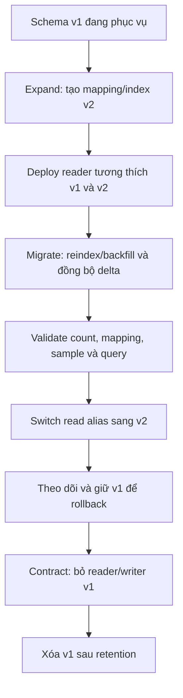
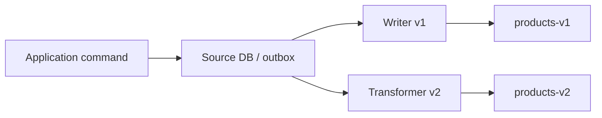
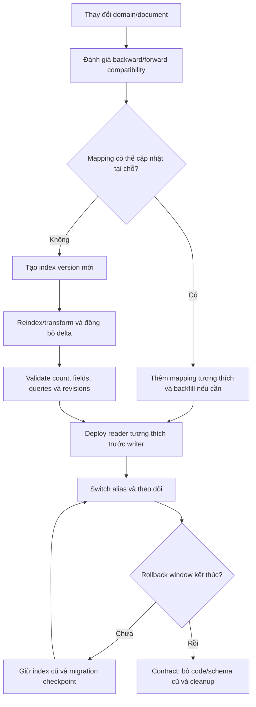

# Quản lý phiên bản Document và index schema

Document trong Elasticsearch thường tồn tại lâu hơn một phiên bản ứng dụng. Khi domain thay đổi, một field mới có thể xuất hiện, kiểu dữ liệu có thể thay đổi, analyzer có thể được điều chỉnh hoặc cấu trúc object có thể chuyển thành nested. Nếu chỉ sửa Java entity rồi triển khai ứng dụng mới, index đang tồn tại vẫn giữ mapping cũ và dữ liệu cũ vẫn có cấu trúc cũ.

Vì vậy, ứng dụng Spring Data Elasticsearch cần quản lý riêng **phiên bản cấu trúc document** và **phiên bản schema của index**. Một document có thể được tạo bởi ứng dụng phiên bản cũ nhưng được đọc bởi ứng dụng phiên bản mới; một index mới có thể có mapping khác index cũ; nhiều phiên bản ứng dụng có thể cùng chạy trong thời gian rolling deployment.

Có ba khái niệm rất dễ nhầm:

- **Document schema version**: phiên bản cấu trúc dữ liệu nghiệp vụ được lưu trong `_source`, thường bằng field như `schemaVersion`.
- **Index schema version**: phiên bản mapping/settings/template của một index, thường thể hiện qua tên index như `products-v1`, `products-v2` hoặc metadata của template/mapping.
- **Concurrency version**: phiên bản dùng để phát hiện cập nhật đồng thời, ví dụ Elasticsearch `_version` hoặc Spring Data `@Version`. Nó không mô tả cấu trúc document.

Quản lý đúng ba khái niệm này giúp ứng dụng đọc dữ liệu cũ, triển khai thay đổi an toàn, reindex có kiểm soát và rollback khi migration gặp sự cố.

## 1. Vì sao document và index cần versioning?

Giả sử phiên bản đầu của catalog lưu sản phẩm như sau:

```json
{
  "id": "P-100",
  "name": "Wireless Headphones",
  "price": 129900,
  "category": "audio"
}
```

Sau đó domain yêu cầu:

- Giá phải lưu theo đơn vị nhỏ nhất để tránh sai số tiền tệ.
- Category chuyển thành object có mã và tên.
- Sản phẩm cần có `availability` và `brandId`.
- Tên sản phẩm cần một analyzer mới hỗ trợ tìm kiếm đa ngôn ngữ.

Document mới có thể trở thành:

```json
{
  "id": "P-100",
  "schemaVersion": 2,
  "name": "Wireless Headphones",
  "priceInCents": 129900,
  "category": {
    "id": "audio",
    "name": "Audio"
  },
  "brandId": "B-10",
  "availability": "IN_STOCK"
}
```

Chỉ đổi entity Java không tự chuyển những document cũ. Index hiện tại cũng không tự đổi mapping của `category` từ `keyword` sang `object`, hoặc đổi kiểu `price` sang kiểu mới. Nếu ứng dụng đọc document cũ như thể chúng đã có cấu trúc mới, có thể gặp null, lỗi convert, query không khớp hoặc kết quả tìm kiếm không nhất quán.

Versioning giúp trả lời:

- Document này được ghi theo cấu trúc nào?
- Index này được tạo với mapping/settings nào?
- Ứng dụng hiện tại có đọc được document/index cũ không?
- Khi thay đổi field type hoặc analyzer, dữ liệu cũ được chuyển đổi ra sao?
- Có thể chạy đồng thời ứng dụng cũ và mới trong rolling deployment không?
- Nếu migration lỗi, có thể quay lại index trước không?

## 2. Phân biệt document schema version, index version và concurrency version

| Khái niệm | Nơi lưu | Mục đích | Ví dụ |
|---|---|---|---|
| Document schema version | Field trong `_source` | Nhận biết định dạng của từng document | `schemaVersion: 2` |
| Index schema version | Tên index, template hoặc metadata | Nhận biết mapping/settings của index | `products-v2` |
| Elasticsearch `_version` | Metadata của document trong Elasticsearch | Theo dõi phiên bản write/concurrency theo semantics của Elasticsearch | `_version: 17` |
| Spring Data `@Version` | Property entity được ánh xạ tới metadata version | Optimistic locking khi cập nhật entity | `@Version private Long version;` |

`schemaVersion` không tăng sau mỗi lần cập nhật document. Nó chỉ thay đổi khi cấu trúc document thay đổi theo một phiên bản schema mới.

Ngược lại, `_version` có thể tăng qua các lần ghi document và phục vụ kiểm soát cập nhật. Không dùng `_version` để quyết định document đang ở schema v1 hay v2.

`@Version` của Spring Data là cơ chế optimistic locking; không phải annotation khai báo phiên bản schema. Một entity có thể có `schemaVersion = 2` nhưng concurrency version là `17`.

## 3. Thiết kế document có schema version

Nếu ứng dụng cần đọc nhiều định dạng document trong cùng index, có thể lưu version rõ ràng trong `_source`:

```java
import org.springframework.data.annotation.Id;
import org.springframework.data.elasticsearch.annotations.Document;
import org.springframework.data.elasticsearch.annotations.Field;
import org.springframework.data.elasticsearch.annotations.FieldType;

@Document(indexName = "products-write")
public class ProductDocument {

    @Id
    private String id;

    @Field(type = FieldType.Integer)
    private Integer schemaVersion;

    @Field(type = FieldType.Keyword)
    private String name;

    @Field(type = FieldType.Long)
    private Long priceInCents;

    protected ProductDocument() {
    }

    public Integer getSchemaVersion() {
        return schemaVersion;
    }
}
```

Khi tạo document mới, service đặt schema version theo phiên bản writer hiện tại:

```java
private static final int CURRENT_SCHEMA_VERSION = 2;

public ProductDocument createProduct(CreateProductRequest request) {
    ProductDocument document = new ProductDocument();
    document.setSchemaVersion(CURRENT_SCHEMA_VERSION);
    document.setName(request.name());
    document.setPriceInCents(request.priceInCents());
    return document;
}
```

Field version nên có kiểu số và mapping tường minh. Tránh lưu version dưới dạng chuỗi nếu không có lý do tương thích đặc biệt.

### 3.1. Có phải document nào cũng cần `schemaVersion`?

Không phải mọi ứng dụng đều cần field này. Nếu index chỉ chứa một schema đồng nhất và mọi thay đổi đều được thực hiện bằng reindex hoàn chỉnh, index name/version cùng migration history có thể đủ.

Field `schemaVersion` hữu ích khi:

- Cùng một index tạm thời chứa document được ghi bởi nhiều phiên bản writer.
- Consumer cần biết cách diễn giải document cũ.
- Có migration từng bước, chưa thể chuyển hết dữ liệu cùng lúc.
- Một event hoặc job cần xác định transformation/upcaster phù hợp.
- Cần đo số document còn ở schema cũ.

Nếu mỗi index chỉ chứa một schema version, field này vẫn có thể hữu ích cho kiểm tra dữ liệu, nhưng không bắt buộc phải nhân đôi metadata nếu không có use case.

### 3.2. Mapping `_meta` không phải document version

Elasticsearch mapping hỗ trợ metadata `_meta` ở cấp mapping. Có thể lưu thông tin như schema owner, mapping revision hoặc migration identifier trong đó. `_meta` mô tả mapping/index, không phải field của từng document trong `_source`.

Ví dụ:

```json
PUT products-v2
{
  "mappings": {
    "_meta": {
      "schemaVersion": 2,
      "migration": "products-v1-to-v2"
    },
    "properties": {
      "schemaVersion": { "type": "integer" },
      "name": { "type": "text" },
      "priceInCents": { "type": "long" }
    }
  }
}
```

Ở đây `_meta.schemaVersion` là version của mapping; `properties.schemaVersion` là field version được lưu trên từng document. Hai thông tin có cùng tên nhưng phạm vi khác nhau.

## 4. Quản lý index schema bằng index name có version

Một chiến lược phổ biến là tạo index vật lý có tên versioned:

```text
products-v1
products-v2
products-v3
```

Tên index cho biết schema/mapping contract của index đó. Ứng dụng truy cập qua alias ổn định:

```text
products-read  -> products-v2
products-write -> products-v2 (is_write_index = true)
```

Khi chuẩn bị schema mới, tạo `products-v3`, nạp và xác minh dữ liệu, sau đó chuyển alias. Client tiếp tục dùng alias mà không cần biết index vật lý nào đang active.

### 4.1. Vì sao không ghi trực tiếp vào tên index versioned?

Nếu mọi service hard-code `products-v2`, mỗi lần migration phải cập nhật cấu hình và triển khai lại nhiều nơi. Alias tách hợp đồng truy cập khỏi index vật lý:

- Service sử dụng `products-read` để search.
- Service sử dụng `products-write` để index/update.
- Migration tạo index version mới độc lập.
- Alias switch thay đổi đích đọc/ghi mà không đổi code gọi repository.

Trong ứng dụng Spring Data, `@Document(indexName = "products-write")` có thể trỏ tới write alias nếu cấu hình alias và index tương ứng đúng. Các thao tác đọc cũng có thể dùng alias read riêng qua `IndexCoordinates` hoặc repository mapping thích hợp. Cần xác nhận API và cách Spring Data resolve index/alias trong phiên bản dự án.

## 5. Mapping và settings là schema contract

Mapping quyết định cách Elasticsearch lưu và tìm kiếm field. Những phần quan trọng gồm:

- Field type: `keyword`, `text`, `long`, `integer`, `date`, `boolean`, `object`, `nested`, `geo_point`...
- Analyzer và normalizer.
- Multi-fields, ví dụ `name` và `name.keyword`.
- Nested paths và object structure.
- `doc_values`, `index`, `store` và các tham số mapping khác.
- Dynamic mapping policy.
- Index settings như shard count, replica count, refresh interval và analysis settings.

Mapping không chỉ là metadata cho converter. Nó ảnh hưởng trực tiếp query semantics, sort, aggregation, storage và hiệu năng.

Ví dụ mapping có chủ đích:

```json
PUT products-v2
{
  "settings": {
    "number_of_shards": 3,
    "number_of_replicas": 1,
    "analysis": {
      "analyzer": {
        "product_name": {
          "type": "custom",
          "tokenizer": "standard",
          "filter": ["lowercase"]
        }
      }
    }
  },
  "mappings": {
    "dynamic": "strict",
    "_meta": {
      "schemaVersion": 2
    },
    "properties": {
      "schemaVersion": { "type": "integer" },
      "name": {
        "type": "text",
        "analyzer": "product_name",
        "fields": {
          "keyword": { "type": "keyword" }
        }
      },
      "priceInCents": { "type": "long" },
      "category": {
        "properties": {
          "id": { "type": "keyword" },
          "name": { "type": "keyword" }
        }
      },
      "availability": { "type": "keyword" }
    }
  }
}
```

`dynamic: strict` từ chối document có field không được khai báo. Điều này phát hiện sớm writer gửi field ngoài schema, nhưng đòi hỏi mapping được cập nhật trước khi triển khai writer mới. Nếu chọn `dynamic: false`, field chưa khai báo có thể nằm trong `_source` nhưng không được index theo mapping; hãy hiểu rõ semantics trước khi dùng.

## 6. Những thay đổi mapping có thể và không thể thực hiện trực tiếp

Không phải mọi thay đổi schema đều có thể áp dụng bằng `PUT _mapping` trên index đang tồn tại.

| Thay đổi | Thường có thể làm trên index hiện tại? | Lưu ý |
|---|---|---|
| Thêm field mới | Có | Field cũ không có giá trị; document mới hoặc backfill mới có field đó |
| Thêm multi-field | Có thể thêm mapping | Document cũ cần reindex/update để subfield được populate từ `_source` |
| Thay `keyword` thành `text` | Không đổi type trực tiếp | Tạo index mới và reindex |
| Thay `long` thành `double` | Không đổi type trực tiếp | Tạo index mới, chuyển đổi dữ liệu |
| Đổi `object` thành `nested` | Không đổi trực tiếp | Tạo index mới và reindex |
| Đổi analyzer của field đã có dữ liệu | Không thể áp dụng lại cho token cũ chỉ bằng mapping update | Tạo field/index mới và reindex để phân tích lại dữ liệu |
| Xóa field khỏi mapping | Không hỗ trợ xóa field đã khai báo theo cách thông thường | Tạo index mới nếu cần loại bỏ field khỏi schema/source |
| Đổi số primary shards | Không đổi trực tiếp theo cách thông thường | Tạo index mới hoặc dùng cơ chế split/shrink phù hợp use case |
| Đổi replica count/refresh interval | Có thể cập nhật | Dùng Update Index Settings API |

Quy tắc thực tế: nếu thay đổi ảnh hưởng cách dữ liệu cũ được index hoặc diễn giải, hãy chuẩn bị index mới và reindex. Thêm mapping field không tự tạo giá trị cho document cũ.

## 7. Dynamic mapping và kiểm soát schema drift

Dynamic mapping cho phép Elasticsearch tự tạo mapping khi gặp field mới. Điều này tiện cho thử nghiệm, nhưng có thể tạo schema drift trong hệ thống production.

Ví dụ hai writer gửi cùng field `price` với kiểu khác nhau:

```json
{ "price": 100 }
```

```json
{ "price": "100 USD" }
```

Document đầu có thể khiến field được map thành numeric; document sau có thể gây parsing error. Một field có tên giống nhau nhưng ý nghĩa khác nhau cũng tạo lỗi khó phát hiện.

Các lựa chọn dynamic mapping:

- `true`: field mới được tự động thêm vào mapping.
- `false`: field mới vẫn có thể nằm trong `_source` nhưng không được thêm mapping/index như field thông thường.
- `strict`: từ chối document chứa field chưa khai báo.

Với domain có schema rõ ràng, nên quản lý mapping chủ động và chọn policy phù hợp. Có thể dùng dynamic templates để map một nhóm field theo quy tắc, nhưng vẫn cần test để tránh field name ngoài ý muốn tạo mapping sai.

## 8. Quản lý mapping bằng Spring Data Elasticsearch

Spring Data Elasticsearch cung cấp annotation và `IndexOperations` để mô tả/tạo index.

Ví dụ entity:

```java
@Document(indexName = "products-write", createIndex = false)
@Setting(shards = 3, replicas = 1)
public class ProductDocument {

    @Id
    private String id;

    @Field(type = FieldType.Integer)
    private Integer schemaVersion;

    @Field(type = FieldType.Text, analyzer = "product_name")
    private String name;

    @Field(type = FieldType.Long)
    private Long priceInCents;
}
```

`createIndex = false` cho phép ứng dụng hoặc migration tool kiểm soát thời điểm tạo index. Với môi trường cần mapping/template được quản lý riêng, không nên để nhiều instance ứng dụng cùng tự tạo hoặc thay đổi schema ngoài quy trình deployment.

Tạo index và mapping qua operations:

```java
IndexOperations indexOperations = operations.indexOps(
    IndexCoordinates.of("products-v2")
);

if (!indexOperations.exists()) {
    boolean created = indexOperations.createWithMapping();
    if (!created) {
        throw new IllegalStateException("Could not create products-v2");
    }
}
```

`createWithMapping()` dùng metadata mapping/settings từ entity mà `IndexOperations` đang tham chiếu. Nếu cần index name động, hãy sử dụng `IndexCoordinates` tương ứng và kiểm tra cách mapping context được resolve trong release Spring Data Elasticsearch đang dùng.

### 8.1. Tạo mapping và cập nhật mapping

Spring Data có API `putMapping()` trên `IndexOperations` để gửi mapping được sinh từ entity hoặc mapping object. Ví dụ khái niệm:

```java
IndexOperations indexOperations = operations.indexOps(
    IndexCoordinates.of("products-v2")
);

indexOperations.putMapping();
```

`putMapping()` chỉ cập nhật những thay đổi mapping Elasticsearch cho phép; nó không biến một field đã có dữ liệu thành kiểu khác và không tự reindex document cũ. Kiểm tra kết quả mapping thực tế sau thao tác.

Tên method, overload và cách tạo `IndexCoordinates` có thể khác theo phiên bản. Đối chiếu Javadoc của dependency dự án trước khi dùng trong migration code.

## 9. Lưu schema version ở từng document và kiểm soát writer

Khi có nhiều phiên bản writer chạy đồng thời, cần quy định writer nào được phép ghi schema nào.

Ví dụ:

| Writer | Schema có thể ghi | Điều kiện |
|---|---|---|
| Application v1 | Document schema 1 | Chỉ ghi vào index/alias còn tương thích với v1 |
| Application v2 | Document schema 2 | Chỉ ghi sau khi mapping và reader hỗ trợ schema 2 |
| Migration worker | Schema 2 từ nguồn schema 1 | Có transformation versioned và idempotent |

Nếu writer v2 gửi field mới vào index mapping strict v1, Elasticsearch có thể từ chối write. Nếu writer v1 tiếp tục ghi vào index v2, document mới có thể thiếu field mà reader v2 mong đợi.

Vì vậy, thứ tự triển khai cần đảm bảo reader và mapping tương thích trước khi chuyển writer. Đây là nguyên tắc expand-migrate-contract.

## 10. Chiến lược Expand-Migrate-Contract

Đây là một quy trình an toàn cho thay đổi schema có ảnh hưởng lớn:

### Giai đoạn 1: Expand

- Tạo mapping/index mới hoặc bổ sung field tương thích.
- Triển khai reader có thể đọc cả schema cũ và mới.
- Nếu cần, triển khai writer có thể ghi định dạng mới nhưng vẫn tương thích với reader cũ.
- Không xóa field cũ ngay.

### Giai đoạn 2: Migrate

- Tạo index version mới.
- Reindex hoặc backfill document cũ.
- Nếu dữ liệu nguồn vẫn thay đổi, đồng bộ delta bằng outbox/change events hoặc dual-write có kiểm soát.
- Kiểm tra document count, sample data, query và aggregation.
- Chuyển read alias khi index mới đạt điều kiện.

### Giai đoạn 3: Contract

- Chờ tất cả instance cũ ngừng ghi schema cũ.
- Dừng dual-write/backfill.
- Loại bỏ code đọc field cũ sau khi không còn document cũ.
- Xóa index cũ khi hết thời hạn rollback và retention.
- Cập nhật tài liệu schema và migration history.



Không xóa field/index cũ ngay trong cùng deployment đã giới thiệu field mới. Rolling deployment có thể khiến instance cũ và mới cùng tồn tại trong vài phút hoặc lâu hơn.

## 11. Tạo index mới thay vì thay đổi field type tại chỗ

Giả sử `products-v1` có:

```json
{
  "properties": {
    "price": { "type": "long" },
    "category": { "type": "keyword" }
  }
}
```

Schema v2 cần:

```json
{
  "properties": {
    "priceInCents": { "type": "long" },
    "category": {
      "properties": {
        "id": { "type": "keyword" },
        "name": { "type": "keyword" }
      }
    }
  }
}
```

Không thể đổi trực tiếp `category` từ `keyword` thành `object` trên index đang chứa dữ liệu. Hãy tạo `products-v2` với mapping mới rồi chuyển dữ liệu.

Ví dụ tạo index:

```http
PUT products-v2
{
  "settings": {
    "number_of_shards": 3,
    "number_of_replicas": 1
  },
  "mappings": {
    "dynamic": "strict",
    "properties": {
      "schemaVersion": { "type": "integer" },
      "name": { "type": "text" },
      "priceInCents": { "type": "long" },
      "category": {
        "properties": {
          "id": { "type": "keyword" },
          "name": { "type": "keyword" }
        }
      }
    }
  }
}
```

## 12. Reindex và chuyển đổi document

Elasticsearch `_reindex` có thể đọc document từ source index và ghi vào destination index. Có thể dùng script để đổi cấu trúc trong quá trình reindex.

Ví dụ chuyển `price` thành `priceInCents`, category string thành object và đánh dấu schema version:

```http
POST _reindex
{
  "source": {
    "index": "products-v1"
  },
  "dest": {
    "index": "products-v2",
    "op_type": "create"
  },
  "script": {
    "lang": "painless",
    "source": """
      ctx._source.schemaVersion = 2;
      ctx._source.priceInCents = ctx._source.remove('price');
      def oldCategory = ctx._source.remove('category');
      if (oldCategory != null) {
        ctx._source.category = ['id': oldCategory, 'name': oldCategory];
      }
    """
  }
}
```

Script trên chỉ minh họa transformation đơn giản. Migration thực tế cần xử lý dữ liệu thiếu/null, currency conversion, category lookup, giá trị không hợp lệ, collision ID và version conflict theo domain.

### 12.1. Theo dõi kết quả reindex

Response reindex có thể chứa:

- `total`: số document được xem xét.
- `created`, `updated`, `deleted`, `noops`.
- `version_conflicts`.
- `failures`.
- `timed_out` và task status nếu chạy bất đồng bộ.

Không chỉ kiểm tra HTTP 200. Hãy xác nhận số document kỳ vọng, không có failure ngoài dự kiến và các transformation quan trọng đã được áp dụng.

Với dataset lớn, chạy reindex bất đồng bộ bằng `wait_for_completion=false`, lưu task ID và theo dõi task cho tới khi hoàn tất. Cân nhắc `requests_per_second` để giới hạn tải, đồng thời đo ảnh hưởng lên cluster đang phục vụ production.

### 12.2. Reindex không tự đồng bộ thay đổi phát sinh sau thời điểm bắt đầu

Nếu source index vẫn nhận write trong khi reindex đang chạy, document được cập nhật sau khi reindex đã đi qua nó có thể không được phản ánh trong destination theo cách ứng dụng mong muốn. Cần một chiến lược delta:

- Tạm dừng writer trong cửa sổ migration ngắn.
- Dùng outbox/event log để phát lại thay đổi sau snapshot.
- Dual-write vào hai index với idempotency và retry có kiểm soát.
- Dùng change capture hoặc quy trình cutover có checkpoint.

Không giả định một lệnh `_reindex` đơn lẻ giải quyết toàn bộ bài toán đồng bộ khi nguồn vẫn thay đổi.

## 13. Dual-write và đồng bộ delta

Trong giai đoạn migration, ứng dụng có thể cần ghi cả index cũ và index mới để giữ dữ liệu mới nhất ở hai nơi.



Dual-write trực tiếp từ service có rủi ro partial success: ghi v1 thành công nhưng v2 thất bại, hoặc ngược lại. Elasticsearch không cung cấp transaction nguyên tử giữa hai index.

Nếu dùng dual-write:

- Ghi lại event/command bền vững trong outbox hoặc log có thể replay.
- Dùng document ID ổn định và transformation idempotent.
- Mang theo source revision để phát hiện event cũ.
- Retry riêng từng đích và theo dõi lag.
- Đối soát count và revision trước cutover.
- Có quy trình xử lý poison event và dead-letter.

Outbox pattern thường giúp nguồn dữ liệu và event được commit trong cùng transaction của database quan hệ. Worker sau đó có thể cập nhật cả index cũ và mới theo checkpoint.

## 14. Alias switch để cutover

Alias cho phép chuyển read/write target mà không đổi tên index vật lý. Có thể thực hiện nhiều thao tác alias trong một request `_aliases`, giúp thay đổi alias một cách nguyên tử ở cluster.

Ví dụ chuyển read và write alias từ v1 sang v2:

```http
POST _aliases
{
  "actions": [
    { "remove": { "index": "products-v1", "alias": "products-read" } },
    { "add": { "index": "products-v2", "alias": "products-read" } },
    { "remove": { "index": "products-v1", "alias": "products-write" } },
    {
      "add": {
        "index": "products-v2",
        "alias": "products-write",
        "is_write_index": true
      }
    }
  ]
}
```

Nếu alias `products-read` hoặc `products-write` có nhiều index đích, hãy xác định rõ hành vi trước và sau switch. Với write alias, đặt `is_write_index` tường minh khi cần.

Trước cutover:

1. Kiểm tra mapping/settings của v2.
2. Đối chiếu document count và sample document.
3. Chạy query regression và relevance tests.
4. Xác nhận delta đã đồng bộ đến checkpoint mong muốn.
5. Kiểm tra ứng dụng reader/writer tương thích schema v2.
6. Lập kế hoạch rollback alias và theo dõi sau switch.

## 15. Rollback sau cutover

Giữ `products-v1` trong một khoảng thời gian sau khi chuyển alias giúp rollback nhanh nếu query hoặc mapping mới gây sự cố.

Tuy nhiên, rollback alias không tự đồng bộ dữ liệu được ghi vào v2 sau cutover trở lại v1. Nếu v2 đã nhận write mới, quay lại v1 có thể làm mất các thay đổi đó khi ứng dụng đọc index cũ.

Rollback plan cần trả lời:

- Có thể chuyển alias về v1 không?
- Dữ liệu ghi vào v2 sau cutover sẽ được replay về v1 thế nào?
- Có thể chạy writer tương thích cả hai schema trong thời gian rollback không?
- Khi nào v1 được coi là không còn cần thiết?
- Ai xác nhận rollback và các metric nào kích hoạt nó?

Giữ event log/outbox hoặc khả năng reindex ngược có thể giúp phục hồi dữ liệu. Nếu transformation v2 làm mất thông tin có trong v1, rollback dữ liệu có thể không đảo ngược hoàn toàn.

## 16. Reader tương thích nhiều schema version

Trong rolling deployment, ứng dụng mới có thể đọc document v1 và v2. Có thể dùng một mapper/upcaster ở tầng adapter:

```java
public ProductView toCurrentView(Map<String, Object> source) {
    int version = ((Number) source.getOrDefault("schemaVersion", 1)).intValue();

    return switch (version) {
        case 1 -> fromV1(source);
        case 2 -> fromV2(source);
        default -> throw new UnsupportedDocumentSchemaException(version);
    };
}
```

Ở ví dụ này, document v1 không có `schemaVersion` được xem là version 1. Chỉ dùng default này nếu dữ liệu lịch sử thực sự tuân theo schema v1; đừng coi mọi document thiếu field version là v1 khi không có bằng chứng.

Upcaster chuyển cấu trúc cũ thành một domain view hiện tại mà không nhất thiết ghi lại document ngay lập tức. Cách này hữu ích khi cần đọc dữ liệu cũ trong giai đoạn migration.

Không nên để logic chuyển đổi schema rải rác khắp controller/service. Đặt nó trong adapter hoặc mapper chuyên trách và có test cho từng version được hỗ trợ.

## 17. Writer tương thích nhiều phiên bản ứng dụng

Rolling deployment có thể có instance v1 và v2 cùng hoạt động. Hãy xem ma trận tương thích:

| Reader | Document v1 | Document v2 |
|---|---|---|
| Application v1 | Đọc được | Chỉ đọc được nếu v2 vẫn giữ contract v1 |
| Application v2 | Đọc được nếu có upcaster/backward compatibility | Đọc được |

Một chiến lược an toàn:

1. Deploy reader v2 có thể đọc v1 và v2.
2. Xác nhận toàn bộ instance cũ đã được thay thế hoặc có khả năng tương thích.
3. Bật writer v2.
4. Reindex/backfill document cũ.
5. Theo dõi tỷ lệ document schema v1 còn lại.
6. Chỉ bỏ code đọc v1 sau khi không còn writer v1 và dữ liệu v1.

Nếu writer v1 vẫn ghi document cũ sau khi migration đã chạy qua document đó, index v2 có thể xuất hiện lại document schema cũ. Hãy dừng writer cũ hoặc bảo đảm dual-write/upcast xử lý mọi write mới.

## 18. Versioning trong Spring Data entity khác với schema version

Spring Data có annotation `@Version` để optimistic locking:

```java
import org.springframework.data.annotation.Version;

@Document(indexName = "products-write")
public class ProductDocument {

    @Id
    private String id;

    @Version
    private Long version;

    @Field(type = FieldType.Integer)
    private Integer schemaVersion;
}
```

Hai field có nhiệm vụ khác nhau:

- `version`: concurrency metadata do Spring Data/Elasticsearch quản lý theo cơ chế versioning.
- `schemaVersion`: version cấu trúc document do ứng dụng quản lý.

Ví dụ document có thể có `schemaVersion = 2` và `version = 17`. Sau lần update tiếp theo, concurrency version thay đổi nhưng schema version vẫn là 2.

Không map một field nghiệp vụ tên `version` thành `@Version` nếu nó không có semantics optimistic locking. Cũng không dùng `@Version` để điều khiển migration hoặc lựa chọn upcaster.

## 19. Index template và component template cũng cần versioning

Nếu nhiều index được tạo theo cùng mapping/settings, dùng index template hoặc component template để quản lý contract chung.

Ví dụ index template:

```http
PUT _index_template/products-v2-template
{
  "index_patterns": ["products-v2-*"],
  "priority": 200,
  "template": {
    "settings": {
      "number_of_shards": 3,
      "number_of_replicas": 1
    },
    "mappings": {
      "dynamic": "strict",
      "_meta": {
        "schemaVersion": 2
      },
      "properties": {
        "schemaVersion": { "type": "integer" },
        "name": { "type": "text" },
        "priceInCents": { "type": "long" }
      }
    }
  }
}
```

Template được áp dụng khi index mới phù hợp với pattern được tạo. Cập nhật template không tự thay mapping/settings của những index đã tồn tại.

Quản lý template như code:

- Lưu template trong repository hoặc deployment artifact.
- Đặt tên/metadata có version.
- Review thay đổi mapping như thay đổi API contract.
- Test template bằng cách tạo index tạm khớp pattern.
- Kiểm tra template priority và component composition.
- Không để nhiều service cùng ghi đè template chung ngoài quy trình.

## 20. Migration nên có version, checkpoint và khả năng chạy lại

Một migration tốt cần xác định:

- Source index và destination index.
- Schema version nguồn và đích.
- Transformation logic và phiên bản code.
- Checkpoint hoặc task ID.
- Cách xử lý document lỗi.
- Cách xử lý version conflict.
- Cách đồng bộ delta trong lúc migration.
- Điều kiện xác nhận hoàn tất.

Ví dụ record theo dõi migration:

```json
{
  "migrationId": "products-v1-to-v2-2026-11",
  "sourceIndex": "products-v1",
  "targetIndex": "products-v2",
  "sourceSchemaVersion": 1,
  "targetSchemaVersion": 2,
  "status": "RUNNING",
  "lastCheckpoint": "P-500000",
  "startedAt": "2026-11-13T10:00:00Z"
}
```

Đây là metadata quản lý migration, không phải document sản phẩm. Có thể lưu trong database quản trị hoặc migration store riêng.

Transformation nên idempotent: chạy lại cùng một document không tạo thêm side effect hoặc làm dữ liệu sai. Dùng ID ổn định, `op_type=create` khi phù hợp, revision guard hoặc upsert semantics có kiểm soát.

## 21. Đối soát trước và sau migration

Không chỉ kiểm tra số document tổng. Một migration có thể có cùng count nhưng sai field hoặc sai giá trị.

Nên kiểm tra:

1. Source/destination document count, có giải thích rõ document bị lọc hoặc loại bỏ.
2. Số document theo `schemaVersion`.
3. Tỷ lệ transformation thành công và thất bại.
4. Các field quan trọng như ID, price, tenant, owner, status.
5. Giá trị null/missing và dữ liệu biên.
6. Aggregation tổng hợp có ý nghĩa nghiệp vụ.
7. Query regression và search relevance.
8. Alias read/write trỏ đúng index.
9. Delta checkpoint đã theo kịp nguồn.
10. Cluster health và indexing/search latency trong lúc migration.

Ví dụ kiểm tra phân bố schema version:

```http
GET products-v2/_search
{
  "size": 0,
  "aggs": {
    "schema_versions": {
      "terms": {
        "field": "schemaVersion"
      }
    }
  }
}
```

Nếu index v2 chỉ nên chứa schema version 2, mọi bucket khác 2 cần được giải thích. Không để migration kết thúc chỉ vì task status là completed.

## 22. Quản lý code schema và migration history

Nên lưu các artifact liên quan cùng repository hoặc deployment package:

```text
search-schema/
  products/
    v1/
      mapping.json
      settings.json
    v2/
      mapping.json
      settings.json
    migrations/
      v1-to-v2.painless
      v1-to-v2-notes.md
```

Hoặc dùng cấu trúc phù hợp với cách team quản lý index template, component template và migration job. Điều quan trọng là có thể truy ngược index được tạo từ schema artifact nào và transformation nào đã chạy.

Không sửa một file mapping cũ rồi mất dấu phiên bản trước. Giữ lịch sử giúp so sánh, điều tra và rollback.

## 23. Những lỗi thường gặp

| Hiện tượng | Nguyên nhân có thể | Cách xử lý |
|---|---|---|
| Entity mới có field nhưng document cũ không có | Chỉ deploy code, không backfill dữ liệu | Thêm field tương thích và chạy migration/backfill nếu cần |
| Không đổi được field type | Mapping của field đã tồn tại là bất biến theo cách đổi type trực tiếp | Tạo index mới và reindex |
| Document v1 gây lỗi khi reader v2 deserialize | Reader giả định mọi document có schema mới | Dùng upcaster hoặc migration trước khi cutover |
| Writer v1 ghi field cũ vào index v2 strict | Rolling deployment còn instance cũ | Triển khai reader/mapping tương thích trước và kiểm soát writer cutover |
| Thêm multi-field nhưng query cũ không có dữ liệu | Document cũ chưa được reindex để populate subfield | Reindex hoặc update lại dữ liệu phù hợp |
| Reindex xong vẫn thiếu thay đổi mới | Source tiếp tục nhận write trong lúc migration | Đồng bộ delta bằng outbox/change capture/dual-write |
| Dual-write chỉ thành công ở một index | Hai write không có transaction nguyên tử | Dùng outbox, retry riêng, idempotency và reconciliation |
| Alias chuyển sang index mới nhưng dữ liệu cũ hơn | Delta chưa theo kịp hoặc validation chưa đủ | Kiểm tra checkpoint/revision trước alias switch |
| Rollback alias làm mất write mới | Write sau cutover chỉ tồn tại ở v2 | Replay dữ liệu về v1 hoặc có dual-write trong rollback window |
| `@Version` bị dùng làm schema version | Nhầm concurrency metadata với document format | Dùng field `schemaVersion` riêng |
| Template đã đổi nhưng index cũ không đổi | Template chỉ áp dụng khi tạo index phù hợp | Tạo index mới hoặc cập nhật setting/mapping được phép |
| Dynamic mapping tạo field sai type | Writer gửi dữ liệu không thống nhất | Mapping tường minh, dynamic templates hoặc `strict` |

## 24. Quy trình quản lý schema version từ phát triển tới production



Các bước triển khai:

1. Xác định thay đổi domain và tác động đến mapping/query.
2. Tăng document schema version khi định dạng `_source` thực sự thay đổi.
3. Tạo index schema version mới nếu thay đổi mapping không tương thích.
4. Lưu mapping/settings/template dưới dạng artifact có version.
5. Deploy reader tương thích schema cũ và mới trước khi chuyển writer.
6. Tạo index đích, reindex/backfill bằng transformation có version.
7. Đồng bộ delta trong lúc source tiếp tục nhận write.
8. Đối soát count, field, revision, aggregation và query relevance.
9. Chuyển alias read/write theo một thao tác có kiểm soát.
10. Theo dõi latency, lỗi, tỷ lệ schema version và dữ liệu mới.
11. Giữ index cũ trong rollback window và xác định cách replay write ngược.
12. Sau khi an toàn, bỏ reader/writer cũ và xóa index cũ theo retention policy.

## 25. Kết luận

Quản lý phiên bản document và index schema cần tách biệt định dạng dữ liệu, mapping của index và version dùng cho concurrency. Field `schemaVersion` mô tả cấu trúc document; index name/template hoặc mapping metadata mô tả schema của index; Elasticsearch `_version` và Spring Data `@Version` phục vụ optimistic locking. Không dùng một khái niệm thay cho khái niệm khác.

Mapping Elasticsearch có những giới hạn thay đổi tại chỗ. Thêm field thường có thể thực hiện, nhưng thay field type, đổi object thành nested hoặc thay analyzer để phân tích lại dữ liệu thường cần index mới và reindex. Hãy quản lý mapping/settings/template như code có version, dùng dynamic mapping có kiểm soát và tạo index vật lý versioned phía sau alias ổn định.

Với migration lớn, áp dụng expand-migrate-contract: triển khai reader tương thích, tạo index mới, reindex/transform dữ liệu, đồng bộ delta, kiểm tra count và query, rồi chuyển alias. Giữ index cũ trong rollback window và tính tới dữ liệu mới được ghi sau cutover; alias rollback đơn thuần không đưa write mới trở lại index cũ. Transformation cần idempotent, có checkpoint và có thể đối soát.

Trong Spring Data Elasticsearch, dùng entity annotations và `IndexOperations` để mô tả/tạo mapping khi phù hợp, nhưng để migration/index provisioning có chủ sở hữu rõ ràng. Kết hợp schema version, index version, reader/writer compatibility, migration history và integration tests giúp ứng dụng phát triển document an toàn qua nhiều phiên bản mà không làm mất dữ liệu hoặc gián đoạn tìm kiếm.
