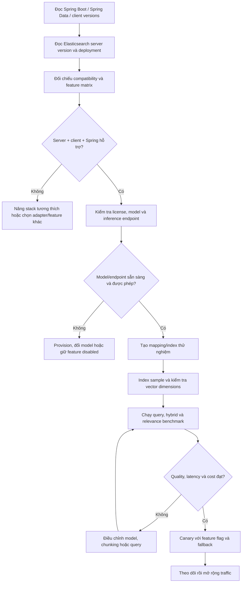

# Kiểm tra phiên bản, mô hình embedding và điều kiện sử dụng tính năng

Tìm kiếm ngữ nghĩa trong Elasticsearch không phải là một API duy nhất có thể bật lên ở mọi phiên bản. Ứng dụng có thể dùng vector do chính mình tạo rồi lưu vào `dense_vector`, dùng trường `semantic_text` để Elasticsearch phối hợp inference và tìm kiếm, dùng biểu diễn sparse như ELSER, hoặc kết hợp tìm kiếm ngữ nghĩa với BM25. Mỗi hướng có yêu cầu khác nhau về phiên bản server, Spring Data Elasticsearch, Java API Client, model, inference endpoint, license/deployment, mapping và tài nguyên vận hành.

Trước khi chọn tính năng, cần xác minh toàn bộ đường đi:

1. Phiên bản Elasticsearch server và loại deployment đang chạy.
2. Phiên bản Spring Boot, Spring Data Elasticsearch và Elasticsearch Java API Client thực sự nằm trên runtime classpath.
3. Field type, query API và retriever mà server hỗ trợ.
4. Khả năng biểu diễn mapping/query của Spring Data release đang dùng; nếu abstraction chưa hỗ trợ, có thể cần adapter dùng Java API Client.
5. Model embedding, chiều vector, similarity, ngôn ngữ, license và nơi inference được thực hiện.
6. Tài nguyên CPU/GPU/ML node, memory, disk, network và latency budget.
7. Chính sách dữ liệu, quyền truy cập model và yêu cầu bảo mật của nội dung được embedding.

Không nên kết luận “Elasticsearch hỗ trợ vector” là đủ để bật mọi tính năng semantic. Một server có thể lưu `dense_vector` nhưng client chưa có builder thuận tiện cho query mới; một Spring Data version có thể ánh xạ dense vector nhưng chưa có abstraction cho `semantic_text`; một model có thể chạy được nhưng không phù hợp ngôn ngữ hoặc latency của sản phẩm.

## 1. Semantic search gồm nhiều cách triển khai

Các hướng thường gặp:

| Hướng | Dữ liệu lưu | Cách truy vấn | Phần ứng dụng phải chịu trách nhiệm |
|---|---|---|---|
| Dense vector tự quản lý | `dense_vector` | kNN hoặc `script_score` | Gọi model tạo embedding, giữ đúng dimensions/model và đồng bộ vector |
| `semantic_text` | Văn bản gốc cùng cấu hình inference | Semantic query trên field | Cấu hình inference endpoint/model và kiểm tra semantics của server version |
| Sparse semantic | Sparse representation, ví dụ mô hình learned sparse | Query expansion/sparse retrieval API tương ứng | Model, inference và query API tương thích |
| Hybrid search | Lexical field và dense/sparse semantic field | Kết hợp BM25 với vector/semantic retriever | Chuẩn hóa ranking, cân bằng relevance và latency |

Các phương án này không thể thay thế nhau hoàn toàn. `dense_vector` cho ứng dụng quyền kiểm soát rõ đối với vector và pipeline embedding. `semantic_text` có thể giảm code xử lý embedding ở ứng dụng nhưng phụ thuộc nhiều hơn vào inference integration và khả năng của server. Hybrid search hữu ích khi người dùng cần cả exact term/SKU lẫn ý nghĩa ngữ nghĩa.

## 2. Xác minh phiên bản theo toàn bộ stack

Một tính năng chỉ sử dụng được khi tất cả thành phần liên quan tương thích. Kiểm tra riêng phiên bản server là chưa đủ.

| Thành phần | Cần xác minh | Rủi ro khi lệch phiên bản |
|---|---|---|
| Elasticsearch server | Major/minor/build và deployment type | Server chưa có field type, query, retriever hoặc inference API cần dùng |
| Spring Boot | Release train và dependency management | Tự kéo một tập Spring Data/client không tương thích |
| Spring Data Elasticsearch | Module version và API mapping/query | Annotation, converter hoặc query abstraction chưa hỗ trợ tính năng |
| Elasticsearch Java API Client | Version trên runtime classpath | Generated request/response type thiếu API hoặc khác signature |
| Elasticsearch plugins/model service | Plugin, model và inference endpoint version | Model không deploy được hoặc endpoint/API khác nhau |
| License/deployment | Subscription, Elastic Cloud/Serverless/self-managed và quyền tính năng | API có thể không khả dụng trong deployment/license hiện tại |

### 2.1. Không tự nâng riêng Elasticsearch Java API Client

Spring Data Elasticsearch sử dụng client/transport được quản lý theo release train của nó. Không nên chỉ nâng `elasticsearch-java` lên một major/minor mới để lấy một request builder rồi giả định Spring Data converter và transport vẫn tương thích.

Hãy dùng dependency management của Spring Boot/Spring Data tương ứng, sau đó kiểm tra compatibility matrix chính thức cho đúng release. Nếu cần một API server mới mà Spring Data abstraction chưa expose, có thể dùng Java API Client tương thích với stack hiện tại thông qua adapter riêng; không ép một client major không tương thích vào cùng application context.

### 2.2. Kiểm tra dependency thực tế trong build

Với Gradle, có thể xem dependency runtime:

```bash
./gradlew dependencyInsight \
  --dependency spring-data-elasticsearch \
  --configuration runtimeClasspath

./gradlew dependencyInsight \
  --dependency elasticsearch-java \
  --configuration runtimeClasspath
```

Hoặc xem dependency tree:

```bash
./gradlew dependencies --configuration runtimeClasspath
```

Với Maven:

```bash
mvn dependency:tree \
  -Dincludes=org.springframework.data:spring-data-elasticsearch,co.elastic.clients:elasticsearch-java
```

Các lệnh trên là cách kiểm tra ở máy phát triển/CI; cần đọc version được resolve cuối cùng, không chỉ version ghi trong `build.gradle` hoặc `pom.xml`. Version có thể được quản lý bởi Spring Boot BOM, platform hoặc dependency constraint.

### 2.3. Kiểm tra phiên bản server đang chạy

Có thể đọc thông tin cluster qua root endpoint:

```http
GET /
```

Response thường chứa `version.number`, build metadata và thông tin cluster. Nếu dùng nhiều cluster hoặc remote cluster, kiểm tra từng endpoint thực sự phục vụ request.

Đừng suy ra server version từ client dependency. Java API Client và Elasticsearch server là hai sản phẩm có version độc lập.

## 3. Lập ma trận tính năng trước khi triển khai

Trước khi viết code, tạo một bảng capability cho môi trường đích:

| Tính năng | Server hỗ trợ? | Spring Data hỗ trợ? | Client hỗ trợ? | Điều kiện bổ sung |
|---|---|---|---|---|
| Lưu `dense_vector` | Kiểm tra mapping support của server | Kiểm tra `FieldType`, converter và mapping metadata | Không nhất thiết cần query builder mới để lưu | Dimensions và vector hợp lệ |
| Approximate kNN | Kiểm tra kNN API/field options của server | Kiểm tra `NativeQuery`/query abstraction | Cần request type tương ứng nếu gọi trực tiếp | Vector indexing, memory và index options |
| Exact vector scoring | Kiểm tra `script_score` và vector functions | Có thể dùng native query hoặc adapter | Cần hỗ trợ script/query request | Chi phí có thể cao khi quét nhiều document |
| `semantic_text` | Kiểm tra field/query API trong server release | Kiểm tra mapping converter/annotation; có thể cần raw mapping | Cần serialize semantic query nếu gọi client trực tiếp | Inference endpoint/model và quyền sử dụng |
| Sparse semantic/ELSER | Kiểm tra model và query API | Kiểm tra abstraction tương ứng | Client phải hỗ trợ API cần gọi | Model deployment, inference và license |
| Hybrid/RRF | Kiểm tra retriever/API kết hợp ở server release | Kiểm tra query builder expose tính năng | Có thể cần Java API Client mới hơn | Ranking strategy và relevance evaluation |

Không dùng bảng này như một compatibility matrix cố định cho mọi release. Hãy điền theo version thực tế trong môi trường phát triển, staging và production.

## 4. Chọn giữa `dense_vector` và `semantic_text`

### 4.1. `dense_vector`: ứng dụng tự quản lý embedding

Với dense vector, pipeline thường gồm:

1. Ứng dụng lấy nội dung cần tìm kiếm.
2. Gọi model embedding để chuyển văn bản thành mảng số thực.
3. Ghi văn bản và vector vào document Elasticsearch.
4. Khi search, gọi cùng model (hoặc model tương thích trong cùng vector space) để tạo query vector.
5. Gửi kNN query hoặc scoring query tới Elasticsearch.

Ví dụ mapping:

```json
PUT articles-v1
{
  "mappings": {
    "properties": {
      "title": { "type": "text" },
      "content": { "type": "text" },
      "embedding": {
        "type": "dense_vector",
        "dims": 384,
        "index": true,
        "similarity": "cosine"
      }
    }
  }
}
```

`384` chỉ là ví dụ. Dimensions phải khớp chính xác với output của model. Các thuộc tính vector indexing và index options được bổ sung/thay đổi qua các phiên bản; hãy kiểm tra mapping reference của server đích và chọn index options phù hợp với workload.

Ví dụ document:

```json
POST articles-v1/_doc/A-100
{
  "title": "Reactive search architecture",
  "content": "A guide to non-blocking search pipelines...",
  "embedding": [0.012, -0.031, 0.087]
}
```

Mảng trong ví dụ được rút gọn để minh họa. Nếu mapping khai báo 384 dimensions, vector thực tế phải có đúng 384 phần tử; vector ba phần tử trên sẽ không hợp lệ với mapping đó.

### 4.2. `semantic_text`: inference tích hợp với field

`semantic_text` là field type dành cho semantic search, cho phép Elasticsearch tích hợp bước inference/embedding theo cấu hình endpoint. Tùy server release, nó có thể hỗ trợ xử lý văn bản và chunking theo cơ chế do Elasticsearch quản lý.

Ví dụ mapping khái niệm:

```json
PUT articles-semantic-v1
{
  "mappings": {
    "properties": {
      "title": { "type": "text" },
      "content_semantic": {
        "type": "semantic_text",
        "inference_id": "article-embedding-endpoint"
      }
    }
  }
}
```

`inference_id` phải trỏ tới inference endpoint đã được tạo và cấu hình tương thích với task/model. Tên API tạo endpoint, service settings, chunking và query syntax phụ thuộc server version/deployment. Không copy mapping này vào một cluster chưa hỗ trợ `semantic_text` hoặc chưa có endpoint tương ứng.

Ưu điểm là giảm phần orchestration embedding trong ứng dụng. Đổi lại, ứng dụng phụ thuộc vào inference service, endpoint lifecycle, model availability, API/version support và chi phí inference tại server.

### 4.3. Khi nào chọn hướng nào?

| Điều kiện | Hướng nên cân nhắc |
|---|---|
| Đã có pipeline embedding ngoài Elasticsearch | `dense_vector` |
| Cần tự kiểm soát model, batching, retry và cache embedding | `dense_vector` |
| Muốn Elasticsearch quản lý inference cho field semantic | `semantic_text`, nếu server/deployment hỗ trợ |
| Cần model learned sparse được tích hợp với Elasticsearch | Sparse semantic path, nếu model/API được hỗ trợ |
| Cần exact SKU/tên riêng cùng semantic meaning | Hybrid lexical + vector/semantic |
| Chưa có model hoặc dữ liệu phù hợp | Chưa bật semantic; bắt đầu bằng lexical baseline và đánh giá nhu cầu |

## 5. Điều kiện của embedding model

Một model embedding không chỉ được đánh giá bằng việc nó trả ra một mảng số. Cần xác minh hợp đồng của model trước khi đưa vector vào index.

Thông tin nên lưu trong cấu hình/model registry:

- Model ID và provider.
- Model version hoặc immutable revision.
- Task type: text embedding, query embedding hoặc instruction-specific mode.
- Vector dimensions.
- Similarity/normalization expectation.
- Ngôn ngữ và domain mà model hỗ trợ.
- Max input tokens và truncation behavior.
- Chunking strategy và overlap nếu nội dung dài.
- Output type/precision.
- License, data retention và điều kiện xử lý dữ liệu.
- Endpoint, region, timeout, rate limit và credential owner.

Không chỉ lưu tên thân thiện như `embedding-model`. Nếu provider cập nhật model phía sau alias mà không thay ID, vector được tạo hôm nay có thể khác vector đã index tháng trước. Hãy pin model revision hoặc ghi lại revision thực tế nếu provider hỗ trợ.

## 6. Dimensions phải khớp mapping

Nếu model trả vector có 384 phần tử, field mapping phải khai báo `dims: 384`. Query vector cũng phải có cùng số phần tử.

Ví dụ kiểm tra trước khi gửi request:

```java
public final class EmbeddingContract {

    private final int expectedDimensions;

    public EmbeddingContract(int expectedDimensions) {
        this.expectedDimensions = expectedDimensions;
    }

    public void validate(float[] vector) {
        if (vector == null || vector.length != expectedDimensions) {
            throw new IllegalArgumentException(
                "Expected " + expectedDimensions + " dimensions"
            );
        }
    }
}
```

Không pad hoặc cắt vector để làm cho dimensions vừa mapping. Làm vậy thay đổi ý nghĩa của vector và khiến similarity không còn đáng tin cậy.

Nếu đổi model từ 384 sang 768 dimensions, cần mapping/index mới cho vector field đó, rồi re-embed document. Không thể sửa `dims` của field đã chứa vector như một cập nhật mapping thông thường.

Ngay cả khi hai model có cùng dimensions, vector space của chúng không mặc nhiên tương thích. Không so sánh trực tiếp vector từ hai model khác nhau trừ khi nhà cung cấp đảm bảo chúng thuộc cùng embedding space.

## 7. Similarity và chuẩn hóa vector

Các lựa chọn phổ biến của dense vector gồm cosine similarity, dot product và L2 norm. Chúng đo độ tương đồng theo cách khác nhau.

| Similarity | Ý nghĩa khái quát | Điều cần kiểm tra |
|---|---|---|
| `cosine` | Góc giữa hai vector, ít phụ thuộc độ lớn vector | Vector không phải zero vector; model output phù hợp cosine |
| `dot_product` | Tích vô hướng | Có thể phụ thuộc việc model đã normalize vector hay chưa |
| `l2_norm` | Khoảng cách Euclidean | Cần hiểu scale và cách diễn giải khoảng cách |

Không đổi similarity chỉ bằng cách sửa query. Mapping, model training và normalization phải thống nhất giữa index vector và query vector.

Nếu model yêu cầu normalize output, hãy áp dụng đúng cùng quy tắc cho cả document và query. Không normalize tùy tiện một phía.

## 8. Model cho query và document phải tương thích

Một số model/provider phân biệt `document` và `query` task hoặc yêu cầu instruction/prefix khác nhau cho hai loại input. Nếu index document bằng một task nhưng query bằng task khác, cần dùng đúng cách gọi model mà provider chỉ định.

Ví dụ abstraction trong ứng dụng:

```java
public interface EmbeddingService {

    float[] embedDocument(String text);

    float[] embedQuery(String text);
}
```

Service không nên giả định hai method luôn gọi cùng một prompt. Có model cần prefix riêng như `passage:` và `query:` hoặc instruction riêng theo task. Những chi tiết này là một phần của model contract và phải được version hóa.

Khi đổi model hoặc instruction, cần re-embed document nếu vector space thay đổi. Chỉ đổi model dùng cho query trong khi giữ vector cũ thường làm chất lượng search suy giảm mạnh.

## 9. Kiểm tra điều kiện inference endpoint

Nếu dùng `semantic_text` hoặc inference tích hợp, cần xác minh:

1. Server release hỗ trợ inference API và task type cần dùng.
2. Deployment có model/service phù hợp (built-in, Elastic inference service hoặc external provider integration theo môi trường).
3. Inference endpoint đã được tạo và trạng thái sẵn sàng.
4. Credential có quyền gọi inference và index/search.
5. Model có đủ tài nguyên để chạy hoặc endpoint từ xa có quota/rate limit phù hợp.
6. Input size, chunking, timeout và retry đã được xác định.
7. Nội dung gửi tới model được phép theo chính sách dữ liệu và hợp đồng provider.

API quản lý inference endpoint và cách xem endpoint có thể khác giữa self-managed, Elastic Cloud và Serverless. Dùng endpoint API của đúng server/deployment thay vì giả định mọi môi trường có cùng model registry hoặc cùng model deployment flow.

Không tạo endpoint trong mỗi request. Endpoint/model deployment là tài nguyên vận hành có lifecycle riêng; tạo trước qua provisioning/migration step và kiểm tra readiness trước khi bật traffic.

## 10. License, deployment và quyền sử dụng

Khả năng sử dụng semantic feature có thể phụ thuộc distribution, deployment type, license/subscription và dịch vụ model bên ngoài. Một số API lưu/query vector có thể khả dụng rộng hơn các tính năng inference/model management hoặc semantic workflow tích hợp.

Trước khi triển khai, kiểm tra:

- License hiện tại và feature matrix của đúng server release.
- Deployment có hỗ trợ ML node/model deployment hay chỉ remote inference.
- Elastic Cloud/Serverless có bật capability tương ứng không.
- Model/provider có yêu cầu subscription hoặc usage billing riêng không.
- API key/role có quyền sử dụng inference endpoint không.
- Điều khoản model cho phép xử lý dữ liệu của sản phẩm và khu vực triển khai không.

Không suy luận license chỉ từ việc API endpoint tồn tại hoặc một lệnh mapping thành công. Kiểm tra trạng thái license/deployment và điều khoản model trước khi chọn kiến trúc production.

## 11. Tài nguyên vận hành và giới hạn hiệu năng

Vector search có chi phí riêng so với lexical search. Cần đánh giá:

- Số document và số vector/chunk.
- Dimensions của mỗi vector.
- Kiểu lưu trữ/precision được server hỗ trợ.
- HNSW graph hoặc cấu trúc approximate nearest neighbor.
- Số shard, replica và lượng vector mỗi shard.
- RAM, filesystem cache, disk và merge/indexing pressure.
- Query concurrency, `k`, `num_candidates` và filter selectivity.
- Inference throughput, batch size và model latency.

Ước lượng thô bộ nhớ payload vector float32:

\[
\text{bytes} \approx N \times D \times 4
\]

Trong đó `N` là số vector và `D` là dimensions. Với 1 triệu vector × 384 dimensions, riêng dữ liệu số float32 xấp xỉ 1,536,000,000 bytes (khoảng 1,43 GiB theo đơn vị nhị phân), chưa tính `_source`, graph, metadata, replicas, allocator và overhead khác. Đây không phải dự toán RAM hoàn chỉnh.

Nếu mỗi document được chia thành nhiều chunk, số vector thực tế có thể lớn hơn nhiều số document. Hãy ước lượng theo số chunk, không chỉ số bài viết/sản phẩm.

### 11.1. Approximate kNN và exact scoring

Approximate kNN thường dùng cấu trúc ANN như HNSW để tìm nhanh một tập ứng viên. Các tham số như `k` và `num_candidates` ảnh hưởng trade-off giữa latency và recall.

Exact scoring như `script_score` có thể phù hợp với tập dữ liệu nhỏ hoặc candidate set đã được lọc hẹp, nhưng có thể đắt khi phải chấm điểm rất nhiều document.

Đừng đặt `num_candidates` quá thấp chỉ để giảm latency mà không đo recall. Ngược lại, tăng nó vô hạn có thể làm search tốn tài nguyên. Benchmark trên dữ liệu và filter thực tế.

## 12. Chunking và giới hạn độ dài văn bản

Embedding model thường có giới hạn token đầu vào. Nếu nội dung dài hơn giới hạn, provider có thể từ chối, truncate hoặc yêu cầu chunking. Truncate âm thầm có thể khiến thông tin quan trọng ở cuối document không được index.

Khi chunking, cần quyết định:

- Chunk theo đoạn, heading, sentence hay token window.
- Kích thước chunk và overlap.
- Giữ metadata gốc như document ID, tenant, heading và vị trí chunk.
- Cách gom nhiều chunk thành kết quả document-level.
- Cách cập nhật/xóa toàn bộ chunk khi source document thay đổi.
- Có cần deduplicate các chunk gần giống nhau không.

Ví dụ document chunk:

```json
{
  "documentId": "DOC-100",
  "chunkId": "DOC-100-03",
  "chunkIndex": 3,
  "schemaVersion": 2,
  "embeddingModel": "e5-small-v2",
  "text": "The section describing reactive repositories...",
  "embedding": [0.01, -0.02, 0.03]
}
```

Vector trong ví dụ được rút gọn. Lưu `documentId`, `chunkIndex` và model metadata giúp truy ngược kết quả tới document nguồn và hỗ trợ migration khi chunk strategy thay đổi.

## 13. Điều kiện mapping và query cho dense vector

Trước khi index vector, xác nhận:

- Field được map thành `dense_vector`.
- `dims` bằng output dimensions.
- Similarity đúng model contract.
- Indexing/ANN options được server version hỗ trợ và bật theo nhu cầu.
- Vector được lưu dưới kiểu số hợp lệ, không có `NaN`/infinity.
- Query vector có cùng dimensions và model space.
- Filter tenant/ACL được áp dụng trong search theo đúng semantics.

Ví dụ kNN query khái niệm:

```http
GET articles-v1/_search
{
  "knn": {
    "field": "embedding",
    "query_vector": [0.01, -0.02, 0.03],
    "k": 10,
    "num_candidates": 100
  },
  "_source": ["title", "content"]
}
```

Vector minh họa có ba phần tử, chỉ phù hợp với mapping `dims: 3`; thay bằng vector thật có đúng dimensions của model. Cú pháp filter trong kNN và các lựa chọn ANN phụ thuộc phiên bản; kiểm tra reference của server.

### 13.1. Exact scoring bằng script

Một cách khác là `script_score`:

```http
GET articles-v1/_search
{
  "query": {
    "script_score": {
      "query": {
        "match": {
          "content": "reactive repository"
        }
      },
      "script": {
        "source": "cosineSimilarity(params.query_vector, 'embedding') + 1.0",
        "params": {
          "query_vector": [0.01, -0.02, 0.03]
        }
      }
    }
  }
}
```

Ví dụ kết hợp lexical filter với vector score để minh họa script scoring. Script có thể chấm điểm toàn bộ document thuộc tập query con, nên cần giới hạn candidate set và benchmark. Các hàm vector và cú pháp có thể thay đổi theo server version.

## 14. Điều kiện sử dụng `semantic_text`

Trước khi chọn `semantic_text`, hãy xác minh:

- Server hỗ trợ field type và semantic query trong release đang chạy.
- Inference endpoint ID hợp lệ, task type tương thích và model sẵn sàng.
- Endpoint có thể xử lý cả indexing inference và query inference theo semantics của feature.
- Mapping template/entity converter không ghi đè sai field type.
- Chunking và metadata behavior đáp ứng cách ứng dụng cần trả kết quả.
- API client có thể serialize semantic query hoặc ứng dụng dùng adapter thích hợp.
- License/deployment cho phép endpoint/model cần dùng.

Query minh họa:

```http
GET articles-semantic-v1/_search
{
  "query": {
    "semantic": {
      "field": "content_semantic",
      "query": "How does a reactive repository execute a request?"
    }
  }
}
```

Đây là ví dụ cho các server release hỗ trợ semantic query trên `semantic_text`. Không giả định cú pháp này có mặt ở mọi Elasticsearch version hoặc mọi deployment. Xác nhận API reference đúng version và thử request trên staging trước khi triển khai.

## 15. Spring Data Elasticsearch có hỗ trợ đến đâu?

Spring Data Elasticsearch cung cấp mapping annotations, `IndexOperations`, `ElasticsearchOperations`, repository abstraction và native query integration. Mức độ hỗ trợ một semantic feature phụ thuộc release.

Với dense vector, kiểm tra:

- `FieldType.Dense_Vector` có trong enum của release hay không.
- `@Field` có expose `dims`, `similarity` và index options cần thiết hay không.
- Mapping converter serialize `float[]`/collection theo đúng format server yêu cầu không.
- Query abstraction có hỗ trợ kNN/filter parameters cần thiết không.

Ví dụ annotation mang tính minh họa, chỉ dùng nếu release Spring Data đang dùng có các thuộc tính tương ứng:

```java
@Field(
    type = FieldType.Dense_Vector,
    dims = 384,
    similarity = "cosine"
)
private float[] embedding;
```

Đừng copy annotation rồi giả định compile/runtime support. Kiểm tra enum và signature trong dependency thực tế. Nếu Spring Data release chưa expose một setting, có thể quản lý mapping bằng index template hoặc `IndexOperations`/client API phù hợp, nhưng cần bảo đảm converter không ghi đè mapping đã provision.

Với `semantic_text`, kiểm tra release có enum/mapping support và converter tương ứng hay không. Nếu không có, vẫn có thể cần mapping raw JSON/template và gọi semantic query qua Elasticsearch Java API Client tương thích. Đặt phần phụ thuộc version trong một adapter để service không phải biết chi tiết generated client API.

## 16. Giữ abstraction ổn định bằng adapter

Một ứng dụng có thể tách logic embedding và vector search khỏi Spring Data generated API:

```java
public interface SemanticSearchPort {

    List<SemanticHit> search(
        String query,
        SearchScope scope,
        int limit
    );
}
```

Implementation có thể:

- Gọi `EmbeddingService` rồi dùng `ElasticsearchOperations`/native query.
- Dùng Java API Client cho kNN API mới hơn.
- Gọi `semantic_text` query nếu server và client hỗ trợ.
- Chuyển sang lexical search khi semantic capability chưa sẵn sàng.

Service nghiệp vụ chỉ phụ thuộc `SemanticSearchPort`. Nhờ vậy, nâng Spring Data hoặc đổi semantic strategy ít ảnh hưởng controller/domain logic hơn.

Với API reactive, port nên trả `Flux<SemanticHit>` hoặc `Mono<List<SemanticHit>>` theo semantics và lượng dữ liệu; không chuyển sang blocking nếu ứng dụng đang dùng WebFlux.

## 17. Hybrid search và điều kiện RRF

Lexical BM25 có lợi thế với tên riêng, mã sản phẩm, SKU và exact phrase. Semantic vector có lợi thế với câu hỏi diễn đạt khác từ khóa trong document. Hybrid search kết hợp hai nguồn ranking.

Một cách kết hợp phổ biến là Reciprocal Rank Fusion (RRF). RRF kết hợp thứ hạng từ nhiều retriever thay vì cộng trực tiếp score không cùng thang đo.

Ví dụ minh họa ý tưởng:

```text
Lexical ranking:  A, B, C, D
Vector ranking:   C, A, E, B

RRF score(document) = sum(1 / (rank_constant + rank))
```

API retriever/RRF và cú pháp cấu hình phụ thuộc Elasticsearch release. Nếu server chưa hỗ trợ native RRF, có thể thử nghiệm kết hợp ở tầng ứng dụng hoặc dùng cách hybrid khác, nhưng cần tính đến việc lấy candidate từ mỗi nhánh và chuẩn hóa ranking.

Không cộng raw `_score` của BM25 và cosine một cách tùy tiện. Hai score có phân bố và ý nghĩa khác nhau. Đánh giá bằng query set có relevance judgments, không chỉ quan sát vài kết quả thủ công.

## 18. Version hóa model và embedding data

Vector là dữ liệu dẫn xuất từ nội dung và model. Khi thay model, dimensions, prompt, tokenizer, chunking hoặc normalization, vector cũ có thể không còn tương thích.

Nên lưu metadata phù hợp:

```json
{
  "documentId": "DOC-100",
  "schemaVersion": 2,
  "embeddingModel": "e5-small-v2",
  "embeddingRevision": "2026-01",
  "embeddingDimensions": 384,
  "chunkStrategy": "paragraph-v2",
  "embedding": [0.01, -0.02, 0.03]
}
```

Vector minh họa được rút gọn; field dimensions phải khớp mapping. Metadata model/version giúp phát hiện document còn dùng model cũ và đo tiến độ re-embedding.

### 18.1. Khi nào cần re-embed?

Thường cần re-embed khi:

- Chuyển sang model embedding khác.
- Model revision không còn cùng vector space.
- Dimensions thay đổi.
- Instruction/prefix cho document/query thay đổi theo cách ảnh hưởng vector space.
- Chunking strategy thay đổi và cần vector mới cho chunk boundaries.
- Normalization hoặc preprocessing thay đổi.
- Model cũ bị ngừng hỗ trợ hoặc không còn được phép sử dụng.

Không nhất thiết phải re-embed nếu chỉ đổi ranking weight ở hybrid layer mà vector/document representation không thay đổi. Hãy phân biệt thay đổi model data với thay đổi query ranking.

### 18.2. Blue-green index cho model mới

Một chiến lược an toàn:

1. Giữ `articles-v1` với model A.
2. Tạo `articles-v2` với mapping/dimensions/model B.
3. Re-embed từ source of truth sang v2.
4. Đồng bộ document thay đổi trong thời gian backfill.
5. Đánh giá recall, latency và relevance trên query set.
6. Chuyển alias khi v2 đạt tiêu chí.
7. Giữ v1 trong rollback window.
8. Xóa v1 sau khi không còn cần rollback.

Nếu model A và B có cùng dimensions nhưng khác vector space, vẫn không trộn vector của hai model vào cùng một field rồi so sánh cosine như thể chúng tương thích.

## 19. Kiểm tra quyền và an toàn dữ liệu khi tạo embedding

Embedding không loại bỏ yêu cầu authorization. Một semantic query có thể tìm thấy nội dung mà lexical query trước đây không tìm thấy, nên tenant/ACL filter phải được áp dụng trong đúng phạm vi truy vấn.

Các điều kiện cần kiểm tra:

- Tenant/owner filter được áp dụng trong vector/hybrid search.
- Model endpoint không nhận dữ liệu vượt phạm vi được phép.
- PII, secret và nội dung nhạy cảm được xử lý theo chính sách dữ liệu.
- Provider có thể lưu input/output trong bao lâu và ở region nào.
- API key/model credential được quản lý như secret.
- Logs không ghi raw document hoặc query nhạy cảm.
- Xóa document nguồn phải xóa cả chunk/vector dẫn xuất theo retention policy.

Vector embedding vẫn có thể tiết lộ thông tin hoặc được dùng để suy luận về nội dung nguồn. Không coi vector là dữ liệu đã ẩn danh hoàn toàn.

## 20. Điều kiện về chất lượng và đánh giá model

Trước khi chọn model, tạo tập query đại diện cho domain:

- Câu hỏi bằng ngôn ngữ tự nhiên.
- Từ khóa ngắn và exact identifier.
- Tiếng Việt có dấu/không dấu nếu sản phẩm cần hỗ trợ.
- Thuật ngữ chuyên ngành, từ viết tắt và tên riêng.
- Query đa ngôn ngữ nếu dữ liệu có nhiều ngôn ngữ.
- Query có filter tenant, category, date hoặc status.
- Query không có câu trả lời phù hợp.

Gán relevance cho các document/chunk và so sánh:

- Recall@k: có tìm thấy các tài liệu liên quan không?
- Precision@k: top results có ít nhiễu không?
- MRR/NDCG@k: kết quả tốt có được xếp ở vị trí cao không?
- Latency p50/p95/p99 và inference latency.
- Throughput, timeout, rate limit và chi phí theo request/document.

Không chọn model chỉ theo dimensions hoặc benchmark chung của nhà cung cấp. Model nhỏ hơn có thể phù hợp latency/cost nhưng kém chất lượng trên tiếng Việt hoặc thuật ngữ nội bộ. Cần benchmark trên dữ liệu và query thực tế đã được phép sử dụng.

## 21. Fallback và feature gate

Semantic search có thể không khả dụng do endpoint chưa ready, model quota, license, node resource hoặc client/server version mismatch. Ứng dụng cần định nghĩa hành vi khi semantic path không sẵn sàng.

Một số lựa chọn:

- Tạm thời dùng lexical BM25.
- Tắt semantic bằng feature flag theo môi trường/tenant.
- Trả lỗi rõ ràng nếu endpoint bắt buộc semantic và fallback làm thay đổi ý nghĩa nghiệp vụ.
- Dùng cache embedding/query khi chính sách freshness và privacy cho phép.
- Giới hạn concurrency và queue request inference.

Không âm thầm trả kết quả lexical như thể đó là semantic result nếu client cần biết chế độ search. Có thể trả metadata `searchMode: LEXICAL_FALLBACK` để telemetry/UI diễn giải đúng.

## 22. Checklist xác minh trước khi bật tính năng

| Nhóm | Câu hỏi phải trả lời |
|---|---|
| Server | Exact Elasticsearch version? Self-managed, Cloud hay Serverless? Feature có trong release/deployment không? |
| Spring | Spring Boot và Spring Data Elasticsearch version nào? Dependency đã resolve đúng chưa? |
| Client | Elasticsearch Java API Client version nào? Có request/response type cần thiết không? |
| Mapping | `dense_vector`, `semantic_text` hoặc sparse field có được hỗ trợ? Dimensions/settings đã đúng chưa? |
| Model | Model ID/revision, task, language, dimensions, normalization và license là gì? |
| Inference | Endpoint đã provision và ready? Credentials, quota, region, timeout đã được cấu hình chưa? |
| Data | Chunking, source metadata, tenant/ACL và re-embedding plan đã rõ chưa? |
| Infra | RAM, disk, ML/GPU/CPU, network, concurrency và cost đã được benchmark chưa? |
| Quality | Có baseline lexical và query relevance set để so sánh không? |
| Security | Dữ liệu được phép gửi tới model? Vector/chunk có lifecycle xóa và retention không? |
| Rollout | Có feature flag, fallback, monitoring và rollback index/alias không? |

Nếu một điều kiện bắt buộc chưa được xác minh, hãy giữ tính năng ở trạng thái thử nghiệm hoặc feature-disabled cho tới khi có bằng chứng.

## 23. Quy trình xác minh theo môi trường



Các bước áp dụng:

1. Ghi lại phiên bản server, deployment và dependency runtime.
2. Đối chiếu release compatibility của Spring Data và Elasticsearch Java API Client.
3. Chọn rõ dense vector, semantic text, sparse semantic hay hybrid.
4. Xác minh field/query/retriever API tồn tại trong server version.
5. Xác minh Spring mapping/query abstraction; dùng adapter nếu cần.
6. Chốt model ID/revision, task, dimensions, similarity, language và chunking.
7. Xác minh license, endpoint readiness, credential, region và quota.
8. Tạo index thử nghiệm với mapping/settings tường minh.
9. Index sample, kiểm tra dimensions, missing vector và inference failures.
10. Chạy query relevance benchmark cùng lexical baseline.
11. Đo latency, throughput, memory, inference cost và failure rate.
12. Thiết lập feature flag, fallback, model/index versioning và rollback.
13. Canary trên một phần traffic, theo dõi rồi mới mở rộng.

## 24. Kết luận

Muốn sử dụng semantic search trong Spring Data Elasticsearch, cần xác minh phiên bản và điều kiện ở cả server, Spring Data, Java API Client, deployment/license và model inference. `dense_vector` cho phép ứng dụng tự quản lý embedding và vector query; `semantic_text` tích hợp inference sâu hơn vào Elasticsearch; sparse semantic và hybrid search có API, model và yêu cầu riêng. Không có một tuyên bố chung rằng một phiên bản Spring Data hoặc Elasticsearch bất kỳ hỗ trợ toàn bộ các hướng này.

Embedding model phải được xem như một phần của schema contract: model ID/revision, task, dimensions, similarity, normalization, language và chunking cần nhất quán giữa lúc index và lúc query. Đổi model hoặc vector space thường đòi hỏi re-embedding và index version mới, ngay cả khi dimensions không đổi. Mapping vector phải khớp dimensions; không pad/cắt vector để né lỗi.

Trước khi bật tính năng, kiểm tra server API, client request types, Spring Data mapping/query support, license, inference endpoint, credential, tài nguyên và chính sách dữ liệu. Đo relevance trên query set của domain cùng latency/cost thực tế. Dùng adapter và feature gate để cô lập khác biệt version, duy trì lexical fallback khi phù hợp, và triển khai canary có rollback. Cách làm này giúp chọn đúng semantic capability cho môi trường đang chạy thay vì dựa vào tên tính năng hoặc một ví dụ API của release khác.
