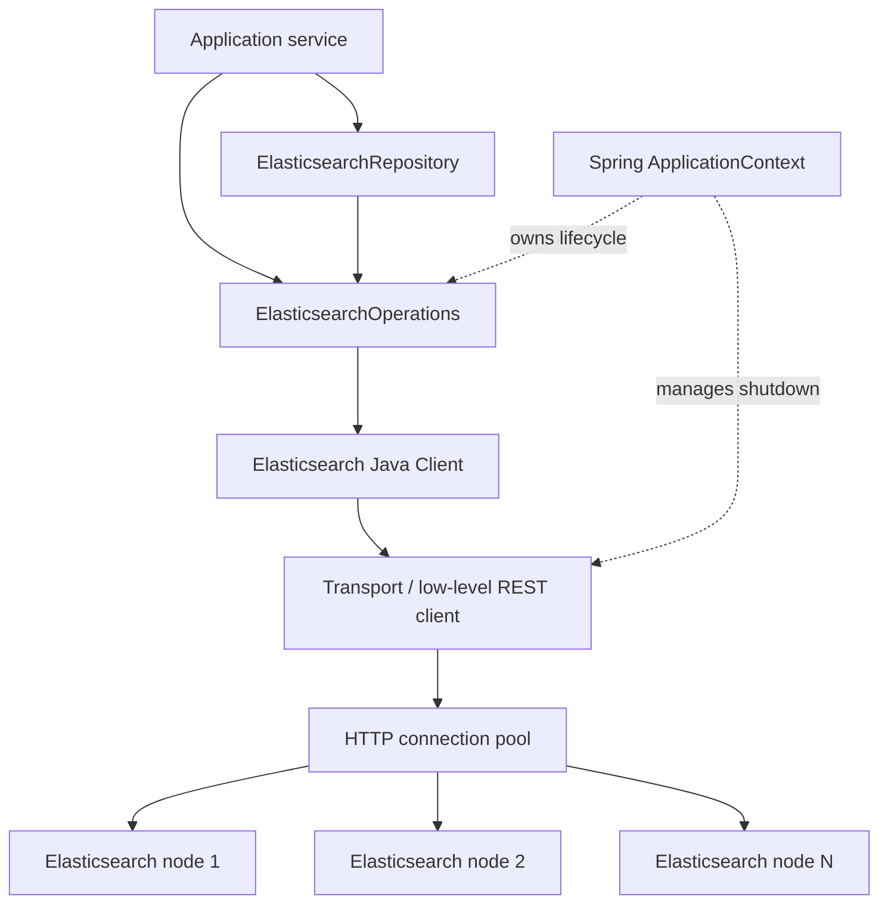
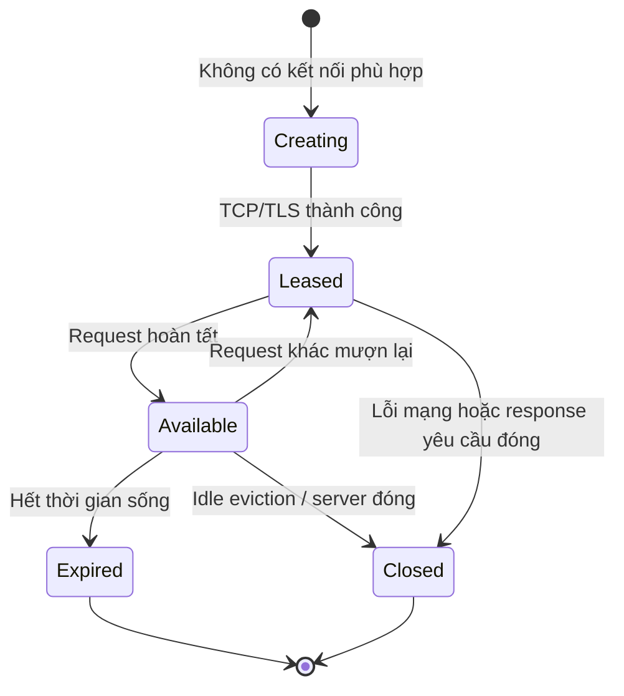

# Connection pool, keep-alive và quản lý vòng đời client

Spring Data Elasticsearch thường được sử dụng thông qua `ElasticsearchOperations` hoặc Elasticsearch Repository. Ở phía dưới các abstraction này là Elasticsearch Java Client và HTTP transport. Transport quản lý việc gửi request tới các node, phân phối request, tái sử dụng kết nối, xử lý timeout và giải phóng tài nguyên mạng.

Trong ứng dụng Spring Boot, client nên được tạo một lần, chia sẻ giữa các service/repository và đóng khi application context dừng. Connection pool giữ lại các kết nối HTTP có thể tái sử dụng, nhờ đó ứng dụng tránh phải tạo TCP connection và thực hiện TLS handshake cho từng request. Keep-alive cho phép kết nối tồn tại qua nhiều request; timeout và chính sách loại bỏ kết nối nhàn rỗi giúp pool thích nghi với server, load balancer và hạ tầng mạng.

Ba khái niệm cần phân biệt ngay từ đầu:

- **Connection pool** quản lý tập kết nối đang được sử dụng, đang rảnh và đang chờ được cấp cho request.
- **HTTP keep-alive** cho phép tái sử dụng một kết nối HTTP cho nhiều request tuần tự hoặc đồng thời theo khả năng của client.
- **Client lifecycle** xác định thời điểm tạo, chia sẻ và đóng client cùng các thread, socket và connection manager bên dưới.

Nếu tạo client mới cho từng request, ứng dụng sẽ liên tục khởi tạo và hủy pool, tăng chi phí kết nối, tạo nhiều thread và socket, đồng thời làm mất lợi ích của keep-alive. Nếu không đóng client khi ứng dụng dừng, các tài nguyên nền có thể tiếp tục tồn tại hoặc shutdown không hoàn tất sạch sẽ.

## 1. Kiến trúc client trong Spring Data Elasticsearch

Với cấu hình imperative phổ biến của Spring Data Elasticsearch 5.x, luồng gọi có thể mô tả như sau:



Repository sử dụng `ElasticsearchOperations` ở bên dưới. `ElasticsearchOperations` làm việc với Java Client; Java Client giao phần giao tiếp HTTP cho transport và low-level REST client. Connection pool nằm ở tầng HTTP client, không nằm trong từng repository method.

Spring Data cung cấp cấu hình để tạo các bean này. Với cấu hình chuẩn, ứng dụng chỉ cần inject `ElasticsearchOperations`, repository hoặc Java Client khi thật sự cần API cấp thấp. Hầu hết code nghiệp vụ nên làm việc với repository/operations thay vì tự tạo HTTP request và tự quản lý socket.

### 1.1 Các lớp có trách nhiệm gì?

| Thành phần | Trách nhiệm |
|---|---|
| `ElasticsearchRepository` | API repository cho entity: lưu, xóa, tìm theo ID và các query method |
| `ElasticsearchOperations` | API thao tác và tìm kiếm linh hoạt hơn repository |
| `ElasticsearchClient` | Java API Client có kiểu request/response cho Elasticsearch API |
| Transport | Chuyển request/response giữa Java Client và HTTP client |
| Low-level REST client | Gửi HTTP, chọn node, load balance, failover và quản lý kết nối |
| Connection pool | Cấp phát và tái sử dụng kết nối tới các endpoint |

Không nên tạo một `RestClient` hoặc `ElasticsearchClient` riêng bên trong mỗi service. Các abstraction cấp cao được thiết kế để dùng chung client đã cấu hình.

### 1.2 Một client có thể kết nối nhiều node

Client có thể được cấu hình với nhiều endpoint của cùng một cluster. Low-level REST client quản lý node và phân phối request theo cơ chế của nó; khi node gặp lỗi, client có thể tạm tránh node đó và thử endpoint khác theo chính sách failover.

```java
ClientConfiguration.builder()
    .connectedTo(
        "es-node-1.internal:9200",
        "es-node-2.internal:9200",
        "es-node-3.internal:9200"
    )
    .build();
```

Danh sách endpoint nên trỏ tới các node phù hợp để nhận HTTP request của ứng dụng. Nếu chỉ cấu hình một load balancer, pool sẽ kết nối tới địa chỉ đó; việc phân phối tiếp tới node Elasticsearch do load balancer thực hiện. Cần hiểu topology thực tế để tránh cấu hình nhầm địa chỉ transport nội bộ, node không mở HTTP hoặc endpoint chỉ truy cập được từ một mạng khác.

## 2. Connection pool hoạt động như thế nào?

Mở một TCP connection cần thực hiện handshake mạng. Nếu dùng HTTPS, client còn cần TLS handshake và xác thực chứng thư. Khi mỗi request đều mở một kết nối mới, các chi phí này lặp lại liên tục và làm tăng độ trễ.

Connection pool giữ các kết nối đã thiết lập để request tiếp theo có thể mượn và tái sử dụng. Khi request hoàn tất, kết nối được trả lại pool nếu vẫn còn hợp lệ. Pool cũng giới hạn số kết nối đồng thời để kiểm soát tài nguyên phía ứng dụng và số lượng connection mà cluster phải phục vụ.

### 2.1 Vòng đời một kết nối trong pool



Một request cần một connection được cấp từ pool. Nếu có connection rảnh, pool có thể cấp ngay. Nếu không, client có thể tạo thêm connection trong giới hạn cấu hình hoặc chờ tới khi một connection được trả về. Nếu pool đã đạt giới hạn và thời gian chờ cấp connection hết hạn, request có thể thất bại do connection pool exhaustion hoặc connection request timeout.

### 2.2 Tổng số kết nối và số kết nối trên một route

Với Apache HttpAsyncClient được dùng bởi low-level `RestClient` trong Spring Data Elasticsearch 5.x, hai giới hạn thường được quan tâm là:

- `maxConnTotal`: số connection tối đa trên toàn bộ pool.
- `maxConnPerRoute`: số connection tối đa cho một route, thường tương ứng một tổ hợp scheme/host/port.

Ví dụ client kết nối ba node, tổng giới hạn là 120 và mỗi route tối đa 40. Khi đó pool không thể vượt quá 120 connection và mỗi node endpoint không vượt quá 40 connection theo route tương ứng. Giới hạn thực tế còn phụ thuộc topology, node list, route và cách client chọn node.

Không nên mặc định đặt số connection bằng số thread của ứng dụng. Một thread có thể không liên tục gọi Elasticsearch; một request có thể giữ connection trong thời gian dài; client có thể xử lý request bất đồng bộ. Cần đo concurrency thực tế, thời gian giữ connection, latency và số node trước khi điều chỉnh.

### 2.3 Điều gì xảy ra khi pool cạn?

Giả sử pool có tối đa 50 connection tới một route. Nếu 50 request đều đang sử dụng connection, request thứ 51 phải chờ một connection được trả về hoặc thất bại khi hết thời gian chờ cấp connection.

Pool exhaustion có thể xuất phát từ:

- Số request đồng thời tăng cao hơn dự kiến.
- Request search/aggregation/bulk giữ connection lâu.
- Timeout quá dài khiến connection bị chiếm dụng lâu khi server xử lý chậm.
- Node hoặc mạng chậm làm connection không được giải phóng đúng tốc độ.
- Pool giới hạn quá thấp so với concurrency.
- Ứng dụng tự tạo quá nhiều client/pool và phân tán tải không cần thiết.

Tăng pool limit không tự động giải quyết được nguyên nhân. Nếu Elasticsearch đã quá tải, mở thêm connection có thể làm tăng áp lực lên node và khiến latency tệ hơn. Cần xem cả hàng đợi ở ứng dụng, connection pool, thread pool và trạng thái cluster.

## 3. HTTP keep-alive và tái sử dụng kết nối

HTTP keep-alive thường được hiểu là kết nối HTTP được giữ mở sau khi response hoàn tất để client có thể gửi request tiếp theo trên cùng kết nối. HTTP/1.1 hỗ trợ persistent connection theo mặc định trừ khi một phía yêu cầu đóng kết nối.

Keep-alive giảm số lần tạo TCP connection và TLS handshake. Nó đặc biệt hữu ích khi một ứng dụng gửi nhiều request tới cùng cluster trong suốt vòng đời process.

### 3.1 Một kết nối, nhiều request

Không có keep-alive, luồng đơn giản có thể là:

```text
Request A -> TCP connect -> TLS handshake -> HTTP request/response -> close
Request B -> TCP connect -> TLS handshake -> HTTP request/response -> close
Request C -> TCP connect -> TLS handshake -> HTTP request/response -> close
```

Với connection pool và persistent connection:

```text
TCP connect -> TLS handshake
       |
       +--> HTTP request A / response A
       +--> HTTP request B / response B
       +--> HTTP request C / response C
       |
       +--> connection returned to pool / reused
```

Một connection được giữ trong pool không có nghĩa một request đang giữ nó mãi mãi. Khi request hoàn tất, connection có thể trở thành available để request khác sử dụng.

### 3.2 HTTP Keep-Alive khác TCP keepalive

Hai thuật ngữ có tên gần giống nhau nhưng hoạt động ở hai tầng khác nhau.

**HTTP keep-alive** là hành vi giữ kết nối HTTP mở để tái sử dụng cho request/response tiếp theo. Client và server có thể trao đổi header liên quan tới connection persistence hoặc thời gian giữ kết nối. Pool cũng có thể áp dụng thời gian sống tối đa và chính sách loại bỏ connection nhàn rỗi.

**TCP keepalive** là tính năng của socket/operating system. Sau một khoảng thời gian không có dữ liệu, hệ điều hành có thể gửi TCP keepalive probe để kiểm tra peer còn phản hồi hay không. Nó giúp phát hiện một số kết nối đã bị đứt âm thầm do lỗi mạng hoặc thiết bị trung gian.

| Tiêu chí | HTTP keep-alive | TCP keepalive |
|---|---|---|
| Tầng hoạt động | HTTP/application protocol | TCP/socket/OS |
| Mục đích | Tái sử dụng kết nối cho nhiều request | Phát hiện peer hoặc đường mạng không còn phản hồi |
| Cơ chế | Persistent connection, pool và chính sách idle/TTL | TCP probe do OS phát ra |
| Có thay thế nhau không? | Không | Không |

TCP keepalive không tự bảo đảm server sẽ giữ HTTP connection mở. Server, reverse proxy hoặc load balancer vẫn có thể chủ động đóng một kết nối HTTP đã idle. Ngược lại, HTTP keep-alive không tự phát hiện mọi trường hợp network path đã mất nhưng socket vẫn đang được coi là mở ở phía client.

### 3.3 Keep-Alive header và thời gian idle

Một server hoặc proxy có thể gửi header `Keep-Alive` với thông tin timeout hoặc giới hạn request tùy implementation. Client có thể dùng thông tin đó khi quyết định connection còn đủ điều kiện tái sử dụng hay không.

Thời gian giữ kết nối phải được xem trong toàn bộ đường đi:

```text
Application client
      |
      v
Load balancer / reverse proxy
      |
      v
Elasticsearch HTTP endpoint
```

Nếu load balancer đóng connection sau 60 giây idle nhưng client giữ connection trong pool lâu hơn, request tiếp theo có thể lấy một connection đã bị đóng ở phía trung gian. Tùy thời điểm phát hiện, request có thể gặp lỗi reset, broken pipe hoặc timeout.

Một nguyên tắc thực tế là cấu hình tuổi thọ/idle eviction của client phù hợp với timeout của thành phần trung gian, thường loại bỏ connection phía client trước khi load balancer đóng nó. Không áp dụng một con số chung cho mọi môi trường; cần lấy timeout thực tế từ cấu hình hạ tầng và đo hành vi.

### 3.4 Idle eviction và connection TTL

Pool có thể loại bỏ connection đã idle quá lâu hoặc connection vượt quá time-to-live (TTL). Hai khái niệm có liên quan nhưng không giống nhau:

- **Idle timeout** đo khoảng thời gian connection không được sử dụng.
- **TTL** đo tổng tuổi đời connection kể từ khi được tạo, kể cả khi connection vẫn thỉnh thoảng được dùng.

Idle eviction giúp pool tránh giữ lâu những connection mà server hoặc proxy có thể đã đóng. TTL giới hạn thời gian tồn tại của một connection để client có cơ hội tạo kết nối mới và làm mới đường mạng/TLS. Cấu hình quá ngắn lại gây churn, liên tục tạo connection mới; quá dài có thể làm tăng khả năng gặp connection stale trong một số môi trường.

Không nên tắt hoàn toàn cơ chế quản lý connection chỉ để tránh lỗi stale connection. Hãy xác định bên nào đóng connection, timeout thực tế và chính sách pool của HTTP client đang sử dụng.

## 4. Cấu hình client trong Spring Data Elasticsearch 5.x

Với ứng dụng imperative sử dụng Spring Data Elasticsearch 5.x, cách cấu hình thông thường là kế thừa `ElasticsearchConfiguration` và cung cấp `ClientConfiguration`. Spring Data tạo các bean client/operations từ cấu hình này để repository sử dụng.

Ví dụ cấu hình endpoint và timeout:

```java
import java.time.Duration;

import org.springframework.context.annotation.Configuration;
import org.springframework.data.elasticsearch.client.ClientConfiguration;
import org.springframework.data.elasticsearch.client.elc.ElasticsearchConfiguration;

@Configuration
public class ElasticsearchClientConfig extends ElasticsearchConfiguration {

    @Override
    public ClientConfiguration clientConfiguration() {
        return ClientConfiguration.builder()
            .connectedTo(
                "es-node-1.internal:9200",
                "es-node-2.internal:9200"
            )
            .withConnectTimeout(Duration.ofSeconds(3))
            .withSocketTimeout(Duration.ofSeconds(30))
            .build();
    }
}
```

Các giá trị thời gian chỉ là ví dụ để minh họa vị trí cấu hình. Hãy đặt chúng theo latency thực tế, kích thước request, yêu cầu nghiệp vụ và cấu hình mạng. Nếu cluster dùng HTTPS, cấu hình SSL và xác thực phù hợp; không tắt kiểm tra chứng thư để làm cho kết nối chạy được.

`ElasticsearchConfiguration` cung cấp các bean để inject, trong đó có `ElasticsearchOperations`, Java `ElasticsearchClient` và low-level REST client. Khi dùng repository, `ElasticsearchOperations` được sử dụng ở phía dưới. Trong phần lớn code nghiệp vụ, nên inject `ElasticsearchOperations` hoặc repository thay vì tự quản lý transport.

### 4.1 Tùy chỉnh connection pool của low-level RestClient

`ClientConfiguration` cung cấp các tham số phổ biến như endpoint, SSL, connect timeout, socket timeout, header và callback. Nếu cần tùy chỉnh pool sâu hơn trong nhánh Spring Data Elasticsearch 5.x dùng low-level `RestClient` dựa trên Apache HttpAsyncClient, có thể dùng `ElasticsearchHttpClientConfigurationCallback`.

Ví dụ:

```java
import java.time.Duration;

import org.springframework.context.annotation.Configuration;
import org.springframework.data.elasticsearch.client.ClientConfiguration;
import org.springframework.data.elasticsearch.client.elc.ElasticsearchConfiguration;

import static org.springframework.data.elasticsearch.client.elc.ElasticsearchClients.*;

@Configuration
public class ElasticsearchClientConfig extends ElasticsearchConfiguration {

    @Override
    public ClientConfiguration clientConfiguration() {
        return ClientConfiguration.builder()
            .connectedTo("es-node-1.internal:9200", "es-node-2.internal:9200")
            .withConnectTimeout(Duration.ofSeconds(3))
            .withSocketTimeout(Duration.ofSeconds(30))
            .withClientConfigurer(
                ElasticsearchHttpClientConfigurationCallback.from(httpClientBuilder ->
                    httpClientBuilder
                        .setMaxConnTotal(120)
                        .setMaxConnPerRoute(40)
                )
            )
            .build();
    }
}
```

Trong ví dụ này, callback nhận `HttpAsyncClientBuilder` của Apache HttpComponents 4 được dùng bên dưới low-level `RestClient`. `maxConnTotal` giới hạn tổng connection của pool; `maxConnPerRoute` giới hạn connection trên từng route. Các giá trị 120 và 40 chỉ là ví dụ, không phải default hoặc khuyến nghị cố định.

Callback cho phép bổ sung cấu hình thấp hơn, chẳng hạn connection manager, keep-alive strategy hoặc các thiết lập HTTP client khác mà `ClientConfiguration` không biểu diễn trực tiếp. Chỉ nên thêm cấu hình khi có yêu cầu được đo lường và hiểu rõ tác động.

### 4.2 Tùy chỉnh thời gian chờ lấy connection

Thời gian chờ lấy một connection từ pool khác với thời gian thiết lập TCP connection và thời gian chờ response:

- Connect timeout: giới hạn thời gian tạo kết nối mạng, bao gồm phần thiết lập TLS theo transport.
- Connection request timeout: giới hạn thời gian chờ pool cấp một connection sẵn sàng.
- Socket/read timeout: giới hạn thời gian chờ I/O trên socket theo cách HTTP client áp dụng.
- Response timeout: giới hạn thời gian chờ nhận response nếu HTTP client hỗ trợ cấu hình riêng.

Với nhánh `RestClient` 5.x dùng Apache HttpAsyncClient, connection request timeout có thể được tùy chỉnh qua request config callback. Ví dụ minh họa:

```java
import java.util.concurrent.TimeUnit;

.withClientConfigurer(
    ElasticsearchRestClientConfigurationCallback.from(restClientBuilder ->
        restClientBuilder.setRequestConfigCallback(requestConfigBuilder ->
            requestConfigBuilder.setConnectionRequestTimeout(500)
        )
    )
)
```

Đoạn trên là phần callback có thể ghép vào builder `ClientConfiguration` và cần các import/API tương ứng với phiên bản Spring Data Elasticsearch đang dùng. Giá trị `500` là milliseconds trong API Apache HttpClient 4 được minh họa. Nếu dùng nhánh Rest5Client/Apache HttpComponents 5, kiểu builder và đơn vị timeout có thể khác.

Nếu pool cạn, một connection request timeout ngắn giúp phát hiện tình trạng chờ pool quá lâu. Nhưng timeout quá ngắn có thể làm request thất bại khi tải tăng đột biến trong thời gian ngắn. Hãy đặt giới hạn dựa trên latency mục tiêu và cơ chế backpressure của ứng dụng.

### 4.3 Có nên tự cấu hình Keep-Alive strategy?

HTTP client thường đã có chính sách persistent connection và cách xử lý Keep-Alive header. Không nên ghi đè chiến lược mặc định nếu chưa biết server/proxy đang trả về thông tin gì.

Nếu cần đặt một thời gian giữ connection riêng, Apache HttpAsyncClient 4 cho phép cấu hình `ConnectionKeepAliveStrategy` trong callback, ví dụ:

```java
.withClientConfigurer(
    ElasticsearchHttpClientConfigurationCallback.from(httpClientBuilder ->
        httpClientBuilder.setKeepAliveStrategy(
            (response, context) -> TimeUnit.SECONDS.toMillis(30)
        )
    )
)
```

Đây là ví dụ minh họa một chính sách cố định 30 giây, không phải giá trị nên sao chép nguyên trạng. Một chiến lược cố định có thể bỏ qua timeout mà server/proxy cung cấp. Trước khi ghi đè, cần bảo đảm giá trị không vượt idle timeout của load balancer và có chính sách loại bỏ connection nhàn rỗi phù hợp.

Nếu server đã cung cấp Keep-Alive timeout phù hợp, ưu tiên để client tôn trọng thông tin đó. Khi có proxy hoặc load balancer, hãy xác nhận timeout của từng hop và chọn thời hạn phía client ngắn hơn giới hạn có thể đóng connection ở hạ tầng.

## 5. Hiểu và lựa chọn timeout

Timeout là một phần của quản lý connection, nhưng mỗi timeout bảo vệ một giai đoạn khác nhau. Dùng một timeout chung cho mọi tình huống thường khiến ứng dụng hoặc chờ quá lâu, hoặc hủy request quá sớm.

| Timeout | Áp dụng ở đâu? | Khi hết hạn thường biểu hiện |
|---|---|---|
| Connect timeout | Thiết lập TCP/TLS | Không tạo được connection tới node |
| Connection request timeout | Chờ lấy connection từ pool | Pool bận hoặc hết giới hạn |
| Socket/read timeout | Chờ dữ liệu trên socket | Không nhận được dữ liệu trong khoảng cho phép |
| Response timeout | Chờ response theo request config | Client ngừng chờ response |
| Idle timeout | Connection không được sử dụng | Pool đóng connection rảnh quá lâu |
| Connection TTL | Tuổi đời connection | Pool thay connection đã quá tuổi |

### 5.1 Connect timeout

Connect timeout nên đủ ngắn để ứng dụng sớm phát hiện endpoint không thể kết nối, nhưng không quá ngắn để gây lỗi khi có độ trễ mạng hoặc TLS handshake cao hơn bình thường. Khi client có nhiều node, một endpoint không kết nối được không nhất thiết khiến toàn bộ cluster không dùng được; khả năng failover phụ thuộc node list và cơ chế client.

### 5.2 Connection request timeout

Timeout này đo thời gian request phải chờ connection từ pool. Nếu thường xuyên chạm giới hạn, hãy xem active/leased connection, request concurrency, response latency và số connection tối đa. Đây có thể là dấu hiệu pool nhỏ, request quá lâu hoặc Elasticsearch đang xử lý chậm.

### 5.3 Socket và response timeout

Search, aggregation, bulk hoặc các request quản trị có thể mất nhiều thời gian tùy dữ liệu và tải cluster. Socket/read timeout quá ngắn có thể khiến client báo lỗi trong khi Elasticsearch vẫn đang xử lý request.

Một timeout phía client không chứng minh operation phía server đã bị hủy. Với write request, request có thể đã tới server và được thực hiện nhưng response không quay lại kịp. Ứng dụng retry một cách mù quáng có thể tạo thao tác lặp hoặc kết quả không mong muốn.

Không dùng response timeout ngắn như cách duy nhất để phát hiện mạng đã đứt. TCP keepalive và cơ chế theo dõi sức khỏe kết nối phù hợp hơn cho việc phát hiện peer không còn phản hồi, còn response timeout cần được chọn theo thời gian xử lý hợp lệ của API.

## 6. Client lifecycle trong ứng dụng Spring

Client, transport và connection pool là các tài nguyên dài hạn. Chúng thường sở hữu thread nền, reactor, socket, connection manager và trạng thái node. Vì vậy, vòng đời của chúng nên gắn với vòng đời ứng dụng.

### 6.1 Tạo một lần và dùng chung

Mẫu cấu hình chuẩn là khai báo `ElasticsearchConfiguration` một lần trong Spring application context. Spring tạo client và các bean liên quan; service và repository nhận dependency qua constructor injection.

```java
@Service
public class ProductSearchService {

    private final ElasticsearchOperations operations;

    public ProductSearchService(ElasticsearchOperations operations) {
        this.operations = operations;
    }

    public Product findById(String id) {
        // Dùng operations đã được Spring quản lý.
        // Không tạo RestClient/ElasticsearchClient mới ở đây.
        return operations.get(id, Product.class);
    }
}
```

Phương thức trên chỉ minh họa việc inject và sử dụng operations. Trong ứng dụng thật, query được xây dựng theo yêu cầu tìm kiếm. Điểm quan trọng là service sử dụng bean đã được cấu hình và quản lý, không khởi tạo một transport riêng cho mỗi lời gọi.

Client của Elasticsearch Java được thiết kế để dùng chung giữa các thread khi underlying transport hỗ trợ. Repository và `ElasticsearchOperations` cũng được sử dụng như các bean dùng chung trong ứng dụng Spring.

### 6.2 Đóng client khi ứng dụng dừng

Khi application context shutdown, các tài nguyên closeable cần được đóng đúng thứ tự để giải phóng connection pool, socket và thread nền. Với client do Spring Data cấu hình, hãy để cấu hình/lifecycle bean của Spring Data quản lý việc đóng tài nguyên.

Nếu tự tạo low-level REST client hoặc transport, hãy đăng ký nó thành Spring bean có lifecycle rõ ràng và khai báo cơ chế `close` khi context dừng. Ví dụ về nguyên tắc:

```java
import org.apache.http.HttpHost;
import org.elasticsearch.client.RestClient;
import org.springframework.context.annotation.Bean;

@Bean(destroyMethod = "close")
public RestClient restClient() {
    return RestClient.builder(
        new HttpHost("es-node-1.internal", 9200, "http")
    ).build();
}
```

Đây là ví dụ low-level client độc lập, không phải cấu hình cần thêm song song với `ElasticsearchConfiguration` chuẩn. Nếu tự lắp Java Client, transport và low-level client, phải xác định rõ bean nào sở hữu bean nào và chỉ đóng tài nguyên đúng một lần. Không tạo hai bean cùng sở hữu một connection pool rồi để cả hai cùng đóng.

### 6.3 Không đóng shared client trong service

Không gọi `close()` sau mỗi repository method hoặc sau mỗi request HTTP tới ứng dụng. Nếu một service đóng client được inject, các service khác có thể tiếp tục dùng một client đã bị đóng và gặp lỗi kết nối.

Đóng client chỉ thuộc về component sở hữu lifecycle của nó, thường là Spring context hoặc một factory/manager chuyên biệt. Code nghiệp vụ chỉ sử dụng client.

### 6.4 Tránh tạo client trong vòng lặp hoặc request handler

Ví dụ không nên dùng:

```java
public Product findProduct(String id) throws IOException {
    try (RestClient client = RestClient.builder(
            new HttpHost("localhost", 9200, "http")).build()) {
        // Tạo và đóng connection pool cho từng lần gọi.
        // Phần transport và query được lược bỏ.
        return loadProduct(client, id);
    }
}
```

Mỗi lần gọi có thể tạo một pool mới, mở connection mới và tạo thread tài nguyên mới. Cách này làm tăng độ trễ, giảm hiệu quả reuse và có thể gây áp lực lớn lên hệ thống khi request đồng thời tăng.

Thay vào đó, tạo client ở cấp application context rồi inject vào service. Việc tái sử dụng connection được thực hiện bên trong pool mà client sở hữu.

## 7. Một cluster hay nhiều client?

Thông thường, một Spring application dùng một client cho một Elasticsearch cluster. Cấu hình nhiều node của cùng cluster không có nghĩa tạo nhiều client; đó là nhiều endpoint được quản lý bởi cùng một client và pool.

Có thể cần nhiều client khi ứng dụng truy cập nhiều cluster độc lập, ví dụ:

- Cluster nghiệp vụ và cluster logging có endpoint khác nhau.
- Hai cluster dùng credential, TLS trust hoặc network policy khác nhau.
- Một luồng truy vấn phải truy cập cluster ở môi trường khác.

Mỗi client riêng sẽ có connection pool và tài nguyên riêng. Vì vậy, không nên tạo nhiều client chỉ để phân chia service theo module nếu tất cả đều truy cập cùng cluster và cùng chính sách bảo mật.

Khi có nhiều cluster, hãy đặt tên bean rõ ràng, inject bằng qualifier và quản lý lifecycle độc lập. Không để một service vô tình dùng nhầm client có credential hoặc index namespace khác.

## 8. Reactive client có pool riêng

Spring Data Elasticsearch có cấu hình imperative và reactive. Cấu hình reactive được xây dựng từ `ReactiveElasticsearchConfiguration`, dùng reactive client stack và cơ chế HTTP client tương ứng. Pool, timeout, connection provider và lifecycle của reactive transport có thể khác với imperative `RestClient` dùng Apache HttpAsyncClient.

Vì vậy, không sao chép callback `ElasticsearchHttpClientConfigurationCallback` của imperative client sang reactive client. Hãy xác định đúng loại client mà ứng dụng sử dụng trước khi điều chỉnh pool. Với reactive stack, cần xem cấu hình WebClient/Reactor Netty và các giới hạn connection provider tương ứng với phiên bản Spring Data.

Reactive API cũng không có nghĩa connection pool không còn cần thiết. Khi ứng dụng tạo concurrency cao, giới hạn connection và backpressure vẫn rất quan trọng. Nếu không giới hạn số request đồng thời, một ứng dụng reactive vẫn có thể tạo lượng công việc lớn hơn khả năng cluster xử lý.

## 9. Quan sát và chẩn đoán connection pool

Khi request chậm hoặc thỉnh thoảng thất bại, cần xác định vấn đề nằm ở pool, mạng, node Elasticsearch hay query.

### 9.1 Dấu hiệu pool có vấn đề

Các dấu hiệu có thể gặp:

- Request thường xuyên chờ lâu trước khi được gửi tới node.
- Connection request timeout xuất hiện khi tải tăng.
- Số connection leased/active thường xuyên chạm giới hạn.
- Số connection pending/waiting tăng.
- Latency tăng dù thời gian xử lý phía Elasticsearch không tăng tương ứng.
- Có nhiều lỗi connection reset, broken pipe hoặc stale connection sau thời gian idle.
- Số lượng thread/socket tăng bất thường do ứng dụng tạo nhiều client.

Không kết luận pool exhaustion chỉ từ một lỗi socket timeout. Cần đối chiếu log client, metric pool nếu HTTP client cung cấp, latency của request và thống kê cluster.

### 9.2 Kiểm tra trạng thái cluster

Một số API giúp xem tình trạng node và tải xử lý:

```http
GET /_cluster/health
GET /_cat/nodes?v
GET /_cat/thread_pool?v
GET /_nodes/stats/http,thread_pool,process,jvm
```

Các API này không thay thế metric của connection pool phía ứng dụng. Chúng giúp kiểm tra node có quá tải, thread pool có queue/rejection hay tài nguyên JVM có bất thường không.

### 9.3 Trace log HTTP client

Spring Data Elasticsearch 5.x cho phép bật logger `tracer` của transport để quan sát request/response ở tầng HTTP. Ví dụ cấu hình log:

```xml
<logger name="tracer" level="trace"/>
```

Trace log hữu ích khi điều tra endpoint, request và response, nhưng có thể tạo lượng log lớn và chứa dữ liệu nhạy cảm trong payload hoặc header. Chỉ bật trong khoảng thời gian cần thiết, giới hạn quyền truy cập log và tắt sau khi điều tra.

### 9.4 Phân biệt lỗi client với lỗi server

| Hiện tượng | Hướng kiểm tra đầu tiên |
|---|---|
| Connection refused | Endpoint, port, firewall, node HTTP service |
| Connect timeout | Network path, DNS, TLS handshake, endpoint quá tải |
| Connection request timeout | Pool limit, request concurrency, thời gian giữ connection |
| Socket/read timeout | Request xử lý lâu, node chậm, mạng mất dữ liệu hoặc timeout quá ngắn |
| Connection reset/broken pipe | Server/proxy đóng connection, stale idle connection, network reset |
| HTTP 429 hoặc 503 | Cluster quá tải, rejection, shard/node availability và retry policy |
| Nhiều client/thread/socket | Kiểm tra nơi khởi tạo client và lifecycle bean |

## 10. Retry và kết nối: tránh gửi lặp không an toàn

Low-level client có thể thực hiện failover hoặc retry một số lỗi theo chính sách của nó. Ứng dụng cũng có thể có retry ở tầng service hoặc resilience library. Nếu cả hai tầng cùng retry mạnh, một sự cố có thể làm số request tăng nhanh và gây thêm áp lực lên cluster.

Đặc biệt, timeout không chứng minh server chưa thực hiện write. Có thể request đã được xử lý nhưng response bị mất trên đường về. Khi retry:

- Index document với `_id` xác định thường dễ thiết kế idempotent hơn vì request tiếp theo ghi lại cùng document ID.
- Index với ID tự sinh có thể tạo document trùng nếu lần đầu đã thành công nhưng client không nhận được response.
- Update script có phép cộng/tăng biến có thể bị áp dụng hai lần nếu retry không được thiết kế an toàn.
- Bulk response có thể chứa kết quả thành công và thất bại theo từng item; cần xử lý từng item thay vì retry toàn bộ một cách mù quáng.

Chính sách retry cần có giới hạn số lần, backoff, jitter và phân loại lỗi. Không retry lỗi xác thực, lỗi mapping hoặc request không hợp lệ như thể đó là lỗi mạng tạm thời. Với write, cần xác định idempotency và trạng thái có thể xảy ra sau timeout.

## 11. Các sai lầm thường gặp

### 11.1 Tạo client mới cho từng request

Điều này liên tục tạo pool, thread và socket, khiến connection reuse không còn hiệu quả. Tạo client ở cấp ứng dụng và inject vào service.

### 11.2 Dùng một pool quá nhỏ hoặc tăng pool không có số liệu

Pool quá nhỏ làm request chờ; pool quá lớn có thể tăng áp lực lên cluster và hệ điều hành. Hãy theo dõi concurrency, latency, connection đang dùng/chờ và khả năng xử lý của node trước khi đổi giới hạn.

### 11.3 Nhầm HTTP keep-alive với TCP keepalive

HTTP keep-alive phục vụ tái sử dụng kết nối HTTP. TCP keepalive phục vụ phát hiện peer/đường mạng không phản hồi. Cần hiểu đúng tầng trước khi điều chỉnh.

### 11.4 Giữ connection idle lâu hơn timeout của load balancer

Client có thể mượn lại connection mà proxy đã đóng. Cần điều chỉnh idle eviction/TTL phù hợp với timeout thực tế trên đường đi.

### 11.5 Đặt socket timeout quá ngắn

Một query hoặc bulk hợp lệ có thể cần nhiều thời gian hơn. Client timeout có thể khiến ứng dụng retry trong khi server vẫn xử lý, tạo thêm tải hoặc write lặp.

### 11.6 Đóng client dùng chung trong service

Một bean client được nhiều service sử dụng phải được đóng bởi component sở hữu lifecycle, không phải sau từng request.

### 11.7 Cấu hình pool theo ví dụ trên Internet mà không xét phiên bản

Spring Data Elasticsearch 5.x thường sử dụng callback cho low-level `RestClient` và Apache HttpAsyncClient 4. Các dòng mới hơn có thể dùng `Rest5Client` và Apache HttpComponents 5 với callback, builder và đơn vị timeout khác. Không thể sao chép nguyên import hoặc code callback giữa hai thế hệ.

## 12. Checklist thiết kế cho production

Khi cấu hình client cho môi trường production, hãy xác định:

1. Ứng dụng dùng imperative hay reactive client.
2. Phiên bản Spring Data Elasticsearch và loại low-level transport thực tế.
3. Endpoint là node trực tiếp hay load balancer/proxy.
4. Số node và cách phân phối request.
5. Pool limit tổng và per route dựa trên concurrency đo được.
6. Connect timeout, connection request timeout và socket/response timeout theo từng giai đoạn.
7. HTTP keep-alive, server/proxy idle timeout và chính sách idle eviction/TTL.
8. TCP keepalive ở client/OS/network theo yêu cầu phát hiện kết nối chết.
9. Retry policy có backoff và đảm bảo idempotency cho write.
10. Client được tạo một lần, dùng chung và đóng khi application context shutdown.
11. Metric/log đủ để phân biệt pool saturation, network error và cluster overload.
12. TLS, credential và secret được cấu hình an toàn.

## 13. Kết luận

Connection pool giúp Spring Data Elasticsearch tái sử dụng kết nối HTTP và kiểm soát số kết nối đồng thời tới cluster. HTTP keep-alive duy trì kết nối cho nhiều request, còn TCP keepalive giúp phát hiện một số kết nối mạng đã mất phản hồi. Idle timeout, TTL và timeout lấy connection quyết định cách pool loại bỏ hoặc cấp connection trong điều kiện thực tế.

Client nên có vòng đời dài bằng ứng dụng: cấu hình một lần qua Spring, chia sẻ qua repository/operations/service và đóng khi context dừng. Việc tạo client cho từng request hoặc đóng client dùng chung trong service làm mất lợi ích của pool và có thể gây lỗi vận hành. Khi cần tinh chỉnh, hãy bắt đầu từ số liệu concurrency, latency, pool wait, timeout và tải cluster; sau đó áp dụng callback đúng với thế hệ HTTP client mà phiên bản Spring Data Elasticsearch đang sử dụng.

## Tài liệu tham khảo

- [Spring Data Elasticsearch 5.5 — Elasticsearch Clients](https://docs.spring.io/spring-data/elasticsearch/reference/5.5/elasticsearch/clients.html)
- [Elasticsearch Java REST Client — REST 5 Client](https://www.elastic.co/docs/reference/elasticsearch/clients/java/transport/rest5-client)
- [Elasticsearch Java REST 5 Client — Configuring timeouts](https://www.elastic.co/docs/reference/elasticsearch/clients/java/transport/rest5-client/config/timeouts)
