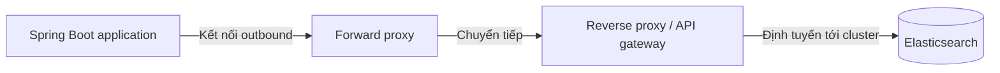

# Proxy, path prefix và header tùy chỉnh

Khi ứng dụng Spring Data Elasticsearch kết nối tới Elasticsearch thông qua mạng nội bộ, API gateway hoặc reverse proxy, cấu hình kết nối có thể cần thêm proxy, path prefix và HTTP header tùy chỉnh. Ba cơ chế này giải quyết ba vấn đề khác nhau: proxy định tuyến kết nối mạng, path prefix bổ sung phần đường dẫn vào mọi request HTTP, còn header truyền metadata hoặc thông tin xác thực theo quy ước của hệ thống.

Hiểu đúng từng cơ chế giúp tránh các lỗi như request đi sai cổng, endpoint bị lặp đường dẫn, gateway trả về 401/403 hoặc proxy từ chối kết nối. Các cấu hình cụ thể phụ thuộc vào thế hệ Elasticsearch client và phiên bản Spring Data Elasticsearch đang dùng. Ví dụ `ClientConfiguration` dưới đây minh họa API cấu hình của Spring Data Elasticsearch dùng Elasticsearch Java API Client; nếu dự án dùng dòng cũ hoặc client transport khác, cần đối chiếu API của đúng phiên bản.

## 1. Phân biệt proxy, path prefix và header

| Cơ chế | Tác dụng | Ví dụ tình huống |
|---|---|---|
| HTTP forward proxy | Là điểm trung gian mà ứng dụng sử dụng để gửi request ra mạng đích | Mạng công ty bắt buộc mọi kết nối outbound đi qua `proxy.corp.example:8080` |
| Reverse proxy / API gateway | Là endpoint đứng trước Elasticsearch và nhận request từ ứng dụng | Elasticsearch chỉ được truy cập qua `search.example.com` |
| Path prefix | Thêm một đoạn đường dẫn trước endpoint REST của Elasticsearch | Gateway công bố Elasticsearch dưới `/elasticsearch/` |
| Custom header | Gửi thêm thông tin trong HTTP request | Gateway yêu cầu `X-Application-Name` hoặc một header định tuyến |

Forward proxy và reverse proxy thường bị gọi chung là proxy nhưng nằm ở hai vị trí khác nhau trong luồng mạng.



Trong một môi trường khác, ứng dụng có thể kết nối trực tiếp tới reverse proxy mà không cần forward proxy. Cũng có thể có forward proxy cho lưu lượng outbound và reverse proxy phía trước cluster cùng lúc. Cần xác định đúng sơ đồ mạng trước khi cấu hình.

## 2. Path prefix là gì?

Elasticsearch REST API có các endpoint như:

```text
GET /
GET /_cluster/health
GET /products/_search
PUT /products
```

Một reverse proxy có thể công bố các endpoint này dưới một prefix riêng, chẳng hạn:

```text
https://search.example.com/elasticsearch/
https://search.example.com/elasticsearch/_cluster/health
https://search.example.com/elasticsearch/products/_search
```

Khi đó, ứng dụng cần thêm `elasticsearch` vào đầu path của mỗi request. Path prefix cho phép cấu hình phần này tại client một lần; code repository vẫn truy vấn index `products` như bình thường.

### Path prefix không phải index name

Các khái niệm sau có ý nghĩa khác nhau:

- Host và port xác định endpoint mạng, ví dụ `search.example.com:443`.
- Path prefix xác định phần đường dẫn gateway yêu cầu, ví dụ `/elasticsearch`.
- Index name xác định index được thao tác, ví dụ `products`.
- Repository hoặc query xác định thao tác dữ liệu, ví dụ tìm kiếm document trong `products`.

Không đưa path prefix vào tên index hoặc thêm thủ công vào từng câu truy vấn. Nếu cấu hình prefix ở client rồi code cũng tự thêm prefix, request có thể trở thành `/elasticsearch/elasticsearch/products/_search` và bị gateway trả về 404.

### Khi nào cần path prefix?

Cần path prefix khi endpoint công khai hoặc endpoint nội bộ của gateway đặt Elasticsearch dưới một đường dẫn con. Không cần path prefix khi ứng dụng kết nối trực tiếp tới Elasticsearch ở root path, hoặc reverse proxy đã loại bỏ prefix trước khi chuyển request đến backend.

Điểm cuối cùng rất quan trọng: có gateway giữ nguyên prefix khi forward và có gateway loại bỏ prefix trước khi chuyển tiếp. Cấu hình client phải khớp với đường dẫn mà endpoint phía ngoài thực sự nhận, không dựa vào cách backend được triển khai bên trong.

## 3. Cấu hình bằng Spring Data `ClientConfiguration`

Trong các phiên bản Spring Data Elasticsearch sử dụng Elasticsearch Java API Client, `ClientConfiguration` có thể mô tả host, SSL, proxy, path prefix, timeout và header mặc định. Ví dụ dưới đây minh họa cấu hình một ứng dụng kết nối tới Elasticsearch thông qua gateway HTTPS, một forward proxy và một header nhận diện ứng dụng.

```java
import org.springframework.context.annotation.Configuration;
import org.springframework.data.elasticsearch.client.ClientConfiguration;
import org.springframework.data.elasticsearch.client.elc.ElasticsearchConfiguration;
import org.springframework.http.HttpHeaders;

@Configuration
public class SearchClientConfiguration extends ElasticsearchConfiguration {

    @Override
    public ClientConfiguration clientConfiguration() {
        return ClientConfiguration.builder()
            .connectedTo("search.example.com:443")
            .usingSsl()
            .withProxy("proxy.corp.example:8080")
            .withPathPrefix("elasticsearch")
            .withHeaders(() -> {
                HttpHeaders headers = new HttpHeaders();
                headers.add("X-Application-Name", "catalog-service");
                return headers;
            })
            .build();
    }
}
```

Đây là ví dụ cho API cấu hình của Spring Data Elasticsearch dùng ELC. Tên package, lớp cấu hình và các phương thức builder có thể khác giữa các thế hệ Spring Data. Hãy đối chiếu Javadoc hoặc reference documentation của dependency thực tế trong dự án trước khi sao chép.

Ý nghĩa từng phần:

- `connectedTo(...)` khai báo endpoint mà client kết nối tới. Khi có reverse proxy, đây thường là host và port của gateway.
- `usingSsl()` bật kết nối TLS. Gateway HTTPS cần được cấu hình chứng chỉ và trust chain phù hợp.
- `withProxy(...)` khai báo forward proxy mà client sử dụng để gửi kết nối outbound.
- `withPathPrefix(...)` thêm prefix vào đường dẫn REST request. Ví dụ `elasticsearch` tương ứng phần path `/elasticsearch`.
- `withHeaders(...)` cung cấp các HTTP header bổ sung. Supplier tạo `HttpHeaders` để client lấy header theo cơ chế của phiên bản Spring Data đang dùng.

Nếu chỉ cần path prefix, không cần cấu hình forward proxy thì bỏ `withProxy(...)`. Nếu gateway không yêu cầu custom header thì bỏ `withHeaders(...)`. Chỉ bật các cơ chế thực sự có trong sơ đồ mạng của ứng dụng.

### Tích hợp cấu hình với Spring Boot

Trong ứng dụng Spring Boot, starter Data Elasticsearch có thể tự cấu hình client từ các properties. Nếu cần những tùy chỉnh mà properties hiện tại không biểu diễn được, có thể cung cấp customizer hoặc cấu hình client riêng theo extension point của đúng phiên bản Boot/Spring Data.

Ví dụ trên kế thừa `ElasticsearchConfiguration` để minh họa việc Spring Data tạo cấu hình client từ `ClientConfiguration`. Khi sử dụng cách này, cần kiểm tra auto-configuration của Spring Boot để tránh tự tạo hai bộ client, hai `ElasticsearchOperations` hoặc các bean trùng vai trò. Chọn một cơ chế cấu hình client làm nguồn chính và xác nhận các bean được inject vào repository/template là cùng một cấu hình.

### Tùy chỉnh `RestClientBuilder` trong các dòng Spring Boot có hỗ trợ

Một số dòng Spring Boot sử dụng Elasticsearch `RestClient` cung cấp extension point `RestClientBuilderCustomizer`. Extension point này cho phép tùy chỉnh builder thấp hơn, ví dụ đặt path prefix, default header hoặc cấu hình HTTP client callback cho forward proxy.

Ví dụ minh họa cho các phiên bản có API `RestClientBuilderCustomizer` và Apache HttpComponents tương ứng:

```java
import org.apache.http.Header;
import org.apache.http.HttpHost;
import org.apache.http.message.BasicHeader;
import org.elasticsearch.client.RestClientBuilder;
import org.springframework.boot.autoconfigure.elasticsearch.RestClientBuilderCustomizer;
import org.springframework.context.annotation.Bean;
import org.springframework.context.annotation.Configuration;

@Configuration
public class ElasticsearchRestClientCustomization {

    @Bean
    RestClientBuilderCustomizer elasticsearchRestClientCustomizer() {
        return (RestClientBuilder builder) -> {
            builder.setPathPrefix("/elasticsearch");
            builder.setDefaultHeaders(new Header[] {
                new BasicHeader("X-Application-Name", "catalog-service")
            });
            builder.setHttpClientConfigCallback(httpClientBuilder ->
                httpClientBuilder.setProxy(
                    new HttpHost("proxy.corp.example", 8080)
                )
            );
        };
    }
}
```

Ví dụ này gắn với `RestClientBuilder` và kiểu `HttpHost` của Apache HttpComponents được dependency tương ứng sử dụng. Không áp dụng nguyên xi cho các dòng client mới dùng transport hoặc HTTP stack khác. Nếu IDE không tìm thấy `RestClientBuilderCustomizer`, `RestClientBuilder` hoặc `HttpHost`, hãy kiểm tra phiên bản Spring Boot, Elasticsearch client và import thực tế; không thêm một dependency client cũ chỉ để làm ví dụ biên dịch.

Trong một dự án Spring Boot, extension point do Boot cung cấp thường phù hợp khi chỉ cần tùy chỉnh builder mà Boot đang dùng. Nếu thay thế toàn bộ cấu hình bằng `ElasticsearchConfiguration`, hãy tránh đồng thời đăng ký một customizer khác làm thay đổi cùng các thiết lập mà không có chủ đích.

## 4. Cấu hình forward proxy

Forward proxy nằm giữa ứng dụng và endpoint Elasticsearch. Ví dụ, chính sách mạng có thể chặn ứng dụng truy cập trực tiếp Internet hoặc một subnet, nhưng cho phép đi qua proxy đã được phê duyệt.

Luồng request:

```text
Spring Boot application
    |
    | HTTP CONNECT hoặc cơ chế proxy phù hợp với giao thức đích
    v
proxy.corp.example:8080
    |
    | Chuyển tiếp tới endpoint đích
    v
search.example.com:443
```

Trong Spring Data `ClientConfiguration`, có thể khai báo proxy bằng:

```java
ClientConfiguration.builder()
    .connectedTo("search.example.com:443")
    .usingSsl()
    .withProxy("proxy.corp.example:8080")
    .build();
```

Địa chỉ trong `withProxy` là forward proxy, còn địa chỉ trong `connectedTo` là endpoint Elasticsearch hoặc reverse proxy đứng trước Elasticsearch. Không đảo hai địa chỉ này.

### Proxy có xác thực

Một số proxy yêu cầu xác thực trước khi cho phép kết nối. Cách cung cấp proxy credentials phụ thuộc HTTP client stack mà phiên bản Spring Data đang sử dụng. Có thể cần dùng client configuration callback hoặc extension point của HTTP client để thiết lập credentials provider.

Khi triển khai:

- Lấy username/password hoặc token từ secret manager hay biến môi trường được quản lý.
- Không hard-code credentials trong source code hoặc commit file cấu hình chứa bí mật.
- Không ghi `Proxy-Authorization` hoặc thông tin xác thực vào log.
- Xác nhận proxy hỗ trợ CONNECT khi đích là HTTPS.
- Kiểm tra allowlist host, port và chính sách outbound của proxy.

Không phải mọi HTTP client đều tự đọc `HTTP_PROXY` hoặc `HTTPS_PROXY` từ environment. Hãy kiểm tra hành vi của client cụ thể và cấu hình proxy qua API được hỗ trợ thay vì giả định biến môi trường sẽ tự động có hiệu lực.

### Proxy và timeout

Khi dùng proxy, thời gian thiết lập kết nối có thể bao gồm phân giải DNS, kết nối tới proxy, thương lượng tunnel và TLS handshake tới endpoint. Vì vậy, timeout quá ngắn có thể gây lỗi dù Elasticsearch vẫn hoạt động bình thường.

Điều chỉnh connect timeout và socket/response timeout theo độ trễ mạng thực tế. Timeout lớn không khắc phục được proxy sai host, sai port, sai credentials hoặc firewall chặn kết nối; cần xác định đúng nguyên nhân trước khi tăng timeout.

## 5. Cấu hình path prefix qua reverse proxy

Giả sử reverse proxy công bố Elasticsearch tại:

```text
https://search.example.com/es/
```

Và giữ nguyên đoạn `/es` khi forward tới backend. Khi đó, client phải gửi request với prefix `/es`.

Ví dụ:

```java
ClientConfiguration.builder()
    .connectedTo("search.example.com:443")
    .usingSsl()
    .withPathPrefix("es")
    .build();
```

Nếu reverse proxy loại bỏ `/es` trước khi chuyển request đến Elasticsearch, client bên ngoài vẫn phải gửi `/es`, vì đó là route public mà gateway nhận. Backend có thể nhận path đã được rewrite thành `/_search` hoặc `/products/_search`. Không cấu hình prefix lần thứ hai trong code truy vấn.

### Phân biệt path prefix với context path của ứng dụng

`server.servlet.context-path` trong Spring Boot điều khiển URL của chính ứng dụng Spring MVC/Servlet. Nó không tự động thêm prefix vào các request outbound mà Elasticsearch client gửi đi.

Tương tự, `spring.elasticsearch.uris` (khi có trong phiên bản Boot đang dùng) xác định URI kết nối, nhưng không nên giả định mọi phiên bản Boot đều xử lý path suffix giống nhau. Hãy dùng thuộc tính path-prefix hoặc client customization mà phiên bản cụ thể hỗ trợ.

### Các lỗi path prefix phổ biến

| Triệu chứng | Nguyên nhân có thể | Hướng kiểm tra |
|---|---|---|
| `404 Not Found` | Thiếu prefix hoặc prefix không đúng | Xem URL request thực tế và route của gateway |
| `404` với đường dẫn lặp | Prefix bị thêm ở client và trong code/proxy cùng lúc | Kiểm tra path sau mỗi bước rewrite |
| `502 Bad Gateway` | Gateway không chuyển được request tới backend | Kiểm tra upstream host, port, health và network |
| Root endpoint hoạt động nhưng `_search` lỗi | Gateway chỉ route một số path hoặc rule không bao phủ endpoint con | Kiểm tra rule cho `/_search`, `/_bulk`, `/_cluster/health` sau prefix |
| Request ghi lỗi nhưng đọc được | Gateway hoặc WAF giới hạn HTTP method/path/body | Kiểm tra chính sách PUT/POST/DELETE và kích thước body |

Elasticsearch client có thể gọi nhiều endpoint khác nhau, không chỉ endpoint tìm kiếm. Gateway phải chuyển tiếp đầy đủ các endpoint mà ứng dụng sử dụng, bao gồm thao tác index, bulk, health hoặc cluster metadata nếu có.

## 6. Header tùy chỉnh

HTTP header truyền thông tin bổ sung cùng request. Elasticsearch client hoặc gateway có thể dùng header để nhận diện ứng dụng, định tuyến tenant, truyền correlation ID hay đáp ứng quy ước xác thực của hạ tầng.

Ví dụ header:

```http
X-Application-Name: catalog-service
X-Correlation-Id: 8d3f1a2b
X-Tenant-Id: tenant-42
```

Không phải Elasticsearch server mặc định hiểu mọi header tùy chỉnh. Header có ý nghĩa khi client, reverse proxy, API gateway, plugin hoặc lớp bảo mật được cấu hình để xử lý nó.

### Header cố định

Header cố định có cùng giá trị cho mọi request của client, ví dụ tên dịch vụ:

```java
.withHeaders(() -> {
    HttpHeaders headers = new HttpHeaders();
    headers.add("X-Application-Name", "catalog-service");
    headers.add("X-Environment", "staging");
    return headers;
})
```

Đây là lựa chọn phù hợp với metadata của ứng dụng không thay đổi theo người dùng hoặc request.

### Header động

Spring Data `ClientConfiguration` có thể nhận một supplier tạo `HttpHeaders`. Supplier cho phép tạo header tại thời điểm client cần lấy chúng, ví dụ tạo correlation ID hoặc lấy token ngắn hạn theo cơ chế của ứng dụng:

```java
.withHeaders(() -> {
    HttpHeaders headers = new HttpHeaders();
    headers.add("X-Application-Name", "catalog-service");
    headers.add("X-Correlation-Id", correlationIdProvider.currentId());
    return headers;
})
```

`correlationIdProvider` ở đây là thành phần do ứng dụng định nghĩa. Ví dụ chỉ minh họa ý tưởng, không phải một API có sẵn của Spring Data. Cần bảo đảm giá trị được lấy từ đúng request context và có thể truy cập an toàn khi client thực hiện request bất đồng bộ hoặc trên thread khác.

Không nên lưu `X-Tenant-Id`, user token hoặc thông tin quyền truy cập của một người dùng vào default header cố định của singleton client dùng chung cho mọi request. Làm vậy có thể khiến request của người dùng sau mang nhầm thông tin người dùng trước. Với dữ liệu phụ thuộc từng request, hãy dùng cơ chế truyền request/transport options riêng của client, hoặc thiết kế client theo tenant nếu đó là yêu cầu kiến trúc.

### Header xác thực

Nếu Elasticsearch dùng Basic Authentication, ưu tiên cơ chế xác thực mà Spring Data hoặc Spring Boot cung cấp, chẳng hạn `withBasicAuth(...)` hoặc các properties tương ứng của phiên bản đang dùng. Nếu gateway yêu cầu API key hoặc token ở header riêng, hãy lấy secret từ secret manager và thêm header theo extension point được hỗ trợ.

Không gửi token hoặc mật khẩu qua HTTP không mã hóa trên mạng không tin cậy. Dùng HTTPS/TLS, giới hạn quyền của credential và luân chuyển secret theo chính sách hệ thống. Tránh ghi toàn bộ request headers vào log vì có thể làm lộ `Authorization`, cookie hoặc API key.

### Header do proxy/gateway thêm hoặc thay đổi

Gateway có thể thêm `X-Forwarded-For`, `X-Forwarded-Proto`, request ID hoặc header định tuyến. Nó cũng có thể xóa header không nằm trong allowlist hoặc ghi đè một số header do client gửi. Nếu header tùy chỉnh không xuất hiện ở backend, hãy kiểm tra cả cấu hình gateway và log truy cập của proxy.

Không dùng header tùy chỉnh để thay thế kiểm soát truy cập ở Elasticsearch. Gateway có thể xác thực header, nhưng Elasticsearch và các dịch vụ liên quan vẫn cần được cấu hình quyền phù hợp, tránh tin tưởng một header do client bất kỳ tự gửi.

## 7. Kết hợp cả ba cơ chế

Một hệ thống có thể cần forward proxy, reverse proxy path prefix và custom header cùng lúc. Ví dụ:

- Ứng dụng chỉ được phép outbound qua `proxy.corp.example:8080`.
- Forward proxy chuyển request tới gateway `search.example.com:443`.
- Gateway công bố Elasticsearch dưới `/elasticsearch`.
- Gateway yêu cầu header `X-Application-Name` để nhận diện dịch vụ.

Khi đó cấu hình có thể có dạng:

```java
ClientConfiguration.builder()
    .connectedTo("search.example.com:443")
    .usingSsl()
    .withProxy("proxy.corp.example:8080")
    .withPathPrefix("elasticsearch")
    .withHeaders(() -> {
        HttpHeaders headers = new HttpHeaders();
        headers.add("X-Application-Name", "catalog-service");
        return headers;
    })
    .build();
```

Một truy vấn repository tới index `products` vẫn được viết theo API Spring Data thông thường. Client sẽ bổ sung prefix và headers theo cấu hình trước khi gửi request qua proxy tới gateway.

## 8. Kiểm tra cấu hình khi chạy ứng dụng

Sau khi cấu hình, cần kiểm tra cả đường đi mạng và HTTP request thực tế. Một cấu hình có thể biên dịch thành công nhưng gateway vẫn không route đúng endpoint.

### Xác minh endpoint từ môi trường ứng dụng

Nếu được phép truy cập từ máy chạy ứng dụng, có thể dùng `curl` để kiểm tra route public. Ví dụ:

```bash
curl -i https://search.example.com/elasticsearch/
```

Nếu endpoint yêu cầu header:

```bash
curl -i \
  -H "X-Application-Name: catalog-service" \
  https://search.example.com/elasticsearch/
```

Nếu cần forward proxy, dùng tùy chọn `--proxy` của curl để kiểm tra đường đi tương ứng:

```bash
curl -i \
  --proxy http://proxy.corp.example:8080 \
  https://search.example.com/elasticsearch/
```

Không đặt token hoặc mật khẩu trực tiếp vào lệnh có thể được lưu trong shell history hoặc log CI. Dùng cơ chế secret an toàn của môi trường kiểm thử.

### Kiểm tra từ ứng dụng

Thực hiện một số thao tác tối thiểu qua `ElasticsearchOperations` hoặc repository:

1. Kết nối tới endpoint và đọc thông tin cluster nếu quyền cho phép.
2. Tạo hoặc xác nhận một index kiểm thử.
3. Lưu một document có ID xác định.
4. Đọc document theo ID và chạy một truy vấn tìm kiếm.
5. Xóa document kiểm thử sau khi hoàn thành.

Nếu chỉ kiểm tra root endpoint, vẫn có thể bỏ sót việc gateway không cho phép `POST /_search`, `PUT /products` hoặc `POST /_bulk`. Cần kiểm tra các method và endpoint thực tế mà ứng dụng sử dụng.

### Diễn giải mã lỗi

| Mã hoặc lỗi | Ý nghĩa thường gặp | Cần kiểm tra |
|---|---|---|
| 401 Unauthorized | Thiếu hoặc sai thông tin xác thực ở Elasticsearch/gateway | Credentials, token, thời hạn token và header có được chuyển tiếp không |
| 403 Forbidden | Đã nhận diện request nhưng không có quyền | Role, quyền index, allowlist ứng dụng hoặc tenant |
| 404 Not Found | Path prefix hoặc route không đúng | URL sau khi client ghép prefix và quy tắc rewrite |
| 407 Proxy Authentication Required | Forward proxy yêu cầu xác thực | Proxy credentials và cách cấu hình cho HTTP client |
| 502/503 | Gateway không kết nối được upstream hoặc upstream không sẵn sàng | Backend address, health check, firewall và DNS |
| Connect timeout | Không thiết lập được kết nối trong thời hạn | Proxy host/port, DNS, firewall, timeout và route mạng |
| TLS handshake error | Không hoàn tất được thương lượng TLS | Scheme HTTPS, chứng chỉ, hostname và truststore |

Các mã lỗi chỉ là dấu hiệu ban đầu. Một gateway có thể ánh xạ lỗi upstream thành mã khác, vì vậy nên đối chiếu request ID với log gateway và Elasticsearch để tìm đúng điểm phát sinh lỗi.

## 9. Lưu ý khi triển khai production

### Bảo vệ credentials và header

- Dùng HTTPS giữa ứng dụng và gateway; nếu có thể, bảo vệ cả chặng từ gateway tới Elasticsearch.
- Đọc API key, token và proxy credentials từ secret manager hoặc cơ chế secret của nền tảng triển khai.
- Không commit secret vào `application.yml`, Dockerfile hoặc file build.
- Không log `Authorization`, `Proxy-Authorization`, cookie hay header chứa dữ liệu nhạy cảm.
- Chỉ gửi header tới đúng endpoint tin cậy; tránh chuyển tiếp token của người dùng sang host không liên quan.

### Đảm bảo tính đúng của tenant và request context

Nếu header dùng để xác định tenant, phải bảo đảm tenant được xác thực và phân quyền trước khi gửi request. Không lấy tenant ID tùy ý từ dữ liệu client rồi tin tưởng header đó như một ranh giới bảo mật.

Với ứng dụng đa tenant, hãy kiểm tra hành vi đồng thời của nhiều request. Header của một tenant không được rò sang request tenant khác. Supplier hoặc ThreadLocal đơn giản có thể không phù hợp nếu request chạy bất đồng bộ hoặc chuyển thread; dùng cơ chế context propagation và request-scoped options có chủ đích.

### Theo dõi và vận hành

Nên theo dõi:

- Tỷ lệ kết nối thành công và lỗi theo endpoint.
- Connect timeout, response timeout và độ trễ request.
- Số lượng lỗi 401/403/404/407/502/503.
- Lỗi TLS và thay đổi chứng chỉ gateway.
- Tỷ lệ request bị proxy từ chối hoặc gateway không route được.

Khi thay đổi proxy, prefix hoặc header, cần triển khai đồng bộ giữa ứng dụng và cấu hình gateway. Một thay đổi path rewrite ở gateway có thể làm ứng dụng cũ ngừng hoạt động ngay cả khi Elasticsearch server không thay đổi.

## 10. Những lỗi cấu hình thường gặp

### Dùng forward proxy như thể đó là Elasticsearch host

`connectedTo(...)` phải trỏ tới endpoint Elasticsearch hoặc reverse proxy đứng trước nó. Forward proxy được cấu hình riêng qua tùy chọn proxy. Đặt proxy host vào `connectedTo` sẽ khiến client gửi request tới sai đích.

### Thêm prefix vào URI và cấu hình prefix lần nữa

Nếu URI đã chứa path prefix và client cũng thêm prefix, request có thể bị lặp đường dẫn. Xác định rõ nơi quản lý prefix và chỉ áp dụng một lần.

### Nhầm context path của ứng dụng với path prefix outbound

`server.servlet.context-path` điều khiển URL inbound của ứng dụng. Nó không thay thế cấu hình path prefix cho Elasticsearch client.

### Dùng header dùng chung cho dữ liệu theo người dùng

Default header của một client singleton thường được áp dụng cho nhiều request. Không gắn token người dùng hoặc tenant hiện hành vào header cố định rồi dùng chung client cho mọi người dùng.

### Giả định proxy tự động lấy từ biến môi trường

Mỗi HTTP client có cách xử lý proxy riêng. Hãy xác minh client có đọc environment hay không và ưu tiên cấu hình tường minh qua API được hỗ trợ.

### Tắt TLS verification để sửa lỗi chứng chỉ

Tắt kiểm tra chứng chỉ làm giảm khả năng xác thực endpoint và có thể mở đường cho kết nối giả mạo. Hãy cài trust chain đúng, dùng hostname khớp chứng chỉ và sửa cấu hình TLS.

### Chỉ kiểm tra một endpoint

Root endpoint có thể hoạt động trong khi gateway chặn `_search`, `_bulk` hoặc các HTTP method ghi dữ liệu. Hãy kiểm tra đầy đủ các thao tác mà ứng dụng thực sự cần.

## 11. Quy trình cấu hình đề xuất

Khi đưa Elasticsearch vào môi trường có proxy hoặc gateway, có thể thực hiện theo trình tự:

1. Vẽ luồng mạng từ ứng dụng tới Elasticsearch; xác định forward proxy, reverse proxy và endpoint thực tế.
2. Xác nhận scheme, host, port và TLS của endpoint mà ứng dụng nhìn thấy.
3. Xác định gateway giữ hay loại bỏ path prefix khi forward.
4. Liệt kê custom header bắt buộc, mục đích của từng header và thành phần nào xác thực chúng.
5. Chọn extension point tương ứng với phiên bản Spring Boot/Spring Data/client đang dùng.
6. Cấu hình proxy, path prefix và header tại một nơi có thể quản lý rõ ràng.
7. Kiểm tra endpoint và các HTTP method qua đúng đường mạng của ứng dụng.
8. Chạy integration test cho thao tác index, get, search, update, delete và bulk nếu sử dụng.
9. Kiểm tra lỗi xác thực, timeout, TLS, tenant isolation và log không làm lộ secret.
10. Triển khai cùng thay đổi gateway/proxy theo kế hoạch và theo dõi chỉ số sau phát hành.

## 12. Kết luận

Proxy, path prefix và custom header là ba phần cấu hình riêng của kết nối HTTP. Forward proxy điều khiển đường đi outbound; path prefix điều chỉnh URL mà Elasticsearch client gửi tới endpoint; custom header truyền metadata hoặc thông tin mà gateway/client đã được cấu hình để xử lý.

Trong Spring Data Elasticsearch, có thể dùng `ClientConfiguration` hoặc extension point của Spring Boot/client phù hợp với phiên bản đang chạy. Cần phân biệt cấu hình của từng thế hệ client, tránh tạo bean client trùng lặp, giữ secret an toàn và kiểm thử toàn bộ endpoint qua đúng proxy/gateway. Khi các ranh giới này rõ ràng, repository và `ElasticsearchOperations` vẫn có thể làm việc với index như bình thường trong khi lớp client xử lý chi tiết mạng.
