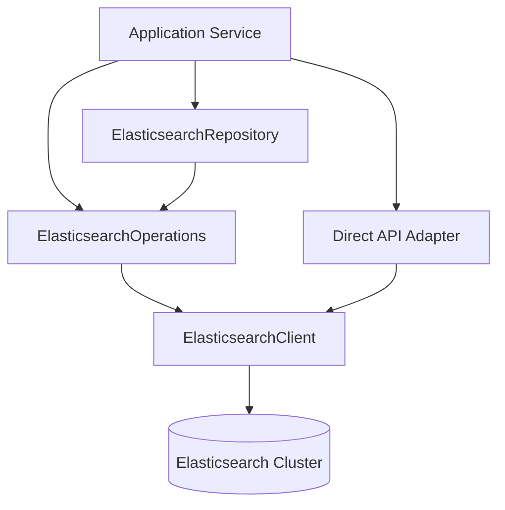
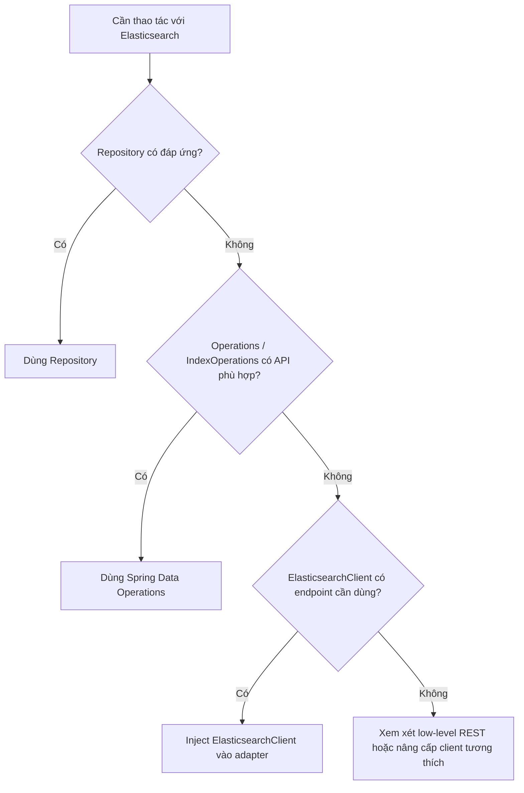

# Tiêm client trực tiếp khi Operations chưa hỗ trợ API cần dùng

`ElasticsearchOperations` là abstraction chính của Spring Data Elasticsearch cho các thao tác trên document và index. Tuy nhiên, Elasticsearch còn có nhiều API ở cấp cluster, node, snapshot, task hoặc các tính năng mới mà abstraction Spring Data chưa cung cấp đầy đủ. Khi một use case cần gọi API như vậy, ứng dụng có thể **inject trực tiếp Elasticsearch Java API Client (`ElasticsearchClient`)** và gọi endpoint tương ứng.

Cách làm này giữ được sự tiện lợi của Spring Data cho CRUD và truy vấn thông thường, đồng thời cho phép dùng API gốc của Elasticsearch ở đúng nơi cần thiết. Bài học tập trung vào cách lấy client từ Spring, tổ chức lớp gọi API trực tiếp, xử lý response và lỗi, cùng những điểm cần lưu ý khi dùng song song với `ElasticsearchOperations`.

## 1. Các lớp client trong Spring Data Elasticsearch

Trong một ứng dụng Spring Boot, các lớp thường gặp có vai trò khác nhau:

| Thành phần | Vai trò | Khi nào dùng |
|---|---|---|
| `ElasticsearchRepository` | API repository theo entity và quy ước Spring Data | CRUD và derived query theo domain. |
| `ElasticsearchOperations` | API thao tác document, query, search result và index theo Spring Data | Truy vấn động, mapping entity, `SearchHits`, bulk và các thao tác index được hỗ trợ. |
| `ElasticsearchClient` | Java API Client chính thức, cung cấp request builder và response model có kiểu | Cần gọi endpoint hoặc option Elasticsearch chưa được Spring Data bọc lại. |
| Low-level REST client / transport | Lớp giao tiếp HTTP phía dưới Java API Client | Chỉ khi cần kiểm soát HTTP hoặc tích hợp ở mức transport mà typed client không đáp ứng. |

Trong các phiên bản Spring Data Elasticsearch hiện đại, `ElasticsearchOperations` sử dụng Elasticsearch Java API Client ở phía dưới. Vì vậy, inject `ElasticsearchClient` trực tiếp không có nghĩa là tạo một kết nối Elasticsearch độc lập. Khi dùng cấu hình Spring Boot mặc định, hãy để Spring quản lý client và transport, rồi inject bean client đó vào adapter cần gọi API gốc.

Luồng tổng quát:



Repository và Operations phù hợp với các thao tác dữ liệu ở mức Spring Data. Adapter gọi trực tiếp client đảm nhiệm một API cụ thể mà Operations chưa cung cấp hoặc chưa bộc lộ đủ option. Các đường đi này có thể cùng tồn tại trong một ứng dụng.

## 2. Trước tiên, xác định API còn thiếu

Không nên inject client trực tiếp chỉ vì muốn viết query Elasticsearch. `ElasticsearchOperations` đã hỗ trợ nhiều kiểu truy vấn, bao gồm `CriteriaQuery`, `StringQuery` và `NativeQuery`. `NativeQuery` cho phép biểu diễn Query DSL bằng các builder có kiểu của Java API Client.

Hãy bắt đầu bằng cách xác định chính xác phần còn thiếu:

- Endpoint cần gọi là API document, index, cluster, node hay task?
- `ElasticsearchOperations` hoặc `IndexOperations` đã có phương thức tương ứng chưa?
- Thiếu một option cụ thể của request, hay cần toàn bộ endpoint chưa được abstraction hỗ trợ?
- Response cần dữ liệu nào mà kiểu kết quả của Spring Data chưa bộc lộ?

Ví dụ, tìm kiếm document với điều kiện `match`, `bool`, sort và phân trang thường vẫn làm được qua `NativeQuery`. Nhưng kiểm tra trạng thái toàn cluster bằng endpoint `_cluster/health` là một thao tác ở cấp cluster, không phải thao tác trên entity. Đây là trường hợp phù hợp để gọi `ElasticsearchClient` trực tiếp.

## 3. Để Spring Boot cấu hình client

Với ứng dụng Spring Boot đã thêm starter Spring Data Elasticsearch, khai báo địa chỉ cluster trong `application.yml`:

```yaml
spring:
  elasticsearch:
    uris: ${ELASTICSEARCH_URIS:http://localhost:9200}
```

Biến môi trường `ELASTICSEARCH_URIS` cho phép thay URI theo môi trường triển khai. Nếu cluster yêu cầu xác thực hoặc TLS, cấu hình các thông tin kết nối theo phiên bản Spring Boot đang dùng và lưu credential trong secret hoặc biến môi trường, không commit mật khẩu vào repository.

Với cấu hình auto-configuration thông thường, Spring Boot tạo client và các thành phần Elasticsearch cần thiết từ dependency cùng các thuộc tính `spring.elasticsearch.*`. Ứng dụng có thể inject `ElasticsearchClient` vào constructor mà không phải tự tạo một HTTP client mới.

Ví dụ class khởi tạo ứng dụng:

```java
package com.example.catalog;

import org.springframework.boot.SpringApplication;
import org.springframework.boot.autoconfigure.SpringBootApplication;

@SpringBootApplication
public class ProductCatalogApplication {

    public static void main(String[] args) {
        SpringApplication.run(ProductCatalogApplication.class, args);
    }
}
```

Đặt các package cấu hình, service và adapter bên dưới package gốc của class này để Spring tìm thấy chúng theo cơ chế component scan mặc định.

### 3.1. Inject bean `ElasticsearchClient`

Một component có thể nhận client trực tiếp qua constructor:

```java
package com.example.catalog.elasticsearch;

import co.elastic.clients.elasticsearch.ElasticsearchClient;
import org.springframework.stereotype.Component;

@Component
public class ElasticsearchClusterApi {

    private final ElasticsearchClient client;

    public ElasticsearchClusterApi(ElasticsearchClient client) {
        this.client = client;
    }
}
```

Spring tìm bean `ElasticsearchClient` trong Application Context và truyền vào constructor khi tạo `ElasticsearchClusterApi`. Constructor injection giúp dependency hiển thị rõ ràng, trường client có thể là `final` và component dễ kiểm thử hơn.

Nếu ứng dụng chỉ có một client bean, không cần `@Qualifier`. Nếu ứng dụng chủ động cấu hình nhiều cluster hoặc nhiều client bean, hãy đặt tên bean và dùng `@Qualifier` tương ứng để tránh inject nhầm cluster.

### 3.2. Khi nào cần cấu hình client thủ công?

Chỉ cấu hình client thủ công khi auto-configuration không phù hợp hoặc ứng dụng có yêu cầu kết nối đặc biệt. Ví dụ: nhiều cluster độc lập, transport riêng, custom authentication hoặc một cấu hình không được hỗ trợ qua thuộc tính Boot.

Trong trường hợp đó, hãy dùng cơ chế cấu hình client được hỗ trợ bởi phiên bản Spring Data Elasticsearch/Spring Boot của dự án. Cần thống nhất client, transport và converter được dùng bởi `ElasticsearchOperations`; không tạo thêm một client với connection pool riêng chỉ để gọi một endpoint đơn lẻ nếu không có lý do vận hành rõ ràng.

Việc tự dựng client thường liên quan đến `RestClient`, `ElasticsearchTransport`, JSON-P mapper và vòng đời đóng tài nguyên. Nếu tự tạo các bean này, ứng dụng phải bảo đảm chúng được quản lý và đóng đúng lúc. Không copy cấu hình client từ một phiên bản Elasticsearch khác mà chưa kiểm tra tương thích thư viện.

## 4. Gọi API cluster trực tiếp

Giả sử ứng dụng cần hiển thị trạng thái cluster để phục vụ trang diagnostics nội bộ. `ElasticsearchOperations` tập trung vào document và index; API cluster health có thể được gọi trực tiếp qua `ElasticsearchClient`.

Tạo DTO cho dữ liệu ứng dụng cần dùng:

```java
package com.example.catalog.elasticsearch;

public record ClusterHealthSnapshot(
    String clusterName,
    String status,
    int nodeCount,
    int activeShards
) {
}
```

Tạo adapter gọi endpoint:

```java
package com.example.catalog.elasticsearch;

import java.io.IOException;

import co.elastic.clients.elasticsearch.ElasticsearchClient;
import org.springframework.stereotype.Component;

@Component
public class ElasticsearchClusterApi {

    private final ElasticsearchClient client;

    public ElasticsearchClusterApi(ElasticsearchClient client) {
        this.client = client;
    }

    public ClusterHealthSnapshot readHealth() {
        try {
            var response = client.cluster().health();

            return new ClusterHealthSnapshot(
                response.clusterName(),
                response.status().toString(),
                response.numberOfNodes(),
                response.activeShards()
            );
        } catch (IOException exception) {
            throw new IllegalStateException(
                "Cannot read Elasticsearch cluster health",
                exception
            );
        }
    }
}
```

Lệnh `client.cluster().health()` gọi Cluster Health API. Java API Client cung cấp builder, kiểu response và serialization cho endpoint này. Ứng dụng chỉ cần chuyển phần response cần thiết thành DTO riêng; không phải tự tạo HTTP request hay parse JSON thủ công.

Phương thức đồng bộ của `ElasticsearchClient` có thể ném `IOException` khi request/response gặp lỗi I/O. Adapter cần xử lý ngoại lệ này theo chính sách của ứng dụng. Ví dụ trên chuyển nó thành unchecked exception để tầng gọi xử lý tập trung; trong ứng dụng production, có thể định nghĩa exception chuyên biệt để phân biệt lỗi kết nối, timeout và lỗi từ Elasticsearch.

`status` phản ánh trạng thái cluster như `green`, `yellow` hoặc `red`. Nó là dữ liệu quan sát, không tự động chứng minh một use case cụ thể thành công hay thất bại. Cần diễn giải theo số replica, shard và cấu hình cluster của hệ thống.

## 5. Dùng client trực tiếp cho request document khi cần option gốc

Một tình huống khác là ứng dụng cần một request search có option đặc thù mà abstraction đang dùng chưa bộc lộ. Khi đó, `ElasticsearchClient` cho phép xây request trực tiếp bằng Java API Client.

Ví dụ tìm document theo tên bằng typed client:

```java
package com.example.catalog.product.search;

public record ProductSearchDocument(
    String sku,
    String name,
    String category,
    Double price
) {
}
```

```java
package com.example.catalog.product.search;

import java.io.IOException;
import java.util.List;
import java.util.Objects;

import co.elastic.clients.elasticsearch.ElasticsearchClient;
import co.elastic.clients.elasticsearch.core.search.Hit;
import org.springframework.stereotype.Component;

@Component
public class DirectProductSearchApi {

    private final ElasticsearchClient client;

    public DirectProductSearchApi(ElasticsearchClient client) {
        this.client = client;
    }

    public List<ProductSearchDocument> searchByName(String text) {
        try {
            var response = client.search(search -> search
                    .index("products")
                    .size(20)
                    .query(query -> query
                        .match(match -> match
                            .field("name")
                            .query(text)
                        )
                    ),
                ProductSearchDocument.class
            );

            return response.hits().hits().stream()
                .map(Hit::source)
                .filter(Objects::nonNull)
                .toList();
        } catch (IOException exception) {
            throw new IllegalStateException(
                "Cannot search products in Elasticsearch",
                exception
            );
        }
    }
}
```

Đây là ví dụ về cách xây request và đọc response bằng Java API Client. Query `match` trên field `name` là một truy vấn phổ biến vốn cũng có thể viết qua `NativeQuery`; không nên dùng client trực tiếp chỉ để thay thế ví dụ này. Trong use case thực tế, chỉ chọn đường gọi trực tiếp khi request cần option hoặc endpoint mà `ElasticsearchOperations` chưa cung cấp phù hợp.

`ProductSearchDocument` là DTO dùng để deserialize `_source`. Client trực tiếp sử dụng JSON mapper gắn với transport, không tự động áp dụng `MappingElasticsearchConverter` của Spring Data. Vì vậy, nếu dùng client trực tiếp để đọc/ghi document, cần xác định rõ tên field, kiểu dữ liệu, date format, custom serializer và cấu trúc JSON. Một DTO riêng cho API trực tiếp giúp tránh giả định rằng mọi annotation Spring Data trên entity sẽ được áp dụng.

## 6. Đặt lời gọi trực tiếp trong adapter chuyên trách

Không nên để mọi service nghiệp vụ phụ thuộc vào `ElasticsearchClient` và tự tạo request builder ở nhiều nơi. Hãy đóng gói API gốc trong một adapter hoặc gateway có tên thể hiện trách nhiệm.

Ví dụ phân chia:

```text
ProductApplicationService
    ├── ProductRepository
    │     └── CRUD và truy vấn domain đơn giản
    │
    ├── ProductSearchService
    │     └── ElasticsearchOperations
    │           └── Search query theo bộ lọc động
    │
    └── ElasticsearchClusterApi
          └── ElasticsearchClient
                └── Cluster Health API
```

Application Service gọi adapter thông qua method có ý nghĩa với ứng dụng, ví dụ `readHealth()` hoặc `readIndexStats()`. Nó không cần biết chi tiết request class, Query DSL hoặc response model của Elasticsearch.

Adapter là ranh giới phù hợp để:

- Chọn endpoint và option cụ thể.
- Chuyển response Elasticsearch thành DTO nội bộ.
- Chuyển lỗi kỹ thuật thành exception có ý nghĩa với ứng dụng.
- Ghi log và metrics ở mức request phù hợp.
- Cô lập thay đổi API client khi nâng cấp phiên bản Elasticsearch.

Không nên trả response model gốc của Elasticsearch xuyên suốt mọi tầng nghiệp vụ nếu ứng dụng chỉ cần một phần nhỏ dữ liệu. DTO nội bộ giảm phụ thuộc vào cấu trúc thư viện và làm rõ hợp đồng của ứng dụng.

## 7. Xử lý lỗi, timeout và retry

Khi gọi API trực tiếp, cần phân biệt ít nhất các nhóm lỗi sau:

| Nhóm lỗi | Ví dụ | Cách xử lý |
|---|---|---|
| Lỗi kết nối | Host không truy cập được, DNS hoặc TLS lỗi | Kiểm tra cấu hình, network và chứng chỉ; trả lỗi hạ tầng phù hợp. |
| Timeout | Cluster phản hồi chậm hoặc request chờ quá lâu | Đặt timeout theo use case, quan sát latency và chỉ retry khi phù hợp. |
| Lỗi HTTP/Elasticsearch | Request sai, index không tồn tại, thiếu quyền | Đọc status và error response, sửa request hoặc quyền; không retry mù quáng. |
| Lỗi chuyển đổi | JSON không khớp DTO hoặc mapper không xử lý kiểu dữ liệu | Kiểm tra mapping, serializer và kiểu Java. |
| Lỗi I/O | Đọc/ghi response thất bại | Giữ nguyên nguyên nhân, ghi log có kiểm soát và chuyển thành lỗi ứng dụng phù hợp. |

Java API Client đồng bộ có thể ném `IOException` cho lỗi giao tiếp. Các lỗi từ Elasticsearch cũng có thể được biểu diễn qua exception của client với thông tin HTTP response. Không nên bắt mọi exception rồi trả về danh sách rỗng hoặc trạng thái thành công giả, vì điều đó làm mất tín hiệu lỗi và khiến hệ thống khó chẩn đoán.

Retry phải dựa trên tính chất thao tác. Một request đọc trạng thái cluster có thể phù hợp với retry giới hạn khi gặp lỗi tạm thời. Một thao tác ghi hoặc cập nhật cần xét idempotency và nguy cơ gửi lặp trước khi retry. Không tự retry mọi lỗi `4xx` hoặc lỗi mapping.

Timeout kết nối và timeout socket/read cần được cấu hình theo phiên bản Boot/client đang dùng. Tránh đặt timeout quá dài khiến thread web bị giữ lâu, hoặc quá ngắn làm request bình thường thất bại. Với API diagnostics, nên giới hạn tần suất gọi và cân nhắc cache ngắn hạn thay vì gọi cluster health trong mọi request không cần thiết.

## 8. Vòng đời client và quản lý tài nguyên

Khi dùng Spring Boot auto-configuration, client và transport được quản lý bởi Spring. Hãy inject bean đã được quản lý và để Application Context xử lý vòng đời của chúng.

Không tạo `ElasticsearchClient` mới trong mỗi lần gọi method:

```java
// Không nên: tạo transport/client liên tục trong mỗi request.
public void doSomething() {
    // Build RestClient, transport và ElasticsearchClient ở đây.
}
```

Việc tạo client lặp lại gây overhead, tạo nhiều connection pool và làm phức tạp việc đóng tài nguyên. Client nên được cấu hình và tái sử dụng trong phạm vi ứng dụng hoặc cluster tương ứng.

Nếu tự cấu hình client, phải xác định rõ bean nào sở hữu `RestClient`/transport và bean nào đóng chúng. Không để cả Spring và code thủ công cùng đóng một tài nguyên, cũng không bỏ quên tài nguyên khi context dừng.

## 9. Dùng `ElasticsearchOperations` và client trực tiếp cùng nhau

Một ứng dụng có thể inject cả hai abstraction vào những thành phần khác nhau:

```java
@Service
public class ProductSearchService {

    private final ElasticsearchOperations operations;

    public ProductSearchService(ElasticsearchOperations operations) {
        this.operations = operations;
    }

    // Dùng Spring Data Query và SearchHits cho search nghiệp vụ.
}
```

```java
@Component
public class ElasticsearchClusterApi {

    private final ElasticsearchClient client;

    public ElasticsearchClusterApi(ElasticsearchClient client) {
        this.client = client;
    }

    // Dùng Cluster Health API hoặc endpoint cấp cluster khác.
}
```

Hai component có thể dùng chung cấu hình kết nối do Spring quản lý. Cần giữ ranh giới rõ ràng:

1. Repository/Operations sở hữu các thao tác dữ liệu và mapping theo Spring Data.
2. Adapter client trực tiếp sở hữu endpoint hoặc option đặc thù.
3. Không để hai cơ chế cùng định nghĩa mapping độc lập cho một loại document.
4. Khi client trực tiếp đọc/ghi `_source`, xác nhận JSON mapper tương thích với dữ liệu mà Spring Data đang lưu.
5. Giữ tên index và field nhất quán; cân nhắc tập trung chúng trong cấu hình hoặc metadata phù hợp nếu nhiều adapter cùng sử dụng.

Việc cùng sử dụng hai API không có nghĩa mọi thao tác phải đi qua cả hai. Mỗi use case nên có một đường gọi rõ ràng để dễ theo dõi và kiểm thử.

## 10. Phân biệt `ElasticsearchClient` với low-level REST client

`ElasticsearchClient` là typed Java API Client. Nó cung cấp các method như `client.cluster().health()` hoặc `client.search(...)`, cùng request builder và response class sinh từ API Elasticsearch.

Low-level REST client là lớp HTTP phía dưới. Nó làm việc gần với HTTP method, path, query parameter và request body hơn. Chỉ cân nhắc lớp thấp hơn khi typed Java API Client cũng chưa cung cấp endpoint hoặc option cần thiết, hoặc một thư viện khác yêu cầu trực tiếp transport/client đó.

Không nên nhầm `ElasticsearchClient` hiện đại với `RestHighLevelClient` cũ. `RestHighLevelClient` thuộc thế hệ client trước và đã bị deprecated trong hệ sinh thái Elasticsearch mới. Với dự án Spring Boot/Spring Data hiện đại, hãy dùng bộ client mà phiên bản dependency management của dự án hỗ trợ.

## 11. Kiểm thử adapter gọi client trực tiếp

Vì adapter nhận `ElasticsearchClient` qua constructor, có thể thay client bằng mock trong unit test để xác nhận tầng ứng dụng gọi đúng adapter và xử lý kết quả theo hợp đồng nội bộ. Tuy nhiên, request builder của Java API Client có nhiều kiểu lồng nhau; không nên viết một test mock quá phức tạp chỉ để lặp lại cấu trúc builder.

Một chiến lược thực tế gồm:

- Unit test phần chuyển đổi response sang DTO bằng dữ liệu response phù hợp.
- Unit test xử lý exception ở adapter hoặc service bằng một test double phù hợp.
- Integration test với Elasticsearch tương thích để xác nhận request thật, quyền truy cập, mapping và response.
- Test cấu hình kết nối riêng khi ứng dụng dùng nhiều cluster hoặc custom transport.

Mock test không chứng minh endpoint thực tế có mặt trong phiên bản Elasticsearch đang chạy. Integration test mới xác nhận được tương thích giữa Java API Client, server và cấu hình cluster.

## 12. Các lỗi thường gặp khi inject client

| Hiện tượng | Nguyên nhân cần kiểm tra |
|---|---|
| Không tìm thấy bean `ElasticsearchClient` | Thiếu starter/client dependency, auto-configuration không được kích hoạt hoặc cấu hình client chưa hợp lệ. |
| Có nhiều bean cùng kiểu | Ứng dụng cấu hình nhiều cluster nhưng chưa dùng `@Qualifier` hoặc `@Primary` phù hợp. |
| Client trực tiếp và Operations kết nối khác cluster | Hai bean được tạo từ cấu hình/transport khác nhau; kiểm tra nguồn cấu hình và bean ownership. |
| API không tồn tại trong client | Phiên bản Java API Client không tương thích hoặc API đó chưa được sinh trong phiên bản đang dùng. |
| Gọi API được nhưng thiếu quyền | User Elasticsearch chưa có cluster/index privilege tương ứng. |
| Deserialize `_source` thất bại | DTO không khớp JSON hoặc mapper không áp dụng conversion của Spring Data. |
| Tạo nhiều connection pool | Client được tạo thủ công nhiều lần thay vì tái sử dụng bean Spring. |
| Request bị timeout | Timeout, tải cluster, network hoặc kích thước request cần được xem xét. |

Khi một endpoint chưa có trong `ElasticsearchOperations`, cũng cần kiểm tra xem Java API Client phiên bản hiện tại đã hỗ trợ endpoint đó chưa. Nếu chưa, có thể phải nâng cấp bộ dependency tương thích hoặc cân nhắc low-level REST API; không nên viết code giả định một method chưa tồn tại.

## 13. Quy trình lựa chọn



Khi triển khai, hãy đi theo trình tự:

1. Xác định endpoint và option cụ thể mà use case cần.
2. Kiểm tra khả năng của Repository, `ElasticsearchOperations` và `IndexOperations` trong phiên bản dự án.
3. Nếu abstraction chưa đáp ứng, inject bean `ElasticsearchClient` do Spring quản lý.
4. Đặt lời gọi trong adapter chuyên trách, chuyển response sang DTO nội bộ và xử lý lỗi rõ ràng.
5. Kiểm tra tương thích phiên bản, quyền truy cập, timeout và hành vi thực tế bằng integration test phù hợp.

## 14. Kết luận

`ElasticsearchOperations` nên là lựa chọn cho các thao tác document, query và mapping mà Spring Data đã hỗ trợ. Khi cần một endpoint hoặc option gốc chưa được abstraction bộc lộ, hãy inject `ElasticsearchClient` trực tiếp qua constructor và đóng gói lời gọi trong một adapter riêng.

Spring Boot có thể quản lý client và transport thông qua auto-configuration. Tái sử dụng bean đó giúp ứng dụng thống nhất cấu hình kết nối và vòng đời tài nguyên. Khi gọi client trực tiếp, hãy nhớ rằng request/response đi theo API và JSON mapper của Java API Client; mapping converter của Spring Data không tự động áp dụng cho đường gọi này.

Chọn API thấp hơn khi có nhu cầu cụ thể, giữ ranh giới adapter rõ ràng và kiểm tra tương thích với phiên bản Elasticsearch đang chạy. Cách tổ chức này giúp ứng dụng sử dụng được toàn bộ khả năng cần thiết của Elasticsearch mà vẫn giữ phần nghiệp vụ thông thường ở abstraction Spring Data dễ bảo trì.
