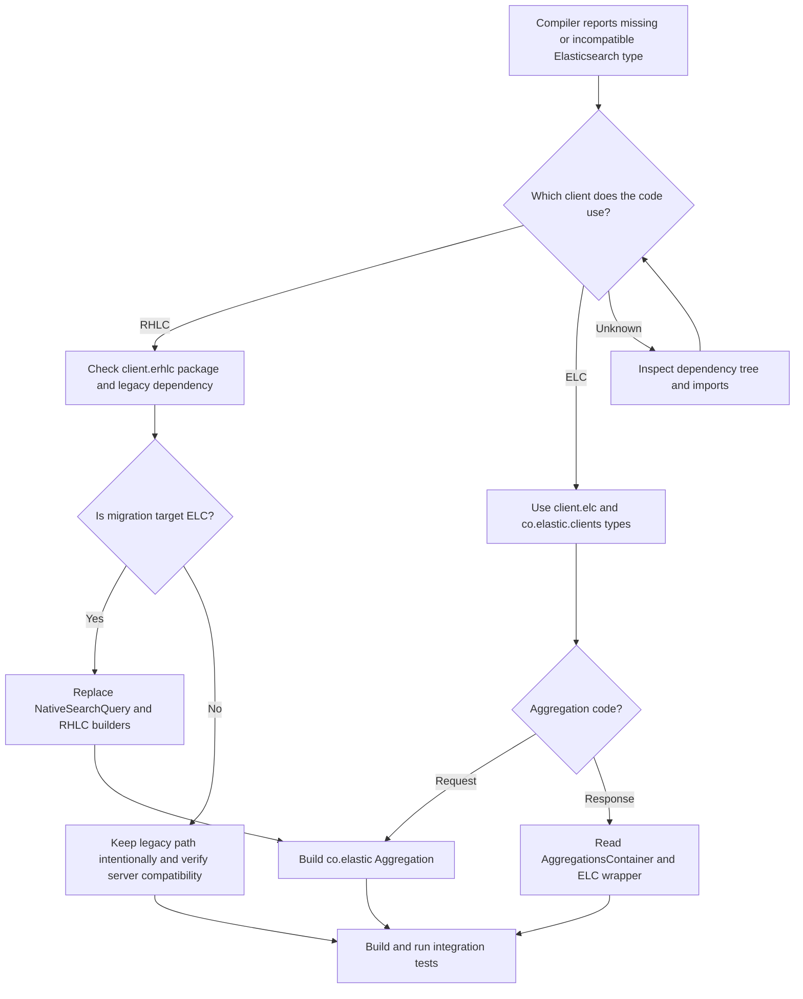

# Kiểm tra thay đổi package, builder và kiểu aggregation

Khi nâng cấp Spring Data Elasticsearch, lỗi biên dịch thường xuất hiện ở những chỗ tưởng như chỉ là import: `NativeSearchQueryBuilder` không còn ở package cũ, `RestHighLevelClient` được thay bằng Elasticsearch Java API Client, hoặc `SearchHits.getAggregations()` không còn trả về kiểu aggregation mà code cũ đang ép kiểu. Đây là hệ quả của việc Spring Data tách phần API độc lập với client khỏi phần implementation phụ thuộc từng client.

Để nâng cấp an toàn, cần kiểm tra ba lớp riêng:

1. **Package và client:** class đang dùng thuộc API Spring Data chung, client cũ REST High Level Client (RHLC), hay client mới Elasticsearch Java API Client (ELC)?
2. **Query builder:** code đang tạo query bằng `NativeSearchQueryBuilder` và Elasticsearch `QueryBuilder` cũ, hay `NativeQuery` và lambda builder của Java API Client?
3. **Aggregation request/response:** kiểu builder để gửi aggregation và kiểu object nhận về có đúng cùng client implementation không?

Đừng sửa import theo từng lỗi compiler một cách máy móc. Hãy xác định version Spring Data Elasticsearch thực tế, client đang được dùng và hướng migration của module trước, rồi mới thay package, builder và kiểu kết quả.

## 1. Xác định version trước khi sửa code

Spring Data Elasticsearch có nhiều thế hệ API. Một thay đổi package có thể đúng trong 4.4 nhưng lại sai trong 5.0; một ví dụ dùng `NativeQuery` có thể là code ELC trong 4.4, trong khi ứng dụng 5.x đã dùng ELC làm client mặc định.

Mốc quan trọng:

| Dòng Spring Data Elasticsearch | Client và đặc điểm cần nhớ |
|---|---|
| 4.0–4.2 | Chủ yếu dùng Elasticsearch REST High Level Client; nhiều query/aggregation type đến từ `org.elasticsearch.*` |
| 4.3 | Bắt đầu tách một số abstraction khỏi client; package aggregation và một số API được điều chỉnh |
| 4.4 | Hỗ trợ implementation dựa trên Elasticsearch Java API Client song song với RHLC; `NativeQuery` xuất hiện trong package `client.elc` |
| 5.0 | Client Java mới trở thành hướng mặc định; các class phụ thuộc RHLC được chuyển vào `client.erhlc` và deprecated; code mới dùng `NativeQuery` |
| 5.1–5.x | Tiếp tục hoàn thiện API ELC và có các thay đổi nhỏ về package, kiểu dữ liệu, exception và method |
| 6.x | Tiếp tục dùng package ELC cho Java API Client; cần đối chiếu đúng API/Javadoc của major version đang chạy |

Đây là mốc định hướng cho migration, không phải bảng tương thích đầy đủ giữa Spring Boot, Spring Data, Elasticsearch server và Java. Luôn xem version matrix của release train mà dự án sử dụng.

### 1.1 Kiểm tra dependency thực tế

Với Gradle:

```bash
./gradlew dependencyInsight --dependency spring-data-elasticsearch --configuration runtimeClasspath
./gradlew dependencyInsight --dependency elasticsearch-java --configuration runtimeClasspath
./gradlew dependencyInsight --dependency elasticsearch-rest-high-level-client --configuration runtimeClasspath
```

Với Maven:

```bash
mvn dependency:tree -Dincludes=org.springframework.data:spring-data-elasticsearch,co.elastic.clients:elasticsearch-java,org.elasticsearch.client:elasticsearch-rest-high-level-client
```

Kiểm tra cả compile classpath và runtime classpath nếu IDE biên dịch được nhưng ứng dụng lỗi khi khởi động. Một dependency có thể được kéo vào gián tiếp bởi starter hoặc thư viện khác.

### 1.2 Để Spring Boot quản lý version qua BOM

Nếu ứng dụng dùng Spring Boot, thông thường nên để Spring Boot dependency management chọn Spring Data Elasticsearch và client version tương thích. Tránh tự nâng riêng `spring-data-elasticsearch`, `elasticsearch-java` hoặc Elasticsearch server client libraries mà không kiểm tra compatibility.

Ví dụ Gradle:

```gradle
dependencies {
    implementation("org.springframework.boot:spring-boot-starter-data-elasticsearch")
}
```

Nếu cần override version, hãy xác nhận rõ Spring Data release train, Spring Framework, Java version và Elasticsearch Java client tương thích. Đừng thêm đồng thời hai thế hệ client chỉ để làm cho một import cũ biên dịch được.

## 2. Phân biệt API độc lập với client và API phụ thuộc client

Spring Data giữ các abstraction chính trong package `org.springframework.data.elasticsearch.core`, ví dụ:

- `ElasticsearchOperations`
- `SearchOperations`
- `SearchHits<T>`
- `SearchHit<T>`
- `IndexOperations`
- `IndexCoordinates`
- `ElasticsearchConverter`
- `AggregationsContainer<T>`

Các abstraction này giúp application code ít phụ thuộc vào thư viện client cụ thể.

Trong khi đó, các implementation phụ thuộc client được phân nhóm theo package:

| Package | Ý nghĩa |
|---|---|
| `org.springframework.data.elasticsearch.client.elc` | Implementation dùng Elasticsearch Java API Client (`co.elastic.clients:elasticsearch-java`) |
| `org.springframework.data.elasticsearch.client.erhlc` | Implementation tương thích với REST High Level Client cũ |
| `org.springframework.data.elasticsearch.core` | Core abstractions và các thành phần chung của Spring Data Elasticsearch |
| `org.springframework.data.elasticsearch.core.query` | Query abstraction/builders dùng chung và một số query implementation không gắn riêng client |

Trong code ứng dụng, ưu tiên inject abstraction như `ElasticsearchOperations`. Chỉ import implementation/client-specific type khi thật sự cần API đặc thù, ví dụ khi đọc raw aggregation response hoặc dùng một query builder native.

## 3. Thay đổi package khi chuyển từ 4.4 sang 5.0

Trong 5.0, Spring Data phân tách rõ code phụ thuộc REST High Level Client cũ và code dùng Java API Client mới. Những class dùng hoặc phụ thuộc RHLC được chuyển vào `org.springframework.data.elasticsearch.client.erhlc`.

Ví dụ những import cũ cần được xem lại:

| Mục đích | API cũ / RHLC | API mới / ELC |
|---|---|---|
| Client | `org.elasticsearch.client.RestHighLevelClient` | `co.elastic.clients.elasticsearch.ElasticsearchClient` |
| Native query | `NativeSearchQuery` | `NativeQuery` |
| Native query builder | `NativeSearchQueryBuilder` | `NativeQuery.builder()` / `NativeQueryBuilder` |
| Elasticsearch aggregation request | `org.elasticsearch.search.aggregations.*` | `co.elastic.clients.elasticsearch._types.aggregations.*` |
| Template implementation | `ElasticsearchRestTemplate` (RHLC) | `ElasticsearchTemplate` (ELC) |
| Configuration base | `client.erhlc.AbstractElasticsearchConfiguration` trong nhánh RHLC | `client.elc.ElasticsearchConfiguration` |
| Aggregation response wrapper | `client.erhlc.ElasticsearchAggregations` | `client.elc.ElasticsearchAggregations` |

`ElasticsearchOperations` vẫn nằm ở core package và là lựa chọn tốt để inject trong service. Nếu code chỉ dùng `ElasticsearchRestTemplate` hoặc `ElasticsearchTemplate` trực tiếp, phải xác định đó là implementation nào trước khi sửa import.

### 3.1 Cẩn thận với tên ElasticsearchTemplate

Trong các phiên bản cũ từng tồn tại `org.springframework.data.elasticsearch.core.ElasticsearchTemplate` dùng TransportClient. Class này đã bị loại bỏ khi Spring Data Elasticsearch 4.4 bỏ TransportClient.

Trong nhánh client mới, `ElasticsearchTemplate` là implementation ở package `org.springframework.data.elasticsearch.client.elc`. Cùng một tên class ở các tài liệu hoặc version khác nhau không có nghĩa nó là cùng implementation.

Nếu code đang inject template trực tiếp, hãy xem package đầy đủ trong import và constructor. Nếu không cần API riêng của template, chuyển sang `ElasticsearchOperations` để giảm phụ thuộc.

### 3.2 RHLC vẫn có thể xuất hiện trong ứng dụng 5.x

Spring Data Elasticsearch 5.x giữ một số class RHLC trong package `client.erhlc` dưới dạng deprecated để hỗ trợ migration. Sự tồn tại của package này không có nghĩa đó là lựa chọn mặc định cho code mới.

Nếu dự án chủ động tiếp tục dùng RHLC:

- Phải khai báo dependency RHLC rõ ràng vì Spring Data không tự kéo dependency này như trước.
- Phải kiểm tra tương thích với Elasticsearch server; RHLC cũ chủ yếu dành cho cluster Elasticsearch 7.
- Tránh trộn request/response class của RHLC với ELC trong cùng một query hoặc aggregation pipeline.
- Lập kế hoạch rời khỏi API deprecated thay vì mở rộng code phụ thuộc RHLC.

## 4. Chuyển từ NativeSearchQueryBuilder sang NativeQuery

`NativeSearchQueryBuilder` cũ nhận các query builder từ thư viện Elasticsearch cũ, chẳng hạn `org.elasticsearch.index.query.QueryBuilder`. `NativeQuery` dùng query type từ Java API Client, chẳng hạn `co.elastic.clients.elasticsearch._types.query_dsl.Query`.

Đây là thay đổi mô hình builder, không chỉ đổi tên class.

### 4.1 Ví dụ cũ với RHLC

Code theo kiểu 4.x/RHLC thường có dạng:

```java
import org.elasticsearch.index.query.QueryBuilders;
import org.springframework.data.elasticsearch.core.query.NativeSearchQuery;
import org.springframework.data.elasticsearch.core.query.NativeSearchQueryBuilder;

NativeSearchQuery query = new NativeSearchQueryBuilder()
    .withQuery(
        QueryBuilders.matchQuery("name", "wireless keyboard")
    )
    .withPageable(PageRequest.of(0, 20))
    .build();

SearchHits<Product> hits = operations.search(query, Product.class);
```

`QueryBuilders.matchQuery(...)` tạo một Elasticsearch `QueryBuilder` thuộc API RHLC. Không thể truyền object này vào `NativeQuery` mới vì hai client có type system riêng.

### 4.2 Ví dụ mới với ELC

Trong ELC, dùng `NativeQuery` và lambda builder:

```java
import co.elastic.clients.elasticsearch._types.query_dsl.Query;
import org.springframework.data.elasticsearch.client.elc.NativeQuery;
import org.springframework.data.elasticsearch.core.SearchHits;

Query nativeQuery = Query.of(q -> q
    .match(m -> m
        .field("name")
        .query("wireless keyboard")
    )
);

NativeQuery query = NativeQuery.builder()
    .withQuery(nativeQuery)
    .withPageable(PageRequest.of(0, 20))
    .build();

SearchHits<Product> hits = operations.search(query, Product.class);
```

Có thể viết trực tiếp lambda trong `withQuery`:

```java
NativeQuery query = NativeQuery.builder()
    .withQuery(q -> q
        .match(m -> m
            .field("name")
            .query("wireless keyboard")
        )
    )
    .withPageable(PageRequest.of(0, 20))
    .build();
```

Lambda builder là API sinh từ Elasticsearch Java API Client. Mỗi builder method thường nhận một lambda để cấu hình object con và trả về `ObjectBuilder<T>`. Không tìm một method `QueryBuilders.matchQuery` tương đương trong package cũ rồi cố dùng chung với ELC.

### 4.3 NativeQuery đã có trong 4.4

Spring Data Elasticsearch 4.4 đã có `NativeQuery` trong package `org.springframework.data.elasticsearch.client.elc`. Ở giai đoạn này, ELC là implementation mới có thể dùng song song với RHLC; không nên hiểu rằng mọi ứng dụng 4.4 tự động đã chuyển client.

Package của query class phụ thuộc cả version lẫn client:

| Version/client | Native query | Builder |
|---|---|---|
| 4.4 với RHLC | `org.springframework.data.elasticsearch.core.query.NativeSearchQuery` | `org.springframework.data.elasticsearch.core.query.NativeSearchQueryBuilder` |
| 4.4 với ELC | `org.springframework.data.elasticsearch.client.elc.NativeQuery` | `org.springframework.data.elasticsearch.client.elc.NativeQueryBuilder` hoặc factory `NativeQuery.builder()` |
| 5.0+ với ELC | `org.springframework.data.elasticsearch.client.elc.NativeQuery` | `NativeQuery.builder()` |
| 5.0+ RHLC compatibility | `org.springframework.data.elasticsearch.client.erhlc.NativeSearchQuery` | `org.springframework.data.elasticsearch.client.erhlc.NativeSearchQueryBuilder` (deprecated) |

Trong Spring Data Elasticsearch 5.0, các class RHLC được chuyển sang `client.erhlc` và deprecated, còn ELC trở thành hướng mặc định. Vì vậy khi migration:

1. Xác định code đang dùng `NativeSearchQuery` từ RHLC hay `NativeQuery` từ ELC.
2. Thay toàn bộ query builder object của RHLC bằng type tương ứng của ELC.
3. Kiểm tra package import của `NativeQuery`, `NativeQueryBuilder` và client configuration.
4. Kiểm tra query JSON cuối cùng, đặc biệt filter, post-filter, sort, highlight và pagination.

### 4.4 Khi nào không cần NativeQuery?

Không phải query nào cũng cần native builder:

- Dùng `CriteriaQuery` nếu điều kiện có thể biểu diễn rõ bằng Criteria API.
- Dùng `StringQuery` nếu đã có JSON query và muốn giữ nguyên query DSL.
- Dùng repository query method cho truy vấn đơn giản theo field.
- Dùng `NativeQuery` khi cần tính năng Elasticsearch phức tạp hoặc aggregation DSL mà abstraction khác không biểu diễn đủ.

Giữ query ở abstraction cao hơn giúp giảm số package client-specific phải migration.

## 5. Builder API thay đổi như thế nào?

Builder RHLC cũ thường dùng method chain:

```java
new NativeSearchQueryBuilder()
    .withQuery(QueryBuilders.matchQuery("name", text))
    .withFilter(QueryBuilders.termQuery("active", true))
    .withSort(SortBuilders.fieldSort("createdAt").order(SortOrder.DESC))
    .build();
```

ELC sử dụng lambda builder:

```java
NativeQuery query = NativeQuery.builder()
    .withQuery(q -> q.bool(b -> b
        .must(m -> m.match(mm -> mm
            .field("name")
            .query(text)
        ))
        .filter(f -> f.term(t -> t
            .field("active")
            .value(true)
        ))
    ))
    .withSort(s -> s.field(f -> f
        .field("createdAt")
        .order(SortOrder.Desc)
    ))
    .withPageable(PageRequest.of(0, 20))
    .build();
```

Tên enum, import và overload có thể thay đổi theo Elasticsearch Java API Client version mà Spring Data release train quản lý. Ví dụ minh họa cấu trúc builder; hãy để IDE/Javadoc của dependency đang dùng xác nhận chữ ký method.

### 5.1 Query và filter không phải lúc nào cũng tương đương

Khi chuyển builder, cần bảo toàn vị trí của filter:

- `withQuery(...)` xác định query chính.
- `withFilter(...)` trong NativeQuery cấu hình filter ở cấp search request theo API Spring Data.
- `post_filter` của Elasticsearch được áp dụng sau aggregation và có semantics khác filter nằm trong query bool.

Không chuyển mọi `withFilter` cũ sang `withQuery` hoặc ngược lại mà không xem query JSON và aggregation semantics. Đặc biệt, nếu aggregation phải được tính trên tập document đã lọc, filter cần nằm ở query/bool filter chứ không phải post-filter.

### 5.2 Sort, pageable và source filtering

Sau khi chuyển builder, xác minh:

- `withPageable(...)` vẫn giới hạn page/size đúng.
- Sort field và order được truyền đúng.
- Source filter vẫn kiểm soát `_source` như mong muốn.
- `trackTotalHits`, timeout, route, preference và search-after không bị bỏ sót.
- Query có giữ nguyên `minimum_should_match`, boost, nested path và script.

Một query biên dịch thành công chưa chắc giữ nguyên semantics của query cũ.

## 6. Aggregation request: đổi kiểu builder

Aggregation request là nơi khác biệt client thể hiện rất rõ.

### 6.1 Request aggregation theo RHLC

Ví dụ terms aggregation trong API cũ:

```java
import org.elasticsearch.search.aggregations.AggregationBuilders;
import org.springframework.data.elasticsearch.core.query.NativeSearchQuery;
import org.springframework.data.elasticsearch.core.query.NativeSearchQueryBuilder;

NativeSearchQuery query = new NativeSearchQueryBuilder()
    .withQuery(QueryBuilders.matchAllQuery())
    .withAggregations(
        AggregationBuilders.terms("by_category")
            .field("category")
            .size(10)
    )
    .build();
```

Builder `AggregationBuilders` tạo các kiểu từ `org.elasticsearch.search.aggregations.*`. Các type này gắn với RHLC/Elasticsearch 7 và không dùng trực tiếp trong ELC.

### 6.2 Request aggregation theo ELC

Với Java API Client:

```java
import co.elastic.clients.elasticsearch._types.aggregations.Aggregation;
import org.springframework.data.elasticsearch.client.elc.NativeQuery;

NativeQuery query = NativeQuery.builder()
    .withQuery(q -> q.matchAll(m -> m))
    .withAggregation("by_category", Aggregation.of(a -> a
        .terms(t -> t
            .field("category")
            .size(10)
        )
    ))
    .build();
```

Điểm cần chú ý:

- `Aggregation` trong ví dụ request là `co.elastic.clients.elasticsearch._types.aggregations.Aggregation`.
- Tên aggregation (`by_category`) là key để lấy kết quả sau này.
- `field` phải khớp mapping; terms aggregation trên field text thường cần subfield keyword.
- Builder dùng type ELC, không phải `AggregationBuilders` từ RHLC.

Không nhầm `co.elastic.clients...Aggregation` ở request với class wrapper `org.springframework.data.elasticsearch.client.elc.Aggregation` xuất hiện trong response.

## 7. Aggregation response: AggregationsContainer

Từ các phiên bản Spring Data Elasticsearch mới, `SearchHits.getAggregations()` được thiết kế trả về abstraction `AggregationsContainer<?>`, không buộc mọi client phải trả cùng một class `org.elasticsearch.search.aggregations.Aggregations`.

Đây là điểm thay đổi quan trọng khi migration:

```java
SearchHits<Product> hits = operations.search(query, Product.class);
AggregationsContainer<?> container = hits.getAggregations();
```

Không ép kiểu trực tiếp như code RHLC cũ nếu ứng dụng đã chuyển sang ELC:

```java
// Không dùng kiểu ép cũ trong code ELC:
// org.elasticsearch.search.aggregations.Aggregations aggregations =
//     hits.getAggregations();
```

`AggregationsContainer<T>` là abstraction của Spring Data. Kiểu cụ thể của `T` phụ thuộc implementation client được sử dụng.

### 7.1 Kiểu response của ELC

Với client ELC, Spring Data cung cấp:

- `org.springframework.data.elasticsearch.client.elc.ElasticsearchAggregations`
- `org.springframework.data.elasticsearch.client.elc.ElasticsearchAggregation`
- `co.elastic.clients.elasticsearch._types.aggregations.Aggregate`

`ElasticsearchAggregations` là container cho danh sách aggregation ELC. Nó hỗ trợ:

- `aggregations()` để lấy danh sách wrapper.
- `aggregationsAsMap()` để lấy map theo tên aggregation.
- `get(name)` để lấy aggregation theo tên.

`ElasticsearchAggregation` chứa aggregation có tên và có method `aggregation()` trả wrapper `org.springframework.data.elasticsearch.client.elc.Aggregation`. Wrapper này giữ tên và raw ELC `Aggregate`.

Ví dụ:

```java
import org.springframework.data.elasticsearch.core.AggregationsContainer;
import org.springframework.data.elasticsearch.client.elc.ElasticsearchAggregations;
import org.springframework.data.elasticsearch.client.elc.ElasticsearchAggregation;

AggregationsContainer<?> container = hits.getAggregations();

if (container instanceof ElasticsearchAggregations aggregations) {
    ElasticsearchAggregation byCategory = aggregations.get("by_category");

    if (byCategory != null) {
        var namedAggregation = byCategory.aggregation();
        var rawAggregate = namedAggregation.getAggregate();
        // Xử lý theo variant cụ thể của Aggregate.
    }
}
```

Kiểm tra `null` trước khi truy cập aggregation theo tên. Response có thể không có aggregation nếu query không yêu cầu, aggregation name sai hoặc API trả về không có phần đó.

### 7.2 Kiểu response của RHLC trong 5.x

Nếu ứng dụng vẫn dùng implementation RHLC trong Spring Data 5.x, wrapper cũ nằm trong package:

`org.springframework.data.elasticsearch.client.erhlc.ElasticsearchAggregations`

Wrapper này giữ `org.elasticsearch.search.aggregations.Aggregations` và đã deprecated từ 5.0. Không dùng wrapper RHLC để đọc response do ELC tạo ra.

Trong 4.4, package của các wrapper aggregation có thay đổi theo client implementation. Đặc biệt, các class RHLC được giữ ở core package trong 4.4, còn ELC có wrapper riêng trong `client.elc`. Khi nâng 4.4 lên 5.0, hãy dùng compiler/Javadoc của version đích để cập nhật package chính xác.

## 8. Đọc kiểu Aggregate trong Elasticsearch Java API Client

Khác với RHLC, Java API Client biểu diễn kết quả aggregation bằng tagged union `Aggregate`. Đây là một object có nhiều variant: terms, range, histogram, date histogram, stats, sum, average, cardinality, top hits và nhiều loại khác.

Không thể coi mọi aggregation response là một object `Terms` chung như cách code RHLC cũ thường làm. Trước khi lấy dữ liệu, phải kiểm tra variant thực tế.

### 8.1 Đọc terms aggregation kiểu string

```java
import co.elastic.clients.elasticsearch._types.aggregations.Aggregate;
import co.elastic.clients.elasticsearch._types.aggregations.StringTermsBucket;

if (rawAggregate.isSterms()) {
    for (StringTermsBucket bucket : rawAggregate.sterms().buckets().array()) {
        String category = bucket.key().stringValue();
        long documentCount = bucket.docCount();

        System.out.println(category + ": " + documentCount);
    }
}
```

Trong Java API Client mới, `Aggregate` có method kiểm tra variant như `isSterms()` và accessor `sterms()`. Accessor sẽ ném exception nếu gọi sai variant, vì vậy hãy kiểm tra trước.

### 8.2 Các variant terms khác

Kiểu field ảnh hưởng kiểu aggregate response:

| Field/aggregation | Variant thường gặp trong Java API Client |
|---|---|
| Terms trên keyword/string | `sterms()` |
| Terms trên long | `lterms()` |
| Terms trên double | `dterms()` |
| Significant string terms | `sigsterms()` |
| Significant long terms | `siglterms()` |

Đừng ép một `Aggregate` thành `StringTermsAggregate` nếu field thực tế là numeric. Dùng variant đúng và đọc key đúng kiểu.

### 8.3 Đọc metric aggregation

Ví dụ sum aggregation:

```java
if (rawAggregate.isSum()) {
    double totalPrice = rawAggregate.sum().value();
}
```

Ví dụ stats aggregation:

```java
if (rawAggregate.isStats()) {
    var stats = rawAggregate.stats();

    double min = stats.min();
    double max = stats.max();
    double average = stats.avg();
    double sum = stats.sum();
    long count = stats.count();
}
```

`Aggregate` là tagged union. Mỗi variant có một response class và tập accessor riêng. Với nested aggregation, bucket có thể chứa thêm `aggregations()` của chính bucket; tiếp tục đọc wrapper/variant tương ứng thay vì giả định một tầng duy nhất.

## 9. Ví dụ hoàn chỉnh: terms aggregation với ELC

Ví dụ sau tìm sản phẩm theo tên và thống kê số document theo category:

```java
import co.elastic.clients.elasticsearch._types.aggregations.Aggregate;
import co.elastic.clients.elasticsearch._types.aggregations.Aggregation;
import co.elastic.clients.elasticsearch._types.aggregations.StringTermsBucket;
import org.springframework.data.elasticsearch.client.elc.ElasticsearchAggregation;
import org.springframework.data.elasticsearch.client.elc.ElasticsearchAggregations;
import org.springframework.data.elasticsearch.client.elc.NativeQuery;
import org.springframework.data.elasticsearch.core.SearchHits;

NativeQuery query = NativeQuery.builder()
    .withQuery(q -> q.match(m -> m
        .field("name")
        .query("keyboard")
    ))
    .withAggregation("by_category", Aggregation.of(a -> a
        .terms(t -> t
            .field("category")
            .size(10)
        )
    ))
    .build();

SearchHits<Product> hits = operations.search(query, Product.class);

if (hits.hasAggregations()
        && hits.getAggregations() instanceof ElasticsearchAggregations aggregations) {

    ElasticsearchAggregation wrapper = aggregations.get("by_category");

    if (wrapper != null) {
        Aggregate aggregate = wrapper.aggregation().getAggregate();

        if (aggregate.isSterms()) {
            for (StringTermsBucket bucket : aggregate.sterms().buckets().array()) {
                String category = bucket.key().stringValue();
                long count = bucket.docCount();
                System.out.printf("%s: %d%n", category, count);
            }
        }
    }
}
```

Import `Aggregation` trong ví dụ là class của Elasticsearch Java API Client. Nếu IDE tự import `org.springframework.data.elasticsearch.client.elc.Aggregation` cho request builder, hãy sửa lại: đó là wrapper response khác tên.

### 9.1 Khi aggregation không có bucket

Nếu code chạy nhưng không có bucket:

- Kiểm tra field có mapping keyword/numeric phù hợp không.
- Kiểm tra query chính có lọc hết document không.
- Kiểm tra tên aggregation trong `get("by_category")`.
- Kiểm tra aggregation response có đúng variant không.
- Kiểm tra field có giá trị được index hay chỉ tồn tại trong `_source`.

Nếu aggregation là nested hoặc composite, response type và cách đọc bucket sẽ khác terms aggregation thông thường.

## 10. Thay đổi package aggregation theo từng giai đoạn

Package aggregation đã thay đổi trong quá trình Spring Data tách client. Không nên chỉ tìm một package trong một blog cũ rồi áp dụng cho mọi version.

| Giai đoạn | Wrapper/response cần nhận biết |
|---|---|
| 4.3 | `ElasticsearchAggregations` và `ElasticsearchAggregation` được chuyển vào package `core.clients.elasticsearch7` trong quá trình chuẩn bị hỗ trợ client mới |
| 4.4 RHLC | Các class dùng RHLC được đặt lại trong `org.springframework.data.elasticsearch.core` |
| 4.4 ELC | Có wrapper riêng trong `org.springframework.data.elasticsearch.client.elc` |
| 5.0+ RHLC compatibility | Class cũ ở `org.springframework.data.elasticsearch.client.erhlc`, deprecated |
| 5.0+ ELC | Dùng `org.springframework.data.elasticsearch.client.elc.ElasticsearchAggregations` và `ElasticsearchAggregation` |

`SearchHits.getAggregations()` trả `AggregationsContainer<?>` từ API Spring Data. Vì vậy application code nên giữ kiểu abstraction cho tới khi thật sự cần đọc raw response; khi đó mới kiểm tra/cast đúng implementation.

## 11. Những thay đổi khác dễ xuất hiện cùng migration

Ngoài package, builder và aggregation, migration 4.4 → 5.0 có một số thay đổi thường làm code cũ lỗi compile:

### 11.1 HttpHeaders

Client configuration trước đây dùng:

```java
import org.springframework.http.HttpHeaders;
```

Trong 5.0, Spring Data Elasticsearch có class riêng:

```java
import org.springframework.data.elasticsearch.support.HttpHeaders;
```

Nếu cấu hình header trực tiếp, xem lại import. Spring Data class có thể nhận header Spring Web qua `addAll(...)`.

### 11.2 Record accessor thay getter

Một số class được chuyển thành Java record, nên accessor đổi từ `getProp()` sang `prop()`. Ví dụ các type như `SeqNoPrimaryTerm`, `ScriptData`, `Version` hoặc `ScoreDoc` có thể yêu cầu đổi cách truy cập.

Đừng thay mọi `get...()` thành `...()` theo tên đoán. Chỉ đổi các type đã được chuyển thành record theo Javadoc version đích.

### 11.3 Query SearchType và VersionType

Một số enum được đưa vào trong abstraction Spring Data:

- `Query.SearchType`
- `Document.VersionType`

Nếu code import enum từ Elasticsearch core cũ, hãy kiểm tra type mới trong annotation/interface của Spring Data.

### 11.4 IndicesOptions

Spring Data dùng `org.springframework.data.elasticsearch.core.query.IndicesOptions` thay cho `org.elasticsearch.action.support.IndicesOptions` ở API liên quan. Điều này tiếp tục giảm việc để type RHLC xuất hiện trong core abstraction.

### 11.5 RuntimeField và ScriptType trong 5.2

Ở Spring Data Elasticsearch 5.2, `RuntimeField` và `ScriptType` được chuyển vào `org.springframework.data.elasticsearch.core.query`. Khi nâng minor version, kiểm tra các import này nếu IDE báo package cũ không còn đúng.

### 11.6 Range trong 5.2

`org.springframework.data.elasticsearch.core.Range` đã bị loại bỏ; dùng `org.springframework.data.domain.Range` thay thế.

### 11.7 BulkFailureException

Trong 5.2, `BulkFailureException.getFailedDocuments()` đổi từ `Map<String, String>` sang `Map<String, FailureDetails>`. Nếu code đang đọc error message như String, cần cập nhật để đọc status và `errorMessage` từ `FailureDetails`.

Những thay đổi này không trực tiếp là query/aggregation, nhưng thường xuất hiện trong cùng đợt nâng cấp và nên được tìm kiếm trong source trước khi build.

## 12. Cách tìm các import cần migration

Trước khi sửa, tìm toàn bộ dấu vết của client cũ và builder cũ:

```bash
rg -n "NativeSearchQuery|NativeSearchQueryBuilder|NativeQuery|AggregationBuilders|AggregationsContainer|ElasticsearchAggregations|RestHighLevelClient|ElasticsearchClient|IndicesOptions|HttpHeaders|ScriptType|RuntimeField" src
```

Sau đó nhóm kết quả:

| Nhóm tìm thấy | Hành động |
|---|---|
| `NativeSearchQueryBuilder`, `QueryBuilders` | Xác định RHLC hay ELC; chuyển builder nếu sang ELC |
| `org.elasticsearch.search.aggregations.*` | Thay bằng ELC aggregation request/response type nếu bỏ RHLC |
| `RestHighLevelClient` | Chuyển client/configuration hoặc giữ legacy có chủ đích |
| `ElasticsearchRestTemplate` | Xác định implementation/package và cân nhắc `ElasticsearchOperations` |
| `SearchHits.getAggregations()` | Chuyển sang `AggregationsContainer<?>` và wrapper đúng client |
| `org.springframework.http.HttpHeaders` | Xem cấu hình header có cần Spring Data `HttpHeaders` mới không |
| `IndicesOptions`, `RuntimeField`, `ScriptType`, `Range` | Kiểm tra package/type thay thế theo release |

Không sửa hàng loạt chỉ dựa trên chuỗi tên. Ví dụ `NativeQuery` và `NativeSearchQuery` có thể cùng xuất hiện hợp lệ trong một ứng dụng đang dùng 4.4 hai client; cần xác định class import thực tế.

## 13. Kiểm tra API trong IDE và Javadoc

Khi không chắc class nằm ở đâu:

1. Dùng Go to Declaration trên class trong IDE.
2. Xem fully qualified name trong auto-import.
3. Mở External Libraries/Gradle dependency để xác nhận jar version.
4. Đối chiếu Javadoc đúng version, không chỉ trang `current`.
5. Xem package summary để biết implementation dùng ELC hay RHLC.
6. Kiểm tra constructor, method return type và generic parameter của aggregation container.

Một class có cùng simple name ở hai package khác nhau có thể có semantics hoàn toàn khác. Ví dụ `Aggregation` trong `co.elastic.clients...` là request definition, còn `Aggregation` trong `org.springframework.data.elasticsearch.client.elc` là wrapper cho response có tên.

### 13.1 Ưu tiên API docs theo version

Khi nâng 4.4 lên 5.0, hãy dùng API docs 5.0.x để kiểm tra package và method. Khi nâng 5.1 lên 5.2, xem migration guide 5.1 → 5.2. Khi dùng 6.x, mở Javadoc 6.x tương ứng.

Trang `current` có ích để biết API hiện hành, nhưng không chứng minh class đó đã tồn tại trong version mà dự án đang nâng lên.

## 14. Quy trình migration có kiểm soát

Một quy trình thực tế:

1. Ghi lại Spring Boot, Spring Data Elasticsearch, Elasticsearch server và Java version hiện tại.
2. Xem dependency tree để xác định RHLC/ELC và version thực tế.
3. Chọn release train đích theo compatibility matrix.
4. Tìm tất cả import `NativeSearchQuery*`, `RestHighLevelClient`, aggregation builders và aggregation response classes.
5. Quyết định tiếp tục RHLC tạm thời hay chuyển hẳn sang ELC.
6. Nếu chuyển ELC, thay client configuration và native query builder.
7. Chuyển aggregation request sang `co.elastic.clients...Aggregation`.
8. Chuyển aggregation response sang `AggregationsContainer<?>` và wrapper ELC.
9. Xem các thay đổi minor version khác như `HttpHeaders`, `IndicesOptions`, record accessor, `Range` và `RuntimeField`.
10. Build để tìm lỗi compile, rồi chạy integration test trên Elasticsearch version tương thích.
11. So sánh query JSON, aggregation result và behavior trước/sau migration.
12. Loại bỏ dependency/import RHLC không còn được sử dụng.

## 15. Những lỗi thường gặp khi đổi package và builder

### 15.1 Chỉ đổi import, giữ nguyên QueryBuilder cũ

`NativeQuery` không nhận `org.elasticsearch.index.query.QueryBuilder`. Cần tạo `co.elastic.clients.elasticsearch._types.query_dsl.Query` bằng builder mới.

### 15.2 Trộn hai client trong một aggregation

Không truyền `AggregationBuilders.terms(...)` của RHLC vào `NativeQuery.withAggregation(...)` của ELC. Một bên là `AbstractAggregationBuilder<?>`, bên kia là ELC `Aggregation`.

### 15.3 Ép kiểu aggregation response về RHLC

`SearchHits.getAggregations()` trả abstraction. Nếu implementation là ELC, cast về `org.elasticsearch.search.aggregations.Aggregations` sẽ sai. Kiểm tra wrapper client cụ thể trước.

### 15.4 Import nhầm hai class cùng tên Aggregation

`co.elastic.clients.elasticsearch._types.aggregations.Aggregation` dùng để tạo request. `org.springframework.data.elasticsearch.client.elc.Aggregation` là wrapper response. Đặt import tường minh và xem IDE chọn class nào.

### 15.5 Giả định mọi aggregation đều là terms

`Aggregate` là tagged union. Kiểm tra `isSterms()`, `isStats()`, `isSum()` hoặc variant phù hợp trước khi gọi accessor.

### 15.6 Chuyển builder nhưng bỏ sót post_filter

Filter nằm trong query và post-filter có thể cho kết quả aggregation khác nhau. Giữ đúng vị trí của filter khi chuyển builder.

### 15.7 Dùng package từ Javadoc current cho dependency cũ

Package có thể đã được chuyển trong minor/major version. Mở Javadoc đúng version đang dùng và xem resolved dependency.

### 15.8 Nâng client độc lập với Spring Data

Spring Data Elasticsearch quản lý tương thích với Java API Client. Override client version độc lập có thể gây `NoSuchMethodError`, lỗi serialization hoặc compile mismatch.

### 15.9 Nghĩ ElasticsearchOperations cũng thay package

Core abstraction vẫn nằm ở `org.springframework.data.elasticsearch.core`. Thường chỉ implementation/client-specific class cần đổi package.

## 16. Checklist kiểm tra sau migration

### Dependency và client

- [ ] Spring Boot và Spring Data Elasticsearch thuộc release train tương thích.
- [ ] Đã xác định client runtime là ELC hay RHLC.
- [ ] Không còn dependency RHLC ngoài ý muốn.
- [ ] Elasticsearch server version tương thích với client.
- [ ] Không override riêng client version mà chưa xác minh.

### Package và builder

- [ ] `NativeQuery` import từ `client.elc` khi dùng ELC.
- [ ] Query builder dùng `co.elastic.clients` types, không dùng RHLC `QueryBuilder`.
- [ ] `NativeSearchQuery*` legacy được giữ trong package RHLC chỉ khi cần tương thích.
- [ ] Template/configuration import đúng implementation.
- [ ] Core abstraction như `ElasticsearchOperations` vẫn được dùng khi phù hợp.

### Aggregation

- [ ] Request aggregation dùng builder đúng client.
- [ ] `SearchHits.getAggregations()` được đọc qua `AggregationsContainer<?>`.
- [ ] Wrapper response được cast đúng ELC/RHLC.
- [ ] Aggregation name lấy đúng key.
- [ ] `Aggregate` được kiểm tra variant trước khi đọc.
- [ ] Terms key/bucket type khớp string, long hoặc double.
- [ ] Nested aggregation được đọc đúng cấp.
- [ ] Filter/query semantics giữ nguyên kết quả aggregation.

### Kiểm thử

- [ ] Build compile thành công.
- [ ] Repository query trả cùng semantics như trước.
- [ ] Terms, metric và nested aggregation cho kết quả đúng.
- [ ] Pagination/sort/highlight/filter được giữ nguyên.
- [ ] Integration test chạy trên Elasticsearch server tương thích.
- [ ] Không chỉ kiểm tra compile mà bỏ qua runtime deserialization.

## 17. Sơ đồ quyết định khi gặp lỗi compile



## 18. Nguyên tắc triển khai

- Xác định version và client trước khi sửa package.
- Để Spring Boot BOM quản lý Spring Data/client version nếu có thể.
- Dùng `ElasticsearchOperations` và `SearchHits` để giữ code ở abstraction chung.
- Dùng `NativeQuery` cho ELC và `NativeSearchQuery` chỉ khi còn ở nhánh RHLC tương ứng.
- Không truyền query/aggregation builder của RHLC vào API ELC.
- Dùng `AggregationsContainer<?>` làm kiểu response abstraction.
- Cast về `client.elc.ElasticsearchAggregations` khi response đến từ ELC.
- Đọc `Aggregate` theo variant, không ép mọi kết quả về terms.
- Kiểm tra đúng package theo version; không lấy package từ tài liệu current rồi áp dụng ngược.
- So sánh query semantics và aggregation output sau khi migration, không chỉ dừng ở build xanh.

## 19. Tổng kết

Những thay đổi package, builder và aggregation trong Spring Data Elasticsearch phản ánh quá trình chuyển từ REST High Level Client sang Elasticsearch Java API Client. Mốc 4.4 có hai implementation song song; từ 5.0, ELC trở thành hướng mặc định và code RHLC được chuyển vào package `client.erhlc` dưới dạng deprecated. `NativeSearchQueryBuilder` dùng query type của client cũ, còn `NativeQuery` dùng lambda builder và type từ `co.elastic.clients`.

Aggregation cũng thay đổi ở cả request và response. Request ELC dùng `co.elastic.clients...Aggregation`; response được bọc trong `AggregationsContainer<?>`, cụ thể là `client.elc.ElasticsearchAggregations` và `ElasticsearchAggregation`. Raw `Aggregate` là tagged union nên cần kiểm tra variant như `isSterms()` hoặc `isStats()` trước khi đọc dữ liệu. Đây là điểm dễ gây lỗi runtime nếu chỉ sửa import để code biên dịch.

Một migration tốt bắt đầu bằng dependency tree và Javadoc đúng version, phân loại rõ code chung/ELC/RHLC, chuyển builder và aggregation theo đúng client, rồi xác minh cả compile lẫn integration behavior. Khi có thể, giữ application code trên `ElasticsearchOperations` và các abstraction Spring Data để giảm số thay đổi ở lần nâng cấp tiếp theo.

## Tài liệu tham khảo

- [Spring Data Elasticsearch — Upgrading from 4.4.x to 5.0.x](https://docs.spring.io/spring-data/elasticsearch/reference/migration-guides/migration-guide-4.4-5.0.html)
- [Spring Data Elasticsearch 5.0 — NativeQuery and Elasticsearch Operations](https://docs.spring.io/spring-data/elasticsearch/docs/5.0.x/reference/html/)
- [Spring Data Elasticsearch 4.4 — NativeSearchQuery and NativeQuery API](https://docs.spring.io/spring-data/elasticsearch/docs/4.4.x/api/)
- [Spring Data Elasticsearch 5.5 — ElasticsearchAggregations API](https://docs.spring.io/spring-data/elasticsearch/reference/5.5/api/java/org/springframework/data/elasticsearch/client/elc/ElasticsearchAggregations.html)
- [Spring Data Elasticsearch 5.5 — ElasticsearchAggregation API](https://docs.spring.io/spring-data/elasticsearch/reference/5.5/api/java/org/springframework/data/elasticsearch/client/elc/ElasticsearchAggregation.html)
- [Spring Data Elasticsearch — Upgrading from 5.1.x to 5.2.x](https://docs.spring.io/spring-data/elasticsearch/reference/migration-guides/migration-guide-5.1-5.2.html)
- [Elasticsearch Java API Client — Aggregate API](https://artifacts.elastic.co/javadoc/co/elastic/clients/elasticsearch-java/8.19.19/co/elastic/clients/elasticsearch/_types/aggregations/Aggregate.html)
- [Elasticsearch Java API Client — StringTermsAggregate API](https://artifacts.elastic.co/javadoc/co/elastic/clients/elasticsearch-java/8.19.19/co/elastic/clients/elasticsearch/_types/aggregations/StringTermsAggregate.html)
