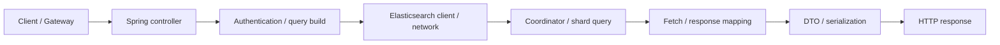
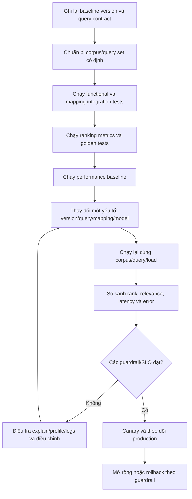

# Kiểm thử hồi quy truy vấn, điểm xếp hạng và hiệu năng

Nâng cấp Elasticsearch, Lucene, Spring Data Elasticsearch, analyzer, mapping hoặc model ranking có thể làm thay đổi kết quả tìm kiếm dù code ứng dụng không đổi. Một query vẫn chạy thành công và trả HTTP 200 nhưng thứ tự document có thể khác, tổng hit có thể thay đổi, aggregation có thể khác hoặc latency tăng đáng kể. Vì vậy, kiểm thử hồi quy cho search cần kiểm tra đồng thời **đúng chức năng**, **đúng thứ hạng** và **đáp ứng mục tiêu hiệu năng**.

Một bộ regression test tốt không chỉ lưu một JSON response rồi so sánh toàn bộ chuỗi. Nó xác định những gì sản phẩm thực sự cam kết: document nào phải xuất hiện, document quan trọng phải nằm trong top bao nhiêu, filter/tenant có được giữ đúng, total hits có cần exact không, aggregation nào phải ổn định và latency được đo trong điều kiện tải nào.

Trong Spring Data Elasticsearch, có thể kiểm tra query ở nhiều lớp: unit test cho query builder và business rules, integration test trên Elasticsearch thật cho mapping/query semantics, relevance test với tập truy vấn có nhãn, và benchmark/load test cho latency/throughput. Các lớp này bổ sung cho nhau; một test repository pass không chứng minh ranking tốt hoặc production latency đạt SLO.

## 1. Vì sao cần regression test cho search?

Search behavior có thể thay đổi do nhiều thành phần:

- Nâng Elasticsearch hoặc Lucene có thể thay đổi implementation, scoring hoặc execution plan.
- Nâng Spring Data Elasticsearch có thể thay đổi converter, query serialization, default parameter hoặc cách mapping metadata được tạo.
- Thay analyzer, tokenizer, synonym hoặc normalizer làm thay đổi token và match set.
- Thay mapping field từ `text` sang `keyword`, thêm multi-field hoặc nested path làm query có semantics khác.
- Thay query clause, boost, `minimum_should_match`, fuzziness hoặc function score làm thay đổi thứ hạng.
- Thay số shard, replica, routing hoặc refresh behavior có thể ảnh hưởng execution và latency.
- Thay model embedding, vector dimensions, ANN parameters hoặc hybrid fusion làm thay đổi semantic ranking.
- Thay kích thước dữ liệu, phân bố term hoặc concurrency làm latency khác baseline.

Một thay đổi có thể cải thiện một khía cạnh và làm xấu khía cạnh khác. Ví dụ, thêm fuzzy matching có thể tăng recall nhưng tăng latency và đưa nhiều kết quả nhiễu vào top 10. Tăng `num_candidates` có thể cải thiện recall của approximate kNN nhưng làm query tốn tài nguyên hơn.

## 2. Phân biệt các loại regression test

| Loại kiểm thử | Câu hỏi chính | Công cụ/phương pháp thường dùng |
|---|---|---|
| Query construction test | Ứng dụng tạo đúng query/filter/sort/boost không? | Unit test, kiểm tra request object/JSON |
| Mapping integration test | Mapping và analyzer trên cluster có đúng không? | Testcontainers, `IndexOperations`, mapping API |
| Functional search test | Document đúng có xuất hiện và filter đúng không? | Elasticsearch integration test |
| Ranking/relevance test | Kết quả liên quan có đứng ở vị trí phù hợp không? | Golden query set, relevance judgments, NDCG/MRR |
| Score diagnostic test | Vì sao một document có score cụ thể? | `_explain`, Profile API, score inspection |
| Performance benchmark | Latency/throughput/resource có thay đổi không? | Elasticsearch Rally, load test, Micrometer |
| Upgrade compatibility test | Stack mới có giữ hợp đồng ứng dụng không? | Version matrix, CI upgrade suite, canary |

Không nên dùng một loại test thay cho tất cả. Unit test có thể chứng minh query builder thêm tenant filter, nhưng chỉ integration test mới xác nhận server thực thi field mapping/analyzer đúng như mong đợi. Relevance test mới đo chất lượng ranking trên tập query có nhãn.

## 3. Xác định hợp đồng tìm kiếm trước khi viết test

Một query test cần mô tả điều gì là đúng. Tránh chỉ ghi “query trả về 10 kết quả” nếu sản phẩm cần một thứ tự hoặc một tập kết quả cụ thể.

Với mỗi use case, xác định:

- Query text và ngôn ngữ.
- Index/alias và schema version.
- Tenant/owner/ACL scope.
- Filter bắt buộc như status, category, date hoặc availability.
- Sort, tie-breaker và page size.
- Các document phải xuất hiện hoặc phải bị loại.
- Document nào phải nằm trong top 1/top 3/top 10.
- Có cần exact total hits hay chỉ cần cận dưới.
- Aggregation/bucket nào là một phần của API contract.
- Search có chấp nhận partial result hay phải đầy đủ.
- Latency SLO theo percentile và điều kiện tải.

Ví dụ hợp đồng cho catalog:

| Trường hợp | Kỳ vọng chức năng | Kỳ vọng ranking |
|---|---|---|
| Tìm đúng SKU | Chỉ sản phẩm có SKU khớp được ưu tiên cao nhất | SKU exact phải ở vị trí 1 |
| Tìm tên sản phẩm | Sản phẩm có tên phù hợp xuất hiện | Exact phrase đứng trước match yếu hơn |
| Tìm từ đồng nghĩa | Sản phẩm dùng synonym vẫn được tìm thấy | Kết quả chính xác hơn vẫn đứng trên |
| Filter còn hàng | Không trả sản phẩm hết hàng nếu filter bắt buộc | Không đánh đổi filter để tăng score |
| Tenant A | Không trả document tenant B | Đây là correctness/security contract, không phải metric relevance có thể đánh đổi |
| Không có kết quả | Trả zero hits theo đúng contract | Không trả kết quả không liên quan chỉ để danh sách không rỗng |

## 4. Xây dựng corpus kiểm thử ổn định

Corpus là tập document dùng để kiểm tra search. Nó cần đủ nhỏ để chạy thường xuyên nhưng đủ đại diện để phát hiện thay đổi có ý nghĩa.

Một corpus tốt nên có:

- Document exact match và document chỉ match một phần.
- Các document gần giống nhau để kiểm tra ranking tie.
- Từ đồng nghĩa, biến thể chính tả, dấu tiếng Việt và từ viết tắt nếu sản phẩm hỗ trợ.
- Field thiếu/null/rỗng và các giá trị biên.
- Các trạng thái nghiệp vụ như ACTIVE/INACTIVE, còn hàng/hết hàng.
- Document ở nhiều tenant/owner để kiểm tra filter bảo mật.
- Ngày tháng ở trước, đúng và sau range boundary.
- Document có cùng score hoặc cùng sort value để kiểm tra tie-breaker.
- Các trường hợp query không có kết quả.

Fixture nên dùng ID và timestamp cố định. Không tạo corpus bằng `Instant.now()` hoặc random data không seed nếu test cần so sánh kết quả chính xác.

Ví dụ document fixture:

```json
{ "id": "P-001", "sku": "WH-100", "name": "Wireless Headphones", "status": "ACTIVE", "tenantId": "A" }
{ "id": "P-002", "sku": "WH-101", "name": "Noise Cancelling Headset", "status": "ACTIVE", "tenantId": "A" }
{ "id": "P-003", "sku": "KB-200", "name": "Wireless Keyboard", "status": "ACTIVE", "tenantId": "A" }
{ "id": "P-004", "sku": "WH-102", "name": "Wireless Headphones", "status": "INACTIVE", "tenantId": "A" }
{ "id": "P-005", "sku": "WH-103", "name": "Wireless Headphones", "status": "ACTIVE", "tenantId": "B" }
```

Corpus nhỏ này giúp kiểm tra exact phrase, semantic/synonym, status filter và tenant boundary. Dataset performance lớn cần được quản lý riêng; không nên dùng corpus vài document để kết luận throughput production.

## 5. Tạo query set và relevance judgments

Query set là danh sách truy vấn đại diện. Mỗi query cần có mục tiêu đánh giá và nhãn relevance cho một tập document.

Ví dụ:

| Query ID | Query | Mục tiêu |
|---|---|---|
| Q-001 | `WH-100` | Exact SKU |
| Q-002 | `wireless headphones` | Full-text name search |
| Q-003 | `tai nghe chống ồn` | Ngôn ngữ/synonym |
| Q-004 | `wireless` + `status=ACTIVE` | Text kết hợp filter |
| Q-005 | `nonexistent item xyz` | Zero-result behavior |
| Q-006 | `wireless headphones` + tenant A | Tenant scoping |

Relevance judgments có thể dùng thang điểm:

| Grade | Ý nghĩa |
|---:|---|
| 0 | Không liên quan |
| 1 | Có liên quan một phần |
| 2 | Phù hợp |
| 3 | Rất phù hợp/đúng ý định chính |

Nhãn nên được tạo theo hướng dẫn thống nhất. Nếu nhiều người đánh giá, cần quy tắc giải quyết bất đồng và review các query quan trọng. Không coi click đơn lẻ là ground truth vì click chịu ảnh hưởng vị trí, UI và traffic source.

Giữ query set và judgments có version. Khi thay analyzer hoặc ranking, so sánh cùng corpus/query/judgments để biết thay đổi thực sự đến từ đâu.

## 6. Đo chất lượng ranking bằng metric

### 6.1. Precision@k

Precision@k đo tỷ lệ kết quả relevant trong top k:

\[
Precision@k = \frac{\text{relevant hits in top k}}{k}
\]

Nếu top 5 có 4 document relevant, Precision@5 là 0,8. Metric này hữu ích khi danh sách đầu tiên cần ít kết quả nhiễu.

### 6.2. Recall@k

Recall@k đo tỷ lệ document relevant đã tìm được trong top k so với tổng document relevant đã biết:

\[
Recall@k = \frac{\text{relevant hits in top k}}{\text{all known relevant documents}}
\]

Recall quan trọng khi người dùng cần tìm được nhiều tài liệu phù hợp, ví dụ knowledge base hoặc catalog tra cứu.

### 6.3. Mean Reciprocal Rank (MRR)

MRR tập trung vào vị trí của kết quả relevant đầu tiên. Nếu kết quả relevant đầu tiên ở rank 1, reciprocal rank là 1; nếu ở rank 4, điểm là 0,25. MRR là trung bình trên các query.

Metric này hữu ích khi người dùng thường chỉ cần tìm đúng kết quả đầu tiên.

### 6.4. NDCG@k

NDCG@k đánh giá thứ tự với relevance grade nhiều mức. Kết quả grade 3 ở vị trí đầu đóng góp nhiều hơn kết quả grade 1 ở vị trí thấp. Metric này phù hợp khi chất lượng không chỉ là đúng/sai.

### 6.5. Metric sản phẩm bổ sung

Theo dõi thêm zero-result rate, query reformulation, click-through theo vị trí, search-to-conversion, abandonment và task completion. Các metric online cần được diễn giải cùng thay đổi UI, traffic và giá/tồn kho; chúng không thay thế relevance judgments offline.

## 7. Vì sao không nên so sánh `_score` bằng số tuyệt đối?

Elasticsearch `_score` là điểm xếp hạng tương đối do query/scoring model tạo ra. Nó hữu ích để sắp xếp kết quả và chẩn đoán, nhưng thường không phải hợp đồng ổn định giữa các phiên bản.

Score có thể thay đổi khi:

- Lucene thay đổi cách triển khai hoặc chi tiết scoring.
- BM25 parameters hoặc similarity configuration thay đổi.
- Số document, term frequency hoặc document frequency thay đổi.
- Shard topology hoặc corpus được phân phối khác.
- Analyzer/tokenization thay đổi.
- Query rewrite, boost hoặc clause thay đổi.
- Script/function score hoặc vector similarity thay đổi.
- Candidate set của approximate kNN khác.

Ví dụ, document A có score 8.2 ở một version và 7.6 ở version khác không tự động có nghĩa relevance giảm. Nếu A vẫn ở rank 1 và các kết quả relevant vẫn nằm trong top 5, trải nghiệm có thể không đổi. Ngược lại, score có thể gần như giữ nguyên nhưng thứ tự document quan trọng thay đổi.

Vì vậy:

- Ưu tiên kiểm tra document IDs, ranking order và relevance metrics.
- Chỉ kiểm tra score tuyệt đối khi có một lý do cụ thể và môi trường rất được kiểm soát.
- Nếu phải kiểm tra score, dùng tolerance thay vì exact equality và ghi rõ version/corpus/configuration.
- Không đưa raw `_score` vào API contract nếu client không có nhu cầu nghiệp vụ thực sự.

## 8. Kiểm tra ranking bằng golden tests

Golden test lưu một tập query và expected result behavior. Không nhất thiết phải cố định toàn bộ danh sách hit theo byte-for-byte.

Một test có thể kiểm tra:

- Document chính xác phải đứng đầu.
- Các document relevant phải xuất hiện trong top 5.
- Document INACTIVE phải bị loại khi filter ACTIVE được yêu cầu.
- Document tenant B không được xuất hiện trong query tenant A.
- Zero-result query phải thực sự rỗng.
- Sort tie-breaker tạo thứ tự ổn định khi score bằng nhau.

Ví dụ test với Spring Data:

```java
@Test
void exactSkuMustRankFirst() {
    Query query = NativeQuery.builder()
        .withQuery(q -> q
            .bool(b -> b
                .should(s -> s.term(t -> t
                    .field("sku")
                    .value("WH-100")
                    .boost(10.0f)
                ))
                .should(s -> s.match(m -> m
                    .field("name")
                    .query("WH-100")
                ))
                .minimumShouldMatch("1")
            )
        )
        .withMaxResults(5)
        .build();

    SearchHits<ProductDocument> hits = operations.search(
        query,
        ProductDocument.class,
        IndexCoordinates.of("products-test")
    );

    assertThat(hits.getSearchHits()).isNotEmpty();
    assertThat(hits.getSearchHits().get(0).getId()).isEqualTo("P-001");
}
```

Ví dụ giả định mapping `sku` là `keyword`, `name` là `text` và fixture đã được seed/refresh. Query builder signature có thể khác theo Spring Data/Java API Client release; test nên dùng API của version dự án.

### 8.1. Kiểm tra tập kết quả khi thứ tự không phải contract

Nếu API chỉ cam kết membership, không so sánh list theo thứ tự:

```java
Set<String> actualIds = hits.getSearchHits().stream()
    .map(SearchHit::getId)
    .collect(Collectors.toSet());

assertThat(actualIds).containsExactlyInAnyOrder("P-001", "P-002");
```

### 8.2. Kiểm tra top-k khi thứ tự có ý nghĩa

Nếu sản phẩm yêu cầu ranking, lấy ID theo thứ tự và kiểm tra các ràng buộc quan trọng:

```java
List<String> rankedIds = hits.getSearchHits().stream()
    .map(SearchHit::getId)
    .toList();

assertThat(rankedIds).startsWith("P-001");
assertThat(rankedIds.subList(0, Math.min(3, rankedIds.size())))
    .contains("P-002");
```

Tránh assert toàn bộ thứ tự nếu những vị trí thấp không phải product contract. Một query có thể có nhiều document đồng hạng hoặc gần tương đương; test chỉ nên khóa những điều có ý nghĩa.

## 9. Kiểm tra score với tolerance khi thực sự cần

Nếu score là một phần cần chẩn đoán, dùng delta tolerance:

```java
float actualScore = hits.getSearchHits().get(0).getScore();

assertThat(actualScore)
    .isCloseTo(expectedScore, within(0.5f));
```

Không chọn tolerance tùy tiện. Trước hết phải xác định:

- Server/Lucene version có được pin không?
- Corpus và document frequency có cố định không?
- Shard count và query semantics có cố định không?
- Có thay đổi analyzer, similarity hoặc query không?
- Score được dùng cho nghiệp vụ hay chỉ là diagnostic?

Nếu không có các điều kiện này, kiểm tra score tuyệt đối dễ tạo flaky test và báo regression giả. Tốt hơn là kiểm tra rank constraints và NDCG/MRR trên query set.

## 10. Dùng `_explain` để hiểu vì sao document được xếp hạng

Khi một document bất ngờ lên/xuống hạng, `_explain` giúp xem đóng góp scoring của query cho một document cụ thể:

```http
GET products-test/_explain/P-001
{
  "query": {
    "bool": {
      "should": [
        { "term": { "sku": { "value": "WH-100", "boost": 10 } } },
        { "match": { "name": "wireless headphones" } }
      ],
      "minimum_should_match": 1
    }
  }
}
```

Explain response cho biết document có match không và các thành phần scoring đóng góp thế nào. Nó hữu ích cho điều tra một query/document, không phải công cụ benchmark latency thường xuyên.

Khi so sánh hai version, lưu explain output cho một số query quan trọng như artifact chẩn đoán. Không nhất thiết so sánh toàn bộ explain JSON bằng snapshot vì nội dung chi tiết có thể thay đổi giữa Lucene versions.

## 11. Dùng Profile API để điều tra query chậm

Profile API cung cấp chi tiết thời gian thực thi query trên shard:

```http
GET products-test/_search
{
  "profile": true,
  "query": {
    "bool": {
      "must": [
        { "match": { "name": "wireless headphones" } }
      ],
      "filter": [
        { "term": { "status": "ACTIVE" } }
      ]
    }
  }
}
```

Profile giúp nhận diện clause hoặc collector tốn thời gian. Nó có overhead và không đại diện hoàn hảo cho end-to-end latency. Không bật profile cho mọi production request.

Quy trình chẩn đoán:

1. Dùng latency metrics để xác định query chậm.
2. Lấy query cụ thể và dữ liệu/corpus tương ứng.
3. Chạy Profile trong môi trường có kiểm soát.
4. Kiểm tra clause, shard và collector tốn thời gian.
5. Thay một yếu tố như filter, sort, aggregation hoặc analyzer.
6. Chạy lại relevance và latency benchmark.

## 12. Kiểm tra total hits, partial results và aggregation

Regression test cần phân biệt page size, total hits và tính đầy đủ của response.

Các điều kiện nên kiểm tra:

- `hits.total.relation` là `eq` hay `gte` theo contract.
- `track_total_hits` được đặt đúng theo nhu cầu exact count.
- `timed_out` phải false nếu endpoint yêu cầu hoàn tất.
- `_shards.failed` phải bằng 0 nếu yêu cầu đầy đủ.
- `terminated_early` phải false nếu không chấp nhận early termination.
- Cross-cluster metadata không có cluster bắt buộc bị fail/partial.
- Aggregation error bounds và bucket limits phù hợp yêu cầu.

Một response có HTTP 200 không chứng minh kết quả đầy đủ. Đừng để regression test chỉ assert `SearchHits` có một số phần tử rồi bỏ qua shard failures hoặc timeout.

## 13. Kiểm thử mapping và analyzer khi nâng cấp

Trước khi chạy ranking test, phải chắc chắn corpus được index theo mapping dự kiến.

Các assertion hữu ích:

- `keyword` field dùng cho exact match/sort/aggregation.
- `text` field dùng đúng analyzer.
- Multi-field như `name.keyword` tồn tại.
- Date format và timezone được hiểu như mong đợi.
- Nested query giữ correlation giữa các field con.
- Synonym/analyzer output không đổi ngoài dự kiến.
- Dynamic mapping không tạo field type bất ngờ.

Có thể đọc mapping:

```http
GET products-test/_mapping
```

Và kiểm tra analyzer:

```http
POST products-test/_analyze
{
  "field": "name",
  "text": "Tai nghe chống ồn"
}
```

Khi nâng Elasticsearch/Lucene, nên chạy lại analyzer tests với các từ khóa đặc trưng của domain. Thay đổi tokenization có thể làm thay đổi match set và ranking dù query JSON không đổi.

## 14. Thiết lập integration test với Testcontainers

Testcontainers giúp chạy Elasticsearch thật có version được pin trong CI. Một test có thể tạo index riêng, mapping rõ ràng, seed fixture cố định và refresh trước khi search.

Ví dụ cấu trúc:

```java
@Testcontainers
@SpringBootTest
class ProductSearchRegressionTest {

    @Container
    static final ElasticsearchContainer elasticsearch =
        new ElasticsearchContainer(
            "docker.elastic.co/elasticsearch/elasticsearch:8.15.0"
        );

    @DynamicPropertySource
    static void properties(DynamicPropertyRegistry registry) {
        registry.add("spring.elasticsearch.uris", elasticsearch::getHttpHostAddress);
    }

    @Autowired
    ElasticsearchOperations operations;

    @BeforeEach
    void setUp() {
        IndexOperations index = operations.indexOps(ProductDocument.class);
        if (index.exists()) {
            index.delete();
        }
        index.createWithMapping();
        seedDeterministicFixtures();
        index.refresh();
    }
}
```

Đây là khung minh họa. Chọn image version tương thích với Spring Data/Java API Client của dự án và cấu hình security/TLS theo container thực tế. Không dùng index production trong test. Nếu test chạy song song, mỗi test worker cần index riêng hoặc cluster/container riêng.

### 14.1. Không dùng `Thread.sleep()` để chờ refresh

Sau khi seed fixture, gọi `IndexOperations.refresh()` hoặc sử dụng refresh policy thích hợp. Sleep một giây không bảo đảm refresh đã xảy ra và làm test chậm/flaky.

### 14.2. Sort phải xác định

Elasticsearch không bảo đảm thứ tự insert. Nếu test cần thứ tự, query phải có sort và tie-breaker duy nhất. Nếu thứ tự không phải contract, so sánh tập ID thay vì list.

## 15. Đo latency end-to-end trong Spring

Latency mà người dùng trải nghiệm gồm nhiều tầng:



Đo riêng `took` của Elasticsearch không bao gồm toàn bộ thời gian ở gateway, backend, connection pool, network và DTO serialization. Nên đo cả end-to-end timer ở service và server-side query time để tìm bottleneck.

Ví dụ Micrometer:

```java
@Service
public class ProductSearchService {

    private final ElasticsearchOperations operations;
    private final Timer searchTimer;

    public ProductSearchService(
            ElasticsearchOperations operations,
            MeterRegistry registry) {
        this.operations = operations;
        this.searchTimer = Timer.builder("catalog.search.duration")
            .tag("operation", "search")
            .register(registry);
    }

    public SearchHits<ProductDocument> search(Query query) {
        return searchTimer.record(() -> operations.search(
            query,
            ProductDocument.class,
            IndexCoordinates.of("products")
        ));
    }
}
```

Ví dụ trên dùng API đồng bộ. Với reactive publisher, không đo bằng timer đồng bộ quanh thời điểm tạo `Mono`/`Flux`; cần instrumentation reactive/Observation hoặc timer gắn với subscription lifecycle.

Không dùng query string, document ID, user ID hoặc tenant ID làm metric tag vì cardinality cao. Dùng tag có tập giá trị nhỏ như operation, outcome, query family hoặc index family.

## 16. Chỉ số hiệu năng cần so sánh

Không chỉ đo average latency. Hãy lưu:

| Metric | Ý nghĩa |
|---|---|
| p50 | Latency điển hình |
| p95 | Tail latency ảnh hưởng phần lớn user chậm |
| p99 | Tail latency nghiêm trọng hơn |
| Max | Outlier trong cửa sổ benchmark |
| QPS | Số search request xử lý mỗi giây |
| Throughput indexing | Document/s hoặc MB/s khi có ingest |
| Error/timeout rate | Tỷ lệ request không hoàn thành |
| Rejection rate | Request bị từ chối do queue/capacity |
| CPU/heap/GC | Tài nguyên ứng dụng và cluster |
| Disk I/O/merge/refresh | Chi phí index/search storage |
| Search visibility lag | Độ trễ từ write đến khi search thấy dữ liệu |

Ví dụ báo cáo baseline:

| Chỉ số | Baseline version | Candidate version | Thay đổi |
|---|---:|---:|---:|
| p50 | 32 ms | 34 ms | +6,3% |
| p95 | 110 ms | 128 ms | +16,4% |
| p99 | 280 ms | 390 ms | +39,3% |
| Throughput | 500 QPS | 520 QPS | +4,0% |
| Error rate | 0,02% | 0,03% | +0,01 điểm % |
| NDCG@10 | 0,91 | 0,92 | +0,01 |

Candidate có relevance và throughput tốt hơn nhưng p95/p99 xấu đi. Việc chấp nhận hay không phụ thuộc SLO; không thể kết luận chỉ dựa trên một metric.

## 17. Thiết kế performance benchmark có thể tái lập

Một benchmark đáng tin cậy cần cố định:

- Elasticsearch version/build.
- Java, Spring Boot, Spring Data và client versions.
- Node type/count, heap, disk và topology.
- Index mapping/settings, shard/replica count.
- Corpus document count, kích thước và phân bố field.
- Query set, tỷ lệ từng query class và page size.
- Cache condition (cold/warm), warm-up và thời gian steady state.
- Concurrency/QPS và mô hình load generator.
- Search-only, indexing-only và mixed workload.
- Thời gian chạy và số lần lặp.

Nếu thay nhiều yếu tố cùng lúc, rất khó biết nguyên nhân latency thay đổi. Bắt đầu bằng so sánh cùng môi trường và một thay đổi mỗi lần.

### 17.1. Warm-up và cache

Search đầu tiên có thể chậm do JVM/JIT, filesystem cache, query cache hoặc shard initialization. Benchmark phải định nghĩa warm-up rõ ràng và báo cáo riêng cold-start nếu cold-start quan trọng với sản phẩm.

Không xóa cache giữa mỗi request nếu production không làm như vậy. Ngược lại, không chỉ đo warm cache nếu production thường xuyên có query mới hoặc dữ liệu lớn hơn memory.

### 17.2. Closed-loop và open-loop load

Closed-loop load generator gửi request tiếp theo sau khi request trước hoàn tất. Khi server chậm, generator tự giảm tốc độ gửi và có thể che khuất queueing.

Open-loop generator cố gắng duy trì arrival rate cố định, giúp quan sát hệ thống khi request tiếp tục đến trong lúc server chậm. Với benchmark latency ở tải cố định, cân nhắc công cụ xử lý coordinated omission để không đánh giá thấp tail latency.

### 17.3. Mixed workload

Nếu production vừa search vừa index, benchmark cần chạy cả hai cùng lúc. Bulk indexing có thể làm tăng merge/refresh/disk I/O và ảnh hưởng p95 search. Search-only benchmark không dự đoán được tình huống này.

## 18. Dùng Elasticsearch Rally

Elasticsearch Rally là công cụ benchmark chuyên dụng có thể chạy track và challenge có thể tái lập. Nó hữu ích để so sánh server version, mapping, shard layout hoặc query workload.

Một quy trình điển hình:

1. Chuẩn bị track chứa corpus và operations đại diện.
2. Chọn challenge phản ánh search/index workload.
3. Chạy baseline trên cluster ổn định.
4. Lưu latency, throughput và service time.
5. Thay đổi một yếu tố.
6. Chạy lại cùng track/challenge và so sánh.

Rally đo cluster-level performance. Nó không thay thế load test đi qua Spring application; cần thêm test end-to-end để bao gồm security, query construction, connection pool và response mapping.

## 19. Kiểm thử hồi quy khi nâng cấp version

Nên có một ma trận nâng cấp rõ ràng:

| Thành phần | Baseline | Candidate |
|---|---|---|
| Elasticsearch | Version production hiện tại | Version dự kiến nâng |
| Spring Boot | Version hiện tại | Version tương thích mới |
| Spring Data Elasticsearch | Version hiện tại | Version tương ứng release train |
| Java API Client | Version resolve hiện tại | Version được dependency management chọn |
| Mapping/template | Schema hiện tại | Schema không đổi hoặc migration mới có kiểm soát |
| Analyzer/model | Model hiện tại | Cùng model để cô lập server upgrade, hoặc version mới được đánh giá riêng |

Khi nâng server, cố gắng giữ corpus, query, mapping và model không đổi trong lần so sánh đầu tiên. Nếu cùng lúc đổi server, analyzer và model, không thể quy regression cho một nguyên nhân cụ thể.

Sau đó chạy riêng migration/schema/model tests nếu có thay đổi tương ứng.

## 20. Phân tầng test trong CI

Không phải benchmark lớn nào cũng cần chạy trên mỗi commit. Có thể chia thành nhiều tầng:

| Tầng | Nội dung | Tần suất |
|---|---|---|
| Unit | Query builder, filter rules, boost configuration và DTO mapping | Mỗi commit |
| Small integration | Testcontainers, mapping và corpus nhỏ | Mỗi PR |
| Relevance regression | Golden query set và NDCG/MRR/Precision/Recall | Mỗi PR hoặc trước merge ranking change |
| Full integration | Corpus lớn hơn, aggregation, pagination, partial result behavior | Nightly hoặc trước release |
| Performance benchmark | Rally/load test, mixed workload, p95/p99 | Nightly, release candidate hoặc upgrade |
| Production canary | Theo dõi real traffic, relevance proxy và latency | Mỗi rollout quan trọng |

CI test nên thất bại với thông tin đủ để chẩn đoán: query ID, expected/actual IDs, relation, shard failure, server version và benchmark configuration. Không log toàn bộ dữ liệu nhạy cảm hoặc credential.

## 21. Đặt ngưỡng regression và xử lý nhiễu

Một benchmark có độ biến thiên tự nhiên do CPU scheduling, cache, GC, cluster noise và network. Không nên fail build chỉ vì p95 tăng 1 ms trong một lần chạy đơn lẻ.

Thiết kế threshold:

- Dựa trên SLO thực tế, không chọn phần trăm tùy tiện.
- Dùng nhiều lần chạy hoặc nhiều cửa sổ steady-state.
- Xem cả median của benchmark runs và percentile trong từng run.
- Đặt ngưỡng cho p95/p99, error rate, throughput và relevance.
- Dùng ngưỡng khác nhau cho query class có độ phức tạp khác nhau.
- Phân biệt noise nhỏ với regression vượt ngân sách.
- Lưu raw results để có thể điều tra.

Ví dụ policy minh họa: fail nếu p95 tăng hơn 15% qua nhiều lần chạy và đồng thời vượt SLO 200 ms; cảnh báo nếu chỉ tăng nhẹ nhưng vẫn nằm trong budget. Đây chỉ là ví dụ, cần chọn threshold dựa trên hệ thống thực tế.

Với relevance, có thể đặt ngưỡng giảm tối đa cho NDCG@10 hoặc yêu cầu các query trọng yếu không bị tụt hạng. Không chỉ nhìn average toàn tập vì một nhóm query quan trọng có thể giảm mạnh trong khi average gần như không đổi.

## 22. A/B test và canary cho thay đổi ranking

Offline regression test không thể mô phỏng đầy đủ mọi hành vi người dùng. Với thay đổi ranking lớn, nên rollout có kiểm soát:

1. Chạy offline relevance benchmark.
2. Chạy performance benchmark.
3. Bật candidate ranking cho một phần traffic hoặc nhóm người dùng.
4. Phân nhóm ổn định để cùng người dùng không liên tục đổi ranking.
5. Theo dõi CTR, reformulation, conversion/task completion và latency.
6. So sánh theo query class, ngôn ngữ và tenant segment.
7. Rollback nếu SLO hoặc guardrail bị vi phạm.

Click-through rate có bias vị trí và UI. Kết hợp online metrics với human review, offline judgments và guardrail correctness/security.

## 23. Semantic/vector search cần regression test riêng

Nếu query dùng vector hoặc hybrid ranking, bổ sung các điều kiện:

- Model ID/revision và dimensions được pin.
- Corpus vector được tạo bởi đúng model version.
- Similarity và normalization được giữ nhất quán.
- `k`, `num_candidates`, filter và ANN index options được ghi lại.
- Query embedding và document embedding dùng đúng task/prefix.
- Relevance judgments có semantic queries, exact identifiers và multilingual cases.
- Hybrid fusion parameters (ví dụ RRF rank constant/window) được version hóa.
- Inference latency và rate limit được đo riêng.

Approximate kNN có thể có một mức biến thiên trong tập candidate do thuật toán/index state. Regression test nên tập trung vào recall@k, NDCG@k và các document trọng yếu thay vì đòi mọi score tuyệt đối giống nhau.

Nếu đổi model, không so sánh ranking mới trên vector cũ như thể chỉ có server thay đổi. Re-embed corpus hoặc dùng index version mới để bảo đảm query/document vectors cùng vector space.

## 24. Những lỗi thường gặp

| Hiện tượng | Nguyên nhân có thể | Cách xử lý |
|---|---|---|
| Test fail vì `_score` khác vài phần trăm sau upgrade | Score không phải hợp đồng ổn định | So sánh ID/rank/relevance metric; dùng tolerance chỉ khi cần |
| Query vẫn trả kết quả nhưng top result sai | Không có ranking regression test | Dùng golden queries và relevance judgments |
| Test thứ tự lúc pass lúc fail | Không có sort/tie-breaker hoặc nhiều score bằng nhau | Khóa các rank quan trọng hoặc thêm deterministic sort |
| Latency local tốt nhưng production chậm | Corpus, concurrency, topology và cache khác | Benchmark gần production, mixed workload và p95/p99 |
| Benchmark candidate nhanh hơn vì trả ít lỗi? | Error/rejection không được tính | Báo throughput cùng error/timeout/rejection rate |
| Relevance trung bình tăng nhưng query quan trọng giảm | Average che mất regression theo segment | Theo dõi metric theo query class và guardrail query |
| Exact total hits làm query chậm | `track_total_hits=true` cho mọi request | Chọn threshold/exact theo contract và đo chi phí |
| Nâng Spring Data làm query JSON đổi | Converter/API/default thay đổi | Test query construction và raw request/behavior trên cluster |
| Analyzer change làm mất match | Tokenization/synonym khác | Chạy analyzer regression tests và relevance suite |
| Vector ranking thay đổi mạnh | Model/dimensions/normalization mismatch | Pin model contract và re-embed đúng index |
| CI benchmark flaky | Cluster shared/noisy hoặc chỉ chạy một lần | Cô lập tài nguyên, warm-up, lặp run và threshold theo SLO |
| Search thiếu dữ liệu nhưng test vẫn pass | Không assert timeout/shard/partial metadata | Kiểm tra completeness flags trong response |

## 25. Quy trình regression test cho một thay đổi search



Các bước thực tế:

1. Ghi baseline Elasticsearch, Spring Data, Java API Client, mapping và model versions.
2. Xác định query contract, filter/security scope, sort, total hits và completeness.
3. Tạo corpus cố định với ID/timestamp rõ ràng.
4. Tạo query set và relevance judgments có version.
5. Chạy unit tests cho query builder và business rules.
6. Chạy integration tests trên Elasticsearch thật với mapping/analyzer đúng.
7. Chạy golden tests cho document membership và top-rank constraints.
8. Tính Precision@k, Recall@k, MRR và NDCG@k theo query class.
9. Đo p50/p95/p99, QPS, error rate và resource trong điều kiện tải đã định nghĩa.
10. Nếu ranking bất ngờ, dùng `_explain`; nếu query chậm, dùng Profile API/slow logs.
11. So sánh candidate với baseline bằng cùng corpus, query, cache và load conditions.
12. Rollout bằng canary/A-B test, theo dõi guardrails và giữ rollback plan.

## 26. Kết luận

Kiểm thử hồi quy search phải kiểm tra ba điều khác nhau: query có đúng chức năng, ranking có phù hợp và hiệu năng có đáp ứng SLO. Một response HTTP 200 hoặc một test repository pass không chứng minh ba điều đó. Hãy xác định query contract, tạo corpus và query set có version, gán relevance judgments và giữ fixture ổn định.

Không nên coi `_score` là giá trị tuyệt đối ổn định giữa các Elasticsearch/Lucene versions. Ưu tiên kiểm tra document IDs, rank constraints và metric như Precision@k, Recall@k, MRR hoặc NDCG@k. Dùng `_explain` để hiểu scoring của một document và Profile API/slow logs để điều tra query chậm. Kiểm tra mapping/analyzer, total hits relation, timeout, shard failures và partial results để tránh test pass trên response không đầy đủ.

Đo performance bằng p50/p95/p99, throughput, error/rejection rate và resource utilization trên corpus, query mix, topology và concurrency gần production. Elasticsearch Rally phù hợp benchmark cluster có thể tái lập; load test qua Spring backend đo thêm security, client/network và response mapping. Chia CI thành unit, integration, relevance và performance tiers để cân bằng tốc độ với độ tin cậy.

Khi nâng version hoặc thay ranking, giữ các biến khác cố định trong lần so sánh đầu tiên, phân tích regression theo query class, rồi rollout canary với guardrails. Với vector/hybrid search, pin model revision, dimensions, similarity và ANN/fusion parameters. Quy trình này giúp phát hiện thay đổi thứ hạng hoặc latency trước khi chúng ảnh hưởng người dùng và đưa ra quyết định nâng cấp dựa trên bằng chứng.
