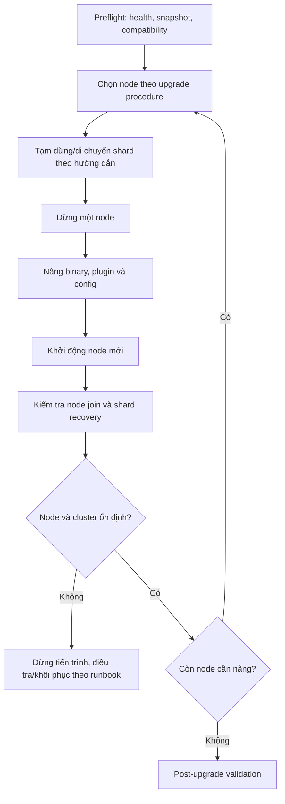
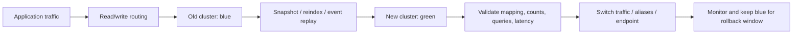
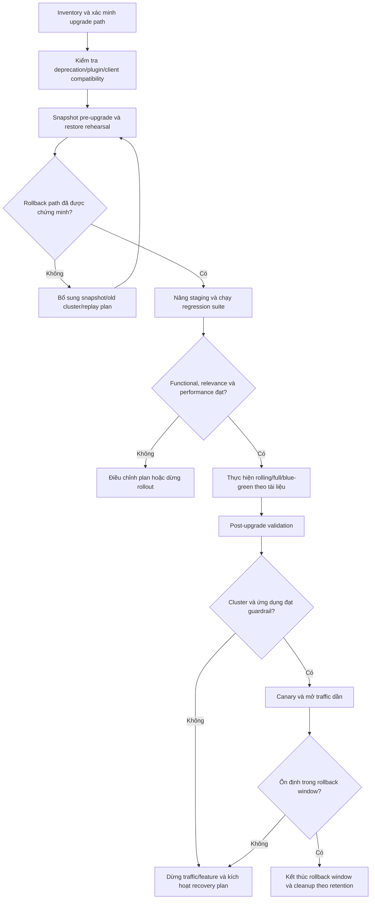

# Lập kế hoạch nâng cấp cluster và ứng dụng có thể quay lại

Nâng cấp Elasticsearch là thay đổi hạ tầng có thể ảnh hưởng đồng thời tới dữ liệu, mapping, shard allocation, client protocol, query behavior, security và hiệu năng. Nâng cấp ứng dụng Spring Data Elasticsearch cũng có thể thay đổi converter, repository behavior, query serialization và dependency của Elasticsearch Java API Client. Nếu chỉ thay version rồi khởi động lại, một lỗi tương thích hoặc migration dữ liệu có thể làm search gián đoạn hoặc khiến việc quay lại phiên bản cũ rất khó.

Một kế hoạch nâng cấp an toàn phải xác định trước bốn điều:

1. **Đích nâng cấp có được hỗ trợ không?** Kiểm tra version hiện tại, version đích, các bước nâng trung gian, plugin, JVM, Spring Data và client compatibility.
2. **Dữ liệu và schema sẽ thay đổi thế nào?** Phân biệt nâng binary cluster với thay đổi index mapping/document schema.
3. **Làm sao biết nâng cấp thành công?** Định nghĩa health, shard allocation, search correctness, indexing, latency, error rate và business checks.
4. **Nếu thất bại thì quay lại bằng cách nào?** Xác định snapshot, old cluster, application artifact, alias, event replay và giới hạn downgrade trước khi bắt đầu.

Điểm quan trọng: Elasticsearch không hỗ trợ coi việc cài lại binary cũ là một thao tác downgrade an toàn. Khi cần rollback cluster version, phương án thường là khôi phục snapshot tương thích vào cluster chạy version cũ hoặc chuyển traffic về một cluster cũ được giữ nguyên. Nếu dữ liệu mới đã được ghi sau cutover, cần kế hoạch đồng bộ/replay riêng; chuyển alias hoặc DNS ngược lại không tự đưa các write mới về hệ thống cũ.

## 1. Phạm vi của một lần nâng cấp

Trước tiên, tách các thay đổi thường bị gộp vào một đợt:

| Thành phần | Thay đổi ví dụ | Rủi ro chính |
|---|---|---|
| Elasticsearch cluster | Nâng server version, node, plugin hoặc deployment | Cluster compatibility, shard recovery, API behavior, performance |
| JVM/runtime | Nâng Java runtime theo yêu cầu server/client | Bytecode, GC, TLS provider, memory behavior |
| Spring Boot | Nâng framework platform | Dependency alignment, configuration và lifecycle |
| Spring Data Elasticsearch | Nâng mapping/repository/operations module | Converter, annotation, query abstraction, repository behavior |
| Elasticsearch Java API Client | Nâng generated client và transport | Request/response type, serialization, compatibility |
| Index schema | Mapping, analyzer, template, shard strategy | Reindex, data conversion, query semantics |
| Document schema | Thêm/đổi field hoặc representation | Reader/writer compatibility, backfill |
| Search model/ranking | Embedding model, synonym, boost, retriever | Relevance, latency, vector migration |

Không nên thay mọi thành phần cùng lúc nếu mục tiêu là cô lập rủi ro của một upgrade. Khi có thể, nâng cluster binary riêng, sau đó nâng ứng dụng/client, rồi thực hiện schema/model migration ở một đợt có kiểm soát. Nếu dependency compatibility bắt buộc phải nâng cùng nhau, ghi rõ chúng thành một change set và test đúng combination đó.

## 2. Xác định version hiện tại và version đích

Thu thập thông tin thực tế trước khi lên lịch:

- Elasticsearch server version/build của mọi node.
- Cluster topology, node roles, data tiers và deployment type.
- Spring Boot, Spring Data Elasticsearch và Elasticsearch Java API Client version trên runtime classpath.
- Java runtime của cluster và ứng dụng.
- Plugin, custom plugin, ingest processor và integration bên ngoài.
- Index templates, component templates, mappings, aliases và data streams.
- Security configuration, TLS certificates, roles, API keys và remote cluster settings.
- Snapshot repository và trạng thái snapshot gần nhất.

Có thể lấy server version từ root endpoint:

```http
GET /
```

Có thể xem node và cluster:

```http
GET _cluster/health
GET _cat/nodes?v
GET _cat/master?v
GET _cat/shards?v
```

Trong Gradle, kiểm tra dependency đã resolve:

```bash
./gradlew dependencyInsight \
  --dependency spring-data-elasticsearch \
  --configuration runtimeClasspath

./gradlew dependencyInsight \
  --dependency elasticsearch-java \
  --configuration runtimeClasspath
```

Đừng chỉ đọc version khai báo trong build file. Spring Boot BOM, platform hoặc dependency constraint có thể chọn version khác.

## 3. Kiểm tra upgrade path chính thức

Elasticsearch có yêu cầu và giới hạn nâng cấp theo từng version. Một số đường nâng cấp yêu cầu nâng qua version trung gian; một số thay đổi cần chạy deprecation checks hoặc reindex trước khi chuyển sang major mới.

Trước khi lên kế hoạch, tra tài liệu upgrade của đúng version nguồn và version đích để xác định:

- Có thể nâng trực tiếp hay phải đi qua một hoặc nhiều version trung gian.
- Có cần chạy Upgrade Assistant hoặc deprecation API trước không.
- Những setting, API, query syntax hoặc plugin nào đã bị deprecated/removed.
- Index format nào còn được hỗ trợ đọc và có cần reindex không.
- JVM và operating system requirements.
- Có hỗ trợ rolling upgrade trong đường nâng cấp này không.
- Những bước cần thực hiện trước, trong và sau khi nâng node.
- Giới hạn snapshot/restore giữa các version.

Không dùng một quy tắc “luôn có thể nhảy qua một major” hoặc “mọi version đều hỗ trợ rolling upgrade”. Upgrade path là version-specific. Ghi lại link/tài liệu chính thức và phiên bản được kiểm tra trong change plan.

### 3.1. Kiểm tra deprecation trước khi nâng

Các API hoặc setting đã deprecated có thể bị loại bỏ ở version đích. Hãy chạy deprecation checks/Upgrade Assistant mà version hiện tại hỗ trợ và xử lý các mục liên quan tới:

- Query DSL và search request parameters.
- Index settings và mapping parameters.
- Cluster settings và node configuration.
- Security APIs, roles và authentication configuration.
- Plugin hoặc integration bên ngoài.
- Script, ingest pipeline và painless usage.
- Index template và component template format.

Không coi việc ứng dụng compile thành công là bằng chứng mọi query runtime còn tương thích. Một query có thể compile vì được serialize thành JSON, nhưng server đích có thể từ chối hoặc diễn giải khác.

### 3.2. Plugin và integration

Mỗi plugin cần version tương thích với server version đích. Plugin cũ có thể ngăn node khởi động hoặc làm rolling upgrade không thể tiếp tục.

Lập danh sách plugin theo node role, xác định plugin có built-in trong version mới hay phải cài lại, và kiểm tra checksum/package nguồn. Không copy nguyên thư mục plugin từ node cũ sang node mới nếu tài liệu yêu cầu cài lại đúng package version.

## 4. Lập compatibility matrix cho ứng dụng Spring

Elasticsearch server và ứng dụng Spring là hai trục version độc lập. Cần kiểm tra cả tổ hợp:

| Lớp | Cần xác minh |
|---|---|
| Spring Boot | Version hỗ trợ Java runtime và Spring Data release train nào |
| Spring Data Elasticsearch | Server/client version tương thích, API mapping và query nào có mặt |
| Elasticsearch Java API Client | Version resolve thực tế, generated API và transport behavior |
| Elasticsearch server | API/query/mapping behavior của version đích |
| Java runtime | JDK version được framework, client và server yêu cầu |
| Serialization | Jackson/custom converter, date/time và numeric behavior |
| Security | TLS, certificate, authentication, API key và role privileges |

Spring Data Elasticsearch thường quản lý một tập client/transport tương ứng release của nó. Không tự nâng riêng `elasticsearch-java` lên version tùy ý chỉ để lấy một request builder. Nếu server mới có API mà Spring Data abstraction chưa expose, hãy xem xét adapter riêng dùng client tương thích hoặc nâng toàn bộ Spring stack theo compatibility matrix.

### 4.1. Kiểm tra các API ứng dụng thực sự dùng

Lập danh sách các đường gọi:

- `ElasticsearchRepository` và derived query methods.
- `ElasticsearchOperations`/`ReactiveElasticsearchOperations`.
- `NativeQuery`, criteria query, aggregations, sorting và pagination.
- Bulk, update-by-query, delete-by-query và reindex.
- Alias, index template, mapping và settings provisioning.
- kNN, `dense_vector`, `semantic_text`, retriever hoặc hybrid search nếu có.
- Custom Java API Client calls và custom transport/interceptor.

Với mỗi API, ghi request JSON hiện tại, response fields mà code phụ thuộc và test tương ứng. Điều này giúp tập trung kiểm thử vào hành vi ứng dụng đang dùng thay vì chỉ chạy một smoke test chung.

### 4.2. Compatibility mode không phải kế hoạch dài hạn

Một số version/client hỗ trợ cơ chế compatibility cho REST API trong quá trình chuyển đổi. Nếu dùng, xác minh chính xác version pair và header/API được hỗ trợ. Compatibility mode không làm cho API đã bị xóa, mapping không tương thích hoặc plugin lỗi trở nên tương thích. Đặt thời hạn kết thúc chế độ này và có test xác nhận.

## 5. Chọn chiến lược nâng cấp cluster

Có ba chiến lược thường gặp, tùy deployment và đường nâng cấp được hỗ trợ.

| Chiến lược | Mô tả | Ưu điểm | Rủi ro/đánh đổi |
|---|---|---|---|
| Rolling upgrade | Nâng từng node theo quy trình được hỗ trợ, cluster tiếp tục hoạt động | Giảm downtime, giữ cluster hiện tại | Cần compatibility giữa node versions trong giai đoạn chuyển tiếp; shard relocation và capacity phải đủ |
| Full-cluster restart | Dừng toàn bộ cluster, nâng tất cả node rồi khởi động lại | Quy trình đơn giản hơn trong một số đường nâng cấp | Downtime rõ ràng; cần kiểm soát thứ tự shutdown/startup và recovery |
| Blue-green/new cluster | Dựng cluster đích riêng, migrate/sync dữ liệu rồi chuyển traffic | Cô lập tốt, rollback traffic dễ hơn | Tốn tài nguyên; cần đồng bộ dữ liệu và cutover chính xác |

Không tự chọn rolling upgrade chỉ vì muốn tránh downtime. Nếu version path hoặc plugin không hỗ trợ, hãy dùng chiến lược được tài liệu yêu cầu. Blue-green thường phù hợp khi cần rollback rõ ràng hoặc thay đổi lớn về topology/mapping/model.

## 6. Rolling upgrade: lập kế hoạch capacity và thứ tự node

Trong rolling upgrade, node được nâng từng bước trong khi phần còn lại của cluster tiếp tục phục vụ. Điều kiện cơ bản là đường nâng cấp cho phép rolling và cluster đủ capacity để chịu tải khi một node dừng.

Trước khi nâng:

- Xác nhận cluster health và không có shard unassigned bất thường.
- Kiểm tra replica đủ để duy trì availability theo yêu cầu.
- Kiểm tra disk watermark, heap, CPU, network và recovery bandwidth.
- Đảm bảo số node còn lại đủ chịu search/index traffic.
- Xác định thứ tự master-eligible, coordinating, ingest và data nodes theo tài liệu version cụ thể.
- Kiểm tra shard allocation awareness và zone distribution.
- Xác định node nào có thể dừng mà không mất primary availability.

Một flow khái quát:



Sơ đồ chỉ mô tả vòng lặp. Các thao tác chính xác như allocation filtering, voting configuration, node order và restart sequence phải theo tài liệu của đúng version; không áp dụng một command sequence chung cho mọi cluster.

### 6.1. Không nâng nhiều node cùng lúc tùy tiện

Dừng nhiều data node có thể làm mất shard availability hoặc tạo tải recovery lớn khi node quay lại. Dừng quá nhiều master-eligible node có thể làm mất quorum. Nâng theo batch và đợi cluster ổn định theo điều kiện đã định trước.

### 6.2. Theo dõi shard recovery

Sau mỗi node, kiểm tra:

```http
GET _cluster/health
GET _cat/nodes?v
GET _cat/shards?v
GET _cluster/pending_tasks
```

Không tiếp tục node tiếp theo chỉ vì process đã khởi động. Chờ node join đúng cluster, shard allocation/recovery đạt trạng thái chấp nhận được và error log không có lỗi lặp.

## 7. Full-cluster restart

Nếu upgrade path yêu cầu full restart hoặc deployment không hỗ trợ rolling, lập maintenance window và quy trình shutdown/startup.

Trước shutdown:

- Hoàn tất snapshot và xác nhận trạng thái snapshot `SUCCESS`.
- Kiểm tra cluster health và ghi lại cluster state cần thiết.
- Dừng hoặc giảm indexing/bulk job nếu cần.
- Thông báo downtime cho consumer và client theo quy trình vận hành.
- Ghi lại node list, role, config, plugin và startup order.
- Xác nhận có đủ disk/memory và snapshot repository sẵn sàng.

Trong shutdown/startup:

- Thực hiện đúng trình tự được tài liệu version yêu cầu.
- Không xóa data path để “làm sạch” nếu không có chỉ dẫn cụ thể.
- Giữ nguyên cluster identity/configuration cần thiết.
- Nâng tất cả node và plugin đúng version.
- Khởi động cluster theo thứ tự phù hợp, xác nhận master election và shard recovery.
- Không mở lại traffic đầy đủ trước khi validation hoàn tất.

Full restart không phải cách thay thế snapshot. Nếu một node không khởi động sau nâng cấp, không tùy tiện copy data path từ node khác hoặc hạ binary xuống version cũ.

## 8. Blue-green hoặc dựng cluster mới

Với blue-green, cluster cũ tiếp tục phục vụ trong khi cluster mới được dựng độc lập:



Các bước:

1. Dựng cluster green đúng version đích, node role, security và topology.
2. Tạo templates, mappings, pipelines, roles và aliases cần thiết.
3. Chọn snapshot restore, remote reindex hoặc data pipeline để nạp dữ liệu.
4. Đồng bộ các write phát sinh sau snapshot bằng event log/outbox/dual-write có kiểm soát.
5. So sánh document count, revision, aggregation và sample documents.
6. Chạy functional, relevance và performance regression tests.
7. Chuyển read traffic, sau đó write traffic theo cutover plan.
8. Theo dõi error/latency/queue lag và giữ cluster blue trong rollback window.

Blue-green giúp rollback traffic nhanh hơn, nhưng không tự giải quyết đồng bộ dữ liệu sau cutover. Cần có chiến lược replay hoặc dual-write nếu green nhận write mới.

## 9. Snapshot và backup trước nâng cấp

Snapshot là cơ sở quan trọng để phục hồi cluster state và dữ liệu. Trước upgrade:

- Xác minh snapshot repository đã register và truy cập được từ các node cần thiết.
- Kiểm tra quyền đọc/ghi repository và credential.
- Tạo snapshot theo chính sách phù hợp, bao gồm index cần thiết và feature states cần backup.
- Chờ snapshot hoàn tất và kiểm tra `state: SUCCESS`.
- Lưu snapshot name, repository, thời gian, source version và danh sách index/feature states.
- Thực hiện restore rehearsal trên cluster test hoặc môi trường cô lập.

Ví dụ tạo snapshot:

```http
PUT _snapshot/prod-backups/pre-upgrade-2026-11-13?wait_for_completion=true
{
  "indices": "*",
  "include_global_state": true
}
```

Ví dụ trên cần được điều chỉnh theo repository, retention và feature-state requirements của deployment. Với Elasticsearch version hiện đại, cần kiểm tra cách backup feature states/security state theo tài liệu tương ứng; `include_global_state` không nên được coi là câu trả lời duy nhất cho mọi loại metadata.

Kiểm tra snapshot:

```http
GET _snapshot/prod-backups/pre-upgrade-2026-11-13
GET _snapshot/prod-backups/_all
```

Snapshot `IN_PROGRESS` hoặc `PARTIAL` không phải backup đã được xác nhận đầy đủ. Xem failure details và quyết định có cần tạo snapshot mới.

### 9.1. Snapshot không phải rollback binary

Snapshot lưu dữ liệu/metadata theo format của version nguồn. Quy tắc restore phụ thuộc source version và target version; restore snapshot từ version mới hơn về cluster cũ hơn thường không được hỗ trợ. Do đó:

- Tạo snapshot trước upgrade trên version cũ.
- Không dựa vào snapshot tạo sau upgrade để downgrade về version cũ.
- Kiểm tra restore compatibility chính thức trước khi chọn snapshot làm rollback path.
- Giữ old cluster hoặc snapshot pre-upgrade cho đến khi rollback window kết thúc.
- Diễn tập restore trên đúng version đích của recovery plan.

## 10. Không coi downgrade Elasticsearch là rollback thông thường

Elasticsearch không hỗ trợ hạ version binary trực tiếp trên data path đã được nâng cấp như một thao tác rollback đơn giản. Index metadata, cluster state hoặc internal data format có thể đã thay đổi.

Các lựa chọn phục hồi thực tế thường là:

1. **Restore pre-upgrade snapshot vào cluster version cũ tương thích** theo quy trình restore được hỗ trợ.
2. **Chuyển traffic về old cluster còn nguyên** trong chiến lược blue-green.
3. **Rebuild cluster cũ từ source of truth** hoặc replay event log nếu snapshot không đủ.

Không làm:

- Cài lại binary cũ lên data directory đã được mở bằng version mới.
- Copy data path của node mới vào cluster cũ.
- Restore snapshot từ version mới vào version cũ khi không được hỗ trợ.
- Xóa cluster cũ ngay sau cutover.

Rollback cluster version và rollback application version là hai quy trình khác nhau. Có thể rollback ứng dụng về artifact cũ mà vẫn giữ cluster version mới nếu client/server compatibility cho phép; ngược lại, có thể cần dựng cluster cũ độc lập nếu server upgrade gây lỗi nghiêm trọng.

## 11. Chuẩn bị ứng dụng Spring Data Elasticsearch

Trước khi deploy application mới:

- Nâng dependency theo Spring Boot/Spring Data compatibility matrix.
- Kiểm tra Java runtime.
- Chạy unit và integration tests với Elasticsearch version đích.
- Xác minh repository derived queries, `NativeQuery`, aggregations, sorting và pagination.
- Kiểm tra serialization/deserialization của date, numeric, enum, nested và vector fields.
- Kiểm tra timeout, retry, connection pool và TLS configuration.
- Kiểm tra security role/API key privileges.
- Kiểm tra `@Document`, `@Field`, `@Setting`, index template và alias provisioning.
- Kiểm tra response metadata mà service sử dụng: total hits relation, shard failures, bulk failures và version conflict.

### 11.1. Đừng thay đổi mapping vô tình khi nâng ứng dụng

Một phiên bản Spring Data mới có thể tạo mapping JSON khác do annotation support hoặc converter changes. So sánh mapping thực tế trước/sau:

```http
GET products/_mapping
GET products/_settings?include_defaults=true
```

Nếu ứng dụng tự động tạo index khi khởi động, cần hiểu rõ behavior trong môi trường production. Nhiều hệ thống nên tách index provisioning/migration khỏi startup của mọi application instance để tránh nhiều instance cùng thay đổi schema.

### 11.2. Reader và writer phải tương thích trong rolling deployment

Trong rolling deployment, application version cũ và mới có thể chạy đồng thời. Trước khi writer mới gửi field hoặc representation mới, reader cũ phải tiếp tục hoạt động hoặc không còn nhận traffic.

Dùng chiến lược expand-migrate-contract:

1. Mở rộng mapping/schema theo hướng tương thích.
2. Deploy reader hiểu cả định dạng cũ và mới.
3. Chuyển writer sang schema mới.
4. Backfill/reindex document cũ.
5. Xác nhận không còn writer/schema cũ.
6. Bỏ code tương thích cũ trong một release sau.

Không xóa field cũ trong cùng đợt deploy đã bắt đầu ghi field mới nếu còn instance cũ.

## 12. Tách cluster upgrade khỏi index schema migration

Nâng Elasticsearch binary không nhất thiết yêu cầu đổi mapping của mọi index. Ngược lại, thay mapping field type có thể yêu cầu reindex dù server version không đổi.

| Thay đổi | Chiến lược |
|---|---|
| Nâng server version, mapping giữ nguyên | Cluster upgrade + regression tests |
| Thêm field mapping tương thích | Mapping update có kiểm soát, backfill nếu cần |
| Đổi `keyword` sang `text` hoặc `object` sang `nested` | Tạo index mới và reindex |
| Đổi analyzer để re-tokenize dữ liệu | Index mới/reindex |
| Đổi vector dimensions/model | Index mới và re-embed |
| Đổi alias/topology | Provisioning/cutover riêng |

Nếu cần cả server upgrade và schema migration, cân nhắc chia thành các mốc riêng. Ví dụ, trước tiên nâng cluster mà giữ mapping/query cũ; sau khi cluster ổn định mới tạo index v2 và chuyển alias. Điều này giúp xác định nguyên nhân nếu regression xuất hiện.

## 13. Lập kế hoạch dữ liệu khi có reindex

Nếu schema migration là một phần của upgrade, cần xác định source of truth và cách đồng bộ write trong lúc reindex.

Các lựa chọn:

- Tạm dừng writer trong cửa sổ migration.
- Snapshot/reindex rồi replay event từ outbox.
- Dual-write vào hai index với idempotency và revision guard.
- Dùng remote reindex giữa cluster cũ và mới nếu network/auth/version hỗ trợ.
- Chuyển read alias sau khi xác nhận destination đã theo kịp source.

Reindex không tự bảo đảm mọi write phát sinh sau thời điểm source document được đọc đã được phản ánh trong destination. Cần delta synchronization hoặc một cutover window có write freeze.

Kiểm tra:

- Source/destination document count.
- Số document lỗi và version conflicts.
- Revision/checkpoint cuối cùng.
- Field quan trọng, null/missing và transformation.
- Aggregation tổng hợp và query regression.
- Alias read/write và index routing.

## 14. Xây dựng rollback plan cho ứng dụng

Mỗi release application nên có artifact cũ đã xác định và cấu hình tương ứng:

- Container/image hoặc binary version cũ.
- Dependency lock/resolved dependency record.
- Configuration/secret references tương thích.
- Feature flags và cách tắt tính năng mới.
- Mapping/index alias assumptions.
- API contract với frontend/consumer.
- Database/event schema compatibility nếu có.

Rollback ứng dụng chỉ an toàn nếu artifact cũ vẫn có thể giao tiếp với cluster hiện tại và dữ liệu hiện tại. Nếu ứng dụng mới đã ghi field mà reader cũ không hiểu, cần backward compatibility hoặc giữ feature flag tắt cho tới khi old application không còn chạy.

### 14.1. Expand-migrate-contract cho ứng dụng

Ví dụ thay `price` thành `priceInCents`:

1. Reader mới hiểu cả `price` và `priceInCents`.
2. Mapping mới cho phép field mới.
3. Writer bắt đầu ghi field mới; nếu cần, tạm thời dual-write field cũ.
4. Backfill dữ liệu cũ.
5. Kiểm tra không còn document chỉ có field cũ.
6. Sau rollback window, bỏ fallback đọc field cũ.

Nếu rollback về ứng dụng cũ vẫn cần field `price`, tiếp tục duy trì field đó hoặc có transformation/replay tương thích trong thời gian rollback.

## 15. Rollback khi dùng alias và blue-green

Alias switch có thể thực hiện nguyên tử trong cluster:

```http
POST _aliases
{
  "actions": [
    { "remove": { "index": "products-v1", "alias": "products-read" } },
    { "add": { "index": "products-v2", "alias": "products-read" } }
  ]
}
```

Để rollback, có thể chuyển alias lại nếu index cũ còn nguyên và dữ liệu phù hợp. Nhưng nếu v2 đã nhận write sau cutover, v1 có thể stale.

Trước cutover, xác định:

- Có write freeze hay dual-write không?
- Có outbox/event log để replay không?
- Có source revision để đối soát không?
- Rollback có cần replay delta v2 về v1 không?
- Alias read và write có được switch cùng lúc không?
- Ai có quyền thực hiện switch và xác nhận hoàn tất?

Không coi thao tác đổi alias là toàn bộ rollback plan. Nó chỉ đổi đích truy cập.

## 16. Post-upgrade validation

Không kết thúc upgrade ngay khi mọi node báo started. Cần kiểm tra theo nhiều lớp.

### 16.1. Cluster health và node

```http
GET _cluster/health
GET _cat/nodes?v
GET _cat/shards?v
GET _cluster/pending_tasks
```

Kiểm tra:

- Tất cả node dự kiến đã join đúng cluster.
- Version/build của node đúng mục tiêu.
- Master election ổn định.
- Primary/replica shard allocation theo chính sách.
- Không có pending tasks bất thường.
- Disk/heap/CPU/GC trong giới hạn.
- Plugin và ingest pipeline hoạt động.

### 16.2. Data và index

- Index, alias, data stream và template tồn tại đúng.
- Mapping/settings không bị thay đổi ngoài dự kiến.
- Document count và các aggregation kiểm tra mẫu phù hợp.
- Snapshot repository vẫn truy cập được.
- Ingest pipeline và ILM/SLM policy hoạt động.
- Security roles, API keys và TLS kết nối được.

### 16.3. Search và indexing

Chạy smoke test:

- GET document theo ID.
- Exact term query.
- Full-text query/analyzer query.
- Filter tenant/ACL.
- Sort, pagination và aggregation.
- Bulk index/update/delete.
- Read-after-write theo refresh contract.
- Query vector/hybrid nếu có.
- Kiểm tra total hits relation, timeout và shard failure metadata.

Không chỉ xác nhận response status. So sánh expected document IDs, ranking constraints và response completeness.

### 16.4. Hiệu năng và lỗi

So sánh với baseline:

- p50/p95/p99 search latency.
- Indexing throughput và refresh visibility lag.
- Error, timeout, rejection và retry rate.
- Search/index thread pool queue.
- Heap, GC pause, CPU, disk I/O và merge pressure.
- Circuit breaker trips và shard recovery.
- Query relevance metrics nếu ranking có thay đổi.

## 17. Canary và mở traffic theo giai đoạn

Nếu deployment hỗ trợ, hãy mở traffic dần:

1. Smoke test nội bộ với traffic rất nhỏ.
2. Canary một instance ứng dụng hoặc một phần query traffic.
3. Theo dõi error/latency/cluster resource trong cửa sổ đủ dài.
4. Mở rộng traffic theo từng bước.
5. Giữ guardrail và rollback trigger rõ ràng.

Với blue-green cluster, có thể shadow một phần read traffic tới green nhưng không trả kết quả cho người dùng; so sánh result IDs, ranking và latency. Cẩn thận với write traffic: không gửi write shadow nếu operation có side effect hoặc dữ liệu không được đồng bộ.

### 17.1. Định nghĩa rollback trigger

Ví dụ trigger cần được điều chỉnh theo SLO thực tế:

- Cluster health chuyển red hoặc shard primary không allocate.
- Error/timeout rate vượt ngưỡng trong nhiều cửa sổ liên tiếp.
- p95/p99 vượt SLO đã định.
- Search regression làm sai kết quả nghiệp vụ hoặc rò rỉ dữ liệu.
- Indexing backlog/consumer lag tăng không phục hồi.
- Authentication/TLS hoặc plugin integration không hoạt động.
- Snapshot/restore hoặc recovery path không còn khả dụng.

Một lỗi security/data isolation nghiêm trọng có thể yêu cầu dừng traffic ngay cả khi latency và health vẫn tốt.

## 18. Runbook khi upgrade gặp lỗi

### 18.1. Node không join cluster

1. Đọc log node và cluster formation messages.
2. Kiểm tra version/build, plugin, JVM, config và certificate.
3. Xác nhận discovery/cluster name/network và node role.
4. Kiểm tra disk permission, data path và startup configuration.
5. Không xóa data path hoặc đổi cluster identity tùy tiện.
6. Dừng tiến trình nâng tiếp theo cho tới khi nguyên nhân rõ ràng.

### 18.2. Shard không allocate

1. Đọc `_cat/shards` và cluster health.
2. Dùng allocation explain cho shard cụ thể.
3. Kiểm tra disk watermark, awareness, node capacity và recovery.
4. Kiểm tra primary/replica state và cluster logs.
5. Không ép allocate stale primary nếu chưa hiểu nguy cơ mất dữ liệu.

### 18.3. Ứng dụng nhận lỗi sau upgrade

1. Ghi exception/cause, HTTP status và Elasticsearch error type.
2. Xác định lỗi transport, authentication, API incompatibility hay mapping/query.
3. So sánh raw request/response với baseline.
4. Kiểm tra client version và compatibility matrix.
5. Tắt feature flag hoặc quay lại application artifact nếu tương thích.
6. Không downgrade cluster binary trên data path đã nâng.

### 18.4. Ranking hoặc latency regression

1. Chạy lại cùng corpus/query set và load conditions.
2. Kiểm tra analyzer, mapping, similarity và shard topology.
3. Dùng `_explain` cho document lên/xuống hạng.
4. Dùng Profile API/slow logs cho query chậm.
5. Phân biệt server upgrade với query/model/schema change.
6. Rollback query/feature hoặc chuyển traffic theo kế hoạch.

## 19. Kế hoạch theo mốc thời gian

| Giai đoạn | Công việc | Bằng chứng hoàn tất |
|---|---|---|
| T-2 đến T-4 tuần | Inventory, compatibility, deprecation và upgrade path | Version matrix, danh sách blocker, change plan |
| T-1 đến T-2 tuần | Restore rehearsal, test staging, benchmark và runbook | Snapshot restore test, test report, rollback rehearsal |
| T-1 ngày | Freeze thay đổi schema/query không liên quan, xác nhận snapshot/repository | Go/no-go checklist và snapshot status |
| Upgrade window | Rolling/full restart hoặc blue-green migration | Node/cluster state theo từng checkpoint |
| Ngay sau nâng | Functional, data, security và performance validation | Validation report |
| Canary window | Theo dõi traffic, error, latency, lag và relevance | Metrics trong guardrail |
| Sau rollback window | Xác nhận ổn định, cleanup tài nguyên cũ theo retention | Sign-off và archive artifacts |

Mốc thời gian chỉ là ví dụ. Hệ thống lớn hoặc có yêu cầu compliance cần thời gian rehearsal và phê duyệt dài hơn.

## 20. Mẫu upgrade plan cần lưu

Một change record nên có:

```text
Change ID:
Current Elasticsearch version:
Target Elasticsearch version:
Supported upgrade path:
Deployment strategy: rolling / full restart / blue-green
Current Spring Boot / Spring Data / Java API Client:
Target application versions:
Java runtime:
Plugins and integrations:
Index/mapping/template changes:
Snapshot repository and pre-upgrade snapshot:
Restore rehearsal result:
Maintenance window:
Owners and communication channel:
Preflight checks:
Step-by-step upgrade sequence:
Post-upgrade validation:
SLO and rollback triggers:
Application rollback artifact:
Cluster recovery/rollback strategy:
Write freeze / dual-write / event replay plan:
Old cluster/index retention period:
Final sign-off:
```

Giữ command, endpoint, version và thời gian thực tế trong change log. Không lưu password, API key hoặc secret trực tiếp trong tài liệu; chỉ tham chiếu secret manager/credential identifier.

## 21. Checklist trước khi bắt đầu

| Nhóm | Điều kiện go/no-go |
|---|---|
| Upgrade path | Version đích và các bước trung gian được tài liệu chính thức hỗ trợ |
| Cluster | Health ổn định, shard allocation bình thường, capacity đủ |
| Plugin | Mọi plugin/integration có version tương thích |
| Runtime | JVM/OS/config đáp ứng yêu cầu version đích |
| Snapshot | Snapshot pre-upgrade hoàn tất, repository truy cập được, restore đã diễn tập |
| Application | Spring Data/client compatibility đã xác minh và test trên staging |
| Schema | Mapping/template/document compatibility đã được đánh giá |
| Security | TLS, certificates, roles, API keys và feature permissions đã kiểm tra |
| Observability | Dashboard, logs, alert và baseline metrics sẵn sàng |
| Rollback | Có old artifact, old cluster hoặc restore plan; đã xử lý write divergence |
| Operations | Owner, maintenance window, communication và stop/go decision rõ ràng |

Nếu snapshot chưa xác nhận, upgrade path chưa rõ, plugin không tương thích hoặc rollback path chưa được diễn tập, không bắt đầu thay đổi production.

## 22. Checklist sau khi hoàn tất

- Tất cả node chạy đúng version/build đích.
- Cluster health và shard allocation đạt trạng thái mong muốn.
- Không có lỗi plugin, TLS, authentication hoặc cluster formation.
- Index, alias, template, data stream và ingest pipeline tồn tại đúng.
- Repository/operations smoke tests pass.
- Search ranking, pagination, aggregation và total-hit semantics đúng.
- Bulk và indexing pipeline hoạt động, không có partial failure bất thường.
- p95/p99, QPS, error/rejection và resource trong SLO.
- Backup/snapshot schedule tiếp tục chạy.
- Application rollback artifact và cluster recovery material được giữ trong thời hạn quy định.
- Runbook, version inventory và migration history được cập nhật.

## 23. Quy trình nâng cấp và quay lại



Trình tự thực tế:

1. Ghi nhận version, topology, plugin, dependency và schema hiện tại.
2. Xác minh upgrade path chính thức và xử lý deprecation.
3. Kiểm tra plugin, JVM, security, client và Spring compatibility.
4. Tạo snapshot pre-upgrade, xác nhận success và diễn tập restore.
5. Chốt application rollback artifact, old cluster/restore path và event replay.
6. Nâng staging với cùng cấu hình và chạy regression/benchmark.
7. Chọn rolling, full restart hoặc blue-green theo support matrix.
8. Thực hiện theo từng checkpoint, kiểm tra node join và shard recovery.
9. Chạy functional, data, security, ranking và performance validation.
10. Canary traffic, theo dõi guardrails và giữ rollback window.
11. Nếu cần rollback, chuyển traffic hoặc restore cluster tương thích; không hạ binary trên data path đã upgrade.
12. Sau khi ổn định, kết thúc rollback window, cập nhật tài liệu và cleanup tài nguyên cũ theo retention.

## 24. Kết luận

Nâng cấp Elasticsearch cluster và ứng dụng Spring Data Elasticsearch cần được xem là một thay đổi có kế hoạch, có bằng chứng và có đường phục hồi. Trước khi nâng, xác minh upgrade path theo đúng server version, deprecation, plugin, JVM, Spring Data và Java API Client compatibility. Tách cluster binary upgrade khỏi index schema/model migration khi có thể để dễ cô lập regression.

Chọn rolling upgrade chỉ khi version path hỗ trợ và cluster đủ capacity; dùng full-cluster restart khi quy trình yêu cầu downtime; cân nhắc blue-green khi cần cô lập và rollback traffic rõ ràng. Snapshot pre-upgrade phải hoàn tất và restore cần được diễn tập. Snapshot từ version mới hơn không phải công cụ downgrade về version cũ, và không được cài binary cũ lên data path đã nâng.

Ứng dụng cần reader/writer compatibility trong rolling deployment, kiểm thử repository/query/mapping/security và giữ artifact cũ có thể chạy với cluster hiện tại nếu muốn rollback app. Với schema thay đổi không tương thích, dùng expand-migrate-contract, index version mới, reindex và đồng bộ delta. Alias switch chỉ đổi đích truy cập; nó không tự đưa write mới về index/cluster cũ.

Sau upgrade, xác nhận node/shard health, mapping/template, data, security, search correctness, ranking, bulk indexing và p95/p99. Canary cùng rollback triggers rõ ràng giúp phát hiện vấn đề trước khi mở toàn bộ traffic. Một kế hoạch có snapshot, restore rehearsal, validation và xử lý write divergence sẽ giúp đội ngũ nâng cấp có kiểm soát và biết chính xác phải làm gì nếu cần quay lại.
