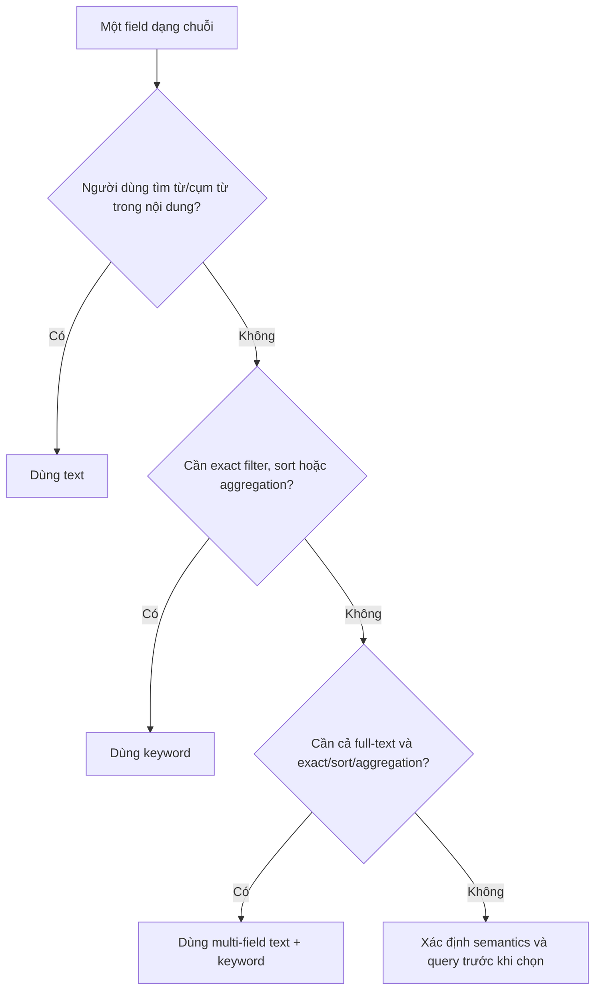

# Ánh xạ text và keyword theo nhu cầu tìm kiếm

Trong Elasticsearch, kiểu mapping của một field quyết định cách dữ liệu được lập chỉ mục và những loại truy vấn có thể sử dụng hiệu quả. Hai kiểu thường gặp nhất khi xử lý chuỗi là **`text`** và **`keyword`**. Chúng đều lưu giá trị dạng chuỗi trong document, nhưng phục vụ hai mục đích khác nhau:

- `text` dành cho tìm kiếm toàn văn. Elasticsearch phân tích nội dung thành token để có thể tìm theo từ, cụm từ và mức độ liên quan.
- `keyword` dành cho giá trị cần giữ như một đơn vị để so khớp chính xác, lọc, sắp xếp và aggregation.

Một field tên sản phẩm có thể cần cả hai cách sử dụng: người dùng gõ từ khóa để tìm tên gần đúng, nhưng giao diện cũng cần sắp xếp tên theo alphabet hoặc lọc theo đúng toàn bộ tên. Khi đó, **multi-fields** cho phép index cùng một giá trị thành nhiều field con với mapping khác nhau.

## 1. Vì sao phải chọn kiểu mapping cho chuỗi?

Giả sử document có nội dung:

```json
{
  "name": "Wireless Headphones",
  "category": "Audio Equipment",
  "sku": "WH-1001"
}
```

Mỗi field có cách sử dụng khác nhau:

| Field | Nhu cầu chính | Mapping phù hợp |
|---|---|---|
| `name` | Tìm sản phẩm theo từ hoặc cụm từ trong tên | `text` |
| `category` | Lọc đúng danh mục, aggregation theo danh mục | `keyword` |
| `sku` | So khớp chính xác mã sản phẩm | `keyword` |

Nếu khai báo tất cả chuỗi thành `text`, việc tìm kiếm toàn văn có thể hoạt động, nhưng lọc chính xác, sắp xếp và aggregation sẽ không thuận tiện. Nếu khai báo tất cả thành `keyword`, mỗi chuỗi được xem như một giá trị nguyên vẹn; tìm một từ nằm bên trong tên hoặc mô tả sẽ không có hành vi phân tích văn bản như mong đợi.

Do đó, cần xuất phát từ câu hỏi: ứng dụng sẽ tìm kiếm field này như văn bản tự do, hay dùng nó như một giá trị định danh/phân loại?

## 2. `text`: phân tích văn bản để tìm kiếm toàn văn

Field kiểu `text` được xử lý qua **analyzer** khi index và khi chạy các truy vấn dạng full-text. Analyzer thường bao gồm ba bước:

1. **Character filters**: có thể biến đổi chuỗi đầu vào trước khi tokenization, ví dụ thay thế hoặc loại bỏ một số ký tự.
2. **Tokenizer**: chia văn bản thành các token.
3. **Token filters**: biến đổi token, ví dụ chuyển chữ thường, bỏ stop word hoặc stemming khi analyzer được cấu hình như vậy.

Ví dụ, analyzer tiêu chuẩn có thể biến đổi:

```text
Input:  "Wireless Headphones"
Tokens: ["wireless", "headphones"]
```

Elasticsearch lập chỉ mục các token này trong inverted index. Khi người dùng tìm `wireless`, truy vấn `match` có thể tìm document chứa token tương ứng dù chuỗi gốc là `Wireless Headphones`.

### 2.1. Khai báo field `text`

Trong Spring Data Elasticsearch:

```java
import org.springframework.data.elasticsearch.annotations.Document;
import org.springframework.data.elasticsearch.annotations.Field;
import org.springframework.data.elasticsearch.annotations.FieldType;

@Document(indexName = "products")
public class ProductDocument {

    @Field(type = FieldType.Text)
    private String name;

    @Field(type = FieldType.Text, analyzer = "standard")
    private String description;
}
```

`FieldType.Text` khai báo mapping kiểu `text`. Thuộc tính `analyzer` chỉ định analyzer dùng khi index nội dung. Nếu không chỉ định, Elasticsearch sử dụng analyzer mặc định theo mapping và index settings. Khi cần kiểm soát chính xác, hãy khai báo analyzer trong settings của index và tham chiếu bằng tên.

### 2.2. Truy vấn `match`

`match` là truy vấn full-text phổ biến. Giá trị tìm kiếm được phân tích bằng search analyzer tương ứng, sau đó Elasticsearch tìm các token trong field:

```json
GET products/_search
{
  "query": {
    "match": {
      "name": "wireless headphones"
    }
  }
}
```

Mặc định, `match` thường kết hợp các token theo `OR`: document chứa một trong các token có thể được trả về và được xếp hạng theo relevance score. Có thể dùng `operator: "and"` nếu muốn yêu cầu tất cả token phải xuất hiện:

```json
GET products/_search
{
  "query": {
    "match": {
      "name": {
        "query": "wireless headphones",
        "operator": "and"
      }
    }
  }
}
```

`match` phù hợp với tên, tiêu đề, mô tả, nội dung bài viết và các field mà người dùng nhập từ khóa để tìm.

### 2.3. `match_phrase` khi cần giữ thứ tự token

Nếu yêu cầu tìm cụm từ theo thứ tự token, có thể dùng `match_phrase`:

```json
GET products/_search
{
  "query": {
    "match_phrase": {
      "name": "wireless headphones"
    }
  }
}
```

Truy vấn này dùng token positions trong inverted index để tìm cụm từ theo thứ tự. Nó không có nghĩa là so sánh chuỗi gốc theo từng ký tự; analyzer vẫn có thể lowercase, bỏ dấu câu hoặc biến đổi token trước khi tìm.

### 2.4. Những đặc tính quan trọng của `text`

- Nội dung được phân tích thành token; một field có thể tạo nhiều term trong inverted index.
- Có thể hỗ trợ tìm theo từ, cụm từ, điều kiện boolean và relevance scoring.
- Mặc định không phù hợp để sort hoặc terms aggregation trực tiếp như field `keyword`.
- `fielddata` có thể bật để thực hiện một số thao tác trên `text`, nhưng có thể tiêu thụ nhiều heap memory. Thông thường nên dùng multi-field `keyword` thay vì bật `fielddata` cho tên hoặc mô tả.

## 3. `keyword`: giữ giá trị như một đơn vị

Field kiểu `keyword` được index như một giá trị nguyên vẹn, không chia thành các từ theo tokenizer. Ví dụ:

```text
Input:  "Wireless Headphones"
Token:  ["Wireless Headphones"]
```

Vì giá trị được xem như một term duy nhất, `keyword` phù hợp với:

- Mã sản phẩm, mã đơn hàng và ID nghiệp vụ.
- Danh mục, trạng thái, loại tài khoản và mã quốc gia.
- Email, URL hoặc các nhãn cần so khớp toàn giá trị.
- Giá trị dùng để sort, terms aggregation và filter.

### 3.1. Khai báo field `keyword`

```java
@Field(type = FieldType.Keyword)
private String sku;

@Field(type = FieldType.Keyword)
private String category;
```

Spring Data chuyển metadata này thành mapping tương ứng cho Elasticsearch khi index được tạo từ metadata của entity. Nếu index được quản lý bằng template hoặc migration riêng, cần bảo đảm mapping thực tế có kiểu `keyword` như mong muốn.

### 3.2. Truy vấn `term`

Với field `keyword`, truy vấn `term` thường được dùng để tìm đúng giá trị:

```json
GET products/_search
{
  "query": {
    "term": {
      "category": {
        "value": "audio"
      }
    }
  }
}
```

`term` không phân tích chuỗi đầu vào như `match`. Nếu giá trị trong index là `Audio Equipment`, truy vấn `term` với `audio` không tìm thấy document chỉ vì từ `audio` xuất hiện bên trong giá trị. Nó đang so khớp term đã index với giá trị truy vấn.

### 3.3. Sort và aggregation

`keyword` có doc values mặc định, phù hợp với các thao tác cần đọc giá trị theo document như sort và aggregation.

Sắp xếp theo tên nếu tên có mapping `keyword`:

```json
GET products/_search
{
  "sort": [
    {
      "name.raw": {
        "order": "asc"
      }
    }
  ]
}
```

Đếm số sản phẩm theo danh mục:

```json
GET products/_search
{
  "size": 0,
  "aggs": {
    "products_by_category": {
      "terms": {
        "field": "category"
      }
    }
  }
}
```

Với field `text`, sort hoặc terms aggregation thường không được bật mặc định vì field này không có doc values như `keyword`. Bật `fielddata` trên `text` có thể làm tăng mạnh mức sử dụng heap. Nếu một thuộc tính vừa cần full-text search vừa cần sort/aggregation, hãy tạo multi-field.

## 4. So sánh `text` và `keyword`

| Tiêu chí | `text` | `keyword` |
|---|---|---|
| Mục đích | Full-text search | Exact value, filter, sort, aggregation |
| Tokenization | Có | Không chia từ; xử lý như một term |
| Analyzer | Có analyzer và search analyzer | Có thể dùng normalizer, không dùng tokenizer thông thường |
| Truy vấn thường dùng | `match`, `match_phrase`, `multi_match` | `term`, `terms`, `prefix` và các truy vấn exact-value phù hợp |
| Relevance scoring | Phù hợp tính điểm liên quan | Thường dùng filter/exact matching |
| Sorting | Không thuận tiện mặc định | Phù hợp, có doc values mặc định |
| Terms aggregation | Cần `fielddata` nếu dùng trực tiếp, thường không khuyến nghị | Phù hợp mặc định |
| Ví dụ | `name`, `description`, `content` | `sku`, `status`, `category`, `countryCode` |

Hai kiểu mapping không phải là hai lựa chọn loại trừ nhau cho toàn bộ document. Một document có thể chứa field `text`, field `keyword` và multi-field tùy mục đích sử dụng.

## 5. Dùng multi-fields khi một giá trị cần nhiều cách tìm kiếm

Giả sử `name` cần đáp ứng đồng thời các yêu cầu:

1. Người dùng tìm `wireless` và muốn thấy `Wireless Headphones`.
2. Hệ thống lọc đúng toàn bộ tên sản phẩm.
3. Giao diện sắp xếp tên theo alphabet.
4. Có thể aggregation theo giá trị tên trong báo cáo.

Chỉ dùng `text` không đáp ứng thuận tiện yêu cầu 2, 3 và 4. Chỉ dùng `keyword` không đáp ứng full-text search. Multi-fields giải quyết bằng cách index cùng một giá trị thành field chính và các field con có mapping riêng.

Ví dụ mapping Elasticsearch:

```json
PUT products
{
  "mappings": {
    "properties": {
      "name": {
        "type": "text",
        "fields": {
          "raw": {
            "type": "keyword",
            "ignore_above": 256
          }
        }
      },
      "category": {
        "type": "keyword"
      },
      "sku": {
        "type": "keyword"
      }
    }
  }
}
```

Sau khi mapping được tạo, cùng một giá trị `name` được index theo hai đường:

- `name`: field `text`, được analyzer xử lý để tìm toàn văn.
- `name.raw`: field `keyword`, giữ giá trị như một term để lọc chính xác, sort hoặc aggregation.

Tên `raw` chỉ là hậu tố quy ước. Có thể dùng `keyword`, `exact` hoặc một tên khác miễn là query tham chiếu đúng mapping đã tạo.

### 5.1. Khai báo multi-field bằng Spring Data Elasticsearch

Spring Data cung cấp `@MultiField` và `@InnerField` để mô tả field chính cùng các field con:

```java
import org.springframework.data.elasticsearch.annotations.Document;
import org.springframework.data.elasticsearch.annotations.Field;
import org.springframework.data.elasticsearch.annotations.FieldType;
import org.springframework.data.elasticsearch.annotations.InnerField;
import org.springframework.data.elasticsearch.annotations.MultiField;

@Document(indexName = "products")
public class ProductDocument {

    @MultiField(
        mainField = @Field(type = FieldType.Text, analyzer = "standard"),
        otherFields = {
            @InnerField(
                suffix = "raw",
                type = FieldType.Keyword,
                ignoreAbove = 256
            )
        }
    )
    private String name;

    @Field(type = FieldType.Keyword)
    private String category;
}
```

Trong ví dụ:

- `mainField` tạo field `name` kiểu `text`.
- `otherFields` tạo field con `name.raw` kiểu `keyword`.
- `ignoreAbove = 256` tránh index giá trị keyword quá dài vượt ngưỡng đã chọn. Giá trị dài vẫn có thể nằm trong `_source`, nhưng không có term tương ứng trong field keyword để tìm/sort/aggregation.

Nếu dùng index template hoặc migration riêng, hãy bảo đảm mapping thực tế giống với annotation. Không nên cho rằng thay đổi annotation sẽ tự động sửa mapping của một index đã tồn tại.

### 5.2. Truy vấn hai field theo hai mục đích

Full-text search trên field chính:

```json
GET products/_search
{
  "query": {
    "match": {
      "name": "wireless"
    }
  }
}
```

Exact match trên field con:

```json
GET products/_search
{
  "query": {
    "term": {
      "name.raw": {
        "value": "Wireless Headphones"
      }
    }
  }
}
```

Sort theo field con:

```json
GET products/_search
{
  "sort": [
    {
      "name.raw": "asc"
    }
  ]
}
```

Multi-fields không tạo thêm thuộc tính Java riêng. Chúng là nhiều cách index một thuộc tính nguồn. Khi xây query, cần tham chiếu tên field con trong Elasticsearch, ví dụ `name.raw`.

## 6. Kết hợp full-text và filter trong cùng truy vấn

Một màn hình tìm kiếm sản phẩm thường cần tìm theo tên đồng thời lọc theo danh mục. Có thể dùng `bool` query:

```json
GET products/_search
{
  "query": {
    "bool": {
      "must": [
        {
          "match": {
            "name": "wireless headphones"
          }
        }
      ],
      "filter": [
        {
          "term": {
            "category": "audio"
          }
        }
      ]
    }
  }
}
```

Ở đây:

- `must` chứa điều kiện full-text và có thể ảnh hưởng relevance score.
- `filter` chứa điều kiện chính xác theo category và không tham gia tính score.
- `name` là `text`, nên dùng `match`.
- `category` là `keyword`, nên dùng `term`.

Đây là cách kết hợp phổ biến: dùng `text` cho nội dung người dùng tìm kiếm và `keyword` cho các bộ lọc dạng danh mục, trạng thái, mã hoặc giá trị chính xác.

Trong ứng dụng Spring Data Elasticsearch, có thể diễn đạt cùng truy vấn bằng `NativeQuery` và thực thi qua `ElasticsearchOperations`:

```java
import co.elastic.clients.elasticsearch._types.FieldValue;
import org.springframework.data.elasticsearch.client.elc.NativeQuery;
import org.springframework.data.elasticsearch.core.ElasticsearchOperations;
import org.springframework.data.elasticsearch.core.SearchHits;
import org.springframework.data.elasticsearch.core.query.Query;

public class ProductSearchService {

    private final ElasticsearchOperations operations;

    public ProductSearchService(ElasticsearchOperations operations) {
        this.operations = operations;
    }

    public SearchHits<ProductDocument> search(String text, String category) {
        Query query = NativeQuery.builder()
            .withQuery(q -> q
                .bool(b -> b
                    .must(m -> m
                        .match(match -> match
                            .field("name")
                            .query(text)
                        )
                    )
                    .filter(f -> f
                        .term(term -> term
                            .field("category")
                            .value(FieldValue.of(category))
                        )
                    )
                )
            )
            .build();

        return operations.search(query, ProductDocument.class);
    }
}
```

Ở đây `name` là field `text` nên dùng `match`; `category` là field `keyword` nên dùng `term`. `NativeQuery` cho phép dùng Query DSL có kiểu mà vẫn để Spring Data thực hiện mapping kết quả thành `ProductDocument`.

## 7. Normalizer cho `keyword`

`keyword` không dùng analyzer để tách token, nhưng có thể dùng **normalizer** để chuẩn hóa một giá trị thành một term duy nhất. Normalizer thường được dùng khi cần tìm không phân biệt chữ hoa/chữ thường hoặc chuẩn hóa dấu.

Ví dụ, nếu dữ liệu lưu là `Audio` nhưng ứng dụng nhận input `AUDIO`, exact matching mặc định có thể không khớp do khác chữ hoa/thường. Có thể định nghĩa normalizer:

```json
PUT products
{
  "settings": {
    "analysis": {
      "normalizer": {
        "lowercase_normalizer": {
          "type": "custom",
          "filter": ["lowercase", "asciifolding"]
        }
      }
    }
  },
  "mappings": {
    "properties": {
      "category": {
        "type": "keyword",
        "normalizer": "lowercase_normalizer"
      }
    }
  }
}
```

Với normalizer này, giá trị keyword được chuyển chữ thường và áp dụng `asciifolding` trước khi index và khi chuẩn hóa giá trị truy vấn. Ví dụ `AUDIO` và `audio` có thể khớp cùng một term.

Nếu dùng annotation Spring Data, có thể tham chiếu tên normalizer đã khai báo trong index settings:

```java
@Field(
    type = FieldType.Keyword,
    normalizer = "lowercase_normalizer"
)
private String category;
```

Normalizers phải được khai báo trong settings trước khi index được tạo. Không thể tùy tiện thêm một normalizer mới vào index đang tồn tại như thay đổi một thuộc tính Java; cần kiểm tra giới hạn mapping/settings và có thể phải tạo index mới.

`asciifolding` giúp chuẩn hóa một số ký tự có dấu về dạng ASCII tương đương. Điều này có thể hỗ trợ tìm kiếm không dấu trong một số ngôn ngữ, nhưng không thay thế tokenizer hoặc bộ phân đoạn từ theo ngôn ngữ. Với tiếng Việt, dấu cách thường ngăn cách âm tiết chứ không phải lúc nào cũng là ranh giới từ ghép; cần kiểm tra analyzer bằng dữ liệu thực tế trước khi quyết định cách tìm kiếm có dấu/không dấu.

## 8. Kiểm tra analyzer bằng `_analyze`

Không nên đoán analyzer đã tạo ra token nào. Elasticsearch cung cấp Analyze API để quan sát trực tiếp quá trình phân tích.

Ví dụ kiểm tra field `name`:

```json
POST products/_analyze
{
  "field": "name",
  "text": "Wireless Headphones"
}
```

Hoặc kiểm tra một analyzer cụ thể:

```json
POST products/_analyze
{
  "analyzer": "standard",
  "text": "Tai nghe không dây"
}
```

Response chứa danh sách token cùng vị trí và offset. Hãy dùng kết quả đó để xác nhận:

- Chuỗi được chia thành những token nào?
- Chữ hoa/thường có được chuẩn hóa không?
- Dấu câu và ký tự đặc biệt được xử lý ra sao?
- Từ dừng có bị loại bỏ không?
- Thứ tự và vị trí token có phù hợp với `match_phrase` không?
- Dữ liệu tiếng Việt hoặc ngôn ngữ của sản phẩm có được phân đoạn như mong muốn không?

Nếu yêu cầu tìm kiếm không dấu, có thể thử `asciifolding` trong analyzer hoặc normalizer phù hợp, nhưng cần test cả dữ liệu index lẫn search analyzer. Nếu yêu cầu phân đoạn từ theo ngôn ngữ, hãy đánh giá analyzer/plugin phù hợp với phiên bản Elasticsearch và dữ liệu của ứng dụng.

## 9. Dynamic mapping và field chuỗi

Khi Elasticsearch nhận document có field chưa được khai báo mapping, dynamic mapping có thể tự suy luận kiểu. Với chuỗi, cấu hình mặc định thường tạo field `text` cùng subfield `keyword` để hỗ trợ cả full-text search và exact-value operation. Ví dụ có thể thấy dạng mapping:

```json
{
  "name": {
    "type": "text",
    "fields": {
      "keyword": {
        "type": "keyword",
        "ignore_above": 256
      }
    }
  }
}
```

Đây là hành vi dynamic mapping phổ biến, không phải lý do để bỏ qua thiết kế mapping. Trong hệ thống có yêu cầu tìm kiếm rõ ràng, hãy khai báo mapping hoặc index template một cách chủ động. Nếu dựa vào dynamic mapping, tên subfield, giới hạn `ignore_above` và analyzer phụ thuộc cấu hình mặc định hoặc template đang áp dụng.

Kiểm tra mapping thực tế:

```http
GET products/_mapping
```

Nếu field đã được tạo sai kiểu, chỉ sửa annotation không làm index tự đổi mapping. Cần lập kế hoạch tạo index mới, reindex và chuyển alias/ứng dụng nếu thay đổi không tương thích.

## 10. Những lỗi thiết kế thường gặp

| Cách làm | Vấn đề | Hướng xử lý |
|---|---|---|
| Dùng `term` để tìm từ nằm trong field `text` | `term` không phân tích input như full-text query | Dùng `match` hoặc truy vấn full-text phù hợp. |
| Dùng `match` trên SKU cần chính xác | Analyzer có thể tách hoặc chuẩn hóa chuỗi theo cách không mong muốn | Dùng field `keyword` và `term`. |
| Sort trực tiếp trên `text` | `text` không có doc values mặc định | Dùng subfield `keyword` như `name.raw`. |
| Aggregation trên `text` bằng cách bật `fielddata` | Có thể tiêu thụ nhiều heap memory | Tạo field `keyword` hoặc multi-field. |
| Dùng một field cho cả mô tả và trạng thái | Hai nhu cầu có semantics tìm kiếm khác nhau | Tách field theo ý nghĩa hoặc dùng multi-fields. |
| Đổi annotation rồi mong mapping cũ tự cập nhật | Mapping index đã tồn tại không tự thay kiểu | Kiểm tra mapping và thực hiện migration/reindex. |
| Dùng lowercase normalizer nhưng quên khai báo settings | Index không nhận ra tên normalizer hoặc tạo mapping thất bại | Khai báo normalizer trước khi tạo index. |
| Giả định analyzer mặc định xử lý tiếng Việt như bộ tìm kiếm ngôn ngữ hoàn chỉnh | Tokenization có thể chưa phù hợp với từ ghép và yêu cầu dấu | Kiểm tra `_analyze`, đánh giá analyzer/plugin và dữ liệu thực tế. |

## 11. Quy trình chọn mapping theo nhu cầu



Có thể áp dụng theo các bước sau:

1. Liệt kê các thao tác tìm kiếm, lọc, sort và aggregation mà ứng dụng cần trên từng field.
2. Chọn `text` nếu nội dung cần được phân tích thành token để full-text search.
3. Chọn `keyword` nếu giá trị cần được so khớp như một đơn vị hoặc dùng làm key cho sort/aggregation.
4. Chọn multi-field nếu cùng một giá trị cần cả hai cách sử dụng.
5. Chọn analyzer/normalizer phù hợp, rồi kiểm tra bằng `_analyze` và query thử trên dữ liệu đại diện.
6. Xác nhận mapping thực tế sau khi index được tạo; quản lý thay đổi bằng migration khi cần.

## 12. Kết luận

`text` và `keyword` giải quyết hai bài toán khác nhau. `text` phân tích nội dung thành token để tìm kiếm toàn văn và tính điểm liên quan. `keyword` giữ giá trị như một term để exact matching, filter, sort và aggregation. Multi-fields cho phép một thuộc tính có cả hai cách index mà không cần nhân đôi dữ liệu trong lớp Java.

Hãy chọn mapping dựa trên hành vi tìm kiếm thực tế, không chỉ dựa trên việc thuộc tính Java có kiểu `String`. Kết hợp `match` với `text`, `term` với `keyword`, dùng multi-field khi cần nhiều cách truy cập, và xác minh analyzer bằng `_analyze`. Cách làm này giúp kết quả tìm kiếm đúng kỳ vọng, tránh chi phí `fielddata` không cần thiết và giữ mapping phù hợp khi chức năng tìm kiếm mở rộng.
