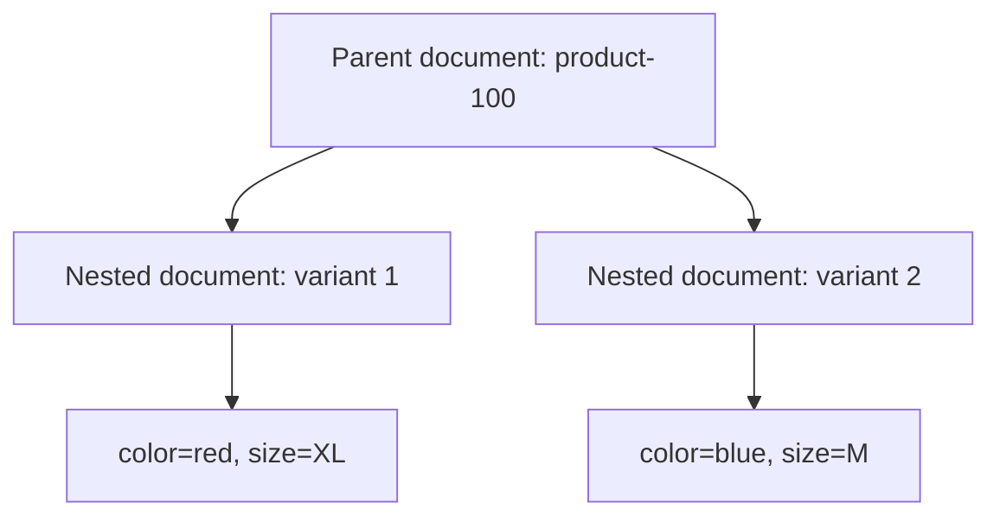

# Object, nested và khác biệt khi lọc nhiều thuộc tính con

Elasticsearch cho phép một document chứa object lồng nhau và mảng các object. Ví dụ một sản phẩm có thể chứa thông tin nhà sản xuất, địa chỉ giao hàng hoặc danh sách biến thể với màu sắc, kích thước và giá bán. Trong mapping, hai kiểu thường dùng để mô tả cấu trúc này là `object` và `nested`.

Điểm khác biệt quan trọng không nằm ở hình dạng JSON. Cả hai đều có thể nhận một object hoặc mảng object. Khác biệt nằm ở cách Elasticsearch lập chỉ mục và giữ quan hệ giữa các trường con. Với `object`, Elasticsearch làm phẳng các trường con thành những trường đa trị và không bảo toàn quan hệ giữa các thuộc tính thuộc cùng một phần tử mảng. Với `nested`, mỗi phần tử object trong mảng được lập chỉ mục như một document nested riêng, nhờ đó query có thể yêu cầu nhiều điều kiện cùng khớp trên đúng một phần tử.

Sự khác biệt này đặc biệt quan trọng khi lọc đồng thời nhiều thuộc tính con. Nếu dùng `object` cho mảng object, truy vấn có thể trả về document cha dù không có phần tử con nào thỏa tất cả điều kiện. Nếu nghiệp vụ yêu cầu các điều kiện phải thuộc cùng một phần tử, cần dùng `nested` và bọc điều kiện trong một `nested` query.

## 1. Mô hình dữ liệu có object lồng nhau

Giả sử ứng dụng quản lý sản phẩm. Mỗi sản phẩm có tên và danh sách biến thể. Một biến thể có màu sắc, kích thước, giá và trạng thái còn hàng.

```json
{
  "id": "product-100",
  "name": "Áo khoác gió",
  "variants": [
    {
      "color": "red",
      "size": "XL",
      "price": 450000,
      "available": true
    },
    {
      "color": "blue",
      "size": "M",
      "price": 420000,
      "available": true
    }
  ]
}
```

Một yêu cầu tìm kiếm có thể là: tìm sản phẩm có một biến thể vừa màu đỏ (`color = red`) vừa có kích thước M (`size = M`). Với document trên, kết quả đúng phải là không tìm thấy sản phẩm, vì biến thể màu đỏ có size XL, còn biến thể size M có màu xanh.

Đây là tình huống điển hình để thấy sự khác nhau giữa `object` và `nested`.

## 2. Object mapping: cấu trúc JSON được làm phẳng

Kiểu `object` là kiểu mặc định thường được Elasticsearch suy luận cho một object JSON khi dynamic mapping được bật. Các thuộc tính con được đưa vào mapping theo đường dẫn phân cấp, ví dụ `variants.color`, `variants.size` và `variants.price`.

Mapping minh họa:

```json
PUT /products-object
{
  "mappings": {
    "properties": {
      "name": {
        "type": "text"
      },
      "variants": {
        "type": "object",
        "properties": {
          "color": { "type": "keyword" },
          "size": { "type": "keyword" },
          "price": { "type": "double" },
          "available": { "type": "boolean" }
        }
      }
    }
  }
}
```

Khi index một mảng object, Elasticsearch xử lý các giá trị của từng trường con như các tập giá trị đa trị. Với document ví dụ, cách nhìn khái quát ở tầng field sẽ giống như sau:

| Field | Các giá trị được lập chỉ mục |
|---|---|
| `variants.color` | `red`, `blue` |
| `variants.size` | `XL`, `M` |
| `variants.price` | `450000`, `420000` |
| `variants.available` | `true`, `true` |

Mối liên hệ rằng `red` thuộc cùng biến thể với `XL`, còn `blue` thuộc cùng biến thể với `M`, không được giữ lại để query `object` kiểm tra. Elasticsearch biết document cha có các giá trị màu và kích thước đó, nhưng không còn đủ thông tin để kết luận cặp giá trị nào nằm trên cùng một phần tử mảng.

### 2.1 Vì sao truy vấn nhiều thuộc tính con có thể sai?

Xét truy vấn:

```json
GET /products-object/_search
{
  "query": {
    "bool": {
      "filter": [
        { "term": { "variants.color": "red" } },
        { "term": { "variants.size": "M" } }
      ]
    }
  }
}
```

Truy vấn này có thể trả về `product-100`. Điều đó không có nghĩa Elasticsearch tìm được một biến thể màu đỏ và size M. Điều kiện đầu khớp với giá trị `red` trong document; điều kiện thứ hai khớp với giá trị `M` trong cùng document. Hai giá trị có thể đến từ hai phần tử mảng khác nhau.

Nói cách khác, `bool.filter` ở cấp document cha có nghĩa là document phải chứa giá trị `red` ở field `variants.color` và chứa giá trị `M` ở field `variants.size`. Nó không biểu đạt ràng buộc “hai điều kiện phải cùng đúng trên một object con”.

Đây không phải lỗi của Elasticsearch. Đây là semantics đúng của `object` mapping: các thuộc tính con được lập chỉ mục độc lập và không giữ quan hệ giữa các phần tử của mảng object.

### 2.2 Object phù hợp với trường hợp nào?

`object` vẫn là lựa chọn phù hợp trong nhiều tình huống:

- Một object đơn có các thuộc tính cần đọc hoặc lọc độc lập.
- Một cấu trúc lồng nhau không phải mảng các object cần giữ quan hệ giữa từng phần tử.
- Một mảng object mà truy vấn chỉ cần biết document có một giá trị nào đó trong từng field, không yêu cầu các giá trị phải đến từ cùng một phần tử.
- Dữ liệu dạng metadata đơn giản, không cần nested query, nested sort hoặc nested aggregation.

Ví dụ một sản phẩm có thông tin nhà sản xuất:

```json
{
  "manufacturer": {
    "name": "Northwind",
    "country": "VN"
  }
}
```

Nếu chỉ cần lọc sản phẩm có `manufacturer.name = Northwind` và `manufacturer.country = VN`, và đây là một object duy nhất chứ không phải một danh sách object, kiểu `object` thường là đủ. Không cần dùng `nested` chỉ vì JSON có dấu ngoặc nhọn lồng nhau.

## 3. Nested mapping: bảo toàn quan hệ của từng object con

Kiểu `nested` được thiết kế cho mảng object mà ứng dụng cần truy vấn từng phần tử như một đơn vị độc lập. Elasticsearch lập chỉ mục mỗi object con thành một hidden nested document liên kết với document cha. Query có thể tìm nested document thỏa điều kiện rồi trả về document cha tương ứng.

Mapping cho index `products`:

```json
PUT /products
{
  "mappings": {
    "properties": {
      "name": {
        "type": "text"
      },
      "variants": {
        "type": "nested",
        "properties": {
          "color": { "type": "keyword" },
          "size": { "type": "keyword" },
          "price": { "type": "double" },
          "available": { "type": "boolean" }
        }
      }
    }
  }
}
```

Với mapping này, mỗi phần tử trong `variants` được lập chỉ mục như một nested document riêng. Quan hệ giữa `color`, `size`, `price` và `available` của cùng một biến thể được giữ lại. Document cha vẫn là đối tượng mà ứng dụng tìm kiếm và nhận về.

Có thể hình dung cấu trúc lập chỉ mục như sau:



Đây là cách hình dung logic. Nested document là cấu trúc nội bộ do Elasticsearch quản lý, không phải các document độc lập mà ứng dụng phải tự tạo ID và quản lý riêng.

### 3.1 Query đúng: gom điều kiện vào cùng một nested query

Để tìm sản phẩm có một biến thể vừa màu đỏ vừa size M, dùng `nested` query với `path` trỏ tới `variants`. Đặt cả hai điều kiện trong cùng một query con:

```json
GET /products/_search
{
  "query": {
    "nested": {
      "path": "variants",
      "query": {
        "bool": {
          "filter": [
            { "term": { "variants.color": "red" } },
            { "term": { "variants.size": "M" } }
          ]
        }
      }
    }
  }
}
```

`nested` query thực thi query con trong phạm vi từng nested document thuộc path `variants`. Một nested document chỉ thỏa nếu chính phần tử đó có cả `color = red` và `size = M`. Với dữ liệu ví dụ, biến thể thứ nhất không thỏa size; biến thể thứ hai không thỏa color. Do đó document cha không được trả về.

Nếu đổi điều kiện size thành `XL`, nested query sẽ tìm được biến thể thứ nhất và trả về sản phẩm cha `product-100`.

### 3.2 Quy tắc quan trọng: các điều kiện phải ở cùng phạm vi nested

Để biểu đạt các điều kiện phải thuộc cùng một phần tử, cần đặt chúng bên trong **một** nested query:

```json
{
  "nested": {
    "path": "variants",
    "query": {
      "bool": {
        "filter": [
          { "term": { "variants.color": "red" } },
          { "term": { "variants.size": "XL" } }
        ]
      }
    }
  }
}
```

Nếu viết hai nested query riêng ở cấp document cha:

```json
{
  "bool": {
    "filter": [
      {
        "nested": {
          "path": "variants",
          "query": { "term": { "variants.color": "red" } }
        }
      },
      {
        "nested": {
          "path": "variants",
          "query": { "term": { "variants.size": "M" } }
        }
      }
    ]
  }
}
```

truy vấn có ý nghĩa khác: document cha phải có ít nhất một nested document có màu đỏ, đồng thời phải có ít nhất một nested document có size M. Hai nested document có thể khác nhau. Với ví dụ ban đầu, truy vấn này vẫn khớp sản phẩm `product-100`.

Hai cách viết không tương đương:

| Cấu trúc query | Ý nghĩa |
|---|---|
| Một nested query chứa nhiều điều kiện trong `bool` | Tất cả điều kiện phải khớp trên cùng một phần tử nested |
| Nhiều nested query độc lập trong bool ở cấp cha | Mỗi nested query có thể khớp một phần tử khác nhau |

Đây là quy tắc cần nhớ khi thiết kế bộ lọc nhiều thuộc tính con.

## 4. Mapping nested trong Spring Data Elasticsearch

Trong Spring Data Elasticsearch, có thể khai báo entity cha bằng `@Document`, định danh bằng `@Id` và chỉ định kiểu nested cho thuộc tính danh sách bằng `@Field(type = FieldType.Nested)`.

Ví dụ lớp biểu diễn một biến thể:

```java
import org.springframework.data.elasticsearch.annotations.Field;
import org.springframework.data.elasticsearch.annotations.FieldType;

public class ProductVariant {

    @Field(type = FieldType.Keyword)
    private String color;

    @Field(type = FieldType.Keyword)
    private String size;

    @Field(type = FieldType.Double)
    private Double price;

    @Field(type = FieldType.Boolean)
    private Boolean available;

    public String getColor() {
        return color;
    }

    public String getSize() {
        return size;
    }

    public Double getPrice() {
        return price;
    }

    public Boolean getAvailable() {
        return available;
    }
}
```

Entity cha:

```java
import java.util.List;

import org.springframework.data.annotation.Id;
import org.springframework.data.elasticsearch.annotations.Document;
import org.springframework.data.elasticsearch.annotations.Field;
import org.springframework.data.elasticsearch.annotations.FieldType;

@Document(indexName = "products")
public class Product {

    @Id
    private String id;

    @Field(type = FieldType.Text)
    private String name;

    @Field(type = FieldType.Nested)
    private List<ProductVariant> variants;

    public String getId() {
        return id;
    }

    public String getName() {
        return name;
    }

    public List<ProductVariant> getVariants() {
        return variants;
    }
}
```

`FieldType.Nested` là metadata để Spring Data mô tả mapping của thuộc tính. Nó phải khớp với mapping thực tế trên index. Nếu index `products` đã được tạo trước đó với `variants` là `object`, chỉ đổi annotation trong Java không tự chuyển field hiện có thành `nested`.

Với một object con đơn hoặc mảng object không cần giữ quan hệ từng phần tử, có thể dùng `FieldType.Object` hoặc để framework suy luận theo cấu hình mapping. Hãy khai báo tường minh khi kiểu dữ liệu có ý nghĩa quan trọng đối với truy vấn và cần tránh phụ thuộc vào dynamic mapping.

### 4.1 Kiểm tra mapping do Elasticsearch đang sử dụng

Sau khi tạo index, kiểm tra trực tiếp:

```http
GET /products/_mapping
```

Trong kết quả, field `variants` cần có:

```json
"variants": {
  "type": "nested",
  "properties": {
    "color": { "type": "keyword" },
    "size": { "type": "keyword" },
    "price": { "type": "double" },
    "available": { "type": "boolean" }
  }
}
```

Nếu kết quả hiển thị `"type": "object"`, nested query trên path đó sẽ không hoạt động như mong muốn. Mapping thực tế trên cluster mới là thứ quyết định semantics của truy vấn.

## 5. Truy vấn nested từ Spring Data Repository

Derived query method phù hợp với các điều kiện đơn giản. Với nested query cần kiểm soát rõ phạm vi của nhiều điều kiện, cách dễ đọc và ít mơ hồ là khai báo Query DSL tường minh.

Ví dụ repository:

```java
import java.util.List;

import org.springframework.data.elasticsearch.annotations.Query;
import org.springframework.data.elasticsearch.repository.ElasticsearchRepository;

public interface ProductRepository
        extends ElasticsearchRepository<Product, String> {

    @Query("{\"nested\":{\"path\":\"variants\",\"query\":{\"bool\":{\"filter\":[{\"term\":{\"variants.color\":\"?0\"}},{\"term\":{\"variants.size\":\"?1\"}}]}}}}")
    List<Product> findProductsWithVariant(String color, String size);
}
```

Phương thức trên dùng một nested query duy nhất. Tham số thứ nhất được gắn vào điều kiện màu, tham số thứ hai vào điều kiện kích thước. Cả hai điều kiện nằm trong cùng `bool.filter`, vì vậy chúng phải khớp trên cùng một nested document.

`@Query` hỗ trợ khai báo query JSON với placeholder tham số theo cơ chế Spring Data Elasticsearch. Cú pháp cụ thể cần tương thích với phiên bản dependency của dự án. Với query phức tạp, query động hoặc cần `inner_hits`, sort và aggregation, `ElasticsearchOperations` cùng `NativeQuery` thường dễ mở rộng hơn một chuỗi JSON dài trong annotation.

### 5.1 Khi cần query động

Giả sử người dùng có thể nhập màu, kích thước và trạng thái còn hàng; một số bộ lọc có thể không được cung cấp. Khi đó, ứng dụng có thể xây dựng nested query động bằng `NativeQuery` hoặc API client phù hợp với phiên bản.

Ý tưởng Query DSL:

```json
{
  "nested": {
    "path": "variants",
    "query": {
      "bool": {
        "filter": [
          { "term": { "variants.color": "red" } },
          { "term": { "variants.available": true } }
        ]
      }
    }
  }
}
```

Nếu size không được nhập, chỉ thêm điều kiện color và available. Nếu cả ba bộ lọc đều được nhập, thêm cả ba vào cùng nested `bool.filter`. Cách này giữ đúng semantics “một biến thể phải thỏa mọi bộ lọc đã nhập”.

Không nên tạo nhiều nested query độc lập chỉ vì từng điều kiện được thêm từ một hàm riêng. Nếu các điều kiện phải thuộc cùng phần tử, hãy gom chúng vào cùng một query con trước khi bọc bằng `nested`.

## 6. Lấy lại phần tử nested đã khớp với inner_hits

Một nested query thường trả về document cha. Điều đó đủ nếu giao diện chỉ cần danh sách sản phẩm. Nhưng nếu giao diện cần hiển thị chính xác biến thể nào đã khớp, có thể dùng `inner_hits`.

```json
GET /products/_search
{
  "query": {
    "nested": {
      "path": "variants",
      "query": {
        "bool": {
          "filter": [
            { "term": { "variants.color": "blue" } },
            { "term": { "variants.available": true } }
          ]
        }
      },
      "inner_hits": {
        "name": "matching_variants",
        "size": 10
      }
    }
  }
}
```

Kết quả có hai phần đáng chú ý:

- `hits.hits`: các document cha `Product` khớp nested query.
- `hits.hits[i].inner_hits.matching_variants.hits`: các nested document cụ thể thỏa query con.

`inner_hits` có thể trả về `_source` của nested object, score và thông tin vị trí nested. Nhờ đó, ứng dụng có thể hiển thị đúng biến thể màu xanh còn hàng thay vì tự lọc lại toàn bộ danh sách biến thể ở Java.

Ví dụ response rút gọn:

```json
{
  "hits": {
    "hits": [
      {
        "_id": "product-100",
        "_source": {
          "name": "Áo khoác gió"
        },
        "inner_hits": {
          "matching_variants": {
            "hits": {
              "hits": [
                {
                  "_nested": { "field": "variants", "offset": 1 },
                  "_source": {
                    "color": "blue",
                    "size": "M",
                    "price": 420000,
                    "available": true
                  }
                }
              ]
            }
          }
        }
      }
    ]
  }
}
```

Response chỉ minh họa cấu trúc liên quan; các metadata khác đã được lược bỏ. `inner_hits` có thể làm tăng chi phí xử lý và kích thước response, vì vậy nên giới hạn `size`, chọn field cần trả về và chỉ bật khi ứng dụng thật sự cần dữ liệu nested khớp.

## 7. Nested query với điều kiện nâng cao

Nested query có thể chứa các query DSL thông thường. Ví dụ tìm sản phẩm có một biến thể màu đỏ, còn hàng và giá không quá 500.000:

```json
GET /products/_search
{
  "query": {
    "nested": {
      "path": "variants",
      "query": {
        "bool": {
          "filter": [
            { "term": { "variants.color": "red" } },
            { "term": { "variants.available": true } },
            {
              "range": {
                "variants.price": {
                  "lte": 500000
                }
              }
            }
          ]
        }
      },
      "score_mode": "none"
    }
  }
}
```

Tất cả filter phải khớp trên cùng một nested document. `score_mode` xác định cách score của nested document được kết hợp thành score của document cha. Các lựa chọn thường gặp gồm `avg`, `max`, `min`, `sum` và `none`. Nếu query chỉ dùng filter và không cần relevance score từ nested document, `none` có thể phù hợp.

### 7.1 Kết hợp nested với điều kiện của document cha

Điều kiện có thể áp dụng đồng thời cho document cha và nested document. Ví dụ tìm sản phẩm thuộc category `outdoor` có biến thể màu đỏ size M:

```json
GET /products/_search
{
  "query": {
    "bool": {
      "filter": [
        { "term": { "category": "outdoor" } },
        {
          "nested": {
            "path": "variants",
            "query": {
              "bool": {
                "filter": [
                  { "term": { "variants.color": "red" } },
                  { "term": { "variants.size": "M" } }
                ]
              }
            }
          }
        }
      ]
    }
  }
}
```

`category` được kiểm tra trên document cha. `color` và `size` được kiểm tra trong phạm vi một phần tử `variants`. Cấu trúc query thể hiện rõ ranh giới giữa parent và nested child.

### 7.2 Phủ định điều kiện nested

Một trường hợp cần chú ý là yêu cầu “sản phẩm không có biến thể màu đỏ”. Đặt `must_not` bên trong nested query có nghĩa là tìm một nested document không phải màu đỏ; sản phẩm vẫn có thể được trả về nếu nó có một biến thể màu xanh.

Nếu nghiệp vụ muốn loại toàn bộ sản phẩm có bất kỳ biến thể màu đỏ nào, hãy đặt nested query dương tính bên trong `must_not` ở cấp cha:

```json
GET /products/_search
{
  "query": {
    "bool": {
      "must_not": [
        {
          "nested": {
            "path": "variants",
            "query": {
              "term": {
                "variants.color": "red"
              }
            }
          }
        }
      ]
    }
  }
}
```

Ý nghĩa là không tồn tại nested document nào khớp `color = red`. Đây là cách diễn đạt điều kiện phủ định ở cấp document cha.

## 8. Nested sort: sắp xếp theo thuộc tính con

Với `object`, các giá trị con đa trị có thể được dùng cho một số thao tác sort theo quy tắc multi-value. Nhưng khi cần sort theo các nested document và chỉ xét những phần tử con đáp ứng điều kiện, cần dùng nested sort.

Ví dụ sắp xếp sản phẩm theo giá thấp nhất của các biến thể còn hàng:

```json
GET /products/_search
{
  "query": {
    "match_all": {}
  },
  "sort": [
    {
      "variants.price": {
        "order": "asc",
        "mode": "min",
        "nested": {
          "path": "variants",
          "filter": {
            "term": {
              "variants.available": true
            }
          }
        }
      }
    }
  ]
}
```

`nested.path` xác định nested field cần sort. `nested.filter` giới hạn những nested document được tham gia tính sort value. `mode: min` lấy giá nhỏ nhất trong các biến thể còn hàng. Nếu bỏ nested filter, một biến thể đã hết hàng nhưng có giá thấp vẫn có thể ảnh hưởng tới thứ tự sản phẩm.

Nếu nested field nằm sâu hơn một cấp, cấu hình nested sort phải chỉ rõ đường dẫn phù hợp và có thể cần khai báo nested context lồng nhau theo cấu trúc mapping.

## 9. Nested aggregation: thống kê theo thuộc tính con

Khi muốn thống kê số lượng biến thể theo màu, aggregation phải đi vào nested context. Sau đó có thể dùng `terms` trên field con. Nếu muốn quay lại phạm vi document cha để đếm sản phẩm, có thể dùng `reverse_nested`.

```json
GET /products/_search
{
  "size": 0,
  "aggs": {
    "variants_scope": {
      "nested": {
        "path": "variants"
      },
      "aggs": {
        "by_color": {
          "terms": {
            "field": "variants.color"
          },
          "aggs": {
            "parent_products": {
              "reverse_nested": {}
            }
          }
        }
      }
    }
  }
}
```

Ở đây:

- `variants_scope` chuyển aggregation vào nested documents thuộc `variants`.
- `by_color` nhóm các nested document theo màu.
- `parent_products` dùng `reverse_nested` để quay lại document cha và thống kê số sản phẩm có biến thể thuộc bucket màu tương ứng.

Nếu chỉ cần số lượng biến thể, số document trong bucket nested là số nested entry. Nếu cần số sản phẩm cha, phải dùng `reverse_nested`; hai con số này không nhất thiết giống nhau vì một sản phẩm có thể có nhiều biến thể cùng màu.

## 10. Chi phí và giới hạn của nested

Nested bảo toàn quan hệ giữa các object con nhưng có chi phí cao hơn `object`. Mỗi nested object được lưu như một hidden document liên kết với parent. Một document cha có nhiều nested object sẽ làm số lượng Lucene document cần lập chỉ mục tăng lên.

Nested query, nested sort, nested aggregation và `inner_hits` đều có thêm chi phí xử lý. Nếu dữ liệu chứa hàng nghìn hoặc hàng chục nghìn phần tử con trong một document, cần đánh giá kỹ thiết kế thay vì mặc định chuyển tất cả thành nested.

Các giới hạn liên quan đến số lượng nested field và số nested object trong một document được Elasticsearch kiểm soát bằng index settings. Giá trị mặc định và tên setting cần kiểm tra theo phiên bản Elasticsearch đang triển khai; không nên tăng giới hạn chỉ để che giấu một mô hình document quá lớn.

### 10.1 Khi nào nên chọn nested?

Dùng nested khi đồng thời có các đặc điểm:

- Thuộc tính là một mảng object.
- Truy vấn cần giữ mối liên hệ giữa các thuộc tính của cùng phần tử.
- Kết quả cần trả về document cha, có thể kèm phần tử con khớp qua `inner_hits`.
- Số lượng phần tử con trên mỗi document ở mức phù hợp với nested mapping.

Ví dụ phù hợp: biến thể sản phẩm, các dòng trong một đơn hàng, lịch sử giá theo từng thị trường, danh sách chứng chỉ với ngày cấp và ngày hết hạn, hoặc các khoảng thời gian có nhiều thuộc tính đi kèm.

### 10.2 Khi nào object là đủ?

Dùng object khi các field con được truy vấn độc lập hoặc cấu trúc chỉ có một object đơn. Nếu ứng dụng chỉ cần lọc “sản phẩm có bất kỳ màu đỏ nào” và “sản phẩm có bất kỳ size M nào” mà không yêu cầu hai điều kiện cùng thuộc một biến thể, object có thể đáp ứng đúng yêu cầu.

Điều quan trọng là semantics truy vấn phải phù hợp với ý nghĩa nghiệp vụ. Không chọn nested chỉ vì muốn tránh một false positive trong một query chưa được xác định đúng; trước hết phải làm rõ các điều kiện có cần thuộc cùng một phần tử hay không.

### 10.3 Khi nào nên tách thành index riêng?

Nếu phần tử con có vòng đời độc lập, số lượng rất lớn, thường xuyên được cập nhật riêng hoặc cần tìm kiếm như một thực thể độc lập, có thể cân nhắc mô hình hóa chúng thành document riêng trong một index khác. Ứng dụng có thể lưu ID parent để liên kết logic và thực hiện nhiều bước truy vấn, hoặc xem xét parent-child khi có yêu cầu phù hợp.

Tách index giúp child document được quản lý và tìm kiếm độc lập nhưng làm tăng trách nhiệm đồng bộ dữ liệu và kết hợp kết quả ở tầng ứng dụng. Parent-child cũng có chi phí và ràng buộc routing riêng; không nên chọn chỉ để thay nested mà chưa đánh giá query pattern.

## 11. Thay đổi object thành nested cần migration

Mapping của một field đã được tạo với kiểu `object` không thể đơn giản đổi trực tiếp thành `nested` trên cùng index đang sử dụng. Hai kiểu có cách lập chỉ mục khác nhau. Nếu cần chuyển đổi, hãy tạo index mới với mapping nested rồi reindex dữ liệu.

Quy trình điển hình:

1. Đọc mapping hiện tại và xác nhận field đang là `object`.
2. Xác định các truy vấn nghiệp vụ cần bảo toàn quan hệ giữa phần tử con.
3. Tạo index mới với field tương ứng là `nested`.
4. Reindex document từ index cũ sang index mới.
5. Kiểm tra số document cha, số nested object và kết quả query đại diện.
6. Chuyển ứng dụng hoặc alias sang index mới.
7. Theo dõi lỗi và latency sau chuyển đổi; chỉ xóa index cũ khi đã có phương án rollback phù hợp.

Ví dụ tạo index đích:

```http
PUT /products-v2
{
  "mappings": {
    "properties": {
      "name": { "type": "text" },
      "variants": {
        "type": "nested",
        "properties": {
          "color": { "type": "keyword" },
          "size": { "type": "keyword" },
          "price": { "type": "double" },
          "available": { "type": "boolean" }
        }
      }
    }
  }
}
```

Reindex dữ liệu:

```http
POST /_reindex
{
  "source": {
    "index": "products-v1"
  },
  "dest": {
    "index": "products-v2"
  }
}
```

Reindex sao chép `_source` và lập chỉ mục lại theo mapping đích. Nó không tự động chuyển đổi nội dung nghiệp vụ; nếu cấu trúc document cũ không phù hợp với mapping mới, cần script hoặc bước chuyển đổi dữ liệu có chủ đích.

## 12. Cách kiểm tra false positive do object mapping

Khi query nhiều field con trả về document không mong muốn, hãy kiểm tra theo thứ tự:

1. Đọc mapping bằng `GET /index/_mapping`.
2. Xác nhận field chứa mảng object đang là `object` hay `nested`.
3. Xem `_source` của document để xác nhận dữ liệu con thực tế.
4. Xác định điều kiện có cần khớp trên cùng một phần tử mảng hay không.
5. Nếu cần cùng phần tử, chuyển mapping sang nested trong index mới và dùng một nested query chứa toàn bộ điều kiện liên quan.
6. Kiểm tra lại trường hợp một nested query và trường hợp nhiều nested query độc lập để bảo đảm semantics đúng.

Có thể kiểm tra một document cụ thể:

```http
GET /products/_doc/product-100
```

Và chạy query trực tiếp trên Elasticsearch trước khi đưa vào repository:

```http
GET /products/_search
{
  "query": {
    "nested": {
      "path": "variants",
      "query": {
        "bool": {
          "filter": [
            { "term": { "variants.color": "red" } },
            { "term": { "variants.size": "XL" } }
          ]
        }
      },
      "inner_hits": {}
    }
  }
}
```

`inner_hits` giúp nhìn thấy nested object nào làm cho document cha khớp. Đây là cách kiểm chứng trực quan rằng điều kiện đang được đánh giá trong đúng phạm vi.

## 13. Bộ tình huống minh họa

Giả sử có ba sản phẩm:

```json
[
  {
    "id": "p1",
    "variants": [
      { "color": "red", "size": "XL" },
      { "color": "blue", "size": "M" }
    ]
  },
  {
    "id": "p2",
    "variants": [
      { "color": "red", "size": "M" },
      { "color": "blue", "size": "XL" }
    ]
  },
  {
    "id": "p3",
    "variants": [
      { "color": "green", "size": "M" }
    ]
  }
]
```

Kết quả mong muốn cho từng yêu cầu:

| Yêu cầu | Kết quả đúng |
|---|---|
| Có màu đỏ ở bất kỳ biến thể nào | `p1`, `p2` |
| Có size M ở bất kỳ biến thể nào | `p1`, `p2`, `p3` |
| Có một biến thể vừa đỏ vừa size M | `p2` |
| Có một biến thể đỏ và có một biến thể size M, có thể khác nhau | `p1`, `p2` |
| Không có bất kỳ biến thể màu đỏ nào | `p3` |

Hai yêu cầu ở dòng thứ ba và thứ tư thường bị nhầm lẫn. Dòng thứ ba cần một nested query chứa cả hai điều kiện. Dòng thứ tư cần hai nested query độc lập ở cấp parent.

### 13.1 Query một phần tử phải thỏa tất cả điều kiện

```json
{
  "nested": {
    "path": "variants",
    "query": {
      "bool": {
        "filter": [
          { "term": { "variants.color": "red" } },
          { "term": { "variants.size": "M" } }
        ]
      }
    }
  }
}
```

Kết quả: `p2`.

### 13.2 Hai phần tử có thể khác nhau

```json
{
  "bool": {
    "filter": [
      {
        "nested": {
          "path": "variants",
          "query": { "term": { "variants.color": "red" } }
        }
      },
      {
        "nested": {
          "path": "variants",
          "query": { "term": { "variants.size": "M" } }
        }
      }
    ]
  }
}
```

Kết quả: `p1`, `p2`.

## 14. Nguyên tắc thiết kế

Khi thiết kế object lồng nhau, hãy bắt đầu từ câu hỏi truy vấn thay vì chỉ nhìn vào cấu trúc JSON:

- Nếu các field con chỉ được lọc độc lập, `object` có thể đủ.
- Nếu nhiều điều kiện phải cùng khớp trên một phần tử của mảng object, dùng `nested`.
- Khi dùng nested, gom các điều kiện cùng phạm vi vào một nested query.
- Nếu cần điều kiện ở các phần tử khác nhau, biểu đạt bằng nhiều nested query độc lập ở cấp parent.
- Nếu cần hiển thị chính xác phần tử con khớp, dùng `inner_hits` và giới hạn kích thước response.
- Nếu sort hoặc aggregation theo field nested, khai báo nested context và filter phù hợp.
- Đánh giá số nested object trên mỗi document và chi phí query trước khi chọn nested cho dữ liệu lớn.
- Xác nhận mapping thực tế trên Elasticsearch; annotation Java không thay đổi kiểu của index đã tồn tại.
- Khi đổi object thành nested, tạo index mới và reindex theo quy trình migration.

## 15. Kết luận

`object` và `nested` đều biểu diễn dữ liệu JSON lồng nhau, nhưng chỉ `nested` giữ được quan hệ giữa các thuộc tính của từng object trong một mảng. Với object mapping, các field con được làm phẳng thành những giá trị đa trị; vì vậy, hai điều kiện trên hai field khác nhau có thể khớp với hai phần tử mảng khác nhau. Đây là nguồn gốc của false positive khi lọc nhiều thuộc tính con.

Với nested mapping, mỗi object con trở thành một hidden nested document. Một nested query chứa nhiều điều kiện trong cùng query con bảo đảm tất cả điều kiện được đánh giá trên cùng phần tử. Nếu đặt các nested query độc lập ở cấp parent, mỗi query có thể khớp một phần tử khác nhau. Hiểu rõ phạm vi này giúp thiết kế mapping, repository query, sort và aggregation đúng với ý nghĩa nghiệp vụ.

Trong Spring Data Elasticsearch, khai báo `@Field(type = FieldType.Nested)` cho thuộc tính nested và dùng Query DSL tường minh khi cần kiểm soát điều kiện cùng phần tử. Luôn kiểm tra mapping thực tế, thử query trực tiếp trên cluster và cân nhắc chi phí nested trước khi triển khai dữ liệu lớn.
