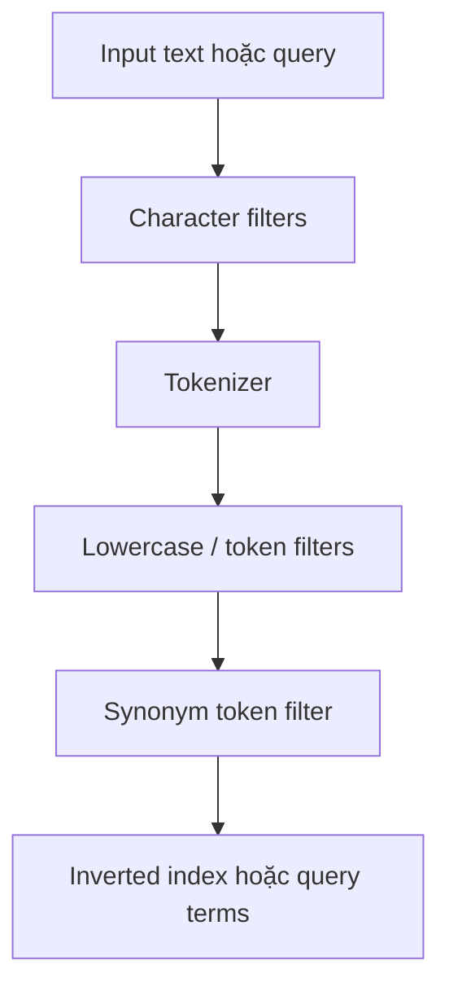
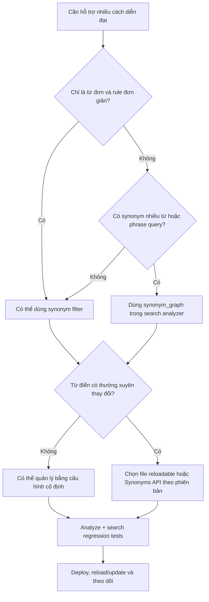

# Synonym, synonym graph và quản lý thay đổi từ đồng nghĩa

Trong tìm kiếm toàn văn, người dùng có thể dùng những từ khác nhau để diễn đạt cùng một ý. Ví dụ, người tìm `laptop` có thể cũng muốn thấy sản phẩm được mô tả là `notebook`; người tìm `TV` có thể muốn thấy kết quả chứa `television`. **Synonym** (từ đồng nghĩa) giúp Elasticsearch mở rộng hoặc chuẩn hóa truy vấn để các cách diễn đạt liên quan có thể tìm thấy cùng nhóm tài liệu.

Elasticsearch hỗ trợ synonym thông qua token filter trong analyzer. Với từ đơn, filter `synonym` có thể đáp ứng nhiều tình huống. Với synonym gồm nhiều từ như `new york` và `nyc`, cần hiểu **token graph** và thường dùng `synonym_graph` trong search analyzer để giữ đúng cấu trúc cụm từ. Khi danh sách synonym thay đổi, cách cấu hình và thời điểm reload analyzer quyết định thay đổi có hiệu lực ra sao.

Bài học này trình bày cách định nghĩa rule, chọn filter, tích hợp analyzer với Spring Data Elasticsearch, kiểm tra token, cập nhật file hoặc synonym set, và quản lý thay đổi an toàn khi hệ thống đang chạy.

## 1. Vì sao cần synonym trong tìm kiếm?

Một sản phẩm hoặc nội dung có thể được mô tả bằng nhiều từ khác nhau:

| Người dùng nhập | Nội dung trong document | Kỳ vọng |
|---|---|---|
| `laptop` | `notebook computer` | Có thể tìm thấy cùng sản phẩm. |
| `tv` | `television` | Hai cách gọi có thể được xem là tương đương. |
| `điện thoại` | `smartphone` | Có thể mở rộng kết quả theo từ điển nghiệp vụ. |
| `nyc` | `new york city` | Một từ viết tắt có thể đại diện cho cụm nhiều từ. |
| `wi-fi` | `wifi` | Chuẩn hóa biến thể chính tả. |

Nếu không có synonym, ứng dụng có thể phải tự thêm nhiều điều kiện OR vào từng truy vấn hoặc lưu nhiều biến thể từ vựng trong dữ liệu. Điều này khiến logic tìm kiếm phân tán và khó quản lý.

Synonym đưa quy tắc tương đương từ vựng vào tầng phân tích văn bản. Khi analyzer xử lý query, Elasticsearch có thể mở rộng token hoặc cụm từ theo từ điển synonym trước khi thực hiện search.

Synonym phù hợp khi:

- Người dùng có nhiều cách gọi cho cùng một khái niệm.
- Có từ viết tắt, tên thương mại, tên phổ thông hoặc biến thể chính tả.
- Nội dung đến từ nhiều nguồn và dùng thuật ngữ không thống nhất.
- Muốn thay đổi quy tắc mở rộng tìm kiếm mà không phải sửa từng endpoint hoặc query builder.

Không nên thêm synonym chỉ vì hai từ có liên quan. Ví dụ `phone` và `case` đều liên quan đến điện thoại nhưng không đồng nghĩa. Rule quá rộng có thể làm kết quả nhiễu, tăng số hit và giảm độ chính xác của relevance ranking.

## 2. Synonym hoạt động ở đâu trong analyzer?

Analyzer của field `text` có thể gồm character filter, tokenizer và các token filter. Synonym được áp dụng như một token filter trong chuỗi xử lý đó.



Ví dụ, người dùng nhập `TV`. Analyzer có thể chuyển thành chữ thường `tv`, sau đó synonym filter mở rộng thành `television`. Query cuối cùng có thể tìm các document được index với một trong những term tương ứng.

Điều quan trọng là analyzer dùng khi index document và analyzer dùng khi tìm kiếm có thể khác nhau:

- **Index analyzer** xử lý văn bản khi document được ghi vào inverted index.
- **Search analyzer** xử lý chuỗi người dùng nhập khi thực hiện query.

Với synonym thường xuyên thay đổi, cách phổ biến là giữ index analyzer ổn định và đặt synonym filter trong search analyzer. Khi từ điển thay đổi, chỉ cần cập nhật/reload search analyzer; không phải index lại toàn bộ document chỉ để áp dụng synonym mới cho query.

## 3. Cú pháp synonym rules

Elasticsearch hỗ trợ hai dạng rule cơ bản: **equivalent synonyms** và **explicit mappings**.

### 3.1. Equivalent synonyms

Các từ được phân tách bằng dấu phẩy được xem là tương đương. Ví dụ:

```text
laptop, notebook
tv, television
wifi, wi-fi, wireless fidelity
```

Với rule `laptop, notebook`, Elasticsearch có thể mở rộng một token đầu vào thành các biến thể tương ứng theo cách filter được cấu hình. Đây là dạng rule phù hợp khi các thuật ngữ có thể thay thế nhau trong tìm kiếm.

Một dòng có thể chứa nhiều biến thể, nhưng cần bảo đảm chúng thật sự tương đương trong ngữ cảnh nghiệp vụ. Nếu hai thuật ngữ chỉ gần nghĩa hoặc khác phạm vi, nên dùng rule có hướng hoặc không thêm synonym.

### 3.2. Explicit mappings với `=>`

Khi muốn ánh xạ một chiều, dùng toán tử `=>`:

```text
smartphone => mobile phone
nyc => new york city
```

Vế trái là biểu thức được nhận diện; vế phải là các token thay thế. Đây là dạng phù hợp khi muốn một cách nhập cụ thể được chuẩn hóa sang thuật ngữ đích.

Ví dụ, rule:

```text
nyc => new york city
```

cho phép truy vấn `nyc` được mở rộng thành cụm `new york city`. Rule không tự động có nghĩa rằng truy vấn `new york city` sẽ mở rộng ngược thành `nyc`.

Nếu muốn hai chiều, có thể dùng equivalent rule:

```text
nyc, new york city
```

### 3.3. Quy tắc viết file synonym

Ví dụ file `product-synonyms.txt`:

```text
# Product terminology
laptop, notebook
tv, television
wifi, wi-fi

# One-way normalization
nyc => new york city
```

Các dòng bắt đầu bằng `#` là comment. Mỗi rule nằm trên một dòng. Có thể nhóm rule theo lĩnh vực để người quản lý dễ đọc, nhưng không nên để một dòng có quá nhiều từ không cùng ngữ nghĩa.

Synonym rule được phân tích qua phần đầu của analyzer chain cho đến vị trí synonym filter. Vì vậy, thứ tự token filter có ý nghĩa. Nếu có lowercase filter trước synonym filter, hãy viết rule nhất quán với dạng chữ thường hoặc bảo đảm quy tắc parse synonym được chuẩn hóa như mong đợi.

## 4. Phân biệt `synonym` và `synonym_graph`

Hai token filter có tên gần giống nhau nhưng xử lý token stream khác nhau.

| Tiêu chí | `synonym` | `synonym_graph` |
|---|---|---|
| Mục đích | Thay thế hoặc mở rộng synonym theo token stream truyền thống | Biểu diễn synonym dưới dạng token graph để giữ quan hệ vị trí và nhánh token |
| Từ đơn | Hỗ trợ | Hỗ trợ |
| Synonym nhiều từ | Có giới hạn khi biểu diễn phrase/position | Xử lý tốt hơn cho multi-word synonym |
| Phrase query | Có thể không biểu diễn đúng các nhánh cụm từ | Giữ cấu trúc graph để query builder hiểu các đường token |
| Vị trí sử dụng phổ biến | Các trường hợp đơn giản, hoặc index-time tùy thiết kế | Search analyzer cho full-text search, đặc biệt khi có cụm nhiều từ |

### 4.1. Vì sao token graph quan trọng?

Giả sử rule tương đương:

```text
nyc, new york city
```

Một token đơn `nyc` tương ứng với ba token `new`, `york`, `city`. Nếu chỉ xếp token thay thế vào cùng vị trí theo kiểu token stream phẳng, cấu trúc cụm từ có thể bị mất. Phrase query có thể hiểu sai quan hệ giữa các token và tạo kết quả không mong muốn.

`synonym_graph` tạo một đồ thị token với các nhánh và vị trí phù hợp để biểu diễn nhiều cách diễn đạt. Khi search analyzer sử dụng filter này, query full-text có thể chuyển đồ thị thành các nhánh truy vấn thích hợp.

Ví dụ minh họa về hai đường biểu diễn:

```text
Đường 1:  nyc
Đường 2:  new -> york -> city
```

Hai đường biểu diễn cùng một khái niệm nhưng có số token khác nhau. Token graph giữ được thông tin cần thiết để xử lý cụm từ thay thế.

### 4.2. Nên đặt `synonym_graph` ở search time

`synonym_graph` được thiết kế cho search analyzer. Thông thường, không dùng filter này trong index analyzer để tạo inverted index. Đặt synonym ở search time có các lợi ích:

- Cập nhật từ điển synonym mà không phải index lại toàn bộ document.
- Giữ nội dung gốc trong inverted index, tránh nhân số term chỉ vì mở rộng synonym.
- Dùng được multi-word synonym với token graph cho query.
- Có thể điều chỉnh quy tắc tìm kiếm độc lập với pipeline ghi dữ liệu.

Nếu synonym được mở rộng lúc index, các term đã ghi vào index phản ánh từ điển tại thời điểm đó. Thay đổi file synonym sau này không tự biến đổi các term cũ. Muốn thay đổi kết quả theo quy tắc mới, có thể phải reindex dữ liệu hoặc chạy một quy trình cập nhật tương ứng.

## 5. Thứ tự analyzer và cách synonym rules được phân tích

Thứ tự token filter ảnh hưởng trực tiếp đến rule. Ví dụ, nếu analyzer có lowercase trước synonym filter:

```json
{
  "filter": [
    "lowercase",
    "product_synonyms"
  ]
}
```

thì token đã được chuyển chữ thường trước khi synonym filter xử lý. Nên viết rule nhất quán:

```text
tv, television
wifi, wi-fi
```

Nếu rule chứa từ có stop word, cần xem xét vị trí của stop filter. Stop filter trước synonym filter có thể loại bỏ token trong rule hoặc làm một số rule không còn hợp lệ. Việc đặt stop filter sau synonym filter cũng có ảnh hưởng khác đến token thay thế. Không có một thứ tự chung phù hợp mọi ngôn ngữ và bộ rule; cần kiểm tra analyzer thực tế bằng `_analyze`.

Một cấu hình thường gặp cho tìm kiếm sản phẩm là:

```text
standard tokenizer
    -> lowercase
    -> synonym_graph
```

Các filter khác như asciifolding, stemming hoặc stop words cần được thêm theo yêu cầu ngôn ngữ và được kiểm tra cùng synonym rules. Đừng giả định rule sẽ được xử lý giống nhau nếu đổi vị trí tokenizer hoặc token filter.

## 6. Khai báo synonym file trong Elasticsearch

Với cluster tự quản lý, có thể lưu rule trong file cấu hình synonym. Ví dụ file:

`config/analysis/product-synonyms.txt`

```text
laptop, notebook
tv, television
wifi, wi-fi
nyc, new york city
```

Sau đó khai báo filter và analyzer trong index settings:

```json
PUT products
{
  "settings": {
    "analysis": {
      "filter": {
        "product_synonyms": {
          "type": "synonym_graph",
          "synonyms_path": "analysis/product-synonyms.txt",
          "updateable": true
        }
      },
      "analyzer": {
        "product_index_analyzer": {
          "type": "custom",
          "tokenizer": "standard",
          "filter": ["lowercase"]
        },
        "product_search_analyzer": {
          "type": "custom",
          "tokenizer": "standard",
          "filter": ["lowercase", "product_synonyms"]
        }
      }
    }
  },
  "mappings": {
    "properties": {
      "name": {
        "type": "text",
        "analyzer": "product_index_analyzer",
        "search_analyzer": "product_search_analyzer"
      }
    }
  }
}
```

Trong cấu hình trên:

- `product_index_analyzer` chỉ lowercase và tokenize văn bản khi index.
- `product_search_analyzer` thêm synonym graph khi phân tích query.
- `updateable: true` đánh dấu synonym filter có thể được reload trong search analyzer theo cơ chế reload search analyzer của Elasticsearch.
- `synonyms_path` là đường dẫn file tương đối với thư mục cấu hình Elasticsearch trên từng node.

File phải có mặt ở mọi node có thể thực hiện thao tác phân tích liên quan. Cần triển khai file nhất quán trên cluster và bảo đảm quyền đọc. Không chỉ cập nhật file trên một node rồi giả định toàn bộ cluster đã dùng từ điển mới.

### 6.1. Vì sao index analyzer và search analyzer tách riêng?

Trong ví dụ, field `name` được index bằng analyzer không có synonym filter. Khi tìm kiếm, chuỗi query được xử lý bằng analyzer có synonym graph. Nhờ vậy, document giữ token từ nội dung gốc, còn synonym được mở rộng linh hoạt lúc query.

Nếu cả hai analyzer đều dùng synonym, việc thay đổi rule có thể ảnh hưởng cả pipeline index và search. Đối với từ điển cần cập nhật thường xuyên, thiết kế search-time synonym thường dễ vận hành hơn.

## 7. Tích hợp settings và mapping với Spring Data Elasticsearch

Spring Data Elasticsearch hỗ trợ khai báo settings từ resource classpath thông qua `@Setting`, đồng thời cấu hình analyzer cho field bằng `@Field`.

Ví dụ document:

```java
import org.springframework.data.elasticsearch.annotations.Document;
import org.springframework.data.elasticsearch.annotations.Field;
import org.springframework.data.elasticsearch.annotations.FieldType;
import org.springframework.data.elasticsearch.annotations.Setting;

@Document(indexName = "products")
@Setting(settingPath = "/elasticsearch/product-settings.json")
public class ProductDocument {

    @Field(
        type = FieldType.Text,
        analyzer = "product_index_analyzer",
        searchAnalyzer = "product_search_analyzer"
    )
    private String name;
}
```

Resource `/elasticsearch/product-settings.json` chứa phần `analysis` tương ứng với cấu hình index settings ở ví dụ trước. Có thể đặt resource trong:

```text
src/main/resources/
└── elasticsearch/
    └── product-settings.json
```

Khi Spring Data tạo index từ metadata của entity, settings resource được dùng để cấu hình analyzer và filter. Nếu index được tạo bằng template hoặc migration bên ngoài, hãy bảo đảm settings và mapping đã được triển khai trước khi ứng dụng sử dụng index.

Lưu ý rằng `@Setting` là metadata dùng trong quá trình tạo index. Nó không phải cơ chế tự động cập nhật settings của index production mỗi khi file resource thay đổi. Một index đã tồn tại vẫn giữ settings đã được áp dụng lúc tạo, trừ khi có thao tác quản lý tương ứng được hỗ trợ.

## 8. Kiểm tra synonym bằng Analyze API

Trước khi đưa rule vào production, cần quan sát token graph mà analyzer thực sự tạo ra.

Ví dụ kiểm tra analyzer tìm kiếm:

```json
POST products/_analyze
{
  "analyzer": "product_search_analyzer",
  "text": "tv"
}
```

Kiểm tra synonym nhiều từ:

```json
POST products/_analyze
{
  "analyzer": "product_search_analyzer",
  "text": "nyc",
  "explain": true
}
```

`explain: true` cung cấp thêm chi tiết các bước phân tích, hữu ích để quan sát token và vị trí trong graph. Tùy phiên bản Elasticsearch, cấu trúc response có thể khác nhau; hãy kiểm tra token, position và position length thay vì chỉ nhìn chuỗi token.

Một quy trình thử nghiệm nên kiểm tra ít nhất:

1. Truy vấn bằng từ gốc có tạo ra các biến thể mong đợi không?
2. Truy vấn bằng từ đồng nghĩa có tìm được tài liệu dùng thuật ngữ khác không?
3. Rule một chiều có đúng chiều mong muốn không?
4. Phrase query có giữ đúng thứ tự và cụm từ không?
5. Chữ hoa/thường, dấu câu, dấu gạch nối và dấu tiếng Việt được xử lý ra sao?
6. Các rule chồng lấn hoặc có từ trùng nhau có gây mở rộng quá rộng không?

Sau Analyze API, hãy chạy search trên một tập document đại diện. Token graph đúng không tự bảo đảm relevance ranking phù hợp với nghiệp vụ; cần quan sát kết quả thực tế và score.

## 9. Cập nhật synonym file và reload search analyzer

Với file synonym được khai báo bằng `synonyms_path`, việc sửa nội dung file không đồng nghĩa analyzer đang chạy đã nạp rule mới. Cần dùng cơ chế reload search analyzer được Elasticsearch hỗ trợ.

Quy trình tổng quát:

1. Chỉnh sửa file synonym theo quy trình quản lý cấu hình.
2. Kiểm tra cú pháp và triển khai file đồng nhất lên các node cần thiết.
3. Gọi API reload search analyzers cho index liên quan.
4. Kiểm tra response để xác nhận analyzer đã được reload.
5. Chạy lại `_analyze` và các truy vấn đại diện để xác nhận rule mới có hiệu lực.

API reload có dạng:

```http
POST products/_reload_search_analyzers
```

Để reload hoạt động, synonym filter cần được cấu hình phù hợp cho search analyzer, ví dụ `updateable: true`. Cơ chế này áp dụng cho analyzer có thể reload; thay đổi index analyzer hoặc cấu trúc mapping thường cần một kế hoạch khác và có thể phải tạo index/reindex.

Trong cluster nhiều node, phải bảo đảm file đồng nhất trước khi reload. Nếu các node nạp các phiên bản rule khác nhau, kết quả tìm kiếm có thể không nhất quán tùy node xử lý request. Nên triển khai file theo một phiên bản cấu hình xác định, sau đó reload theo quy trình có thể quan sát và kiểm soát.

### 9.1. Reload không thay thế kiểm thử

Reload thành công chỉ cho biết analyzer đã nạp cấu hình mới theo API. Nó không xác nhận từ điển mới có chất lượng tốt. Sau reload, vẫn cần chạy Analyze API và search regression tests với các truy vấn nghiệp vụ quan trọng.

Nếu file có rule lỗi, việc nạp analyzer có thể thất bại hoặc index không thể dùng analyzer như dự kiến. Vì vậy, nên validate file trước khi triển khai và giữ lại phiên bản trước để rollback.

## 10. Quản lý synonym set bằng API

Ở các phiên bản Elasticsearch hỗ trợ Synonyms API, có thể quản lý synonym set thông qua API thay vì tự phân phối file trên từng node. Synonym set có một tên định danh và danh sách rule được quản lý trong Elasticsearch.

Ví dụ tạo hoặc cập nhật một synonym set:

```json
PUT _synonyms/product-synonyms
{
  "synonyms_set": [
    {
      "id": "laptop-notebook",
      "synonyms": "laptop, notebook"
    },
    {
      "id": "tv-television",
      "synonyms": "tv, television"
    },
    {
      "id": "nyc-new-york",
      "synonyms": "nyc, new york city"
    }
  ]
}
```

Sau đó, cấu hình synonym graph filter tham chiếu set:

```json
{
  "type": "synonym_graph",
  "synonyms_set": "product-synonyms",
  "updateable": true
}
```

Tên set trong `synonyms_set` phải khớp với tên được tạo qua API. Mỗi rule có `id` để có thể nhận diện và cập nhật theo API tương ứng.

Synonyms API được giới thiệu trong các phiên bản Elasticsearch mới hơn; cần kiểm tra phiên bản server và Java API Client đang dùng trước khi chọn cách này. Không phải mọi phiên bản Elasticsearch hoặc dịch vụ tương thích Elasticsearch đều hỗ trợ cùng một bộ API.

Khi dùng synonym set do Elasticsearch quản lý, vòng đời cập nhật khác với file `synonyms_path`: ứng dụng hoặc quy trình quản trị gọi API để thay đổi set, sau đó Elasticsearch quản lý việc cập nhật analyzer tham chiếu set theo cơ chế của phiên bản đó. Hãy kiểm tra trạng thái và kết quả reload theo tài liệu phiên bản đang triển khai; không trộn file-based rules và set-based rules trong cùng một filter nếu không có thiết kế rõ ràng.

### 10.1. Chọn file-based hay synonym set?

| Tiêu chí | File `synonyms_path` | Synonym set API |
|---|---|---|
| Nơi lưu rule | File cấu hình trên node | Synonym set được Elasticsearch quản lý |
| Phân phối | Cần triển khai file đồng nhất trên các node | Cập nhật thông qua API quản lý set |
| Quy trình cập nhật | Sửa file rồi reload search analyzer | Gọi API cập nhật set và theo dõi cơ chế áp dụng của phiên bản |
| Phù hợp | Cluster tự quản lý, cấu hình theo Git/ops | Phiên bản hỗ trợ Synonyms API và muốn quản lý tập trung |
| Điều cần chú ý | Đường dẫn, quyền file, đồng bộ node, reload | Quyền API, version compatibility, quản lý ID và nội dung set |

Chọn một cơ chế làm nguồn sự thật cho mỗi bộ synonym. Nếu lưu rule trong Git, cần xác định cách đồng bộ từ Git sang file hoặc API set, cách review thay đổi và cách rollback.

## 11. Quản lý thay đổi từ đồng nghĩa trong môi trường production

Synonym là một phần của chất lượng tìm kiếm và có thể thay đổi kết quả trên diện rộng. Một rule mới có thể làm tăng số lượng hit, thay đổi score hoặc đưa các tài liệu trước đây không liên quan vào kết quả. Vì vậy, quản lý synonym cần có quy trình giống một thay đổi cấu hình ảnh hưởng hành vi sản phẩm.

### 11.1. Lưu trữ và review rule

Nên quản lý synonym như dữ liệu có version:

- Lưu file hoặc manifest rule trong source control nếu dùng file-based configuration.
- Mỗi rule có chú thích về ngữ cảnh nghiệp vụ, người đề xuất và lý do thêm.
- Review các rule có phạm vi rộng hoặc có thể tạo nhiều kết quả không liên quan.
- Tránh để các nhóm tự thêm rule trùng lặp hoặc mâu thuẫn.
- Duy trì bản phát hành trước để có thể rollback.

Với synonym set, nên quản lý bản export hoặc định nghĩa nguồn trong repository để có thể tái tạo, audit và review, ngay cả khi dữ liệu runtime được lưu trong Elasticsearch.

### 11.2. Kiểm thử hồi quy

Tạo một tập truy vấn chuẩn gồm:

- Từ gốc và biến thể đồng nghĩa.
- Cụm từ nhiều từ và từ viết tắt.
- Truy vấn có dấu, không dấu, chữ hoa/thường.
- Truy vấn gần giống nhưng không đồng nghĩa.
- Truy vấn phải không trả về một nhóm tài liệu nhất định.

Đánh giá cả kết quả mong đợi lẫn kết quả không mong đợi. Chỉ kiểm tra rằng synonym mới trả thêm document là chưa đủ; cần xác nhận các document nhiễu không bị đưa vào kết quả quá nhiều.

### 11.3. Triển khai có thể rollback

Một quy trình triển khai nên có các bước:

1. Chuẩn bị phiên bản rule mới và kiểm tra cú pháp.
2. Chạy Analyze API trên các ví dụ đại diện.
3. Chạy search regression tests trên dữ liệu thử nghiệm.
4. Triển khai rule lên môi trường staging và đánh giá kết quả.
5. Phát hành lên production theo một phiên bản xác định.
6. Reload search analyzer hoặc cập nhật synonym set theo cơ chế đang dùng.
7. Xác nhận token graph và search results sau thay đổi.
8. Theo dõi số hit, latency, lỗi query và phản hồi người dùng.
9. Rollback rule nếu kết quả xấu hoặc có lỗi nạp analyzer.

Không nên chỉnh trực tiếp file synonym trên production mà không lưu lại nội dung đã thay đổi. Nếu cần sửa khẩn cấp, hãy ghi nhận phiên bản trước/sau và đồng bộ lại vào nguồn quản lý cấu hình sau đó.

## 12. Các vấn đề cần lưu ý với synonym

### 12.1. Synonym có thể làm tăng số nhánh truy vấn

Một rule mở rộng một thuật ngữ thành nhiều biến thể. Nếu nhiều rule cùng áp dụng cho một query, query graph có thể tạo nhiều nhánh. Điều này có thể tăng chi phí thực thi và làm thay đổi relevance ranking. Tránh tạo synonym quá rộng hoặc nối nhiều nhóm từ không thực sự tương đương.

### 12.2. Synonym không thay thế stemming hoặc fuzzy search

Synonym xử lý các thuật ngữ được khai báo trong từ điển. Stemming rút gọn từ về dạng gốc theo quy tắc ngôn ngữ; fuzzy search tìm từ có độ tương tự ký tự nhất định. Ba cơ chế có mục đích khác nhau và có thể kết hợp, nhưng cần cân nhắc thứ tự analyzer, chi phí query và độ chính xác.

### 12.3. Cẩn trọng với stop words và rule nhiều từ

Nếu stop filter loại bỏ một từ xuất hiện trong synonym rule, rule có thể không được phân tích như mong muốn. Với multi-word synonyms, cần dùng `synonym_graph` ở search analyzer và kiểm tra position/position length. Không đánh giá chỉ bằng cách xem danh sách token đã flatten.

### 12.4. Synonym không tự cập nhật document đã index

Search-time synonym chỉ thay đổi cách phân tích query. Nó không viết lại `_source` và không thay đổi token đã index. Nếu thay đổi synonym index-time, document cũ vẫn giữ term theo analyzer cũ; muốn đồng nhất có thể phải reindex.

### 12.5. Exact identifiers thường không nên mở rộng synonym

SKU, serial number, mã đơn hàng và ID thường cần so khớp chính xác. Không nên đưa các field này qua synonym filter trừ khi có yêu cầu nghiệp vụ đặc biệt. Giữ chúng là `keyword` và dùng exact query thường an toàn hơn.

## 13. Quy trình quyết định



Hãy xác định số từ trong synonym, yêu cầu phrase search, tần suất thay đổi và cách vận hành cluster trước khi chọn filter và nguồn lưu rule.

## 14. Kết luận

Synonym giúp tìm kiếm nhận diện nhiều cách diễn đạt của cùng một khái niệm. Rule dạng equivalent phù hợp với các thuật ngữ thay thế lẫn nhau; rule `=>` phù hợp với ánh xạ có hướng. `synonym` xử lý các trường hợp đơn giản, còn `synonym_graph` giữ cấu trúc token graph cần thiết cho synonym nhiều từ và phrase search.

Trong Spring Data Elasticsearch, khai báo analyzer qua index settings và gắn `analyzer`/`searchAnalyzer` vào field. Với từ điển cần thay đổi thường xuyên, ưu tiên thiết kế search-time synonym để tránh reindex chỉ vì đổi rule. Có thể quản lý rule bằng file `synonyms_path` kết hợp reload search analyzer hoặc bằng Synonyms API nếu phiên bản Elasticsearch hỗ trợ.

Mọi thay đổi synonym cần được version hóa, kiểm tra bằng Analyze API và search regression tests, triển khai đồng nhất trên cluster và có phương án rollback. Khi làm được điều đó, synonym trở thành một phần có thể quản lý của chất lượng tìm kiếm thay vì một tập quy tắc khó kiểm soát.
