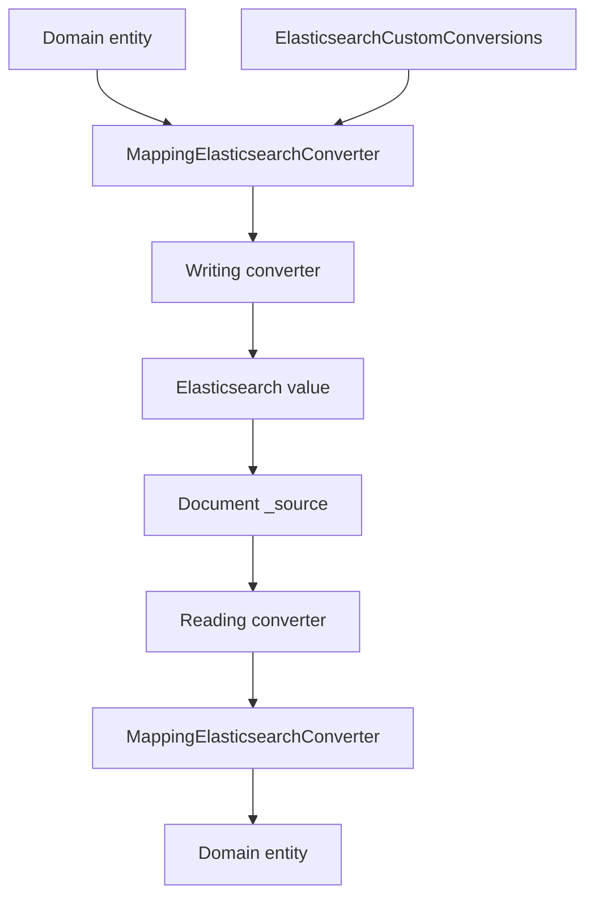

# Đăng ký ElasticsearchCustomConversions

Trong ứng dụng Spring Data Elasticsearch, entity Java thường không có cấu trúc giống hoàn toàn với document JSON được lưu trong Elasticsearch. Domain model có thể sử dụng value object, kiểu định danh riêng, kiểu thời gian đặc thù hoặc những lớp bao bọc nhằm bảo vệ quy tắc nghiệp vụ. Elasticsearch lại cần các giá trị có thể biểu diễn bằng những kiểu dữ liệu mà mapping hỗ trợ như `keyword`, `text`, số, boolean, date, object hoặc mảng.

Spring Data Elasticsearch dùng cơ chế conversion để chuyển đổi giữa hai thế giới đó. `ElasticsearchCustomConversions` là nơi đăng ký các converter bổ sung để `MappingElasticsearchConverter` sử dụng khi ghi entity thành document và khi đọc document thành entity.

Ví dụ, domain model có kiểu `Sku` riêng để biểu diễn mã sản phẩm. Ở phía Java, ứng dụng muốn dùng `Sku` thay vì để mọi nơi truyền một chuỗi tùy ý. Ở Elasticsearch, trường `sku` có thể được lưu dưới dạng `keyword`. Một writing converter chuyển `Sku` thành `String`; một reading converter chuyển `String` trở lại `Sku`. Khi đăng ký hai converter này trong `ElasticsearchCustomConversions`, Spring Data có thể thực hiện chuyển đổi trong luồng mapping.

## 1. Vì sao cần custom conversions?

Domain model thường ưu tiên ý nghĩa và quy tắc nghiệp vụ. Document Elasticsearch ưu tiên cấu trúc dữ liệu và kiểu field phục vụ tìm kiếm. Hai mô hình có thể khác nhau.

Ví dụ, một ứng dụng có thể có:

```java
public class Product {
    private Sku sku;
    private Money price;
    private ProductStatus status;
}
```

Trong khi document cần được lưu như JSON:

```json
{
  "sku": "SKU-1001",
  "price": {
    "amount": 185000,
    "currency": "VND"
  },
  "status": "ACTIVE"
}
```

Các kiểu `Sku`, `Money` và `ProductStatus` mang ý nghĩa domain. Elasticsearch không tự biết cách diễn giải một lớp Java tùy chỉnh thành field phù hợp. Nếu không có conversion thích hợp, mapping converter có thể xem lớp đó như một object cần ánh xạ các thuộc tính con, hoặc không thể chuyển đổi nếu kiểu không có cấu trúc mà nó hiểu.

Custom conversion cho phép định nghĩa rõ cách một kiểu domain được biểu diễn trong `_source` và cách khôi phục kiểu đó khi đọc document.

Các trường hợp thường cần custom converter:

- Value object như `Sku`, `EmailAddress`, `PhoneNumber`, `Money` hoặc mã định danh nghiệp vụ.
- Kiểu dữ liệu riêng cần được lưu dưới dạng một kiểu Elasticsearch đơn giản.
- Một kiểu Java cần có định dạng lưu trữ chuẩn hóa, chẳng hạn chuỗi ngày giờ theo quy ước riêng.
- Cấu trúc Java cần được chuyển thành map, list hoặc kiểu dữ liệu Elasticsearch khác.
- Cần chuyển đổi ngược từ kiểu dữ liệu trong document về domain type khi đọc.

Không nên tạo custom converter cho mọi thuộc tính. Các kiểu Java phổ biến đã được Spring Data hỗ trợ thường không cần converter riêng. Chỉ bổ sung conversion khi có khác biệt biểu diễn thực sự hoặc khi muốn kiểm soát rõ ràng hợp đồng lưu trữ.

## 2. Conversion diễn ra ở đâu trong mô hình?

Với Spring Data Elasticsearch, `ElasticsearchCustomConversions` cung cấp metadata và converter cho mapping converter. `MappingElasticsearchConverter` sử dụng mapping context cùng custom conversions để chuyển đổi object Java và dữ liệu document.



Luồng ghi:

1. Ứng dụng gọi `repository.save(product)` hoặc thao tác ghi qua `ElasticsearchOperations`.
2. Spring Data đọc metadata entity và field.
3. Mapping converter kiểm tra custom conversion phù hợp với kiểu thuộc tính.
4. Writing converter chuyển domain value thành kiểu dữ liệu có thể lưu.
5. Mapping converter tạo document gửi tới Elasticsearch.

Luồng đọc:

1. Elasticsearch trả về document JSON.
2. Mapping converter đọc metadata của entity đích.
3. Với field có custom conversion, reading converter chuyển kiểu lưu trữ thành domain type.
4. Mapping converter tạo entity Java và gán các thuộc tính.

Converter được gọi trong quá trình ánh xạ dữ liệu. Nó không phải repository, không phải query builder và cũng không phải cơ chế tạo index. Mapping thực tế của Elasticsearch vẫn phải phù hợp với kiểu dữ liệu mà writing converter tạo ra.

## 3. Phân biệt reading converter và writing converter

Một custom conversion thường có hai chiều:

| Hướng | Nguồn | Đích | Thời điểm dùng |
|---|---|---|---|
| Writing | Domain type | Elasticsearch-compatible type | Khi ghi entity thành document |
| Reading | Elasticsearch-compatible type | Domain type | Khi đọc document thành entity |

Spring Data sử dụng hai annotation để thể hiện rõ chiều chuyển đổi:

- `@WritingConverter`: converter dùng cho chiều ghi.
- `@ReadingConverter`: converter dùng cho chiều đọc.

Hai annotation này thuộc package `org.springframework.data.convert`.

Converter thường triển khai interface `Converter<S, T>` của Spring:

```java
import org.springframework.core.convert.converter.Converter;

public class SomeConverter implements Converter<SourceType, TargetType> {

    @Override
    public TargetType convert(SourceType source) {
        // Chuyển đổi source thành target.
        return ...;
    }
}
```

Khi kiểu nguồn và đích có thể gây mơ hồ, đặc biệt với các kiểu đơn giản như `String`, `Long`, `BigDecimal` hoặc kiểu scalar khác, cần đánh dấu converter đúng chiều. Điều này giúp Spring Data không phải suy đoán ý định từ cặp kiểu.

Không nên tạo một converter hai chiều bằng cách cố xử lý cả hai hướng trong cùng một hàm `convert`. Mỗi converter có một kiểu nguồn và kiểu đích cụ thể; nên khai báo riêng reading và writing converter để dễ đọc, kiểm tra và đăng ký.

## 4. Ví dụ domain value object Sku

Giả sử mỗi sản phẩm có mã SKU. Ở phía domain, mã này được biểu diễn bằng một kiểu riêng để chuẩn hóa dữ liệu và tránh truyền chuỗi tùy ý trong toàn bộ ứng dụng.

### 4.1 Khai báo value object

```java
import java.util.Locale;
import java.util.Objects;

public record Sku(String value) {

    public Sku {
        Objects.requireNonNull(value, "sku must not be null");

        String normalized = value.trim().toUpperCase(Locale.ROOT);
        if (normalized.isEmpty()) {
            throw new IllegalArgumentException("sku must not be blank");
        }

        value = normalized;
    }
}
```

`Sku` giữ quy tắc chuẩn hóa ở một nơi. Sau khi tạo object, giá trị luôn được trim và chuyển về chữ hoa theo `Locale.ROOT`. Việc chuẩn hóa không phụ thuộc locale của máy chủ.

Đây là ví dụ domain type đơn giản. Một value object thực tế có thể có thêm kiểm tra định dạng, quy tắc độ dài hoặc constructor factory.

### 4.2 Writing converter: Sku thành String

```java
import org.springframework.core.convert.converter.Converter;
import org.springframework.data.convert.WritingConverter;

@WritingConverter
public class SkuToStringConverter implements Converter<Sku, String> {

    @Override
    public String convert(Sku source) {
        return source.value();
    }
}
```

Writing converter nhận `Sku` và trả về `String`. Với `Sku("sku-1001")`, giá trị được lưu là `"SKU-1001"` vì constructor của value object đã chuẩn hóa.

Kiểu đích `String` là kiểu đơn giản mà Elasticsearch có thể lưu. Field tương ứng nên có mapping phù hợp, ví dụ `keyword` nếu mã SKU được dùng để lọc hoặc so khớp chính xác.

### 4.3 Reading converter: String thành Sku

```java
import org.springframework.core.convert.converter.Converter;
import org.springframework.data.convert.ReadingConverter;

@ReadingConverter
public class StringToSkuConverter implements Converter<String, Sku> {

    @Override
    public Sku convert(String source) {
        return new Sku(source);
    }
}
```

Reading converter nhận giá trị chuỗi trong document và tạo lại `Sku`. Constructor của `Sku` tiếp tục áp dụng quy tắc chuẩn hóa và xác thực.

Khi dữ liệu cũ trong index không tuân theo định dạng hiện tại, constructor có thể ném exception. Đây là tín hiệu dữ liệu không hợp lệ; không nên âm thầm trả về một giá trị mặc định làm sai ý nghĩa domain. Nếu cần hỗ trợ dữ liệu legacy, hãy xử lý rõ trong converter hoặc migration.

### 4.4 Dùng Sku trong entity

```java
import org.springframework.data.annotation.Id;
import org.springframework.data.elasticsearch.annotations.Document;
import org.springframework.data.elasticsearch.annotations.Field;
import org.springframework.data.elasticsearch.annotations.FieldType;

@Document(indexName = "products")
public class Product {

    @Id
    private String id;

    @Field(type = FieldType.Keyword)
    private Sku sku;

    @Field(type = FieldType.Text)
    private String name;

    protected Product() {
    }

    public Product(String id, Sku sku, String name) {
        this.id = id;
        this.sku = sku;
        this.name = name;
    }

    public String getId() {
        return id;
    }

    public Sku getSku() {
        return sku;
    }

    public String getName() {
        return name;
    }
}
```

Trong entity, thuộc tính vẫn là `Sku`. `@Field(type = FieldType.Keyword)` mô tả kiểu field ở Elasticsearch. Custom converter quyết định giá trị của thuộc tính `sku` được chuyển thành chuỗi trước khi ghi và được chuyển ngược thành `Sku` khi đọc.

Mapping mong muốn trên index có dạng:

```json
{
  "properties": {
    "sku": {
      "type": "keyword"
    },
    "name": {
      "type": "text"
    }
  }
}
```

Khi ghi entity, `_source` có thể chứa:

```json
{
  "id": "product-1001",
  "sku": "SKU-1001",
  "name": "Bàn phím cơ"
}
```

Khi đọc document này thành `Product`, thuộc tính `sku` nhận một đối tượng `Sku`, không phải một `String`.

## 5. Đăng ký ElasticsearchCustomConversions

Việc viết converter mới chỉ định nghĩa logic chuyển đổi. Để mapping converter sử dụng chúng, cần đăng ký converter trong `ElasticsearchCustomConversions`.

Với cấu hình Java dựa trên `ElasticsearchConfiguration` của Spring Data Elasticsearch 5.x, có thể override phương thức `elasticsearchCustomConversions()`:

```java
import java.time.Duration;
import java.util.List;

import org.springframework.context.annotation.Configuration;
import org.springframework.data.elasticsearch.client.ClientConfiguration;
import org.springframework.data.elasticsearch.client.elc.ElasticsearchConfiguration;
import org.springframework.data.elasticsearch.core.convert.ElasticsearchCustomConversions;

@Configuration
public class ElasticsearchConfig extends ElasticsearchConfiguration {

    @Override
    public ClientConfiguration clientConfiguration() {
        return ClientConfiguration.builder()
            .connectedTo("localhost:9200")
            .withConnectTimeout(Duration.ofSeconds(3))
            .withSocketTimeout(Duration.ofSeconds(10))
            .build();
    }

    @Override
    public ElasticsearchCustomConversions elasticsearchCustomConversions() {
        return new ElasticsearchCustomConversions(List.of(
            new SkuToStringConverter(),
            new StringToSkuConverter()
        ));
    }
}
```

Phương thức `elasticsearchCustomConversions()` trả về một đối tượng chứa danh sách converter. Spring Data dùng bean này khi cấu hình `MappingElasticsearchConverter`. Khi entity được ghi hoặc đọc qua repository/operations dùng converter đó, các conversion đã đăng ký sẽ được áp dụng.

Phần `clientConfiguration()` chỉ minh họa một cấu hình client tối thiểu để ví dụ có thể đứng trong một class cấu hình hoàn chỉnh. Trong ứng dụng thật, hãy giữ endpoint, TLS, xác thực và timeout phù hợp với môi trường triển khai.

### 5.1 Nếu cấu hình client bằng Spring Boot auto-configuration

Một ứng dụng có thể đang sử dụng auto-configuration của Spring Boot thay vì kế thừa `ElasticsearchConfiguration`. Trong trường hợp đó, có thể đăng ký `ElasticsearchCustomConversions` như một bean nếu phiên bản Spring Data/Spring Boot đang dùng lấy bean này để cấu hình converter:

```java
@Configuration
public class ElasticsearchConversionConfig {

    @Bean
    public ElasticsearchCustomConversions elasticsearchCustomConversions() {
        return new ElasticsearchCustomConversions(List.of(
            new SkuToStringConverter(),
            new StringToSkuConverter()
        ));
    }
}
```

Chọn một cách cấu hình phù hợp với kiến trúc hiện tại. Nếu class cấu hình đã kế thừa `ElasticsearchConfiguration`, dùng phương thức override của class đó. Nếu dự án dùng auto-configuration, đăng ký bean theo cơ chế mà phiên bản đang sử dụng hỗ trợ. Không tạo nhiều bean conversion cạnh tranh hoặc tự tạo một `MappingElasticsearchConverter` riêng mà không thay thế converter đang được repository sử dụng.

Tên package và điểm mở rộng có thể khác giữa các dòng Spring Data Elasticsearch. Hãy kiểm tra API của đúng phiên bản dependency trong dự án trước khi áp dụng ví dụ.

### 5.2 Danh sách converter có thể gồm nhiều cặp

Một `ElasticsearchCustomConversions` có thể nhận nhiều converter:

```java
@Override
public ElasticsearchCustomConversions elasticsearchCustomConversions() {
    return new ElasticsearchCustomConversions(List.of(
        new SkuToStringConverter(),
        new StringToSkuConverter(),
        new EmailAddressToStringConverter(),
        new StringToEmailAddressConverter(),
        new ExternalCodeToStringConverter(),
        new StringToExternalCodeConverter()
    ));
}
```

Mỗi converter nên có một nhiệm vụ cụ thể và cặp kiểu nguồn/đích rõ ràng. Không gom nhiều quy tắc domain không liên quan vào một converter tổng quát chỉ vì chúng đều chuyển thành `String`.

## 6. Vai trò của @ReadingConverter và @WritingConverter

Spring Data có thể suy luận một số chiều conversion từ kiểu nguồn và kiểu đích, nhưng những cặp kiểu đơn giản có thể gây mơ hồ. Ví dụ converter `String -> Sku` và `Sku -> String` có hai hướng rõ ràng với người viết, nhưng khi có nhiều converter dùng `String`, việc đánh dấu chiều giúp conversion metadata không phải dựa vào suy luận thiếu chắc chắn.

Với converter từ kiểu domain riêng sang kiểu đơn giản của Elasticsearch, đánh dấu `@WritingConverter`:

```java
@WritingConverter
public class SkuToStringConverter implements Converter<Sku, String> {
    @Override
    public String convert(Sku source) {
        return source.value();
    }
}
```

Với converter từ kiểu đơn giản trong document sang kiểu domain riêng, đánh dấu `@ReadingConverter`:

```java
@ReadingConverter
public class StringToSkuConverter implements Converter<String, Sku> {
    @Override
    public Sku convert(String source) {
        return new Sku(source);
    }
}
```

Các annotation không thay thế việc đăng ký converter. Chúng mô tả ý định của converter; `ElasticsearchCustomConversions` vẫn là nơi tập hợp và cung cấp chúng cho mapping converter.

## 7. Converter có thể trả về kiểu dữ liệu nào?

Kiểu đích của writing converter cần được mapping converter và Elasticsearch biểu diễn phù hợp. Thông thường có thể dùng các kiểu đơn giản hoặc cấu trúc mà Spring Data hỗ trợ:

| Kiểu đích | Ví dụ sử dụng | Mapping Elasticsearch thường phù hợp |
|---|---|---|
| `String` | SKU, mã ngoài, trạng thái | `keyword` hoặc `text` tùy cách truy vấn |
| `Long`, `Integer`, `Double` | Giá trị số đã chuẩn hóa | Kiểu số tương ứng |
| `Boolean` | Cờ trạng thái | `boolean` |
| Kiểu ngày/giờ được hỗ trợ | Ngày hoặc thời điểm | `date` |
| `Map<String, Object>` | Value object có nhiều field | `object` với properties phù hợp |
| `List<?>` | Danh sách giá trị | Field tương ứng dạng đa trị hoặc object/nested theo mapping |

Không phải cứ chuyển đổi được ở Java là mapping Elasticsearch tự động đúng. Ví dụ, nếu converter trả về `String` nhưng mapping của index là `long`, thao tác index có thể lỗi hoặc dữ liệu không đáp ứng query/sort mong muốn. Kiểu dữ liệu được ghi ra và mapping trên index phải thống nhất.

### 7.1 Ví dụ Money thành Map

Nếu muốn lưu `Money` dưới dạng object gồm amount và currency, converter có thể trả về `Map<String, Object>`:

```java
import java.math.BigDecimal;
import java.util.LinkedHashMap;
import java.util.Map;

public record Money(BigDecimal amount, String currency) {
}
```

Writing converter:

```java
import java.util.Map;
import java.util.LinkedHashMap;

import org.springframework.core.convert.converter.Converter;
import org.springframework.data.convert.WritingConverter;

@WritingConverter
public class MoneyToMapConverter implements Converter<Money, Map<String, Object>> {

    @Override
    public Map<String, Object> convert(Money source) {
        Map<String, Object> result = new LinkedHashMap<>();
        result.put("amount", source.amount());
        result.put("currency", source.currency());
        return result;
    }
}
```

Reading converter:

```java
import java.math.BigDecimal;
import java.util.Map;

import org.springframework.core.convert.converter.Converter;
import org.springframework.data.convert.ReadingConverter;

@ReadingConverter
public class MapToMoneyConverter implements Converter<Map<String, Object>, Money> {

    @Override
    public Money convert(Map<String, Object> source) {
        Object amountValue = source.get("amount");
        Object currencyValue = source.get("currency");

        if (amountValue == null || currencyValue == null) {
            throw new IllegalArgumentException("Invalid money document");
        }

        BigDecimal amount = new BigDecimal(amountValue.toString());
        String currency = currencyValue.toString();
        return new Money(amount, currency);
    }
}
```

Mapping field tương ứng có thể là `object`:

```json
"price": {
  "type": "object",
  "properties": {
    "amount": { "type": "scaled_float", "scaling_factor": 100 },
    "currency": { "type": "keyword" }
  }
}
```

Ví dụ minh họa cấu trúc chuyển đổi. Cần thống nhất độ chính xác tiền tệ và `scaling_factor` với quy tắc nghiệp vụ. Nếu cần lọc/sort theo amount, field amount phải được lập chỉ mục bằng kiểu số; nếu ghi toàn bộ `Money` thành một chuỗi, Elasticsearch không thể thực hiện range query số trên chuỗi đó như một giá trị số.

## 8. Global conversion và property-specific conversion

`ElasticsearchCustomConversions` đăng ký converter ở cấp mapping converter, vì vậy nó có thể được dùng cho nhiều entity có cùng cặp kiểu. Đây là lựa chọn phù hợp khi một value object có cách biểu diễn nhất quán trên toàn ứng dụng.

Đôi khi cùng một kiểu Java cần được lưu khác nhau ở hai thuộc tính. Ví dụ một `LocalDateTime` ở field A cần lưu theo UTC timestamp, còn field B cần lưu chuỗi theo múi giờ nghiệp vụ. Một global converter có thể không diễn đạt được hai quy tắc khác nhau theo từng thuộc tính.

Spring Data Elasticsearch có cơ chế property-specific conversion thông qua `@ValueConverter` và `PropertyValueConverter` ở các phiên bản hỗ trợ. Cơ chế này gắn converter với một thuộc tính cụ thể thay vì đăng ký conversion toàn cục.

Ví dụ ý tưởng:

```java
@Field(type = FieldType.Keyword)
@ValueConverter(SkuPropertyConverter.class)
private Sku sku;
```

Converter thuộc tính triển khai `PropertyValueConverter` theo API của phiên bản Spring Data Elasticsearch tương ứng. Cơ chế này phù hợp khi cùng một Java type có nhiều biểu diễn phụ thuộc vị trí sử dụng.

Hãy chọn:

- `ElasticsearchCustomConversions` khi một kiểu domain luôn có cùng cách chuyển đổi ở mọi nơi.
- `@ValueConverter` khi conversion chỉ áp dụng cho một thuộc tính hoặc cần quy tắc riêng theo field.

Không đăng ký cùng một conversion toàn cục và property converter cho cùng field nếu chưa xác định rõ thứ tự/semantics ưu tiên. Tránh cấu hình trùng lặp khiến người đọc khó biết quy tắc nào đang thực sự có hiệu lực.

## 9. Custom conversions và mapping field

Custom converter quyết định giá trị Java được biểu diễn ra sao. `@Field` và mapping Elasticsearch quyết định field đó được index như thế nào. Hai phần này phải được thiết kế cùng nhau.

Ví dụ `SkuToStringConverter` trả về `String`. Nếu `sku` được dùng để:

- Tìm chính xác theo mã: dùng `keyword`.
- Tìm toàn văn theo từng token: cân nhắc `text`, nhưng thường không phù hợp với mã SKU.
- Sắp xếp hoặc aggregation: `keyword` có thể phù hợp nếu field và cấu hình cho phép doc values.

Converter không tự động tạo mapping `keyword`. Mapping cần được khai báo bằng annotation hoặc quản lý bằng index template/migration. Nếu mapping đã tồn tại, việc đổi converter không tự động đổi mapping cũ.

### 9.1 Kiểm tra `_source` và mapping thực tế

Sau khi lưu một entity, kiểm tra document:

```http
GET /products/_doc/product-1001
```

Xác nhận `sku` được ghi thành chuỗi chuẩn hóa như mong muốn. Sau đó kiểm tra mapping:

```http
GET /products/_mapping
```

Field `sku` cần có kiểu tương ứng với giá trị converter tạo ra. Đừng chỉ kiểm tra object Java sau khi gọi `save()`, vì object trong bộ nhớ không chứng minh dữ liệu trên cluster đã có cấu trúc đúng.

## 10. Custom conversions có tự động chuyển query không?

Không nên giả định rằng mọi query value ở mọi API đều được chuyển đổi giống hệt entity property khi ghi document. Mapping converter có thể tham gia vào một số luồng tạo query hoặc chuyển đổi giá trị theo metadata, nhưng cách xử lý phụ thuộc API cụ thể.

Đặc biệt cần phân biệt:

- Ghi entity qua repository/operations: mapping converter chuyển đổi thuộc tính theo metadata.
- Đọc kết quả thành entity: mapping converter chuyển giá trị lưu trữ về kiểu Java.
- Derived query hoặc query method: Spring Data xây dựng query dựa trên metadata và cơ chế query creator của phiên bản.
- Query DSL tường minh qua `NativeQuery`/Java Client: người viết query thường chỉ định field và giá trị theo mapping Elasticsearch.

Với `Sku`, query theo field `sku` trong Elasticsearch cần dùng chuỗi canonical, ví dụ `SKU-1001`. Không nên truyền một object Java `Sku` trực tiếp vào raw Query DSL rồi mặc định rằng transport sẽ tự biết chuyển đổi.

Ví dụ query REST:

```json
GET /products/_search
{
  "query": {
    "term": {
      "sku": "SKU-1001"
    }
  }
}
```

Nếu dùng repository derived query, hãy kiểm tra query được tạo và xác nhận hành vi với phiên bản Spring Data đang sử dụng. Nếu dùng raw query builder, chuyển `Sku` sang giá trị lưu trữ một cách tường minh hoặc sử dụng API mapping-aware được tài liệu phiên bản hỗ trợ.

## 11. Kiểm thử custom converter

Converter là logic thuần chuyển đổi nên có thể kiểm tra độc lập trước khi kiểm thử với Elasticsearch. Với `Sku`, cần xác nhận:

- Writing converter trả về đúng chuỗi canonical.
- Reading converter tạo lại `Sku` có giá trị mong muốn.
- Giá trị rỗng hoặc không hợp lệ được xử lý theo quy tắc domain.
- Round-trip giữ nguyên ý nghĩa dữ liệu.

Ví dụ unit test với JUnit:

```java
import static org.junit.jupiter.api.Assertions.assertEquals;
import static org.junit.jupiter.api.Assertions.assertThrows;

import org.junit.jupiter.api.Test;

class SkuConverterTest {

    private final SkuToStringConverter writing = new SkuToStringConverter();
    private final StringToSkuConverter reading = new StringToSkuConverter();

    @Test
    void writesCanonicalSku() {
        assertEquals("SKU-1001", writing.convert(new Sku(" sku-1001 ")));
    }

    @Test
    void readsSkuFromStoredString() {
        assertEquals(new Sku("sku-1001"), reading.convert("SKU-1001"));
    }

    @Test
    void rejectsBlankSku() {
        assertThrows(IllegalArgumentException.class, () -> new Sku("  "));
    }
}
```

Sau unit test, cần integration test với Elasticsearch tương thích để xác nhận registration thực sự được sử dụng bởi `MappingElasticsearchConverter` và repository/operations.

Một integration test nên:

1. Khởi tạo application context có cấu hình `ElasticsearchCustomConversions`.
2. Tạo index với mapping tương ứng hoặc xác nhận index được tạo theo metadata entity.
3. Lưu entity chứa `Sku`.
4. Đọc `_source` qua Elasticsearch REST API và xác nhận `sku` là chuỗi canonical.
5. Đọc document qua repository/operations.
6. Xác nhận thuộc tính Java nhận lại là `Sku`, không phải `String` hoặc object map ngoài ý muốn.
7. Thử dữ liệu legacy hoặc malformed nếu converter có quy tắc xử lý riêng.

Unit test chỉ chứng minh converter hoạt động riêng lẻ. Integration test mới xác nhận converter được đăng ký đúng và tham gia vào pipeline mapping của ứng dụng.

## 12. Những lỗi thường gặp

### 12.1 Viết converter nhưng quên đăng ký

Class converter tồn tại trong source code không có nghĩa Spring Data tự động dùng nó. Cần đưa converter vào `ElasticsearchCustomConversions` được cấu hình cho mapping converter. Nếu converter không được đăng ký, field có thể bị xử lý như một object thông thường hoặc không thể đọc/ghi theo ý định.

### 12.2 Đảo chiều reading và writing

Nếu đánh dấu sai annotation, Spring Data có thể chọn converter không đúng chiều hoặc không nhận ra ý định conversion. Hãy kiểm tra kiểu nguồn và đích:

- Domain `Sku` sang `String`: writing.
- `String` từ document sang `Sku`: reading.

Đặt tên class theo hướng chuyển đổi để tránh nhầm lẫn.

### 12.3 Converter trả về kiểu không khớp mapping

Converter có thể chạy thành công ở Java nhưng Elasticsearch từ chối document vì mapping không tương thích. Ví dụ converter trả về chuỗi nhưng mapping field là `long`. Hãy kiểm tra cả giá trị ghi ra và mapping hiện tại.

### 12.4 Converter không đối xứng

Nếu writing converter tạo một định dạng mà reading converter không parse được, dữ liệu ghi xong không thể đọc lại. Cần thiết kế hai chiều như một hợp đồng lưu trữ và kiểm thử round-trip.

### 12.5 Thay đổi định dạng nhưng quên dữ liệu cũ

Nếu trước đây `Sku` được lưu dạng chuỗi lowercase và nay converter ghi uppercase, reading converter vẫn cần xử lý dữ liệu hiện hữu hoặc phải có migration. Thay đổi converter không tự sửa document đã lưu.

### 12.6 Dùng global converter cho quy tắc chỉ thuộc một field

Nếu cùng một Java type có cách biểu diễn khác nhau theo thuộc tính, converter toàn cục có thể gây tác động ngoài dự kiến. Cân nhắc `@ValueConverter` cho property-specific conversion.

### 12.7 Converter phụ thuộc service hoặc gọi network

Converter nên thực hiện chuyển đổi xác định, nhanh và không có side effect. Không nên gọi database, REST API hoặc service bên ngoài trong `convert()`. Mapping có thể gọi converter nhiều lần trong quá trình ghi/đọc; network call ở đây làm tăng latency và khiến thao tác mapping khó dự đoán.

### 12.8 Tự tạo MappingElasticsearchConverter riêng

Nếu ứng dụng tạo một converter riêng nhưng repository vẫn sử dụng bean converter do Spring cấu hình, custom conversions có thể không được áp dụng. Hãy đăng ký `ElasticsearchCustomConversions` qua đúng extension point mà cấu hình Spring Data sử dụng, thay vì tạo thêm một converter không được kết nối vào pipeline.

## 13. Thay đổi converter và dữ liệu đã tồn tại

Converter là một phần của hợp đồng lưu trữ. Khi thay đổi cách biểu diễn một kiểu, cần xem xét cả document mới lẫn document cũ.

Ví dụ phiên bản đầu lưu `sku` dưới dạng chuỗi thường; phiên bản mới muốn lưu object gồm `code` và `source`. Đây không chỉ là thay đổi Java converter. Nó có thể yêu cầu đổi mapping từ `keyword` sang `object`, chuyển đổi dữ liệu cũ và điều chỉnh query.

Quy trình thay đổi nên gồm:

1. Xác định định dạng hiện tại trong `_source` và mapping.
2. Thiết kế định dạng mới cùng converter đọc/ghi.
3. Quyết định reading converter có cần hỗ trợ đồng thời định dạng cũ và mới trong giai đoạn chuyển tiếp không.
4. Tạo index mới nếu mapping thay đổi theo cách Elasticsearch không cho phép cập nhật trực tiếp.
5. Reindex hoặc chuyển đổi document theo quy trình kiểm soát.
6. Kiểm tra các query, sort, aggregation và ứng dụng đọc dữ liệu.
7. Chuyển ứng dụng sang index/mapping mới và theo dõi lỗi conversion.

Không được giả định converter mới sẽ tự chạy trên toàn bộ dữ liệu đã tồn tại. Converter chỉ được thực thi khi ứng dụng thực hiện mapping; document cũ vẫn nằm trong index với `_source` cũ cho tới khi được cập nhật hoặc reindex.

## 14. Nguyên tắc thiết kế custom converter

Một converter tốt cần có hợp đồng rõ ràng:

- Xác định chính xác source type và target type.
- Đánh dấu đúng chiều reading hoặc writing khi cần.
- Chuyển đổi xác định, không phụ thuộc trạng thái toàn cục.
- Không truy cập mạng hoặc thực hiện side effect.
- Xử lý null và dữ liệu không hợp lệ theo một chính sách nhất quán.
- Bảo toàn thông tin cần thiết; không làm mất độ chính xác số hoặc timezone.
- Tạo ra kiểu dữ liệu phù hợp với mapping Elasticsearch.
- Có reading converter tương ứng nếu ứng dụng cần đọc lại thành domain type.
- Có unit test cho logic và integration test cho registration/pipeline.
- Đánh giá ảnh hưởng tới document đã lưu khi thay đổi định dạng.

Đặc biệt với số tiền, ngày giờ và dữ liệu có độ chính xác cao, cần thiết kế biểu diễn rõ ràng. Ví dụ `double` có thể không phù hợp cho mọi nghiệp vụ tiền tệ; `scaled_float`, integer theo đơn vị nhỏ nhất hoặc cấu trúc amount/currency có thể phù hợp hơn tùy yêu cầu. Với thời gian, cần phân biệt ngày lịch và thời điểm có múi giờ.

## 15. Tổng kết

`ElasticsearchCustomConversions` là cơ chế đăng ký các converter mà Spring Data Elasticsearch sử dụng trong pipeline mapping. Writing converter chuyển domain type thành kiểu dữ liệu Elasticsearch có thể lưu; reading converter chuyển dữ liệu trong document trở lại domain type. `@WritingConverter` và `@ReadingConverter` giúp thể hiện rõ chiều chuyển đổi, đặc biệt khi có các kiểu đơn giản dễ gây mơ hồ.

Để triển khai, hãy định nghĩa converter, đăng ký chúng trong `ElasticsearchCustomConversions` qua cấu hình Spring Data phù hợp với phiên bản đang dùng, rồi bảo đảm mapping field tương thích với kiểu dữ liệu converter tạo ra. Dùng conversion toàn cục khi một kiểu có cùng biểu diễn ở mọi nơi; dùng property-specific conversion khi quy tắc chỉ áp dụng cho một field. Cuối cùng, kiểm thử round-trip và integration với Elasticsearch để xác nhận repository/operations thực sự sử dụng converter đã đăng ký.

## Tài liệu tham khảo

- [Spring Data Elasticsearch Reference — Object Mapping](https://docs.spring.io/spring-data/elasticsearch/reference/elasticsearch/object-mapping.html)
- [Spring Data Elasticsearch Reference — Configuration](https://docs.spring.io/spring-data/elasticsearch/reference/elasticsearch/clients.html)
- [Spring Data Commons — Custom Conversions](https://docs.spring.io/spring-data/commons/reference/custom-conversions.html)
