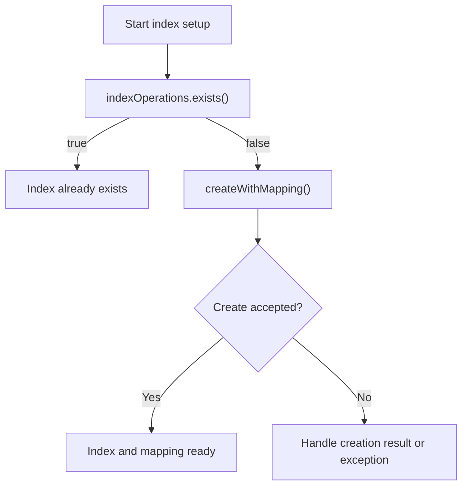
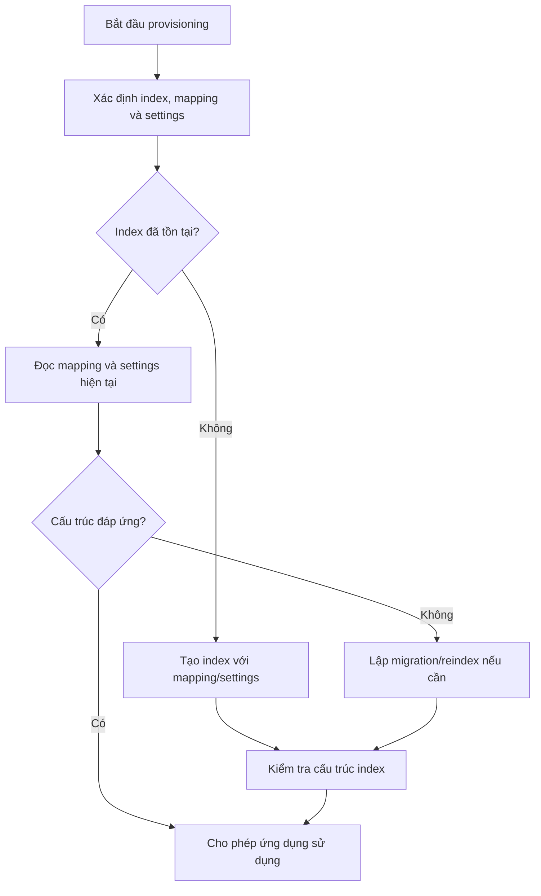

# Kiểm tra tồn tại, tạo và xóa index

Elasticsearch lưu document bên trong **index**. Trước khi ghi dữ liệu, ứng dụng cần có index với tên, settings và mapping phù hợp. Trong Spring Data Elasticsearch, các thao tác quản lý index thường được thực hiện qua **`IndexOperations`**, một API thuộc `ElasticsearchOperations`.

Bài học này trình bày cách kiểm tra index có tồn tại hay chưa, tạo index cùng mapping từ metadata của entity, xóa index và quản lý vòng đời index một cách có chủ đích. Ta cũng xem cách gọi Index API trực tiếp bằng `ElasticsearchClient` khi cần quyền kiểm soát request gốc.

## 1. Index là gì và vì sao phải quản lý?

Elasticsearch lưu dữ liệu theo mô hình document JSON. Các document được nhóm vào index. Một index có các thành phần chính:

- **Tên index**: định danh nơi lưu document, ví dụ `products`.
- **Mapping**: định nghĩa kiểu dữ liệu và cách Elasticsearch lập chỉ mục cho từng field.
- **Settings**: cấu hình index như số primary shard, số replica, analyzer và các tùy chọn index khác.
- **Documents**: dữ liệu JSON thực tế được lưu trong index.

Ví dụ index `products` có thể chứa document:

```json
{
  "sku": "SKU-1001",
  "name": "Wireless Headphones",
  "category": "audio",
  "price": 129.90
}
```

Mapping quyết định cách query hoạt động. Ví dụ `name` có thể là `text` để tìm kiếm toàn văn, còn `category` là `keyword` để lọc chính xác. Settings quyết định cách index được tổ chức và cách analyzer xử lý nội dung.

Một ứng dụng có thể để Spring Data tự tạo index khi khởi động, hoặc chủ động tạo index trong một quy trình provisioning/migration. Với môi trường production, việc tạo, thay đổi và xóa index thường cần được quản lý như một phần của quá trình triển khai dữ liệu.

## 2. `IndexOperations` trong Spring Data Elasticsearch

`IndexOperations` là abstraction cung cấp các thao tác quản lý index. Ta lấy một instance từ `ElasticsearchOperations`:

```java
import org.springframework.data.elasticsearch.core.ElasticsearchOperations;
import org.springframework.data.elasticsearch.core.IndexOperations;

public class ProductIndexService {

    private final IndexOperations indexOperations;

    public ProductIndexService(ElasticsearchOperations operations) {
        this.indexOperations = operations.indexOps(ProductDocument.class);
    }
}
```

`operations.indexOps(ProductDocument.class)` tạo đối tượng thao tác index theo metadata của entity `ProductDocument`. Spring Data có thể lấy tên index, mapping và settings từ các annotation trên lớp document.

Nếu không có entity class tương ứng hoặc muốn thao tác với một index được chỉ định bằng tên, dùng `IndexCoordinates`:

```java
import org.springframework.data.elasticsearch.core.mapping.IndexCoordinates;

IndexOperations indexOperations = operations.indexOps(
    IndexCoordinates.of("products")
);
```

Hai cách lấy `IndexOperations` có mục đích hơi khác nhau:

| Cách lấy | Ý nghĩa |
|---|---|
| `indexOps(ProductDocument.class)` | Dùng metadata entity để xác định index và mapping. |
| `indexOps(IndexCoordinates.of("products"))` | Chỉ định index bằng tên, phù hợp với thao tác index độc lập hoặc index động. |

Các method thường dùng của `IndexOperations` gồm:

| Method | Công dụng |
|---|---|
| `exists()` | Kiểm tra index có tồn tại hay không. |
| `create()` | Tạo index theo settings được cấu hình. |
| `createWithMapping()` | Tạo index và mapping từ metadata của entity. |
| `putMapping()` | Đưa mapping vào index đã tồn tại khi Elasticsearch cho phép. |
| `getMapping()` | Đọc mapping hiện tại. |
| `getSettings()` | Đọc settings của index. |
| `delete()` | Xóa index. |
| `refresh()` | Yêu cầu refresh index để các thay đổi đã index có thể xuất hiện trong search. |

Các overload cụ thể và kiểu tham số có thể thay đổi theo phiên bản Spring Data Elasticsearch. Hãy dùng API tương ứng với phiên bản do Spring Boot dependency management của dự án quản lý.

## 3. Khai báo entity và mapping

Giả sử ứng dụng quản lý sản phẩm. Ta khai báo document:

```java
package com.example.catalog.product.document;

import org.springframework.data.annotation.Id;
import org.springframework.data.elasticsearch.annotations.Document;
import org.springframework.data.elasticsearch.annotations.Field;
import org.springframework.data.elasticsearch.annotations.FieldType;

@Document(indexName = "products", createIndex = false)
public class ProductDocument {

    @Id
    private String id;

    @Field(type = FieldType.Keyword)
    private String sku;

    @Field(type = FieldType.Text)
    private String name;

    @Field(type = FieldType.Keyword)
    private String category;

    @Field(type = FieldType.Double)
    private Double price;

    protected ProductDocument() {
    }

    public ProductDocument(
            String id,
            String sku,
            String name,
            String category,
            Double price) {
        this.id = id;
        this.sku = sku;
        this.name = name;
        this.category = category;
        this.price = price;
    }

    public String getId() {
        return id;
    }

    public String getSku() {
        return sku;
    }

    public String getName() {
        return name;
    }

    public String getCategory() {
        return category;
    }

    public Double getPrice() {
        return price;
    }
}
```

`@Document(indexName = "products")` liên kết entity với index. `@Field` mô tả mapping cho các thuộc tính. `@Id` ánh xạ ID Java thành metadata `_id` của Elasticsearch.

Ở ví dụ này, `createIndex = false` được đặt để minh họa quy trình tạo index tường minh bằng `IndexOperations`. Thuộc tính `createIndex` của `@Document` mặc định là `true`; khi dùng repository, Spring Data có thể tự tạo index và mapping lúc khởi động nếu index chưa tồn tại. Nếu muốn quản lý index bằng migration hoặc provisioning riêng, đặt `createIndex = false` để tránh cơ chế tạo index tự động của repository.

## 4. Kiểm tra index có tồn tại hay không

Trước khi tạo index, thường cần kiểm tra trạng thái hiện tại. Dùng method `exists()`:

```java
import org.springframework.data.elasticsearch.core.ElasticsearchOperations;
import org.springframework.data.elasticsearch.core.IndexOperations;
import org.springframework.stereotype.Service;

@Service
public class ProductIndexService {

    private final IndexOperations indexOperations;

    public ProductIndexService(ElasticsearchOperations operations) {
        this.indexOperations = operations.indexOps(ProductDocument.class);
    }

    public boolean exists() {
        return indexOperations.exists();
    }
}
```

`exists()` trả về `true` nếu index tồn tại và `false` nếu không tìm thấy. Ví dụ sử dụng:

```java
if (productIndexService.exists()) {
    System.out.println("Index products is ready");
} else {
    System.out.println("Index products does not exist");
}
```

Kiểm tra tồn tại hữu ích trước khi chạy thao tác tạo, xóa hoặc migration. Tuy nhiên, kết quả `exists()` chỉ phản ánh trạng thái tại thời điểm request được xử lý. Một tiến trình khác vẫn có thể tạo hoặc xóa index ngay sau đó.

Trong cluster có bảo mật, user cần quyền phù hợp để kiểm tra index. Lỗi xác thực hoặc thiếu quyền có thể tạo ra exception; không nên bắt mọi exception rồi coi như index không tồn tại. Hãy phân biệt rõ trạng thái không có index với lỗi kết nối hoặc lỗi authorization.

## 5. Tạo index cùng mapping

Khi index chưa tồn tại, có thể dùng `createWithMapping()` để tạo index và mapping dựa trên metadata của entity:

```java
public boolean createIfMissing() {
    if (indexOperations.exists()) {
        return false;
    }

    return indexOperations.createWithMapping();
}
```

`createWithMapping()` sử dụng metadata mapping của `ProductDocument`, bao gồm các annotation `@Field`, và settings được khai báo cho entity nếu có. Kết quả boolean cho biết thao tác tạo được chấp nhận hay không; các lỗi kết nối, quyền hoặc request không hợp lệ vẫn có thể được ném thành exception.

### 5.1. Tách kiểm tra và tạo thành hai bước

Luồng thường gặp:



Có thể viết rõ hơn trong service:

```java
public void ensureIndex() {
    if (indexOperations.exists()) {
        return;
    }

    boolean created = indexOperations.createWithMapping();
    if (!created) {
        throw new IllegalStateException(
            "Could not create Elasticsearch index products"
        );
    }
}
```

Đoạn code này phù hợp với ví dụ đơn giản hoặc công cụ quản trị chạy một lần. Trong hệ thống có nhiều instance ứng dụng khởi động đồng thời, hai instance có thể cùng thấy index chưa tồn tại rồi cùng gọi tạo. Một request có thể thành công, request còn lại có thể nhận lỗi resource already exists. Đây là race condition của mẫu check-then-create.

Nếu có nhiều instance, nên để một migration/provisioning job duy nhất quản lý việc tạo index, hoặc xử lý xung đột tạo theo cách có chủ đích rồi kiểm tra lại trạng thái và mapping. Không nên giả định `exists()` cộng `createWithMapping()` là một thao tác nguyên tử.

### 5.2. Tạo index với settings riêng

Index settings có thể bao gồm số shard, replica và analyzer. Với Spring Data Elasticsearch, có thể khai báo settings bằng `@Setting` trỏ đến resource JSON:

```java
import org.springframework.data.elasticsearch.annotations.Setting;

@Document(indexName = "products", createIndex = false)
@Setting(settingPath = "/elasticsearch/product-settings.json")
public class ProductDocument {
    // Fields và mapping
}
```

Resource `src/main/resources/elasticsearch/product-settings.json`:

```json
{
  "index": {
    "number_of_shards": 1,
    "number_of_replicas": 0
  }
}
```

`number_of_replicas: 0` phù hợp với một cluster phát triển một node để tránh replica không thể được phân bổ. Với production, cần chọn replica theo yêu cầu sẵn sàng, khả năng chịu lỗi và số node thực tế. Không sao chép cấu hình một node sang production mà không đánh giá topology.

Khi gọi `createWithMapping()`, Spring Data sử dụng settings và mapping metadata gắn với entity. Nếu index được tạo hoàn toàn bằng migration hoặc index template bên ngoài, cần đảm bảo settings và mapping của template đã sẵn sàng trước khi ứng dụng ghi document.

## 6. Tạo index bằng tên với `IndexCoordinates`

Không phải lúc nào cũng có một entity class cố định. Một số hệ thống quản lý index theo tenant, theo tháng hoặc theo phiên bản dữ liệu. Khi đó có thể lấy `IndexOperations` bằng tên:

```java
import org.springframework.data.elasticsearch.core.IndexOperations;
import org.springframework.data.elasticsearch.core.mapping.IndexCoordinates;

IndexOperations indexOperations = operations.indexOps(
    IndexCoordinates.of("products-2026")
);

if (!indexOperations.exists()) {
    indexOperations.create();
}
```

`create()` tạo index theo settings được truyền hoặc cấu hình phù hợp, nhưng không tự suy ra mapping từ entity class khi chỉ dùng `IndexCoordinates`. Nếu cần mapping, phải cung cấp mapping riêng bằng API tương ứng hoặc tạo index theo metadata entity.

Đối với index động, cần quản lý tên index và mapping nhất quán. Không nên ghép chuỗi tên index từ input người dùng mà không kiểm tra quy tắc đặt tên và quyền truy cập. Nếu mỗi tenant có index riêng, cần cân nhắc số lượng index, shard overhead và khả năng quản trị trước khi chọn mô hình này.

## 7. Đọc mapping và settings sau khi tạo

Sau khi tạo index, có thể đọc mapping để xác nhận field đã được khai báo:

```java
import org.springframework.data.elasticsearch.core.document.Document;

public Document readMapping() {
    return indexOperations.getMapping();
}
```

Với index `products`, mapping kỳ vọng có các field như:

```json
{
  "properties": {
    "sku": {
      "type": "keyword"
    },
    "name": {
      "type": "text"
    },
    "category": {
      "type": "keyword"
    },
    "price": {
      "type": "double"
    }
  }
}
```

Có thể xem settings:

```java
public Document readSettings() {
    return indexOperations.getSettings();
}
```

Tùy phiên bản Spring Data Elasticsearch, API đọc settings có thể cung cấp overload để lấy settings mặc định hoặc settings đã được áp dụng. Hãy tham khảo kiểu trả về của phiên bản dự án.

Kiểm tra mapping thực tế đặc biệt quan trọng khi index đã tồn tại từ trước. Annotation Java mô tả mong muốn của ứng dụng; mapping đang chạy trên cluster mới là cấu hình Elasticsearch thực sự sử dụng.

## 8. Cập nhật mapping của index hiện có

Nếu index đã tồn tại nhưng cần thêm field mới, Elasticsearch cho phép một số thay đổi mapping theo giới hạn của server. Spring Data cung cấp `putMapping()` để gửi mapping từ metadata entity:

```java
boolean mappingUpdated = indexOperations.putMapping();
```

Tuy nhiên, không phải mọi thay đổi mapping đều được phép. Thông thường có thể thêm field mới, nhưng không thể đổi kiểu một field đã được index từ `text` sang `keyword` hoặc ngược lại bằng một lệnh `putMapping` đơn giản.

Ví dụ, nếu `name` đang là `text` nhưng yêu cầu mới cần thêm field `name.raw` kiểu `keyword`, có thể bổ sung multi-field nếu mapping và phiên bản cho phép. Các document cũ có thể cần được reindex/update để field con được populate cho dữ liệu đã tồn tại; chỉ cập nhật mapping không tự phân tích lại toàn bộ `_source` cũ.

Với thay đổi không tương thích, quy trình thường dùng là:

1. Tạo index mới, ví dụ `products-v2`, với mapping/settings mong muốn.
2. Reindex dữ liệu từ index cũ sang index mới.
3. Kiểm tra số lượng document, mapping và kết quả truy vấn.
4. Chuyển alias hoặc cấu hình ứng dụng sang index mới.
5. Giữ index cũ trong thời gian rollback theo chính sách vận hành.

Không nên xóa index cũ ngay khi vừa tạo index mới nếu chưa xác minh dữ liệu và khả năng rollback.

## 9. Xóa index

`IndexOperations.delete()` xóa toàn bộ index tương ứng:

```java
public boolean deleteIndex() {
    if (!indexOperations.exists()) {
        return false;
    }

    return indexOperations.delete();
}
```

Xóa index có nghĩa là xóa:

- Tất cả document trong index.
- Mapping của index.
- Settings của index.
- Các dữ liệu index-level liên quan.

Đây là thao tác phá hủy dữ liệu. Không dùng `delete()` như một cách làm sạch một vài document. Nếu chỉ muốn xóa một document, hãy dùng Repository `deleteById` hoặc API document delete phù hợp.

Trong ứng dụng thật, nên đặt thao tác xóa index trong một luồng quản trị có kiểm soát. Trước khi xóa, cần xác định đúng tên index, kiểm tra alias có trỏ đến index hay không, đánh giá snapshot/backup và xác nhận index không còn được ứng dụng khác sử dụng.

Nếu index không tồn tại, `exists()` có thể giúp tránh gửi request xóa không cần thiết. Nhưng mẫu kiểm tra rồi xóa vẫn có race condition nếu tiến trình khác đồng thời thay đổi index. Hãy xử lý lỗi theo trạng thái thực tế của cluster.

## 10. Ví dụ service quản lý vòng đời index

Gộp các thao tác phổ biến trong một service:

```java
package com.example.catalog.product.service;

import org.springframework.data.elasticsearch.core.ElasticsearchOperations;
import org.springframework.data.elasticsearch.core.IndexOperations;
import org.springframework.stereotype.Service;

import com.example.catalog.product.document.ProductDocument;

@Service
public class ProductIndexService {

    private final IndexOperations indexOperations;

    public ProductIndexService(ElasticsearchOperations operations) {
        this.indexOperations = operations.indexOps(ProductDocument.class);
    }

    public boolean indexExists() {
        return indexOperations.exists();
    }

    public void createIndexIfMissing() {
        if (indexOperations.exists()) {
            return;
        }

        boolean created = indexOperations.createWithMapping();
        if (!created) {
            throw new IllegalStateException(
                "Could not create index products"
            );
        }
    }

    public boolean deleteIndexIfPresent() {
        if (!indexOperations.exists()) {
            return false;
        }

        return indexOperations.delete();
    }
}
```

Service này phù hợp để minh họa API và có thể dùng trong một công cụ quản trị hoặc quy trình migration chạy có kiểm soát. Trong production, không nên tự động expose `deleteIndexIfPresent()` thành endpoint công khai. Nếu cần endpoint quản trị, phải giới hạn quyền truy cập, xác thực thao tác và kiểm tra tên index trước khi thực thi.

## 11. Gọi Index API trực tiếp bằng `ElasticsearchClient`

Khi cần dùng endpoint hoặc option chưa được `IndexOperations` bộc lộ, có thể inject `ElasticsearchClient` và gọi Indices API trực tiếp.

Ví dụ kiểm tra index tồn tại:

```java
import java.io.IOException;

import co.elastic.clients.elasticsearch.ElasticsearchClient;
import org.springframework.stereotype.Component;

@Component
public class DirectIndexApi {

    private final ElasticsearchClient client;

    public DirectIndexApi(ElasticsearchClient client) {
        this.client = client;
    }

    public boolean exists(String indexName) throws IOException {
        return client.indices()
            .exists(request -> request.index(indexName))
            .value();
    }
}
```

Tạo index bằng Java API Client:

```java
public boolean create(String indexName) throws IOException {
    var response = client.indices().create(
        request -> request.index(indexName)
    );

    return response.acknowledged();
}
```

Xóa index:

```java
public boolean delete(String indexName) throws IOException {
    var response = client.indices().delete(
        request -> request.index(indexName)
    );

    return response.acknowledged();
}
```

Các ví dụ direct client minh họa request tối thiểu. Khi tạo index theo cách này, ứng dụng phải cung cấp settings và mappings nếu index cần cấu trúc cụ thể. Java API Client không tự lấy annotation `@Document` và `@Field` để tạo mapping như `IndexOperations` khi dùng entity metadata.

Nếu Spring Data và client trực tiếp cùng quản lý một index, cần thống nhất một nguồn sự thật cho mapping/settings. Tránh để một nơi tạo index rỗng trong khi nơi khác kỳ vọng mapping đã có sẵn.

## 12. Tự động tạo index và quản lý tường minh

Spring Data Elasticsearch có thể tự tạo index khi repository khởi tạo nếu entity được đánh dấu `@Document(createIndex = true)`. Đây là giá trị mặc định.

Hai cách quản lý thường gặp:

| Cách | Đặc điểm | Phù hợp |
|---|---|---|
| Tự động tạo qua `@Document` | Ít mã, thuận tiện cho ví dụ và môi trường phát triển | Ứng dụng nhỏ hoặc index đơn giản. |
| Tạo tường minh qua `IndexOperations`/migration | Kiểm soát thứ tự, settings, mapping và quyền triển khai | Production, index phức tạp hoặc cần migration. |

Nếu ứng dụng chọn quản lý tường minh, đặt `createIndex = false` trên `@Document`, sau đó dùng một bước provisioning/migration để tạo index trước khi Repository thực hiện thao tác dữ liệu.

Không nên để nhiều cơ chế cùng quản lý một index mà không có quy ước. Ví dụ, nếu migration tạo `products-v2` với mapping riêng nhưng entity vẫn trỏ tới `products`, ứng dụng có thể tiếp tục ghi vào index cũ.

## 13. Alias và đổi phiên bản index

Trong production, ứng dụng thường không nên phụ thuộc trực tiếp vào tên index vật lý có phiên bản. Có thể dùng alias, ví dụ:

```text
products-read  -> products-v2
products-write -> products-v2
```

Khi cần nâng cấp mapping, có thể tạo `products-v3`, reindex dữ liệu và chuyển alias sang index mới. Ứng dụng tiếp tục sử dụng alias `products-read` hoặc `products-write`, nhờ vậy giảm thay đổi cấu hình ứng dụng.

Alias có thể được quản lý qua các API alias của Elasticsearch hoặc API tương ứng trong Spring Data, tùy phiên bản. Chuyển alias nên dùng một thao tác update aliases có tính nguyên tử ở phía Elasticsearch để tránh khoảng thời gian alias không trỏ tới index nào hoặc trỏ đồng thời sai index.

Trước khi xóa index cũ, hãy xác nhận không còn alias hoặc ứng dụng nào cần nó. Xóa index đang được alias sử dụng có thể làm các request sau đó thất bại.

## 14. Lỗi thường gặp khi quản lý index

| Hiện tượng | Nguyên nhân cần kiểm tra |
|---|---|
| `exists()` trả về false dù ứng dụng đã ghi dữ liệu | Có thể đang kiểm tra sai tên index, dùng alias/index khác hoặc kết nối nhầm cluster. |
| `createWithMapping()` thất bại | Index đã tồn tại, thiếu quyền, settings/mapping không hợp lệ hoặc server không hỗ trợ cấu hình. |
| Index được tạo nhưng field mapping không đúng | Chỉ gọi `create()` thay vì tạo cùng mapping, entity annotation không đúng hoặc index template áp dụng khác. |
| Thay annotation nhưng mapping không đổi | Index đã tồn tại; mapping cũ vẫn là cấu hình đang chạy. |
| Không thể đổi `text` thành `keyword` | Đây là thay đổi mapping không tương thích; cần tạo index mới và reindex. |
| Xóa index nhưng dữ liệu vẫn xuất hiện | Ứng dụng có thể đang đọc alias hoặc index khác. |
| Lỗi 403 khi kiểm tra/tạo/xóa | User Elasticsearch thiếu cluster/index privilege tương ứng. |
| Tạo index bị xung đột lúc nhiều instance khởi động | Race condition giữa bước exists và create. |

Khi chẩn đoán, hãy xác nhận cluster đang kết nối, tên index/alias, mapping thực tế và quyền của user. Không suy luận rằng index không tồn tại chỉ từ một exception kết nối.

## 15. Quy trình quản lý index an toàn



Một quy trình triển khai có thể gồm:

1. Xác định index vật lý hoặc alias mà ứng dụng sẽ sử dụng.
2. Chuẩn bị mapping và settings đúng với query và dữ liệu.
3. Kiểm tra index tồn tại bằng `IndexOperations.exists()` hoặc API tương ứng.
4. Tạo index cùng mapping nếu chưa tồn tại.
5. Nếu đã tồn tại, đọc mapping/settings và xác nhận tương thích.
6. Nếu cần thay đổi không tương thích, tạo index mới và reindex.
7. Chuyển alias hoặc cấu hình ứng dụng sau khi xác minh dữ liệu.
8. Chỉ xóa index cũ sau thời gian rollback và khi chắc chắn không còn consumer sử dụng.

## 16. Kết luận

`IndexOperations` là điểm truy cập thuận tiện trong Spring Data Elasticsearch để kiểm tra, tạo, đọc mapping/settings và xóa index. Dùng `operations.indexOps(Entity.class)` khi muốn dựa trên metadata của entity; dùng `IndexCoordinates` khi cần thao tác theo tên index.

`createWithMapping()` phù hợp khi muốn tạo index cùng mapping được mô tả bởi annotation. `exists()` giúp kiểm tra trạng thái trước thao tác, còn `delete()` xóa toàn bộ index và document bên trong. Với API index chưa được Spring Data bộc lộ, có thể inject `ElasticsearchClient` và gọi Indices API trực tiếp.

Trong production, hãy quản lý index theo một quy trình có nguồn sự thật rõ ràng cho mapping/settings, xử lý race condition khi nhiều instance cùng khởi động, và dùng migration/reindex khi thay đổi không tương thích. Xóa index phải được xem là thao tác phá hủy dữ liệu, có xác nhận và phương án khôi phục phù hợp.
