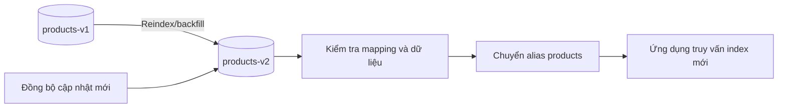

# Tạo mapping từ Document và áp dụng mapping

Trong Spring Data Elasticsearch, một lớp Java được đánh dấu `@Document` mô tả loại document mà ứng dụng lưu trong một Elasticsearch index. Các annotation như `@Id`, `@Field`, `@MultiField`, `@InnerField`, `@Setting` và `@Mapping` cung cấp metadata để Spring Data chuyển cấu trúc lớp thành mapping và index settings. Mapping xác định cách Elasticsearch lưu trữ, phân tích và truy vấn từng trường.

Việc khai báo annotation trong Java chưa tự động thay đổi mapping của một index đã tồn tại. Ứng dụng cần tạo index cùng mapping khi index chưa có, hoặc áp dụng mapping vào index hiện có bằng API quản lý index. Khi mapping thay đổi kiểu dữ liệu của một trường đã được lập chỉ mục, thông thường phải tạo index mới và reindex dữ liệu.

## 1. Document, index và mapping

Ba khái niệm này liên quan nhưng không giống nhau:

- **Document** là một bản ghi JSON được lưu trong Elasticsearch, ví dụ một sản phẩm có `id`, `name`, `price` và `categories`.
- **Index** là nơi chứa các document có cấu trúc và mục đích tìm kiếm tương tự. Có thể hình dung gần giống một bảng trong cơ sở dữ liệu quan hệ, nhưng cách lưu trữ và truy vấn khác nhau.
- **Mapping** mô tả cấu trúc trường của document: kiểu dữ liệu, analyzer, normalizer, cách xử lý object/nested, date format và các thuộc tính lập chỉ mục khác.

Ví dụ document:

```json
{
  "id": "p-1001",
  "name": "Máy pha cà phê",
  "sku": "COFFEE-001",
  "price": 3250000,
  "available": true,
  "categories": ["Gia dụng", "Máy pha cà phê"]
}
```

Mapping tương ứng có thể khai báo `name` là `text`, `sku` là `keyword`, `price` là kiểu số và `available` là `boolean`. Cùng một giá trị JSON có thể được xử lý khác nhau tùy mapping. Ví dụ `name` được phân tích thành token để tìm toàn văn, còn `sku` được giữ nguyên để khớp chính xác.

Trong Spring Data Elasticsearch, lớp document là mô hình Java dùng để chuyển đổi giữa object và JSON. Mapping là cấu hình ở phía Elasticsearch. Hai bên nên nhất quán nhưng không nhất thiết có cấu trúc giống hệt nhau: mapping có thể chứa subfield, analyzer hoặc thiết lập tối ưu truy vấn mà Java class không cần biểu diễn thành thuộc tính riêng.

## 2. Spring Data tạo mapping từ `@Document`

`@Document` đánh dấu một lớp là Elasticsearch entity và chỉ định index đích. Các thuộc tính của lớp được Spring Data phân tích thông qua mapping metadata và `MappingElasticsearchConverter`.

Ví dụ cơ bản:

```java
import org.springframework.data.annotation.Id;
import org.springframework.data.elasticsearch.annotations.Document;
import org.springframework.data.elasticsearch.annotations.Field;
import org.springframework.data.elasticsearch.annotations.FieldType;

@Document(indexName = "products")
public class ProductDocument {

    @Id
    private String id;

    @Field(type = FieldType.Text)
    private String name;

    @Field(type = FieldType.Keyword)
    private String sku;

    @Field(type = FieldType.Double)
    private Double price;

    @Field(type = FieldType.Boolean)
    private Boolean available;

    // Constructors, getters and setters
}
```

Các annotation quan trọng:

- `@Document(indexName = "products")` xác định index mà entity đại diện.
- `@Id` đánh dấu thuộc tính được dùng làm định danh document `_id`.
- `@Field(type = ...)` khai báo kiểu Elasticsearch cho một thuộc tính.
- `@Document(createIndex = true)` cho phép cơ chế khởi tạo index tự động của Spring Data tạo index khi chưa tồn tại trong các luồng khởi tạo được hỗ trợ. Cần kiểm tra cấu hình và hành vi của phiên bản đang dùng.
- `@Setting` khai báo settings của index, ví dụ số shard, replica và analyzer.
- `@Mapping` có thể trỏ tới file JSON chứa mapping tùy chỉnh.

Nếu không khai báo `@Field` cho mọi thuộc tính, Spring Data vẫn có thể suy luận một số kiểu từ kiểu Java. Tuy nhiên, với các trường quan trọng cho tìm kiếm, nên khai báo tường minh để kiểm soát analyzer, kiểu số, date format và cấu trúc object.

### Tên trường trong Java và tên trường trong Elasticsearch

Có thể dùng `name` trong `@Field` để ánh xạ thuộc tính Java sang tên field khác:

```java
@Field(name = "created_at", type = FieldType.Date)
private Instant createdAt;
```

Document JSON sẽ dùng `created_at`, trong khi code Java vẫn sử dụng `createdAt`. Hãy thống nhất quy tắc đặt tên field trong toàn bộ index và các truy vấn. Đổi tên field trong mapping thực tế thường được xem như thay đổi cấu trúc dữ liệu, cần có kế hoạch chuyển đổi.

## 3. Chọn kiểu field khi tạo mapping

Kiểu field quyết định cách Elasticsearch lập chỉ mục và hỗ trợ truy vấn. Không nên chọn kiểu chỉ dựa vào kiểu Java hoặc việc dữ liệu hiện tại tình cờ có dạng chuỗi.

| Nhu cầu | Kiểu Elasticsearch thường dùng | Ví dụ |
|---|---|---|
| Tìm kiếm toàn văn | `text` | Tên, mô tả, nội dung bài viết |
| Khớp chính xác, lọc, sort, aggregation theo chuỗi | `keyword` | SKU, trạng thái, mã danh mục |
| Số nguyên | `integer`, `long` | Số lượng, bộ đếm |
| Số thực | `float`, `double`, `scaled_float` | Trọng lượng, điểm đánh giá |
| Đúng/sai | `boolean` | Còn hàng, đã xuất bản |
| Ngày giờ | `date` | Thời điểm tạo, cập nhật |
| Object lồng | `object` | Thông tin thương hiệu |
| Mảng object cần giữ quan hệ từng phần tử | `nested` | Các biến thể sản phẩm |
| Tọa độ địa lý | `geo_point` | Vị trí cửa hàng |

Ví dụ, SKU thường nên là `keyword`, kể cả khi chỉ chứa chữ số. Nếu khai báo SKU là kiểu số, các số 0 ở đầu có thể bị mất và truy vấn sẽ mang ý nghĩa số học không mong muốn.

### `text` và `keyword`

`text` được phân tích thành token bởi analyzer. Nó phù hợp với tìm kiếm từ hoặc cụm từ trong nội dung. `keyword` giữ giá trị như một đơn vị, phù hợp với khớp chính xác, lọc, sắp xếp và aggregation.

Một thuộc tính có thể cần cả hai cách lập chỉ mục. Khi đó, dùng multi-field:

```java
import org.springframework.data.elasticsearch.annotations.InnerField;
import org.springframework.data.elasticsearch.annotations.MultiField;

@MultiField(
    mainField = @Field(type = FieldType.Text, analyzer = "standard"),
    otherFields = {
        @InnerField(suffix = "keyword", type = FieldType.Keyword)
    }
)
private String name;
```

Mapping tạo ra có trường `name` kiểu `text` và subfield `name.keyword` kiểu `keyword`. Ứng dụng có thể tìm toàn văn trên `name`, đồng thời sort hoặc aggregation trên `name.keyword`.

### Object và nested

`object` phù hợp với object lồng khi các thuộc tính có thể được truy vấn độc lập. `nested` phù hợp với mảng object khi điều kiện truy vấn cần cùng khớp trên một phần tử cụ thể.

Ví dụ một sản phẩm có hai biến thể:

```json
{
  "variants": [
    { "color": "black", "size": "small" },
    { "color": "silver", "size": "large" }
  ]
}
```

Nếu cần tìm một biến thể vừa màu đen vừa cỡ lớn, `nested` giữ quan hệ giữa `color` và `size` trong cùng phần tử. Dùng `object` thông thường có thể làm Elasticsearch ghép điều kiện từ các phần tử khác nhau sau khi làm phẳng mảng object.

Khai báo trong Java:

```java
public class VariantDocument {

    @Field(type = FieldType.Keyword)
    private String color;

    @Field(type = FieldType.Keyword)
    private String size;
}

@Field(type = FieldType.Nested)
private List<VariantDocument> variants;
```

`nested` có chi phí lưu trữ và truy vấn cao hơn object thông thường. Chỉ chọn khi truy vấn cần bảo toàn quan hệ giữa các trường trong từng phần tử.

## 4. Mapping cho ngày giờ và analyzer

### Ngày giờ

Elasticsearch thường dùng `date` để lập chỉ mục thời điểm. Trong Java có thể dùng `Instant`, `LocalDate`, `LocalDateTime` hoặc kiểu phù hợp với quy ước thời gian của hệ thống. Cần thống nhất timezone và format khi serialize.

```java
import java.time.Instant;

@Field(type = FieldType.Date)
private Instant createdAt;
```

Nếu dữ liệu đầu vào có format tùy chỉnh, khai báo format/pattern tương ứng và bảo đảm serializer ghi ra giá trị mà mapping chấp nhận. Với thời điểm tuyệt đối, `Instant` thường rõ nghĩa hơn một `LocalDateTime` không có timezone.

### Analyzer

Analyzer xác định cách Elasticsearch phân tích văn bản khi lập chỉ mục và khi phân tích truy vấn. Có thể khai báo analyzer trong index settings và tham chiếu trong `@Field`:

```java
@Field(
    type = FieldType.Text,
    analyzer = "product_name_index",
    searchAnalyzer = "product_name_search"
)
private String name;
```

Tên analyzer phải được định nghĩa trong settings của index trước khi index document. Nếu analyzer không tồn tại hoặc plugin cần thiết chưa được cài, thao tác tạo index có thể thất bại.

### Index settings bằng `@Setting`

`@Setting` có thể tham chiếu file JSON trong classpath:

```java
import org.springframework.data.elasticsearch.annotations.Setting;

@Document(indexName = "products")
@Setting(settingPath = "/elasticsearch/product-settings.json")
public class ProductDocument {
    // fields
}
```

Ví dụ file `src/main/resources/elasticsearch/product-settings.json`:

```json
{
  "index": {
    "number_of_shards": 1,
    "number_of_replicas": 1
  },
  "analysis": {
    "analyzer": {
      "product_name_index": {
        "type": "custom",
        "tokenizer": "standard",
        "filter": ["lowercase", "asciifolding"]
      },
      "product_name_search": {
        "type": "custom",
        "tokenizer": "standard",
        "filter": ["lowercase", "asciifolding"]
      }
    }
  }
}
```

Settings là cấu hình của index, chẳng hạn shard, replica và analysis. Mapping là cấu hình các trường. Hai phần này thường được tạo cùng lúc khi khởi tạo index nhưng có mục đích riêng.

## 5. Dùng file JSON mapping tùy chỉnh

Với mapping phức tạp, nhóm phát triển có thể quản lý mapping bằng file JSON thay vì biểu diễn mọi chi tiết qua annotation. Spring Data Elasticsearch hỗ trợ `@Mapping(mappingPath = "...")` trong các phiên bản có annotation này.

Ví dụ:

```java
import org.springframework.data.elasticsearch.annotations.Document;
import org.springframework.data.elasticsearch.annotations.Mapping;
import org.springframework.data.elasticsearch.annotations.Setting;

@Document(indexName = "products")
@Setting(settingPath = "/elasticsearch/product-settings.json")
@Mapping(mappingPath = "/elasticsearch/product-mapping.json")
public class ProductDocument {
    // Java properties
}
```

Ví dụ file `src/main/resources/elasticsearch/product-mapping.json`:

```json
{
  "properties": {
    "name": {
      "type": "text",
      "analyzer": "product_name_index",
      "search_analyzer": "product_name_search",
      "fields": {
        "keyword": {
          "type": "keyword",
          "ignore_above": 256
        }
      }
    },
    "sku": {
      "type": "keyword"
    },
    "price": {
      "type": "scaled_float",
      "scaling_factor": 100
    },
    "created_at": {
      "type": "date"
    },
    "variants": {
      "type": "nested",
      "properties": {
        "color": { "type": "keyword" },
        "size": { "type": "keyword" }
      }
    }
  }
}
```

File mapping cần được đóng gói trong classpath và đường dẫn phải đúng với cách ứng dụng chạy trong IDE, test và artifact đã build. Hãy xem file JSON là schema có version và review như code.

### Annotation hay file JSON?

| Cách khai báo | Ưu điểm | Phù hợp khi |
|---|---|---|
| Annotation `@Field` | Gần với Java property, dễ hiểu với mapping đơn giản | Mapping phần lớn phản ánh trực tiếp cấu trúc document |
| `@Setting` + `@Mapping` file JSON | Biểu diễn được cấu hình Elasticsearch đầy đủ, dễ review riêng | Analyzer, nested, multi-field hoặc mapping phức tạp |
| Quản lý mapping qua migration/API | Tách vòng đời index khỏi vòng đời deploy ứng dụng | Production cần versioning, rollout và reindex có kiểm soát |

Không nên duy trì hai định nghĩa mapping độc lập mà không có quy tắc đồng bộ. Nếu cùng một field được khai báo trong annotation và file JSON với kiểu hoặc tên khác nhau, cần xác định rõ nguồn nào được dùng khi tạo index trong phiên bản Spring Data đang chạy. Với dự án dùng file mapping riêng, nên coi file đó là schema chính và kiểm tra mapping thực tế sau khi tạo index.

## 6. Tạo index cùng mapping bằng `IndexOperations`

Spring Data cung cấp `ElasticsearchOperations` để thao tác với Elasticsearch. Từ đó, lấy `IndexOperations` cho entity class và tạo index với mapping được tạo từ metadata của entity.

Ví dụ:

```java
import org.springframework.data.elasticsearch.core.ElasticsearchOperations;
import org.springframework.data.elasticsearch.core.IndexOperations;
import org.springframework.stereotype.Component;

@Component
public class ProductIndexInitializer {

    private final ElasticsearchOperations operations;

    public ProductIndexInitializer(ElasticsearchOperations operations) {
        this.operations = operations;
    }

    public void createIndexIfMissing() {
        IndexOperations indexOperations =
            operations.indexOps(ProductDocument.class);

        if (!indexOperations.exists()) {
            indexOperations.createWithMapping();
        }
    }
}
```

`createWithMapping()` tạo index với settings và mapping gắn với entity theo khả năng của phiên bản Spring Data. Khi index đã tồn tại, đoạn code trên không ghi đè mapping hiện tại. Đây là cách kiểm soát đơn giản cho bước khởi tạo, nhưng trong production nên quản lý migration index riêng để biết chính xác phiên bản schema đang được triển khai.

### Tạo index bằng repository auto-configuration

Trong một số luồng Spring Data repository, `@Document(createIndex = true)` cho phép Spring Data tự tạo index nếu chưa tồn tại khi repository được khởi tạo. Cơ chế này hữu ích trong ứng dụng nhỏ hoặc môi trường phát triển.

Tuy nhiên, không nên dựa vào việc ứng dụng tự khởi động để thay đổi schema production. Một lần deploy có thể có nhiều instance khởi động đồng thời; việc thay đổi mapping cũng cần quy trình kiểm soát và reindex. Với môi trường production, thường nên tạo index bằng migration hoặc bước triển khai riêng, sau đó ứng dụng chỉ sử dụng index đã sẵn sàng.

## 7. Áp dụng mapping lên index đã tồn tại

Nếu index đã tồn tại, có thể dùng `IndexOperations.putMapping()` để gửi mapping được tạo từ entity metadata lên Elasticsearch. Ví dụ:

```java
public void applyMappingToExistingIndex() {
    IndexOperations indexOperations =
        operations.indexOps(ProductDocument.class);

    if (!indexOperations.exists()) {
        indexOperations.createWithMapping();
        return;
    }

    indexOperations.putMapping();
}
```

`putMapping()` áp dụng mapping theo khả năng cập nhật của Elasticsearch. Nó không phải lệnh thay thế toàn bộ mapping và không thể đổi tùy ý kiểu của field đã tồn tại. Việc thêm field mới thường được hỗ trợ; thay đổi kiểu một field đã có dữ liệu thường không được phép.

### Xem mapping hiện tại

Có thể lấy mapping qua API Spring Data:

```java
IndexOperations indexOperations =
    operations.indexOps(ProductDocument.class);

var currentMapping = indexOperations.getMapping();
```

Hoặc gọi Elasticsearch REST API:

```http
GET /products/_mapping
```

So sánh mapping thực tế với schema mong muốn trước khi áp dụng thay đổi. Không nên giả định mapping trong code luôn giống mapping của index đang chạy; index có thể được tạo từ phiên bản ứng dụng cũ hoặc được thay đổi thủ công.

### Kiểm tra kết quả sau khi áp dụng

Sau khi tạo hoặc cập nhật mapping:

1. Đọc lại mapping thực tế.
2. Xác nhận tên field và kiểu field.
3. Kiểm tra analyzer/normalizer được khai báo đúng.
4. Thử index một document mẫu.
5. Dùng `_analyze` để kiểm tra token nếu có analyzer.
6. Chạy truy vấn, sort và aggregation dự kiến.

Ví dụ kiểm tra mapping:

```http
GET /products/_mapping
```

Ví dụ kiểm tra analyzer:

```http
POST /products/_analyze
Content-Type: application/json

{
  "field": "name",
  "text": "Máy pha cà phê"
}
```

Kết quả `_analyze` cho biết token được tạo từ field đã khai báo. Đây là cách nhanh để phát hiện analyzer không tồn tại hoặc xử lý văn bản khác với dự kiến.

## 8. Mapping động và mapping tường minh

Elasticsearch hỗ trợ dynamic mapping: khi nhận document có field chưa được khai báo, Elasticsearch có thể tự suy luận kiểu và thêm field vào mapping. Cơ chế này thuận tiện khi dữ liệu linh hoạt, nhưng có rủi ro khi field đầu tiên có giá trị không đại diện hoặc tên field phát sinh vô hạn.

Ví dụ, document đầu tiên gửi `rating: 5` có thể khiến field được tạo thành kiểu số nguyên. Sau đó document gửi `rating: 4.5` có thể không được xử lý như mong muốn. Tương tự, các field động từ dữ liệu người dùng có thể làm mapping tăng nhanh.

Với các trường quan trọng, nên khai báo mapping tường minh. Có thể dùng `dynamic: strict` nếu muốn từ chối field không nằm trong schema, hoặc lựa chọn chính sách dynamic phù hợp với yêu cầu. Thiết lập `dynamic` có thể được quản lý trong file mapping JSON hoặc cấu hình mapping tương ứng của phiên bản Spring Data.

Ví dụ mapping JSON:

```json
{
  "dynamic": "strict",
  "properties": {
    "name": { "type": "text" },
    "sku": { "type": "keyword" },
    "price": { "type": "long" }
  }
}
```

Với `strict`, document chứa field không được khai báo sẽ bị từ chối. Đây là lựa chọn phù hợp khi schema phải được kiểm soát chặt, nhưng cần bảo đảm mọi phiên bản ứng dụng gửi đúng cấu trúc.

## 9. Những thay đổi mapping có thể và không thể áp dụng trực tiếp

Elasticsearch cho phép bổ sung một số cấu hình mapping vào index đang tồn tại, nhưng có những thay đổi không thể thực hiện trực tiếp vì dữ liệu đã được lập chỉ mục theo cấu trúc cũ.

| Thay đổi | Có thể áp dụng trực tiếp? | Hướng xử lý |
|---|---|---|
| Thêm một field mới | Thường có | Gửi mapping bổ sung bằng `putMapping()` |
| Thêm multi-field mới cho field hiện có | Có thể thêm mapping, nhưng dữ liệu cũ chưa có giá trị subfield được lập chỉ mục | Cập nhật mapping rồi reindex/update dữ liệu cũ để subfield có dữ liệu |
| Đổi `integer` thành `long` | Không thể đổi kiểu trực tiếp | Tạo index mới và reindex |
| Đổi `text` thành `keyword` | Không thể đổi kiểu trực tiếp | Tạo field/index mới và backfill |
| Đổi analyzer của field đã có dữ liệu | Không thể thay cách token cũ bằng sửa mapping đơn giản | Tạo index mới và reindex |
| Đổi `object` thành `nested` | Không thể đổi trực tiếp | Tạo index mới với mapping nested và reindex |
| Đổi tên field | Không có thao tác rename mapping đơn giản | Tạo field mới, chuyển dữ liệu và cập nhật ứng dụng |

Một số thay đổi có thể thêm mapping mới nhưng không tự tạo lại inverted index cho document cũ. Ví dụ, thêm `name.keyword` vào mapping không có nghĩa các document đã lập chỉ mục trước đó tự có dữ liệu trong subfield mới. Cần cập nhật hoặc reindex dữ liệu cũ.

## 10. Reindex khi cần thay đổi cấu trúc

Khi cần đổi kiểu field, analyzer, object/nested hoặc thay đổi lớn, quy trình an toàn thường là tạo index mới và reindex dữ liệu.

Ví dụ luồng triển khai:



Các bước chính:

1. Tạo `products-v2` với settings và mapping mới.
2. Nạp dữ liệu hiện có từ nguồn có thẩm quyền hoặc dùng API `_reindex` nếu phù hợp.
3. Đồng bộ những thay đổi phát sinh trong thời gian backfill.
4. So sánh số lượng document và kiểm tra một số bản ghi đại diện.
5. Chạy thử truy vấn, sort, aggregation và analyzer trên index mới.
6. Chuyển alias hoặc cấu hình ứng dụng sang index mới.
7. Giữ index cũ trong thời gian cần thiết để có thể rollback.

Nếu dùng `_reindex`, lưu ý thao tác này sao chép dữ liệu document; nó không tự đồng bộ các thay đổi nghiệp vụ phát sinh sau thời điểm bắt đầu. Hệ thống cần cơ chế bắt kịp thay đổi như outbox, CDC, dual-write có kiểm soát hoặc một cửa sổ dừng ghi phù hợp.

### Dùng alias để chuyển index

Thay vì để ứng dụng truy cập trực tiếp `products-v1`, có thể dùng alias `products` trỏ tới index vật lý. Khi index mới sẵn sàng, chuyển alias trong một thao tác cập nhật alias:

```http
POST /_aliases
Content-Type: application/json

{
  "actions": [
    { "remove": { "index": "products-v1", "alias": "products" } },
    { "add": { "index": "products-v2", "alias": "products" } }
  ]
}
```

Đảm bảo alias đã tồn tại và đang trỏ đúng index cũ trước khi thực hiện thao tác remove/add. Nếu alias chưa có, dùng hành động add phù hợp. Với ứng dụng ghi dữ liệu, cần cấu hình write index khi alias trỏ tới nhiều index.

## 11. Ví dụ tạo mapping hoàn chỉnh cho sản phẩm

Một document sản phẩm có thể kết hợp multi-field, số, ngày giờ, object và nested:

```java
import java.time.Instant;
import java.util.List;

import org.springframework.data.annotation.Id;
import org.springframework.data.elasticsearch.annotations.Document;
import org.springframework.data.elasticsearch.annotations.Field;
import org.springframework.data.elasticsearch.annotations.FieldType;
import org.springframework.data.elasticsearch.annotations.InnerField;
import org.springframework.data.elasticsearch.annotations.MultiField;

@Document(indexName = "products")
public class ProductDocument {

    @Id
    private String id;

    @MultiField(
        mainField = @Field(type = FieldType.Text, analyzer = "standard"),
        otherFields = {
            @InnerField(suffix = "keyword", type = FieldType.Keyword)
        }
    )
    private String name;

    @Field(type = FieldType.Keyword)
    private String sku;

    @Field(type = FieldType.Scaled_Float, scalingFactor = 100)
    private Double price;

    @Field(type = FieldType.Boolean)
    private boolean available;

    @Field(type = FieldType.Date)
    private Instant createdAt;

    @Field(type = FieldType.Nested)
    private List<VariantDocument> variants;

    // Constructors, getters and setters
}
```

Mapping này hỗ trợ tìm kiếm toàn văn trên `name`, sort hoặc aggregation theo `name.keyword`, lọc theo SKU, giá, trạng thái và truy vấn biến thể theo ngữ nghĩa nested.

Nếu `price` là tiền tệ cần chính xác tuyệt đối, hãy cân nhắc lưu bằng `Long` theo đơn vị nhỏ nhất thay vì `scaled_float`. Ví dụ trên dùng `scaled_float` để minh họa trường thập phân có độ phân giải hai chữ số; lựa chọn thực tế phải theo quy tắc tiền tệ.

## 12. Kiểm tra mapping trong vòng đời ứng dụng

Mapping là một phần của schema và nên được quản lý có version. Một số nguyên tắc vận hành:

- Tạo index trước khi nạp dữ liệu để tránh dynamic mapping không mong muốn.
- Pin tên index vật lý theo version khi cần migration, ví dụ `products-v1`, `products-v2`.
- Dùng alias ổn định cho ứng dụng nếu cần chuyển index mà không sửa code truy vấn.
- Kiểm tra mapping thực tế bằng `GET /{index}/_mapping` sau mỗi lần triển khai schema.
- Kiểm tra settings bằng `GET /{index}/_settings`.
- Dùng `_analyze` để kiểm tra analyzer và token filter.
- Không giả định thay annotation trong Java sẽ sửa index hiện có.
- Có quy trình rollback và lưu giữ index cũ khi thay đổi có rủi ro.

Trong môi trường nhiều instance, tránh để mọi instance cùng thực hiện migration schema khi khởi động. Một bước triển khai riêng hoặc migration job có kiểm soát giúp tránh race condition và làm rõ thời điểm schema mới sẵn sàng.

## 13. Lỗi thường gặp khi tạo và áp dụng mapping

### Index đã tồn tại nhưng mapping không đổi

`createWithMapping()` thường được gọi trong nhánh tạo index mới. Nếu index đã tồn tại, phương thức đó không phải lệnh ghi đè mapping. Hãy dùng `putMapping()` cho thay đổi được phép hoặc tạo index mới khi cần thay đổi không tương thích.

### Analyzer không tồn tại

Mapping tham chiếu analyzer chưa được khai báo trong settings hoặc plugin chưa được cài trên node. Kiểm tra settings, tên analyzer và trạng thái plugin trước khi tạo index.

### Java class và mapping thực tế khác nhau

Index có thể đã được tạo bởi code cũ hoặc bằng thao tác thủ công. Đọc mapping thực tế, so sánh với metadata hiện tại và lập kế hoạch migration; không dựa vào class Java để giả định index đã đồng bộ.

### Field bị sai kiểu do dynamic mapping

Document đầu tiên có thể khiến Elasticsearch suy luận kiểu không phù hợp. Khai báo mapping trước khi index dữ liệu và kiểm tra các giá trị biên.

### Thêm subfield nhưng sort/aggregation không có dữ liệu cũ

Mapping mới chỉ áp dụng cho dữ liệu được index sau khi subfield được tạo. Reindex hoặc cập nhật các document cũ để subfield được lập chỉ mục.

### Đổi kiểu field trên index đang dùng

Elasticsearch không hỗ trợ đổi tùy ý kiểu field đã tồn tại. Tạo index mới, chuyển đổi dữ liệu và chuyển alias sau khi xác nhận.

## 14. Quy trình thực tế để tạo và áp dụng mapping

Khi thiết kế mapping cho một document mới, có thể làm theo trình tự:

1. Xác định các truy vấn, bộ lọc, sort và aggregation mà ứng dụng cần.
2. Thiết kế Java document class và xác định field nào là định danh, text, keyword, số, date, object hoặc nested.
3. Chọn annotation hay file JSON cho mapping; chọn một nguồn schema rõ ràng.
4. Khai báo index settings như analyzer, normalizer, shard và replica.
5. Tạo index cùng mapping bằng `createWithMapping()` hoặc migration tương ứng.
6. Đọc lại mapping và settings thực tế từ Elasticsearch.
7. Index dữ liệu mẫu và kiểm tra query, analyzer, sort và aggregation.
8. Khi có thay đổi, phân loại thay đổi có thể thêm mapping hay cần index mới.
9. Reindex/backfill và đồng bộ thay đổi mới nếu tạo index mới.
10. Chuyển alias và theo dõi sau khi triển khai.

## 15. Kết luận

Spring Data Elasticsearch tạo mapping từ metadata của lớp `@Document` và các annotation như `@Field`, `@MultiField`, `@InnerField`, `@Setting`. Với mapping phức tạp, có thể quản lý settings và mapping bằng file JSON hoặc một quy trình migration riêng. `IndexOperations.createWithMapping()` tạo index cùng mapping; `putMapping()` áp dụng những thay đổi mà Elasticsearch cho phép lên index hiện có.

Mapping là schema của index, không chỉ là mô tả của Java class. Cần kiểm tra mapping thực tế, tạo index trước khi nạp dữ liệu quan trọng và hiểu giới hạn cập nhật mapping. Khi cần đổi kiểu field, analyzer hoặc cấu trúc object/nested, hãy tạo index mới, reindex dữ liệu và chuyển alias sau khi xác nhận. Cách quản lý này giúp cấu trúc document trong ứng dụng và cách Elasticsearch lập chỉ mục luôn nhất quán theo từng phiên bản schema.
