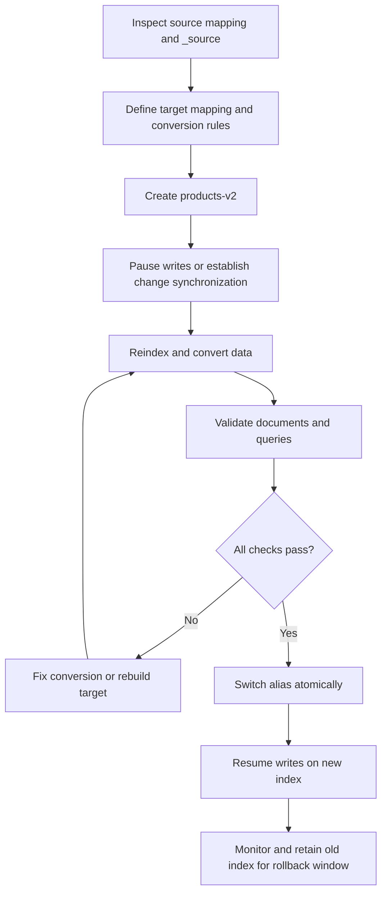

# Vì sao không thể đổi tùy ý kiểu trường đã lập chỉ mục

Trong Elasticsearch, mapping định nghĩa cách một field được hiểu và lập chỉ mục. Ví dụ `price` có thể được khai báo là `double`, `title` là `text`, `sku` là `keyword`, còn `publishedAt` là `date`. Những lựa chọn này không chỉ mô tả kiểu JSON. Chúng quyết định cách Elasticsearch phân tích, mã hóa, lưu trữ và tìm kiếm giá trị trong Lucene index.

Vì vậy, sau khi một field đã được lập chỉ mục với một kiểu dữ liệu, Elasticsearch thường không cho phép đổi trực tiếp field đó sang kiểu khác trên cùng index. Ví dụ không thể đổi `price` từ `keyword` sang `double` chỉ bằng cách gửi một mapping mới. Nếu cần thay đổi kiểu, cách phổ biến và an toàn là tạo index mới với mapping đích, chuyển dữ liệu bằng `_reindex` hoặc pipeline chuyển đổi, kiểm tra kết quả rồi chuyển ứng dụng sang index mới thông qua alias.

Trong Spring Data Elasticsearch, việc sửa `@Field(type = ...)` trên entity cũng không tự chuyển đổi index đang tồn tại. Annotation mô tả metadata cho mapping của ứng dụng; mapping thực tế đã được Elasticsearch áp dụng cho index vẫn giữ nguyên cho đến khi có một quy trình migration dữ liệu phù hợp.

## 1. Mapping không chỉ là khai báo kiểu JSON

Một document Elasticsearch được lưu dưới dạng JSON trong `_source`, nhưng Elasticsearch không chỉ giữ JSON rồi đọc tuần tự mỗi lần tìm kiếm. Khi index document, Elasticsearch sử dụng mapping để tạo cấu trúc dữ liệu phục vụ tìm kiếm, lọc, sắp xếp và aggregation.

Ví dụ một document sản phẩm:

```json
{
  "sku": "SKU-1001",
  "name": "Bàn phím cơ",
  "price": 185000,
  "available": true,
  "createdAt": "2025-03-12T10:30:00Z"
}
```

Mapping tương ứng có thể là:

```json
PUT /products
{
  "mappings": {
    "properties": {
      "sku": { "type": "keyword" },
      "name": { "type": "text" },
      "price": { "type": "double" },
      "available": { "type": "boolean" },
      "createdAt": { "type": "date" }
    }
  }
}
```

Các kiểu field tạo ra những cấu trúc index khác nhau:

- `text` thường được phân tích thành token bởi analyzer để hỗ trợ tìm kiếm toàn văn.
- `keyword` giữ giá trị như một term chính xác, thường phục vụ lọc, sort và aggregation.
- Kiểu số như `integer`, `long`, `float`, `double` dùng biểu diễn và cấu trúc phù hợp cho so sánh số, range query và sort.
- `date` chuyển giá trị thời gian về biểu diễn có thể truy vấn theo khoảng và sắp xếp.
- `boolean` lưu trạng thái đúng/sai theo semantics của kiểu boolean.
- `object` và `nested` có cách tổ chức field con khác nhau và ảnh hưởng trực tiếp đến query.

Mapping còn có thể xác định analyzer, normalizer, format ngày, doc values, index options và những tham số khác. Những lựa chọn này ảnh hưởng đến dữ liệu đã được lập chỉ mục, không đơn thuần là cách hiển thị JSON.

## 2. Vì sao kiểu field đã lập chỉ mục không thể đổi tùy ý?

Elasticsearch xây dựng Lucene index từ các document được ghi vào. Lucene lưu những cấu trúc chuyên biệt cho từng kiểu dữ liệu. Các cấu trúc này được tổ chức thành segment và không được thiết kế để tùy ý diễn giải lại toàn bộ dữ liệu cũ theo một mapping khác chỉ bằng một lệnh cập nhật metadata.

### 2.1 Kiểu dữ liệu quyết định cách index giá trị

Với `text`, analyzer có thể tách một chuỗi thành nhiều token, chuẩn hóa chữ hoa/thường, loại bỏ stop word hoặc áp dụng stemming. Khi document đã được index, Lucene đã tạo term dictionary và inverted index dựa trên các token đó.

Với `keyword`, toàn bộ giá trị thường được index như một term. Nếu đổi từ `keyword` sang `text`, Elasticsearch cần phân tích lại chuỗi thành token. Những token cần thiết không thể được tạo ra chỉ bằng cách đổi tên kiểu field trong mapping; phải đọc lại dữ liệu nguồn và lập chỉ mục lại.

Với số và ngày, Elasticsearch cần biểu diễn giá trị theo kiểu phù hợp để thực hiện range query, sort và aggregation. Một chuỗi `"185000"` được index như `keyword` không giống một số `185000` được index như `double`. Đổi mapping sang `double` không tự chuyển các term cũ thành giá trị số.

### 2.2 Doc values và cấu trúc phục vụ sort/aggregation

Nhiều kiểu field có thể sử dụng doc values để hỗ trợ sort và aggregation hiệu quả. Doc values được tạo trong quá trình index theo kiểu và cấu hình của field. Nếu field được index như `keyword`, cấu trúc doc values phản ánh semantics của chuỗi; nếu là `long` hoặc `double`, cấu trúc phản ánh giá trị số.

Việc đổi kiểu có thể đòi hỏi tạo lại cả inverted index lẫn doc values. Elasticsearch không thể tự suy ra và tái tạo mọi cấu trúc cần thiết cho dữ liệu lịch sử chỉ từ một yêu cầu cập nhật mapping.

### 2.3 Mapping phải nhất quán trên các document trong cùng index

Một field trong một index cần có semantics thống nhất. Nếu document đầu tiên khiến `price` được suy luận là `keyword`, các document tiếp theo gửi số vào cùng field có thể không còn phù hợp. Ngược lại, nếu field đã là `double`, một chuỗi không thể parse thành số sẽ gây lỗi mapping/parsing.

Elasticsearch không cho mỗi document tự định nghĩa một kiểu khác nhau cho cùng một field trong cùng index. Điều này giúp query trên index có ý nghĩa nhất quán: khi truy vấn `price` bằng range, Elasticsearch biết cần thực hiện so sánh số trên tất cả document có field đó.

### 2.4 Đổi mapping không đồng nghĩa chuyển đổi dữ liệu

Giả sử mapping hiện tại:

```json
"price": {
  "type": "keyword"
}
```

Ứng dụng muốn chuyển thành:

```json
"price": {
  "type": "double"
}
```

Nếu chỉ sửa metadata, các giá trị đã index vẫn được lưu trong Lucene theo cấu trúc cũ. Elasticsearch cần một bước đọc giá trị nguồn, chuyển đổi thành số, rồi index lại theo kiểu mới. Đó chính là lý do cần reindex hoặc một quy trình migration tương đương.

## 3. Ví dụ xung đột kiểu dữ liệu

Giả sử dynamic mapping được bật và document đầu tiên có:

```json
PUT /catalog/_doc/1
{
  "price": "185000"
}
```

Elasticsearch có thể suy luận `price` là `text` hoặc `keyword` tùy nội dung và quy tắc dynamic mapping. Sau đó ứng dụng gửi:

```json
PUT /catalog/_doc/2
{
  "price": 210000
}
```

Kiểu dữ liệu mới không nhất thiết tương thích với mapping đã tạo. Kết quả có thể là lỗi parsing hoặc mapping conflict. Không nên dựa vào dynamic mapping để xử lý một field có quy tắc kiểu không ổn định.

Kiểm tra mapping thực tế:

```http
GET /catalog/_mapping
```

Nếu kết quả cho thấy `price` là `keyword`, việc sửa entity thành `Double` không làm index đổi kiểu. Cần xác định dữ liệu hiện tại, mapping đích và quy trình chuyển đổi.

### 3.1 Các ví dụ thay đổi kiểu thường gặp

| Mapping hiện tại | Mapping mong muốn | Vì sao cần migration? |
|---|---|---|
| `keyword` | `double` | Cần parse chuỗi thành số và tạo lại cấu trúc index số |
| `text` | `keyword` | Cần index lại giá trị theo semantics chính xác, không phân tích token |
| `keyword` | `text` | Cần chạy analyzer trên dữ liệu cũ để tạo token |
| `long` | `date` | Cần xác định đơn vị timestamp/format và index lại theo kiểu date |
| `object` | `nested` | Cần xây dựng lại cấu trúc index để giữ quan hệ từng object con |
| `integer` | `long` | Cần tạo lại field theo kiểu số đích; không thể chỉ đổi mapping trên field đã index |

Ngay cả khi dữ liệu hiện tại có vẻ tương thích, chẳng hạn chuỗi chỉ chứa chữ số, việc đổi kiểu vẫn là thay đổi semantics và cấu trúc index. Hãy thực hiện migration thay vì giả định Elasticsearch sẽ tự chuyển đổi dữ liệu cũ.

## 4. Những thay đổi mapping nào có thể thực hiện?

Không phải mọi cập nhật mapping đều bị cấm. Elasticsearch cho phép mở rộng mapping trong nhiều trường hợp, nhưng không cho phép tùy ý đổi kiểu của field đã tồn tại.

### 4.1 Thêm field mới

Có thể thêm một field mới vào mapping:

```http
PUT /products/_mapping
{
  "properties": {
    "description": {
      "type": "text"
    }
  }
}
```

Sau khi mapping được cập nhật, các document mới có thể ghi `description`. Những document cũ không tự có giá trị cho field mới. Nếu cần dữ liệu lịch sử, phải cập nhật/reindex chúng theo một quy trình riêng.

### 4.2 Thêm multi-field cho field hiện có

Trong một số trường hợp, có thể thêm multi-field vào một field đã tồn tại. Ví dụ `name` đang là `text` và cần thêm sub-field `keyword` để sort hoặc aggregation:

```http
PUT /products/_mapping
{
  "properties": {
    "name": {
      "type": "text",
      "fields": {
        "raw": {
          "type": "keyword"
        }
      }
    }
  }
}
```

Mapping mới cho phép document được index sau đó ghi thêm giá trị vào `name.raw`. Tuy nhiên, các document đã tồn tại trước khi multi-field được thêm sẽ chưa có dữ liệu trong sub-field mới. Muốn sort/aggregate trên toàn bộ dữ liệu, cần chạy `_update_by_query` hoặc reindex để tạo lại giá trị sub-field từ `_source`.

Ví dụ cập nhật lại document cũ:

```http
POST /products/_update_by_query
{
  "query": {
    "exists": {
      "field": "name"
    }
  }
}
```

Thao tác này yêu cầu Elasticsearch đọc và index lại các document phù hợp để áp dụng mapping mới. Cần đánh giá tải, thời gian chạy và xung đột với ghi đồng thời trước khi thực hiện.

### 4.3 Thay đổi một số tham số không phải kiểu field

Một số mapping parameter có thể được cập nhật theo giới hạn của Elasticsearch; một số khác chỉ được thiết lập khi tạo field/index hoặc cần reindex để áp dụng cho dữ liệu lịch sử. Không thể suy luận rằng vì một tham số mapping cập nhật được nên mọi tham số khác cũng vậy.

Ví dụ, một số thiết lập liên quan đến search có thể thay đổi cho các truy vấn về sau, nhưng thay đổi analyzer dùng khi index không tự chạy lại analyzer trên các term đã lưu. Hãy kiểm tra tài liệu cho đúng field type và parameter cụ thể trước khi cập nhật.

### 4.4 Đổi tên field và field alias

Mapping không cung cấp thao tác đổi tên field theo nghĩa di chuyển dữ liệu cũ sang một tên mới. Có thể thêm field mới và chuyển đổi dữ liệu; trong một số trường hợp có thể dùng field alias để cung cấp tên thay thế trỏ tới một field hiện hữu.

Field alias không chuyển đổi kiểu dữ liệu, không tạo lại dữ liệu và có các giới hạn sử dụng riêng. Nó chỉ giúp một tên field khác tham chiếu tới field đã được index. Nếu cần đổi semantics hoặc kiểu dữ liệu, vẫn phải migration.

## 5. Vì sao sửa @Field trong Spring Data không đủ?

Trong Spring Data Elasticsearch, entity có thể khai báo:

```java
@Document(indexName = "products")
public class Product {

    @Id
    private String id;

    @Field(type = FieldType.Keyword)
    private String price;
}
```

Sau đó đội phát triển đổi thành:

```java
@Field(type = FieldType.Double)
private Double price;
```

Thay đổi này chỉ cập nhật metadata trong mã Java. Nó có thể ảnh hưởng tới mapping được sinh khi tạo một index mới, nhưng không tự sửa mapping của index `products` đã tồn tại trên cluster.

Khi ứng dụng khởi động và index đã tồn tại, Spring Data không thể tự chuyển đổi toàn bộ dữ liệu lịch sử từ chuỗi sang số chỉ bằng cách đọc annotation mới. Nếu cố áp dụng mapping không tương thích, Elasticsearch sẽ từ chối cập nhật hoặc thao tác ghi có thể thất bại vì dữ liệu và mapping không phù hợp.

### 5.1 Annotation là mô tả, mapping trên cluster là trạng thái thực tế

Hai nguồn cần được phân biệt:

| Nguồn | Vai trò |
|---|---|
| `@Document`, `@Field` | Metadata entity mà Spring Data sử dụng khi ánh xạ và tạo mapping |
| Mapping trong Elasticsearch | Quy tắc thực tế đã được index sử dụng để index và query |

Khi có khác biệt, mapping trên cluster quyết định cách Elasticsearch xử lý document. Vì vậy, sau khi thay đổi entity, cần kiểm tra `GET /index/_mapping` và xác định migration nếu kiểu field hiện hữu cần thay đổi.

### 5.2 IndexOperations không phải công cụ đổi kiểu field

Spring Data cung cấp `IndexOperations` để kiểm tra index, tạo index, đọc mapping, cập nhật mapping được phép và thực hiện các thao tác quản lý index.

Ví dụ:

```java
IndexOperations indexOps = operations.indexOps(Product.class);

if (!indexOps.exists()) {
    indexOps.create();
    indexOps.putMapping(indexOps.createMapping());
}
```

Đoạn code này minh họa tạo index và mapping khi index chưa tồn tại. `putMapping(...)` không phải API để chuyển đổi tùy ý một field đã có từ `keyword` sang `double`. Nếu mapping update vi phạm giới hạn của Elasticsearch, thao tác sẽ thất bại.

Với production, nên tách việc quản lý index/mapping thành migration hoặc deployment step có kiểm soát thay vì trông chờ ứng dụng tự thay đổi cấu trúc index mỗi lần khởi động.

## 6. Chiến lược chuẩn: tạo index mới và reindex

Khi cần thay đổi kiểu field, cách phổ biến là tạo một index mới với mapping đích, sau đó chuyển dữ liệu từ index cũ sang index mới. Quy trình này thường được gọi là index migration.

Giả sử index hiện tại là `products-v1`:

```json
{
  "properties": {
    "sku": { "type": "keyword" },
    "price": { "type": "keyword" }
  }
}
```

Ứng dụng muốn chuyển `price` sang `double`. Tạo index mới `products-v2`:

```http
PUT /products-v2
{
  "settings": {
    "number_of_shards": 1,
    "number_of_replicas": 1
  },
  "mappings": {
    "properties": {
      "sku": { "type": "keyword" },
      "price": { "type": "double" }
    }
  }
}
```

Settings ở trên chỉ là ví dụ. Index đích cần có settings, analyzers, mappings và các cấu hình cần thiết của index thật. API `_reindex` không tự sao chép toàn bộ settings, mapping hay alias từ index nguồn sang index đích; phải tạo index đích trước.

### 6.1 Reindex trực tiếp khi dữ liệu đã tương thích

Nếu `_source.price` của mọi document là chuỗi số hợp lệ, có thể reindex và chuyển đổi field bằng script:

```http
POST /_reindex
{
  "source": {
    "index": "products-v1"
  },
  "dest": {
    "index": "products-v2"
  },
  "script": {
    "lang": "painless",
    "source": "if (ctx._source.price != null) { ctx._source.price = Double.parseDouble(ctx._source.price.toString()); }"
  }
}
```

Script đọc giá trị cũ từ `_source`, chuyển sang `double` rồi ghi vào index đích. Nếu dữ liệu có chuỗi rỗng, dấu phân cách hàng nghìn, ký hiệu tiền tệ hoặc định dạng không chuẩn, script đơn giản này có thể thất bại. Cần phân tích dữ liệu thực tế và thiết kế quy tắc chuyển đổi có kiểm soát.

### 6.2 Xử lý dữ liệu không hợp lệ

Trước khi reindex, hãy xác định các giá trị không thể chuyển đổi. Ví dụ:

```json
[
  { "price": "185000" },
  { "price": "210000.50" },
  { "price": "unknown" },
  { "price": "" },
  { "price": null }
]
```

Ứng dụng cần quyết định rõ cách xử lý từng trường hợp:

- Chuỗi số hợp lệ: chuyển thành số.
- Chuỗi rỗng: chuyển thành `null`, bỏ field hoặc đưa vào danh sách lỗi tùy nghiệp vụ.
- Chuỗi không hợp lệ: sửa dữ liệu nguồn, cách ly document hoặc dừng migration.
- `null`/field vắng mặt: giữ nguyên semantics tương ứng.

Không nên âm thầm chuyển mọi giá trị không hợp lệ thành `0`. Điều đó có thể làm sai báo cáo, sort và range query mà không để lại dấu hiệu rõ ràng.

Một script có kiểm tra có thể đánh dấu document lỗi:

```http
POST /_reindex
{
  "source": {
    "index": "products-v1"
  },
  "dest": {
    "index": "products-v2"
  },
  "script": {
    "lang": "painless",
    "source": "if (ctx._source.price != null) { def raw = ctx._source.price.toString().trim(); if (raw == '') { ctx._source.remove('price'); } else { try { ctx._source.price = Double.parseDouble(raw); } catch (Exception e) { ctx._source.migrationError = 'INVALID_PRICE'; ctx._source.remove('price'); } } }"
  }
}
```

Đây chỉ là ví dụ về cách biểu đạt chính sách. Trong migration thực tế, không nên tự ý bỏ field và tiếp tục nếu nghiệp vụ yêu cầu bảo toàn giá trị. Có thể cần ghi lỗi ra một index kiểm tra riêng, dùng ingest pipeline hoặc xử lý dữ liệu trước khi reindex. Hãy xác định cách xử lý document lỗi trước khi chạy trên dữ liệu thật.

### 6.3 Chạy reindex bất đồng bộ và theo dõi task

Với dữ liệu lớn, có thể yêu cầu reindex chạy bất đồng bộ:

```http
POST /_reindex?wait_for_completion=false
{
  "source": {
    "index": "products-v1"
  },
  "dest": {
    "index": "products-v2"
  }
}
```

Response trả về task ID. Có thể theo dõi:

```http
GET /_tasks/<task_id>
```

Task response cung cấp tiến độ, số document đã xử lý, lỗi và trạng thái hoàn thành. Với workload lớn, có thể xem xét slicing, throttling và giới hạn batch size để kiểm soát tài nguyên. Không nên chạy nhiều reindex lớn cùng lúc nếu cluster không đủ khả năng xử lý.

### 6.4 Reindex không tự đồng bộ các thay đổi phát sinh sau snapshot

`_reindex` đọc document nguồn theo một góc nhìn tại thời điểm bắt đầu tác vụ. Nếu ứng dụng vẫn ghi vào `products-v1` trong khi reindex đang chạy, các cập nhật phát sinh sau khi snapshot được tạo có thể không có trong `products-v2`.

Đây là điểm quan trọng của cutover. Một lần reindex hoàn tất không tự chứng minh index đích đã nhận mọi thay đổi mới nhất nếu nguồn vẫn tiếp tục được ghi.

Có hai cách triển khai phổ biến:

1. **Tạm dừng ghi:** dừng hoặc khóa các luồng ghi, chạy reindex, xác nhận dữ liệu, chuyển alias rồi mở ghi lại trên index mới. Đây là cách đơn giản, dễ kiểm soát nhưng có downtime ghi.
2. **Đồng bộ thay đổi trong lúc migration:** dùng dual-write hoặc một cơ chế change capture/replay để đưa mọi thay đổi phát sinh sau snapshot vào index đích, sau đó dừng ghi trong khoảng cutover ngắn và xác nhận không còn thay đổi chưa đồng bộ. Cách này giảm downtime nhưng phức tạp hơn và cần xử lý idempotency, thứ tự cập nhật, delete và lỗi từng đích ghi.

Không nên chuyển alias khi chưa có kế hoạch cho các write phát sinh trong lúc reindex.

## 7. Dùng alias để chuyển index mà không đổi tên logic trong ứng dụng

Thay vì để ứng dụng kết nối trực tiếp tới `products-v1`, nên dùng alias ổn định như `products`. Alias trỏ tới index vật lý hiện tại. Khi migration hoàn tất, alias có thể được chuyển sang index mới bằng một thao tác `_aliases` nguyên tử.

### 7.1 Tạo alias ban đầu

```http
POST /_aliases
{
  "actions": [
    {
      "add": {
        "index": "products-v1",
        "alias": "products"
      }
    }
  ]
}
```

Ứng dụng cấu hình `indexName = "products"`. Khi alias trỏ tới `products-v1`, mọi request qua tên `products` đi tới index đó.

### 7.2 Chuyển alias sau khi index mới sẵn sàng

Sau khi `products-v2` đã được reindex, refresh và kiểm tra, chuyển alias:

```http
POST /_aliases
{
  "actions": [
    {
      "remove": {
        "index": "products-v1",
        "alias": "products"
      }
    },
    {
      "add": {
        "index": "products-v2",
        "alias": "products",
        "is_write_index": true
      }
    }
  ]
}
```

Các action trong cùng một aliases request được áp dụng như một thay đổi metadata nguyên tử. Ứng dụng tiếp tục dùng tên `products`; không cần đổi mọi nơi trong code sang `products-v2`.

Nếu alias trỏ tới nhiều index để phục vụ đọc, cần cấu hình write index rõ ràng trước khi ghi qua alias. Một alias không có write index duy nhất có thể khiến thao tác ghi thất bại hoặc mơ hồ tùy cấu hình.

### 7.3 Rollback cần xét các write sau cutover

Giữ `products-v1` trong một khoảng thời gian giúp có thể quay lại nếu phát hiện lỗi đọc sau migration. Tuy nhiên, nếu ứng dụng đã ghi dữ liệu mới vào `products-v2`, chỉ chuyển alias ngược về `products-v1` sẽ làm các write sau cutover biến mất khỏi góc nhìn ứng dụng.

Vì vậy, rollback phải có chiến lược dữ liệu: dừng ghi và đồng bộ ngược, replay event, hoặc chấp nhận một cửa sổ mất dữ liệu được nghiệp vụ phê duyệt. Không xóa index cũ ngay sau khi chuyển alias; nhưng cũng không giả định giữ index cũ là đủ để rollback an toàn.

## 8. Quy trình migration đầy đủ

Một migration thay đổi kiểu field có thể tổ chức theo các giai đoạn sau:



### 8.1 Khảo sát nguồn

Trước khi tạo index mới, hãy kiểm tra:

- Mapping hiện tại bằng `GET /products-v1/_mapping`.
- Settings và analyzer bằng `GET /products-v1/_settings`.
- `_source` có được bật và có chứa field cần chuyển đổi không.
- Dữ liệu thực tế có giá trị không hợp lệ hoặc nhiều định dạng khác nhau không.
- Query, sort, aggregation, ingest pipeline và ứng dụng nào đang phụ thuộc field cũ.
- Có routing, parent-child hoặc alias filter cần bảo toàn không.

Nếu `_source` bị tắt hoặc field bị loại khỏi `_source`, khả năng reindex/chuyển đổi có thể bị hạn chế vì dữ liệu gốc không còn đầy đủ để tái tạo. Cần xác định nguồn dữ liệu chuẩn khác trước khi migration.

### 8.2 Thiết kế mapping đích

Mapping đích cần phản ánh kiểu dữ liệu đúng và các query pattern dự kiến. Không chỉ đổi `price` sang `double`; hãy kiểm tra analyzer, multi-field, nested, dynamic mapping, doc values và các field liên quan.

Ví dụ entity Spring Data mới:

```java
@Document(indexName = "products")
public class Product {

    @Id
    private String id;

    @Field(type = FieldType.Keyword)
    private String sku;

    @Field(type = FieldType.Double)
    private Double price;
}
```

`indexName` dùng alias ổn định `products`. Trong migration, index vật lý mới là `products-v2`; alias sẽ trỏ tới index đó sau cutover. Tên field và kiểu Java cần khớp với mapping đích.

### 8.3 Tạo index đích trước khi reindex

Tạo `products-v2` với settings và mapping đầy đủ. Không dựa vào `_reindex` để tự sao chép cấu trúc index nguồn. Nếu cần analyzer tùy chỉnh, khai báo analyzer trong settings trước khi tạo mapping field sử dụng analyzer đó.

### 8.4 Chuyển đổi dữ liệu

Chọn một trong các cơ chế phù hợp:

- `_reindex` trực tiếp nếu `_source` đã có cấu trúc phù hợp.
- `_reindex` kèm Painless script nếu cần chuyển đổi đơn giản tại chỗ.
- Ingest pipeline nếu logic chuyển đổi có thể được mô tả bằng processor.
- Job ứng dụng hoặc ETL riêng nếu cần validation phức tạp, tra cứu dữ liệu tham chiếu hoặc cách ly lỗi.

Hãy lưu lại số lượng document thành công, lỗi và các document bị bỏ qua. Không chỉ nhìn trạng thái task là `completed`; cần xem phần `failures` và kết quả thực tế.

### 8.5 Kiểm tra index đích

Sau khi reindex, refresh index đích rồi kiểm tra:

```http
POST /products-v2/_refresh
GET /products-v2/_count
GET /products-v2/_mapping
```

So sánh số document nguồn và đích theo điều kiện migration. Nếu có document lỗi hoặc bị lọc, giải thích chênh lệch. Kiểm tra các mẫu giá trị biên: null, số âm nếu hợp lệ, số thập phân, giá trị lớn, chuỗi rỗng và dữ liệu legacy.

Chạy các query quan trọng trên index đích: exact match, range query, sort, aggregation và query method từ ứng dụng. Chỉ so sánh số lượng document là chưa đủ; cần xác nhận semantics của query đã đúng với kiểu mới.

### 8.6 Cutover và theo dõi

Khi index đích đạt yêu cầu và các thay đổi ghi đã được đồng bộ, chuyển alias. Sau đó kiểm tra ứng dụng qua alias, theo dõi lỗi mapping, conversion exception, latency và kết quả nghiệp vụ. Giữ index cũ trong khoảng rollback đã xác định; xóa sau khi đã xác nhận an toàn và hoàn tất chính sách lưu trữ.

## 9. Cách tiếp cận từ Spring Data Elasticsearch

Spring Data cung cấp `IndexOperations` để thao tác index và mapping. Nhưng migration thay đổi kiểu field thường vượt quá một lệnh `putMapping`; nó cần tạo index mới, chuyển dữ liệu và chuyển alias.

### 9.1 Kiểm tra và tạo index bằng IndexOperations

```java
import org.springframework.data.elasticsearch.core.ElasticsearchOperations;
import org.springframework.data.elasticsearch.core.IndexOperations;

public class ProductIndexSetup {

    private final ElasticsearchOperations operations;

    public ProductIndexSetup(ElasticsearchOperations operations) {
        this.operations = operations;
    }

    public void createIndexIfMissing() {
        IndexOperations indexOps = operations.indexOps(Product.class);

        if (!indexOps.exists()) {
            indexOps.create();
            indexOps.putMapping(indexOps.createMapping());
        }
    }
}
```

Đây là ví dụ tạo index từ metadata entity. Trong hệ thống có migration riêng, nên tách việc tạo index phiên bản mới khỏi startup thông thường của ứng dụng. Cần bảo đảm mapping được tạo đúng trước khi ghi dữ liệu.

### 9.2 Không dùng putMapping để đổi kiểu field

Ví dụ sau không phải cách hợp lệ để đổi field đã tồn tại từ `keyword` sang `double`:

```java
Map<String, Object> mapping = Map.of(
    "properties", Map.of(
        "price", Map.of("type", "double")
    )
);

indexOps.putMapping(mapping);
```

`putMapping` có thể dùng cho các cập nhật mapping được Elasticsearch cho phép, chẳng hạn thêm field. Nếu field `price` đã có kiểu `keyword`, cập nhật thành `double` sẽ bị từ chối. Hãy tạo index đích với mapping mới rồi reindex.

### 9.3 Ứng dụng sử dụng alias

Entity có thể khai báo index name là alias ổn định:

```java
@Document(indexName = "products")
public class Product {
    // fields
}
```

Alias `products` trỏ tới index vật lý đang hoạt động. Việc chuyển alias là thao tác quản trị cluster, có thể thực hiện bằng REST API hoặc công cụ migration. Sau khi chuyển, repository tiếp tục dùng cùng alias.

Điều này giảm coupling giữa ứng dụng và tên index phiên bản. Ứng dụng không cần thay `@Document(indexName = "products-v1")` thành `products-v2` trong mỗi lần migration.

## 10. Các lựa chọn thay thế khi chưa thể reindex ngay

Không phải lúc nào cũng có thể thực hiện migration ngay lập tức. Một số cách có thể giúp chuyển tiếp, nhưng chúng không thay thế hoàn toàn việc tạo lại index khi cần đổi kiểu.

### 10.1 Tạo field mới với tên khác

Có thể giữ field cũ và thêm field mới:

```json
{
  "price": "185000",
  "priceNumeric": 185000
}
```

Mapping:

```json
{
  "properties": {
    "price": { "type": "keyword" },
    "priceNumeric": { "type": "double" }
  }
}
```

Ứng dụng có thể ghi đồng thời cả hai field trong giai đoạn chuyển tiếp. Sau khi dữ liệu cũ được backfill, query mới chuyển sang `priceNumeric`. Cách này có thể thực hiện trong cùng index vì đây là field mới, không phải đổi kiểu field cũ.

### 10.2 Runtime field

Runtime field cho phép tính giá trị khi query thay vì lưu và index lại giá trị theo cấu trúc mới. Ví dụ một runtime field có thể parse chuỗi số từ `_source` thành giá trị số để hỗ trợ một số query hoặc aggregation.

Runtime field hữu ích cho thử nghiệm, chuyển tiếp hoặc trường hợp không thể reindex ngay. Tuy nhiên, nó có chi phí tính toán khi truy vấn và không tương đương với field số đã được index đầy đủ. Nếu dùng thường xuyên cho range query/sort/aggregation trên lượng dữ liệu lớn, nên cân nhắc tạo field/index vật lý đúng kiểu.

### 10.3 Field alias

Field alias có thể cung cấp tên thay thế cho field hiện hữu, giúp tương thích tên trong một số query. Nó không chuyển dữ liệu từ kiểu cũ sang kiểu mới và không sửa semantics của field đích.

### 10.4 Chuyển đổi ở tầng ứng dụng

Ứng dụng có thể parse chuỗi thành số sau khi đọc từ Elasticsearch, nhưng điều đó chỉ chuyển đổi giá trị trong Java. Nó không làm cho Elasticsearch thực hiện range query, sort hoặc aggregation số trên field `keyword`. Nếu chức năng tìm kiếm cần semantics số, mapping index vẫn cần field số.

## 11. Những sai lầm thường gặp

### 11.1 Chỉ sửa annotation rồi khởi động lại ứng dụng

Annotation mới không tự migrate index hiện có. Hãy kiểm tra mapping trên cluster và thực hiện index migration nếu kiểu field cần thay đổi.

### 11.2 Cho rằng update mapping sẽ parse lại `_source`

Update mapping thay đổi metadata theo các quy tắc được hỗ trợ; nó không đọc lại toàn bộ `_source` để tạo cấu trúc index mới cho field đã tồn tại.

### 11.3 Reindex nhưng không tạo mapping đích

Nếu index đích được tạo tự động bằng dynamic mapping, giá trị đầu tiên có thể khiến field được suy luận sai kiểu một lần nữa. Tạo index đích với mapping tường minh trước khi chạy reindex.

### 11.4 Reindex trong lúc vẫn ghi vào index nguồn rồi chuyển alias ngay

Các write phát sinh sau snapshot reindex có thể không xuất hiện ở đích. Cần tạm dừng ghi hoặc đồng bộ thay đổi trong migration trước cutover.

### 11.5 Chỉ so sánh document count

Hai index có cùng số document vẫn có thể khác giá trị, mapping hoặc kết quả query. Kiểm tra dữ liệu đại diện, trường chuyển đổi, query, sort và aggregation.

### 11.6 Dùng giá trị mặc định để che dữ liệu lỗi

Chuyển mọi chuỗi không parse được thành `0`, ngày không hợp lệ thành ngày hiện tại hoặc trạng thái không rõ thành `false` làm mất thông tin và có thể gây sai nghiệp vụ. Hãy có quy tắc xử lý lỗi rõ ràng.

### 11.7 Xóa index cũ ngay sau cutover

Giữ index cũ trong rollback window, nhưng cần tính tới các write đã phát sinh trên index mới. Rollback phải có chiến lược đồng bộ dữ liệu, không chỉ chuyển alias ngược.

## 12. Checklist trước khi đổi kiểu field

Trước khi triển khai migration, hãy xác nhận:

- Mapping thực tế và settings của index nguồn đã được đọc.
- Dữ liệu `_source` có đầy đủ để tái tạo field đích.
- Các định dạng dữ liệu cũ đã được thống kê và có quy tắc chuyển đổi.
- Mapping đích được thiết kế tường minh, gồm settings/analyzer cần thiết.
- Index đích được tạo trước khi reindex.
- Kế hoạch xử lý document lỗi, null, field thiếu và giá trị biên đã rõ.
- Kế hoạch ghi đồng thời trong lúc reindex đã được chọn.
- Task reindex, failures, throttling và tiến độ được theo dõi.
- Validation gồm count, dữ liệu mẫu, query, sort và aggregation.
- Alias có write index phù hợp và cutover được thực hiện có kiểm soát.
- Kế hoạch rollback tính tới write phát sinh sau cutover.
- Index cũ chỉ được xóa sau khi hết rollback window và có xác nhận an toàn.

## 13. Kết luận

Kiểu field trong Elasticsearch quyết định cách dữ liệu được phân tích và tổ chức trong Lucene index. Khi field đã được lập chỉ mục, thay đổi kiểu có thể đòi hỏi tạo lại inverted index, doc values và những cấu trúc liên quan từ dữ liệu nguồn. Vì vậy, Elasticsearch cho phép nhiều kiểu cập nhật mapping như thêm field mới, nhưng không cho đổi tùy ý kiểu của field đã tồn tại.

Trong Spring Data Elasticsearch, sửa `@Field(type = ...)` chỉ cập nhật metadata của ứng dụng; nó không tự chuyển đổi index trên cluster. Khi cần thay đổi kiểu, hãy tạo index mới với mapping đích, chuyển đổi dữ liệu bằng reindex hoặc pipeline phù hợp, xử lý write phát sinh trong migration, kiểm tra kết quả và chuyển alias. Cách tiếp cận này giữ mapping nhất quán, làm rõ cách dữ liệu lịch sử được chuyển đổi và cho phép cutover/rollback có kế hoạch.

## Tài liệu tham khảo

- [Elasticsearch — Update mapping API](https://www.elastic.co/guide/en/elasticsearch/reference/current/indices-put-mapping.html)
- [Elasticsearch — Reindex documents](https://www.elastic.co/guide/en/elasticsearch/reference/current/docs-reindex.html)
- [Elasticsearch — Index aliases](https://www.elastic.co/guide/en/elasticsearch/reference/current/aliases.html)
- [Spring Data Elasticsearch — Index operations](https://docs.spring.io/spring-data/elasticsearch/reference/elasticsearch/misc.html)
